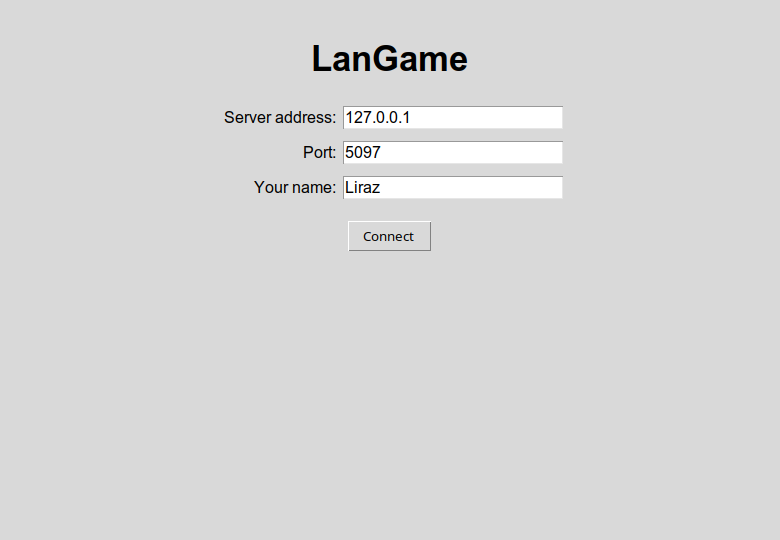
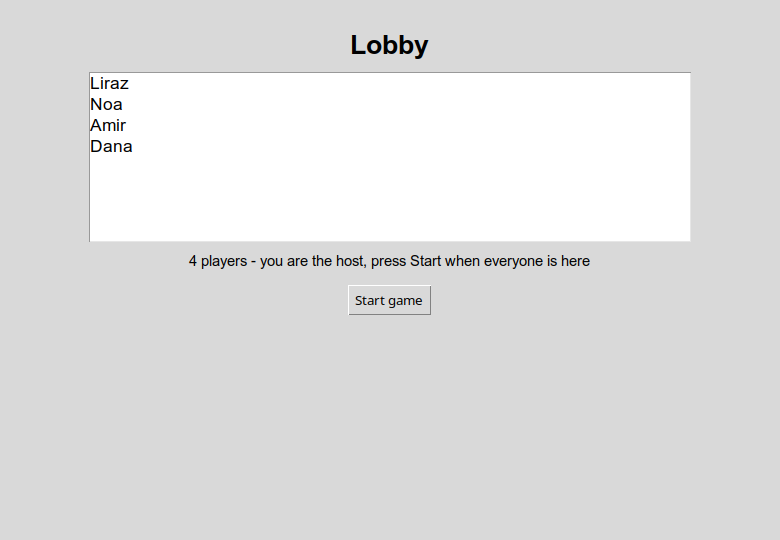
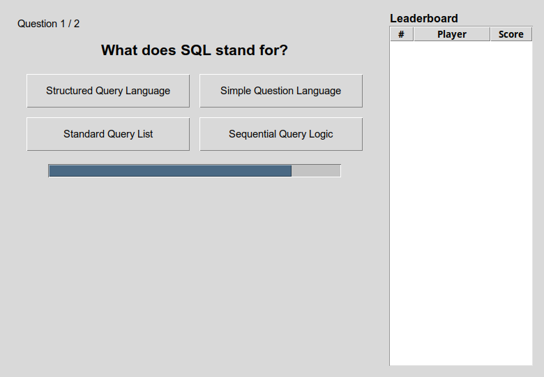
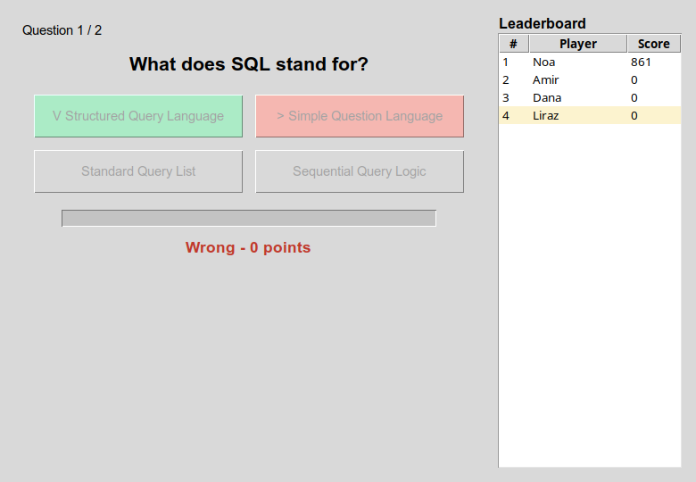
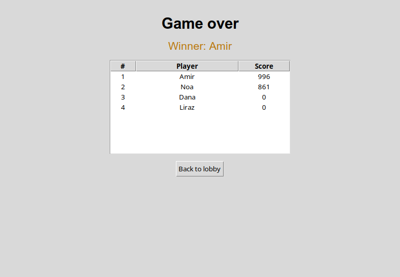
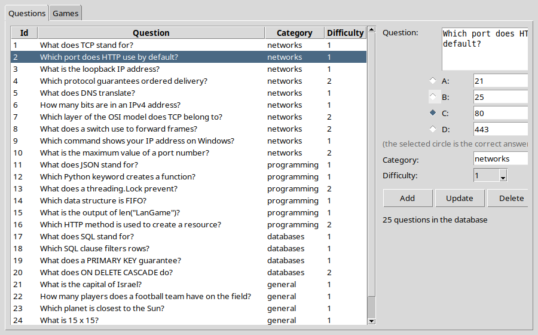

# LanGame — walkthrough

Every function you write in this project (86 of them), in the order of `TASKS.md`. For each one:

- **Problem** — what the function has to do,
- **Solution** — the finished code,
- **Check** — the test that proves it works.

Try each function yourself first, then compare. Run the check after every function, not at the end.

## Contents

- [Stage 1 — Protocol and infrastructure](#stage-1--protocol-and-infrastructure) (3 functions)
- [Stage 2 — Server and lobby](#stage-2--server-and-lobby) (17 functions)
- [Stage 3 — Database and questions](#stage-3--database-and-questions) (11 functions)
- [Stage 4 — State machine and scoring](#stage-4--state-machine-and-scoring) (11 functions)
- [Stage 5 — Graphical client](#stage-5--graphical-client) (29 functions)
- [Stage 6 — Admin tool and persistence](#stage-6--admin-tool-and-persistence) (14 functions)
- [Stage 7 — Load test, network analysis, documentation](#stage-7--load-test-network-analysis-documentation) (1 functions)
- [The finished project](#the-finished-project)

## Stage 1 — Protocol and infrastructure

### `langame/common/protocol.py`

#### `Message.to_wire()`

**Problem.** Turn a message into bytes ready to send: one JSON object {"type", "payload"} followed by a newline, encoded as UTF-8. Keep Hebrew readable (ensure_ascii=False).

**Solution.**

```python
def to_wire(self) -> bytes:
    text = json.dumps({"type": self.type.value, "payload": self.payload}, ensure_ascii=False)
    return (text + config.MESSAGE_DELIMITER).encode(config.ENCODING)
```

**Check.** `pytest tests/test_protocol.py -k "test_round_trip or test_wire_ends_with_delimiter or test_hebrew_survives or test_buffer_splits_glued_messages"`

#### `Message.from_wire(line)`

**Problem.** Turn one received line back into a Message. Invalid JSON, a missing or unknown type, or a payload that is not a dict raises ProtocolError - never a raw json or KeyError. The server must survive garbage from any client.

**Solution.**

```python
@classmethod
def from_wire(cls, line: str) -> "Message":
    try:
        data = json.loads(line)
    except (json.JSONDecodeError, TypeError) as exc:
        raise ProtocolError("bad_json", f"not valid JSON: {exc}") from None
    if not isinstance(data, dict) or "type" not in data:
        raise ProtocolError("bad_message", "the message has no 'type'")
    try:
        kind = MessageType(data["type"])
    except (ValueError, TypeError):
        raise ProtocolError("unknown_type", f"unknown message type {data['type']!r}") from None
    if not isinstance(data.get("payload"), dict):
        raise ProtocolError("bad_payload", "'payload' must be a JSON object")
    return cls(kind, data["payload"])
```

**Check.** `pytest tests/test_protocol.py -k "test_round_trip or test_hebrew_survives or test_malformed_raises_protocol_error"`

#### `MessageBuffer.feed(chunk)`

**Problem.** TCP is a stream: two messages can arrive glued together, or one can arrive in two pieces. Add the new bytes to what is pending, cut at every newline, return the complete messages and keep the unfinished end for next time. Anything longer than the size limit raises ProtocolError.

**Solution.**

```python
def feed(self, chunk: bytes) -> List[Message]:
    self._pending += chunk
    delimiter = config.MESSAGE_DELIMITER.encode(config.ENCODING)
    *lines, rest = self._pending.split(delimiter)
    if len(rest) > config.MAX_MESSAGE_BYTES or any(len(line) > config.MAX_MESSAGE_BYTES for line in lines):
        self._pending = b""
        raise ProtocolError("too_large", f"message longer than {config.MAX_MESSAGE_BYTES} bytes")
    self._pending = rest
    messages = []
    for line in lines:
        if not line.strip():
            continue
        try:
            text = line.decode(config.ENCODING)
        except UnicodeDecodeError:
            raise ProtocolError("bad_encoding", f"message is not valid {config.ENCODING}") from None
        messages.append(Message.from_wire(text))
    return messages
```

**Check.** `pytest tests/test_protocol.py -k "test_buffer_splits_glued_messages or test_buffer_reassembles_split_message or test_buffer_rejects_oversized_message"`


## Stage 2 — Server and lobby

### `langame/server/client_handler.py`

#### `ClientHandler.run()`

**Problem.** The thread of one client: receive bytes, cut them into messages and dispatch each one. A garbage message gets an ERROR reply and the thread keeps serving; a closed connection ends the loop and always closes the handler.

**Solution.**

```python
def run(self) -> None:
    self.conn.settimeout(config.SOCKET_TIMEOUT_SECONDS)
    try:
        while self._alive:
            try:
                chunk = self.conn.recv(config.RECV_BUFFER_SIZE)
            except socket.timeout:
                continue
            except OSError:
                break
            if not chunk:
                break                                   # the client closed the connection
            try:
                for message in self._buffer.feed(chunk):
                    self._dispatch(message)
            except ProtocolError as exc:
                log.warning("bad message from %s: %s", self.address, exc)
                self.send(error(exc.code, str(exc)))     # tell the client, keep serving
    finally:
        self.close()
```

**Check.** No unit test - run the program and look (see the stage's exit condition in `TASKS.md`).

#### `ClientHandler._dispatch(message)`

**Problem.** Turn a message into a Command and let the engine execute it. A bad payload gets an ERROR reply. The handler never decides game rules itself.

**Solution.**

```python
def _dispatch(self, message: Message) -> None:
    try:
        command = build_command(message, self)
    except ProtocolError as exc:
        self.send(error(exc.code, str(exc)))
        return
    self.engine.execute(command)
```

**Check.** No unit test - run the program and look (see the stage's exit condition in `TASKS.md`).

#### `ClientHandler.send(message)`

**Problem.** Send a message to this client under its send lock (two threads may send at once). On a network error return False instead of raising - the caller may be broadcasting to everyone.

**Solution.**

```python
def send(self, message: Message) -> bool:
    with self._send_lock:
        if not self._alive:
            return False
        try:
            self.conn.sendall(message.to_wire())
            return True
        except OSError:
            self._alive = False
            return False
```

**Check.** No unit test - run the program and look (see the stage's exit condition in `TASKS.md`).

#### `ClientHandler.close()`

**Problem.** Close the handler once (calling it again does nothing): tell the engine the player left, close the socket and remove the handler from the server.

**Solution.**

```python
def close(self) -> None:
    with self._send_lock:
        if getattr(self, "_closed", False):
            return
        self._closed = True
        self._alive = False
    name = self.player_name
    if name is not None:
        self.engine.player_left(name)
    try:
        self.conn.shutdown(socket.SHUT_RDWR)
    except OSError:
        pass
    try:
        self.conn.close()
    except OSError:
        pass
    server = getattr(self, "server", None) or getattr(self.engine, "server", None)
    if server is not None:
        server.remove_handler(self)
    log.info("%s (%s) disconnected", self.address, name or "not joined")
```

**Check.** No unit test - run the program and look (see the stage's exit condition in `TASKS.md`).

### `langame/server/commands.py`

#### `JoinCommand.execute(engine)`

**Problem.** Accept a new player only in the lobby, with a name of 1-16 characters that is not taken, while there is room. Otherwise return an ERROR with a code like "name_taken", "game_started" or "full".

**Solution.**

```python
def execute(self, engine) -> Optional[Message]:
    name = (self.name or "").strip()
    if self.handler.player_name is not None:
        return error("already_joined", "you have already joined")
    if engine.state is not GameState.LOBBY:
        return error("game_started", "the game has already started - wait for the next one")
    if not name or len(name) > config.PLAYER_NAME_MAX_LENGTH:
        return error("bad_name", f"the name must be 1-{config.PLAYER_NAME_MAX_LENGTH} characters")
    if name in engine.players:
        return error("name_taken", f"the name '{name}' is already taken")
    if len(engine.connected_players()) >= config.MAX_PLAYERS:
        return error("full", f"the game is full ({config.MAX_PLAYERS} players)")
    engine.add_player(name, self.handler)
    return None
```

**Check.** `pytest tests/test_game_engine.py -k "test_join_adds_player_and_broadcasts_lobby or test_duplicate_name_is_rejected or test_answer_in_lobby_is_rejected or test_second_answer_is_rejected"`

#### `LeaveCommand.execute(engine)`

**Problem.** Tell the engine this player left.

**Solution.**

```python
def execute(self, engine) -> Optional[Message]:
    engine.player_left(self.handler.player_name)
    return None
```

**Check.** `pytest tests/test_game_engine.py -k "test_join_adds_player_and_broadcasts_lobby or test_duplicate_name_is_rejected or test_answer_in_lobby_is_rejected or test_second_answer_is_rejected"`

#### `build_command(message, handler)`

**Problem.** Turn a message into the matching Command (JOIN, ANSWER, LEAVE, START_GAME). Missing or wrongly typed fields raise ProtocolError("bad_payload"); any other type raises ProtocolError("unexpected_type").

**Solution.**

```python
def build_command(message: Message, handler) -> Command:
    payload = message.payload
    if message.type is MessageType.JOIN:
        name = payload.get("name")
        if not isinstance(name, str):
            raise ProtocolError("bad_payload", "JOIN needs a string 'name'")
        return JoinCommand(handler, name)
    if message.type is MessageType.ANSWER:
        question_id, choice = payload.get("question_id"), payload.get("choice")
        if not isinstance(question_id, int) or isinstance(question_id, bool) \
                or not isinstance(choice, int) or isinstance(choice, bool):
            raise ProtocolError("bad_payload", "ANSWER needs integer 'question_id' and 'choice'")
        return AnswerCommand(handler, question_id, choice)
    if message.type is MessageType.LEAVE:
        return LeaveCommand(handler)
    if message.type is MessageType.START_GAME:
        return StartGameCommand(handler)
    raise ProtocolError("unexpected_type", f"a client may not send {message.type.value}")
```

**Check.** No unit test - run the program and look (see the stage's exit condition in `TASKS.md`).

### `langame/server/game_engine.py`

**Helper code in this file** (used by the functions below, not a TODO in your skeleton):

`GameEngine._schedule`

```python
def _schedule(self, seconds: float, action) -> threading.Timer:
        timer = threading.Timer(seconds, action)
        timer.daemon = True
        timer.start()
        return timer
```

`GameEngine._pick_new_host`

```python
def _pick_new_host(self) -> None:
        connected = self.connected_players()
        self.host_name = connected[0].name if connected else None
        if self.host_name and self.host_name in self.handlers:
            self.handlers[self.host_name].send(Message(MessageType.WELCOME, {"name": self.host_name, "is_host": True}))
```

`GameEngine._reset_to_lobby`

```python
def _reset_to_lobby(self) -> None:
        """After a game: forget who left, keep who is still here, ready for a new game."""
        self.players = {n: p for n, p in self.players.items() if p.connected}
        for player in self.players.values():
            player.score = 0
        if self.host_name not in self.players:
            self._pick_new_host()
        self.current_question = None
        self.question_number = 0
        self.answers = {}
        self.history = []
        self.started_at = None
        self.state = GameState.LOBBY
        self.server.broadcast(Message(MessageType.LOBBY_UPDATE, self.lobby_payload()))
```

`GameEngine._abandon_game`

```python
def _abandon_game(self) -> None:
        if self._question_timer is not None:
            self._question_timer.cancel()
            self._question_timer = None
        self.state = GameState.LOBBY                             # pending timers see LOBBY and do nothing
        self._reset_to_lobby()
```

`GameEngine.save_in_progress`

```python
def save_in_progress(self) -> None:
        with self._lock:
            if self.state in (GameState.QUESTION, GameState.SCORING) and self.history:
                if self._question_timer is not None:
                    self._question_timer.cancel()
                board = build_leaderboard(self.players)
                try:
                    GameRepository().save_game(datetime.fromtimestamp(self.started_at or time.time()), datetime.now(),
                                               self.question_number, self.time_limit, self.category,
                                               board[0].name if board else None, self.players, self.history)
                except Exception:
                    log.exception("could not save the interrupted game")
            self.state = GameState.GAME_OVER
```

#### `GameEngine.execute(command)`

**Problem.** Run a command under the engine lock and send its ERROR reply (if any) back to that client. Log every command.

**Solution.**

```python
def execute(self, command) -> None:
    with self._lock:
        reply = command.execute(self)
        log.info("%s from %s (state %s)%s", type(command).__name__, command.handler.player_name,
                 self.state.value, f" -> {reply.payload.get('code')}" if reply is not None else "")
    if reply is not None:
        command.handler.send(reply)
```

**Check.** `pytest tests/test_game_engine.py -k "test_join_adds_player_and_broadcasts_lobby or test_duplicate_name_is_rejected or test_answer_in_lobby_is_rejected or test_second_answer_is_rejected"`

#### `GameEngine.add_player(name, handler)`

**Problem.** Add the player, remember its handler, make the first player the host, send it WELCOME and send everyone the updated lobby.

**Solution.**

```python
def add_player(self, name: str, handler) -> None:
    self.players[name] = Player(name, handler.address)
    self.handlers[name] = handler
    handler.player_name = name
    if self.host_name is None:
        self.host_name = name
    handler.send(Message(MessageType.WELCOME, {"name": name, "is_host": self.host_name == name}))
    self.server.broadcast(Message(MessageType.LOBBY_UPDATE, self.lobby_payload()))
```

**Check.** No unit test - run the program and look (see the stage's exit condition in `TASKS.md`).

#### `GameEngine.player_left(name)`

**Problem.** A player disconnected: in the lobby remove them (and choose a new host if needed) and update the lobby; during a game keep their score, and close the question early if everyone still here has answered. Never crash.

**Solution.**

```python
def player_left(self, name: Optional[str]) -> None:
    with self._lock:
        if name is None or name not in self.players:
            return
        self.players[name].connected = False
        self.handlers.pop(name, None)
        log.info("%s left (state %s)", name, self.state.value)
        if self.state in (GameState.LOBBY, GameState.GAME_OVER):
            del self.players[name]
            if self.host_name == name:
                self._pick_new_host()
            self.server.broadcast(Message(MessageType.LOBBY_UPDATE, self.lobby_payload()))
            return
        if not self.connected_players():
            log.info("everybody left - abandoning the game")
            self._abandon_game()
            return
        if self.host_name == name:
            self._pick_new_host()
        if self.state is GameState.QUESTION and all(p.name in self.answers for p in self.connected_players()):
            self.close_question()
```

**Check.** No unit test - run the program and look (see the stage's exit condition in `TASKS.md`).

#### `GameEngine.lobby_payload()`

**Problem.** The lobby message: the names of the connected players and the minimum needed.

**Solution.**

```python
def lobby_payload(self) -> dict:
    return {"players": [p.name for p in self.connected_players()], "min_players": config.MIN_PLAYERS}
```

**Check.** No unit test - run the program and look (see the stage's exit condition in `TASKS.md`).

#### `GameEngine.connected_players()`

**Problem.** The players who are still connected.

**Solution.**

```python
def connected_players(self) -> List[Player]:
    return [p for p in self.players.values() if p.connected]
```

**Check.** No unit test - run the program and look (see the stage's exit condition in `TASKS.md`).

### `langame/server/game_server.py`

**Helper code in this file** (used by the functions below, not a TODO in your skeleton):

`GameServer.running`

```python
@property
def running(self) -> bool:
    return self._running
```

#### `GameServer.serve_forever()`

**Problem.** Open a TCP socket on the port (reusable after a restart), listen, and accept connections in a loop. Give each new connection its own ClientHandler thread and keep it in the handler list. A one-second timeout lets the loop notice a shutdown.

**Solution.**

```python
def serve_forever(self) -> None:
    from langame.server.client_handler import ClientHandler
    self._listen_socket = socket.socket(socket.AF_INET, socket.SOCK_STREAM)
    self._listen_socket.setsockopt(socket.SOL_SOCKET, socket.SO_REUSEADDR, 1)
    self._listen_socket.bind((config.SERVER_HOST, self.port))
    self._listen_socket.listen(config.MAX_PLAYERS)
    self._listen_socket.settimeout(config.SOCKET_TIMEOUT_SECONDS)
    self._running = True
    log.info("listening on %s:%s", config.SERVER_HOST, self.port)
    try:
        while self._running:
            try:
                conn, addr = self._listen_socket.accept()
            except socket.timeout:
                continue
            except OSError:
                if self._running:
                    log.exception("accept failed")
                break
            handler = ClientHandler(conn, addr, self.engine)
            handler.server = self
            with self._handlers_lock:
                self._handlers.append(handler)
            log.info("connection from %s:%s", *addr)
            handler.start()
    finally:
        self._running = False
        try:
            self._listen_socket.close()
        except OSError:
            pass
```

**Check.** No unit test - run the program and look (see the stage's exit condition in `TASKS.md`).

#### `GameServer.broadcast(message, exclude_name)`

**Problem.** Send a message to every player who joined. Copy the handler list under the lock, then send outside it, so one slow client cannot block the others. A handler whose send fails is reported to the engine as left.

**Solution.**

```python
def broadcast(self, message, exclude_name: Optional[str] = None) -> None:
    with self._handlers_lock:
        targets = [h for h in self._handlers if h.player_name is not None and h.player_name != exclude_name]
    failed = [h for h in targets if not h.send(message)]
    for handler in failed:
        self.engine.player_left(handler.player_name)
```

**Check.** No unit test - run the program and look (see the stage's exit condition in `TASKS.md`).

#### `GameServer.remove_handler(handler)`

**Problem.** Remove a finished handler from the list (under the lock).

**Solution.**

```python
def remove_handler(self, handler) -> None:
    with self._handlers_lock:
        if handler in self._handlers:
            self._handlers.remove(handler)
```

**Check.** No unit test - run the program and look (see the stage's exit condition in `TASKS.md`).

#### `GameServer.shutdown()`

**Problem.** Stop the accept loop, save a game that is in progress, close every client and the listening socket.

**Solution.**

```python
def shutdown(self) -> None:
    self._running = False
    self.engine.save_in_progress()
    with self._handlers_lock:
        handlers = list(self._handlers)
    for handler in handlers:
        handler.close()
    if self._listen_socket is not None:
        try:
            self._listen_socket.close()
        except OSError:
            pass
```

**Check.** No unit test - run the program and look (see the stage's exit condition in `TASKS.md`).

### `run_server.py`

#### `print_local_addresses(port)`

**Problem.** Print every IPv4 address of this computer (and 127.0.0.1) so players know what to type in their client.

**Solution.**

```python
def print_local_addresses(port: int):
    addresses = set()
    try:
        addresses.update(socket.gethostbyname_ex(socket.gethostname())[2])
    except OSError:
        pass
    try:                                    # the address used to reach the LAN (no packet is sent)
        probe = socket.socket(socket.AF_INET, socket.SOCK_DGRAM)
        probe.connect(("10.255.255.255", 1))
        addresses.add(probe.getsockname()[0])
        probe.close()
    except OSError:
        pass
    addresses.discard("127.0.0.1")
    print(f"LanGame server listening on port {port}. Players type one of these addresses:")
    for address in sorted(addresses):
        print(f"    {address}")
    print("    127.0.0.1   (players on this computer)")
```

**Check.** No unit test - run the program and look (see the stage's exit condition in `TASKS.md`).


## Stage 3 — Database and questions

### `langame/common/models.py`

#### `Question.public_payload()`

**Problem.** What goes into a QUESTION message: id, text and options - never the correct index, or a modified client could cheat.

**Solution.**

```python
def public_payload(self) -> dict:
    return {"question_id": self.id, "text": self.text, "options": list(self.options)}
```

**Check.** `pytest tests/test_game_engine.py::test_public_payload_never_leaks_the_answer`

### `langame/database/db.py`

#### `Database.get_connection()`

**Problem.** Open an SQLite connection usable from any thread, with dict-like rows and foreign keys switched on. Each call opens its own short connection.

**Solution.**

```python
def get_connection(self) -> sqlite3.Connection:
    conn = sqlite3.connect(self.db_path, check_same_thread=False)
    conn.row_factory = sqlite3.Row
    conn.execute("PRAGMA foreign_keys = ON")
    return conn
```

**Check.** No unit test - run the program and look (see the stage's exit condition in `TASKS.md`).

#### `Database.connection()`

**Problem.** A context manager: commit on success, roll back on an error, always close.

**Solution.**

```python
@contextmanager
def connection(self):
    conn = self.get_connection()
    try:
        yield conn
        conn.commit()
    except Exception:
        conn.rollback()
        raise
    finally:
        conn.close()
```

**Check.** No unit test - run the program and look (see the stage's exit condition in `TASKS.md`).

#### `Database.initialize_schema()`

**Problem.** Create the tables by running the SCHEMA script.

**Solution.**

```python
def initialize_schema(self) -> None:
    with self.connection() as conn:
        conn.executescript(SCHEMA)
```

**Check.** No unit test - run the program and look (see the stage's exit condition in `TASKS.md`).

### `langame/database/repositories.py`

**Helper code in this file** (used by the functions below, not a TODO in your skeleton):

`_row_to_question`

```python
def _row_to_question(r):
    return Question(id=r["id"], text=r["text"], options=[r["option_a"], r["option_b"], r["option_c"], r["option_d"]],
                    correct_index=r["correct_index"], category=r["category"], difficulty=r["difficulty"])
```

#### `QuestionRepository.add(question)`

**Problem.** Insert a question (text, four options, the correct index, category, difficulty) and return its id.

**Solution.**

```python
def add(self, question: Question) -> int:
    with self.db.connection() as conn:
        cur = conn.execute("INSERT INTO questions (text, option_a, option_b, option_c, option_d, correct_index, category, difficulty, created_at) VALUES (?, ?, ?, ?, ?, ?, ?, ?, ?)",
                           (question.text, *question.options, question.correct_index, question.category, question.difficulty, datetime.now().isoformat()))
        return cur.lastrowid
```

**Check.** `pytest tests/test_repositories.py -k "test_add_and_get or test_list_ids_filters_by_category or test_save_game_writes_everything_in_one_transaction"`

#### `QuestionRepository.get(question_id)`

**Problem.** Read one question by id with its four options as a list, or None.

**Solution.**

```python
def get(self, question_id: int) -> Optional[Question]:
    with self.db.connection() as conn:
        r = conn.execute("SELECT * FROM questions WHERE id = ?", (question_id,)).fetchone()
    return _row_to_question(r) if r else None
```

**Check.** `pytest tests/test_repositories.py::test_add_and_get`

#### `QuestionRepository.list_ids(category)`

**Problem.** Return only the question ids, optionally of one category - the game shuffles these.

**Solution.**

```python
def list_ids(self, category: Optional[str] = None) -> List[int]:
    sql, params = ("SELECT id FROM questions WHERE category = ?", (category,)) if category else ("SELECT id FROM questions", ())
    with self.db.connection() as conn:
        return [r[0] for r in conn.execute(sql, params).fetchall()]
```

**Check.** `pytest tests/test_repositories.py::test_list_ids_filters_by_category`

#### `QuestionRepository.count(category)`

**Problem.** How many questions there are, optionally in one category.

**Solution.**

```python
def count(self, category: Optional[str] = None) -> int:
    sql, params = ("SELECT COUNT(*) FROM questions WHERE category = ?", (category,)) if category else ("SELECT COUNT(*) FROM questions", ())
    with self.db.connection() as conn:
        return conn.execute(sql, params).fetchone()[0]
```

**Check.** `pytest tests/test_repositories.py -k "test_list_ids_filters_by_category or test_import_csv"`

#### `QuestionRepository.import_csv(path)`

**Problem.** Import questions from a CSV in one transaction and return how many were added. Rows with a correct index outside 0-3 (or other broken values) are skipped and reported.

**Solution.**

```python
def import_csv(self, path: str) -> int:
    rows, bad = [], []
    now = datetime.now().isoformat()
    with open(path, encoding="utf-8-sig", newline="") as fh:
        for line_no, r in enumerate(csv.DictReader(fh), start=2):
            try:
                idx = int(r["correct_index"])
                difficulty = int(r.get("difficulty") or 1)
                options = [r["option_a"], r["option_b"], r["option_c"], r["option_d"]]
            except (ValueError, KeyError, TypeError):
                bad.append(line_no)
                continue
            if not 0 <= idx <= 3 or difficulty not in (1, 2, 3) or not (r.get("text") or "").strip() \
                    or any(not (o or "").strip() for o in options):
                bad.append(line_no)
                continue
            rows.append((r["text"].strip(), *[o.strip() for o in options], idx,
                         (r.get("category") or "general").strip(), difficulty, now))
    with self.db.connection() as conn:
        conn.executemany("INSERT INTO questions (text, option_a, option_b, option_c, option_d, correct_index, "
                         "category, difficulty, created_at) VALUES (?, ?, ?, ?, ?, ?, ?, ?, ?)", rows)
    if bad:
        print(f"import_csv: skipped bad rows (line numbers): {bad}")
    self.last_skipped = bad
    return len(rows)
```

**Check.** `pytest tests/test_repositories.py::test_import_csv`

### `langame/server/question_manager.py`

#### `QuestionManager.prepare(count)`

**Problem.** Take all matching question ids, shuffle them and keep `count` for this game. Too few questions raises a clear ValueError before the game starts.

**Solution.**

```python
def prepare(self, count: int) -> None:
    ids = list(self.repository.list_ids(self.category))
    if len(ids) < count:
        where = f" in category '{self.category}'" if self.category else ""
        raise ValueError(f"only {len(ids)} questions{where} in the database, the game needs {count} - "
                         f"add more questions in the admin tool")
    random.shuffle(ids)
    self._queue = ids[:count]
```

**Check.** No unit test - run the program and look (see the stage's exit condition in `TASKS.md`).

#### `QuestionManager.next()`

**Problem.** Take the next prepared id and return its question.

**Solution.**

```python
def next(self) -> Question:
    if not self._queue:
        raise ValueError("no questions left - call prepare() first")
    question = self.repository.get(self._queue.pop(0))
    if question is None:
        raise ValueError("a question was deleted during the game")
    return question
```

**Check.** No unit test - run the program and look (see the stage's exit condition in `TASKS.md`).


## Stage 4 — State machine and scoring

### `langame/common/models.py`

#### `build_leaderboard(players)`

**Problem.** Sort the players by score (highest first, then by name) and number them from 1. Players who left stay on the board.

**Solution.**

```python
def build_leaderboard(players: Dict[str, Player]) -> List[LeaderboardEntry]:
    ordered = sorted(players.values(), key=lambda p: (-p.score, p.name))
    return [LeaderboardEntry(i, p.name, p.score) for i, p in enumerate(ordered, start=1)]
```

**Check.** `pytest tests/test_score_engine.py::test_leaderboard_is_sorted_and_ranked`

### `langame/server/commands.py`

#### `StartGameCommand.execute(engine)`

**Problem.** Only the host may start, only in the lobby, and only with enough players. Not enough questions becomes an ERROR too.

**Solution.**

```python
def execute(self, engine) -> Optional[Message]:
    if self.handler.player_name is None:
        return error("not_joined", "join the game first")
    if engine.state is not GameState.LOBBY:
        return error("game_started", "the game is already running")
    if self.handler.player_name != engine.host_name:
        return error("not_host", "only the host can start the game")
    if len(engine.connected_players()) < config.MIN_PLAYERS:
        return error("not_enough_players", f"at least {config.MIN_PLAYERS} players are needed")
    try:
        engine.start_game()
    except ValueError as exc:
        return error("no_questions", str(exc))
    return None
```

**Check.** `pytest tests/test_game_engine.py -k "test_join_adds_player_and_broadcasts_lobby or test_duplicate_name_is_rejected or test_answer_in_lobby_is_rejected or test_second_answer_is_rejected"`

#### `AnswerCommand.execute(engine)`

**Problem.** Pass the answer to the engine, which checks it.

**Solution.**

```python
def execute(self, engine) -> Optional[Message]:
    if self.handler.player_name is None:
        return error("not_joined", "join the game first")
    return engine.record_answer(self.handler.player_name, self.question_id, self.choice)
```

**Check.** `pytest tests/test_game_engine.py -k "test_join_adds_player_and_broadcasts_lobby or test_duplicate_name_is_rejected or test_answer_in_lobby_is_rejected or test_second_answer_is_rejected"`

### `langame/server/game_engine.py`

#### `GameEngine.start_game()`

**Problem.** Prepare the questions, reset the scores, leave the lobby (no more joining), tell everyone the countdown and schedule the first question.

**Solution.**

```python
def start_game(self) -> None:
    with self._lock:
        if self.state is not GameState.LOBBY:
            return
        self.questions.prepare(self.questions_per_game)        # ValueError -> the command reports it
        for player in self.players.values():
            player.score = 0
        self.question_number = 0
        self.history = []
        self.answers = {}
        self.started_at = time.time()
        self.state = GameState.SCORING                          # not LOBBY any more: no late joiners
        self.server.broadcast(Message(MessageType.COUNTDOWN, {"seconds": config.LOBBY_COUNTDOWN_SECONDS}))
        self._schedule(config.LOBBY_COUNTDOWN_SECONDS, self.next_question)
```

**Check.** No unit test - run the program and look (see the stage's exit condition in `TASKS.md`).

#### `GameEngine.next_question()`

**Problem.** After the last question end the game. Otherwise take the next question, clear the answers, broadcast it (without the answer, with the time limit and number) and start the timer that closes it.

**Solution.**

```python
def next_question(self) -> None:
    with self._lock:
        if self.state is not GameState.SCORING:                 # the game ended / was abandoned meanwhile
            return
        if self.question_number >= self.questions_per_game:
            self.end_game()
            return
        try:
            question = self.questions.next()
        except ValueError as exc:
            log.error("cannot continue: %s", exc)
            self.end_game()
            return
        self.current_question = question
        self.question_number += 1
        self.answers = {}
        self.state = GameState.QUESTION
        payload = question.public_payload()
        payload.update({"time_limit": self.time_limit, "number": self.question_number,
                        "index": self.question_number, "total": self.questions_per_game})
        self.question_sent_at = time.monotonic()
        started = time.perf_counter()
        self.server.broadcast(Message(MessageType.QUESTION, payload))
        log.info("question %d/%d (id %d) broadcast to %d players in %.1f ms", self.question_number,
                 self.questions_per_game, question.id, len(self.connected_players()),
                 (time.perf_counter() - started) * 1000)
        self._question_timer = self._schedule(self.time_limit, self.close_question)
```

**Check.** No unit test - run the program and look (see the stage's exit condition in `TASKS.md`).

#### `GameEngine.record_answer(name, question_id, choice)`

**Problem.** The key check of the game. Refuse an answer when no question is open, for an old question, with a choice outside 0-3, or a second time from the same player. Otherwise store it with the server's own timing; when everyone has answered, close the question early.

**Solution.**

```python
def record_answer(self, name: str, question_id: int, choice: int) -> Optional[Message]:
    if self.state is not GameState.QUESTION:
        return error("not_accepting", "no question is open")
    if self.current_question is None or question_id != self.current_question.id:
        return error("stale_question", "that question is closed")
    if not isinstance(choice, int) or not 0 <= choice <= 3:
        return error("bad_choice", "choice must be 0-3")
    if name in self.answers:
        return error("already_answered", "you already answered")
    self.answers[name] = AnswerRecord(name, question_id, choice, time.monotonic() - self.question_sent_at)
    if all(p.name in self.answers for p in self.connected_players()):
        self.close_question()
    return None
```

**Check.** No unit test - run the program and look (see the stage's exit condition in `TASKS.md`).

#### `GameEngine.close_question()`

**Problem.** Close the question once (the timer and the last answer may both call it): score the answers, keep them for the database, broadcast the result and the leaderboard, and schedule the next question.

**Solution.**

```python
def close_question(self) -> None:
    with self._lock:
        if self.state is not GameState.QUESTION:
            return                                              # already closed (timer and last answer raced)
        if self._question_timer is not None:
            self._question_timer.cancel()
            self._question_timer = None
        self.state = GameState.SCORING
        self.scores.score_round(self.current_question, self.answers, self.players)
        self.history.extend(self.answers.values())
        self.server.broadcast(Message(MessageType.RESULT, self.result_payload()))
        self.server.broadcast(Message(MessageType.LEADERBOARD, self.leaderboard_payload()))
        self._schedule(config.SECONDS_BETWEEN_QUESTIONS, self.next_question)
```

**Check.** `pytest tests/test_game_engine.py -k "test_second_answer_is_rejected or test_bad_choice_is_rejected or test_concurrent_answers_are_all_recorded"`

#### `GameEngine.result_payload()`

**Problem.** The result message: the question id, the correct index and each player's answer {choice, is_correct, points}, keyed by name.

**Solution.**

```python
def result_payload(self) -> dict:
    answers = {name: {"choice": a.chosen_index, "is_correct": a.is_correct, "points": a.points}
               for name, a in self.answers.items()}
    return {"question_id": self.current_question.id, "correct_index": self.current_question.correct_index,
            "answers": answers}
```

**Check.** No unit test - run the program and look (see the stage's exit condition in `TASKS.md`).

#### `GameEngine.leaderboard_payload()`

**Problem.** The leaderboard message: the ranked entries as dicts.

**Solution.**

```python
def leaderboard_payload(self) -> dict:
    return {"entries": [asdict(e) for e in build_leaderboard(self.players)]}
```

**Check.** No unit test - run the program and look (see the stage's exit condition in `TASKS.md`).

### `langame/server/score_engine.py`

#### `ScoreEngine.points_for(is_correct, response_time)`

**Problem.** Points for one answer: a wrong answer gets 0; a correct one gets 1000 x (time left / time limit), at least 100. Answering in 3 of 15 seconds gives 800. Keep the time between 0 and the limit.

**Solution.**

```python
def points_for(self, is_correct: bool, response_time: float) -> int:
    if not is_correct:
        return 0
    t = min(max(response_time, 0.0), self.time_limit)
    return max(config.MIN_POINTS_CORRECT, round(config.MAX_POINTS * (self.time_limit - t) / self.time_limit))
```

**Check.** `pytest tests/test_score_engine.py -k "test_fast_correct_answer_scores_high or test_instant_answer_scores_max or test_slow_correct_answer_never_below_minimum or test_wrong_answer_scores_zero"`

#### `ScoreEngine.score_round(question, answers, players)`

**Problem.** Mark every answer correct or not, give it its points and add them to the player's score. Players who did not answer get nothing.

**Solution.**

```python
def score_round(self, question: Question, answers: Dict[str, AnswerRecord],
                players: Dict[str, Player]) -> None:
    for name, a in answers.items():
        a.is_correct = a.chosen_index == question.correct_index
        a.points = self.points_for(a.is_correct, a.response_time)
        if name in players:
            players[name].score += a.points
```

**Check.** `pytest tests/test_score_engine.py::test_score_round_updates_players`


## Stage 5 — Graphical client

### `langame/client/controllers/client_controller.py`

**Helper code in this file** (used by the functions below, not a TODO in your skeleton):

`LEAVE_CODES`

```python
LEAVE_CODES = {"name_taken", "game_started", "full", "bad_name", "disconnected"}
```

`ClientController.on_back`

```python
def on_back(self) -> None:
        self.view.show("lobby" if self.net.connected else "connect")
```

`ClientController._on_welcome`

```python
def _on_welcome(self, payload: dict) -> None:
        self.player_name = payload.get("name", self.player_name)
        self.is_host = bool(payload.get("is_host"))
        self.view.lobby.set_host_controls(self.is_host)
```

`ClientController._on_lobby`

```python
def _on_lobby(self, payload: dict) -> None:
        self.view.lobby.set_players(payload.get("players", []), payload.get("min_players", config.MIN_PLAYERS))
```

`ClientController._on_countdown`

```python
def _on_countdown(self, payload: dict) -> None:
        self.view.leaderboard.update([])
        self.view.show("lobby")
        self.view.lobby.show_countdown(int(payload.get("seconds", 0)))
```

`ClientController._on_question`

```python
def _on_question(self, payload: dict) -> None:
        self.current_question_id = payload["question_id"]
        self.has_answered = False
        self.view.question.show(payload)
        self.view.show("game")
```

`ClientController._on_result`

```python
def _on_result(self, payload: dict) -> None:
        self.view.question.show_result(payload, self.player_name)
```

`ClientController._on_leaderboard`

```python
def _on_leaderboard(self, payload: dict) -> None:
        self.view.leaderboard.update(payload.get("entries", []))
        self.view.leaderboard.highlight(self.player_name)
```

`ClientController._on_game_over`

```python
def _on_game_over(self, payload: dict) -> None:
        self.current_question_id = None
        self.view.game_over.show(payload.get("winner"), payload.get("entries", []))
        self.view.show("game_over")
```

`ClientController._on_error`

```python
def _on_error(self, payload: dict) -> None:
        code = payload.get("code", "")
        self.view.show_error(payload.get("message", code))
        if code in LEAVE_CODES:
            self.net.close()
            self.current_question_id = None
            self.view.show_connect()
```

#### `ClientController.__init__(root, default_host, default_port)`

**Problem.** Create the network client and the main window, give the window the callbacks, and close tidily when the window is closed.

**Solution.**

```python
def __init__(self, root: tk.Tk, default_host: str, default_port: int):
    self.root = root
    self.net = NetworkClient()
    self.player_name = ""
    self.is_host = False
    self.current_question_id = None
    self.has_answered = False
    self.view = MainWindow(root, on_connect=self.on_connect, on_answer=self.on_answer, on_start=self.on_start,
                           default_host=default_host, default_port=default_port, on_back=self.on_back)
    root.protocol("WM_DELETE_WINDOW", self.on_close)
    self._handlers = {
        MessageType.WELCOME: self._on_welcome,
        MessageType.LOBBY_UPDATE: self._on_lobby,
        MessageType.COUNTDOWN: self._on_countdown,
        MessageType.QUESTION: self._on_question,
        MessageType.RESULT: self._on_result,
        MessageType.LEADERBOARD: self._on_leaderboard,
        MessageType.GAME_OVER: self._on_game_over,
        MessageType.ERROR: self._on_error,
    }
```

**Check.** No unit test - run the program and look (see the stage's exit condition in `TASKS.md`).

#### `ClientController.start()`

**Problem.** Show the connect screen and start the polling loop that reads messages from the server.

**Solution.**

```python
def start(self) -> None:
    self.view.show_connect()
    self._poll_job = self.root.after(POLL_MS, self._poll_inbox)
```

**Check.** `pytest tests/test_game_engine.py::test_concurrent_answers_are_all_recorded`

#### `ClientController.on_connect(host, port, name)`

**Problem.** Check the name, connect to the server and send JOIN, then show the lobby. A connection error is shown to the user.

**Solution.**

```python
def on_connect(self, host: str, port: int, name: str) -> None:
    name = (name or "").strip()
    if not name:
        self.view.show_error("Type your name first.")
        return
    if len(name) > config.PLAYER_NAME_MAX_LENGTH:
        self.view.show_error(f"The name can be at most {config.PLAYER_NAME_MAX_LENGTH} characters.")
        return
    try:
        self.net.connect(host.strip(), int(port))
        self.net.send(join(name))
    except (OSError, ValueError) as exc:
        self.net.close()
        self.view.show_error(f"Could not connect to {host}:{port}\n{exc}")
        return
    self.player_name = name
    self.is_host = False
    self.view.lobby.set_host_controls(False)
    self.view.lobby.set_players([], config.MIN_PLAYERS)
    self.view.show("lobby")
```

**Check.** No unit test - run the program and look (see the stage's exit condition in `TASKS.md`).

#### `ClientController.on_start()`

**Problem.** Host only: send START_GAME.

**Solution.**

```python
def on_start(self) -> None:
    if not self.is_host:
        self.view.show_error("Only the host can start the game.")
        return
    try:
        self.net.send(start_game())
    except ConnectionError as exc:
        self.view.show_error(str(exc))
```

**Check.** No unit test - run the program and look (see the stage's exit condition in `TASKS.md`).

#### `ClientController.on_answer(choice)`

**Problem.** Send the chosen answer once per question and lock the buttons.

**Solution.**

```python
def on_answer(self, choice: int) -> None:
    if self.has_answered or self.current_question_id is None:
        return
    try:
        self.net.send(answer(self.current_question_id, choice))
    except ConnectionError as exc:
        self.view.show_error(str(exc))
        return
    self.has_answered = True
    self.view.question.lock_buttons(choice)
```

**Check.** No unit test - run the program and look (see the stage's exit condition in `TASKS.md`).

#### `ClientController.on_close()`

**Problem.** Send LEAVE if possible (ignore errors - the server may be gone), close the connection and the window.

**Solution.**

```python
def on_close(self) -> None:
    try:
        self.net.send(leave())
    except Exception:
        pass
    self.net.close()
    if getattr(self, "_poll_job", None):
        self.root.after_cancel(self._poll_job)        # no poll may fire after the window is gone
        self._poll_job = None
    self.root.destroy()
```

**Check.** No unit test - run the program and look (see the stage's exit condition in `TASKS.md`).

#### `ClientController._poll_inbox()`

**Problem.** The bridge between the network thread and the screen: every 50 ms take all waiting messages out of the queue (without blocking) and handle them, then schedule itself again. Only this method, on the Tk thread, may update the widgets.

**Solution.**

```python
def _poll_inbox(self) -> None:
    while True:
        try:
            message = self.net.inbox.get_nowait()
        except queue.Empty:
            break
        try:
            self.handle_message(message)
        except Exception as exc:                 # one bad message must not stop the polling loop
            print(f"error handling {message.type}: {exc}")
    self._poll_job = self.root.after(POLL_MS, self._poll_inbox)
```

**Check.** No unit test - run the program and look (see the stage's exit condition in `TASKS.md`).

#### `ClientController.handle_message(message)`

**Problem.** Call the handler for each message type: WELCOME, LOBBY_UPDATE, COUNTDOWN, QUESTION, RESULT, LEADERBOARD, GAME_OVER and ERROR (a disconnect goes back to the connect screen).

**Solution.**

```python
def handle_message(self, message: Message) -> None:
    handler = self._handlers.get(message.type)
    if handler is not None:
        handler(message.payload)
```

**Check.** No unit test - run the program and look (see the stage's exit condition in `TASKS.md`).

### `langame/client/network_client.py`

#### `NetworkClient.connect(host, port)`

**Problem.** Connect to the server (give up after a few seconds) and start a background thread that reads from the socket. Connection errors go to the caller.

**Solution.**

```python
def connect(self, host: str, port: int) -> None:
    self.close()
    sock = socket.create_connection((host, port), timeout=5)
    sock.settimeout(None)
    self._sock = sock
    self._buffer = MessageBuffer()
    self.connected = True
    self._thread = threading.Thread(target=self._reader_loop, daemon=True, name="net-reader")
    self._thread.start()
```

**Check.** No unit test - run the program and look (see the stage's exit condition in `TASKS.md`).

#### `NetworkClient._reader_loop()`

**Problem.** Receive bytes, cut them into messages and put each one in the inbox queue - never touch the screen from this thread. When the connection drops, put a "disconnected" ERROR in the queue.

**Solution.**

```python
def _reader_loop(self) -> None:
    sock = self._sock
    reason = "the server closed the connection"
    try:
        while self.connected and sock is self._sock:
            try:
                chunk = sock.recv(config.RECV_BUFFER_SIZE)
            except OSError:
                reason = "the connection was lost"
                break
            if not chunk:
                break
            try:
                for message in self._buffer.feed(chunk):
                    self.inbox.put(message)
            except ProtocolError as exc:
                self.inbox.put(Message(MessageType.ERROR, {"code": exc.code, "message": str(exc)}))
    finally:
        if sock is self._sock and self.connected:
            self.connected = False
            self.inbox.put(Message(MessageType.ERROR, {"code": "disconnected", "message": reason}))
```

**Check.** No unit test - run the program and look (see the stage's exit condition in `TASKS.md`).

#### `NetworkClient.send(message)`

**Problem.** Send a message; if the connection is gone raise ConnectionError so the controller can show it.

**Solution.**

```python
def send(self, message: Message) -> None:
    if not self.connected or self._sock is None:
        raise ConnectionError("not connected to a server")
    try:
        self._sock.sendall(message.to_wire())
    except OSError as exc:
        self.connected = False
        raise ConnectionError(f"sending failed: {exc}") from None
```

**Check.** No unit test - run the program and look (see the stage's exit condition in `TASKS.md`).

#### `NetworkClient.close()`

**Problem.** Close the socket; calling it twice does nothing.

**Solution.**

```python
def close(self) -> None:
    sock, self._sock = self._sock, None
    self.connected = False
    if sock is not None:
        try:
            sock.shutdown(socket.SHUT_RDWR)
        except OSError:
            pass
        try:
            sock.close()
        except OSError:
            pass
```

**Check.** No unit test - run the program and look (see the stage's exit condition in `TASKS.md`).

### `langame/client/views/connect_view.py`

**Helper code in this file** (used by the functions below, not a TODO in your skeleton):

`ConnectView.submit`

```python
def submit(self) -> None:
        try:
            port = int(self.port_var.get())
        except ValueError:
            port = -1
        self.on_connect(self.host_var.get().strip(), port, self.name_var.get().strip())
```

#### `ConnectView.__init__(parent, on_connect, default_host, default_port)`

**Problem.** Three fields (server, port, name) and a Connect button; Enter also connects.

**Solution.**

```python
def __init__(self, parent, on_connect, default_host: str, default_port: int):
    super().__init__(parent, padding=20)
    self.on_connect = on_connect
    ttk.Label(self, text="LanGame", font=("Arial", 26, "bold")).grid(row=0, column=0, columnspan=2, pady=(10, 20))
    self.host_var = tk.StringVar(value=default_host)
    self.port_var = tk.StringVar(value=str(default_port))
    self.name_var = tk.StringVar()
    for row, (label, var) in enumerate((("Server address:", self.host_var), ("Port:", self.port_var),
                                        ("Your name:", self.name_var)), start=1):
        ttk.Label(self, text=label, font=("Arial", 12)).grid(row=row, column=0, sticky="e", padx=6, pady=6)
        entry = ttk.Entry(self, textvariable=var, width=24, font=("Arial", 12))
        entry.grid(row=row, column=1, sticky="w", pady=6)
        entry.bind("<Return>", lambda _e: self.submit())
        if var is self.name_var:
            entry.focus_set()
    ttk.Button(self, text="Connect", command=self.submit).grid(row=4, column=0, columnspan=2, pady=16)
    self.columnconfigure(0, weight=1)
    self.columnconfigure(1, weight=1)
```

**Check.** No unit test - run the program and look (see the stage's exit condition in `TASKS.md`).

### `langame/client/views/game_over_view.py`

#### `GameOverView.__init__(parent, on_back)`

**Problem.** The winner, the final table and a "Back to lobby" button.

**Solution.**

```python
def __init__(self, parent, on_back):
    super().__init__(parent, padding=20)
    self.on_back = on_back
    ttk.Label(self, text="Game over", font=("Arial", 22, "bold")).pack(pady=(0, 6))
    self.winner = ttk.Label(self, text="", font=("Arial", 16), foreground="#b9770e")
    self.winner.pack(pady=6)
    self.tree = ttk.Treeview(self, columns=("rank", "name", "score"), show="headings", height=8)
    for key, title, width in (("rank", "#", 50), ("name", "Player", 200), ("score", "Score", 100)):
        self.tree.heading(key, text=title)
        self.tree.column(key, width=width, anchor="center")
    self.tree.pack(pady=8)
    ttk.Button(self, text="Back to lobby", command=self.on_back).pack(pady=6)
```

**Check.** No unit test - run the program and look (see the stage's exit condition in `TASKS.md`).

#### `GameOverView.show(winner, entries)`

**Problem.** Show the winner and fill the final table.

**Solution.**

```python
def show(self, winner: str, entries) -> None:
    self.winner.configure(text=f"Winner: {winner}" if winner else "No winner")
    self.tree.delete(*self.tree.get_children())
    for e in entries:
        self.tree.insert("", "end", values=(e["rank"], e["name"], e["score"]))
```

**Check.** No unit test - run the program and look (see the stage's exit condition in `TASKS.md`).

### `langame/client/views/leaderboard_view.py`

#### `LeaderboardView.__init__(parent)`

**Problem.** A small table of rank, name and score.

**Solution.**

```python
def __init__(self, parent):
    super().__init__(parent, padding=8)
    ttk.Label(self, text="Leaderboard", font=("Arial", 12, "bold")).pack(anchor="w")
    self.tree = ttk.Treeview(self, columns=("rank", "name", "score"), show="headings", height=10)
    for key, title, width in (("rank", "#", 34), ("name", "Player", 110), ("score", "Score", 60)):
        self.tree.heading(key, text=title)
        self.tree.column(key, width=width, anchor="w")
    self.tree.tag_configure("me", background="#fcf3cf")
    self.tree.pack(fill="y", expand=True)
```

**Check.** No unit test - run the program and look (see the stage's exit condition in `TASKS.md`).

#### `LeaderboardView.update(entries)`

**Problem.** Clear and refill the table from the entries.

**Solution.**

```python
def update(self, entries) -> None:
    self.tree.delete(*self.tree.get_children())
    for e in entries:
        self.tree.insert("", "end", iid=e["name"], values=(e["rank"], e["name"], e["score"]))
```

**Check.** No unit test - run the program and look (see the stage's exit condition in `TASKS.md`).

#### `LeaderboardView.highlight(my_name)`

**Problem.** Colour this player's row.

**Solution.**

```python
def highlight(self, my_name: str) -> None:
    for iid in self.tree.get_children():
        self.tree.item(iid, tags=("me",) if iid == my_name else ())
```

**Check.** No unit test - run the program and look (see the stage's exit condition in `TASKS.md`).

### `langame/client/views/lobby_view.py`

**Helper code in this file** (used by the functions below, not a TODO in your skeleton):

`LobbyView._tick`

```python
def _tick(self) -> None:
        if self._count <= 0:
            self.countdown.configure(text="Go!")
            self._job = None
            return
        self.countdown.configure(text=f"Game starts in {self._count}...")
        self._count -= 1
        self._job = self.after(1000, self._tick)
```

#### `LobbyView.__init__(parent, on_start)`

**Problem.** The player list, a status line, the Start button (for the host only) and a big countdown label.

**Solution.**

```python
def __init__(self, parent, on_start):
    super().__init__(parent, padding=20)
    self.on_start = on_start
    ttk.Label(self, text="Lobby", font=("Arial", 20, "bold")).pack(pady=(0, 10))
    self.players = tk.Listbox(self, height=8, font=("Arial", 13), activestyle="none")
    self.players.pack(fill="x", padx=60)
    self.status = ttk.Label(self, text="", font=("Arial", 11))
    self.status.pack(pady=8)
    self.start_button = ttk.Button(self, text="Start game", command=self.on_start)
    self.countdown = ttk.Label(self, text="", font=("Arial", 28, "bold"), foreground="#1f618d")
    self.countdown.pack(side="bottom", pady=10)
    self._is_host = False
    self._count = 0
    self._job = None
    self._names = []
    self._min = 2
```

**Check.** No unit test - run the program and look (see the stage's exit condition in `TASKS.md`).

#### `LobbyView.set_players(names, min_players)`

**Problem.** Refresh the player list and the status line ("3 players - waiting for the host").

**Solution.**

```python
def set_players(self, names, min_players: int) -> None:
    self._names, self._min = list(names), min_players
    self.players.delete(0, "end")
    for name in names:
        self.players.insert("end", name)
    need = "" if len(names) >= min_players else f" - need at least {min_players}"
    who = "you are the host, press Start when everyone is here" if self._is_host else "waiting for the host"
    self.status.configure(text=f"{len(names)} player{'s' if len(names) != 1 else ''}{need} - {who}")
    if self._is_host:
        self.start_button.configure(state="normal" if len(names) >= min_players else "disabled")
```

**Check.** No unit test - run the program and look (see the stage's exit condition in `TASKS.md`).

#### `LobbyView.set_host_controls(is_host)`

**Problem.** Show the Start button only to the host.

**Solution.**

```python
def set_host_controls(self, is_host: bool) -> None:
    self._is_host = is_host
    if is_host:
        self.start_button.pack(pady=6)
    else:
        self.start_button.pack_forget()
    self.set_players(self._names, self._min)
```

**Check.** No unit test - run the program and look (see the stage's exit condition in `TASKS.md`).

#### `LobbyView.show_countdown(seconds)`

**Problem.** Count down "Game starts in 5..." once per second with after().

**Solution.**

```python
def show_countdown(self, seconds: int) -> None:
    if self._job is not None:
        self.after_cancel(self._job)
        self._job = None
    self._count = seconds
    self.start_button.configure(state="disabled")
    self._tick()
```

**Check.** No unit test - run the program and look (see the stage's exit condition in `TASKS.md`).

### `langame/client/views/main_window.py`

**Helper code in this file** (used by the functions below, not a TODO in your skeleton):

`MainWindow.show_connect`

```python
def show_connect(self) -> None:
        self.show("connect")
```

#### `MainWindow.__init__(root, on_connect, on_answer, on_start, default_host, default_port)`

**Problem.** Create all screens (connect, lobby, game with the leaderboard on the side, game over) on top of each other in one container.

**Solution.**

```python
def __init__(self, root: tk.Tk, on_connect, on_answer, on_start, default_host: str, default_port: int,
             on_back=None):
    super().__init__(root, padding=8)
    self.pack(fill="both", expand=True)
    self.rowconfigure(0, weight=1)
    self.columnconfigure(0, weight=1)
    self.connect = ConnectView(self, on_connect, default_host, default_port)
    self.lobby = LobbyView(self, on_start)
    self.game = ttk.Frame(self)
    self.question = QuestionView(self.game, on_answer)
    self.question.pack(side="left", fill="both", expand=True)
    self.leaderboard = LeaderboardView(self.game)
    self.leaderboard.pack(side="right", fill="y")
    self.game_over = GameOverView(self, on_back or (lambda: self.show("lobby")))
    self.screens = {"connect": self.connect, "lobby": self.lobby, "game": self.game,
                    "question": self.game, "game_over": self.game_over}
    for screen in (self.connect, self.lobby, self.game, self.game_over):
        screen.grid(row=0, column=0, sticky="nsew")
    self.current = None
```

**Check.** No unit test - run the program and look (see the stage's exit condition in `TASKS.md`).

#### `MainWindow.show(name)`

**Problem.** Bring the named screen to the front with tkraise().

**Solution.**

```python
def show(self, name: str) -> None:
    self.screens[name].tkraise()
    self.current = name
```

**Check.** No unit test - run the program and look (see the stage's exit condition in `TASKS.md`).

#### `MainWindow.show_error(text)`

**Problem.** Show an error message box.

**Solution.**

```python
def show_error(self, text: str) -> None:
    messagebox.showerror("LanGame", text, parent=self)
```

**Check.** No unit test - run the program and look (see the stage's exit condition in `TASKS.md`).

### `langame/client/views/question_view.py`

**Helper code in this file** (used by the functions below, not a TODO in your skeleton):

`QuestionView._start_countdown`

```python
def _start_countdown(self, seconds: float) -> None:
        if self._countdown_job:
            self.after_cancel(self._countdown_job)
        self._deadline = time.time() + seconds
        self._limit = seconds or 1.0
        self._tick()
```

`QuestionView._tick`

```python
def _tick(self) -> None:
        left = max(0.0, self._deadline - time.time())
        self.timer["value"] = 100 * left / self._limit
        self._countdown_job = self.after(100, self._tick) if left > 0 else None
```

#### `QuestionView.__init__(parent, on_answer)`

**Problem.** The question screen: a counter, the question text, four answer buttons in a 2x2 grid, a time bar and a result line. Use lambda idx=i so each button answers its own number.

**Solution.**

```python
def __init__(self, parent, on_answer):
    super().__init__(parent, padding=16)
    self.on_answer = on_answer
    self.counter = ttk.Label(self, text="", font=("Arial", 11))
    self.counter.pack(anchor="w")
    self.question = ttk.Label(self, text="", font=("Arial", 16, "bold"), wraplength=520, justify="center")
    self.question.pack(pady=14)
    grid = ttk.Frame(self)
    grid.pack()
    self.buttons = []
    for i in range(4):
        btn = tk.Button(grid, text="", width=26, height=2, font=("Arial", 11),
                        command=lambda idx=i: self.on_answer(idx))
        btn.grid(row=i // 2, column=i % 2, padx=6, pady=6)
        self.buttons.append(btn)
    self._default_bg = self.buttons[0].cget("background")
    self.timer = ttk.Progressbar(self, length=420, maximum=100)
    self.timer.pack(pady=12)
    self.result = ttk.Label(self, text="", font=("Arial", 13, "bold"))
    self.result.pack()
    self._countdown_job = None
    self._deadline = 0.0
    self._limit = 1.0
```

**Check.** No unit test - run the program and look (see the stage's exit condition in `TASKS.md`).

#### `QuestionView.show(payload)`

**Problem.** Show a new question: the counter, the text, the four options with the buttons enabled again, and start the time bar. The bar is only a display - the server decides the time.

**Solution.**

```python
def show(self, payload: dict) -> None:
    self.counter.config(text=f"Question {payload.get('index', payload.get('number'))} / {payload['total']}")
    self.question.config(text=payload["text"])
    for btn, option in zip(self.buttons, payload["options"]):
        btn.config(text=option, state="normal", background=self._default_bg)
    self.result.config(text="", foreground="black")
    self._start_countdown(float(payload["time_limit"]))
```

**Check.** No unit test - run the program and look (see the stage's exit condition in `TASKS.md`).

#### `QuestionView.lock_buttons(chosen)`

**Problem.** Disable the buttons after answering and mark the chosen one. The server also refuses a second answer.

**Solution.**

```python
def lock_buttons(self, chosen: int) -> None:
    for i, btn in enumerate(self.buttons):
        btn.config(state="disabled")
        if i == chosen:
            btn.config(text="> " + btn.cget("text"), background="#d6eaf8")
```

**Check.** No unit test - run the program and look (see the stage's exit condition in `TASKS.md`).

#### `QuestionView.show_result(payload, my_name)`

**Problem.** Stop the time bar, mark the correct answer and show this player's result (correct with points, wrong, or no answer).

**Solution.**

```python
def show_result(self, payload: dict, my_name: str) -> None:
    if self._countdown_job:
        self.after_cancel(self._countdown_job)
        self._countdown_job = None
    self.timer["value"] = 0
    correct = payload["correct_index"]
    for btn in self.buttons:
        btn.config(state="disabled")
    self.buttons[correct].config(text="V " + self.buttons[correct].cget("text").lstrip("> "),
                                 background="#abebc6")
    mine = payload["answers"].get(my_name)
    if mine is None:
        self.result.config(text="No answer - 0 points", foreground="#7f8c8d")
    elif mine["is_correct"]:
        self.result.config(text=f"Correct!  +{mine['points']} points", foreground="#1e8449")
    else:
        self.buttons[mine["choice"]].config(background="#f5b7b1")
        self.result.config(text="Wrong - 0 points", foreground="#c0392b")
```

**Check.** No unit test - run the program and look (see the stage's exit condition in `TASKS.md`).


## Stage 6 — Admin tool and persistence

### `langame/admin/admin_app.py`

**Helper code in this file** (used by the functions below, not a TODO in your skeleton):

`AdminApp._selected_id`

```python
def _selected_id(self):
        selection = self.tree.selection()
        return int(selection[0]) if selection else None
```

`AdminApp._on_select`

```python
def _on_select(self, _event=None) -> None:
        qid = self._selected_id()
        if qid is None:
            return
        q = self.questions.get(qid)
        if q is None:
            return
        self.text.delete("1.0", "end")
        self.text.insert("1.0", q.text)
        for var, option in zip(self.option_vars, q.options):
            var.set(option)
        self.correct_var.set(q.correct_index)
        self.category_var.set(q.category)
        self.difficulty_var.set(str(q.difficulty))
```

`AdminApp._form_question`

```python
def _form_question(self, question_id=None):
        text = self.text.get("1.0", "end").strip()
        options = [v.get().strip() for v in self.option_vars]
        category = self.category_var.get().strip() or config.DEFAULT_CATEGORY
        if not text:
            messagebox.showerror("Admin", "Write the question.", parent=self)
            return None
        if any(not o for o in options):
            messagebox.showerror("Admin", "All four answers must be filled in.", parent=self)
            return None
        if len(set(options)) < 4:
            messagebox.showerror("Admin", "The four answers must be different.", parent=self)
            return None
        return Question(id=question_id, text=text, options=options, correct_index=self.correct_var.get(),
                        category=category, difficulty=int(self.difficulty_var.get() or 1))
```

`AdminApp.clear_form`

```python
def clear_form(self) -> None:
        self.text.delete("1.0", "end")
        for var in self.option_vars:
            var.set("")
        self.correct_var.set(0)
```

`AdminApp.import_file`

```python
def import_file(self, path: str) -> int:
        try:
            count = self.questions.import_csv(path)
        except (OSError, KeyError) as exc:
            messagebox.showerror("Admin", f"Could not import {path}:\n{exc}", parent=self)
            return 0
        skipped = getattr(self.questions, "last_skipped", [])
        messagebox.showinfo("Admin", f"Imported {count} questions."
                            + (f"\nSkipped {len(skipped)} bad rows (lines {skipped})." if skipped else ""), parent=self)
        self.refresh_questions()
        return count
```

#### `AdminApp.__init__(root)`

**Problem.** The admin window: a Questions tab (table plus a form with the text, four options, the correct one, category and difficulty, and Add / Update / Delete / Import CSV / Refresh) and a Games tab.

**Solution.**

```python
def __init__(self, root: tk.Tk):
    super().__init__(root, padding=8)
    self.questions = QuestionRepository()
    self.games = GameRepository()
    notebook = ttk.Notebook(self)
    notebook.pack(fill="both", expand=True)

    tab = ttk.Frame(notebook, padding=8)
    notebook.add(tab, text="Questions")
    left = ttk.Frame(tab)
    left.pack(side="left", fill="both", expand=True)
    self.tree = ttk.Treeview(left, columns=("id", "text", "category", "difficulty"), show="headings")
    for key, title, width in (("id", "Id", 45), ("text", "Question", 380), ("category", "Category", 100),
                              ("difficulty", "Difficulty", 70)):
        self.tree.heading(key, text=title)
        self.tree.column(key, width=width, anchor="w")
    scroll = ttk.Scrollbar(left, orient="vertical", command=self.tree.yview)
    self.tree.configure(yscrollcommand=scroll.set)
    self.tree.pack(side="left", fill="both", expand=True)
    scroll.pack(side="right", fill="y")
    self.tree.bind("<<TreeviewSelect>>", self._on_select)

    form = ttk.Frame(tab, padding=(10, 0))
    form.pack(side="right", fill="y")
    ttk.Label(form, text="Question:").grid(row=0, column=0, sticky="nw")
    self.text = tk.Text(form, width=34, height=4, wrap="word")
    self.text.grid(row=0, column=1, columnspan=2, sticky="w", pady=2)
    self.option_vars = [tk.StringVar() for _ in range(4)]
    self.correct_var = tk.IntVar(value=0)
    for i, var in enumerate(self.option_vars):
        ttk.Radiobutton(form, value=i, variable=self.correct_var).grid(row=1 + i, column=0, sticky="e")
        ttk.Label(form, text="ABCD"[i] + ":").grid(row=1 + i, column=1, sticky="w")
        ttk.Entry(form, textvariable=var, width=30).grid(row=1 + i, column=2, sticky="w", pady=2)
    ttk.Label(form, text="(the selected circle is the correct answer)", foreground="#666").grid(
        row=5, column=0, columnspan=3, sticky="w")
    ttk.Label(form, text="Category:").grid(row=6, column=0, columnspan=2, sticky="w", pady=(6, 2))
    self.category_var = tk.StringVar(value=config.DEFAULT_CATEGORY)
    self.category_box = ttk.Combobox(form, textvariable=self.category_var, width=27)
    self.category_box.grid(row=6, column=2, sticky="w")
    ttk.Label(form, text="Difficulty:").grid(row=7, column=0, columnspan=2, sticky="w")
    self.difficulty_var = tk.StringVar(value="1")
    ttk.Combobox(form, textvariable=self.difficulty_var, values=[str(d) for d in config.DIFFICULTY_LEVELS],
                 state="readonly", width=5).grid(row=7, column=2, sticky="w", pady=2)
    buttons = ttk.Frame(form)
    buttons.grid(row=8, column=0, columnspan=3, pady=10)
    for text, command in (("Add", self.on_add), ("Update", self.on_update), ("Delete", self.on_delete),
                          ("Import CSV", self.on_import_csv), ("Refresh", self.refresh_questions)):
        ttk.Button(buttons, text=text, command=command).pack(side="left", padx=2)
    self.count_label = ttk.Label(form, text="")
    self.count_label.grid(row=9, column=0, columnspan=3, sticky="w")

    games_tab = ttk.Frame(notebook, padding=8)
    notebook.add(games_tab, text="Games")
    self.games_tree = ttk.Treeview(games_tab, columns=("id", "started", "questions", "players", "winner",
                                                       "top", "category"), show="headings")
    for key, title, width in (("id", "Game", 50), ("started", "Started", 160), ("questions", "Questions", 80),
                              ("players", "Players", 70), ("winner", "Winner", 120), ("top", "Top score", 80),
                              ("category", "Category", 100)):
        self.games_tree.heading(key, text=title)
        self.games_tree.column(key, width=width, anchor="w")
    self.games_tree.pack(fill="both", expand=True)
    ttk.Button(games_tab, text="Refresh", command=self.refresh_games).pack(anchor="e", pady=4)

    self.refresh_questions()
    self.refresh_games()
```

**Check.** No unit test - run the program and look (see the stage's exit condition in `TASKS.md`).

#### `AdminApp.refresh_questions()`

**Problem.** Clear and refill the questions table from the database. Call it after every change so the table always matches the database.

**Solution.**

```python
def refresh_questions(self) -> None:
    rows = self.questions.list_all()
    for item in self.tree.get_children():
        self.tree.delete(item)
    for q in rows:
        self.tree.insert("", "end", iid=str(q.id), values=(q.id, q.text[:60], q.category, q.difficulty))
    self.category_box.configure(values=self.questions.categories())
    self.count_label.configure(text=f"{len(rows)} questions in the database")
```

**Check.** No unit test - run the program and look (see the stage's exit condition in `TASKS.md`).

#### `AdminApp.on_add()`

**Problem.** Read the form, check that the text and all four options are filled in and different, and add the question.

**Solution.**

```python
def on_add(self) -> None:
    question = self._form_question()
    if question is None:
        return
    self.questions.add(question)
    self.clear_form()
    self.refresh_questions()
```

**Check.** No unit test - run the program and look (see the stage's exit condition in `TASKS.md`).

#### `AdminApp.on_update()`

**Problem.** Save the form over the selected question.

**Solution.**

```python
def on_update(self) -> None:
    qid = self._selected_id()
    if qid is None:
        messagebox.showerror("Admin", "Select a question in the table first.", parent=self)
        return
    question = self._form_question(qid)
    if question is None:
        return
    self.questions.update(question)
    self.refresh_questions()
    self.tree.selection_set(str(qid))
```

**Check.** No unit test - run the program and look (see the stage's exit condition in `TASKS.md`).

#### `AdminApp.on_delete()`

**Problem.** Ask for confirmation and delete the selected question; a question used in a saved game cannot be deleted.

**Solution.**

```python
def on_delete(self) -> None:
    qid = self._selected_id()
    if qid is None:
        messagebox.showerror("Admin", "Select a question in the table first.", parent=self)
        return
    if not messagebox.askyesno("Admin", f"Delete question {qid}?", parent=self):
        return
    try:
        self.questions.delete(qid)
    except Exception as exc:          # used in a saved game
        messagebox.showerror("Admin", f"This question cannot be deleted - it was used in a saved game.\n{exc}",
                             parent=self)
        return
    self.clear_form()
    self.refresh_questions()
```

**Check.** No unit test - run the program and look (see the stage's exit condition in `TASKS.md`).

#### `AdminApp.on_import_csv()`

**Problem.** Choose a CSV file, import it and show how many questions were added.

**Solution.**

```python
def on_import_csv(self) -> None:
    path = filedialog.askopenfilename(title="Questions CSV", initialdir=config.DATA_DIR,
                                      filetypes=[("CSV files", "*.csv"), ("All files", "*.*")])
    if not path:
        return
    self.import_file(path)
```

**Check.** No unit test - run the program and look (see the stage's exit condition in `TASKS.md`).

#### `AdminApp.refresh_games()`

**Problem.** Reload the games table.

**Solution.**

```python
def refresh_games(self) -> None:
    self.games_tree.delete(*self.games_tree.get_children())
    for g in self.games.list_recent():
        self.games_tree.insert("", "end", iid=str(g["id"]), values=(
            g["id"], g["started_at"][:19].replace("T", " "), g["questions_count"], g["player_count"],
            g["winner_name"] or "", g["top_score"] if g["top_score"] is not None else "", g["category"] or "all"))
```

**Check.** No unit test - run the program and look (see the stage's exit condition in `TASKS.md`).

### `langame/database/repositories.py`

#### `QuestionRepository.update(question)`

**Problem.** Save every editable column of a question.

**Solution.**

```python
def update(self, question: Question) -> None:
    with self.db.connection() as conn:
        conn.execute("UPDATE questions SET text = ?, option_a = ?, option_b = ?, option_c = ?, option_d = ?, "
                     "correct_index = ?, category = ?, difficulty = ? WHERE id = ?",
                     (question.text, *question.options, question.correct_index, question.category,
                      question.difficulty, question.id))
```

**Check.** No unit test - run the program and look (see the stage's exit condition in `TASKS.md`).

#### `QuestionRepository.delete(question_id)`

**Problem.** Delete a question by id.

**Solution.**

```python
def delete(self, question_id: int) -> None:
    with self.db.connection() as conn:
        conn.execute("DELETE FROM questions WHERE id = ?", (question_id,))
```

**Check.** No unit test - run the program and look (see the stage's exit condition in `TASKS.md`).

#### `QuestionRepository.list_all(category)`

**Problem.** All questions (optionally of one category) for the admin table.

**Solution.**

```python
def list_all(self, category: Optional[str] = None) -> List[Question]:
    sql, params = ("SELECT * FROM questions WHERE category = ? ORDER BY id", (category,)) if category \
        else ("SELECT * FROM questions ORDER BY id", ())
    with self.db.connection() as conn:
        rows = conn.execute(sql, params).fetchall()
    return [_row_to_question(r) for r in rows]
```

**Check.** No unit test - run the program and look (see the stage's exit condition in `TASKS.md`).

#### `QuestionRepository.categories()`

**Problem.** The distinct categories, sorted.

**Solution.**

```python
def categories(self) -> List[str]:
    with self.db.connection() as conn:
        return [r[0] for r in conn.execute("SELECT DISTINCT category FROM questions ORDER BY category").fetchall()]
```

**Check.** No unit test - run the program and look (see the stage's exit condition in `TASKS.md`).

#### `GameRepository.save_game(started_at, ended_at, questions_count, time_limit, category, winner_name, players, answers)`

**Problem.** Save a finished game in one transaction: the game, then every player (remember each new player id), then every answer with its player id. If anything fails, nothing is written.

**Solution.**

```python
def save_game(self, started_at: datetime, ended_at: datetime, questions_count: int,
              time_limit: float, category: Optional[str], winner_name: Optional[str],
              players: Dict[str, Player], answers: List[AnswerRecord]) -> int:
    with self.db.connection() as conn:
        game_id = conn.execute(
            "INSERT INTO games (started_at, ended_at, questions_count, time_limit, category, winner_name) "
            "VALUES (?, ?, ?, ?, ?, ?)",
            (started_at.isoformat(), ended_at.isoformat() if ended_at else None, questions_count, time_limit,
             category, winner_name)).lastrowid
        ids = {}
        for p in players.values():
            ids[p.name] = conn.execute(
                "INSERT INTO players (game_id, name, address, joined_at, final_score) VALUES (?, ?, ?, ?, ?)",
                (game_id, p.name, p.address, p.joined_at.isoformat(), p.score)).lastrowid
        conn.executemany(
            "INSERT INTO answers (game_id, player_id, question_id, chosen_index, is_correct, response_time, points) "
            "VALUES (?, ?, ?, ?, ?, ?, ?)",
            [(game_id, ids[a.player_name], a.question_id, a.chosen_index, int(a.is_correct), a.response_time,
              a.points) for a in answers if a.player_name in ids])
        return game_id
```

**Check.** `pytest tests/test_repositories.py::test_save_game_writes_everything_in_one_transaction`

#### `GameRepository.list_recent(limit)`

**Problem.** The newest games with their winner and number of players (JOIN + GROUP BY).

**Solution.**

```python
def list_recent(self, limit: int = 20) -> List[dict]:
    with self.db.connection() as conn:
        rows = conn.execute(
            "SELECT g.*, COUNT(p.id) AS player_count, MAX(p.final_score) AS top_score "
            "FROM games g LEFT JOIN players p ON p.game_id = g.id "
            "GROUP BY g.id ORDER BY g.started_at DESC, g.id DESC LIMIT ?", (limit,)).fetchall()
    return [dict(r) for r in rows]
```

**Check.** `pytest tests/test_repositories.py::test_save_game_writes_everything_in_one_transaction`

### `langame/server/game_engine.py`

#### `GameEngine.end_game()`

**Problem.** Broadcast GAME_OVER with the winner and the final table, save the game, and go back to a lobby with the players who are still connected.

**Solution.**

```python
def end_game(self) -> None:
    with self._lock:
        self.state = GameState.GAME_OVER
        board = build_leaderboard(self.players)
        winner = board[0].name if board else None
        self.server.broadcast(Message(MessageType.GAME_OVER, {"winner": winner,
                                                              "entries": [asdict(e) for e in board]}))
        try:
            game_id = GameRepository().save_game(
                datetime.fromtimestamp(self.started_at or time.time()), datetime.now(), self.question_number,
                self.time_limit, self.category, winner, self.players, self.history)
            log.info("game %s saved: winner %s, %d players, %d answers", game_id, winner, len(self.players),
                     len(self.history))
        except Exception:                                       # a DB problem must not kill the server
            log.exception("could not save the game")
        self._reset_to_lobby()
```

**Check.** No unit test - run the program and look (see the stage's exit condition in `TASKS.md`).


## Stage 7 — Load test, network analysis, documentation

### `langame/database/repositories.py`

#### `GameRepository.question_stats()`

**Problem.** For each question: how many times it was asked, the share of correct answers and the average answer time - the hardest questions first.

**Solution.**

```python
def question_stats(self) -> List[dict]:
    with self.db.connection() as conn:
        rows = conn.execute(
            "SELECT q.id, q.text, COUNT(a.id) AS asked, AVG(a.is_correct) AS pct_correct, "
            "AVG(a.response_time) AS avg_time FROM questions q LEFT JOIN answers a ON a.question_id = q.id "
            "GROUP BY q.id ORDER BY asked = 0, pct_correct").fetchall()
    return [dict(r) for r in rows]
```

**Check.** No unit test - run the program and look (see the stage's exit condition in `TASKS.md`).


## The finished project

Run it from the project folder:

```
pytest -q                 # 29 passed
python run_admin.py       # add questions or import data/questions_seed.csv
python run_server.py      # prints the address players type
python run_client.py      # one window per player (--host <server address>)
```

What the finished project does:

- up to 8 players join a lobby; the first one is the host and starts the game
- each question reaches every player in under 1 ms on one computer; faster correct answers score more (1000 at once, at least 100)
- a player who disconnects does not stop the game; garbage sent to the server gets an ERROR reply and the server keeps running
- after the last question everyone sees the winner, the game is saved, and the admin tool's Games tab lists it

### Screenshots

**connect**



**lobby**



**question**



**result and leaderboard**



**game over**



**admin questions**


