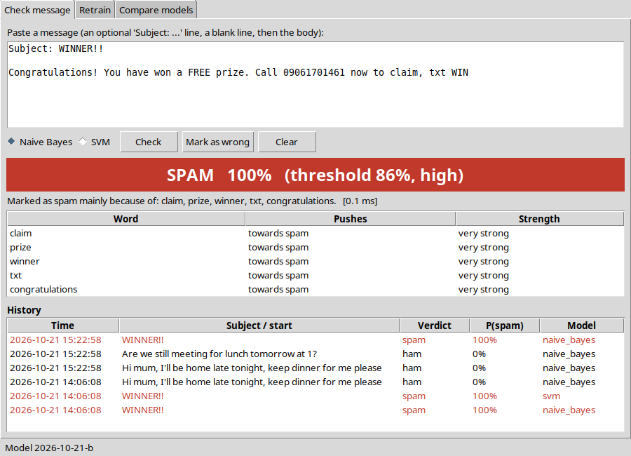
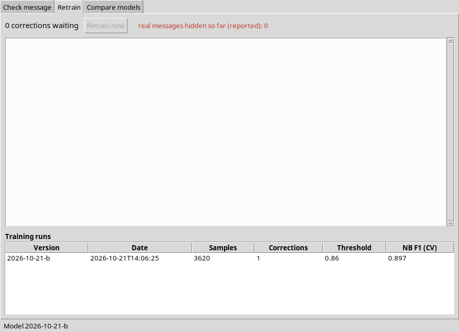
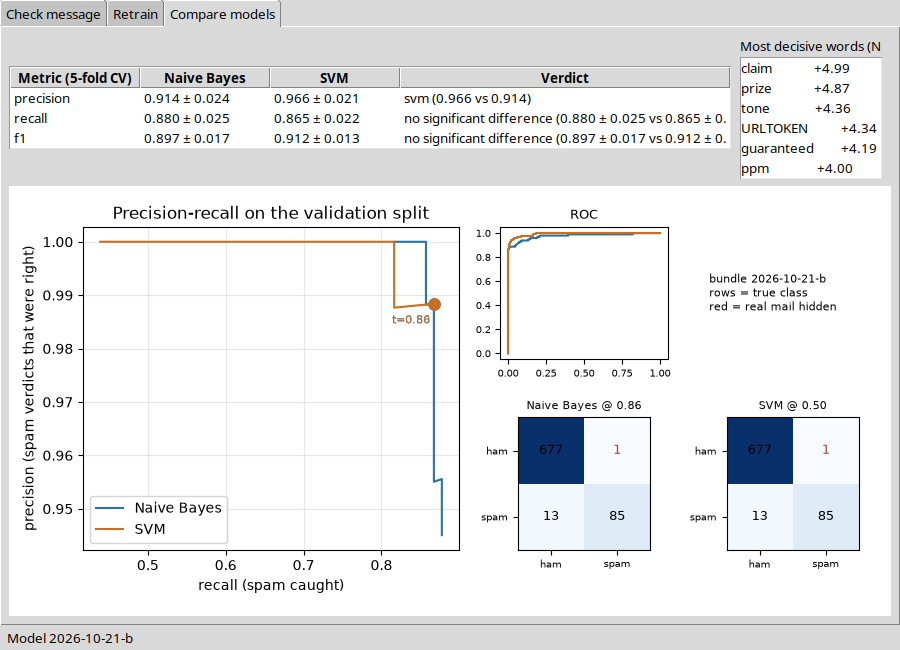

# SpamClassifier — walkthrough

Every function you write in this project (99 of them), in the order of `TASKS.md`. For each one:

- **Problem** — what the function has to do,
- **Solution** — the finished code,
- **Check** — the test that proves it works.

Try each function yourself first, then compare. Run the check after every function, not at the end.

## Contents

- [Stage 1 — Data and splitting](#stage-1--data-and-splitting) (4 functions)
- [Stage 2 — Cleaning and tokenizing](#stage-2--cleaning-and-tokenizing) (14 functions)
- [Stage 3 — Features](#stage-3--features) (7 functions)
- [Stage 4 — Naive Bayes, from scratch (the heart of the project)](#stage-4--naive-bayes-from-scratch-the-heart-of-the-project) (7 functions)
- [Stage 5 — SVM and comparison](#stage-5--svm-and-comparison) (7 functions)
- [Stage 6 — Threshold and bundle](#stage-6--threshold-and-bundle) (14 functions)
- [Stage 7 — Database, UI and the explanation](#stage-7--database-ui-and-the-explanation) (44 functions)
- [Stage 8 — Train, measure, write](#stage-8--train-measure-write) (2 functions)
- [Files the solution adds](#files-the-solution-adds)
- [The finished project](#the-finished-project)

## Stage 1 — Data and splitting

### `spamclassifier/ml/dataset.py`

#### `load_corpus(path)`

**Problem.** Read the corpus CSV (columns text and label) and return (texts, labels) with ham = 0 and spam = 1. A missing column or an unknown label is an error naming the row. Drop exact duplicate texts and say how many - the same text in train and test would be a leak.

**Solution.**

```python
def load_corpus(path: str | None = None) -> Tuple[List[str], List[int]]:
    path = path or config.CORPUS_PATH
    texts, labels, seen, duplicates = [], [], set(), 0
    with open(path, encoding="utf-8-sig", newline="") as fh:
        reader = csv.DictReader(fh)
        missing = {"text", "label"} - set(reader.fieldnames or [])
        if missing:
            raise ValueError(f"{path}: missing column(s) {', '.join(sorted(missing))}")
        for line_no, row in enumerate(reader, start=2):
            label = (row["label"] or "").strip().lower()
            if label not in ("spam", "ham"):
                raise ValueError(f"{path}, row {line_no}: label must be 'spam' or 'ham', got {row['label']!r}")
            text = row["text"] or ""
            if text in seen:
                duplicates += 1
                continue
            seen.add(text)
            texts.append(text)
            labels.append(1 if label == "spam" else 0)
    print(f"loaded {len(texts)} messages from {path} ({duplicates} exact duplicates dropped)")
    return texts, labels
```

**Check.** No unit test - run the program and look (see the stage's exit condition in `TASKS.md`).

#### `class_balance(labels)`

**Problem.** Count the ham and spam labels and the spam share: {"ham": n, "spam": n, "spam_ratio": 0.13}. Print it right after loading - a strange ratio means a broken corpus.

**Solution.**

```python
def class_balance(labels: Sequence[int]) -> dict:
    spam = sum(1 for l in labels if l == 1)
    return {"ham": len(labels) - spam, "spam": spam, "spam_ratio": spam / len(labels) if labels else 0.0}
```

**Check.** `pytest tests/test_dataset.py::test_class_balance_counts`

#### `stratified_split(texts, labels, seed)`

**Problem.** Split the messages 70 / 15 / 15 into train, validation and test, keeping the same spam share in each part and the same split on every run (fixed seed). Give the sizes as whole numbers of messages, not ratios, so the parts are exactly the right size.

**Solution.**

```python
def stratified_split(texts: Sequence[str], labels: Sequence[int],
                     seed: int | None = None) -> Split:
    from sklearn.model_selection import train_test_split
    seed = config.RANDOM_SEED if seed is None else seed
    texts, labels = list(texts), list(labels)
    n_test = round(len(texts) * config.TEST_RATIO)
    n_val = round(len(texts) * config.VAL_RATIO)
    t_rest, t_test, y_rest, y_test = train_test_split(texts, labels, test_size=n_test, stratify=labels,
                                                      random_state=seed)
    t_train, t_val, y_train, y_val = train_test_split(t_rest, y_rest, test_size=n_val, stratify=y_rest,
                                                      random_state=seed)
    return Split(train=(list(t_train), list(y_train)), validation=(list(t_val), list(y_val)),
                 test=(list(t_test), list(y_test)))
```

**Check.** `pytest tests/test_dataset.py -k "test_split_sizes or test_split_preserves_class_ratio or test_split_is_reproducible or test_no_leakage_passes_on_a_clean_split"`

#### `assert_no_leakage(split)`

**Problem.** Raise AssertionError if the same text appears in two of the three parts. Run it before every training.

**Solution.**

```python
def assert_no_leakage(split: Split) -> None:
    train, val, test = set(split.train[0]), set(split.validation[0]), set(split.test[0])
    overlaps = {"train/validation": len(train & val), "train/test": len(train & test),
                "validation/test": len(val & test)}
    if any(overlaps.values()):
        raise AssertionError(f"leakage between splits: {overlaps}")
```

**Check.** `pytest tests/test_dataset.py -k "test_no_leakage_passes_on_a_clean_split or test_no_leakage_detects_an_overlap"`


## Stage 2 — Cleaning and tokenizing

### `spamclassifier/preprocessing/email_parser.py`

#### `EmailParser.parse(raw)`

**Problem.** Turn a raw message into a CleanedMessage in this order: cut it to the maximum length, split off the subject, measure the capitals, "!" and digits on the raw text, count tags and links, remove the HTML, replace links with URLTOKEN, then lower-case everything except URLTOKEN. Measuring before lower-casing is the point: "FREE!!!" and "free" must not look the same.

**Solution.**

```python
def parse(self, raw: str) -> CleanedMessage:
    raw = self.truncate(raw or "")
    subject, body = self.split_headers(raw)
    whole = f"{subject} {body}"
    caps = self.caps_ratio(whole)                  # measured before lower-casing
    exclamations = self.exclamation_count(whole)
    digits = self.digit_ratio(whole)
    urls = self.count_urls(body)
    tags = self.count_html_tags(body)
    body = self.strip_html(body)
    body = self.replace_urls(body)
    subject = self.replace_urls(self.strip_html(subject))
    token = config.URL_TOKEN
    body = body.lower().replace(token.lower(), token)
    subject = subject.lower().replace(token.lower(), token)
    return CleanedMessage(subject=subject, body=body, raw_length=len(raw), caps_ratio=caps,
                          exclamation_count=exclamations, digit_ratio=digits, url_count=urls,
                          html_tag_count=tags)
```

**Check.** `pytest tests/test_email_parser.py -k "test_parse_measures_caps_before_lowercasing or test_parse_full_pipeline or test_parse_empty_message or test_text_property_joins_subject_and_body"` and `pytest tests/test_feature_engineer.py -k "test_long_and_short_messages_are_comparable or test_handcrafted_carries_parser_measurements or test_trigger_word_count or test_unique_word_ratio"` and `pytest tests/test_pipeline.py -k "test_spam_is_classified_as_spam or test_ham_is_classified_as_ham or test_every_verdict_comes_with_reasons or test_training_and_scanning_agree_on_the_vector"` and `pytest tests/test_tokenizer.py::test_tokenize_accepts_cleaned_message`

#### `EmailParser.truncate(raw)`

**Problem.** Return at most MAX_INPUT_CHARS characters, so a huge message cannot use up the memory.

**Solution.**

```python
def truncate(self, raw: str) -> str:
    return raw[:config.MAX_INPUT_CHARS]
```

**Check.** `pytest tests/test_email_parser.py::test_truncate_caps_length`

#### `EmailParser.split_headers(raw)`

**Problem.** Return (subject, body). Headers are the "Name: value" lines before the first blank line; keep only the Subject. No headers: the whole text is the body. Only headers: the body is "".

**Solution.**

```python
def split_headers(self, raw: str) -> Tuple[str, str]:
    lines = raw.split("\n")
    if not lines or not HEADER_RE.match(lines[0]):
        return "", raw
    subject = ""
    for i, line in enumerate(lines):
        if line.strip() == "":
            return subject, "\n".join(lines[i + 1:]).strip()
        match = HEADER_RE.match(line)
        if match and match.group(1).lower() == "subject":
            subject = match.group(2).strip()
    return subject, ""
```

**Check.** `pytest tests/test_email_parser.py -k "test_split_headers_keeps_only_subject or test_split_headers_without_headers or test_split_headers_only_headers"`

#### `EmailParser.strip_html(text)`

**Problem.** Remove every <...> tag and squeeze the spaces, so "<b>free</b><i>offer</i>" becomes "free offer", not "freeoffer".

**Solution.**

```python
def strip_html(self, text: str) -> str:
    return " ".join(TAG_RE.sub(" ", text).split())
```

**Check.** `pytest tests/test_email_parser.py -k "test_strip_html_keeps_words_apart or test_strip_html_leaves_plain_text"`

#### `EmailParser.replace_urls(text)`

**Problem.** Replace every link with URLTOKEN. The model should learn "there is a link", not one particular domain.

**Solution.**

```python
def replace_urls(self, text: str) -> str:
    return URL_RE.sub(config.URL_TOKEN, text)
```

**Check.** `pytest tests/test_email_parser.py -k "test_replace_urls_drops_the_domain or test_replace_urls_handles_www"`

#### `EmailParser.caps_ratio(text)`

**Problem.** Upper-case letters divided by all letters, between 0 and 1. Digits and punctuation are not letters. No letters gives 0.

**Solution.**

```python
@staticmethod
def caps_ratio(text: str) -> float:
    letters = [c for c in text if c.isalpha()]
    return sum(c.isupper() for c in letters) / len(letters) if letters else 0.0
```

**Check.** `pytest tests/test_email_parser.py -k "test_caps_ratio_counts_letters_only or test_parse_measures_caps_before_lowercasing or test_parse_empty_message"` and `pytest tests/test_feature_engineer.py::test_handcrafted_carries_parser_measurements`

#### `EmailParser.exclamation_count(text)`

**Problem.** Count the "!" characters.

**Solution.**

```python
@staticmethod
def exclamation_count(text: str) -> int:
    return text.count("!")
```

**Check.** `pytest tests/test_email_parser.py -k "test_exclamation_count or test_parse_full_pipeline"` and `pytest tests/test_feature_engineer.py::test_handcrafted_carries_parser_measurements`

#### `EmailParser.digit_ratio(text)`

**Problem.** Digits divided by all characters, between 0 and 1. An empty string gives 0.

**Solution.**

```python
@staticmethod
def digit_ratio(text: str) -> float:
    return sum(c.isdigit() for c in text) / len(text) if text else 0.0
```

**Check.** `pytest tests/test_email_parser.py::test_digit_ratio`

#### `EmailParser.count_urls(text)`

**Problem.** Count the links in the text.

**Solution.**

```python
@staticmethod
def count_urls(text: str) -> int:
    return len(URL_RE.findall(text))
```

**Check.** `pytest tests/test_email_parser.py::test_count_urls_and_tags`

#### `EmailParser.count_html_tags(text)`

**Problem.** Count the <...> tags, before they are removed.

**Solution.**

```python
@staticmethod
def count_html_tags(text: str) -> int:
    return len(TAG_RE.findall(text))
```

**Check.** `pytest tests/test_email_parser.py::test_count_urls_and_tags`

### `spamclassifier/preprocessing/tokenizer.py`

#### `load_stopwords()`

**Problem.** Return NLTK's English stopword set, downloading it once if it is missing.

**Solution.**

```python
def load_stopwords() -> Set[str]:
    import nltk
    try:
        from nltk.corpus import stopwords
        return set(stopwords.words("english"))
    except LookupError:
        nltk.download("stopwords", quiet=True)
        from nltk.corpus import stopwords
        return set(stopwords.words("english"))
```

**Check.** No unit test - run the program and look (see the stage's exit condition in `TASKS.md`).

#### `Tokenizer.tokenize(message)`

**Problem.** Split a cleaned message's text into tokens with the filtering rules below.

**Solution.**

```python
def tokenize(self, message: CleanedMessage) -> List[str]:
    return self.tokenize_text(message.text)
```

**Check.** `pytest tests/test_pipeline.py -k "test_spam_is_classified_as_spam or test_ham_is_classified_as_ham or test_every_verdict_comes_with_reasons or test_empty_message_does_not_crash"` and `pytest tests/test_tokenizer.py::test_tokenize_accepts_cleaned_message`

#### `Tokenizer.tokenize_text(text)`

**Problem.** Split a string into words (letters and apostrophes), drop stopwords and words shorter than 3 letters, but always keep URLTOKEN: "free URLTOKEN offer now" -> ["free", "URLTOKEN", "offer", "now"].

**Solution.**

```python
def tokenize_text(self, text: str) -> List[str]:
    out = []
    for i, part in enumerate((text or "").split(config.URL_TOKEN)):
        if i > 0:
            out.append(config.URL_TOKEN)
        out.extend(t for t in WORD_RE.findall(part.lower()) if self._keep(t))
    return out
```

**Check.** `pytest tests/test_tokenizer.py -k "test_removes_stopwords_and_short_tokens or test_keeps_content_words or test_url_token_survives_filtering or test_short_tokens_dropped"`

#### `Tokenizer._keep(token)`

**Problem.** Return True when a token stays: always for URLTOKEN, otherwise when it is long enough and not a stopword.

**Solution.**

```python
def _keep(self, token: str) -> bool:
    if token == config.URL_TOKEN:
        return True
    return len(token) >= config.MIN_TOKEN_LENGTH and token not in self._stopwords
```

**Check.** No unit test - run the program and look (see the stage's exit condition in `TASKS.md`).


## Stage 3 — Features

### `spamclassifier/features/feature_engineer.py`

**Helper code in this file** (used by the functions below, not a TODO in your skeleton):

`FeatureEngineer._handcrafted`

```python
def _handcrafted(self, message: CleanedMessage, tokens: List[str]) -> Dict[str, float]:
        present = set(tokens)
        values = {
            "caps_ratio": float(message.caps_ratio),
            "exclamation_count": float(message.exclamation_count),
            "message_length": float(message.raw_length),
            "digit_ratio": float(message.digit_ratio),
            "url_count": float(message.url_count),
            "trigger_word_count": float(sum(1 for w in config.TRIGGER_WORDS if w in present)),
            "unique_word_ratio": len(present) / len(tokens) if tokens else 0.0,
        }
        return {name: values[name] for name in config.HANDCRAFTED_FEATURES}
```

#### `FeatureEngineer.fit(messages)`

**Problem.** Build the vocabulary from the TRAINING messages only: count in how many messages each unigram and bigram appears, keep the MAX_FEATURES most common, and store each one's IDF. Fitting on all the data would let the test set shape the features.

**Solution.**

```python
def fit(self, messages: Sequence[CleanedMessage]) -> "FeatureEngineer":
    df: Dict[str, int] = {}
    for message in messages:
        for term in set(ngrams(self._tokenizer.tokenize(message), config.NGRAM_MIN, config.NGRAM_MAX)):
            df[term] = df.get(term, 0) + 1
    keep = sorted(df, key=lambda t: (-df[t], t))[:config.MAX_FEATURES]
    self._vocabulary = sorted(keep)
    self._index = {t: i for i, t in enumerate(self._vocabulary)}
    n = len(messages)
    self._idf = {t: self.idf_value(n, df[t]) for t in self._vocabulary}
    self._fitted = True
    return self
```

**Check.** `pytest tests/test_feature_engineer.py -k "test_fit_sets_vocabulary or test_vocabulary_respects_max_features or test_long_and_short_messages_are_comparable or test_handcrafted_names_and_order"` and `pytest tests/test_naive_bayes.py -k "test_fit_marks_fitted or test_priors_are_balanced or test_laplace_smoothing_prevents_zero or test_unknown_token_is_skipped"`

#### `FeatureEngineer.transform(message)`

**Problem.** Turn one message into a FeatureVector: TF-IDF values for the vocabulary terms (count / length x idf, then scaled to length 1) plus the seven hand-made numbers. Terms not in the vocabulary are ignored. Calling it before fit is an error.

**Solution.**

```python
def transform(self, message: CleanedMessage) -> FeatureVector:
    if not self._fitted:
        raise RuntimeError("FeatureEngineer.transform() called before fit()")
    tokens = self._tokenizer.tokenize(message)
    terms = ngrams(tokens, config.NGRAM_MIN, config.NGRAM_MAX)
    raw: Dict[str, float] = {}
    if terms:
        counts = Counter(terms)
        raw = {t: counts[t] / len(terms) * self._idf[t] for t in counts if t in self._idf}
    return FeatureVector(tfidf=self.l2_normalise(raw), values=self._handcrafted(message, tokens))
```

**Check.** `pytest tests/test_feature_engineer.py -k "test_transform_before_fit_raises or test_long_and_short_messages_are_comparable or test_to_dense_has_the_full_width or test_unknown_terms_do_not_widen_the_vector"` and `pytest tests/test_pipeline.py::test_training_and_scanning_agree_on_the_vector`

#### `FeatureEngineer.handcrafted(message)`

**Problem.** The seven hand-made numbers in the fixed order: capitals share, "!" count, length, digit share and link count (all measured by the parser), plus how many trigger words appear and unique words / all words.

**Solution.**

```python
def handcrafted(self, message: CleanedMessage) -> Dict[str, float]:
    return self._handcrafted(message, self._tokenizer.tokenize(message))
```

**Check.** `pytest tests/test_feature_engineer.py -k "test_handcrafted_names_and_order or test_handcrafted_carries_parser_measurements or test_trigger_word_count or test_unique_word_ratio"`

#### `FeatureEngineer.l2_normalise(vector)`

**Problem.** Divide every value by the vector's length (square root of the sum of squares). A zero vector stays as it is. Without this, long messages get bigger numbers and the model learns length instead of content.

**Solution.**

```python
@staticmethod
def l2_normalise(vector: Dict[str, float]) -> Dict[str, float]:
    norm = math.sqrt(sum(v * v for v in vector.values()))
    return {k: v / norm for k, v in vector.items()} if norm else dict(vector)
```

**Check.** `pytest tests/test_feature_engineer.py -k "test_l2_normalise_gives_unit_length or test_l2_normalise_handles_zero_vector"`

#### `FeatureEngineer.idf_value(n_documents, document_frequency)`

**Problem.** log(N / (1 + df)) + 1: rare terms get a high weight, a term in every message the lowest.

**Solution.**

```python
@staticmethod
def idf_value(n_documents: int, document_frequency: int) -> float:
    return math.log(n_documents / (1 + document_frequency)) + 1
```

**Check.** `pytest tests/test_feature_engineer.py -k "test_idf_formula or test_idf_of_universal_term_is_lowest"`

#### `FeatureEngineer.to_dense(vector)`

**Problem.** Flatten a FeatureVector into one list: the vocabulary values in vocabulary order, then the seven numbers in their fixed order. This is exactly what the SVM receives.

**Solution.**

```python
def to_dense(self, vector: FeatureVector) -> List[float]:
    dense = [0.0] * len(self._vocabulary)
    index = getattr(self, "_index", None) or {t: i for i, t in enumerate(self._vocabulary)}
    for term, value in vector.tfidf.items():
        dense[index[term]] = value
    return dense + [float(vector.values[name]) for name in config.HANDCRAFTED_FEATURES]
```

**Check.** `pytest tests/test_feature_engineer.py -k "test_to_dense_has_the_full_width or test_unknown_terms_do_not_widen_the_vector"` and `pytest tests/test_pipeline.py::test_training_and_scanning_agree_on_the_vector`

### `spamclassifier/preprocessing/tokenizer.py`

#### `ngrams(tokens, n_min, n_max)`

**Problem.** Return every n-gram from n_min to n_max words, joined by spaces: ["click", "here", "now"] with 1-2 gives ["click", "here", "now", "click here", "here now"].

**Solution.**

```python
def ngrams(tokens: Iterable[str], n_min: int, n_max: int) -> List[str]:
    tokens = list(tokens)
    return [" ".join(tokens[i:i + n]) for n in range(n_min, n_max + 1) for i in range(len(tokens) - n + 1)]
```

**Check.** `pytest tests/test_tokenizer.py -k "test_ngrams_unigrams_only or test_ngrams_unigrams_and_bigrams or test_ngrams_too_few_tokens or test_ngrams_empty"`


## Stage 4 — Naive Bayes, from scratch (the heart of the project)

### `spamclassifier/ml/naive_bayes.py`

#### `NaiveBayesClassifier.fit(documents, labels)`

**Problem.** Learn from token lists: the log share of each class (prior), and for every word in each class log((count + alpha) / (total words in the class + alpha x vocabulary size)). The +alpha (Laplace smoothing) stops an unseen word from giving probability 0; logs stop the product from becoming 0.0.

**Solution.**

```python
def fit(self, documents: Sequence[Sequence[str]], labels: Sequence[int]) -> "NaiveBayesClassifier":
    if len(documents) != len(labels) or not labels:
        raise ValueError("fit() needs the same, non-zero number of documents and labels")
    vocabulary = sorted({t for doc in documents for t in doc})
    n = len(labels)
    for c in (HAM, SPAM):
        n_c = sum(1 for label in labels if label == c)
        if n_c == 0:
            raise ValueError("both classes must appear in the training data")
        self._log_prior[c] = math.log(n_c / n)
        counts = Counter(t for doc, label in zip(documents, labels) if label == c for t in doc)
        total = sum(counts.values())
        denominator = total + self.alpha * len(vocabulary)
        self._log_likelihood[c] = {w: math.log((counts[w] + self.alpha) / denominator) for w in vocabulary}
    self._vocabulary = vocabulary
    self._fitted = True
    return self
```

**Check.** `pytest tests/test_feature_engineer.py -k "test_fit_sets_vocabulary or test_vocabulary_respects_max_features or test_long_and_short_messages_are_comparable or test_handcrafted_names_and_order"` and `pytest tests/test_naive_bayes.py -k "test_fit_marks_fitted or test_priors_are_balanced or test_laplace_smoothing_prevents_zero or test_unknown_token_is_skipped"`

#### `NaiveBayesClassifier.predict_log_scores(tokens)`

**Problem.** The log score of each class for one message: its log prior plus the log likelihood of every known token. Unknown tokens are skipped - they would add the same to both classes.

**Solution.**

```python
def predict_log_scores(self, tokens: Sequence[str]) -> Dict[int, float]:
    if not self._fitted:
        raise RuntimeError("NaiveBayesClassifier used before fit()")
    return {c: self._log_prior[c] + sum(self._log_likelihood[c][t] for t in tokens if t in self._log_likelihood[c])
            for c in (HAM, SPAM)}
```

**Check.** `pytest tests/test_naive_bayes.py -k "test_priors_are_balanced or test_laplace_smoothing_prevents_zero"`

#### `NaiveBayesClassifier.predict_proba(tokens)`

**Problem.** P(spam) = 1 / (1 + exp(ham score - spam score)), computed from the difference so it never underflows. Very large differences give exactly 0.0 or 1.0.

**Solution.**

```python
def predict_proba(self, tokens: Sequence[str]) -> float:
    s = self.predict_log_scores(tokens)
    d = s[HAM] - s[SPAM]
    if d > 700:
        return 0.0
    if d < -700:
        return 1.0
    return 1.0 / (1.0 + math.exp(d))
```

**Check.** `pytest tests/test_naive_bayes.py -k "test_unknown_token_is_skipped or test_probability_in_range or test_spam_words_push_probability_up or test_no_underflow_on_long_document"` and `pytest tests/test_pipeline.py -k "test_spam_is_classified_as_spam or test_ham_is_classified_as_ham or test_empty_message_does_not_crash or test_message_of_only_stopwords"`

#### `NaiveBayesClassifier.predict(tokens, threshold)`

**Problem.** 1 (spam) when P(spam) is at least the threshold, else 0.

**Solution.**

```python
def predict(self, tokens: Sequence[str], threshold: float = 0.5) -> int:
    return SPAM if self.predict_proba(tokens) >= threshold else HAM
```

**Check.** `pytest tests/test_naive_bayes.py::test_predict_respects_threshold`

#### `NaiveBayesClassifier.log_odds(token)`

**Problem.** How strongly a word points to spam: log P(word | spam) - log P(word | ham). Positive means spam, negative means ham, 0 for an unknown word.

**Solution.**

```python
def log_odds(self, token: str) -> float:
    if token not in self._log_likelihood[SPAM]:
        return 0.0
    return self._log_likelihood[SPAM][token] - self._log_likelihood[HAM][token]
```

**Check.** `pytest tests/test_naive_bayes.py::test_log_odds_sign`

#### `NaiveBayesClassifier.explain(tokens, top_n)`

**Problem.** The words of this message with the strongest log-odds (by absolute value), each word once - the reasons shown to the user.

**Solution.**

```python
def explain(self, tokens: Sequence[str], top_n: int | None = None) -> List[Reason]:
    top_n = top_n or config.TOP_REASONS
    known = [t for t in dict.fromkeys(tokens) if t in self._log_likelihood[SPAM]]
    known.sort(key=lambda t: abs(self.log_odds(t)), reverse=True)
    return [Reason(t, self.log_odds(t)) for t in known[:top_n]]
```

**Check.** `pytest tests/test_naive_bayes.py -k "test_explain_returns_top_reasons or test_explain_deduplicates"` and `pytest tests/test_pipeline.py::test_every_verdict_comes_with_reasons`

#### `NaiveBayesClassifier.most_discriminative(top_n)`

**Problem.** The vocabulary words with the strongest log-odds, strongest first - useful to spot a model that learned something silly.

**Solution.**

```python
def most_discriminative(self, top_n: int = 50) -> List[Tuple[str, float]]:
    return sorted(((t, self.log_odds(t)) for t in self._vocabulary), key=lambda x: abs(x[1]), reverse=True)[:top_n]
```

**Check.** `pytest tests/test_naive_bayes.py::test_most_discriminative_is_sorted`


## Stage 5 — SVM and comparison

### `spamclassifier/ml/comparator.py`

#### `ModelComparator.cross_validate(model_factory, texts, labels)`

**Problem.** Stratified 5-fold cross-validation: for every fold train a NEW model (features refitted too) on the other folds, score the held-out fold, and return mean and standard deviation of precision, recall and F1.

**Solution.**

```python
def cross_validate(self, model_factory, texts: Sequence[str],
                   labels: Sequence[int]) -> List[MetricResult]:
    from sklearn.model_selection import StratifiedKFold
    texts, labels = list(texts), list(labels)
    folds = StratifiedKFold(n_splits=self.folds, shuffle=True, random_state=config.RANDOM_SEED)
    scores = {"precision": [], "recall": [], "f1": []}
    name = None
    for train_idx, test_idx in folds.split(texts, labels):
        model = model_factory()                         # new model for every fold
        name = model.name
        model.fit([texts[i] for i in train_idx], [labels[i] for i in train_idx])
        probabilities = model.predict_proba_many([texts[i] for i in test_idx])
        predictions = [1 if p >= 0.5 else 0 for p in probabilities]
        m = self.confusion_matrix(predictions, [labels[i] for i in test_idx])
        scores["precision"].append(m.precision)
        scores["recall"].append(m.recall)
        scores["f1"].append(m.f1)
    return [MetricResult(name, metric, statistics.mean(values), statistics.pstdev(values))
            for metric, values in scores.items()]
```

**Check.** No unit test - run the program and look (see the stage's exit condition in `TASKS.md`).

#### `ModelComparator.compare(results_a, results_b)`

**Problem.** For each metric say which model wins - or "no significant difference" when the gap between the means is smaller than the larger standard deviation.

**Solution.**

```python
def compare(self, results_a: List[MetricResult],
            results_b: List[MetricResult]) -> Dict[str, str]:
    b_by_metric = {r.metric_name: r for r in results_b}
    out = {}
    for a in results_a:
        b = b_by_metric.get(a.metric_name)
        if b is None:
            continue
        if abs(a.mean - b.mean) < max(a.std, b.std):
            out[a.metric_name] = (f"no significant difference ({a.mean:.3f} ± {a.std:.3f} vs "
                                  f"{b.mean:.3f} ± {b.std:.3f})")
        else:
            winner, loser = (a, b) if a.mean > b.mean else (b, a)
            out[a.metric_name] = f"{winner.model_name} ({winner.mean:.3f} vs {loser.mean:.3f})"
    return out
```

**Check.** No unit test - run the program and look (see the stage's exit condition in `TASKS.md`).

#### `ModelComparator.confusion_matrix(predictions, labels)`

**Problem.** Count true ham, false spam (real mail hidden), false ham (spam let through) and true spam from predictions and labels.

**Solution.**

```python
@staticmethod
def confusion_matrix(predictions: Sequence[int],
                     labels: Sequence[int]) -> ConfusionMatrix:
    true_ham = false_spam = false_ham = true_spam = 0
    for predicted, actual in zip(predictions, labels):
        if predicted == 1 and actual == 1:
            true_spam += 1
        elif predicted == 1:
            false_spam += 1          # real mail marked spam
        elif actual == 1:
            false_ham += 1           # spam let through
        else:
            true_ham += 1
    return ConfusionMatrix(true_ham=true_ham, false_spam=false_spam, false_ham=false_ham, true_spam=true_spam)
```

**Check.** No unit test - run the program and look (see the stage's exit condition in `TASKS.md`).

### `spamclassifier/ml/svm_classifier.py`

**Helper code in this file** (used by the functions below, not a TODO in your skeleton):

`SVMClassifier.predict_proba_many`

```python
def predict_proba_many(self, vectors) -> List[float]:
        """All probabilities in one call - much faster than one predict_proba per row."""
        return [float(p) for p in self._model.predict_proba(vectors)[:, 1]]
```

#### `SVMClassifier.fit(vectors, labels)`

**Problem.** Fit the comparison model: a MaxAbsScaler (every column between 0 and 1) and a LinearSVC, wrapped in CalibratedClassifierCV so it outputs probabilities like Naive Bayes.

**Solution.**

```python
def fit(self, vectors: Sequence[Sequence[float]], labels: Sequence[int]) -> "SVMClassifier":
    from sklearn.calibration import CalibratedClassifierCV
    from sklearn.pipeline import make_pipeline
    from sklearn.preprocessing import MaxAbsScaler
    from sklearn.svm import LinearSVC

    # MaxAbsScaler keeps the sparse TF-IDF values sane; StandardScaler made LinearSVC very slow
    base = make_pipeline(MaxAbsScaler(), LinearSVC(C=self.c, random_state=config.RANDOM_SEED, max_iter=5000))
    self._model = CalibratedClassifierCV(base, method="sigmoid", cv=5)
    self._model.fit(vectors, labels)
    self._fitted = True
    return self
```

**Check.** `pytest tests/test_feature_engineer.py -k "test_fit_sets_vocabulary or test_vocabulary_respects_max_features or test_long_and_short_messages_are_comparable or test_handcrafted_names_and_order"` and `pytest tests/test_naive_bayes.py -k "test_fit_marks_fitted or test_priors_are_balanced or test_laplace_smoothing_prevents_zero or test_unknown_token_is_skipped"`

#### `SVMClassifier.predict_proba(vector)`

**Problem.** P(spam) for one dense vector.

**Solution.**

```python
def predict_proba(self, vector: Sequence[float]) -> float:
    if not self._fitted:
        raise RuntimeError("SVMClassifier used before fit()")
    return float(self._model.predict_proba([list(vector)])[0][1])
```

**Check.** `pytest tests/test_naive_bayes.py -k "test_unknown_token_is_skipped or test_probability_in_range or test_spam_words_push_probability_up or test_no_underflow_on_long_document"` and `pytest tests/test_pipeline.py -k "test_spam_is_classified_as_spam or test_ham_is_classified_as_ham or test_empty_message_does_not_crash or test_message_of_only_stopwords"`

#### `SVMClassifier.predict(vector, threshold)`

**Problem.** 1 when P(spam) is at least the threshold, else 0.

**Solution.**

```python
def predict(self, vector: Sequence[float], threshold: float = 0.5) -> int:
    return 1 if self.predict_proba(vector) >= threshold else 0
```

**Check.** `pytest tests/test_naive_bayes.py::test_predict_respects_threshold`

#### `SVMClassifier.explain(vector, feature_names, top_n)`

**Problem.** Approximate reasons from the linear weights: weight x scaled value for each feature present, strongest first. Only an approximation after calibration - that is why Naive Bayes is the main model.

**Solution.**

```python
def explain(self, vector: Sequence[float], feature_names: List[str], top_n: int = 5):
    import numpy as np

    from spamclassifier.models.entities import Reason
    x = np.asarray(vector, dtype=float)
    contributions = np.zeros_like(x)
    for calibrated in self._model.calibrated_classifiers_:
        scaler, svc = calibrated.estimator.named_steps["maxabsscaler"], calibrated.estimator.named_steps["linearsvc"]
        contributions += svc.coef_[0] * x / scaler.scale_
    contributions /= len(self._model.calibrated_classifiers_)
    # only features that are present in this message (a word that is absent is not a reason)
    candidates = [i for i in range(len(x)) if x[i] != 0 or i >= len(x) - 7]
    candidates.sort(key=lambda i: abs(contributions[i]), reverse=True)
    return [Reason(feature_names[i], float(contributions[i])) for i in candidates[:top_n]]
```

**Check.** `pytest tests/test_naive_bayes.py -k "test_explain_returns_top_reasons or test_explain_deduplicates"` and `pytest tests/test_pipeline.py::test_every_verdict_comes_with_reasons`


## Stage 6 — Threshold and bundle

### `spamclassifier/ml/bundle.py`

**Helper code in this file** (used by the functions below, not a TODO in your skeleton):

`CHECKED_FILES`

```python
CHECKED_FILES = ("features.json", "metrics.json", "nb_model.pkl", "svm_model.pkl",
                 "threshold.json", "vectorizer.pkl", "version.txt")
```

`_version_key`

```python
def _version_key(name: str):
    day, _, suffix = name.rpartition("-")
    return day, len(suffix), suffix
```

`ModelBundle._checksum_of`

```python
@staticmethod
def _checksum_of(directory: str) -> str:
    h = hashlib.sha256()
    for name in sorted(CHECKED_FILES):
        h.update(name.encode())
        with open(os.path.join(directory, name), "rb") as fh:
            for chunk in iter(lambda: fh.read(65536), b""):
                h.update(chunk)
    return h.hexdigest()
```

#### `ModelBundle.new_version()`

**Problem.** A version name like "2026-03-11-a": today's date plus the first free letter, so two runs on one day do not collide.

**Solution.**

```python
@staticmethod
def new_version() -> str:
    today = date.today().isoformat()
    existing = set(os.listdir(config.MODELS_DIR)) if os.path.isdir(config.MODELS_DIR) else set()
    letters = string.ascii_lowercase
    candidates = list(letters) + [a + b for a in letters for b in letters]
    for suffix in candidates:
        name = f"{today}-{suffix}"
        if name not in existing and f"{name}.tmp" not in existing:
            return name
    raise RuntimeError("too many bundles for one day")
```

**Check.** No unit test - run the program and look (see the stage's exit condition in `TASKS.md`).

#### `ModelBundle.save(vectorizer, nb_model, svm_model, threshold_choice, metrics, feature_names)`

**Problem.** Write the eight files of a bundle (vectorizer, both models, features, thresholds, metrics, version, checksum last) into a temporary folder and rename it at the end, so a crash never leaves a half-written bundle.

**Solution.**

```python
def save(self, vectorizer, nb_model, svm_model, threshold_choice,
         metrics: List, feature_names: List[str]) -> str:
    if os.path.exists(self.path):
        raise FileExistsError(f"bundle {self.version} already exists")
    tmp = self.path + ".tmp"
    shutil.rmtree(tmp, ignore_errors=True)
    os.makedirs(tmp)
    try:
        with open(os.path.join(tmp, "vectorizer.pkl"), "wb") as fh:
            pickle.dump(vectorizer, fh)
        with open(os.path.join(tmp, "nb_model.pkl"), "wb") as fh:
            pickle.dump(nb_model.to_dict(), fh)
        with open(os.path.join(tmp, "svm_model.pkl"), "wb") as fh:
            pickle.dump(svm_model.to_dict(), fh)
        handcrafted = list(config.HANDCRAFTED_FEATURES)
        with open(os.path.join(tmp, "features.json"), "w", encoding="utf-8") as fh:
            json.dump({"handcrafted": handcrafted, "tfidf_dimension": len(feature_names) - len(handcrafted),
                       "total": len(feature_names), "feature_names": list(feature_names)}, fh, indent=1)
        choices = threshold_choice if isinstance(threshold_choice, dict) else {"naive_bayes": threshold_choice}
        with open(os.path.join(tmp, "threshold.json"), "w", encoding="utf-8") as fh:
            json.dump({"min_precision": config.MIN_PRECISION,
                       "models": {name: asdict(choice) for name, choice in choices.items()}}, fh, indent=2)
        with open(os.path.join(tmp, "metrics.json"), "w", encoding="utf-8") as fh:
            json.dump({"cross_validation": [asdict(m) for m in metrics],
                       "validation": getattr(self, "validation_report", {})}, fh, indent=1)
        with open(os.path.join(tmp, "version.txt"), "w", encoding="utf-8") as fh:
            fh.write(f"{self.version}\n{datetime.now().isoformat(timespec='seconds')}\n")
        checksum = self._checksum_of(tmp)
        with open(os.path.join(tmp, "checksum.txt"), "w", encoding="utf-8") as fh:
            fh.write(checksum + "\n")
        os.replace(tmp, self.path)                 # atomic: the bundle appears complete or not at all
    except Exception:
        shutil.rmtree(tmp, ignore_errors=True)
        raise
    return self.path
```

**Check.** `pytest tests/test_repositories.py -k "test_save_returns_an_id or test_body_is_stored_truncated or test_reasons_round_trip or test_threshold_is_stored_with_the_verdict"`

#### `ModelBundle.load()`

**Problem.** In this order: all files present, checksum matches, feature list matches config - and only then unpickle. Unpickling first would make the checksum useless, because pickle can run code.

**Solution.**

```python
def load(self) -> Dict:
    missing = [name for name in self.REQUIRED_FILES if not os.path.isfile(os.path.join(self.path, name))]
    if missing:
        raise FileNotFoundError(f"bundle {self.version} is incomplete, missing: {', '.join(missing)}")
    with open(os.path.join(self.path, "checksum.txt"), encoding="utf-8") as fh:
        stored = fh.read().strip()
    if stored != self.compute_checksum():
        raise ValueError(f"bundle {self.version} failed its checksum - a file was changed or replaced; refusing to load")
    with open(os.path.join(self.path, "features.json"), encoding="utf-8") as fh:
        features = json.load(fh)
    self.verify_feature_contract(features["handcrafted"])
    with open(os.path.join(self.path, "vectorizer.pkl"), "rb") as fh:
        vectorizer = pickle.load(fh)
    with open(os.path.join(self.path, "nb_model.pkl"), "rb") as fh:
        nb_state = pickle.load(fh)
    with open(os.path.join(self.path, "svm_model.pkl"), "rb") as fh:
        svm_state = pickle.load(fh)
    with open(os.path.join(self.path, "threshold.json"), encoding="utf-8") as fh:
        threshold = json.load(fh)
    with open(os.path.join(self.path, "metrics.json"), encoding="utf-8") as fh:
        metrics = json.load(fh)
    return {"version": self.version, "vectorizer": vectorizer, "nb": nb_state, "svm": svm_state,
            "features": features, "threshold": threshold, "metrics": metrics}
```

**Check.** No unit test - run the program and look (see the stage's exit condition in `TASKS.md`).

#### `ModelBundle.compute_checksum()`

**Problem.** One SHA-256 over the bundle files in sorted name order.

**Solution.**

```python
def compute_checksum(self) -> str:
    return self._checksum_of(self.path)
```

**Check.** No unit test - run the program and look (see the stage's exit condition in `TASKS.md`).

#### `ModelBundle.verify()`

**Problem.** True when all files are there and the stored checksum matches.

**Solution.**

```python
def verify(self) -> bool:
    if not all(os.path.isfile(os.path.join(self.path, name)) for name in self.REQUIRED_FILES):
        return False
    with open(os.path.join(self.path, "checksum.txt"), encoding="utf-8") as fh:
        return fh.read().strip() == self.compute_checksum()
```

**Check.** No unit test - run the program and look (see the stage's exit condition in `TASKS.md`).

#### `ModelBundle.verify_feature_contract(feature_names)`

**Problem.** Raise ValueError when the bundle's hand-made feature names are not exactly config's, in the same order. Name both lists in the message.

**Solution.**

```python
def verify_feature_contract(self, feature_names: List[str]) -> None:
    expected = list(config.HANDCRAFTED_FEATURES)
    if list(feature_names) != expected:
        raise ValueError("feature contract broken - the bundle was trained with handcrafted features "
                         f"{list(feature_names)} but this code computes {expected}. Retrain with train.py.")
```

**Check.** No unit test - run the program and look (see the stage's exit condition in `TASKS.md`).

#### `ModelBundle.latest_version()`

**Problem.** The newest bundle in models/ that passes verify, or None.

**Solution.**

```python
@staticmethod
def latest_version() -> str | None:
    if not os.path.isdir(config.MODELS_DIR):
        return None
    names = [n for n in os.listdir(config.MODELS_DIR)
             if os.path.isdir(os.path.join(config.MODELS_DIR, n)) and not n.endswith(".tmp")]
    for name in sorted(names, key=_version_key, reverse=True):
        if ModelBundle(name).verify():
            return name
    return None
```

**Check.** No unit test - run the program and look (see the stage's exit condition in `TASKS.md`).

### `spamclassifier/ml/naive_bayes.py`

#### `NaiveBayesClassifier.to_dict()`

**Problem.** Return the learned numbers (alpha, priors, likelihoods, vocabulary) as a plain dict for the bundle.

**Solution.**

```python
def to_dict(self) -> Dict:
    return {"alpha": self.alpha, "log_prior": dict(self._log_prior),
            "log_likelihood": {c: dict(v) for c, v in self._log_likelihood.items()}, "vocabulary": list(self._vocabulary)}
```

**Check.** `pytest tests/test_naive_bayes.py::test_round_trip_through_dict`

#### `NaiveBayesClassifier.from_dict(data)`

**Problem.** Rebuild a ready-to-use classifier from to_dict's output.

**Solution.**

```python
@classmethod
def from_dict(cls, data: Dict) -> "NaiveBayesClassifier":
    m = cls(alpha=data["alpha"])
    m._log_prior = {int(k): v for k, v in data["log_prior"].items()}
    m._log_likelihood = {int(k): dict(v) for k, v in data["log_likelihood"].items()}
    m._vocabulary = list(data["vocabulary"])
    m._fitted = True
    return m
```

**Check.** `pytest tests/test_naive_bayes.py::test_round_trip_through_dict`

### `spamclassifier/ml/svm_classifier.py`

#### `SVMClassifier.to_dict()`

**Problem.** Return what is needed to save the SVM (its C and the fitted model).

**Solution.**

```python
def to_dict(self) -> Dict:
    return {"c": self.c, "model": self._model, "fitted": self._fitted}
```

**Check.** `pytest tests/test_naive_bayes.py::test_round_trip_through_dict`

#### `SVMClassifier.from_dict(data)`

**Problem.** Rebuild the SVM from to_dict's output.

**Solution.**

```python
@classmethod
def from_dict(cls, data: Dict) -> "SVMClassifier":
    svm = cls(c=data["c"])
    svm._model = data["model"]
    svm._fitted = data["fitted"]
    return svm
```

**Check.** `pytest tests/test_naive_bayes.py::test_round_trip_through_dict`

### `spamclassifier/ml/threshold.py`

**Helper code in this file** (used by the functions below, not a TODO in your skeleton):

`_search_range`

```python
def _search_range():
    return [round(float(t), 4) for t in np.arange(config.THRESHOLD_SEARCH_START, config.THRESHOLD_SEARCH_STOP,
                                                  config.THRESHOLD_SEARCH_STEP)]
```

#### `confusion_at(probabilities, labels, threshold)`

**Problem.** Count the four cells when a message is spam if its probability is at least the threshold.

**Solution.**

```python
def confusion_at(probabilities: Sequence[float], labels: Sequence[int],
                 threshold: float) -> ConfusionMatrix:
    true_ham = false_spam = false_ham = true_spam = 0
    for p, y in zip(probabilities, labels):
        predicted_spam = p >= threshold
        if predicted_spam and y == 1:
            true_spam += 1
        elif predicted_spam:
            false_spam += 1
        elif y == 1:
            false_ham += 1
        else:
            true_ham += 1
    return ConfusionMatrix(true_ham=true_ham, false_spam=false_spam, false_ham=false_ham, true_spam=true_spam)
```

**Check.** `pytest tests/test_threshold.py -k "test_confusion_counts_at_a_threshold or test_confusion_at_zero_catches_everything or test_precision_recall_f1_arithmetic or test_chooses_best_recall_among_qualifying"`

#### `choose_threshold(probabilities, labels, min_precision)`

**Problem.** On the validation split, try thresholds from 0.50 to 0.99 and keep the one with the best recall among those whose precision is at least the floor (0.98). If none reaches the floor, raise ValueError - never fall back to 0.5 silently.

**Solution.**

```python
def choose_threshold(probabilities: Sequence[float], labels: Sequence[int],
                     min_precision: float | None = None) -> ThresholdChoice:
    floor = config.MIN_PRECISION if min_precision is None else min_precision
    best, best_precision = None, 0.0
    for t in _search_range():
        m = confusion_at(probabilities, labels, t)
        best_precision = max(best_precision, m.precision)
        if m.precision >= floor and (best is None or m.recall > best.recall):
            best = ThresholdChoice(t, m.precision, m.recall,
                                   rule=f"highest recall subject to precision >= {floor}")
    if best is None:
        raise ValueError(f"no threshold reaches precision {floor} on the validation split; "
                         f"the best precision achieved was {best_precision:.3f}")
    return best
```

**Check.** `pytest tests/test_threshold.py -k "test_chosen_threshold_meets_the_precision_floor or test_higher_floor_gives_higher_threshold or test_chooses_best_recall_among_qualifying or test_impossible_floor_raises_rather_than_defaulting"`

#### `precision_recall_curve(probabilities, labels)`

**Problem.** Precision and recall at every threshold of the search range - the curve on the comparison tab.

**Solution.**

```python
def precision_recall_curve(probabilities: Sequence[float], labels: Sequence[int]):
    thresholds = _search_range()
    precisions, recalls = [], []
    for t in thresholds:
        m = confusion_at(probabilities, labels, t)
        precisions.append(m.precision)
        recalls.append(m.recall)
    return thresholds, precisions, recalls
```

**Check.** No unit test - run the program and look (see the stage's exit condition in `TASKS.md`).


## Stage 7 — Database, UI and the explanation

### `run.py`

#### `main()`

**Problem.** Open the database, load the model bundle (or print "No trained model found. Run: python3 train.py" and exit), build the presenter and open the window.

**Solution.**

```python
def main() -> int:
    conn = db.connect()
    db.initialise(conn)
    try:
        spam_filter = SpamFilter.from_bundle()
    except FileNotFoundError:
        print("No trained model found. Run:  python3 train.py")
        return 1
    except ValueError as err:
        print(f"The model bundle is damaged: {err}\nRetrain with:  python3 train.py")
        return 1
    presenter = AppPresenter(spam_filter, ScanRepository(conn), FeedbackRepository(conn), TrainingRepository(conn))
    MainWindow(presenter).run()
    return 0
```

**Check.** No unit test - run the program and look (see the stage's exit condition in `TASKS.md`).

### `spamclassifier/database/db.py`

#### `connect(path)`

**Problem.** Open the SQLite connection with dict-like rows and foreign keys switched on. check_same_thread=False, because the Retrain tab trains on a worker thread that uses the same connection.

**Solution.**

```python
def connect(path: Optional[str] = None) -> sqlite3.Connection:
    # the retrain thread uses the same connection
    conn = sqlite3.connect(path or config.DB_PATH, check_same_thread=False)
    conn.row_factory = sqlite3.Row
    conn.execute("PRAGMA foreign_keys = ON")
    return conn
```

**Check.** No unit test - run the program and look (see the stage's exit condition in `TASKS.md`).

#### `initialise(conn)`

**Problem.** Create the tables (safe to run every time) and commit.

**Solution.**

```python
def initialise(conn: sqlite3.Connection) -> None:
    conn.executescript(SCHEMA)
    conn.commit()
```

**Check.** No unit test - run the program and look (see the stage's exit condition in `TASKS.md`).

### `spamclassifier/database/repositories.py`

**Helper code in this file** (used by the functions below, not a TODO in your skeleton):

`_rec`

```python
def _rec(r):
    return ScanRecord(subject=r["subject"], body_excerpt=r["body_excerpt"], scanned_at=datetime.fromisoformat(r["scanned_at"]),
                      probability=r["probability"], threshold=r["threshold"], verdict=r["verdict"], model_name=r["model_name"],
                      model_version=r["model_version"], top_reasons=[Reason(t, w) for t, w in json.loads(r["top_reasons"])],
                      elapsed_ms=r["elapsed_ms"], scan_id=r["id"])
```

`TrainingRepository.metrics_for_run`

```python
def metrics_for_run(self, run_id: int) -> List[MetricResult]:
        rows = self._conn.execute("SELECT * FROM metrics WHERE training_run_id = ? ORDER BY model_name, id",
                                  (run_id,)).fetchall()
        return [MetricResult(r["model_name"], r["metric_name"], r["mean_value"], r["std_value"]) for r in rows]
```

`TrainingRepository.top_vocabulary`

```python
def top_vocabulary(self, limit: int = 50) -> List[Tuple[str, float]]:
        rows = self._conn.execute(
            "SELECT token, log_odds FROM vocabulary_stats WHERE training_run_id = (SELECT MAX(id) FROM training_runs) "
            "ORDER BY ABS(log_odds) DESC LIMIT ?", (limit,)).fetchall()
        return [(r["token"], r["log_odds"]) for r in rows]
```

#### `ScanRepository.save(verdict, subject, body)`

**Problem.** Insert one checked message and return its id. Store only the first 500 characters of the body and the reasons as JSON - never whole mails.

**Solution.**

```python
def save(self, verdict: Verdict, subject: str, body: str) -> int:
    cur = self._conn.execute(
        "INSERT INTO scans (subject, body_excerpt, scanned_at, probability, threshold, verdict, model_name, model_version, top_reasons, elapsed_ms) VALUES (?, ?, ?, ?, ?, ?, ?, ?, ?, ?)",
        (subject, body[:config.BODY_EXCERPT_CHARS], datetime.now().isoformat(), verdict.probability, verdict.threshold,
         verdict.label, verdict.model_name, verdict.model_version,
         json.dumps([[r.token, r.weight] for r in verdict.reasons]), verdict.elapsed_ms))
    self._conn.commit()
    return cur.lastrowid
```

**Check.** `pytest tests/test_repositories.py -k "test_save_returns_an_id or test_body_is_stored_truncated or test_reasons_round_trip or test_threshold_is_stored_with_the_verdict"`

#### `ScanRepository.recent(limit)`

**Problem.** The newest scans first, at most `limit`.

**Solution.**

```python
def recent(self, limit: int = 100) -> List[ScanRecord]:
    rows = self._conn.execute("SELECT * FROM scans ORDER BY scanned_at DESC, id DESC LIMIT ?", (limit,)).fetchall()
    return [_rec(r) for r in rows]
```

**Check.** `pytest tests/test_repositories.py::test_recent_is_newest_first`

#### `ScanRepository.get(scan_id)`

**Problem.** One scan by id, or None.

**Solution.**

```python
def get(self, scan_id: int) -> Optional[ScanRecord]:
    r = self._conn.execute("SELECT * FROM scans WHERE id = ?", (scan_id,)).fetchone()
    return _rec(r) if r else None
```

**Check.** `pytest tests/test_repositories.py -k "test_reasons_round_trip or test_threshold_is_stored_with_the_verdict or test_get_missing_returns_none"`

#### `ScanRepository.count_by_verdict()`

**Problem.** Count the scans per verdict: {"ham": n, "spam": n}.

**Solution.**

```python
def count_by_verdict(self) -> dict:
    rows = self._conn.execute("SELECT verdict, COUNT(*) AS n FROM scans GROUP BY verdict").fetchall()
    out = {"ham": 0, "spam": 0}
    out.update({r["verdict"]: r["n"] for r in rows})
    return out
```

**Check.** `pytest tests/test_repositories.py::test_count_by_verdict`

#### `FeedbackRepository.submit(scan_id, correct_label)`

**Problem.** Record that a verdict was wrong (with the right label) and return the id. Feedback waits for the next retrain - it never retrains by itself.

**Solution.**

```python
def submit(self, scan_id: int, correct_label: str) -> int:
    if correct_label not in ("ham", "spam"):
        raise ValueError("correct_label must be 'ham' or 'spam'")
    cur = self._conn.execute("INSERT INTO feedback (scan_id, correct_label, submitted_at) VALUES (?, ?, ?)",
                             (scan_id, correct_label, datetime.now().isoformat()))
    self._conn.commit()
    return cur.lastrowid
```

**Check.** `pytest tests/test_repositories.py -k "test_feedback_starts_unused or test_mark_used_empties_the_queue or test_false_positive_count"`

#### `FeedbackRepository.pending()`

**Problem.** The corrections not used yet, as (text, correct label).

**Solution.**

```python
def pending(self) -> List[Tuple[str, str]]:
    rows = self._conn.execute(
        "SELECT s.subject, s.body_excerpt, f.correct_label FROM feedback f JOIN scans s ON s.id = f.scan_id "
        "WHERE f.used_in_training = 0 ORDER BY f.id").fetchall()
    return [((f"Subject: {r['subject']}\n\n" if r["subject"] else "") + r["body_excerpt"], r["correct_label"])
            for r in rows]
```

**Check.** `pytest tests/test_repositories.py -k "test_feedback_starts_unused or test_mark_used_empties_the_queue"`

#### `FeedbackRepository.mark_used(training_run_id)`

**Problem.** Mark every waiting correction as used by a training run and return how many. Call it only after the run succeeded.

**Solution.**

```python
def mark_used(self, training_run_id: int) -> int:
    cur = self._conn.execute("UPDATE feedback SET used_in_training = 1, training_run_id = ? WHERE used_in_training = 0", (training_run_id,))
    self._conn.commit()
    return cur.rowcount
```

**Check.** `pytest tests/test_repositories.py::test_mark_used_empties_the_queue`

#### `FeedbackRepository.false_positive_count()`

**Problem.** How many messages marked spam the user said were real mail - the most important number of the project.

**Solution.**

```python
def false_positive_count(self) -> int:
    return self._conn.execute("SELECT COUNT(*) FROM feedback f JOIN scans s ON s.id = f.scan_id WHERE s.verdict = 'spam' AND f.correct_label = 'ham'").fetchone()[0]
```

**Check.** `pytest tests/test_repositories.py::test_false_positive_count`

#### `TrainingRepository.start_run(model_version, n_samples, n_feedback, threshold, notes)`

**Problem.** Insert a training run (version, sizes, threshold, notes) and return its id.

**Solution.**

```python
def start_run(self, model_version: str, n_samples: int,
              n_feedback: int, threshold: float, notes: str = "") -> int:
    cur = self._conn.execute(
        "INSERT INTO training_runs (started_at, model_version, n_samples, n_feedback, threshold, notes) "
        "VALUES (?, ?, ?, ?, ?, ?)",
        (datetime.now().isoformat(timespec="seconds"), model_version, n_samples, n_feedback, threshold, notes))
    self._conn.commit()
    return cur.lastrowid
```

**Check.** No unit test - run the program and look (see the stage's exit condition in `TASKS.md`).

#### `TrainingRepository.save_metrics(run_id, results)`

**Problem.** Save the cross-validation results of a run, one row per metric.

**Solution.**

```python
def save_metrics(self, run_id: int, results: Sequence[MetricResult]) -> None:
    self._conn.executemany(
        "INSERT INTO metrics (training_run_id, model_name, metric_name, mean_value, std_value) VALUES (?, ?, ?, ?, ?)",
        [(run_id, m.model_name, m.metric_name, m.mean, m.std) for m in results])
    self._conn.commit()
```

**Check.** No unit test - run the program and look (see the stage's exit condition in `TASKS.md`).

#### `TrainingRepository.save_vocabulary(run_id, entries)`

**Problem.** Save the most decisive words of a run with their log-odds and counts.

**Solution.**

```python
def save_vocabulary(self, run_id: int,
                    entries: Sequence[Tuple[str, float, int, int]]) -> None:
    self._conn.executemany(
        "INSERT INTO vocabulary_stats (training_run_id, token, log_odds, count_spam, count_ham) VALUES (?, ?, ?, ?, ?)",
        [(run_id, token, log_odds, count_spam, count_ham) for token, log_odds, count_spam, count_ham in entries])
    self._conn.commit()
```

**Check.** No unit test - run the program and look (see the stage's exit condition in `TASKS.md`).

#### `TrainingRepository.latest_metrics()`

**Problem.** Every metric of the newest run.

**Solution.**

```python
def latest_metrics(self) -> List[MetricResult]:
    rows = self._conn.execute(
        "SELECT * FROM metrics WHERE training_run_id = (SELECT MAX(id) FROM training_runs) ORDER BY model_name, id"
    ).fetchall()
    return [MetricResult(r["model_name"], r["metric_name"], r["mean_value"], r["std_value"]) for r in rows]
```

**Check.** No unit test - run the program and look (see the stage's exit condition in `TASKS.md`).

#### `TrainingRepository.runs(limit)`

**Problem.** The recent training runs, newest first, for the history table.

**Solution.**

```python
def runs(self, limit: int = 20) -> List[dict]:
    rows = self._conn.execute(
        "SELECT t.*, (SELECT mean_value FROM metrics m WHERE m.training_run_id = t.id AND m.model_name = 'naive_bayes' "
        "AND m.metric_name = 'f1') AS nb_f1 FROM training_runs t ORDER BY t.id DESC LIMIT ?", (limit,)).fetchall()
    return [dict(r) for r in rows]
```

**Check.** No unit test - run the program and look (see the stage's exit condition in `TASKS.md`).

### `spamclassifier/ml/explainer.py`

#### `Explainer.reasons_for(tokens, top_n)`

**Problem.** Ask the classifier for the reasons of a token list.

**Solution.**

```python
def reasons_for(self, tokens: Sequence[str], top_n: int | None = None) -> List[Reason]:
    return self._classifier.explain(tokens, top_n or config.TOP_REASONS)
```

**Check.** No unit test - run the program and look (see the stage's exit condition in `TASKS.md`).

#### `Explainer.to_sentence(reasons, verdict)`

**Problem.** Write the reasons as one readable sentence: "Marked as spam mainly because of: winner, free, urgent." - mention the words pointing the other way too, and say so plainly when there are no reasons at all.

**Solution.**

```python
def to_sentence(self, reasons: List[Reason], verdict: str) -> str:
    if not reasons:
        return "No usable words in this message - the verdict rests on the prior alone."
    toward_spam = [r.token for r in reasons if r.weight > 0]
    toward_ham = [r.token for r in reasons if r.weight < 0]
    if verdict == "spam":
        sentence = "Marked as spam mainly because of: " + ", ".join(toward_spam or [r.token for r in reasons]) + "."
        if toward_ham:
            sentence += " Pointing the other way: " + ", ".join(toward_ham) + "."
        return sentence
    if not toward_spam:
        return "Looks legitimate; nothing in it resembles spam strongly (" + ", ".join(toward_ham) + " look normal)."
    return ("Looks legitimate overall, though " + ", ".join(toward_spam) + " lean towards spam"
            + (" while " + ", ".join(toward_ham) + " lean towards normal mail." if toward_ham else "."))
```

**Check.** No unit test - run the program and look (see the stage's exit condition in `TASKS.md`).

#### `Explainer.format_weight(weight)`

**Problem.** Turn a log-odds weight into a word: "very strong" (2 or more), "strong" (1), "moderate" (0.5), else "weak".

**Solution.**

```python
@staticmethod
def format_weight(weight: float) -> str:
    w = abs(weight)
    if w >= 2.0:
        return "very strong"
    if w >= 1.0:
        return "strong"
    if w >= 0.5:
        return "moderate"
    return "weak"
```

**Check.** No unit test - run the program and look (see the stage's exit condition in `TASKS.md`).

### `spamclassifier/presenters/app_presenter.py`

**Helper code in this file** (used by the functions below, not a TODO in your skeleton):

`AppPresenter.last_verdict_label`

```python
def last_verdict_label(self) -> Optional[str]:
        verdict = getattr(self, "_last_verdict", None)
        return verdict.label if verdict else None
```

`AppPresenter.training_runs`

```python
def training_runs(self, limit: int = 20) -> List[dict]:
        return self._training.runs(limit)
```

`AppPresenter.validation_report`

```python
def validation_report(self) -> Dict:
        bundle = getattr(self._filter, "bundle", {}) or {}
        return {"report": bundle.get("metrics", {}).get("validation", {}),
                "thresholds": {k: v["threshold"] for k, v in bundle.get("threshold", {}).get("models", {}).items()},
                "version": self._filter.model_version}
```

`AppPresenter.false_positive_count`

```python
def false_positive_count(self) -> int:
        return self._feedback.false_positive_count()
```

`AppPresenter.model_version`

```python
def model_version(self) -> str:
        return self._filter.model_version
```

#### `AppPresenter.check_message(raw_text, model_name)`

**Problem.** Classify a pasted message, save the scan, remember its id for the feedback button and return the verdict. Empty input raises ValueError with a message for the screen.

**Solution.**

```python
def check_message(self, raw_text: str, model_name: str = "naive_bayes") -> Verdict:
    if not raw_text or not raw_text.strip():
        raise ValueError("Paste a message first - the box is empty.")
    start = time.perf_counter()
    verdict = self._filter.classify(raw_text, model_name)
    elapsed = (time.perf_counter() - start) * 1000
    if not verdict.elapsed_ms:
        from dataclasses import replace
        verdict = replace(verdict, elapsed_ms=elapsed)
    subject, body = self._filter.split_headers(raw_text)
    self._last_scan_id = self._scans.save(verdict, subject, body)
    self._last_verdict = verdict
    return verdict
```

**Check.** No unit test - run the program and look (see the stage's exit condition in `TASKS.md`).

#### `AppPresenter.submit_feedback(correct_label)`

**Problem.** Record that the last verdict was wrong; raise RuntimeError if nothing was checked yet.

**Solution.**

```python
def submit_feedback(self, correct_label: str) -> None:
    if self._last_scan_id is None:
        raise RuntimeError("Nothing has been checked yet.")
    if correct_label not in ("ham", "spam"):
        raise ValueError("correct_label must be 'ham' or 'spam'")
    self._feedback.submit(self._last_scan_id, correct_label)
```

**Check.** No unit test - run the program and look (see the stage's exit condition in `TASKS.md`).

#### `AppPresenter.recent_scans(limit)`

**Problem.** The rows for the history table.

**Solution.**

```python
def recent_scans(self, limit: int = 100) -> List[ScanRecord]:
    return self._scans.recent(limit)
```

**Check.** No unit test - run the program and look (see the stage's exit condition in `TASKS.md`).

#### `AppPresenter.pending_feedback_count()`

**Problem.** How many corrections are waiting.

**Solution.**

```python
def pending_feedback_count(self) -> int:
    return len(self._feedback.pending())
```

**Check.** No unit test - run the program and look (see the stage's exit condition in `TASKS.md`).

#### `AppPresenter.retrain(progress)`

**Problem.** Retrain on the corpus plus the corrections, reporting each step through `progress`, switch to the new model, and return a summary with the change of every metric against the previous run.

**Solution.**

```python
def retrain(self, progress: Optional[Callable[[str], None]] = None) -> Dict:
    from spamclassifier.ml.training import run_training
    from spamclassifier.spam_filter import SpamFilter
    say = progress or (lambda line: None)
    previous = {(m.model_name, m.metric_name): m.mean for m in self._training.latest_metrics()}
    summary = run_training(self._feedback, self._training, notes="retrain from the application", progress=say)
    self._filter = SpamFilter.from_bundle(summary["version"])
    deltas = {}
    for m in summary["metrics"]:
        key = (m.model_name, m.metric_name)
        if key in previous:
            deltas[f"{m.model_name} {m.metric_name}"] = m.mean - previous[key]
    summary["deltas"] = deltas
    return summary
```

**Check.** No unit test - run the program and look (see the stage's exit condition in `TASKS.md`).

#### `AppPresenter.comparison_metrics()`

**Problem.** Both models' cross-validation metrics (from the loaded bundle).

**Solution.**

```python
def comparison_metrics(self) -> List[MetricResult]:
    # metrics saved with the loaded bundle
    stored = (getattr(self._filter, "bundle", {}) or {}).get("metrics", {}).get("cross_validation")
    if stored:
        return [MetricResult(m["model_name"], m["metric_name"], m["mean"], m["std"]) for m in stored]
    return self._training.latest_metrics()
```

**Check.** No unit test - run the program and look (see the stage's exit condition in `TASKS.md`).

#### `AppPresenter.comparison_summary()`

**Problem.** For each metric, which model won or that neither did.

**Solution.**

```python
def comparison_summary(self) -> Dict[str, str]:
    metrics = self.comparison_metrics()
    return ModelComparator().compare([m for m in metrics if m.model_name == "naive_bayes"],
                                     [m for m in metrics if m.model_name == "svm"])
```

**Check.** No unit test - run the program and look (see the stage's exit condition in `TASKS.md`).

#### `AppPresenter.most_discriminative_words(top_n)`

**Problem.** The words the model finds most decisive, for the comparison tab.

**Solution.**

```python
def most_discriminative_words(self, top_n: int = 50):
    return self._filter.most_discriminative(top_n)
```

**Check.** No unit test - run the program and look (see the stage's exit condition in `TASKS.md`).

#### `AppPresenter.format_verdict(verdict)`

**Problem.** Turn a verdict into display strings: SPAM / LEGITIMATE, red / green, the probability, the confidence word (high / moderate / borderline), the explanation sentence and the reasons.

**Solution.**

```python
@staticmethod
def format_verdict(verdict: Verdict) -> Dict[str, str]:
    if verdict.confidence >= 0.6:
        confidence = "high"
    elif verdict.confidence >= 0.25:
        confidence = "moderate"
    else:
        confidence = "borderline"
    explainer = Explainer(None)
    reasons = [{"token": r.token, "direction": "towards spam" if r.weight > 0 else "towards legitimate",
                "strength": explainer.format_weight(r.weight)} for r in verdict.reasons]
    return {"label": "SPAM" if verdict.is_spam else "LEGITIMATE",
            "colour": "red" if verdict.is_spam else "green",
            "probability": f"{verdict.probability:.0%}",
            "threshold": f"{verdict.threshold:.0%}",
            "confidence": confidence,
            "explanation": explainer.to_sentence(verdict.reasons, verdict.label),
            "reasons": reasons,
            "elapsed": f"{verdict.elapsed_ms:.1f} ms"}
```

**Check.** No unit test - run the program and look (see the stage's exit condition in `TASKS.md`).

### `spamclassifier/spam_filter.py`

**Helper code in this file** (used by the functions below, not a TODO in your skeleton):

`SpamFilter.explain_sentence`

```python
def explain_sentence(self, verdict: Verdict) -> str:
        return self._explainer.to_sentence(verdict.reasons, verdict.label)
```

`SpamFilter.split_headers`

```python
def split_headers(self, raw_text: str):
        return self._parser.split_headers(self._parser.truncate(raw_text or ""))
```

`SpamFilter.most_discriminative`

```python
def most_discriminative(self, top_n: int = 50):
        return self._nb.most_discriminative(top_n)
```

#### `SpamFilter.from_bundle(version)`

**Problem.** Load the newest (or a given) bundle and build a ready SpamFilter. With no bundle at all, raise FileNotFoundError that says to run train.py.

**Solution.**

```python
@classmethod
def from_bundle(cls, version: Optional[str] = None) -> "SpamFilter":
    version = version or ModelBundle.latest_version()
    if version is None:
        raise FileNotFoundError("No trained model found. Run:  python3 train.py")
    start = time.perf_counter()
    data = ModelBundle(version).load()
    engineer = data["vectorizer"]
    nb = NaiveBayesClassifier.from_dict(data["nb"])
    svm = SVMClassifier.from_dict(data["svm"])
    thresholds = {name: choice["threshold"] for name, choice in data["threshold"]["models"].items()}
    spam_filter = cls(EmailParser(), engineer._tokenizer, engineer, nb, svm, Explainer(nb),
                      thresholds["naive_bayes"], version)
    spam_filter._thresholds = thresholds
    spam_filter.bundle = data
    spam_filter.load_seconds = time.perf_counter() - start
    return spam_filter
```

**Check.** No unit test - run the program and look (see the stage's exit condition in `TASKS.md`).

#### `SpamFilter.classify(raw_text, model_name)`

**Problem.** The full scan: parse, tokenize, compute the probability with the chosen model, add the reasons, compare with that model's threshold and return a Verdict with the time it took. It uses the same parser, tokenizer and features as training.

**Solution.**

```python
def classify(self, raw_text: str, model_name: str = "naive_bayes") -> Verdict:
    start = time.perf_counter()
    cleaned = self._parser.parse(raw_text)
    tokens = self._tokenizer.tokenize(cleaned)
    thresholds = getattr(self, "_thresholds", {"naive_bayes": self._threshold})
    if model_name == "naive_bayes":
        probability = self._nb.predict_proba(tokens)
        reasons = self._explainer.reasons_for(tokens, config.TOP_REASONS)
    elif model_name == "svm":
        dense = self._engineer.to_dense(self._engineer.transform(cleaned))
        probability = self._svm.predict_proba(dense)
        reasons = self._svm.explain(dense, self._engineer.feature_names(), config.TOP_REASONS)
    else:
        raise ValueError(f"unknown model '{model_name}' - use naive_bayes or svm")
    threshold = thresholds.get(model_name, self._threshold)
    label = "spam" if probability >= threshold else "ham"
    return Verdict(label=label, probability=probability, threshold=threshold, model_name=model_name,
                   model_version=self._version, reasons=reasons,
                   elapsed_ms=(time.perf_counter() - start) * 1000)
```

**Check.** No unit test - run the program and look (see the stage's exit condition in `TASKS.md`).

### `spamclassifier/views/check_view.py`

**Helper code in this file** (used by the functions below, not a TODO in your skeleton):

`COLOURS`

```python
COLOURS = {"red": "#c0392b", "green": "#1e8449"}
```

#### `CheckView.build()`

**Problem.** Lay out the check tab: the message box, a Naive Bayes / SVM choice, Check and "Mark as wrong" buttons, a coloured verdict banner, the reasons table and the history table. The message is shown as plain text only.

**Solution.**

```python
def build(self) -> None:
    self.configure(padding=8)
    top = ttk.Frame(self)
    top.pack(fill="x")
    ttk.Label(top, text="Paste a message (an optional 'Subject: ...' line, a blank line, then the body):").pack(anchor="w")
    self.text = tk.Text(top, height=7, wrap="word")
    self.text.pack(fill="x", pady=(2, 4))
    bar = ttk.Frame(top)
    bar.pack(fill="x")
    self.model_var = tk.StringVar(value="naive_bayes")
    ttk.Radiobutton(bar, text="Naive Bayes", value="naive_bayes", variable=self.model_var).pack(side="left")
    ttk.Radiobutton(bar, text="SVM", value="svm", variable=self.model_var).pack(side="left", padx=6)
    ttk.Button(bar, text="Check", command=self.on_check).pack(side="left", padx=6)
    self.wrong_button = ttk.Button(bar, text="Mark as wrong", command=self.on_mark_wrong, state="disabled")
    self.wrong_button.pack(side="left")
    ttk.Button(bar, text="Clear", command=lambda: self.text.delete("1.0", "end")).pack(side="left", padx=6)

    self.banner = tk.Label(self, text="", font=("TkDefaultFont", 18, "bold"), fg="white", pady=6)
    self.banner.pack(fill="x", pady=(8, 2))
    self.sentence = ttk.Label(self, text="", wraplength=860)
    self.sentence.pack(anchor="w")
    self.reasons = ttk.Treeview(self, columns=("word", "direction", "strength"), show="headings", height=5)
    for key, title, width in (("word", "Word", 220), ("direction", "Pushes", 180), ("strength", "Strength", 120)):
        self.reasons.heading(key, text=title)
        self.reasons.column(key, width=width, anchor="w")
    self.reasons.pack(fill="x", pady=(4, 8))

    ttk.Label(self, text="History", font=("TkDefaultFont", 10, "bold")).pack(anchor="w")
    self.history = ttk.Treeview(self, columns=("time", "subject", "verdict", "probability", "model"),
                                show="headings", height=7)
    for key, title, width in (("time", "Time", 140), ("subject", "Subject / start", 380),
                              ("verdict", "Verdict", 80), ("probability", "P(spam)", 80), ("model", "Model", 100)):
        self.history.heading(key, text=title)
        self.history.column(key, width=width, anchor="w")
    self.history.tag_configure("spam", foreground=COLOURS["red"])
    self.history.pack(fill="both", expand=True)
    self.refresh_history()
```

**Check.** No unit test - run the program and look (see the stage's exit condition in `TASKS.md`).

#### `CheckView.on_check()`

**Problem.** Send the text to the presenter and show the verdict; an empty box shows the error message instead of crashing.

**Solution.**

```python
def on_check(self) -> None:
    try:
        verdict = self._presenter.check_message(self.text.get("1.0", "end-1c"), self.model_var.get())
    except ValueError as err:
        self.winfo_toplevel().show_error(str(err))
        return
    self.display_verdict(self._presenter.format_verdict(verdict))
    self.wrong_button.configure(state="normal")
    self.refresh_history()
```

**Check.** No unit test - run the program and look (see the stage's exit condition in `TASKS.md`).

#### `CheckView.on_mark_wrong()`

**Problem.** Send the opposite label as feedback and confirm it to the user.

**Solution.**

```python
def on_mark_wrong(self) -> None:
    label = self._presenter.last_verdict_label()
    try:
        self._presenter.submit_feedback("ham" if label == "spam" else "spam")
    except (RuntimeError, ValueError) as err:
        self.winfo_toplevel().show_error(str(err))
        return
    self.wrong_button.configure(state="disabled")
    self.winfo_toplevel().show_info(f"Thank you - recorded as {'legitimate' if label == 'spam' else 'spam'}. "
                                    f"It will be used the next time you retrain.")
```

**Check.** No unit test - run the program and look (see the stage's exit condition in `TASKS.md`).

#### `CheckView.display_verdict(formatted)`

**Problem.** Fill the banner and the reasons from the presenter's display strings - the view decides nothing itself.

**Solution.**

```python
def display_verdict(self, formatted: dict) -> None:
    self.banner.configure(text=f"{formatted['label']}   {formatted['probability']}   "
                               f"(threshold {formatted['threshold']}, {formatted['confidence']})",
                          bg=COLOURS[formatted["colour"]])
    self.sentence.configure(text=f"{formatted['explanation']}   [{formatted['elapsed']}]")
    self.reasons.delete(*self.reasons.get_children())
    for r in formatted["reasons"]:
        self.reasons.insert("", "end", values=(r["token"], r["direction"], r["strength"]))
```

**Check.** No unit test - run the program and look (see the stage's exit condition in `TASKS.md`).

#### `CheckView.refresh_history()`

**Problem.** Reload the history table from the recent scans.

**Solution.**

```python
def refresh_history(self) -> None:
    self.history.delete(*self.history.get_children())
    for record in self._presenter.recent_scans():
        start = record.subject or record.body_excerpt[:60].replace("\n", " ")
        self.history.insert("", "end", iid=str(record.scan_id), tags=(record.verdict,),
                            values=(record.scanned_at.strftime("%Y-%m-%d %H:%M:%S"), start, record.verdict,
                                    f"{record.probability:.0%}", record.model_name))
```

**Check.** No unit test - run the program and look (see the stage's exit condition in `TASKS.md`).

### `spamclassifier/views/compare_view.py`

**Helper code in this file** (used by the functions below, not a TODO in your skeleton):

`NAMES`

```python
NAMES = {"naive_bayes": "Naive Bayes", "svm": "SVM"}
```

#### `CompareView.build()`

**Problem.** Lay out the comparison tab: the metrics table (mean ± spread and the winner), the most decisive words and a figure for the curves.

**Solution.**

```python
def build(self) -> None:
    self.configure(padding=8)
    top = ttk.Frame(self)
    top.pack(fill="x")
    self.table = ttk.Treeview(top, columns=("metric", "nb", "svm", "winner"), show="headings", height=3)
    for key, title, width in (("metric", "Metric (5-fold CV)", 130), ("nb", "Naive Bayes", 130),
                              ("svm", "SVM", 130), ("winner", "Verdict", 330)):
        self.table.heading(key, text=title)
        self.table.column(key, width=width, anchor="w")
    self.table.pack(side="left", fill="x", expand=True)
    words = ttk.Frame(top, padding=(8, 0))
    words.pack(side="left", fill="y")
    ttk.Label(words, text="Most decisive words (NB)").pack(anchor="w")
    self.words = tk.Listbox(words, height=6, width=28)
    self.words.pack(fill="y")
    self.figure = Figure(figsize=(9, 3.8), dpi=100)
    self.canvas = FigureCanvasTkAgg(self.figure, master=self)
    self.canvas.get_tk_widget().pack(fill="both", expand=True, pady=(6, 0))
    self.refresh()
```

**Check.** No unit test - run the program and look (see the stage's exit condition in `TASKS.md`).

#### `CompareView.draw_curves()`

**Problem.** Draw the precision-recall curves of both models with the chosen threshold marked, a small ROC plot and both confusion matrices.

**Solution.**

```python
def draw_curves(self) -> None:
    data = self._presenter.validation_report()
    report, thresholds = data["report"], data["thresholds"]
    self.figure.clear()
    grid = self.figure.add_gridspec(2, 4)
    ax_pr = self.figure.add_subplot(grid[:, 0:2])
    ax_roc = self.figure.add_subplot(grid[0, 2])
    ax_cm = [self.figure.add_subplot(grid[1, 2]), self.figure.add_subplot(grid[1, 3])]
    ax_note = self.figure.add_subplot(grid[0, 3])
    ax_note.axis("off")
    for name, colour in (("naive_bayes", "#2874a6"), ("svm", "#ca6f1e")):
        if name not in report:
            continue
        pr = report[name]["pr"]
        ax_pr.plot(pr["recall"], pr["precision"], color=colour, label=NAMES[name])
        t = thresholds.get(name)
        if t is not None and t in pr["thresholds"]:
            i = pr["thresholds"].index(t)
            ax_pr.plot(pr["recall"][i], pr["precision"][i], "o", color=colour, markersize=8)
            ax_pr.annotate(f"t={t:.2f}", (pr["recall"][i], pr["precision"][i]), textcoords="offset points",
                           xytext=(-30, -14), fontsize=8, color=colour)
        ax_roc.plot(report[name]["roc"]["fpr"], report[name]["roc"]["tpr"], color=colour)
    ax_pr.set_xlabel("recall (spam caught)")
    ax_pr.set_ylabel("precision (spam verdicts that were right)")
    ax_pr.set_title("Precision-recall on the validation split")
    ax_pr.legend(loc="lower left")
    ax_pr.grid(alpha=0.3)
    ax_roc.set_title("ROC", fontsize=9)
    ax_roc.tick_params(labelsize=7)
    for ax, name in zip(ax_cm, ("naive_bayes", "svm")):
        if name not in report:
            ax.axis("off")
            continue
        th, fs, fh, ts = report[name]["confusion"]
        cells = [[th, fs], [fh, ts]]
        ax.imshow(cells, cmap="Blues")
        for i in range(2):
            for j in range(2):
                ax.text(j, i, cells[i][j], ha="center", va="center", fontsize=9,
                        color="#c0392b" if (i, j) == (0, 1) else "black")
        ax.set_xticks([0, 1], ["ham", "spam"], fontsize=7)
        ax.set_yticks([0, 1], ["ham", "spam"], fontsize=7)
        ax.set_title(f"{NAMES[name]} @ {thresholds.get(name, 0):.2f}", fontsize=8)
    ax_note.text(0, 0.5, f"bundle {data['version']}\nrows = true class\nred = real mail hidden",
                 fontsize=8, va="center")
    self.figure.tight_layout()
    self.canvas.draw_idle()
```

**Check.** No unit test - run the program and look (see the stage's exit condition in `TASKS.md`).

#### `CompareView.refresh()`

**Problem.** Reload the table, the words and the curves.

**Solution.**

```python
def refresh(self) -> None:
    self.table.delete(*self.table.get_children())
    metrics = {(m.model_name, m.metric_name): m for m in self._presenter.comparison_metrics()}
    verdicts = self._presenter.comparison_summary()
    for metric in ("precision", "recall", "f1"):
        nb, svm = metrics.get(("naive_bayes", metric)), metrics.get(("svm", metric))
        fmt = lambda m: f"{m.mean:.3f} ± {m.std:.3f}" if m else "-"
        self.table.insert("", "end", values=(metric, fmt(nb), fmt(svm), verdicts.get(metric, "")))
    self.words.delete(0, "end")
    for word, weight in self._presenter.most_discriminative_words(30):
        self.words.insert("end", f"{word:<18} {weight:+.2f}")
    self.draw_curves()
```

**Check.** No unit test - run the program and look (see the stage's exit condition in `TASKS.md`).

### `spamclassifier/views/main_window.py`

**Helper code in this file** (used by the functions below, not a TODO in your skeleton):

`MainWindow._tab_changed`

```python
def _tab_changed(self, _event=None) -> None:
        current = self.nametowidget(self.notebook.select())
        if hasattr(current, "refresh"):
            current.refresh()
        self.status.configure(text=f"Model {self._presenter.model_version()}")
```

`MainWindow.show_info`

```python
def show_info(self, message: str) -> None:
        messagebox.showinfo("SpamClassifier", message, parent=self)
```

#### `MainWindow.build()`

**Problem.** Create the notebook with the three tabs: Check message, Retrain, Compare models.

**Solution.**

```python
def build(self) -> None:
    self.notebook = ttk.Notebook(self)
    self.notebook.pack(fill="both", expand=True)
    self.check = CheckView(self.notebook, self._presenter)
    self.train = TrainView(self.notebook, self._presenter)
    self.compare = CompareView(self.notebook, self._presenter)
    for view in (self.check, self.train, self.compare):
        view.build()
    self.notebook.add(self.check, text="Check message")
    self.notebook.add(self.train, text="Retrain")
    self.notebook.add(self.compare, text="Compare models")
    self.status = ttk.Label(self, text=f"Model {self._presenter.model_version()}", anchor="w", padding=(6, 2))
    self.status.pack(side="bottom", fill="x")
    self.notebook.bind("<<NotebookTabChanged>>", self._tab_changed)
```

**Check.** No unit test - run the program and look (see the stage's exit condition in `TASKS.md`).

#### `MainWindow.run()`

**Problem.** Build the window and start the main loop.

**Solution.**

```python
def run(self) -> None:
    self.build()
    self.mainloop()
```

**Check.** No unit test - run the program and look (see the stage's exit condition in `TASKS.md`).

#### `MainWindow.show_error(message)`

**Problem.** Show an error message box - the only error path of the UI.

**Solution.**

```python
def show_error(self, message: str) -> None:
    messagebox.showerror("SpamClassifier", message, parent=self)
```

**Check.** No unit test - run the program and look (see the stage's exit condition in `TASKS.md`).

### `spamclassifier/views/train_view.py`

**Helper code in this file** (used by the functions below, not a TODO in your skeleton):

`TrainView.refresh`

```python
def refresh(self) -> None:
        n = self._presenter.pending_feedback_count()
        self.pending_label.configure(text=f"{n} correction{'s' if n != 1 else ''} waiting")
        busy = self._worker is not None and self._worker.is_alive()
        self.button.configure(state="normal" if n > 0 and not busy else "disabled")
        self.fp_label.configure(text=f"real messages hidden so far (reported): {self._presenter.false_positive_count()}")
        self.runs.delete(*self.runs.get_children())
        for r in self._presenter.training_runs():
            self.runs.insert("", "end", values=(r["model_version"], r["started_at"], r["n_samples"], r["n_feedback"],
                                                f"{r['threshold']:.2f}",
                                                "" if r["nb_f1"] is None else f"{r['nb_f1']:.3f}"))
```

`TrainView._poll`

```python
def _poll(self) -> None:
        try:
            while True:
                kind, payload = self._queue.get_nowait()
                if kind == "log":
                    self.append_log(payload)
                elif kind == "error":
                    self.append_log("FAILED: " + payload)
                    self.winfo_toplevel().show_error(f"Retraining failed:\n{payload}")
                elif kind == "done":
                    self.append_log(f"new model {payload['version']} is now in use")
                    for name, delta in payload.get("deltas", {}).items():
                        self.append_log(f"  {name}: {delta:+.3f} against the previous run")
                    self.refresh()
        except queue.Empty:
            pass
        if self._worker is not None and self._worker.is_alive():
            self.after(100, self._poll)
        else:
            self.refresh()
```

#### `TrainView.build()`

**Problem.** Lay out the retrain tab: "N corrections waiting", a Retrain button (disabled at 0), a scrolling log and the table of past runs.

**Solution.**

```python
def build(self) -> None:
    self.configure(padding=8)
    bar = ttk.Frame(self)
    bar.pack(fill="x")
    self.pending_label = ttk.Label(bar, text="", font=("TkDefaultFont", 11))
    self.pending_label.pack(side="left")
    self.button = ttk.Button(bar, text="Retrain now", command=self.on_retrain)
    self.button.pack(side="left", padx=10)
    self.fp_label = ttk.Label(bar, text="", foreground="#c0392b")
    self.fp_label.pack(side="left", padx=10)
    frame = ttk.Frame(self)
    frame.pack(fill="both", expand=True, pady=(8, 0))
    self.log = tk.Text(frame, height=12, state="disabled", wrap="word", background="#fbfcfc")
    scroll = ttk.Scrollbar(frame, orient="vertical", command=self.log.yview)
    self.log.configure(yscrollcommand=scroll.set)
    self.log.pack(side="left", fill="both", expand=True)
    scroll.pack(side="right", fill="y")
    ttk.Label(self, text="Training runs", font=("TkDefaultFont", 10, "bold")).pack(anchor="w", pady=(8, 0))
    self.runs = ttk.Treeview(self, columns=("version", "date", "samples", "feedback", "threshold", "f1"),
                             show="headings", height=6)
    for key, title, width in (("version", "Version", 120), ("date", "Date", 160), ("samples", "Samples", 80),
                              ("feedback", "Corrections", 90), ("threshold", "Threshold", 80),
                              ("f1", "NB F1 (CV)", 90)):
        self.runs.heading(key, text=title)
        self.runs.column(key, width=width, anchor="w")
    self.runs.pack(fill="x")
    self.refresh()
```

**Check.** No unit test - run the program and look (see the stage's exit condition in `TASKS.md`).

#### `TrainView.on_retrain()`

**Problem.** Run the retrain on a worker thread so the window does not freeze; the worker only puts progress lines in a queue, and the Tk thread reads them with after(). Never touch a widget from the worker.

**Solution.**

```python
def on_retrain(self) -> None:
    if self._worker is not None and self._worker.is_alive():
        return
    self.button.configure(state="disabled")
    self.append_log("retraining - this takes a minute or two...")

    def work():
        try:
            summary = self._presenter.retrain(progress=lambda line: self._queue.put(("log", line)))
            self._queue.put(("done", summary))
        except Exception as err:              # reported in the Tk thread, never raised here
            self._queue.put(("error", str(err)))

    self._worker = threading.Thread(target=work, daemon=True)
    self._worker.start()
    self.after(100, self._poll)
```

**Check.** No unit test - run the program and look (see the stage's exit condition in `TASKS.md`).

#### `TrainView.append_log(line)`

**Problem.** Add a line to the log and scroll to the bottom.

**Solution.**

```python
def append_log(self, line: str) -> None:
    self.log.configure(state="normal")
    self.log.insert("end", line + "\n")
    self.log.see("end")
    self.log.configure(state="disabled")
```

**Check.** No unit test - run the program and look (see the stage's exit condition in `TASKS.md`).


## Stage 8 — Train, measure, write

### `evaluate.py`

**Helper code in this file** (used by the functions below, not a TODO in your skeleton):

`TARGETS`

```python
TARGETS = [
    # (name, key, comparison, target)
    ("Precision on spam", "precision", ">=", 0.98),
    ("Recall on spam", "recall", ">=", 0.85),
    ("F1 on spam", "f1", ">=", 0.90),
    ("False alarms per 1,000 real messages", "fp_per_1000", "<=", 20),
    ("Std of F1 between CV folds", "cv_f1_std", "<=", 0.03),
    ("Median time to classify one message (ms)", "median_ms", "<=", 50),
    ("Bundle load time (s)", "load_seconds", "<=", 2.0),
    ("Training corpus size", "corpus_size", ">=", 5000),
]
```

#### `main()`

**Problem.** The final measurement: load the bundle, rebuild the same locked test split, classify every test message with both models, and print PASS or FAIL against each target of the proposal. Write reports/evaluation.md.

**Solution.**

```python
def main() -> int:
    parser = argparse.ArgumentParser(description="Final measurement on the locked test split")
    parser.add_argument("--version", default=None, help="bundle version (default: the newest)")
    args = parser.parse_args()
    try:
        spam_filter = SpamFilter.from_bundle(args.version)
    except (FileNotFoundError, ValueError) as err:
        print(err)
        return 1
    split = locked_split()
    texts, labels = split.test
    corpus_size = sum(split.sizes().values())
    cv = {(m["model_name"], m["metric_name"]): m for m in spam_filter.bundle["metrics"]["cross_validation"]}

    lines = [f"# Evaluation of bundle {spam_filter.model_version}", "",
             f"Locked test split: {len(texts)} messages ({sum(labels)} spam), never used for training or tuning.", ""]
    all_pass = True
    for model in ("naive_bayes", "svm"):
        times, predictions = [], []
        for text in texts:
            verdict = spam_filter.classify(text, model)
            times.append(verdict.elapsed_ms)
            predictions.append(1 if verdict.is_spam else 0)
        m = ModelComparator.confusion_matrix(predictions, labels)
        n_ham = m.true_ham + m.false_spam
        values = {"precision": m.precision, "recall": m.recall, "f1": m.f1,
                  "fp_per_1000": 1000 * m.false_spam / n_ham if n_ham else 0.0,
                  "cv_f1_std": cv[(model, "f1")]["std"], "median_ms": sorted(times)[len(times) // 2],
                  "load_seconds": spam_filter.load_seconds, "corpus_size": corpus_size}
        threshold = spam_filter._thresholds[model]
        print(f"\n{model}  (threshold {threshold:.2f})")
        print(f"  confusion: true ham {m.true_ham}, REAL MAIL HIDDEN {m.false_spam}, spam let through "
              f"{m.false_ham}, true spam {m.true_spam}")
        lines += [f"## {model} (threshold {threshold:.2f})", "",
                  f"| | predicted ham | predicted spam |", "|---|---|---|",
                  f"| actual ham | {m.true_ham} | {m.false_spam} |", f"| actual spam | {m.false_ham} | {m.true_spam} |", "",
                  "| Target | Required | Measured | Result |", "|---|---|---|---|"]
        for name, key, op, target in TARGETS:
            value = values[key]
            ok = value >= target if op == ">=" else value <= target
            all_pass &= ok or model != "naive_bayes"          # the primary model is the one that must pass
            shown = f"{value:.3f}" if isinstance(value, float) else str(value)
            print(f"  {'PASS' if ok else 'FAIL'}  {name:<42} {op} {target:<8} measured {shown}")
            lines.append(f"| {name} | {op} {target} | {shown} | {'PASS' if ok else '**FAIL**'} |")
        lines.append("")
    lines += ["Targets are the ones fixed in the proposal before training. A FAIL is reported, not hidden.", ""]
    os.makedirs(os.path.join(config.HERE, "reports"), exist_ok=True)
    out = os.path.join(config.HERE, "reports", "evaluation.md")
    with open(out, "w", encoding="utf-8") as fh:
        fh.write("\n".join(lines))
    print(f"\nreport written to {out}")
    return 0 if all_pass else 2
```

**Check.** No unit test - run the program and look (see the stage's exit condition in `TASKS.md`).

### `train.py`

#### `main()`

**Problem.** Train both models on the corpus plus waiting corrections, save a new bundle, record the run, and print the sizes, metrics with their spread, the comparison and the chosen thresholds.

**Solution.**

```python
def main() -> int:
    parser = argparse.ArgumentParser(description="Train SpamClassifier")
    parser.add_argument("--notes", default="", help="what changed in this run")
    parser.add_argument("--corpus", default=None, help="CSV with text,label (default: config.CORPUS_PATH)")
    args = parser.parse_args()
    conn = db.connect()
    db.initialise(conn)
    try:
        summary = run_training(FeedbackRepository(conn), TrainingRepository(conn), notes=args.notes,
                               progress=print, corpus_path=args.corpus)
    except (FileNotFoundError, ValueError, AssertionError) as err:
        print("Training failed:", err)
        return 1
    print()
    print(f"sizes: {summary['sizes']}   corrections used: {summary['n_feedback']}")
    print(f"{'model':<13}{'metric':<11}{'mean':>8}{'std':>8}")
    for m in summary["metrics"]:
        print(f"{m.model_name:<13}{m.metric_name:<11}{m.mean:>8.3f}{m.std:>8.3f}")
    for metric, verdict in summary["comparison"].items():
        print(f"  {metric}: {verdict}")
    for name, choice in summary["thresholds"].items():
        print(f"threshold {name}: {choice.threshold:.2f} (precision {choice.precision:.3f}, recall {choice.recall:.3f}"
              f" on validation)")
    print(f"bundle {summary['version']} written in {summary['seconds']:.1f} s")
    return 0
```

**Check.** No unit test - run the program and look (see the stage's exit condition in `TASKS.md`).


## Files the solution adds

These files are not in your skeleton; the finished project needs them.

### `spamclassifier/ml/training.py`

```python
import time
from typing import Callable, Dict, List, Optional

import numpy as np

import config
from spamclassifier.features.feature_engineer import FeatureEngineer
from spamclassifier.ml.bundle import ModelBundle
from spamclassifier.ml.comparator import ModelComparator
from spamclassifier.ml.dataset import assert_no_leakage, class_balance, load_corpus, stratified_split
from spamclassifier.ml.naive_bayes import NaiveBayesClassifier
from spamclassifier.ml.svm_classifier import SVMClassifier
from spamclassifier.ml.threshold import choose_threshold, confusion_at, precision_recall_curve
from spamclassifier.models.entities import Split
from spamclassifier.preprocessing.email_parser import EmailParser
from spamclassifier.preprocessing.tokenizer import Tokenizer


class NaiveBayesTextModel:

    name = "naive_bayes"

    def __init__(self, parser: EmailParser, tokenizer: Tokenizer) -> None:
        self.parser, self.tokenizer = parser, tokenizer
        self.model = NaiveBayesClassifier()

    def fit(self, texts, labels):
        self.model.fit([self.tokenizer.tokenize(self.parser.parse(t)) for t in texts], labels)
        return self

    def predict_proba_many(self, texts) -> List[float]:
        return [self.model.predict_proba(self.tokenizer.tokenize(self.parser.parse(t))) for t in texts]


class SvmTextModel:

    name = "svm"

    def __init__(self, parser: EmailParser, tokenizer: Tokenizer) -> None:
        self.parser, self.tokenizer = parser, tokenizer
        self.engineer = FeatureEngineer(tokenizer)
        self.model = SVMClassifier()

    def vectors(self, texts) -> np.ndarray:
        messages = [self.parser.parse(t) for t in texts]
        return np.array([self.engineer.to_dense(self.engineer.transform(m)) for m in messages])

    def fit(self, texts, labels):
        self.engineer.fit([self.parser.parse(t) for t in texts])
        self.model.fit(self.vectors(texts), labels)
        return self

    def predict_proba_many(self, texts) -> List[float]:
        return self.model.predict_proba_many(self.vectors(texts))


def locked_split(path: Optional[str] = None) -> Split:
    texts, labels = load_corpus(path)
    return stratified_split(texts, labels, seed=config.RANDOM_SEED)


def _curves(probabilities, labels) -> Dict:
    from sklearn.metrics import roc_curve
    thresholds, precisions, recalls = precision_recall_curve(probabilities, labels)
    fpr, tpr, _ = roc_curve(labels, probabilities)
    keep = np.linspace(0, len(fpr) - 1, num=min(200, len(fpr))).astype(int)
    return {"pr": {"thresholds": thresholds, "precision": precisions, "recall": recalls},
            "roc": {"fpr": [float(fpr[i]) for i in keep], "tpr": [float(tpr[i]) for i in keep]}}


def run_training(feedback_repo=None, training_repo=None, notes: str = "",
                 progress: Optional[Callable[[str], None]] = None, corpus_path: Optional[str] = None) -> Dict:
    say = progress or (lambda line: None)
    started = time.perf_counter()

    say("loading the corpus")
    split = locked_split(corpus_path)
    all_labels = split.train[1] + split.validation[1] + split.test[1]
    balance = class_balance(all_labels)
    say(f"  {len(all_labels)} messages, {balance['spam']} spam ({balance['spam_ratio']:.1%})")
    if not 0.05 <= balance["spam_ratio"] <= 0.6:
        raise ValueError(f"spam ratio {balance['spam_ratio']:.1%} is implausible - check the corpus before training")

    feedback = feedback_repo.pending() if feedback_repo else []
    test_texts = set(split.test[0])
    extra = [(text, 1 if label == "spam" else 0) for text, label in feedback if text not in test_texts]
    train_texts = list(split.train[0]) + [t for t, _ in extra]
    train_labels = list(split.train[1]) + [y for _, y in extra]
    split = Split(train=(train_texts, train_labels), validation=split.validation, test=split.test)
    assert_no_leakage(split)
    say(f"  split {split.sizes()} (+{len(extra)} corrections added to train), no leakage")

    parser = EmailParser()
    tokenizer = Tokenizer()

    say("fitting the feature engineer and both models on the training split")
    nb = NaiveBayesTextModel(parser, tokenizer).fit(train_texts, train_labels)
    svm = SvmTextModel(parser, tokenizer).fit(train_texts, train_labels)

    say(f"cross-validating both models ({config.CV_FOLDS} folds, features refitted per fold)")
    comparator = ModelComparator()
    cv = comparator.cross_validate(lambda: NaiveBayesTextModel(parser, tokenizer), train_texts, train_labels)
    cv += comparator.cross_validate(lambda: SvmTextModel(parser, tokenizer), train_texts, train_labels)

    say("choosing the thresholds on the validation split")
    val_texts, val_labels = split.validation
    choices, report = {}, {}
    for model in (nb, svm):
        probabilities = model.predict_proba_many(val_texts)
        choice = choose_threshold(probabilities, val_labels)
        choices[model.name] = choice
        m = confusion_at(probabilities, val_labels, choice.threshold)
        report[model.name] = {"confusion": [m.true_ham, m.false_spam, m.false_ham, m.true_spam],
                              **_curves(probabilities, val_labels)}
        say(f"  {model.name}: threshold {choice.threshold:.2f} -> precision {choice.precision:.3f}, "
            f"recall {choice.recall:.3f}")

    say("saving the bundle")
    version = ModelBundle.new_version()
    bundle = ModelBundle(version)
    bundle.validation_report = report
    bundle.save(svm.engineer, nb.model, svm.model, choices, cv, svm.engineer.feature_names())

    run_id = None
    if training_repo is not None:
        run_id = training_repo.start_run(version, len(train_texts), len(extra),
                                         choices["naive_bayes"].threshold, notes)
        training_repo.save_metrics(run_id, cv)
        nb_tokens = [tokenizer.tokenize(parser.parse(t)) for t in train_texts]
        counts = {}
        for tokens, label in zip(nb_tokens, train_labels):
            for t in tokens:
                c = counts.setdefault(t, [0, 0])
                c[label] += 1
        training_repo.save_vocabulary(run_id, [(t, w, counts.get(t, [0, 0])[1], counts.get(t, [0, 0])[0])
                                               for t, w in nb.model.most_discriminative(200)])
    if feedback_repo is not None and run_id is not None and feedback:
        feedback_repo.mark_used(run_id)          # only now: everything above succeeded

    seconds = time.perf_counter() - started
    say(f"done in {seconds:.1f} s - bundle {version}")
    return {"version": version, "run_id": run_id, "sizes": split.sizes(), "n_feedback": len(extra),
            "balance": balance, "metrics": cv, "thresholds": choices,
            "comparison": comparator.compare([m for m in cv if m.model_name == "naive_bayes"],
                                             [m for m in cv if m.model_name == "svm"]),
            "seconds": seconds}
```

## The finished project

Run it from the project folder:

```
pytest -q            # 91 passed
python3 train.py     # about 20 seconds on the SMS Spam Collection
python3 evaluate.py  # PASS/FAIL for every target of the proposal
python3 run.py       # the app
```

What the finished project does on the locked test split (776 messages):

- Naive Bayes (threshold 0.86) passes all 8 targets: precision 0.988, recall 0.857, F1 0.918, 1.5 false alarms per 1,000 real messages, under 1 ms per message
- the SVM is the yardstick; it lands just under the precision and recall targets (0.976 and 0.847) and the report says so
- the app checks a message with its reasons, takes "mark as wrong" feedback, retrains in the background, and compares both models with their spread

### Screenshots

**check message**



**retrain**



**compare models**


