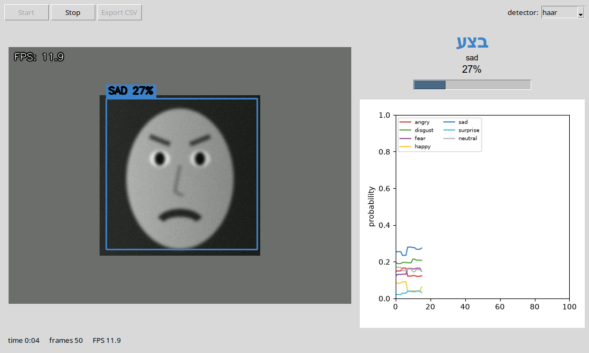
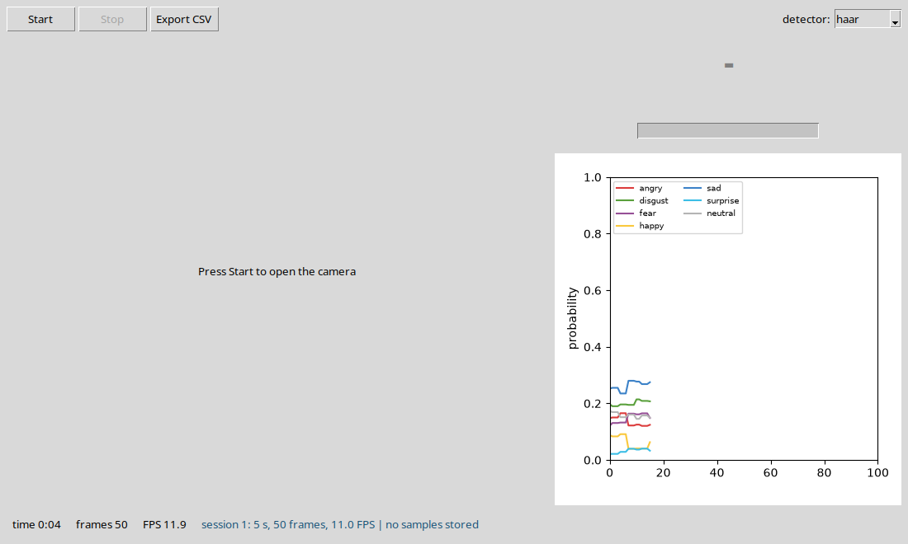

# FaceEmotion — walkthrough

Every function you write in this project (97 of them), in the order of `TASKS.md`. For each one:

- **Problem** — what the function has to do,
- **Solution** — the finished code,
- **Check** — the test that proves it works.

Try each function yourself first, then compare. Run the check after every function, not at the end.

## Contents

- [Stage 1 — Environment and camera](#stage-1--environment-and-camera) (5 functions)
- [Stage 2 — Face detection](#stage-2--face-detection) (8 functions)
- [Stage 3 — Data and model](#stage-3--data-and-model) (14 functions)
- [Stage 4 — Full training on the GPU, and evaluation](#stage-4--full-training-on-the-gpu-and-evaluation) (12 functions)
- [Stage 5 — Real-time integration](#stage-5--real-time-integration) (17 functions)
- [Stage 6 — Database, UI and export](#stage-6--database-ui-and-export) (37 functions)
- [Stage 7 — Comparing alternatives, tests and documentation](#stage-7--comparing-alternatives-tests-and-documentation) (4 functions)
- [The finished project](#the-finished-project)

## Stage 1 — Environment and camera

### `app/vision/camera.py`

#### `CameraService.start()`

**Problem.** Open the camera (or a video file), set the frame size and start a background thread that keeps reading frames. If the camera cannot be opened, raise RuntimeError with a clear message.

**Solution.**

```python
def start(self) -> None:
    if self._running:
        return
    self._capture = cv2.VideoCapture(self.camera_index)
    if not self._capture.isOpened():
        self._capture.release()
        self._capture = None
        raise RuntimeError(f"cannot open camera {self.camera_index} - is it connected and not used by another app?")
    self._capture.set(cv2.CAP_PROP_FRAME_WIDTH, config.FRAME_WIDTH)
    self._capture.set(cv2.CAP_PROP_FRAME_HEIGHT, config.FRAME_HEIGHT)
    self._running = True
    self._thread = threading.Thread(target=self._reader_loop, daemon=True, name="camera-reader")
    self._thread.start()
```

**Check.** No unit test - run the program and look (see the stage's exit condition in `TASKS.md`).

#### `CameraService._reader_loop()`

**Problem.** Keep reading frames while running and store only the newest one (under the lock). A failed read is never stored. Reading here, not in the Tk callback, stops the window from freezing.

**Solution.**

```python
def _reader_loop(self) -> None:
    is_file = isinstance(self.camera_index, str)
    fps = (self._capture.get(cv2.CAP_PROP_FPS) or 30.0) if is_file else 0
    while self._running:
        ok, frame = self._capture.read()
        if not ok:
            if is_file:                                  # a video file: loop it (demo / tests)
                self._capture.set(cv2.CAP_PROP_POS_FRAMES, 0)
                continue
            time.sleep(0.01)
            continue
        with self._lock:
            self._latest_frame = frame
        if is_file:
            time.sleep(1.0 / fps)                        # play a file at its own speed, like a camera
```

**Check.** No unit test - run the program and look (see the stage's exit condition in `TASKS.md`).

#### `CameraService.read()`

**Problem.** Return a copy of the newest frame, or None if there is none yet. A copy, because the reader thread keeps overwriting the buffer.

**Solution.**

```python
def read(self) -> Optional[np.ndarray]:
    with self._lock:
        return None if self._latest_frame is None else self._latest_frame.copy()
```

**Check.** No unit test - run the program and look (see the stage's exit condition in `TASKS.md`).

#### `CameraService.stop()`

**Problem.** Stop the thread, wait for it, release the camera and drop the stored frame.

**Solution.**

```python
def stop(self) -> None:
    self._running = False
    if self._thread is not None:
        self._thread.join(timeout=2.0)
        self._thread = None
    if self._capture is not None:
        self._capture.release()
        self._capture = None
    with self._lock:
        self._latest_frame = None
```

**Check.** No unit test - run the program and look (see the stage's exit condition in `TASKS.md`).

### `train.py`

#### `print_device_banner()`

**Problem.** Print which device will train the model: for a GPU its name and memory, otherwise a loud warning that CPU training takes hours.

**Solution.**

```python
def print_device_banner():
    if config.DEVICE.type == "cuda":
        props = torch.cuda.get_device_properties(0)
        print(f"device: CUDA - {torch.cuda.get_device_name(0)}, {props.total_memory / 1024 ** 3:.1f} GB, "
              f"mixed precision {'on' if config.USE_AMP else 'off'}")
    else:
        print("=" * 70)
        print("WARNING: no CUDA GPU found - training on the CPU.")
        print(f"         {torch.get_num_threads()} CPU threads; a full 50-epoch run takes several hours.")
        print("         Check: python -c \"import torch; print(torch.cuda.is_available())\"")
        print("=" * 70)
```

**Check.** No unit test - run the program and look (see the stage's exit condition in `TASKS.md`).


## Stage 2 — Face detection

### `app/models/detection.py`

#### `FaceDetection.area`

**Problem.** The box's width x height - used to pick the biggest face.

**Solution.**

```python
@property
def area(self) -> int:
    return self.w * self.h
```

**Check.** `pytest tests/test_preprocessor.py::test_area`

#### `FaceDetection.with_margin(margin, frame_shape)`

**Problem.** Return a new box grown by `margin` (0.10 = 10%) on every side, but never outside the frame. frame_shape is (height, width).

**Solution.**

```python
def with_margin(self, margin: float, frame_shape: Tuple[int, int]) -> "FaceDetection":
    fh, fw = frame_shape[:2]
    dx, dy = int(self.w * margin), int(self.h * margin)
    x, y = max(0, self.x - dx), max(0, self.y - dy)
    w = min(fw, self.x + self.w + dx) - x
    h = min(fh, self.y + self.h + dy) - y
    return FaceDetection(x, y, w, h, self.confidence)
```

**Check.** `pytest tests/test_preprocessor.py -k "test_margin_grows_the_box or test_margin_is_clipped_to_the_frame"`

#### `FaceDetection.crop(frame)`

**Problem.** Cut the box out of the frame: rows y..y+h, columns x..x+w (numpy indexes rows first).

**Solution.**

```python
def crop(self, frame: np.ndarray) -> np.ndarray:
    return frame[self.y:self.y + self.h, self.x:self.x + self.w]
```

**Check.** `pytest tests/test_preprocessor.py::test_crop_returns_the_right_region`

### `app/vision/face_detector.py`

#### `FaceDetector.detect_largest(frame)`

**Problem.** Find all faces and return a list with only the biggest one, or an empty list.

**Solution.**

```python
def detect_largest(self, frame: np.ndarray) -> List[FaceDetection]:
    faces = self.detect(frame)
    return [max(faces, key=lambda f: f.area)] if faces else []
```

**Check.** No unit test - run the program and look (see the stage's exit condition in `TASKS.md`).

#### `create_detector(name)`

**Problem.** Turn a name into a detector object: "haar" or "dnn"; anything else raises ValueError.

**Solution.**

```python
def create_detector(name: str) -> FaceDetector:
    if name == "haar":
        from app.vision.haar_detector import HaarCascadeDetector
        return HaarCascadeDetector()
    if name == "dnn":
        from app.vision.dnn_detector import DnnFaceDetector
        return DnnFaceDetector()
    raise ValueError(f"unknown detector '{name}' - use 'haar' or 'dnn'")
```

**Check.** No unit test - run the program and look (see the stage's exit condition in `TASKS.md`).

### `app/vision/haar_detector.py`

#### `HaarCascadeDetector.__init__(cascade_path)`

**Problem.** Load the Haar cascade file. A wrong path does not raise by itself - it just finds nothing - so check that the cascade loaded and raise if it is empty.

**Solution.**

```python
def __init__(self, cascade_path: str = None):
    path = cascade_path or config.HAAR_CASCADE_PATH
    self._cascade = cv2.CascadeClassifier(path)
    if self._cascade.empty():
        raise RuntimeError(f"could not load the Haar cascade from '{path}'")
```

**Check.** No unit test - run the program and look (see the stage's exit condition in `TASKS.md`).

#### `HaarCascadeDetector.detect(frame)`

**Problem.** Find faces: convert to grey, equalise the lighting, run detectMultiScale with the config settings and return a FaceDetection per box.

**Solution.**

```python
def detect(self, frame: np.ndarray) -> List[FaceDetection]:
    gray = cv2.cvtColor(frame, cv2.COLOR_BGR2GRAY) if frame.ndim == 3 else frame
    gray = cv2.equalizeHist(gray)
    boxes = self._cascade.detectMultiScale(gray, scaleFactor=config.HAAR_SCALE_FACTOR,
                                           minNeighbors=config.HAAR_MIN_NEIGHBORS, minSize=config.HAAR_MIN_SIZE)
    return [FaceDetection(int(x), int(y), int(w), int(h), 1.0) for (x, y, w, h) in boxes]
```

**Check.** No unit test - run the program and look (see the stage's exit condition in `TASKS.md`).

### `app/vision/preprocessor.py`

#### `FacePreprocessor.crop_face(frame, detection)`

**Problem.** Cut the face out of the frame with the margin added, so it includes forehead and chin like the training images.

**Solution.**

```python
def crop_face(self, frame: np.ndarray, detection: FaceDetection) -> np.ndarray:
    box = detection.with_margin(self.margin, frame.shape[:2])
    return frame[box.y:box.y + box.h, box.x:box.x + box.w]
```

**Check.** No unit test - run the program and look (see the stage's exit condition in `TASKS.md`).


## Stage 3 — Data and model

### `app/ml/dataset.py`

**Helper code in this file** (used by the functions below, not a TODO in your skeleton):

`_Subset`

```python
class _Subset(Dataset):

    def __init__(self, base: "FER2013Dataset", indices, transform):
        self.base, self.indices, self.transform = base, list(indices), transform

    def __len__(self) -> int:
        return len(self.indices)

    def __getitem__(self, i):
        path, folder_label = self.base.folder.samples[self.indices[i]]
        image = self.base.folder.loader(path)
        return self.transform(image), self.base.remap[folder_label]

    def class_counts(self) -> np.ndarray:
        counts = np.zeros(NUM_CLASSES, dtype=np.int64)
        for i in self.indices:
            counts[self.base.remap[self.base.folder.samples[i][1]]] += 1
        return counts
```

#### `EqualizeHist.__call__(image)`

**Problem.** A transform that equalises the lighting of a grey image (cv2.equalizeHist) - the camera path does the same, so training and real time see the same kind of picture.

**Solution.**

```python
def __call__(self, image):
    array = np.array(image)
    array = cv2.equalizeHist(array)
    return Image.fromarray(array)
```

**Check.** No unit test - run the program and look (see the stage's exit condition in `TASKS.md`).

#### `build_train_transform()`

**Problem.** The training transforms: grey, equalise, random flip, small rotation and crop, to tensor, normalise, and random erasing. The randomness makes the model robust; it is used for training only.

**Solution.**

```python
def build_train_transform():
    return T.Compose([
        T.Grayscale(num_output_channels=1),
        EqualizeHist(),
        T.RandomHorizontalFlip(p=0.5),
        T.RandomRotation(10),
        T.RandomResizedCrop(config.IMAGE_SIZE, scale=(0.85, 1.0)),
        T.ToTensor(),
        T.Normalize([config.NORMALIZE_MEAN], [config.NORMALIZE_STD]),
        T.RandomErasing(p=0.2),
    ])
```

**Check.** No unit test - run the program and look (see the stage's exit condition in `TASKS.md`).

#### `build_eval_transform()`

**Problem.** The evaluation transforms: grey, resize to 48x48, equalise, to tensor, normalise - no randomness, and the same steps as the camera path.

**Solution.**

```python
def build_eval_transform():
    return T.Compose([
        T.Grayscale(num_output_channels=1),
        T.Resize((config.IMAGE_SIZE, config.IMAGE_SIZE)),
        EqualizeHist(),
        T.ToTensor(),
        T.Normalize([config.NORMALIZE_MEAN], [config.NORMALIZE_STD]),
    ])
```

**Check.** `pytest tests/test_preprocessor.py::test_eval_transform_matches_realtime_preprocessing`

#### `FER2013Dataset.__init__(root, transform)`

**Problem.** Load the image folders with ImageFolder and build a lookup that turns its alphabetical label numbers into the Emotion numbers. Without it the model learns fine but calls every sad face "neutral".

**Solution.**

```python
def __init__(self, root: str, transform=None):
    self.folder = torchvision.datasets.ImageFolder(root, transform=transform)
    self.remap = [0] * len(self.folder.classes)
    for folder_name, folder_index in self.folder.class_to_idx.items():
        self.remap[folder_index] = Emotion[folder_name.upper()].value
    self.transform = transform
```

**Check.** No unit test - run the program and look (see the stage's exit condition in `TASKS.md`).

#### `FER2013Dataset.__len__()`

**Problem.** The number of images.

**Solution.**

```python
def __len__(self) -> int:
    return len(self.folder)
```

**Check.** No unit test - run the program and look (see the stage's exit condition in `TASKS.md`).

#### `FER2013Dataset.__getitem__(index)`

**Problem.** Return one (image, label) pair with the label translated to the Emotion order.

**Solution.**

```python
def __getitem__(self, index: int) -> Tuple[torch.Tensor, int]:
    image, folder_label = self.folder[index]
    return image, self.remap[folder_label]
```

**Check.** No unit test - run the program and look (see the stage's exit condition in `TASKS.md`).

#### `FER2013Dataset.class_counts()`

**Problem.** How many images each of the seven emotions has, counted from the file list (not by loading images). Disgust has far fewer than happy.

**Solution.**

```python
def class_counts(self) -> np.ndarray:
    counts = np.zeros(NUM_CLASSES, dtype=np.int64)
    for _, folder_label in self.folder.samples:
        counts[self.remap[folder_label]] += 1
    return counts
```

**Check.** No unit test - run the program and look (see the stage's exit condition in `TASKS.md`).

#### `build_dataloaders(batch_size)`

**Problem.** Return train, validation and test loaders: split 10% of the training images off for validation (fixed seed), augment only the training part, shuffle only the training loader.

**Solution.**

```python
def build_dataloaders(batch_size: int = config.BATCH_SIZE) -> Tuple[DataLoader, DataLoader, DataLoader]:
    import os
    train_dir, test_dir = os.path.join(config.FER2013_DIR, "train"), os.path.join(config.FER2013_DIR, "test")
    if not os.path.isdir(train_dir) or not os.path.isdir(test_dir):
        raise FileNotFoundError(f"FER-2013 not found in {config.FER2013_DIR} - see data/README.md")
    full = FER2013Dataset(train_dir, transform=None)
    n_val = int(len(full) * config.VALIDATION_SPLIT)
    generator = torch.Generator().manual_seed(config.RANDOM_SEED)
    train_idx, val_idx = random_split(range(len(full)), [len(full) - n_val, n_val], generator=generator)
    train_set = _Subset(full, train_idx.indices, build_train_transform())
    val_set = _Subset(full, val_idx.indices, build_eval_transform())
    test_set = FER2013Dataset(test_dir, transform=build_eval_transform())
    pin = config.DEVICE.type == "cuda"
    workers = config.NUM_WORKERS
    common = dict(batch_size=batch_size, num_workers=workers, pin_memory=pin, persistent_workers=workers > 0)
    return (DataLoader(train_set, shuffle=True, **common),
            DataLoader(val_set, shuffle=False, **common),
            DataLoader(test_set, shuffle=False, **common))
```

**Check.** No unit test - run the program and look (see the stage's exit condition in `TASKS.md`).

### `app/ml/network.py`

#### `ResidualBlock.__init__(in_channels, out_channels, stride)`

**Problem.** Create the two 3x3 convolutions with batch norm and ReLU, and the shortcut: the identity when the shape stays the same, otherwise a 1x1 convolution with batch norm.

**Solution.**

```python
def __init__(self, in_channels: int, out_channels: int, stride: int = 1):
    super().__init__()
    self.conv1 = nn.Conv2d(in_channels, out_channels, 3, stride, 1, bias=False)
    self.bn1 = nn.BatchNorm2d(out_channels)
    self.conv2 = nn.Conv2d(out_channels, out_channels, 3, 1, 1, bias=False)
    self.bn2 = nn.BatchNorm2d(out_channels)
    self.relu = nn.ReLU(inplace=True)
    if stride != 1 or in_channels != out_channels:
        self.shortcut = nn.Sequential(nn.Conv2d(in_channels, out_channels, 1, stride, bias=False), nn.BatchNorm2d(out_channels))
    else:
        self.shortcut = nn.Identity()
```

**Check.** `pytest tests/test_network.py -k "test_residual_block_keeps_shape_with_stride_one or test_residual_block_halves_with_stride_two"`

#### `ResidualBlock.forward(x)`

**Problem.** conv-bn-relu, conv-bn, add the shortcut, then ReLU. Adding the shortcut before the last ReLU is what lets the gradient flow back through deep networks.

**Solution.**

```python
def forward(self, x: torch.Tensor) -> torch.Tensor:
    identity = self.shortcut(x)
    out = self.relu(self.bn1(self.conv1(x)))
    out = self.bn2(self.conv2(out))
    out = out + identity
    return self.relu(out)
```

**Check.** `pytest tests/test_network.py::test_network_returns_logits_not_probabilities`

#### `EmotionNet.__init__(num_classes, dropout)`

**Problem.** Build the network: a stem (1 to 64 channels), four residual blocks (64, 128, 256, 512 channels, halving the size from block 2 on), and a head (average pool, dropout, linear to 7). About 4.9 million parameters.

**Solution.**

```python
def __init__(self, num_classes: int = NUM_CLASSES, dropout: float = 0.3):
    super().__init__()
    self.stem = nn.Sequential(nn.Conv2d(1, 64, 3, 1, 1, bias=False), nn.BatchNorm2d(64), nn.ReLU(inplace=True))
    self.block1 = ResidualBlock(64, 64, 1)
    self.block2 = ResidualBlock(64, 128, 2)
    self.block3 = ResidualBlock(128, 256, 2)
    self.block4 = ResidualBlock(256, 512, 2)
    self.head = nn.Sequential(nn.AdaptiveAvgPool2d(1), nn.Flatten(), nn.Dropout(dropout), nn.Linear(512, num_classes))
```

**Check.** `pytest tests/test_network.py -k "test_network_output_shape or test_network_returns_logits_not_probabilities or test_gradients_flow"`

#### `EmotionNet.forward(x)`

**Problem.** Pass the batch through stem, the four blocks and the head. Return raw logits - no softmax here, CrossEntropyLoss applies it.

**Solution.**

```python
def forward(self, x: torch.Tensor) -> torch.Tensor:
    x = self.stem(x)
    x = self.block1(x)
    x = self.block2(x)
    x = self.block3(x)
    x = self.block4(x)
    return self.head(x)
```

**Check.** `pytest tests/test_network.py::test_network_returns_logits_not_probabilities`

### `app/vision/preprocessor.py`

#### `FacePreprocessor.to_model_input(face_bgr)`

**Problem.** Turn a face crop into what the network expects: grey, resized to 48x48, equalised, scaled to 0-1, normalised with the training mean and std, shaped (1, 1, 48, 48). The steps must match the evaluation transform exactly.

**Solution.**

```python
def to_model_input(self, face_bgr: np.ndarray) -> np.ndarray:
    import cv2
    g = cv2.cvtColor(face_bgr, cv2.COLOR_BGR2GRAY)
    g = cv2.resize(g, (self.image_size, self.image_size), interpolation=cv2.INTER_AREA)
    g = cv2.equalizeHist(g)
    x = (g.astype(np.float32) / 255.0 - config.NORMALIZE_MEAN) / config.NORMALIZE_STD
    return x.reshape(1, 1, self.image_size, self.image_size).astype(np.float32)
```

**Check.** `pytest tests/test_preprocessor.py -k "test_model_input_shape_and_scale or test_model_input_is_deterministic or test_eval_transform_matches_realtime_preprocessing"`

#### `FacePreprocessor.process(frame, detection)`

**Problem.** Crop the face, then turn it into the model input.

**Solution.**

```python
def process(self, frame: np.ndarray, detection: FaceDetection) -> np.ndarray:
    return self.to_model_input(self.crop_face(frame, detection))
```

**Check.** No unit test - run the program and look (see the stage's exit condition in `TASKS.md`).


## Stage 4 — Full training on the GPU, and evaluation

### `app/ml/dataset.py`

#### `compute_class_weights(counts)`

**Problem.** Give rare emotions a bigger weight in the loss: total / (7 x count) for each class, scaled so the average weight is 1. Return a tensor on the training device.

**Solution.**

```python
def compute_class_weights(counts: np.ndarray) -> torch.Tensor:
    counts = np.asarray(counts, dtype=np.float64)
    w = counts.sum() / (len(counts) * counts)
    w = w / w.mean()
    return torch.tensor(w, dtype=torch.float32, device=config.DEVICE)
```

**Check.** No unit test - run the program and look (see the stage's exit condition in `TASKS.md`).

### `app/ml/evaluator.py`

#### `ModelEvaluator.evaluate()`

**Problem.** Run the whole test set once and compute the accuracy, precision/recall/F1 per emotion and the confusion matrix.

**Solution.**

```python
@torch.no_grad()
def evaluate(self) -> Dict:
    from sklearn.metrics import accuracy_score, classification_report, confusion_matrix
    self.model.eval()
    y_true, y_pred = [], []
    for images, labels in self.test_loader:
        outputs = self.model(images.to(self.device))
        y_pred.extend(outputs.argmax(dim=1).cpu().tolist())
        y_true.extend(labels.tolist())
    names = [e.name for e in Emotion]
    self.y_true, self.y_pred = np.array(y_true), np.array(y_pred)
    self.confusion = confusion_matrix(y_true, y_pred, labels=list(range(len(names))))
    self.metrics = {
        "accuracy": float(accuracy_score(y_true, y_pred)),
        "report": classification_report(y_true, y_pred, labels=list(range(len(names))), target_names=names,
                                        output_dict=True, zero_division=0),
        "confusion_matrix": self.confusion.tolist(),
        "test_images": len(y_true),
    }
    return self.metrics
```

**Check.** No unit test - run the program and look (see the stage's exit condition in `TASKS.md`).

#### `ModelEvaluator.plot_confusion_matrix(path, normalize)`

**Problem.** Draw the confusion matrix as a heat-map with the emotion names, each row scaled to sum to 1, so you can see which emotions get mixed up.

**Solution.**

```python
def plot_confusion_matrix(self, path: str, normalize: bool = True) -> None:
    import matplotlib
    matplotlib.use("Agg")
    import matplotlib.pyplot as plt
    cm = self.confusion.astype(float)
    if normalize:
        cm = cm / np.maximum(cm.sum(axis=1, keepdims=True), 1)
    names = [e.name.lower() for e in Emotion]
    fig, ax = plt.subplots(figsize=(7, 6))
    image = ax.imshow(cm, cmap="Blues", vmin=0, vmax=1 if normalize else None)
    for i in range(len(names)):
        for j in range(len(names)):
            ax.text(j, i, f"{cm[i, j]:.2f}" if normalize else int(cm[i, j]), ha="center", va="center",
                    color="white" if cm[i, j] > cm.max() / 2 else "black", fontsize=8)
    ax.set_xticks(range(len(names)), names, rotation=45)
    ax.set_yticks(range(len(names)), names)
    ax.set_xlabel("predicted")
    ax.set_ylabel("true")
    ax.set_title(f"FER-2013 test - accuracy {self.metrics['accuracy']:.1%}")
    fig.colorbar(image, ax=ax)
    fig.tight_layout()
    fig.savefig(path, dpi=120)
    plt.close(fig)
```

**Check.** No unit test - run the program and look (see the stage's exit condition in `TASKS.md`).

#### `ModelEvaluator.save_report(path)`

**Problem.** Write the metrics to a JSON file.

**Solution.**

```python
def save_report(self, path: str) -> None:
    with open(path, "w", encoding="utf-8") as fh:
        json.dump(self.metrics, fh, indent=2)
```

**Check.** No unit test - run the program and look (see the stage's exit condition in `TASKS.md`).

### `app/ml/trainer.py`

**Helper code in this file** (used by the functions below, not a TODO in your skeleton):

`ModelTrainer._build_scheduler`

```python
def _build_scheduler(self, epochs: int) -> None:
        warmup_epochs = min(config.WARMUP_EPOCHS, max(1, epochs - 1))
        warmup = LinearLR(self.optimizer, start_factor=0.1, total_iters=warmup_epochs)
        cosine = CosineAnnealingLR(self.optimizer, T_max=max(1, epochs - warmup_epochs))
        self.scheduler = SequentialLR(self.optimizer, [warmup, cosine], milestones=[warmup_epochs])
```

#### `ModelTrainer.__init__(model, train_loader, val_loader, class_weights)`

**Problem.** Create the loss (with the class weights and label smoothing), the AdamW optimiser, a learning-rate schedule (warm-up then cosine) and the gradient scaler for mixed precision on a GPU.

**Solution.**

```python
def __init__(self, model, train_loader, val_loader, class_weights=None):
    self.model = model
    self.train_loader = train_loader
    self.val_loader = val_loader
    self.class_weights = class_weights
    self.device = config.DEVICE
    self.history = TrainingHistory()
    self.best_val_acc = 0.0
    self.criterion = nn.CrossEntropyLoss(weight=class_weights, label_smoothing=config.LABEL_SMOOTHING)
    self.optimizer = torch.optim.AdamW(model.parameters(), lr=config.LEARNING_RATE, weight_decay=config.WEIGHT_DECAY)
    self.total_epochs = config.EPOCHS
    self._build_scheduler(config.EPOCHS)
    self.scaler = torch.amp.GradScaler("cuda", enabled=config.USE_AMP)
    if self.device.type == "cuda":
        torch.backends.cudnn.benchmark = True
```

**Check.** No unit test - run the program and look (see the stage's exit condition in `TASKS.md`).

#### `ModelTrainer.train_one_epoch()`

**Problem.** One pass over the training data: move each batch to the device, compute the loss, back-propagate and step the optimiser. Return the average loss and accuracy.

**Solution.**

```python
def train_one_epoch(self) -> Dict[str, float]:
    self.model.train()
    total_loss, correct, seen = 0.0, 0, 0
    for images, labels in self.train_loader:
        images = images.to(self.device, non_blocking=True)
        labels = labels.to(self.device, non_blocking=True)
        self.optimizer.zero_grad(set_to_none=True)
        with torch.autocast(self.device.type, enabled=config.USE_AMP):
            outputs = self.model(images)
            loss = self.criterion(outputs, labels)
        self.scaler.scale(loss).backward()
        self.scaler.step(self.optimizer)
        self.scaler.update()
        total_loss += loss.item() * labels.size(0)
        correct += (outputs.argmax(dim=1) == labels).sum().item()
        seen += labels.size(0)
    return {"loss": total_loss / max(seen, 1), "acc": correct / max(seen, 1)}
```

**Check.** No unit test - run the program and look (see the stage's exit condition in `TASKS.md`).

#### `ModelTrainer.validate()`

**Problem.** The same loop over the validation data, in eval mode and without gradients or optimiser steps.

**Solution.**

```python
@torch.no_grad()
def validate(self) -> Dict[str, float]:
    self.model.eval()
    total_loss, correct, seen = 0.0, 0, 0
    for images, labels in self.val_loader:
        images = images.to(self.device, non_blocking=True)
        labels = labels.to(self.device, non_blocking=True)
        with torch.autocast(self.device.type, enabled=config.USE_AMP):
            outputs = self.model(images)
            loss = self.criterion(outputs, labels)
        total_loss += loss.item() * labels.size(0)
        correct += (outputs.argmax(dim=1) == labels).sum().item()
        seen += labels.size(0)
    return {"loss": total_loss / max(seen, 1), "acc": correct / max(seen, 1)}
```

**Check.** No unit test - run the program and look (see the stage's exit condition in `TASKS.md`).

#### `ModelTrainer.fit(epochs)`

**Problem.** Train for the given epochs: train, validate, step the schedule and print a line per epoch. Save the best model whenever validation accuracy improves and the last model every epoch, and stop early after 8 epochs without improvement.

**Solution.**

```python
def fit(self, epochs: int = config.EPOCHS) -> TrainingHistory:
    if epochs != self.total_epochs:                 # a short run gets its own warm-up + cosine curve
        self.total_epochs = epochs
        self._build_scheduler(epochs)
    without_improvement = 0
    for epoch in range(1, epochs + 1):
        start = time.time()
        train = self.train_one_epoch()
        val = self.validate()
        self.scheduler.step()
        seconds = time.time() - start
        h = self.history
        h.train_loss.append(train["loss"]); h.train_acc.append(train["acc"])
        h.val_loss.append(val["loss"]); h.val_acc.append(val["acc"]); h.epoch_seconds.append(seconds)
        improved = val["acc"] > self.best_val_acc
        print(f"epoch {epoch:3d}/{epochs}  train loss {train['loss']:.4f} acc {train['acc']:.4f}  "
              f"val loss {val['loss']:.4f} acc {val['acc']:.4f}  lr {self.optimizer.param_groups[0]['lr']:.6f}  "
              f"{seconds:.0f}s{'  *best*' if improved else ''}", flush=True)
        if improved:
            self.best_val_acc = val["acc"]
            self.save_checkpoint(config.BEST_MODEL_PATH, epoch, val["acc"])
            without_improvement = 0
        else:
            without_improvement += 1
        self.save_checkpoint(config.LAST_MODEL_PATH, epoch, val["acc"])
        if without_improvement >= config.EARLY_STOPPING_PATIENCE:
            print(f"early stopping: no improvement for {without_improvement} epochs")
            break
    return self.history
```

**Check.** No unit test - run the program and look (see the stage's exit condition in `TASKS.md`).

#### `ModelTrainer.save_checkpoint(path, epoch, val_acc)`

**Problem.** Save the weights, the optimiser state, the epoch, the validation accuracy and the pre-processing constants together, so a model file can never be used with the wrong normalisation.

**Solution.**

```python
def save_checkpoint(self, path: str, epoch: int, val_acc: float) -> None:
    torch.save({"model_state": self.model.state_dict(),
                "optimizer_state": self.optimizer.state_dict(),
                "epoch": epoch, "val_acc": val_acc,
                "config": {"image_size": config.IMAGE_SIZE, "mean": config.NORMALIZE_MEAN, "std": config.NORMALIZE_STD}},
               path)
```

**Check.** No unit test - run the program and look (see the stage's exit condition in `TASKS.md`).

#### `ModelTrainer.plot_history(path)`

**Problem.** Plot loss and accuracy per epoch (train and validation) and save the picture.

**Solution.**

```python
def plot_history(self, path: str) -> None:
    import matplotlib
    matplotlib.use("Agg")
    import matplotlib.pyplot as plt
    h = self.history
    epochs = range(1, len(h.train_loss) + 1)
    fig, (ax1, ax2) = plt.subplots(1, 2, figsize=(11, 4))
    ax1.plot(epochs, h.train_loss, label="train"); ax1.plot(epochs, h.val_loss, label="validation")
    ax1.set_title("Loss"); ax1.set_xlabel("epoch"); ax1.legend(); ax1.grid(alpha=0.3)
    ax2.plot(epochs, h.train_acc, label="train"); ax2.plot(epochs, h.val_acc, label="validation")
    ax2.set_title("Accuracy"); ax2.set_xlabel("epoch"); ax2.legend(); ax2.grid(alpha=0.3)
    fig.tight_layout()
    fig.savefig(path, dpi=120)
    plt.close(fig)
    with open(path.rsplit(".", 1)[0] + ".json", "w", encoding="utf-8") as fh:
        json.dump(h.__dict__, fh, indent=1)
```

**Check.** No unit test - run the program and look (see the stage's exit condition in `TASKS.md`).

### `evaluate.py`

#### `main()`

**Problem.** Load a checkpoint, evaluate it on the test set, save the confusion matrix and the metrics, and print the accuracy and the F1 per emotion.

**Solution.**

```python
def main():
    args = parse_args()
    if not os.path.exists(args.model):
        raise SystemExit(f"no checkpoint at {args.model} - train first: python train.py")
    os.makedirs(config.REPORTS_DIR, exist_ok=True)
    _, _, test_loader = build_dataloaders(args.batch_size)
    checkpoint = torch.load(args.model, map_location=config.DEVICE, weights_only=False)
    model = EmotionNet()
    model.load_state_dict(checkpoint["model_state"])
    model.to(config.DEVICE).eval()
    evaluator = ModelEvaluator(model, test_loader)
    metrics = evaluator.evaluate()
    evaluator.plot_confusion_matrix(os.path.join(config.REPORTS_DIR, "confusion_matrix.png"))
    evaluator.save_report(os.path.join(config.REPORTS_DIR, "metrics.json"))
    print(f"checkpoint {args.model} (epoch {checkpoint.get('epoch')}, val acc {checkpoint.get('val_acc', 0):.4f})")
    print(f"test accuracy on {metrics['test_images']} images: {metrics['accuracy']:.4f}")
    print(f"{'emotion':<10}{'precision':>10}{'recall':>8}{'f1':>8}{'support':>9}")
    for emotion in Emotion:
        r = metrics["report"][emotion.name]
        print(f"{emotion.name.lower():<10}{r['precision']:>10.3f}{r['recall']:>8.3f}{r['f1-score']:>8.3f}{int(r['support']):>9}")
    print(f"saved {config.REPORTS_DIR}/confusion_matrix.png and metrics.json")
```

**Check.** No unit test - run the program and look (see the stage's exit condition in `TASKS.md`).

### `train.py`

#### `main()`

**Problem.** Build the loaders, the class weights, the model and the trainer, train, save the training curves and print the best validation accuracy.

**Solution.**

```python
def main():
    args = parse_args()
    if args.cpu:
        config.DEVICE = torch.device("cpu")
        config.USE_AMP = False
    torch.manual_seed(config.RANDOM_SEED)
    os.makedirs(config.MODELS_DIR, exist_ok=True)
    os.makedirs(config.REPORTS_DIR, exist_ok=True)

    print_device_banner()

    train_loader, val_loader, _ = build_dataloaders(args.batch_size)
    counts = train_loader.dataset.class_counts()
    print("training images per emotion:", {e.name.lower(): int(n) for e, n in zip(Emotion, counts)})
    weights = compute_class_weights(counts)
    model = EmotionNet().to(config.DEVICE)
    print(f"parameters: {model.count_parameters():,}")
    trainer = ModelTrainer(model, train_loader, val_loader, weights)
    if args.lr != config.LEARNING_RATE:
        for group in trainer.optimizer.param_groups:
            group["lr"] = args.lr
            group["initial_lr"] = args.lr
    if args.resume:
        checkpoint = torch.load(args.resume, map_location=config.DEVICE, weights_only=False)
        model.load_state_dict(checkpoint["model_state"])
        if "optimizer_state" in checkpoint:
            trainer.optimizer.load_state_dict(checkpoint["optimizer_state"])
        trainer.best_val_acc = checkpoint.get("val_acc", 0.0)
        print(f"resumed from {args.resume} (epoch {checkpoint.get('epoch')}, val acc {trainer.best_val_acc:.4f})")
    history = trainer.fit(args.epochs)
    trainer.plot_history(os.path.join(config.REPORTS_DIR, "training_curves.png"))
    print(f"best validation accuracy: {trainer.best_val_acc:.4f} -> {config.BEST_MODEL_PATH}")
    print(f"epochs run: {len(history.val_acc)}, average {sum(history.epoch_seconds) / len(history.epoch_seconds):.0f} s/epoch")
```

**Check.** No unit test - run the program and look (see the stage's exit condition in `TASKS.md`).


## Stage 5 — Real-time integration

### `app/controllers/app_controller.py`

#### `AppController.__init__(root)`

**Problem.** Create the camera, detector, preprocessor, predictor, smoother, annotator, FPS counter and session controller, and the window with its four callbacks.

**Solution.**

```python
def __init__(self, root: tk.Tk, camera_source=None):
    self.root = root
    self.camera = CameraService(config.CAMERA_INDEX if camera_source is None else camera_source)
    self.detector = create_detector(config.DETECTOR)
    self.preprocessor = FacePreprocessor()
    self.predictor = EmotionPredictor()
    self.smoother = TemporalSmoother()
    self.annotator = FrameAnnotator()
    self.fps_counter = FpsCounter()
    self.session_controller = SessionController(SessionRepository(), SampleRepository())
    self.view = MainWindow(root, on_start=self.start_capture, on_stop=self.stop_capture,
                           on_export=self.export_session, on_detector_change=self.change_detector)
    self._job = None
    self._frames = 0
    self._fps_samples = []
    self._started = 0.0
    root.protocol("WM_DELETE_WINDOW", self.on_close)
```

**Check.** No unit test - run the program and look (see the stage's exit condition in `TASKS.md`).

#### `AppController.start()`

**Problem.** Show the window and warn when there is no trained model.

**Solution.**

```python
def start(self) -> None:
    self.view.pack(fill="both", expand=True)
    self.view.set_running(False)
    self.view.set_detector(self.detector.name)
    if not self.predictor.is_ready:
        self.view.show_message("No trained model",
                               "No trained model was found, so faces are detected but not classified.\n\n"
                               "Train one first:\n    python train.py")
```

**Check.** No unit test - run the program and look (see the stage's exit condition in `TASKS.md`).

#### `AppController.start_capture()`

**Problem.** Start the camera, open a session, reset the counters and schedule the first frame. A second click while running does nothing; a camera error is shown.

**Solution.**

```python
def start_capture(self) -> None:
    if self.camera.is_running:
        return
    try:
        self.camera.start()
    except RuntimeError as exc:
        self.view.show_message("Camera", str(exc))
        return
    model_name = os.path.basename(self.predictor.model_path) if self.predictor.is_ready else "none"
    self.session_controller.start_session(self.detector.name, model_name)
    self.fps_counter.reset()
    self.smoother.reset()
    self.view.chart_frame.clear()
    self._frames, self._fps_samples, self._started = 0, [], time.time()
    self.view.set_running(True)
    self._job = self.root.after(config.UI_REFRESH_MS, self._on_frame)
```

**Check.** No unit test - run the program and look (see the stage's exit condition in `TASKS.md`).

#### `AppController._on_frame()`

**Problem.** One frame: read it, find the biggest face, classify and smooth it, draw the result, record the sample, update the panel and chart, show the frame - then schedule the next call. Never sleep or loop here; Tk would freeze.

**Solution.**

```python
def _on_frame(self) -> None:
    self._job = None
    if not self.camera.is_running:
        return
    frame = self.camera.read()
    if frame is not None:
        self.fps_counter.tick()
        self._frames += 1
        detections = self.detector.detect_largest(frame)
        if detections:
            face = detections[0]
            if self.predictor.is_ready:
                _, _, probs = self.predictor.predict(self.preprocessor.process(frame, face))
                emotion, confidence = self.smoother.update(probs)
                frame = self.annotator.draw_detection(frame, face, emotion, confidence)
                self.session_controller.record(emotion, confidence, face.box, probs)
                self.view.emotion_panel.show(emotion, confidence)
                if self._frames % 3 == 0:
                    self.view.chart_frame.push(probs)
            else:
                x, y, w, h = face.box
                import cv2
                frame = frame.copy()
                cv2.rectangle(frame, (x, y), (x + w, y + h), (200, 200, 200), 2)
        else:
            self.smoother.reset()
            self.view.emotion_panel.clear()
            frame = self.annotator.draw_no_face(frame)
        fps = self.fps_counter.value
        if fps:
            self._fps_samples.append(fps)
        self.view.video_frame.show(self.annotator.draw_fps(frame, fps))
        self.view.stats_frame.update_live(time.time() - self._started, self._frames, fps)
    self._job = self.root.after(config.UI_REFRESH_MS, self._on_frame)
```

**Check.** No unit test - run the program and look (see the stage's exit condition in `TASKS.md`).

#### `AppController.stop_capture()`

**Problem.** Cancel the scheduled frame, stop the camera, close the session (saving the remaining samples) and show the summary.

**Solution.**

```python
def stop_capture(self) -> None:
    if self._job is not None:
        self.root.after_cancel(self._job)
        self._job = None
    if not self.camera.is_running and self.session_controller.current is None:
        return
    self.camera.stop()
    average_fps = sum(self._fps_samples) / len(self._fps_samples) if self._fps_samples else 0.0
    session = self.session_controller.end_session(self._frames, average_fps)
    self.view.set_running(False)
    self.view.video_frame.clear()
    self.view.emotion_panel.clear()
    if session is not None:
        self.view.stats_frame.show_summary(session)
```

**Check.** No unit test - run the program and look (see the stage's exit condition in `TASKS.md`).

#### `AppController.on_close()`

**Problem.** Stop everything cleanly, then close the window.

**Solution.**

```python
def on_close(self) -> None:
    try:
        self.stop_capture()
    finally:
        self.root.destroy()
```

**Check.** No unit test - run the program and look (see the stage's exit condition in `TASKS.md`).

### `app/ml/predictor.py`

#### `EmotionPredictor.load_model()`

**Problem.** Load the trained model once. If the file is missing, print how to train and stay "not ready" - the app must still open and show the camera.

**Solution.**

```python
def load_model(self) -> None:
    if not os.path.exists(self.model_path):
        print(f"no trained model at {self.model_path} - train the model first: python train.py")
        self.is_ready = False
        return
    checkpoint = torch.load(self.model_path, map_location=self.device, weights_only=False)
    saved = checkpoint.get("config", {})
    if saved and (saved.get("image_size") != config.IMAGE_SIZE or abs(saved.get("mean", 0) - config.NORMALIZE_MEAN) > 1e-6
                  or abs(saved.get("std", 0) - config.NORMALIZE_STD) > 1e-6):
        print(f"WARNING: {self.model_path} was trained with different pre-processing {saved}; retrain it")
    model = EmotionNet()
    model.load_state_dict(checkpoint["model_state"])
    self.model = model.to(self.device).eval()
    self.checkpoint_info = {k: checkpoint.get(k) for k in ("epoch", "val_acc")}
    self.is_ready = True
```

**Check.** No unit test - run the program and look (see the stage's exit condition in `TASKS.md`).

#### `EmotionPredictor.predict(model_input)`

**Problem.** Classify one face: run the network, apply softmax, and return the top emotion, its probability and all seven probabilities.

**Solution.**

```python
@torch.no_grad()
def predict(self, model_input: np.ndarray) -> Tuple[Emotion, float, np.ndarray]:
    if not self.is_ready:
        raise RuntimeError("no trained model loaded")
    tensor = torch.from_numpy(np.ascontiguousarray(model_input, dtype=np.float32)).to(self.device)
    logits = self.model(tensor)
    probs = torch.softmax(logits, dim=1)[0].cpu().numpy()
    index = int(probs.argmax())
    return Emotion(index), float(probs[index]), probs
```

**Check.** No unit test - run the program and look (see the stage's exit condition in `TASKS.md`).

### `app/ml/smoothing.py`

#### `TemporalSmoother.update(probabilities)`

**Problem.** Add the newest probability vector, average the last N vectors and return the top emotion of the average. Averaging probabilities (not labels) stops the label from flickering between two close emotions.

**Solution.**

```python
def update(self, probabilities: np.ndarray) -> Tuple[Emotion, float]:
    self._window.append(np.asarray(probabilities, dtype=np.float32))
    avg = np.mean(self._window, axis=0)
    return Emotion(int(avg.argmax())), float(avg.max())
```

**Check.** `pytest tests/test_smoothing.py -k "test_single_update_returns_that_emotion or test_majority_wins_inside_the_window or test_window_forgets_old_frames or test_reset_clears_state"`

#### `TemporalSmoother.reset()`

**Problem.** Forget the stored frames (when the face is lost).

**Solution.**

```python
def reset(self) -> None:
    self._window.clear()
```

**Check.** `pytest tests/test_smoothing.py::test_reset_clears_state`

#### `TemporalSmoother.current`

**Problem.** The smoothed emotion now, or None when nothing is stored.

**Solution.**

```python
@property
def current(self) -> Optional[Emotion]:
    if not self._window:
        return None
    avg = np.mean(self._window, axis=0)
    return Emotion(int(avg.argmax())), float(avg.max())
```

**Check.** `pytest tests/test_smoothing.py::test_reset_clears_state`

### `app/utils/fps.py`

#### `FpsCounter.tick()`

**Problem.** Record the time of a new frame.

**Solution.**

```python
def tick(self) -> None:
    self._timestamps.append(time.perf_counter())
```

**Check.** No unit test - run the program and look (see the stage's exit condition in `TASKS.md`).

#### `FpsCounter.value`

**Problem.** Frames per second over the last frames: (count - 1) / (last time - first time), 0 with fewer than two frames.

**Solution.**

```python
@property
def value(self) -> float:
    if len(self._timestamps) < 2:
        return 0.0
    span = self._timestamps[-1] - self._timestamps[0]
    return (len(self._timestamps) - 1) / span if span > 0 else 0.0
```

**Check.** No unit test - run the program and look (see the stage's exit condition in `TASKS.md`).

#### `FpsCounter.reset()`

**Problem.** Forget the stored times.

**Solution.**

```python
def reset(self) -> None:
    self._timestamps.clear()
```

**Check.** `pytest tests/test_smoothing.py::test_reset_clears_state`

### `app/vision/annotator.py`

**Helper code in this file** (used by the functions below, not a TODO in your skeleton):

`FONT`

```python
FONT = cv2.FONT_HERSHEY_SIMPLEX
```

#### `FrameAnnotator.draw_detection(frame, detection, emotion, confidence)`

**Problem.** On a copy of the frame, draw the face box in the emotion's colour and a label "HAPPY 87%" on a filled bar above it. The English name, because OpenCV cannot draw Hebrew.

**Solution.**

```python
def draw_detection(self, frame: np.ndarray, detection: FaceDetection,
                   emotion: Emotion, confidence: float) -> np.ndarray:
    out = frame.copy()
    x, y, w, h = detection.box
    colour = emotion.color_bgr
    cv2.rectangle(out, (x, y), (x + w, y + h), colour, 2)
    text = f"{emotion.name} {confidence * 100:.0f}%"
    (tw, th), baseline = cv2.getTextSize(text, FONT, 0.6, 2)
    top = max(0, y - th - baseline - 6)
    cv2.rectangle(out, (x, top), (x + tw + 8, top + th + baseline + 6), colour, cv2.FILLED)
    cv2.putText(out, text, (x + 4, top + th + 3), FONT, 0.6, (0, 0, 0), 2, cv2.LINE_AA)
    return out
```

**Check.** No unit test - run the program and look (see the stage's exit condition in `TASKS.md`).

#### `FrameAnnotator.draw_fps(frame, fps)`

**Problem.** Write "FPS: 24.3" in the top-left corner.

**Solution.**

```python
def draw_fps(self, frame: np.ndarray, fps: float) -> np.ndarray:
    out = frame.copy()
    cv2.putText(out, f"FPS: {fps:.1f}", (10, 24), FONT, 0.6, (0, 0, 0), 3, cv2.LINE_AA)
    cv2.putText(out, f"FPS: {fps:.1f}", (10, 24), FONT, 0.6, (255, 255, 255), 1, cv2.LINE_AA)
    return out
```

**Check.** No unit test - run the program and look (see the stage's exit condition in `TASKS.md`).

#### `FrameAnnotator.draw_no_face(frame)`

**Problem.** Write "No face detected" on the frame.

**Solution.**

```python
def draw_no_face(self, frame: np.ndarray) -> np.ndarray:
    out = frame.copy()
    cv2.putText(out, "No face detected", (10, out.shape[0] - 14), FONT, 0.7, (0, 0, 255), 2, cv2.LINE_AA)
    return out
```

**Check.** No unit test - run the program and look (see the stage's exit condition in `TASKS.md`).


## Stage 6 — Database, UI and export

### `app/controllers/app_controller.py`

#### `AppController.export_session()`

**Problem.** Export the last finished session and tell the user where the file is (or why there is nothing to export yet).

**Solution.**

```python
def export_session(self) -> None:
    session_id = getattr(self.session_controller, "last_session_id", None)
    if self.session_controller.current is not None:
        self.view.show_message("Export", "Stop the camera first - the session is still recording.")
        return
    if session_id is None:
        self.view.show_message("Export", "Record a session first (Start, then Stop).")
        return
    path = self.session_controller.export_csv(session_id)
    self.view.show_message("Export", f"Session {session_id} saved to:\n{path}")
```

**Check.** No unit test - run the program and look (see the stage's exit condition in `TASKS.md`).

### `app/controllers/session_controller.py`

#### `SessionController.start_session(detector_name, model_name)`

**Problem.** Create a session with the current time, save it, keep it as the current session and return it.

**Solution.**

```python
def start_session(self, detector_name: str, model_name: str) -> Session:
    session = Session(started_at=datetime.now(), detector_name=detector_name, model_name=model_name)
    session.id = self.sessions.create(session)
    self.current = session
    self._buffer = []
    return session
```

**Check.** No unit test - run the program and look (see the stage's exit condition in `TASKS.md`).

#### `SessionController.record(emotion, confidence, box, probabilities)`

**Problem.** Buffer a sample, skipping those below the confidence floor; save the buffer every 60 samples.

**Solution.**

```python
def record(self, emotion: Emotion, confidence: float, box: tuple, probabilities) -> None:
    if self.current is None or confidence < config.MIN_CONFIDENCE_TO_STORE:
        return
    self._buffer.append(EmotionSample(session_id=self.current.id, timestamp=datetime.now(), emotion=emotion,
                                      confidence=float(confidence), box=tuple(int(v) for v in box),
                                      probabilities=[float(p) for p in probabilities]))
    if len(self._buffer) >= FLUSH_EVERY:
        self.flush()
```

**Check.** No unit test - run the program and look (see the stage's exit condition in `TASKS.md`).

#### `SessionController.flush()`

**Problem.** Save the buffered samples at once and empty the buffer.

**Solution.**

```python
def flush(self) -> None:
    if not self._buffer:
        return
    self.samples.add_many(self._buffer)
    self._buffer = []
```

**Check.** No unit test - run the program and look (see the stage's exit condition in `TASKS.md`).

#### `SessionController.end_session(frames_processed, average_fps)`

**Problem.** Save the remaining samples, store the end time, frames and FPS, load the samples back for the summary and return the finished session.

**Solution.**

```python
def end_session(self, frames_processed: int, average_fps: float) -> Optional[Session]:
    if self.current is None:
        return None
    self.flush()
    session = self.current
    session.ended_at = datetime.now()
    session.frames_processed = frames_processed
    session.average_fps = average_fps
    self.sessions.finish(session.id, session.ended_at, frames_processed, average_fps)
    session.samples = self.samples.list_for_session(session.id)
    self.current = None
    self.last_session_id = session.id
    return session
```

**Check.** No unit test - run the program and look (see the stage's exit condition in `TASKS.md`).

#### `SessionController.export_csv(session_id)`

**Problem.** Write the session to CSV and return the path.

**Solution.**

```python
def export_csv(self, session_id: int) -> str:
    return SessionExporter(self.samples, self.sessions).export(session_id)
```

**Check.** No unit test - run the program and look (see the stage's exit condition in `TASKS.md`).

### `app/database/db.py`

#### `Database.get_connection()`

**Problem.** Open the SQLite file with dict-like rows and foreign keys switched on.

**Solution.**

```python
def get_connection(self) -> sqlite3.Connection:
    conn = sqlite3.connect(self.db_path)
    conn.row_factory = sqlite3.Row
    conn.execute("PRAGMA foreign_keys = ON")
    return conn
```

**Check.** No unit test - run the program and look (see the stage's exit condition in `TASKS.md`).

#### `Database.connection()`

**Problem.** A context manager: commit on success, roll back on an error, always close.

**Solution.**

```python
@contextmanager
def connection(self):
    conn = self.get_connection()
    try:
        yield conn
        conn.commit()
    except Exception:
        conn.rollback()
        raise
    finally:
        conn.close()
```

**Check.** No unit test - run the program and look (see the stage's exit condition in `TASKS.md`).

#### `Database.initialize_schema()`

**Problem.** Create the tables by running the SCHEMA script.

**Solution.**

```python
def initialize_schema(self) -> None:
    with self.connection() as conn:
        conn.executescript(SCHEMA)
```

**Check.** No unit test - run the program and look (see the stage's exit condition in `TASKS.md`).

### `app/database/repositories.py`

**Helper code in this file** (used by the functions below, not a TODO in your skeleton):

`_row_to_session`

```python
def _row_to_session(r):
    return Session(id=r["id"], started_at=datetime.fromisoformat(r["started_at"]),
                   ended_at=datetime.fromisoformat(r["ended_at"]) if r["ended_at"] else None,
                   frames_processed=r["frames_processed"], average_fps=r["average_fps"],
                   detector_name=r["detector_name"], model_name=r["model_name"])
```

`_row_to_sample`

```python
def _row_to_sample(r):
    return EmotionSample(session_id=r["session_id"], timestamp=datetime.fromisoformat(r["timestamp"]),
                         emotion=Emotion(r["emotion"]), confidence=r["confidence"],
                         box=(r["box_x"], r["box_y"], r["box_w"], r["box_h"]),
                         probabilities=json.loads(r["probabilities"]), id=r["id"])
```

`_sample_row`

```python
def _sample_row(s):
    x, y, w, h = s.box
    return (s.session_id, s.timestamp.isoformat(), int(s.emotion), float(s.confidence), int(x), int(y), int(w), int(h),
            json.dumps([float(p) for p in s.probabilities]))
```

`_SAMPLE_INSERT`

```python
_SAMPLE_INSERT = ("INSERT INTO emotion_samples (session_id, timestamp, emotion, confidence, box_x, box_y, box_w, box_h, "
                  "probabilities) VALUES (?, ?, ?, ?, ?, ?, ?, ?, ?)")
```

#### `SessionRepository.create(session)`

**Problem.** Insert a new session (start time, detector, model) and return its id.

**Solution.**

```python
def create(self, session: Session) -> int:
    with self.db.connection() as conn:
        cur = conn.execute("INSERT INTO sessions (started_at, detector_name, model_name) VALUES (?, ?, ?)",
                           (session.started_at.isoformat(), session.detector_name, session.model_name))
        return cur.lastrowid
```

**Check.** `pytest tests/test_repositories.py -k "test_create_returns_an_id or test_get_round_trip or test_finish_updates_the_row or test_samples_are_stored_and_read_back"`

#### `SessionRepository.finish(session_id, ended_at, frames_processed, average_fps)`

**Problem.** Save the end time, frames processed and average FPS of a session.

**Solution.**

```python
def finish(self, session_id: int, ended_at: datetime,
           frames_processed: int, average_fps: float) -> None:
    with self.db.connection() as conn:
        conn.execute("UPDATE sessions SET ended_at = ?, frames_processed = ?, average_fps = ? WHERE id = ?",
                     (ended_at.isoformat(), frames_processed, average_fps, session_id))
```

**Check.** `pytest tests/test_repositories.py::test_finish_updates_the_row`

#### `SessionRepository.get(session_id)`

**Problem.** Read one session by id, or None.

**Solution.**

```python
def get(self, session_id: int) -> Optional[Session]:
    with self.db.connection() as conn:
        r = conn.execute("SELECT * FROM sessions WHERE id = ?", (session_id,)).fetchone()
    return _row_to_session(r) if r else None
```

**Check.** `pytest tests/test_repositories.py -k "test_get_round_trip or test_finish_updates_the_row"`

#### `SessionRepository.list_recent(limit)`

**Problem.** The newest sessions first.

**Solution.**

```python
def list_recent(self, limit: int = 20) -> List[Session]:
    with self.db.connection() as conn:
        rows = conn.execute("SELECT * FROM sessions ORDER BY started_at DESC LIMIT ?", (limit,)).fetchall()
    return [_row_to_session(r) for r in rows]
```

**Check.** No unit test - run the program and look (see the stage's exit condition in `TASKS.md`).

#### `SessionRepository.delete(session_id)`

**Problem.** Delete a session; its samples go with it (cascade).

**Solution.**

```python
def delete(self, session_id: int) -> None:
    with self.db.connection() as conn:
        conn.execute("DELETE FROM sessions WHERE id = ?", (session_id,))
```

**Check.** `pytest tests/test_repositories.py::test_delete_cascades_to_samples`

#### `SampleRepository.add(sample)`

**Problem.** Insert one sample, with its seven probabilities stored as JSON.

**Solution.**

```python
def add(self, sample: EmotionSample) -> int:
    with self.db.connection() as conn:
        return conn.execute(_SAMPLE_INSERT, _sample_row(sample)).lastrowid
```

**Check.** `pytest tests/test_repositories.py -k "test_samples_are_stored_and_read_back or test_emotion_counts or test_delete_cascades_to_samples"`

#### `SampleRepository.add_many(samples)`

**Problem.** Insert a whole buffer of samples in one executemany - one disk write per batch, not per frame.

**Solution.**

```python
def add_many(self, samples: List[EmotionSample]) -> None:
    with self.db.connection() as conn:
        conn.executemany(_SAMPLE_INSERT, [_sample_row(s) for s in samples])
```

**Check.** No unit test - run the program and look (see the stage's exit condition in `TASKS.md`).

#### `SampleRepository.list_for_session(session_id)`

**Problem.** All samples of a session in time order.

**Solution.**

```python
def list_for_session(self, session_id: int) -> List[EmotionSample]:
    with self.db.connection() as conn:
        rows = conn.execute("SELECT * FROM emotion_samples WHERE session_id = ? ORDER BY timestamp", (session_id,)).fetchall()
    return [_row_to_sample(r) for r in rows]
```

**Check.** `pytest tests/test_repositories.py -k "test_samples_are_stored_and_read_back or test_delete_cascades_to_samples"`

#### `SampleRepository.emotion_counts(session_id)`

**Problem.** Count the samples per emotion with GROUP BY: {Emotion: count}.

**Solution.**

```python
def emotion_counts(self, session_id: int) -> dict:
    with self.db.connection() as conn:
        rows = conn.execute("SELECT emotion, COUNT(*) FROM emotion_samples WHERE session_id = ? GROUP BY emotion", (session_id,)).fetchall()
    return {Emotion(r[0]): r[1] for r in rows}
```

**Check.** `pytest tests/test_repositories.py::test_emotion_counts`

### `app/models/session.py`

#### `Session.duration_seconds`

**Problem.** Seconds from start to end, or 0 while the session is still running.

**Solution.**

```python
@property
def duration_seconds(self) -> float:
    return (self.ended_at - self.started_at).total_seconds() if self.ended_at else 0.0
```

**Check.** `pytest tests/test_repositories.py::test_finish_updates_the_row`

#### `Session.emotion_distribution()`

**Problem.** The percentage of samples for each emotion; an empty dict when there are no samples.

**Solution.**

```python
def emotion_distribution(self) -> dict:
    if not self.samples:
        return {}
    from collections import Counter
    c = Counter(s.emotion for s in self.samples)
    return {e: 100.0 * n / len(self.samples) for e, n in c.items()}
```

**Check.** No unit test - run the program and look (see the stage's exit condition in `TASKS.md`).

#### `Session.dominant_emotion()`

**Problem.** The emotion with the highest percentage, or None.

**Solution.**

```python
def dominant_emotion(self) -> Optional[Emotion]:
    d = self.emotion_distribution()
    return max(d, key=d.get) if d else None
```

**Check.** No unit test - run the program and look (see the stage's exit condition in `TASKS.md`).

### `app/utils/exporter.py`

#### `SessionExporter.export(session_id, directory)`

**Problem.** Write exports/session_<id>_<time>.csv: one row per sample, then a summary (duration, frames, FPS, percentage per emotion). Use "utf-8-sig" so the Hebrew names open correctly in Excel.

**Solution.**

```python
def export(self, session_id: int, directory: str = config.EXPORTS_DIR) -> str:
    session = self.sessions.get(session_id)
    if session is None:
        raise ValueError(f"session {session_id} not found")
    session.samples = self.samples.list_for_session(session_id)
    os.makedirs(directory, exist_ok=True)
    path = os.path.join(directory, f"session_{session_id}_{datetime.now():%Y%m%d_%H%M%S}.csv")
    with open(path, "w", newline="", encoding="utf-8-sig") as fh:
        w = csv.writer(fh)
        w.writerow(["timestamp", "emotion", "emotion_he", "confidence", "box_x", "box_y", "box_w", "box_h"])
        for s in session.samples:
            x, y, bw, bh = s.box
            w.writerow([s.timestamp.isoformat(timespec="milliseconds"), s.emotion.name, s.emotion.hebrew,
                        f"{s.confidence:.4f}", x, y, bw, bh])
        w.writerow([])
        w.writerow(["summary"])
        w.writerow(["duration_seconds", f"{session.duration_seconds:.1f}"])
        w.writerow(["frames_processed", session.frames_processed])
        w.writerow(["average_fps", f"{session.average_fps:.1f}"])
        w.writerow(["samples_stored", len(session.samples)])
        distribution = session.emotion_distribution()
        for emotion in Emotion:
            w.writerow([emotion.name, emotion.hebrew, f"{distribution.get(emotion, 0.0):.1f}%"])
    return path
```

**Check.** No unit test - run the program and look (see the stage's exit condition in `TASKS.md`).

### `app/views/chart_frame.py`

#### `ChartFrame.__init__(parent, history_size)`

**Problem.** A matplotlib figure inside Tk with seven lines, one per emotion in its colour, y from 0 to 1. Create the lines once.

**Solution.**

```python
def __init__(self, parent, history_size: int = config.HISTORY_SIZE):
    super().__init__(parent)
    self.history = {emotion: deque(maxlen=history_size) for emotion in Emotion}
    self.history_size = history_size
    self.figure = Figure(figsize=(4.2, 3.0), dpi=100)
    self.ax = self.figure.add_subplot(111)
    self.lines = {}
    for emotion in Emotion:
        b, g, r = emotion.color_bgr
        (line,) = self.ax.plot([], [], color=(r / 255, g / 255, b / 255), label=emotion.name.lower(), linewidth=1.5)
        self.lines[emotion] = line
    self.ax.set_ylim(0, 1)
    self.ax.set_xlim(0, history_size)
    self.ax.set_ylabel("probability")
    self.ax.legend(loc="upper left", fontsize=7, ncol=2)
    self.figure.tight_layout()
    self.canvas = FigureCanvasTkAgg(self.figure, master=self)
    self.canvas.get_tk_widget().pack(fill="both", expand=True)
```

**Check.** No unit test - run the program and look (see the stage's exit condition in `TASKS.md`).

#### `ChartFrame.push(probabilities)`

**Problem.** Add the seven new values to their histories, update the lines' data and redraw (without rebuilding the figure).

**Solution.**

```python
def push(self, probabilities) -> None:
    for emotion in Emotion:
        self.history[emotion].append(float(probabilities[int(emotion)]))
    for emotion, line in self.lines.items():
        values = self.history[emotion]
        line.set_data(range(len(values)), list(values))
    self.canvas.draw_idle()
```

**Check.** No unit test - run the program and look (see the stage's exit condition in `TASKS.md`).

#### `ChartFrame.clear()`

**Problem.** Empty all histories and redraw an empty chart.

**Solution.**

```python
def clear(self) -> None:
    for emotion in Emotion:
        self.history[emotion].clear()
        self.lines[emotion].set_data([], [])
    self.canvas.draw_idle()
```

**Check.** No unit test - run the program and look (see the stage's exit condition in `TASKS.md`).

### `app/views/emotion_panel.py`

**Helper code in this file** (used by the functions below, not a TODO in your skeleton):

`EmotionPanel._hex`

```python
@staticmethod
def _hex(emotion) -> str:
    b, g, r = emotion.color_bgr
    return f"#{r:02x}{g:02x}{b:02x}"
```

#### `EmotionPanel.__init__(parent)`

**Problem.** Three widgets: the emotion name in large letters, the percentage and a progress bar.

**Solution.**

```python
def __init__(self, parent):
    super().__init__(parent, padding=10)
    self.name = ttk.Label(self, text="-", font=("Arial", 28, "bold"), foreground="grey")
    self.name.pack()
    self.english = ttk.Label(self, text="", font=("Arial", 11))
    self.english.pack()
    self.percent = ttk.Label(self, text="", font=("Arial", 14))
    self.percent.pack()
    self.bar = ttk.Progressbar(self, length=220, maximum=100)
    self.bar.pack(pady=8)
```

**Check.** No unit test - run the program and look (see the stage's exit condition in `TASKS.md`).

#### `EmotionPanel.show(emotion, confidence)`

**Problem.** Show the Hebrew name in the emotion's colour, the percentage and the bar. The colours are stored as BGR for OpenCV; Tk wants #RRGGBB, so swap the order.

**Solution.**

```python
def show(self, emotion, confidence: float) -> None:
    self.name.config(text=emotion.hebrew, foreground=self._hex(emotion))
    self.english.config(text=emotion.name.lower())
    self.percent.config(text=f"{confidence * 100:.0f}%")
    self.bar["value"] = confidence * 100
```

**Check.** No unit test - run the program and look (see the stage's exit condition in `TASKS.md`).

#### `EmotionPanel.clear()`

**Problem.** No face: show "-" in grey and empty the percentage and bar.

**Solution.**

```python
def clear(self) -> None:
    self.name.config(text="-", foreground="grey")
    self.english.config(text="")
    self.percent.config(text="")
    self.bar["value"] = 0
```

**Check.** No unit test - run the program and look (see the stage's exit condition in `TASKS.md`).

### `app/views/main_window.py`

**Helper code in this file** (used by the functions below, not a TODO in your skeleton):

`MainWindow.set_detector`

```python
def set_detector(self, name: str) -> None:
        self.detector_var.set(name)
```

#### `MainWindow.__init__(root, on_start, on_stop, on_export, on_detector_change)`

**Problem.** Build the window: a toolbar (Start, Stop, Export, detector choice), the video on the left, the emotion panel and live chart on the right, the stats bar at the bottom. The video grows with the window.

**Solution.**

```python
def __init__(self, root: tk.Tk, on_start, on_stop, on_export, on_detector_change):
    super().__init__(root, padding=8)
    self.root = root
    self.on_start = on_start
    self.on_stop = on_stop
    self.on_export = on_export
    self.on_detector_change = on_detector_change

    toolbar = ttk.Frame(self)
    toolbar.grid(row=0, column=0, columnspan=2, sticky="ew", pady=(0, 6))
    self.start_button = ttk.Button(toolbar, text="Start", command=self.on_start)
    self.start_button.pack(side="left")
    self.stop_button = ttk.Button(toolbar, text="Stop", command=self.on_stop)
    self.stop_button.pack(side="left", padx=4)
    self.export_button = ttk.Button(toolbar, text="Export CSV", command=self.on_export)
    self.export_button.pack(side="left")
    self.detector_var = tk.StringVar(value="haar")
    detector_box = ttk.Combobox(toolbar, textvariable=self.detector_var, values=["haar", "dnn"],
                                state="readonly", width=8)
    detector_box.pack(side="right")
    detector_box.bind("<<ComboboxSelected>>", lambda _e: self.on_detector_change(self.detector_var.get()))
    ttk.Label(toolbar, text="detector:").pack(side="right", padx=4)

    self.video_frame = VideoFrame(self)
    self.video_frame.grid(row=1, column=0, rowspan=2, sticky="nsew")
    self.emotion_panel = EmotionPanel(self)
    self.emotion_panel.grid(row=1, column=1, sticky="new", padx=(8, 0))
    self.chart_frame = ChartFrame(self)
    self.chart_frame.grid(row=2, column=1, sticky="nsew", padx=(8, 0))
    self.stats_frame = StatsFrame(self)
    self.stats_frame.grid(row=3, column=0, columnspan=2, sticky="ew", pady=(6, 0))
    self.columnconfigure(0, weight=1)
    self.rowconfigure(2, weight=1)
```

**Check.** No unit test - run the program and look (see the stage's exit condition in `TASKS.md`).

#### `MainWindow.set_running(running)`

**Problem.** Enable and disable the buttons so Start cannot be pressed twice.

**Solution.**

```python
def set_running(self, running: bool) -> None:
    self.start_button.configure(state="disabled" if running else "normal")
    self.stop_button.configure(state="normal" if running else "disabled")
    self.export_button.configure(state="disabled" if running else "normal")
```

**Check.** No unit test - run the program and look (see the stage's exit condition in `TASKS.md`).

#### `MainWindow.show_message(title, message)`

**Problem.** Show an information message box.

**Solution.**

```python
def show_message(self, title: str, message: str) -> None:
    messagebox.showinfo(title, message, parent=self)
```

**Check.** No unit test - run the program and look (see the stage's exit condition in `TASKS.md`).

### `app/views/stats_frame.py`

#### `StatsFrame.__init__(parent)`

**Problem.** Labels for the elapsed time, frames, FPS and the session summary.

**Solution.**

```python
def __init__(self, parent):
    super().__init__(parent, padding=6)
    self.elapsed = ttk.Label(self, text="time 0:00")
    self.elapsed.pack(side="left", padx=(0, 16))
    self.frames = ttk.Label(self, text="frames 0")
    self.frames.pack(side="left", padx=(0, 16))
    self.fps = ttk.Label(self, text="FPS -")
    self.fps.pack(side="left", padx=(0, 16))
    self.summary = ttk.Label(self, text="", foreground="#1a5276")
    self.summary.pack(side="left")
```

**Check.** No unit test - run the program and look (see the stage's exit condition in `TASKS.md`).

#### `StatsFrame.update_live(elapsed_seconds, frames, fps)`

**Problem.** Refresh the time, frames and FPS labels.

**Solution.**

```python
def update_live(self, elapsed_seconds: float, frames: int, fps: float) -> None:
    minutes, seconds = divmod(int(elapsed_seconds), 60)
    self.elapsed.configure(text=f"time {minutes}:{seconds:02d}")
    self.frames.configure(text=f"frames {frames}")
    self.fps.configure(text=f"FPS {fps:.1f}")
```

**Check.** No unit test - run the program and look (see the stage's exit condition in `TASKS.md`).

#### `StatsFrame.show_summary(session)`

**Problem.** After a session, show its duration, frames, FPS and the share of each emotion ("happy 42% | neutral 31% | ...").

**Solution.**

```python
def show_summary(self, session) -> None:
    distribution = session.emotion_distribution()
    parts = [f"{e.name.lower()} {p:.0f}%" for e, p in sorted(distribution.items(), key=lambda kv: -kv[1])]
    dominant = session.dominant_emotion()
    self.summary.configure(
        text=f"session {session.id}: {session.duration_seconds:.0f} s, {session.frames_processed} frames, "
             f"{session.average_fps:.1f} FPS"
             + (f" | dominant {dominant.name.lower()} | " + " | ".join(parts) if parts else " | no samples stored"))
```

**Check.** No unit test - run the program and look (see the stage's exit condition in `TASKS.md`).

### `app/views/video_frame.py`

#### `VideoFrame.__init__(parent)`

**Problem.** A label that will show the video frames, and a place to keep the current image.

**Solution.**

```python
def __init__(self, parent):
    super().__init__(parent)
    self.label = ttk.Label(self, text="Press Start to open the camera", anchor="center")
    self.label.pack(fill="both", expand=True)
    self._photo = None
```

**Check.** No unit test - run the program and look (see the stage's exit condition in `TASKS.md`).

#### `VideoFrame.show(frame_bgr)`

**Problem.** Show a camera frame: BGR to RGB, to a PIL image, to a PhotoImage, into the label - and keep a reference to it, or Python frees it and the label goes grey.

**Solution.**

```python
def show(self, frame_bgr: np.ndarray) -> None:
    rgb = cv2.cvtColor(frame_bgr, cv2.COLOR_BGR2RGB)
    image = Image.fromarray(rgb)
    photo = ImageTk.PhotoImage(image)
    self.label.config(image=photo, text="")
    self._photo = photo
```

**Check.** No unit test - run the program and look (see the stage's exit condition in `TASKS.md`).

#### `VideoFrame.clear()`

**Problem.** Remove the last frame from the label.

**Solution.**

```python
def clear(self) -> None:
    self.label.config(image="", text="Press Start to open the camera")
    self._photo = None
```

**Check.** No unit test - run the program and look (see the stage's exit condition in `TASKS.md`).


## Stage 7 — Comparing alternatives, tests and documentation

### `app/controllers/app_controller.py`

#### `AppController.change_detector(name)`

**Problem.** Switch between the Haar and DNN detectors while running. If the new one cannot load, keep the old one and show why.

**Solution.**

```python
def change_detector(self, name: str) -> None:
    if name == self.detector.name:
        return
    try:
        self.detector = create_detector(name)
    except (ValueError, RuntimeError, FileNotFoundError) as exc:
        self.view.show_message("Detector", f"Cannot switch to '{name}':\n{exc}")
        self.view.set_detector(self.detector.name)
```

**Check.** No unit test - run the program and look (see the stage's exit condition in `TASKS.md`).

### `app/ml/predictor.py`

#### `EmotionPredictor.predict_batch(model_inputs)`

**Problem.** Classify several faces in one network call by stacking them into one batch.

**Solution.**

```python
@torch.no_grad()
def predict_batch(self, model_inputs: List[np.ndarray]) -> List[Tuple[Emotion, float, np.ndarray]]:
    if not model_inputs:
        return []
    tensor = torch.from_numpy(np.concatenate(model_inputs).astype(np.float32)).to(self.device)
    probs = torch.softmax(self.model(tensor), dim=1).cpu().numpy()
    return [(Emotion(int(p.argmax())), float(p.max()), p) for p in probs]
```

**Check.** No unit test - run the program and look (see the stage's exit condition in `TASKS.md`).

### `app/vision/dnn_detector.py`

#### `DnnFaceDetector.__init__(proto_path, weights_path)`

**Problem.** Load the DNN face detector from its two model files; if one is missing, raise an error that says where to download it.

**Solution.**

```python
def __init__(self, proto_path: str = None, weights_path: str = None):
    proto = proto_path or config.DNN_PROTO_PATH
    weights = weights_path or config.DNN_WEIGHTS_PATH
    missing = [p for p in (proto, weights) if not os.path.isfile(p)]
    if missing:
        raise FileNotFoundError("the DNN detector needs " + " and ".join(os.path.basename(p) for p in missing)
                                + " in models/ - see data/README.md (section 2) for the download links")
    self._net = cv2.dnn.readNetFromCaffe(proto, weights)
```

**Check.** No unit test - run the program and look (see the stage's exit condition in `TASKS.md`).

#### `DnnFaceDetector.detect(frame)`

**Problem.** Resize the frame to 300x300, run the network, keep the boxes above the confidence limit, and scale them back from 0-1 to frame pixels.

**Solution.**

```python
def detect(self, frame: np.ndarray) -> List[FaceDetection]:
    h, w = frame.shape[:2]
    blob = cv2.dnn.blobFromImage(cv2.resize(frame, (300, 300)), 1.0, (300, 300), (104.0, 177.0, 123.0))
    self._net.setInput(blob)
    detections = self._net.forward()
    faces = []
    for i in range(detections.shape[2]):
        score = float(detections[0, 0, i, 2])
        if score < config.DNN_CONFIDENCE:
            continue
        x1, y1, x2, y2 = (detections[0, 0, i, 3:7] * np.array([w, h, w, h])).astype(int)
        x1, y1, x2, y2 = max(0, x1), max(0, y1), min(w, x2), min(h, y2)
        if x2 > x1 and y2 > y1:
            faces.append(FaceDetection(int(x1), int(y1), int(x2 - x1), int(y2 - y1), score))
    return faces
```

**Check.** No unit test - run the program and look (see the stage's exit condition in `TASKS.md`).


## The finished project

Run it from the project folder:

```
pytest -q             # 23 passed
python train.py       # on a GPU about 10-20 minutes; on a CPU many hours
python evaluate.py    # accuracy and a confusion matrix on the FER-2013 test set
python run.py         # the camera window
```

What the finished project does:

- the network has 4,900,551 parameters; with the training data, class weights and augmentation it learns the seven emotions (the target is 65% test accuracy)
- the app finds the biggest face with the Haar detector, classifies it, smooths the label over 5 frames, draws the box and the emotion, and plots the seven probabilities live
- Stop saves the session and shows a summary; Export CSV writes every sample for Excel
- the screenshots use a drawn face (FER-2013 pictures may not be shared) and a short test model, so the percentages there are low - your trained model will be far more confident

### Screenshots

**live recognition**



**session summary**


