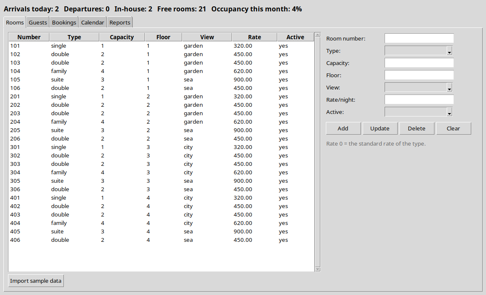
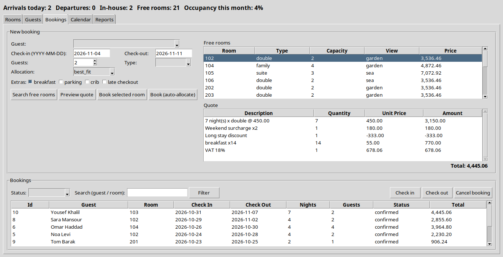
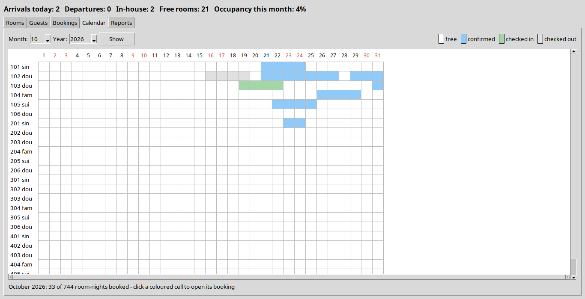
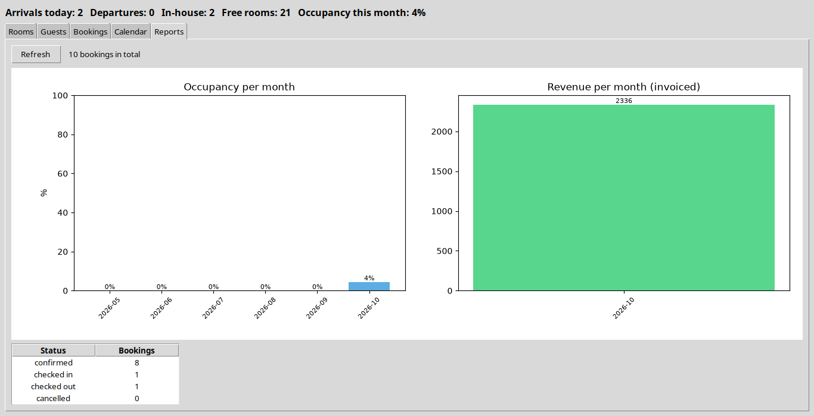

# HotelManager — walkthrough

Every function you write in this project (113 of them), in the order of `TASKS.md`. For each one:

- **Problem** — what the function has to do,
- **Solution** — the finished code,
- **Check** — the test that proves it works.

Try each function yourself first, then compare. Run the check after every function, not at the end.

## Contents

- [Stage 1 — The interval algorithm (the heart)](#stage-1--the-interval-algorithm-the-heart) (7 functions)
- [Stage 2 — The database](#stage-2--the-database) (20 functions)
- [Stage 3 — Availability and allocation](#stage-3--availability-and-allocation) (7 functions)
- [Stage 4 — The pricing engine](#stage-4--the-pricing-engine) (10 functions)
- [Stage 5 — The rules and the state machine](#stage-5--the-rules-and-the-state-machine) (15 functions)
- [Stage 6 — The user interface](#stage-6--the-user-interface) (45 functions)
- [Stage 7 — Reports, export and the book](#stage-7--reports-export-and-the-book) (9 functions)
- [The finished project](#the-finished-project)

## Stage 1 — The interval algorithm (the heart)

### `hotelmanager/models/date_range.py`

#### `DateRange.__post_init__()`

**Problem.** Refuse impossible stays the moment a DateRange is created: check-out must be after check-in, and a stay may not be longer than config.MAX_NIGHTS. Because the class is frozen, an invalid stay can then never exist anywhere in the program.

**Solution.**

```python
def __post_init__(self):
    if self.check_out <= self.check_in:
        raise ValueError("check-out must be after check-in")
    if self.nights > config.MAX_NIGHTS:
        raise ValueError(f"a stay cannot be longer than {config.MAX_NIGHTS} nights")
```

**Check.** `pytest tests/test_availability_allocation.py -k "test_free_when_no_booking or test_not_free_when_overlapping or test_free_when_the_other_booking_ends_on_our_check_in_day or test_cancelled_and_checked_out_bookings_do_not_block"` and `pytest tests/test_date_range.py -k "test_nights_counts_the_nights_slept or test_impossible_ranges_are_refused or test_overlap_cases or test_overlap_is_symmetric"` and `pytest tests/test_hotel_service.py -k "test_create_booking_allocates_a_room_and_prices_it or test_best_fit_gives_the_small_room_to_the_couple or test_double_booking_is_impossible or test_room_is_free_again_after_the_previous_guest_leaves"` and `pytest tests/test_pricing.py -k "test_two_midweek_nights or test_weekend_surcharge_counts_only_friday_and_saturday or test_season_multiplier_applies_per_night or test_long_stay_discount_applies_to_the_room_part"` and `pytest tests/test_repositories.py::test_booking_round_trip_and_period_query`

#### `DateRange.nights`

**Problem.** Return how many nights the guest sleeps: check-out minus check-in, in days. 3 March to 7 March is 4 nights - there is no "+1" because the check-out day is not a night.

**Solution.**

```python
@property
def nights(self) -> int:
    return (self.check_out - self.check_in).days
```

**Check.** `pytest tests/test_date_range.py -k "test_nights_counts_the_nights_slept or test_impossible_ranges_are_refused"` and `pytest tests/test_pricing.py -k "test_two_midweek_nights or test_weekend_surcharge_counts_only_friday_and_saturday or test_season_multiplier_applies_per_night or test_long_stay_discount_applies_to_the_room_part"` and `pytest tests/test_repositories.py::test_booking_round_trip_and_period_query`

#### `DateRange.overlaps(other)`

**Problem.** Return True when two stays share at least one night. Two half-open ranges [a, b) and [c, d) overlap exactly when a < d and c < b. A guest leaving on the 7th and another arriving on the 7th do NOT overlap - the room is re-let the same day.

**Solution.**

```python
def overlaps(self, other: "DateRange") -> bool:
    return self.check_in < other.check_out and other.check_in < self.check_out
```

**Check.** `pytest tests/test_date_range.py -k "test_overlap_cases or test_overlap_is_symmetric"` and `pytest tests/test_repositories.py::test_booking_round_trip_and_period_query`

#### `DateRange.contains(day)`

**Problem.** Return True when `day` is one of the nights of the stay: check-in counts, check-out does not.

**Solution.**

```python
def contains(self, day: date) -> bool:
    return self.check_in <= day < self.check_out
```

**Check.** `pytest tests/test_date_range.py::test_contains_and_nights_list`

#### `DateRange.nights_list()`

**Problem.** Give the nights of the stay one by one, from check-in up to the day before check-out. [3 March, 7 March) gives 3, 4, 5, 6 March - one price per night is built from this list.

**Solution.**

```python
def nights_list(self) -> Iterator[date]:
    day = self.check_in
    while day < self.check_out:
        yield day
        day = day + timedelta(days=1)
```

**Check.** `pytest tests/test_date_range.py::test_contains_and_nights_list`

### `hotelmanager/models/entities.py`

#### `Room.fits(guests)`

**Problem.** Return True when the room is active and has at least `guests` beds. A double room (capacity 2) fits exactly 2 guests.

**Solution.**

```python
def fits(self, guests: int) -> bool:
    return self.active and self.capacity >= guests
```

**Check.** `pytest tests/test_availability_allocation.py -k "test_best_fit_takes_the_smallest_room_that_fits or test_preference_prefers_the_requested_view_and_floor"`

#### `Booking.occupies(day)`

**Problem.** Return True when this booking holds the room on `day`: the booking still blocks the room (confirmed or checked in) and the day is one of its nights. A cancelled booking frees the room automatically.

**Solution.**

```python
def occupies(self, day: date) -> bool:
    return self.status.blocks_room and self.stay.contains(day)
```

**Check.** No unit test - run the program and look (see the stage's exit condition in `TASKS.md`).


## Stage 2 — The database

### `hotelmanager/database/db.py`

#### `Database.get_connection()`

**Problem.** Open the SQLite file with rows that behave like dicts and foreign keys switched on (they are off by default in SQLite).

**Solution.**

```python
def get_connection(self) -> sqlite3.Connection:
    conn = sqlite3.connect(self.db_path)
    conn.row_factory = sqlite3.Row
    conn.execute("PRAGMA foreign_keys = ON")
    return conn
```

**Check.** No unit test - run the program and look (see the stage's exit condition in `TASKS.md`).

#### `Database.connection()`

**Problem.** A context manager around a connection: commit when the block succeeds, roll back when it raises, and always close.

**Solution.**

```python
@contextmanager
def connection(self):
    conn = self.get_connection()
    try:
        yield conn
        conn.commit()
    except Exception:
        conn.rollback()
        raise
    finally:
        conn.close()
```

**Check.** No unit test - run the program and look (see the stage's exit condition in `TASKS.md`).

#### `Database.initialize_schema()`

**Problem.** Create the tables by running the SCHEMA script.

**Solution.**

```python
def initialize_schema(self) -> None:
    with self.connection() as conn:
        conn.executescript(SCHEMA)
```

**Check.** No unit test - run the program and look (see the stage's exit condition in `TASKS.md`).

### `hotelmanager/database/repositories.py`

**Helper code in this file** (used by the functions below, not a TODO in your skeleton):

`_row_to_room`

```python
def _row_to_room(r):
    return Room(id=r["id"], number=r["number"], room_type=r["room_type"], capacity=r["capacity"], floor=r["floor"],
                view=r["view"], base_rate=r["base_rate"], active=bool(r["active"]))
```

`_row_to_guest`

```python
def _row_to_guest(r):
    return Guest(name=r["name"], email=r["email"], phone=r["phone"] or "", document_id=r["document_id"] or "",
                 notes=r["notes"] or "", id=r["id"])
```

#### `RoomRepository.add(room)`

**Problem.** Insert a room and return its new id. Store `active` as 0/1 - SQLite has no boolean type.

**Solution.**

```python
def add(self, room: Room) -> int:
    with self.db.connection() as conn:
        cur = conn.execute("INSERT INTO rooms (number, room_type, capacity, floor, view, base_rate, active) VALUES (?, ?, ?, ?, ?, ?, ?)",
                           (room.number, room.room_type, room.capacity, room.floor, room.view, room.base_rate, int(room.active)))
        return cur.lastrowid
```

**Check.** `pytest tests/test_repositories.py -k "test_room_round_trip or test_rooms_are_sorted_numerically or test_guest_search or test_booking_round_trip_and_period_query"`

#### `RoomRepository.update(room)`

**Problem.** Save every column of an existing room. The id goes last in the parameters because WHERE id = ? comes last in the SQL.

**Solution.**

```python
def update(self, room: Room) -> None:
    with self.db.connection() as conn:
        conn.execute("UPDATE rooms SET number = ?, room_type = ?, capacity = ?, floor = ?, view = ?, base_rate = ?, active = ? WHERE id = ?",
                     (room.number, room.room_type, room.capacity, room.floor, room.view, room.base_rate, int(room.active), room.id))
```

**Check.** `pytest tests/test_repositories.py::test_room_round_trip`

#### `RoomRepository.delete(room_id)`

**Problem.** Delete a room by id. A room that has bookings is refused by the database itself (foreign key) - let that error reach the caller.

**Solution.**

```python
def delete(self, room_id: int) -> None:
    with self.db.connection() as conn:
        conn.execute("DELETE FROM rooms WHERE id = ?", (room_id,))
```

**Check.** No unit test - run the program and look (see the stage's exit condition in `TASKS.md`).

#### `RoomRepository.get(room_id)`

**Problem.** Read one room by id and turn the row into a Room, or return None.

**Solution.**

```python
def get(self, room_id: int) -> Optional[Room]:
    with self.db.connection() as conn:
        row = conn.execute("SELECT * FROM rooms WHERE id = ?", (room_id,)).fetchone()
    return _row_to_room(row) if row else None
```

**Check.** `pytest tests/test_hotel_service.py::test_best_fit_gives_the_small_room_to_the_couple` and `pytest tests/test_repositories.py -k "test_room_round_trip or test_booking_round_trip_and_period_query"`

#### `RoomRepository.list_all(only_active)`

**Problem.** Return all rooms (or only active ones) sorted by number as a number, so 9 comes before 10.

**Solution.**

```python
def list_all(self, only_active: bool = False) -> List[Room]:
    sql = "SELECT * FROM rooms"
    if only_active:
        sql += " WHERE active = 1"
    sql += " ORDER BY CAST(number AS INTEGER)"
    with self.db.connection() as conn:
        rows = conn.execute(sql).fetchall()
    return [_row_to_room(r) for r in rows]
```

**Check.** `pytest tests/test_repositories.py -k "test_room_round_trip or test_rooms_are_sorted_numerically"`

#### `GuestRepository.add(guest)`

**Problem.** Insert a guest and return the new id. A second guest with the same e-mail is refused by the database (UNIQUE).

**Solution.**

```python
def add(self, guest: Guest) -> int:
    with self.db.connection() as conn:
        cur = conn.execute("INSERT INTO guests (name, email, phone, document_id, notes) VALUES (?, ?, ?, ?, ?)",
                           (guest.name, guest.email, guest.phone, guest.document_id, guest.notes))
        return cur.lastrowid
```

**Check.** `pytest tests/test_repositories.py -k "test_room_round_trip or test_rooms_are_sorted_numerically or test_guest_search or test_booking_round_trip_and_period_query"`

#### `GuestRepository.update(guest)`

**Problem.** Save every column of an existing guest, id last.

**Solution.**

```python
def update(self, guest: Guest) -> None:
    with self.db.connection() as conn:
        conn.execute("UPDATE guests SET name = ?, email = ?, phone = ?, document_id = ?, notes = ? WHERE id = ?",
                     (guest.name, guest.email, guest.phone, guest.document_id, guest.notes, guest.id))
```

**Check.** `pytest tests/test_repositories.py::test_room_round_trip`

#### `GuestRepository.delete(guest_id)`

**Problem.** Delete a guest by id; a guest with bookings is refused by the database.

**Solution.**

```python
def delete(self, guest_id: int) -> None:
    with self.db.connection() as conn:
        conn.execute("DELETE FROM guests WHERE id = ?", (guest_id,))
```

**Check.** No unit test - run the program and look (see the stage's exit condition in `TASKS.md`).

#### `GuestRepository.get(guest_id)`

**Problem.** Read one guest by id, or return None. Empty phone, ID and notes come back as "".

**Solution.**

```python
def get(self, guest_id: int) -> Optional[Guest]:
    with self.db.connection() as conn:
        row = conn.execute("SELECT * FROM guests WHERE id = ?", (guest_id,)).fetchone()
    return _row_to_guest(row) if row else None
```

**Check.** `pytest tests/test_hotel_service.py::test_best_fit_gives_the_small_room_to_the_couple` and `pytest tests/test_repositories.py -k "test_room_round_trip or test_booking_round_trip_and_period_query"`

#### `GuestRepository.search(text)`

**Problem.** Find guests whose name, e-mail or ID number contains the text (all guests when the text is empty), sorted by name. Build "%text%" in Python and pass it as a parameter.

**Solution.**

```python
def search(self, text: str = "") -> List[Guest]:
    if not text:
        sql, params = "SELECT * FROM guests ORDER BY name", ()
    else:
        pattern = f"%{text}%"
        sql = "SELECT * FROM guests WHERE name LIKE ? OR email LIKE ? OR document_id LIKE ? ORDER BY name"
        params = (pattern, pattern, pattern)
    with self.db.connection() as conn:
        rows = conn.execute(sql, params).fetchall()
    return [_row_to_guest(r) for r in rows]
```

**Check.** `pytest tests/test_repositories.py::test_guest_search`

#### `BookingRepository._row(r)`

**Problem.** Turn a database row into a Booking: dates back from ISO text, the status back to the enum, the extras back to a list, and the room number and guest name for display.

**Solution.**

```python
@staticmethod
def _row(r) -> Booking:
    ts = lambda v: datetime.fromisoformat(v) if v else None
    return Booking(room_id=r["room_id"], guest_id=r["guest_id"],
                   stay=DateRange(date.fromisoformat(r["check_in"]), date.fromisoformat(r["check_out"])),
                   guests=r["guests"], status=BookingStatus(r["status"]), quoted_total=r["quoted_total"],
                   extras=[e for e in r["extras"].split(",") if e], created_at=ts(r["created_at"]),
                   checked_in_at=ts(r["checked_in_at"]), checked_out_at=ts(r["checked_out_at"]), id=r["id"],
                   room_number=r["room_number"] if "room_number" in r.keys() else "",
                   guest_name=r["guest_name"] if "guest_name" in r.keys() else "")
```

**Check.** No unit test - run the program and look (see the stage's exit condition in `TASKS.md`).

#### `BookingRepository.add(booking)`

**Problem.** Insert a booking and return its id. Convert dates and times to ISO text, the status to its value and the extras list to "a,b,c".

**Solution.**

```python
def add(self, booking: Booking) -> int:
    with self.db.connection() as conn:
        cur = conn.execute("INSERT INTO bookings (room_id, guest_id, check_in, check_out, guests, status, quoted_total, extras, created_at) VALUES (?, ?, ?, ?, ?, ?, ?, ?, ?)",
                           (booking.room_id, booking.guest_id, booking.stay.check_in.isoformat(), booking.stay.check_out.isoformat(),
                            booking.guests, booking.status.value, booking.quoted_total, ",".join(booking.extras), booking.created_at.isoformat()))
        return cur.lastrowid
```

**Check.** `pytest tests/test_repositories.py -k "test_room_round_trip or test_rooms_are_sorted_numerically or test_guest_search or test_booking_round_trip_and_period_query"`

#### `BookingRepository.update(booking)`

**Problem.** Save the changeable columns of a booking (dates, guests, status, price, extras, check-in/out times). Times that are still None stay NULL.

**Solution.**

```python
def update(self, booking: Booking) -> None:
    iso = lambda v: v.isoformat() if v else None
    with self.db.connection() as conn:
        conn.execute("UPDATE bookings SET check_in = ?, check_out = ?, guests = ?, status = ?, quoted_total = ?, extras = ?, checked_in_at = ?, checked_out_at = ? WHERE id = ?",
                     (booking.stay.check_in.isoformat(), booking.stay.check_out.isoformat(), booking.guests, booking.status.value,
                      booking.quoted_total, ",".join(booking.extras), iso(booking.checked_in_at), iso(booking.checked_out_at), booking.id))
```

**Check.** `pytest tests/test_repositories.py::test_room_round_trip`

#### `BookingRepository.get(booking_id)`

**Problem.** Read one booking with its room number and guest name (the JOIN in self.SELECT), or None.

**Solution.**

```python
def get(self, booking_id: int) -> Optional[Booking]:
    with self.db.connection() as conn:
        row = conn.execute(self.SELECT + " WHERE b.id = ?", (booking_id,)).fetchone()
    return self._row(row) if row else None
```

**Check.** `pytest tests/test_hotel_service.py::test_best_fit_gives_the_small_room_to_the_couple` and `pytest tests/test_repositories.py -k "test_room_round_trip or test_booking_round_trip_and_period_query"`

#### `BookingRepository.list_all(status, search)`

**Problem.** Return bookings newest check-in first, optionally only one status and/or matching a guest name or room number.

**Solution.**

```python
def list_all(self, status: Optional[BookingStatus] = None, search: str = "") -> List[Booking]:
    conditions, params = [], []
    if status:
        conditions.append("b.status = ?")
        params.append(BookingStatus(status).value)
    if search:
        conditions.append("(g.name LIKE ? OR r.number LIKE ?)")
        params += [f"%{search}%", f"%{search}%"]
    where = (" WHERE " + " AND ".join(conditions)) if conditions else ""
    with self.db.connection() as conn:
        rows = conn.execute(self.SELECT + where + " ORDER BY b.check_in DESC, b.id DESC", params).fetchall()
    return [self._row(r) for r in rows]
```

**Check.** `pytest tests/test_repositories.py -k "test_room_round_trip or test_rooms_are_sorted_numerically"`

#### `BookingRepository.in_period(start, end)`

**Problem.** Return only the bookings that overlap [start, end) - the same two comparisons as DateRange.overlaps, done in SQL.

**Solution.**

```python
def in_period(self, start: date, end: date) -> List[Booking]:
    with self.db.connection() as conn:
        rows = conn.execute(self.SELECT + " WHERE b.check_in < ? AND b.check_out > ? ORDER BY b.check_in",
                            (end.isoformat(), start.isoformat())).fetchall()
    return [self._row(r) for r in rows]
```

**Check.** `pytest tests/test_repositories.py::test_booking_round_trip_and_period_query`

#### `BookingRepository.count_by_status()`

**Problem.** Count the bookings per status: {"confirmed": 3, "cancelled": 1, ...}.

**Solution.**

```python
def count_by_status(self) -> Dict[str, int]:
    with self.db.connection() as conn:
        rows = conn.execute("SELECT status, COUNT(*) AS n FROM bookings GROUP BY status").fetchall()
    return {r["status"]: r["n"] for r in rows}
```

**Check.** `pytest tests/test_repositories.py::test_booking_round_trip_and_period_query`


## Stage 3 — Availability and allocation

### `hotelmanager/booking/allocation.py`

#### `FirstFreeStrategy.choose(candidates, guests, preferences)`

**Problem.** Pick the free room with the lowest number, or None when the list is empty. Compare the numbers as ints, so room 9 comes before room 10.

**Solution.**

```python
def choose(self, candidates, guests, preferences):
    if not candidates:
        return None
    return min(candidates, key=lambda room: int(room.number))
```

**Check.** `pytest tests/test_availability_allocation.py -k "test_first_free_takes_the_lowest_number or test_best_fit_takes_the_smallest_room_that_fits or test_preference_prefers_the_requested_view_and_floor or test_choose_returns_none_when_nothing_is_free"`

#### `BestFitStrategy.choose(candidates, guests, preferences)`

**Problem.** Pick the smallest room that still fits (then the cheaper, then the lower number), or None. Giving a couple the family room would leave the next family without a room.

**Solution.**

```python
def choose(self, candidates, guests, preferences):
    if not candidates:
        return None
    return min(candidates, key=lambda room: (room.capacity, room.rate, int(room.number)))
```

**Check.** `pytest tests/test_availability_allocation.py -k "test_first_free_takes_the_lowest_number or test_best_fit_takes_the_smallest_room_that_fits or test_preference_prefers_the_requested_view_and_floor or test_choose_returns_none_when_nothing_is_free"`

#### `PreferenceStrategy.score(room, guests, preferences)`

**Problem.** Score one room against the guest's wishes: +3 for the wanted view, +2 for the wanted floor, +1 for the wanted type, and -1 for every unused bed. Use preferences.get(...) because a wish may be missing.

**Solution.**

```python
def score(self, room: Room, guests: int, preferences: dict) -> int:
    total = 0
    if preferences.get("view") == room.view:
        total += 3
    if preferences.get("floor") == room.floor:
        total += 2
    if preferences.get("room_type") == room.room_type:
        total += 1
    total -= (room.capacity - guests)
    return total
```

**Check.** No unit test - run the program and look (see the stage's exit condition in `TASKS.md`).

#### `PreferenceStrategy.choose(candidates, guests, preferences)`

**Problem.** Pick the room with the highest score; on a tie take the lower room number. Return None when there are no rooms.

**Solution.**

```python
def choose(self, candidates, guests, preferences):
    if not candidates:
        return None
    return max(candidates, key=lambda room: (self.score(room, guests, preferences), -int(room.number)))
```

**Check.** `pytest tests/test_availability_allocation.py -k "test_first_free_takes_the_lowest_number or test_best_fit_takes_the_smallest_room_that_fits or test_preference_prefers_the_requested_view_and_floor or test_choose_returns_none_when_nothing_is_free"`

#### `create(name)`

**Problem.** Turn a strategy name from the config into a strategy object ("first_free", "best_fit" or "preference"). An unknown name raises ValueError that lists the valid names.

**Solution.**

```python
def create(name: str = None) -> AllocationStrategy:
    name = name or config.DEFAULT_ALLOCATION
    if name not in _STRATEGIES:
        raise ValueError(f"unknown allocation strategy '{name}'. Valid: {', '.join(sorted(_STRATEGIES))}")
    return _STRATEGIES[name]()
```

**Check.** `pytest tests/test_availability_allocation.py -k "test_first_free_takes_the_lowest_number or test_best_fit_takes_the_smallest_room_that_fits or test_preference_prefers_the_requested_view_and_floor or test_choose_returns_none_when_nothing_is_free"`

### `hotelmanager/booking/availability.py`

#### `is_room_free(room_id, stay, bookings, ignore_booking_id)`

**Problem.** Return True when no booking blocks this room during `stay`. Skip bookings of other rooms, cancelled or checked-out bookings, and the booking being edited (`ignore_booking_id`); any other booking that overlaps makes the room busy.

**Solution.**

```python
def is_room_free(room_id: int, stay: DateRange, bookings: List[Booking], ignore_booking_id: Optional[int] = None) -> bool:
    for b in bookings:
        if b.room_id != room_id or not b.status.blocks_room or b.id == ignore_booking_id:
            continue
        if b.stay.overlaps(stay):
            return False
    return True
```

**Check.** `pytest tests/test_availability_allocation.py -k "test_free_when_no_booking or test_not_free_when_overlapping or test_free_when_the_other_booking_ends_on_our_check_in_day or test_cancelled_and_checked_out_bookings_do_not_block"`

#### `free_rooms(rooms, bookings, stay, guests, room_type)`

**Problem.** Return every room that fits the guests, has the requested type (if one is given) and is free for the whole stay.

**Solution.**

```python
def free_rooms(rooms: List[Room], bookings: List[Booking], stay: DateRange, guests: int,
               room_type: Optional[str] = None) -> List[Room]:
    return [room for room in rooms
            if room.fits(guests)
            and (not room_type or room.room_type == room_type)
            and is_room_free(room.id, stay, bookings)]
```

**Check.** `pytest tests/test_availability_allocation.py::test_free_rooms_filters_capacity_and_type`


## Stage 4 — The pricing engine

### `hotelmanager/models/entities.py`

#### `Quote.subtotal`

**Problem.** Add up every line except the VAT line, rounded to 2 decimals.

**Solution.**

```python
@property
def subtotal(self) -> float:
    return round(sum(line.amount for line in self.lines
                     if not line.description.lower().startswith("vat")), 2)
```

**Check.** `pytest tests/test_pricing.py -k "test_two_midweek_nights or test_weekend_surcharge_counts_only_friday_and_saturday or test_season_multiplier_applies_per_night or test_long_stay_discount_applies_to_the_room_part"`

#### `Quote.total`

**Problem.** Add up every line, VAT and discounts included, rounded to 2 decimals - what the guest pays.

**Solution.**

```python
@property
def total(self) -> float:
    return round(sum(line.amount for line in self.lines), 2)
```

**Check.** `pytest tests/test_hotel_service.py::test_state_machine_happy_path` and `pytest tests/test_pricing.py -k "test_two_midweek_nights or test_weekend_surcharge_counts_only_friday_and_saturday or test_vat_is_the_last_line_and_on_everything or test_the_worked_example_of_the_guide"`

### `hotelmanager/pricing/engine.py`

#### `PricingEngine.quote(context)`

**Problem.** Run the rules in order, giving each one the lines added so far, and return a Quote with all the lines.

**Solution.**

```python
def quote(self, context: PricingContext) -> Quote:
    lines = []
    for rule in self.rules:
        lines.extend(rule.lines(context, lines))
    return Quote(lines)
```

**Check.** No unit test - run the program and look (see the stage's exit condition in `TASKS.md`).

### `hotelmanager/pricing/rules.py`

#### `Season.contains(day)`

**Problem.** Return True when `day` falls in the season, start and end included (a season is a calendar period, not a stay).

**Solution.**

```python
def contains(self, day: date) -> bool:
    return self.start <= day <= self.end
```

**Check.** `pytest tests/test_date_range.py::test_contains_and_nights_list`

#### `PricingContext.season_for(day)`

**Problem.** Return the first season that contains `day`, or None.

**Solution.**

```python
def season_for(self, day: date) -> Optional[Season]:
    return next((s for s in self.seasons if s.contains(day)), None)
```

**Check.** No unit test - run the program and look (see the stage's exit condition in `TASKS.md`).

#### `BaseRateRule.lines(context, current_lines)`

**Problem.** Price the room night by night: the room rate times the season multiplier of that night. Group nights with the same price into one invoice line, for example "4 night(s) x double @ 450.00".

**Solution.**

```python
def lines(self, context, current_lines):
    counts = {}
    for night in context.stay.nights_list():
        season = context.season_for(night)
        price = round(context.room.rate * (season.multiplier if season else 1.0), 2)
        counts[price] = counts.get(price, 0) + 1
    return [InvoiceLine(f"{c} night(s) x {context.room.room_type} @ {p:.2f}", c, p) for p, c in counts.items()]
```

**Check.** `pytest tests/test_hotel_service.py::test_state_machine_happy_path` and `pytest tests/test_pricing.py -k "test_long_stay_discount_applies_to_the_room_part or test_vat_is_the_last_line_and_on_everything or test_every_line_is_explained"`

#### `WeekendSurchargeRule.lines(context, current_lines)`

**Problem.** Add one line for the Friday and Saturday nights: each costs an extra 20% of that night's price (season included). No weekend nights - no line.

**Solution.**

```python
def lines(self, context, current_lines):
    total = 0.0
    n = 0
    for night in context.stay.nights_list():
        if night.weekday() in config.WEEKEND_DAYS:
            season = context.season_for(night)
            total += context.room.rate * (season.multiplier if season else 1.0) * config.WEEKEND_SURCHARGE
            n += 1
    if n == 0:
        return []
    return [InvoiceLine(f"Weekend surcharge x{n}", 1, round(total, 2))]
```

**Check.** `pytest tests/test_hotel_service.py::test_state_machine_happy_path` and `pytest tests/test_pricing.py -k "test_long_stay_discount_applies_to_the_room_part or test_vat_is_the_last_line_and_on_everything or test_every_line_is_explained"`

#### `LongStayDiscountRule.lines(context, current_lines)`

**Problem.** From 7 nights on, take 10% off the room part (the lines added so far). The discount is a line with a negative price, so the total is still just the sum of the lines.

**Solution.**

```python
def lines(self, context, current_lines):
    if context.stay.nights < config.LONG_STAY_NIGHTS:
        return []
    base = sum(l.amount for l in current_lines)
    return [InvoiceLine("Long stay discount", 1, -round(base * config.LONG_STAY_DISCOUNT, 2))]
```

**Check.** `pytest tests/test_hotel_service.py::test_state_machine_happy_path` and `pytest tests/test_pricing.py -k "test_long_stay_discount_applies_to_the_room_part or test_vat_is_the_last_line_and_on_everything or test_every_line_is_explained"`

#### `ExtrasRule.lines(context, current_lines)`

**Problem.** Add one line per extra the guest chose: breakfast is charged per guest per night, the other extras per night. Unknown extras are ignored.

**Solution.**

```python
def lines(self, context, current_lines):
    out = []
    for name in context.extras:
        if name in config.EXTRAS:
            price, per_guest = config.EXTRAS[name]
            q = context.stay.nights * (context.guests if per_guest else 1)
            out.append(InvoiceLine(f"{name} x{q}", q, price))
    return out
```

**Check.** `pytest tests/test_hotel_service.py::test_state_machine_happy_path` and `pytest tests/test_pricing.py -k "test_long_stay_discount_applies_to_the_room_part or test_vat_is_the_last_line_and_on_everything or test_every_line_is_explained"`

#### `VatRule.lines(context, current_lines)`

**Problem.** Add one "VAT 18%" line on everything above. It must be the last rule.

**Solution.**

```python
def lines(self, context, current_lines):
    return [InvoiceLine(f"VAT {int(config.VAT_RATE * 100)}%", 1, round(sum(l.amount for l in current_lines) * config.VAT_RATE, 2))]
```

**Check.** `pytest tests/test_hotel_service.py::test_state_machine_happy_path` and `pytest tests/test_pricing.py -k "test_long_stay_discount_applies_to_the_room_part or test_vat_is_the_last_line_and_on_everything or test_every_line_is_explained"`


## Stage 5 — The rules and the state machine

### `hotelmanager/booking/hotel_service.py`

**Helper code in this file** (used by the functions below, not a TODO in your skeleton):

`_month_bounds`

```python
def _month_bounds(year: int, month: int) -> Tuple[date, date]:
    first = date(year, month, 1)
    nxt = date(year + (month == 12), month % 12 + 1, 1)
    return first, nxt
```

`HotelService._get_booking`

```python
def _get_booking(self, booking_id: int) -> Booking:
        booking = self.bookings.get(booking_id)
        if booking is None:
            raise HotelError("Booking not found")
        return booking
```

`HotelService.update_room`

```python
def update_room(self, room: Room) -> None:
        if room.room_type not in config.ROOM_TYPES:
            raise HotelError(f"Unknown room type '{room.room_type}'")
        if room.capacity <= 0:
            raise HotelError("Capacity must be at least 1")
        if not str(room.number).strip():
            raise HotelError("Room number cannot be empty")
        if any(r.number == room.number and r.id != room.id for r in self.rooms.list_all()):
            raise HotelError(f"Room {room.number} already exists")
        self.rooms.update(room)
```

`HotelService.delete_room`

```python
def delete_room(self, room_id: int) -> None:
        try:
            self.rooms.delete(room_id)
        except sqlite3.IntegrityError:
            raise HotelError("This room has bookings and cannot be deleted - mark it inactive instead") from None
```

`HotelService.update_guest`

```python
def update_guest(self, guest: Guest) -> None:
        if not guest.name.strip():
            raise HotelError("guest name cannot be empty")
        email = guest.email.strip()
        if "@" not in email or "." not in email.split("@")[-1]:
            raise HotelError("that does not look like an e-mail address")
        try:
            self.guests.update(guest)
        except sqlite3.IntegrityError:
            raise HotelError(f"A guest with the e-mail {email} already exists") from None
```

#### `HotelService.add_room(room)`

**Problem.** Check a new room before saving: a number, a known type, a known view, at least 1 bed, no negative rate, and a number that is not taken. A broken rule raises HotelError with a clear message.

**Solution.**

```python
def add_room(self, room: Room) -> int:
    if not room.number or not str(room.number).strip():
        raise HotelError("Room number cannot be empty")
    room.number = str(room.number).strip()
    if room.room_type not in config.ROOM_TYPES:
        raise HotelError(f"Unknown room type '{room.room_type}'. Valid: {', '.join(config.ROOM_TYPES)}")
    if room.capacity <= 0:
        raise HotelError("Capacity must be at least 1")
    if room.base_rate < 0:
        raise HotelError("The rate cannot be negative")
    if room.view not in config.VIEWS:
        raise HotelError(f"Unknown view '{room.view}'. Valid: {', '.join(config.VIEWS)}")
    if any(r.number == room.number for r in self.rooms.list_all()):
        raise HotelError(f"Room {room.number} already exists")
    return self.rooms.add(room)
```

**Check.** `pytest tests/test_hotel_service.py::test_add_room_validation`

#### `HotelService.add_guest(guest)`

**Problem.** Check a new guest before saving: a real name (not just spaces) and an e-mail that looks like one. A duplicate e-mail becomes a readable HotelError.

**Solution.**

```python
def add_guest(self, guest: Guest) -> int:
    if not guest.name.strip():
        raise HotelError("guest name cannot be empty")
    email = guest.email.strip()
    if "@" not in email or "." not in email.split("@")[-1]:
        raise HotelError("that does not look like an e-mail address")
    guest.name, guest.email = guest.name.strip(), email
    try:
        return self.guests.add(guest)
    except sqlite3.IntegrityError:
        raise HotelError(f"A guest with the e-mail {email} already exists") from None
```

**Check.** `pytest tests/test_hotel_service.py::test_add_guest_validation`

#### `HotelService.quote_for(room, stay, guests, extras)`

**Problem.** Price a stay: collect the room, stay, guests, extras and the current seasons into a PricingContext and let the pricing engine build the quote.

**Solution.**

```python
def quote_for(self, room: Room, stay: DateRange, guests: int, extras: List[str]) -> Quote:
    context = PricingContext(room=room, stay=stay, guests=guests, extras=extras, seasons=self.seasons.list_all())
    return self.pricing.quote(context)
```

**Check.** `pytest tests/test_pricing.py -k "test_two_midweek_nights or test_weekend_surcharge_counts_only_friday_and_saturday or test_season_multiplier_applies_per_night or test_long_stay_discount_applies_to_the_room_part"`

#### `HotelService.find_free_rooms(stay, guests, room_type)`

**Problem.** Return the rooms free for the stay, reading only the bookings that overlap it (not the whole table).

**Solution.**

```python
def find_free_rooms(self, stay: DateRange, guests: int, room_type: Optional[str] = None) -> List[Room]:
    return availability.free_rooms(self.rooms.list_all(),
                                   self.bookings.in_period(stay.check_in, stay.check_out),
                                   stay, guests, room_type)
```

**Check.** `pytest tests/test_hotel_service.py::test_find_free_rooms_shrinks_as_the_hotel_fills`

#### `HotelService.create_booking(guest_id, stay, guests, extras, room_type, preferences, strategy_name, room_id)`

**Problem.** The central method. Check the guest exists, the number of guests and nights, and the extras. If a room was chosen, check it fits and is free; otherwise find free rooms and let the allocation strategy pick one. Price it, save the booking and return it. Every broken rule is a HotelError.

**Solution.**

```python
def create_booking(self, guest_id: int, stay: DateRange, guests: int, extras: List[str] = None,
                   room_type: Optional[str] = None, preferences: Dict = None,
                   strategy_name: str = None, room_id: Optional[int] = None) -> Booking:
    if self.guests.get(guest_id) is None:
        raise HotelError("Guest not found")
    if guests < 1:
        raise HotelError("A booking needs at least one guest")
    if stay.nights > config.MAX_NIGHTS:
        raise HotelError(f"A stay cannot be longer than {config.MAX_NIGHTS} nights")
    extras = list(extras or [])
    unknown = [e for e in extras if e not in config.EXTRAS]
    if unknown:
        raise HotelError(f"Unknown extra: {', '.join(unknown)}")

    if room_id is not None:
        room = self.rooms.get(room_id)
        if room is None:
            raise HotelError("Room not found")
        if not room.fits(guests):
            raise HotelError(f"Room {room.number} does not fit {guests} guests")
        if not availability.is_room_free(room.id, stay, self.bookings.in_period(stay.check_in, stay.check_out)):
            raise HotelError(f"Room {room.number} is not free on those dates")
    else:
        candidates = self.find_free_rooms(stay, guests, room_type)
        if not candidates:
            raise HotelError(f"No free room for {guests} guests on those dates")
        try:
            strategy = allocation.create(strategy_name)
        except ValueError as exc:
            raise HotelError(str(exc)) from None
        room = strategy.choose(candidates, guests, preferences or {})

    quote = self.quote_for(room, stay, guests, extras)
    booking = Booking(room.id, guest_id, stay, guests, BookingStatus.CONFIRMED, quote.total, extras)
    booking.id = self.bookings.add(booking)
    return self.bookings.get(booking.id)
```

**Check.** `pytest tests/test_hotel_service.py -k "test_create_booking_allocates_a_room_and_prices_it or test_best_fit_gives_the_small_room_to_the_couple or test_double_booking_is_impossible or test_room_is_free_again_after_the_previous_guest_leaves"`

#### `HotelService.check_in(booking_id, today)`

**Problem.** Check a guest in: only a confirmed booking, and not before its check-in date. Set the status and the check-in time and save.

**Solution.**

```python
def check_in(self, booking_id: int, today: Optional[date] = None) -> Booking:
    booking = self._get_booking(booking_id)
    today = today or date.today()
    if booking.status is not BookingStatus.CONFIRMED:
        raise HotelError(f"Only a confirmed booking can check in (this one is {booking.status.value})")
    if today < booking.stay.check_in:
        raise HotelError(f"Too early - check-in is on {booking.stay.check_in.isoformat()}")
    booking.status = BookingStatus.CHECKED_IN
    booking.checked_in_at = datetime.now()
    self.bookings.update(booking)
    return booking
```

**Check.** `pytest tests/test_hotel_service.py -k "test_state_machine_happy_path or test_illegal_transitions_are_refused"`

#### `HotelService.check_out(booking_id)`

**Problem.** Check a guest out: only after check-in. Build the invoice from the quote lines (the guest pays the price agreed at booking - a difference gets its own line), save it, set the status and time, and return the booking and invoice.

**Solution.**

```python
def check_out(self, booking_id: int) -> Tuple[Booking, Invoice]:
    booking = self._get_booking(booking_id)
    if booking.status is not BookingStatus.CHECKED_IN:
        raise HotelError("Only a guest who checked in can check out")
    room = self.rooms.get(booking.room_id)
    quote = self.quote_for(room, booking.stay, booking.guests, booking.extras)
    lines = list(quote.lines)
    total = round(booking.quoted_total, 2)
    difference = round(total - quote.total, 2)
    if abs(difference) >= 0.01:
        # prices changed since booking: keep the agreed price, show the difference
        lines.append(InvoiceLine("Adjustment to the price agreed at booking", 1, difference))
    vat = round(sum(l.amount for l in lines if l.description.lower().startswith("vat")), 2)
    invoice = Invoice(booking.id, datetime.now(), lines, round(total - vat, 2), vat, total)
    invoice.id = self.invoices.add(invoice)
    booking.status = BookingStatus.CHECKED_OUT
    booking.checked_out_at = datetime.now()
    self.bookings.update(booking)
    return booking, invoice
```

**Check.** `pytest tests/test_hotel_service.py -k "test_state_machine_happy_path or test_illegal_transitions_are_refused"`

#### `HotelService.cancel(booking_id, when)`

**Problem.** Cancel a booking that has not started. Cancelling more than 48 hours before check-in is free; later it costs one night. Return the booking and the fee.

**Solution.**

```python
def cancel(self, booking_id: int, when: Optional[datetime] = None) -> Tuple[Booking, float]:
    booking = self._get_booking(booking_id)
    if booking.status is BookingStatus.CHECKED_IN:
        raise HotelError("Cannot cancel a guest who already checked in")
    if booking.status is not BookingStatus.CONFIRMED:
        raise HotelError(f"This booking is already {booking.status.value.replace('_', ' ')}")
    when = when or datetime.now()
    hours_before = (datetime.combine(booking.stay.check_in, datetime.min.time()) - when).total_seconds() / 3600
    quote = self.quote_for(self.rooms.get(booking.room_id), booking.stay, booking.guests, booking.extras)
    fee = self.pricing.cancellation_fee(quote, hours_before)
    booking.status = BookingStatus.CANCELLED
    self.bookings.update(booking)
    return booking, fee
```

**Check.** `pytest tests/test_hotel_service.py -k "test_illegal_transitions_are_refused or test_cancelling_frees_the_room"`

### `hotelmanager/database/repositories.py`

#### `SeasonRepository.add(season)`

**Problem.** Insert a season (name, start, end, multiplier) and return its id.

**Solution.**

```python
def add(self, season: Season) -> int:
    with self.db.connection() as conn:
        cur = conn.execute("INSERT INTO seasons (name, start_date, end_date, multiplier) VALUES (?, ?, ?, ?)",
                           (season.name, season.start.isoformat(), season.end.isoformat(), season.multiplier))
        return cur.lastrowid
```

**Check.** `pytest tests/test_repositories.py -k "test_room_round_trip or test_rooms_are_sorted_numerically or test_guest_search or test_booking_round_trip_and_period_query"`

#### `SeasonRepository.list_all()`

**Problem.** Return all seasons sorted by start date, dates converted back from text.

**Solution.**

```python
def list_all(self) -> List[Season]:
    with self.db.connection() as conn:
        rows = conn.execute("SELECT * FROM seasons ORDER BY start_date").fetchall()
    return [Season(r["name"], date.fromisoformat(r["start_date"]), date.fromisoformat(r["end_date"]), r["multiplier"], r["id"]) for r in rows]
```

**Check.** `pytest tests/test_repositories.py -k "test_room_round_trip or test_rooms_are_sorted_numerically"`

#### `SeasonRepository.delete(season_id)`

**Problem.** Delete a season by id.

**Solution.**

```python
def delete(self, season_id: int) -> None:
    with self.db.connection() as conn:
        conn.execute("DELETE FROM seasons WHERE id = ?", (season_id,))
```

**Check.** No unit test - run the program and look (see the stage's exit condition in `TASKS.md`).

#### `InvoiceRepository.add(invoice)`

**Problem.** Insert an invoice and all its lines in one transaction and return the invoice id. If one line fails, nothing is written.

**Solution.**

```python
def add(self, invoice: Invoice) -> int:
    with self.db.connection() as conn:
        cur = conn.execute("INSERT INTO invoices (booking_id, issued_at, subtotal, vat, total, paid) VALUES (?, ?, ?, ?, ?, ?)",
                           (invoice.booking_id, invoice.issued_at.isoformat(), invoice.subtotal, invoice.vat, invoice.total, int(invoice.paid)))
        invoice_id = cur.lastrowid
        conn.executemany("INSERT INTO invoice_lines (invoice_id, description, quantity, unit_price) VALUES (?, ?, ?, ?)",
                         [(invoice_id, l.description, l.quantity, l.unit_price) for l in invoice.lines])
        return invoice_id
```

**Check.** `pytest tests/test_repositories.py -k "test_room_round_trip or test_rooms_are_sorted_numerically or test_guest_search or test_booking_round_trip_and_period_query"`

#### `InvoiceRepository.get_for_booking(booking_id)`

**Problem.** Read the invoice of a booking with its lines in their original order, or None.

**Solution.**

```python
def get_for_booking(self, booking_id: int) -> Optional[Invoice]:
    with self.db.connection() as conn:
        head = conn.execute("SELECT * FROM invoices WHERE booking_id = ?", (booking_id,)).fetchone()
        if head is None:
            return None
        lines = conn.execute("SELECT * FROM invoice_lines WHERE invoice_id = ? ORDER BY id", (head["id"],)).fetchall()
    return Invoice(head["booking_id"], datetime.fromisoformat(head["issued_at"]),
                   [InvoiceLine(l["description"], l["quantity"], l["unit_price"]) for l in lines],
                   head["subtotal"], head["vat"], head["total"], bool(head["paid"]), head["id"])
```

**Check.** No unit test - run the program and look (see the stage's exit condition in `TASKS.md`).

#### `InvoiceRepository.mark_paid(invoice_id)`

**Problem.** Mark an invoice as paid.

**Solution.**

```python
def mark_paid(self, invoice_id: int) -> None:
    with self.db.connection() as conn:
        conn.execute("UPDATE invoices SET paid = 1 WHERE id = ?", (invoice_id,))
```

**Check.** No unit test - run the program and look (see the stage's exit condition in `TASKS.md`).

### `hotelmanager/pricing/engine.py`

#### `PricingEngine.cancellation_fee(quote, hours_before_checkin)`

**Problem.** Cancelling at least 48 hours before check-in is free (0.0); later the fee is one night - the unit price of the first room line.

**Solution.**

```python
def cancellation_fee(self, quote: Quote, hours_before_checkin: float) -> float:
    if hours_before_checkin >= config.FREE_CANCELLATION_HOURS:
        return 0.0
    return round(quote.lines[0].unit_price, 2)
```

**Check.** `pytest tests/test_pricing.py::test_cancellation_fee_policy`


## Stage 6 — The user interface

### `hotelmanager/booking/availability.py`

#### `occupancy_on(day, rooms, bookings)`

**Problem.** For each room, which booking holds it on `day` (or None) - what one calendar column shows.

**Solution.**

```python
def occupancy_on(day: date, rooms: List[Room], bookings: List[Booking]) -> dict:
    cells = {}
    for room in rooms:
        cells[room.id] = next((b for b in bookings if b.room_id == room.id and b.occupies(day)), None)
    return cells
```

**Check.** No unit test - run the program and look (see the stage's exit condition in `TASKS.md`).

### `hotelmanager/booking/hotel_service.py`

#### `HotelService.calendar_matrix(year, month)`

**Problem.** Build what the calendar draws for one month: the days, the rooms, and for every (room, day) the booking that occupies it or None.

**Solution.**

```python
def calendar_matrix(self, year: int, month: int) -> Dict:
    first, nxt = _month_bounds(year, month)
    days = [first + timedelta(days=i) for i in range((nxt - first).days)]
    rooms = self.rooms.list_all()
    bookings = self.bookings.in_period(first, nxt)
    cells = {}
    for day in days:
        for room in rooms:
            # checked-out stays are shown too (grey), so the month reads as history
            cells[(room.id, day)] = next((b for b in bookings if b.room_id == room.id
                                          and b.status is not BookingStatus.CANCELLED
                                          and b.stay.contains(day)), None)
    return {"days": days, "rooms": rooms, "cells": cells}
```

**Check.** No unit test - run the program and look (see the stage's exit condition in `TASKS.md`).

### `hotelmanager/booking/importer.py`

**Helper code in this file** (used by the functions below, not a TODO in your skeleton):

`_import`

```python
def _import(path, make, add) -> Tuple[int, List[str]]:
    added, errors = 0, []
    with open(path, newline="", encoding="utf-8-sig") as fh:
        for line_no, row in enumerate(csv.DictReader(fh), start=2):     # line 1 is the header
            try:
                add(make(row))
                added += 1
            except (ValueError, KeyError, TypeError) as exc:              # HotelError is a ValueError
                errors.append(f"line {line_no}: {exc}")
    return added, errors
```

#### `import_rooms(service, path)`

**Problem.** Read the rooms CSV and add each row through the service. Count the rooms added and collect "line N: reason" for the rows that were refused.

**Solution.**

```python
def import_rooms(service, path: str = config.SAMPLE_ROOMS_CSV) -> Tuple[int, List[str]]:
    def make(row):
        return Room(number=row["number"].strip(), room_type=row["room_type"].strip(),
                    capacity=int(row["capacity"]), floor=int(row["floor"]),
                    view=(row.get("view") or "city").strip(), base_rate=float(row.get("base_rate") or 0))
    return _import(path, make, service.add_room)
```

**Check.** No unit test - run the program and look (see the stage's exit condition in `TASKS.md`).

#### `import_guests(service, path)`

**Problem.** The same for the guests CSV (name, email, phone, document_id).

**Solution.**

```python
def import_guests(service, path: str = config.SAMPLE_GUESTS_CSV) -> Tuple[int, List[str]]:
    def make(row):
        return Guest(name=row["name"].strip(), email=row["email"].strip(),
                     phone=(row.get("phone") or "").strip(), document_id=(row.get("document_id") or "").strip())
    return _import(path, make, service.add_guest)
```

**Check.** No unit test - run the program and look (see the stage's exit condition in `TASKS.md`).

### `hotelmanager/controllers/app_controller.py`

**Helper code in this file** (used by the functions below, not a TODO in your skeleton):

`AppController.refresh_dashboard`

```python
def refresh_dashboard(self) -> None:
        self.view.show_dashboard(self.service.dashboard())
```

`AppController.select_booking`

```python
def select_booking(self, booking_id: int) -> None:
        self.refresh_bookings()
        self.view.select_booking(booking_id)
```

`AppController._room_from_fields`

```python
def _room_from_fields(self, fields: dict) -> Room:
        try:
            return Room(number=fields.get("number", "").strip(), room_type=fields.get("room_type", ""),
                        capacity=int(fields.get("capacity") or 0), floor=int(fields.get("floor") or 0),
                        view=fields.get("view") or "city", base_rate=float(fields.get("base_rate") or 0))
        except ValueError:
            raise HotelError("Capacity and floor must be whole numbers, the rate a number") from None
```

`AppController._guest_from_fields`

```python
def _guest_from_fields(self, fields: dict) -> Guest:
        return Guest(name=fields.get("name", "").strip(), email=fields.get("email", "").strip(),
                     phone=fields.get("phone", "").strip(), document_id=fields.get("document_id", "").strip())
```

`AppController._guests_count`

```python
def _guests_count(self, guests: str) -> int:
        try:
            n = int(guests)
        except (TypeError, ValueError):
            raise HotelError("Guests must be a whole number") from None
        if n < 1:
            raise HotelError("A booking needs at least one guest")
        return n
```

`AppController._after_booking_change`

```python
def _after_booking_change(self) -> None:
        self.refresh_bookings(*self.view.bookings.current_filter())
        self.calendar(*self.view.calendar.current_month())
        self.refresh_dashboard()
```

#### `AppController.__init__(root)`

**Problem.** Create the service and the main window, and give the window a dict of options (room types, extras...) and callbacks (on_add_room, on_book...).

**Solution.**

```python
def __init__(self, root: tk.Tk):
    self.root = root
    self.service = HotelService()
    self.view = MainWindow(root, dict(
        room_types=list(config.ROOM_TYPES), views=list(config.VIEWS), extras=list(config.EXTRAS),
        strategies=["first_free", "best_fit", "preference"],
        statuses=["", "confirmed", "checked_in", "checked_out", "cancelled"],
        on_refresh_rooms=self.refresh_rooms, on_add_room=self.add_room, on_update_room=self.update_room,
        on_delete_room=self.delete_room,
        on_search_guests=self.search_guests, on_add_guest=self.add_guest, on_update_guest=self.update_guest,
        on_search_rooms=self.search_free_rooms, on_quote=self.preview_quote, on_book=self.create_booking,
        on_refresh_bookings=self.refresh_bookings, on_check_in=self.check_in, on_check_out=self.check_out,
        on_cancel=self.cancel,
        on_calendar=self.calendar, on_calendar_select=self.select_booking,
        on_reports=self.reports, on_import_sample=self.import_sample))
```

**Check.** No unit test - run the program and look (see the stage's exit condition in `TASKS.md`).

#### `AppController.start()`

**Problem.** Fill every tab (rooms, guests, bookings, calendar, reports) and the dashboard line.

**Solution.**

```python
def start(self) -> None:
    self.refresh_rooms()
    self.search_guests("")
    self.refresh_bookings()
    today = date.today()
    self.calendar(today.year, today.month)
    self.reports()
    self.refresh_dashboard()
```

**Check.** No unit test - run the program and look (see the stage's exit condition in `TASKS.md`).

#### `AppController._guard(fn, *args, **kwargs)`

**Problem.** Call a service function; if it raises HotelError, show the message and return None. Every button goes through this, so a broken rule is a polite message, never a crash.

**Solution.**

```python
def _guard(self, fn, *args, **kwargs):
    try:
        return fn(*args, **kwargs)
    except HotelError as exc:
        self.view.show_error(str(exc))
    except sqlite3.IntegrityError as exc:
        self.view.show_error(f"The database refused this change:\n{exc}")
    return None
```

**Check.** No unit test - run the program and look (see the stage's exit condition in `TASKS.md`).

#### `AppController.refresh_rooms()`

**Problem.** Show the current list of rooms in the rooms table.

**Solution.**

```python
def refresh_rooms(self) -> None:
    self.view.rooms.show_rows(self.service.rooms.list_all())
```

**Check.** No unit test - run the program and look (see the stage's exit condition in `TASKS.md`).

#### `AppController.add_room(fields)`

**Problem.** Turn the form strings into a Room (capacity and floor as ints, rate as a float), add it through the service and refresh. Text in a number field becomes a clear message.

**Solution.**

```python
def add_room(self, fields: dict) -> None:
    def work():
        self.service.add_room(self._room_from_fields(fields))
        return True
    if self._guard(work):
        self.refresh_rooms()
        self.view.rooms.clear_form()
        self.refresh_dashboard()
```

**Check.** `pytest tests/test_hotel_service.py::test_add_room_validation`

#### `AppController.update_room(room_id, fields)`

**Problem.** Save the edited form for the selected room (same checks as add) and refresh.

**Solution.**

```python
def update_room(self, room_id: int, fields: dict) -> None:
    if room_id is None:
        self.view.show_error("Select a room in the table first")
        return
    def work():
        existing = self.service.rooms.get(room_id)
        room = self._room_from_fields(fields)
        room.id, room.active = room_id, existing.active if existing else True
        if "active" in fields:
            room.active = fields["active"] in (True, "yes", "1", 1)
        self.service.update_room(room)
        return True
    if self._guard(work):
        self.refresh_rooms()
        self.refresh_dashboard()
```

**Check.** No unit test - run the program and look (see the stage's exit condition in `TASKS.md`).

#### `AppController.delete_room(room_id)`

**Problem.** Ask for confirmation and delete the selected room; a room with bookings shows a message instead.

**Solution.**

```python
def delete_room(self, room_id: int) -> None:
    if room_id is None:
        self.view.show_error("Select a room in the table first")
        return
    room = self.service.rooms.get(room_id)
    if room is None or not self.view.confirm(f"Delete room {room.number}?"):
        return
    self._guard(self.service.delete_room, room_id)
    self.refresh_rooms()
    self.view.rooms.clear_form()
    self.refresh_dashboard()
```

**Check.** No unit test - run the program and look (see the stage's exit condition in `TASKS.md`).

#### `AppController.search_guests(text)`

**Problem.** Show the guests that match the search text, and give the booking screen the full guest list.

**Solution.**

```python
def search_guests(self, text: str = "") -> None:
    guests = self.service.guests.search((text or "").strip())
    self.view.guests.show_rows(guests)
    self.view.bookings.set_guests(self.service.guests.search(""))
```

**Check.** No unit test - run the program and look (see the stage's exit condition in `TASKS.md`).

#### `AppController.add_guest(fields)`

**Problem.** Build a Guest from the form, add it through the service and refresh the list.

**Solution.**

```python
def add_guest(self, fields: dict) -> None:
    if self._guard(self.service.add_guest, self._guest_from_fields(fields)) is not None:
        self.view.guests.clear_form()
        self.search_guests("")
```

**Check.** `pytest tests/test_hotel_service.py::test_add_guest_validation`

#### `AppController.update_guest(guest_id, fields)`

**Problem.** Save the edited form for the selected guest and refresh.

**Solution.**

```python
def update_guest(self, guest_id: int, fields: dict) -> None:
    if guest_id is None:
        self.view.show_error("Select a guest in the table first")
        return
    guest = self._guest_from_fields(fields)
    guest.id = guest_id
    existing = self.service.guests.get(guest_id)
    guest.notes = existing.notes if existing else ""
    self._guard(self.service.update_guest, guest)
    self.search_guests("")
```

**Check.** No unit test - run the program and look (see the stage's exit condition in `TASKS.md`).

#### `AppController._parse_stay(check_in, check_out)`

**Problem.** Turn two "YYYY-MM-DD" strings into a DateRange. A wrong format or an impossible range becomes a HotelError with a readable message.

**Solution.**

```python
def _parse_stay(self, check_in: str, check_out: str) -> DateRange:
    try:
        start = date.fromisoformat((check_in or "").strip())
        end = date.fromisoformat((check_out or "").strip())
    except ValueError:
        raise HotelError("Dates must be written as YYYY-MM-DD, for example 2026-03-07") from None
    try:
        return DateRange(start, end)
    except ValueError as exc:
        raise HotelError(str(exc).capitalize()) from None
```

**Check.** No unit test - run the program and look (see the stage's exit condition in `TASKS.md`).

#### `AppController.search_free_rooms(check_in, check_out, guests, room_type)`

**Problem.** Read the dates and guest count, find the free rooms and show each one with its price for the stay.

**Solution.**

```python
def search_free_rooms(self, check_in: str, check_out: str, guests: str, room_type: str) -> None:
    def work():
        stay = self._parse_stay(check_in, check_out)
        n = self._guests_count(guests)
        rooms = self.service.find_free_rooms(stay, n, room_type or None)
        return [(room, self.service.quote_for(room, stay, n, []).total) for room in rooms]
    found = self._guard(work)
    if found is not None:
        self.view.bookings.show_free_rooms(found)
        if not found:
            self.view.show_info("No free room matches - try other dates or fewer guests.")
```

**Check.** No unit test - run the program and look (see the stage's exit condition in `TASKS.md`).

#### `AppController.preview_quote(room_id, check_in, check_out, guests, extras)`

**Problem.** Price the chosen room for the stay and extras and show every quote line - the "why" of the price.

**Solution.**

```python
def preview_quote(self, room_id: int, check_in: str, check_out: str, guests: str, extras: list) -> None:
    def work():
        if room_id is None:
            raise HotelError("Pick a room from the free-rooms list first")
        stay = self._parse_stay(check_in, check_out)
        room = self.service.rooms.get(room_id)
        return self.service.quote_for(room, stay, self._guests_count(guests), list(extras))
    quote = self._guard(work)
    if quote is not None:
        self.view.bookings.show_quote(quote.lines, quote.total)
```

**Check.** No unit test - run the program and look (see the stage's exit condition in `TASKS.md`).

#### `AppController.create_booking(guest_id, room_id, check_in, check_out, guests, extras, strategy)`

**Problem.** Create the booking (chosen room or automatic), show "Booking #7 created - room 204, ..." and refresh the bookings, calendar and dashboard.

**Solution.**

```python
def create_booking(self, guest_id: int, room_id: int, check_in: str, check_out: str, guests: str,
                   extras: list, strategy: str) -> None:
    def work():
        if guest_id is None:
            raise HotelError("Choose the guest first")
        stay = self._parse_stay(check_in, check_out)
        return self.service.create_booking(guest_id, stay, self._guests_count(guests), list(extras),
                                           strategy_name=strategy or None, room_id=room_id)
    booking = self._guard(work)
    if booking is not None:
        self.view.show_info(f"Booking #{booking.id} created - room {booking.room_number}, "
                            f"{booking.stay.nights} nights, {booking.quoted_total:,.2f}")
        self.view.bookings.show_free_rooms([])
        self._after_booking_change()
```

**Check.** `pytest tests/test_hotel_service.py -k "test_create_booking_allocates_a_room_and_prices_it or test_best_fit_gives_the_small_room_to_the_couple or test_double_booking_is_impossible or test_room_is_free_again_after_the_previous_guest_leaves"`

#### `AppController.refresh_bookings(status, search)`

**Problem.** Show the bookings that match the status filter and search text.

**Solution.**

```python
def refresh_bookings(self, status: str = "", search: str = "") -> None:
    self.view.bookings.show_rows(self.service.bookings.list_all(status or None, (search or "").strip()))
```

**Check.** No unit test - run the program and look (see the stage's exit condition in `TASKS.md`).

#### `AppController.check_in(booking_id)`

**Problem.** Check in the selected booking and refresh.

**Solution.**

```python
def check_in(self, booking_id: int) -> None:
    if booking_id is None:
        self.view.show_error("Select a booking first")
        return
    booking = self._guard(self.service.check_in, booking_id)
    if booking is not None:
        self.view.show_info(f"{booking.guest_name} checked in to room {booking.room_number}")
        self._after_booking_change()
```

**Check.** `pytest tests/test_hotel_service.py -k "test_state_machine_happy_path or test_illegal_transitions_are_refused"`

#### `AppController.check_out(booking_id)`

**Problem.** Check out the selected booking, show the invoice and, if the user wants, save it as CSV.

**Solution.**

```python
def check_out(self, booking_id: int) -> None:
    if booking_id is None:
        self.view.show_error("Select a booking first")
        return
    result = self._guard(self.service.check_out, booking_id)
    if result is None:
        return
    booking, invoice = result
    self._after_booking_change()
    self.reports()
    if self.view.show_invoice(invoice, booking):
        guest = self.service.guests.get(booking.guest_id)
        room = self.service.rooms.get(booking.room_id)
        path = importer.export_invoice(invoice, booking, guest, room)
        self.view.show_info(f"Invoice saved to\n{path}")
```

**Check.** `pytest tests/test_hotel_service.py -k "test_state_machine_happy_path or test_illegal_transitions_are_refused"`

#### `AppController.cancel(booking_id)`

**Problem.** Ask for confirmation, cancel the selected booking and tell the user the fee.

**Solution.**

```python
def cancel(self, booking_id: int) -> None:
    if booking_id is None:
        self.view.show_error("Select a booking first")
        return
    if not self.view.confirm(f"Cancel booking #{booking_id}?"):
        return
    result = self._guard(self.service.cancel, booking_id)
    if result is not None:
        booking, fee = result
        if fee:
            self.view.show_info(f"Booking #{booking.id} cancelled. Late cancellation fee: {fee:,.2f}")
        else:
            self.view.show_info(f"Booking #{booking.id} cancelled free of charge.")
        self._after_booking_change()
```

**Check.** `pytest tests/test_hotel_service.py -k "test_illegal_transitions_are_refused or test_cancelling_frees_the_room"`

#### `AppController.calendar(year, month)`

**Problem.** Draw the calendar for the chosen month.

**Solution.**

```python
def calendar(self, year: int, month: int) -> None:
    self.view.calendar.draw(self.service.calendar_matrix(int(year), int(month)))
```

**Check.** No unit test - run the program and look (see the stage's exit condition in `TASKS.md`).

#### `AppController.import_sample()`

**Problem.** Import the sample rooms and guests, refresh, and tell the user how many were added and which rows were skipped.

**Solution.**

```python
def import_sample(self) -> None:
    rooms_added, room_errors = importer.import_rooms(self.service)
    guests_added, guest_errors = importer.import_guests(self.service)
    self.refresh_rooms()
    self.search_guests("")
    self.refresh_dashboard()
    self.calendar(*self.view.calendar.current_month())
    message = f"Imported {rooms_added} rooms and {guests_added} guests."
    skipped = room_errors + guest_errors
    if skipped:
        message += f"\n{len(skipped)} rows skipped, for example:\n" + "\n".join(skipped[:5])
    self.view.show_info(message)
```

**Check.** No unit test - run the program and look (see the stage's exit condition in `TASKS.md`).

### `hotelmanager/views/bookings_view.py`

**Helper code in this file** (used by the functions below, not a TODO in your skeleton):

`BookingsView.set_guests`

```python
def set_guests(self, guests) -> None:
        self.guest_ids = {f"{g.name} <{g.email}>": g.id for g in guests}
        self.guest_combo.configure(values=list(self.guest_ids))
```

`BookingsView.current_filter`

```python
def current_filter(self):
        return self.status_var.get(), self.search_var.get()
```

`BookingsView._extras`

```python
def _extras(self):
        return [name for name, var in self.extra_vars.items() if var.get()]
```

`BookingsView._search`

```python
def _search(self):
        v = self.vars
        self.cb["on_search_rooms"](v["check_in"].get(), v["check_out"].get(), v["guests"].get(), v["room_type"].get())
```

`BookingsView._quote`

```python
def _quote(self):
        v = self.vars
        self.cb["on_quote"](self.free_table.selected_id(), v["check_in"].get(), v["check_out"].get(),
                            v["guests"].get(), self._extras())
```

`BookingsView._book`

```python
def _book(self, auto: bool):
        v = self.vars
        room_id = None if auto else self.free_table.selected_id()
        if not auto and room_id is None:
            self.cb["on_quote"](None, "", "", "", [])        # lets the controller show "pick a room"
            return
        self.cb["on_book"](self.guest_ids.get(v["guest"].get()), room_id, v["check_in"].get(),
                           v["check_out"].get(), v["guests"].get(), self._extras(), v["strategy"].get())
```

`BookingsView.select`

```python
def select(self, booking_id: int) -> None:
        iid = str(booking_id)
        if self.table.tree.exists(iid):
            self.table.tree.selection_set(iid)
            self.table.tree.see(iid)
```

#### `BookingsView.__init__(parent, cb)`

**Problem.** Build the bookings tab. Top: dates, guests, type, allocation and extras, with Search / Preview quote / Book buttons, a free-rooms table and a quote table. Bottom: the bookings table with a status filter and Check in / Check out / Cancel.

**Solution.**

```python
def __init__(self, parent, cb):
    super().__init__(parent, padding=10)
    self.cb = cb
    self.guest_ids = {}                 # "Noa Levi <noa@...>" -> id

    new = ttk.LabelFrame(self, text="New booking", padding=8)
    new.pack(fill="x")
    form = ttk.Frame(new)
    form.pack(side="left", fill="y")
    today = date.today()
    self.vars = {
        "guest": tk.StringVar(),
        "check_in": tk.StringVar(value=today.isoformat()),
        "check_out": tk.StringVar(value=(today + timedelta(days=2)).isoformat()),
        "guests": tk.StringVar(value="2"),
        "room_type": tk.StringVar(value=""),
        "strategy": tk.StringVar(value="best_fit"),
    }
    ttk.Label(form, text="Guest:").grid(row=0, column=0, sticky="w", pady=2)
    self.guest_combo = ttk.Combobox(form, textvariable=self.vars["guest"], state="readonly", width=34)
    self.guest_combo.grid(row=0, column=1, columnspan=3, sticky="w", pady=2)
    ttk.Label(form, text="Check-in (YYYY-MM-DD):").grid(row=1, column=0, sticky="w", pady=2)
    ttk.Entry(form, textvariable=self.vars["check_in"], width=12).grid(row=1, column=1, sticky="w")
    ttk.Label(form, text="Check-out:").grid(row=1, column=2, sticky="w", padx=(8, 0))
    ttk.Entry(form, textvariable=self.vars["check_out"], width=12).grid(row=1, column=3, sticky="w")
    ttk.Label(form, text="Guests:").grid(row=2, column=0, sticky="w", pady=2)
    ttk.Spinbox(form, from_=1, to=8, textvariable=self.vars["guests"], width=5).grid(row=2, column=1, sticky="w")
    ttk.Label(form, text="Type:").grid(row=2, column=2, sticky="w", padx=(8, 0))
    ttk.Combobox(form, textvariable=self.vars["room_type"], values=[""] + cb["room_types"],
                 state="readonly", width=10).grid(row=2, column=3, sticky="w")
    ttk.Label(form, text="Allocation:").grid(row=3, column=0, sticky="w", pady=2)
    ttk.Combobox(form, textvariable=self.vars["strategy"], values=cb["strategies"],
                 state="readonly", width=12).grid(row=3, column=1, sticky="w")
    extras = ttk.Frame(form)
    extras.grid(row=4, column=0, columnspan=4, sticky="w", pady=4)
    ttk.Label(extras, text="Extras:").pack(side="left")
    self.extra_vars = {}
    for name in cb["extras"]:
        var = tk.BooleanVar(value=False)
        ttk.Checkbutton(extras, text=name.replace("_", " "), variable=var).pack(side="left", padx=3)
        self.extra_vars[name] = var
    buttons = ttk.Frame(form)
    buttons.grid(row=5, column=0, columnspan=4, sticky="w", pady=(4, 0))
    ttk.Button(buttons, text="Search free rooms", command=self._search).pack(side="left")
    ttk.Button(buttons, text="Preview quote", command=self._quote).pack(side="left", padx=4)
    ttk.Button(buttons, text="Book selected room", command=lambda: self._book(auto=False)).pack(side="left")
    ttk.Button(buttons, text="Book (auto-allocate)", command=lambda: self._book(auto=True)).pack(side="left", padx=4)

    middle = ttk.Frame(new, padding=(12, 0))
    middle.pack(side="left", fill="both", expand=True)
    ttk.Label(middle, text="Free rooms").pack(anchor="w")
    self.free_table = TableFrame(middle, columns=("room", "type", "capacity", "view", "price"),
                                 widths=(60, 70, 70, 70, 90), height=6)
    self.free_table.pack(fill="both", expand=True)
    ttk.Label(middle, text="Quote").pack(anchor="w", pady=(6, 0))
    self.quote_table = TableFrame(middle, columns=("description", "quantity", "unit_price", "amount"),
                                  widths=(230, 70, 90, 90), height=6)
    self.quote_table.pack(fill="both", expand=True)
    self.total_label = ttk.Label(middle, text="", font=("TkDefaultFont", 11, "bold"))
    self.total_label.pack(anchor="e")

    lower = ttk.LabelFrame(self, text="Bookings", padding=8)
    lower.pack(fill="both", expand=True, pady=(8, 0))
    bar = ttk.Frame(lower)
    bar.pack(fill="x")
    ttk.Label(bar, text="Status:").pack(side="left")
    self.status_var = tk.StringVar(value="")
    ttk.Combobox(bar, textvariable=self.status_var, values=cb["statuses"], state="readonly",
                 width=12).pack(side="left", padx=4)
    ttk.Label(bar, text="Search (guest / room):").pack(side="left", padx=(8, 0))
    self.search_var = tk.StringVar()
    entry = ttk.Entry(bar, textvariable=self.search_var, width=20)
    entry.pack(side="left", padx=4)
    entry.bind("<Return>", lambda _e: cb["on_refresh_bookings"](*self.current_filter()))
    ttk.Button(bar, text="Filter", command=lambda: cb["on_refresh_bookings"](*self.current_filter())).pack(side="left")
    ttk.Button(bar, text="Cancel booking",
               command=lambda: cb["on_cancel"](self.selected_booking_id())).pack(side="right")
    ttk.Button(bar, text="Check out",
               command=lambda: cb["on_check_out"](self.selected_booking_id())).pack(side="right", padx=4)
    ttk.Button(bar, text="Check in",
               command=lambda: cb["on_check_in"](self.selected_booking_id())).pack(side="right")
    self.table = TableFrame(lower, columns=("id", "guest", "room", "check_in", "check_out", "nights",
                                            "guests", "status", "total"),
                            widths=(40, 150, 60, 90, 90, 55, 55, 90, 90), height=8)
    self.table.pack(fill="both", expand=True, pady=(6, 0))
    tree = self.table.tree
    tree.tag_configure("checked_in", background="#d5f5e3")
    tree.tag_configure("checked_out", foreground="#888")
    tree.tag_configure("cancelled", foreground="#c0392b")
```

**Check.** No unit test - run the program and look (see the stage's exit condition in `TASKS.md`).

#### `BookingsView.show_free_rooms(rooms_with_prices)`

**Problem.** Fill the free-rooms table with each room and its price for the stay.

**Solution.**

```python
def show_free_rooms(self, rooms_with_prices) -> None:
    self.free_table.fill([(room.id, (room.number, room.room_type, room.capacity, room.view, f"{price:,.2f}"), None)
                          for room, price in rooms_with_prices])
    self.quote_table.fill([])
    self.total_label.configure(text="")
```

**Check.** No unit test - run the program and look (see the stage's exit condition in `TASKS.md`).

#### `BookingsView.show_quote(lines, total)`

**Problem.** Show one row per quote line (description, quantity, unit price, amount) and the total.

**Solution.**

```python
def show_quote(self, lines, total) -> None:
    self.quote_table.fill([(i, (line.description, f"{line.quantity:g}", f"{line.unit_price:,.2f}",
                                f"{line.amount:,.2f}"), None) for i, line in enumerate(lines)])
    self.total_label.configure(text=f"Total: {total:,.2f}")
```

**Check.** No unit test - run the program and look (see the stage's exit condition in `TASKS.md`).

#### `BookingsView.show_rows(bookings)`

**Problem.** Fill the bookings table and colour each row by its status (checked in green, checked out grey, cancelled red).

**Solution.**

```python
def show_rows(self, bookings) -> None:
    self.table.fill([(b.id, (b.id, b.guest_name, b.room_number, b.stay.check_in.isoformat(),
                             b.stay.check_out.isoformat(), b.stay.nights, b.guests,
                             b.status.value.replace("_", " "), f"{b.quoted_total:,.2f}"),
                      b.status.value) for b in bookings])
```

**Check.** No unit test - run the program and look (see the stage's exit condition in `TASKS.md`).

#### `BookingsView.selected_booking_id()`

**Problem.** Return the id of the selected booking, or None.

**Solution.**

```python
def selected_booking_id(self):
    return self.table.selected_id()
```

**Check.** No unit test - run the program and look (see the stage's exit condition in `TASKS.md`).

### `hotelmanager/views/calendar_view.py`

**Helper code in this file** (used by the functions below, not a TODO in your skeleton):

`COLORS`

```python
COLORS = {None: "white", "confirmed": "#90caf9", "checked_in": "#a5d6a7", "checked_out": "#e0e0e0"}
```

`CalendarView.current_month`

```python
def current_month(self):
        return int(self.year_var.get()), int(self.month_var.get())
```

`CalendarView._on_click`

```python
def _on_click(self, _event) -> None:
        item = self.canvas.find_withtag("current")
        tags = self.canvas.gettags(item[0]) if item else ()
        booking_tag = next((t for t in tags if t.startswith("b")), None)
        if booking_tag:
            self.cb["on_calendar_select"](int(booking_tag[1:]))
```

#### `CalendarView.__init__(parent, cb)`

**Problem.** Build the calendar tab: month and year choosers with a Show button, a Canvas, and a legend for the colours.

**Solution.**

```python
def __init__(self, parent, cb):
    super().__init__(parent, padding=10)
    self.cb = cb
    today = date.today()
    bar = ttk.Frame(self)
    bar.pack(fill="x")
    ttk.Label(bar, text="Month:").pack(side="left")
    self.month_var = tk.StringVar(value=str(today.month))
    ttk.Combobox(bar, textvariable=self.month_var, values=[str(m) for m in range(1, 13)],
                 state="readonly", width=4).pack(side="left", padx=4)
    ttk.Label(bar, text="Year:").pack(side="left")
    self.year_var = tk.StringVar(value=str(today.year))
    ttk.Combobox(bar, textvariable=self.year_var, values=[str(y) for y in range(today.year - 2, today.year + 3)],
                 state="readonly", width=6).pack(side="left", padx=4)
    ttk.Button(bar, text="Show", command=lambda: cb["on_calendar"](*self.current_month())).pack(side="left")
    legend = ttk.Frame(bar)
    legend.pack(side="right")
    for text, key in (("free", None), ("confirmed", "confirmed"), ("checked in", "checked_in"),
                      ("checked out", "checked_out")):
        tk.Label(legend, text="   ", bg=COLORS[key], relief="solid", borderwidth=1).pack(side="left", padx=(8, 2))
        ttk.Label(legend, text=text).pack(side="left")

    holder = ttk.Frame(self)
    holder.pack(fill="both", expand=True, pady=(8, 0))
    self.canvas = tk.Canvas(holder, background="white", highlightthickness=0)
    ys = ttk.Scrollbar(holder, orient="vertical", command=self.canvas.yview)
    xs = ttk.Scrollbar(holder, orient="horizontal", command=self.canvas.xview)
    self.canvas.configure(yscrollcommand=ys.set, xscrollcommand=xs.set)
    ys.pack(side="right", fill="y")
    xs.pack(side="bottom", fill="x")
    self.canvas.pack(side="left", fill="both", expand=True)
    self.canvas.tag_bind("cell", "<Button-1>", self._on_click)
    self.info = ttk.Label(self, text="")
    self.info.pack(anchor="w", pady=(4, 0))
```

**Check.** No unit test - run the program and look (see the stage's exit condition in `TASKS.md`).

#### `CalendarView.draw(matrix)`

**Problem.** Draw the month as rectangles on the canvas: rooms down the side, days across, each cell coloured by the booking's status. Clicking a booked cell opens that booking.

**Solution.**

```python
def draw(self, matrix: dict) -> None:
    c = self.canvas
    c.delete("all")
    days, rooms, cells = matrix["days"], matrix["rooms"], matrix["cells"]
    today = date.today()
    for col, day in enumerate(days):
        x = LEFT + col * CELL_W
        weekend = day.weekday() in (4, 5)
        c.create_text(x + CELL_W / 2, TOP / 2, text=str(day.day),
                      fill="#c0392b" if weekend else ("#1565c0" if day == today else "black"),
                      font=("TkDefaultFont", 9, "bold" if day == today else "normal"))
    busy = 0
    for row, room in enumerate(rooms):
        y = TOP + row * CELL_H
        c.create_text(5, y + CELL_H / 2, text=f"{room.number} {room.room_type[:3]}", anchor="w",
                      fill="black" if room.active else "#999")
        for col, day in enumerate(days):
            x = LEFT + col * CELL_W
            booking = cells.get((room.id, day))
            colour = COLORS[booking.status.value] if booking else COLORS[None]
            busy += booking is not None
            c.create_rectangle(x, y, x + CELL_W, y + CELL_H, fill=colour, outline="#bbb",
                               tags=("cell", f"b{booking.id}") if booking else ())
    c.configure(scrollregion=(0, 0, LEFT + len(days) * CELL_W + 10, TOP + len(rooms) * CELL_H + 10))
    total = len(rooms) * len(days)
    if days:
        self.info.configure(text=f"{days[0]:%B %Y}: {busy} of {total} room-nights booked"
                                 f" - click a coloured cell to open its booking")
```

**Check.** No unit test - run the program and look (see the stage's exit condition in `TASKS.md`).

### `hotelmanager/views/guests_view.py`

**Helper code in this file** (used by the functions below, not a TODO in your skeleton):

`GuestsView._fields`

```python
def _fields(self) -> dict:
        return {key: var.get() for key, var in self.form.items()}
```

`GuestsView._on_select`

```python
def _on_select(self, _event=None) -> None:
        guest = self.guests.get(self.table.selected_id())
        if guest is None:
            return
        for key in ("name", "email", "phone", "document_id"):
            self.form[key].set(getattr(guest, key))
```

#### `GuestsView.__init__(parent, cb)`

**Problem.** Build the guests tab: a search box, the guests table, a form and Add / Update buttons.

**Solution.**

```python
def __init__(self, parent, cb):
    super().__init__(parent, padding=10)
    self.cb = cb
    left = ttk.Frame(self)
    left.pack(side="left", fill="both", expand=True)
    bar = ttk.Frame(left)
    bar.pack(fill="x", pady=(0, 6))
    ttk.Label(bar, text="Search:").pack(side="left")
    self.search_var = tk.StringVar()
    entry = ttk.Entry(bar, textvariable=self.search_var, width=30)
    entry.pack(side="left", padx=4)
    entry.bind("<Return>", lambda _e: cb["on_search_guests"](self.search_var.get()))
    ttk.Button(bar, text="Search", command=lambda: cb["on_search_guests"](self.search_var.get())).pack(side="left")
    self.table = TableFrame(left, columns=("name", "email", "phone", "document"), widths=(160, 220, 110, 110))
    self.table.pack(fill="both", expand=True)
    self.table.tree.bind("<<TreeviewSelect>>", self._on_select)

    right = ttk.Frame(self, padding=(12, 0))
    right.pack(side="right", fill="y")
    self.form = make_form(right, [
        ("name", "Name:", "entry", None),
        ("email", "E-mail:", "entry", None),
        ("phone", "Phone:", "entry", None),
        ("document_id", "ID / passport:", "entry", None),
    ])
    buttons = ttk.Frame(right)
    buttons.grid(row=len(self.form), column=0, columnspan=2, pady=10)
    ttk.Button(buttons, text="Add", command=lambda: cb["on_add_guest"](self._fields())).pack(side="left")
    ttk.Button(buttons, text="Update",
               command=lambda: cb["on_update_guest"](self.table.selected_id(), self._fields())).pack(
        side="left", padx=4)
    ttk.Button(buttons, text="Clear", command=self.clear_form).pack(side="left")
    self.guests = {}
```

**Check.** No unit test - run the program and look (see the stage's exit condition in `TASKS.md`).

#### `GuestsView.show_rows(guests)`

**Problem.** Fill the table with the guests and keep {id: Guest} for the form.

**Solution.**

```python
def show_rows(self, guests) -> None:
    self.guests = {g.id: g for g in guests}
    self.table.fill([(g.id, (g.name, g.email, g.phone, g.document_id), None) for g in guests])
```

**Check.** No unit test - run the program and look (see the stage's exit condition in `TASKS.md`).

#### `GuestsView.clear_form()`

**Problem.** Empty every field of the form.

**Solution.**

```python
def clear_form(self) -> None:
    for var in self.form.values():
        var.set("")
```

**Check.** No unit test - run the program and look (see the stage's exit condition in `TASKS.md`).

### `hotelmanager/views/main_window.py`

**Helper code in this file** (used by the functions below, not a TODO in your skeleton):

`MainWindow.select_booking`

```python
def select_booking(self, booking_id: int) -> None:
        self.notebook.select(self.bookings)
        self.bookings.select(booking_id)
```

`MainWindow.show_invoice`

```python
def show_invoice(self, invoice, booking) -> bool:
        lines = [f"Invoice #{invoice.id} - booking #{booking.id}, room {booking.room_number}, {booking.guest_name}",
                 f"{booking.stay}  ({booking.stay.nights} nights)", ""]
        for line in invoice.lines:
            lines.append(f"{line.description:<44}{line.amount:>12,.2f}")
        lines += ["", f"{'Subtotal':<44}{invoice.subtotal:>12,.2f}", f"{'VAT':<44}{invoice.vat:>12,.2f}",
                  f"{'Total':<44}{invoice.total:>12,.2f}", "", "Save the invoice as a CSV file?"]
        return messagebox.askyesno("Check-out - invoice", "\n".join(lines), parent=self)
```

#### `MainWindow.__init__(root, cb)`

**Problem.** Build the window: a dashboard line on top and a notebook with the five tabs (Rooms, Guests, Bookings, Calendar, Reports).

**Solution.**

```python
def __init__(self, root: tk.Tk, cb: dict):
    super().__init__(root, padding=8)
    self.pack(fill="both", expand=True)
    self.dashboard = ttk.Label(self, text="", font=("TkDefaultFont", 12, "bold"))
    self.dashboard.pack(anchor="w", pady=(0, 6))
    self.notebook = ttk.Notebook(self)
    self.notebook.pack(fill="both", expand=True)
    self.rooms = RoomsView(self.notebook, cb)
    self.guests = GuestsView(self.notebook, cb)
    self.bookings = BookingsView(self.notebook, cb)
    self.calendar = CalendarView(self.notebook, cb)
    self.reports = ReportsView(self.notebook, cb)
    for view, title in ((self.rooms, "Rooms"), (self.guests, "Guests"), (self.bookings, "Bookings"),
                        (self.calendar, "Calendar"), (self.reports, "Reports")):
        self.notebook.add(view, text=title)
```

**Check.** No unit test - run the program and look (see the stage's exit condition in `TASKS.md`).

#### `MainWindow.show_error(text)`

**Problem.** Show an error message box.

**Solution.**

```python
def show_error(self, text: str) -> None:
    messagebox.showerror("HotelManager", text, parent=self)
```

**Check.** No unit test - run the program and look (see the stage's exit condition in `TASKS.md`).

#### `MainWindow.show_info(text)`

**Problem.** Show an information message box.

**Solution.**

```python
def show_info(self, text: str) -> None:
    messagebox.showinfo("HotelManager", text, parent=self)
```

**Check.** No unit test - run the program and look (see the stage's exit condition in `TASKS.md`).

#### `MainWindow.confirm(text)`

**Problem.** Ask a yes/no question and return True for yes.

**Solution.**

```python
def confirm(self, text: str) -> bool:
    return messagebox.askyesno("HotelManager", text, parent=self)
```

**Check.** No unit test - run the program and look (see the stage's exit condition in `TASKS.md`).

### `hotelmanager/views/rooms_view.py`

**Helper code in this file** (used by the functions below, not a TODO in your skeleton):

`RoomsView._fields`

```python
def _fields(self) -> dict:
        return {key: var.get() for key, var in self.form.items()}
```

`RoomsView._on_select`

```python
def _on_select(self, _event=None) -> None:
        room = self.rooms.get(self.table.selected_id())
        if room is None:
            return
        for key, value in (("number", room.number), ("room_type", room.room_type), ("capacity", room.capacity),
                           ("floor", room.floor), ("view", room.view), ("base_rate", f"{room.base_rate:g}"),
                           ("active", "yes" if room.active else "no")):
            self.form[key].set(value)
```

#### `RoomsView.__init__(parent, cb)`

**Problem.** Build the rooms tab: the table on the left, a form on the right, and Add / Update / Delete buttons that call the controller callbacks. Clicking a row fills the form.

**Solution.**

```python
def __init__(self, parent, cb):
    super().__init__(parent, padding=10)
    self.cb = cb
    left = ttk.Frame(self)
    left.pack(side="left", fill="both", expand=True)
    self.table = TableFrame(left, columns=("number", "type", "capacity", "floor", "view", "rate", "active"),
                            widths=(70, 90, 80, 60, 90, 80, 60))
    self.table.pack(fill="both", expand=True)
    self.table.tree.bind("<<TreeviewSelect>>", self._on_select)
    ttk.Button(left, text="Import sample data", command=cb["on_import_sample"]).pack(anchor="w", pady=(6, 0))

    right = ttk.Frame(self, padding=(12, 0))
    right.pack(side="right", fill="y")
    self.form = make_form(right, [
        ("number", "Room number:", "entry", None),
        ("room_type", "Type:", "combo", cb["room_types"]),
        ("capacity", "Capacity:", "entry", None),
        ("floor", "Floor:", "entry", None),
        ("view", "View:", "combo", cb["views"]),
        ("base_rate", "Rate/night:", "entry", None),
        ("active", "Active:", "combo", ["yes", "no"]),
    ])
    buttons = ttk.Frame(right)
    buttons.grid(row=len(self.form), column=0, columnspan=2, pady=10)
    ttk.Button(buttons, text="Add", command=lambda: cb["on_add_room"](self._fields())).pack(side="left")
    ttk.Button(buttons, text="Update",
               command=lambda: cb["on_update_room"](self.table.selected_id(), self._fields())).pack(side="left", padx=4)
    ttk.Button(buttons, text="Delete",
               command=lambda: cb["on_delete_room"](self.table.selected_id())).pack(side="left")
    ttk.Button(buttons, text="Clear", command=self.clear_form).pack(side="left", padx=4)
    ttk.Label(right, text="Rate 0 = the standard rate of the type.", foreground="#666").grid(
        row=len(self.form) + 1, column=0, columnspan=2, sticky="w")
    self.rooms = {}
```

**Check.** No unit test - run the program and look (see the stage's exit condition in `TASKS.md`).

#### `RoomsView.show_rows(rooms)`

**Problem.** Turn Room objects into table rows (values in the same order as the columns) and keep {id: Room} so a clicked row can fill the form.

**Solution.**

```python
def show_rows(self, rooms) -> None:
    self.rooms = {room.id: room for room in rooms}
    rows = [(room.id,
             (room.number, room.room_type, room.capacity, room.floor, room.view, f"{room.rate:.2f}",
              "yes" if room.active else "no"),
             None if room.active else "inactive")
            for room in rooms]
    self.table.fill(rows)
    self.table.tree.tag_configure("inactive", foreground="#999")
```

**Check.** No unit test - run the program and look (see the stage's exit condition in `TASKS.md`).

#### `RoomsView.clear_form()`

**Problem.** Empty every field of the form.

**Solution.**

```python
def clear_form(self) -> None:
    for var in self.form.values():
        var.set("")
```

**Check.** No unit test - run the program and look (see the stage's exit condition in `TASKS.md`).

### `hotelmanager/views/widgets.py`

#### `make_form(parent, fields)`

**Problem.** Build a grid of labels with entries or comboboxes and return {key: tk variable}, so a tab can read and set every field by name.

**Solution.**

```python
def make_form(parent, fields):
    variables = {}
    for i, (key, label, kind, options) in enumerate(fields):
        ttk.Label(parent, text=label).grid(row=i, column=0, sticky="w", pady=3)
        var = tk.StringVar()
        if kind == "combo":
            widget = ttk.Combobox(parent, textvariable=var, values=options, state="readonly", width=18)
        else:
            widget = ttk.Entry(parent, textvariable=var, width=20)
        widget.grid(row=i, column=1, sticky="w", pady=3)
        variables[key] = var
    return variables
```

**Check.** No unit test - run the program and look (see the stage's exit condition in `TASKS.md`).

#### `TableFrame.__init__(parent, columns, widths, height)`

**Problem.** A Treeview with a vertical scrollbar. Connect both directions: the bar scrolls the table and the table moves the bar.

**Solution.**

```python
def __init__(self, parent, columns, widths, height=14):
    super().__init__(parent)
    self.tree = ttk.Treeview(self, columns=columns, show="headings", height=height)
    for name, width in zip(columns, widths):
        self.tree.heading(name, text=name.replace("_", " ").title())
        self.tree.column(name, width=width, anchor="w")
    scrollbar = ttk.Scrollbar(self, orient="vertical", command=self.tree.yview)
    self.tree.configure(yscrollcommand=scrollbar.set)
    self.tree.pack(side="left", fill="both", expand=True)
    scrollbar.pack(side="right", fill="y")
```

**Check.** No unit test - run the program and look (see the stage's exit condition in `TASKS.md`).

#### `TableFrame.fill(rows)`

**Problem.** Clear the table and insert the new rows, using the database id as each row's iid. Clearing first stops the list from growing on every refresh.

**Solution.**

```python
def fill(self, rows):
    for item in self.tree.get_children():
        self.tree.delete(item)
    for row_id, values, tag in rows:
        self.tree.insert("", "end", iid=str(row_id), values=values, tags=(tag,) if tag else ())
```

**Check.** No unit test - run the program and look (see the stage's exit condition in `TASKS.md`).

#### `TableFrame.selected_id()`

**Problem.** Return the id of the selected row as an int, or None when nothing is selected.

**Solution.**

```python
def selected_id(self):
    selection = self.tree.selection()
    return int(selection[0]) if selection else None
```

**Check.** No unit test - run the program and look (see the stage's exit condition in `TASKS.md`).


## Stage 7 — Reports, export and the book

### `hotelmanager/booking/availability.py`

#### `occupancy_rate(rooms, bookings, month_start, month_end)`

**Problem.** Return the share of room-nights that were booked in a period: booked nights inside the period divided by (active rooms x nights in the period). Cancelled bookings do not count; 0 when there are no rooms.

**Solution.**

```python
def occupancy_rate(rooms: List[Room], bookings: List[Booking], month_start: date, month_end: date) -> float:
    # checked-out stays count too, cancelled ones don't
    occupied = 0
    for b in bookings:
        if b.status is BookingStatus.CANCELLED:
            continue
        occupied += sum(1 for night in b.stay.nights_list() if month_start <= night < month_end)
    capacity = len([r for r in rooms if r.active]) * (month_end - month_start).days
    return occupied / capacity if capacity else 0.0
```

**Check.** No unit test - run the program and look (see the stage's exit condition in `TASKS.md`).

### `hotelmanager/booking/hotel_service.py`

#### `HotelService.occupancy_for_month(year, month)`

**Problem.** The occupancy rate of one month, from its first day up to the first day of the next month.

**Solution.**

```python
def occupancy_for_month(self, year: int, month: int) -> float:
    first, nxt = _month_bounds(year, month)
    return availability.occupancy_rate(self.rooms.list_all(), self.bookings.in_period(first, nxt), first, nxt)
```

**Check.** No unit test - run the program and look (see the stage's exit condition in `TASKS.md`).

#### `HotelService.dashboard(today)`

**Problem.** The numbers for the top line: arrivals today, departures today, guests in the hotel, free rooms today and this month's occupancy.

**Solution.**

```python
def dashboard(self, today: Optional[date] = None) -> Dict:
    today = today or date.today()
    rooms = self.rooms.list_all(only_active=True)
    around = self.bookings.in_period(today - timedelta(days=1), today + timedelta(days=1))
    live = [b for b in around if b.status.blocks_room]
    arrivals = sum(1 for b in live if b.stay.check_in == today and b.status is BookingStatus.CONFIRMED)
    departures = sum(1 for b in live if b.stay.check_out == today and b.status is BookingStatus.CHECKED_IN)
    in_house = sum(b.guests for b in live if b.status is BookingStatus.CHECKED_IN)
    held = {b.room_id for b in live if b.occupies(today)}
    return {
        "arrivals": arrivals,
        "departures": departures,
        "in_house": in_house,
        "free_rooms": sum(1 for r in rooms if r.id not in held),
        "occupancy": self.occupancy_for_month(today.year, today.month),
    }
```

**Check.** No unit test - run the program and look (see the stage's exit condition in `TASKS.md`).

### `hotelmanager/booking/importer.py`

#### `export_invoice(invoice, booking, guest, room, directory)`

**Problem.** Write an invoice as CSV: a short header (guest, room, dates), one row per line, then subtotal, VAT and total. Use "utf-8-sig" so Excel opens it. Return the path.

**Solution.**

```python
def export_invoice(invoice: Invoice, booking, guest, room, directory: str = config.EXPORTS_DIR) -> str:
    os.makedirs(directory, exist_ok=True)
    path = os.path.join(directory, f"invoice_{invoice.id}_{invoice.issued_at:%Y-%m-%d}.csv")
    with open(path, "w", newline="", encoding="utf-8-sig") as fh:
        w = csv.writer(fh)
        w.writerow(["HotelManager - invoice", invoice.id])
        w.writerow(["Issued", invoice.issued_at.strftime("%Y-%m-%d %H:%M")])
        w.writerow(["Guest", guest.name, guest.email])
        w.writerow(["Room", room.number, room.room_type])
        w.writerow(["Stay", booking.stay.check_in.isoformat(), booking.stay.check_out.isoformat(),
                    f"{booking.stay.nights} nights"])
        w.writerow([])
        w.writerow(["Description", "Quantity", "Unit price", "Amount"])
        for line in invoice.lines:
            w.writerow([line.description, f"{line.quantity:g}", f"{line.unit_price:.2f}", f"{line.amount:.2f}"])
        w.writerow([])
        w.writerow(["Subtotal", "", "", f"{invoice.subtotal:.2f}"])
        w.writerow([f"VAT {config.VAT_RATE:.0%}", "", "", f"{invoice.vat:.2f}"])
        w.writerow(["Total", "", "", f"{invoice.total:.2f}"])
    return path
```

**Check.** No unit test - run the program and look (see the stage's exit condition in `TASKS.md`).

### `hotelmanager/controllers/app_controller.py`

#### `AppController.reports()`

**Problem.** Collect the occupancy of the last 6 months, the revenue per month and the counts per status, and show them in the reports tab.

**Solution.**

```python
def reports(self) -> None:
    today = date.today()
    occupancy = {}
    year, month = today.year, today.month
    for _ in range(6):
        occupancy[f"{year}-{month:02d}"] = self.service.occupancy_for_month(year, month)
        year, month = (year - 1, 12) if month == 1 else (year, month - 1)
    occupancy = dict(reversed(list(occupancy.items())))
    self.view.reports.show(occupancy, self.service.bookings.revenue_by_month(),
                           self.service.bookings.count_by_status())
```

**Check.** No unit test - run the program and look (see the stage's exit condition in `TASKS.md`).

### `hotelmanager/database/repositories.py`

#### `BookingRepository.revenue_by_month()`

**Problem.** Sum the invoice totals per month: {"2026-03": 12345.0, ...}.

**Solution.**

```python
def revenue_by_month(self) -> Dict[str, float]:
    with self.db.connection() as conn:
        rows = conn.execute("SELECT substr(i.issued_at, 1, 7) AS month, SUM(i.total) AS revenue "
                            "FROM invoices i GROUP BY month ORDER BY month").fetchall()
    return {r["month"]: round(r["revenue"], 2) for r in rows}
```

**Check.** No unit test - run the program and look (see the stage's exit condition in `TASKS.md`).

### `hotelmanager/views/main_window.py`

#### `MainWindow.show_dashboard(numbers)`

**Problem.** Show the dashboard numbers in one line: arrivals, departures, in-house, free rooms, occupancy.

**Solution.**

```python
def show_dashboard(self, numbers: dict) -> None:
    self.dashboard.configure(
        text=f"Arrivals today: {numbers['arrivals']}   Departures: {numbers['departures']}   "
             f"In-house: {numbers['in_house']}   Free rooms: {numbers['free_rooms']}   "
             f"Occupancy this month: {numbers['occupancy']:.0%}")
```

**Check.** No unit test - run the program and look (see the stage's exit condition in `TASKS.md`).

### `hotelmanager/views/reports_view.py`

#### `ReportsView.__init__(parent, cb)`

**Problem.** Build the reports tab: one figure with two bar charts (occupancy and revenue), a Refresh button and a small table of status counts.

**Solution.**

```python
def __init__(self, parent, cb):
    super().__init__(parent, padding=10)
    self.cb = cb
    bar = ttk.Frame(self)
    bar.pack(fill="x")
    ttk.Button(bar, text="Refresh", command=cb["on_reports"]).pack(side="left")
    self.counts_label = ttk.Label(bar, text="")
    self.counts_label.pack(side="left", padx=12)
    self.figure = Figure(figsize=(9, 3.6), dpi=100)
    self.ax_occ = self.figure.add_subplot(121)
    self.ax_rev = self.figure.add_subplot(122)
    self.canvas = FigureCanvasTkAgg(self.figure, master=self)
    self.canvas.get_tk_widget().pack(fill="both", expand=True, pady=(8, 0))
    self.counts = ttk.Treeview(self, columns=("status", "bookings"), show="headings", height=4)
    for key, title in (("status", "Status"), ("bookings", "Bookings")):
        self.counts.heading(key, text=title)
        self.counts.column(key, width=140, anchor="center")
    self.counts.pack(anchor="w", pady=(6, 0))
```

**Check.** No unit test - run the program and look (see the stage's exit condition in `TASKS.md`).

#### `ReportsView.show(occupancy, revenue, status_counts)`

**Problem.** Redraw both charts and refill the status table. Create the figure once and only clear and redraw the axes here.

**Solution.**

```python
def show(self, occupancy: dict, revenue: dict, status_counts: dict) -> None:
    self.ax_occ.clear()
    months = list(occupancy)
    values = [occupancy[m] * 100 for m in months]
    bars = self.ax_occ.bar(months, values, color="#5dade2")
    self.ax_occ.bar_label(bars, fmt="%.0f%%", fontsize=8)
    self.ax_occ.set_ylim(0, 100)
    self.ax_occ.set_title("Occupancy per month")
    self.ax_occ.set_ylabel("%")
    self.ax_occ.tick_params(axis="x", labelrotation=45, labelsize=8)

    self.ax_rev.clear()
    if revenue:
        months = list(revenue)
        bars = self.ax_rev.bar(months, list(revenue.values()), color="#58d68d")
        self.ax_rev.bar_label(bars, fmt="%.0f", fontsize=8)
    else:
        self.ax_rev.text(0.5, 0.5, "no invoices yet", ha="center", va="center",
                         transform=self.ax_rev.transAxes, color="#888")
    self.ax_rev.set_title("Revenue per month (invoiced)")
    self.ax_rev.tick_params(axis="x", labelrotation=45, labelsize=8)
    self.figure.tight_layout()
    self.canvas.draw_idle()

    self.counts.delete(*self.counts.get_children())
    for status in ("confirmed", "checked_in", "checked_out", "cancelled"):
        self.counts.insert("", "end", values=(status.replace("_", " "), status_counts.get(status, 0)))
    self.counts_label.configure(text=f"{sum(status_counts.values())} bookings in total")
```

**Check.** No unit test - run the program and look (see the stage's exit condition in `TASKS.md`).


## The finished project

Run it from the project folder:

```
pytest -q          # 49 passed
python run.py      # Rooms tab -> "Import sample data" loads 24 rooms and 10 guests
```

What the finished project does:

- search free rooms for dates and guests, each with its price; preview the quote line by line; book a chosen room or let the allocation strategy pick one
- check in (not before the date), check out with an invoice that can be saved as CSV, cancel (free up to 48 hours before, then one night)
- the calendar shows every room and day in colour; clicking a booking opens it
- the reports tab shows occupancy and revenue per month; the top line shows today's arrivals, departures and free rooms
- the guide's worked example costs exactly 4,445.06 (see the quote in the screenshot)

### Screenshots

**rooms**



**bookings and quote**



**calendar**



**reports**


