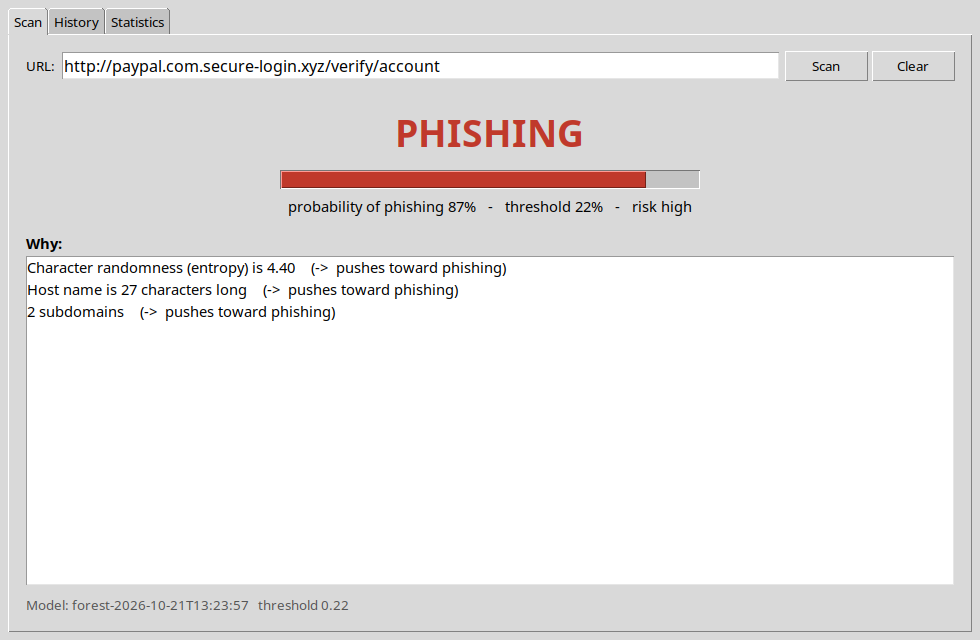
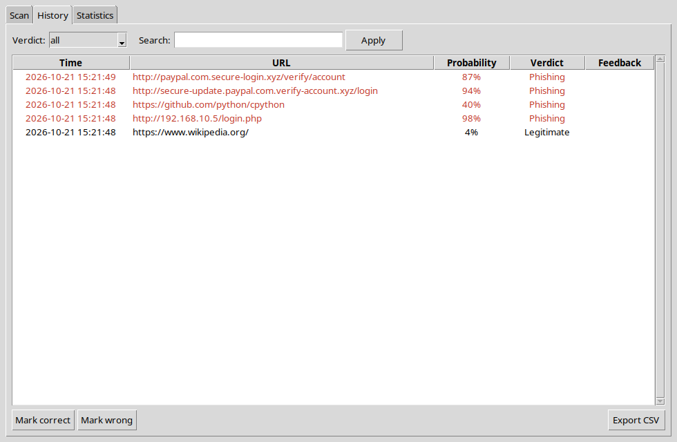
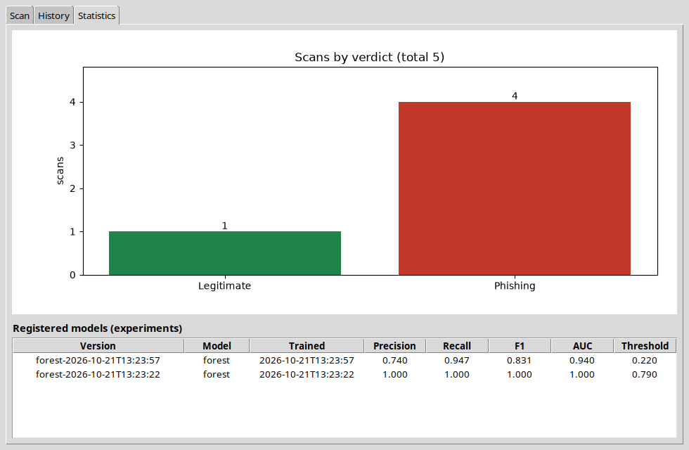

# PhishGuard — walkthrough

Every function you write in this project (59 of them), in the order of `TASKS.md`. For each one:

- **Problem** — what the function has to do,
- **Solution** — the finished code,
- **Check** — the test that proves it works.

Try each function yourself first, then compare. Run the check after every function, not at the end.

## Contents

- [Stage 1 — URL parsing and features (the heart of the project)](#stage-1--url-parsing-and-features-the-heart-of-the-project) (4 functions)
- [Stage 2 — Data](#stage-2--data) (5 functions)
- [Stage 3 — First model](#stage-3--first-model) (6 functions)
- [Stage 4 — Compare, evaluate, choose the threshold](#stage-4--compare-evaluate-choose-the-threshold) (8 functions)
- [Stage 5 — Live prediction and explanation](#stage-5--live-prediction-and-explanation) (5 functions)
- [Stage 6 — Database and UI](#stage-6--database-and-ui) (30 functions)
- [Stage 7 — Experiments, drift test, documentation](#stage-7--experiments-drift-test-documentation) (1 functions)
- [The finished project](#the-finished-project)

## Stage 1 — URL parsing and features (the heart of the project)

### `phishguard/features/extractor.py`

#### `shannon_entropy(text)`

**Problem.** Measure how random a string looks: H = -sum(p * log2(p)) over its characters, where p is how often each character appears divided by the length. "aaaa" gives 0, a random string like "x7f9q2" gives a high value. An empty string gives 0.

**Solution.**

```python
def shannon_entropy(text: str) -> float:
    if not text:
        return 0.0
    n = len(text)
    return -sum((count / n) * math.log2(count / n) for count in Counter(text).values())
```

**Check.** `pytest tests/test_extractor.py::test_entropy_of_uniform_and_constant`

#### `URLFeatureExtractor.extract(url)`

**Problem.** Turn one URL into the 20 numbers listed in FEATURE_NAMES (lengths, counts of dots and hyphens, yes/no flags as 1.0/0.0, entropy, and so on). Return them as a FeatureVector. Check at the end that you produced exactly the 20 names, so a missing feature fails at once instead of shifting the columns.

**Solution.**

```python
def extract(self, url: str) -> FeatureVector:
    p: ParsedURL = self.parser.parse(url)
    lowered = url.lower()
    after_scheme = url.split("://", 1)[1] if "://" in url else url
    digits = sum(ch.isdigit() for ch in url)
    subdomain_text = ".".join(p.subdomains)
    brand_in_sub = any(b in subdomain_text for b in BRAND_WORDS)
    brand_in_domain = any(b in p.domain for b in BRAND_WORDS)

    values = {
        "url_length": len(url),
        "host_length": len(p.host),
        "path_length": len(p.path),
        "num_dots": url.count("."),
        "num_hyphens": url.count("-"),
        "num_underscores": url.count("_"),
        "num_slashes": after_scheme.count("/"),
        "num_digits": digits,
        "digit_ratio": digits / len(url) if url else 0.0,
        "num_subdomains": len(p.subdomains),
        "num_query_params": len([pair for pair in p.query.split("&") if pair]),
        "has_ip_host": p.has_ip_host,
        "has_at_symbol": "@" in url,
        "has_https": p.scheme == "https",
        "has_port": p.port is not None,
        "suspicious_word_count": sum(1 for w in config.SUSPICIOUS_WORDS if w in lowered),
        "suspicious_tld": p.tld in config.SUSPICIOUS_TLDS,
        "is_shortener": p.host in config.URL_SHORTENERS,
        "entropy": shannon_entropy(url),
        "brand_in_subdomain": brand_in_sub and not brand_in_domain,
    }
    values = {name: float(v) for name, v in values.items()}
    assert set(values) == set(FEATURE_NAMES), f"feature mismatch: {set(values) ^ set(FEATURE_NAMES)}"
    return FeatureVector(values)
```

**Check.** `pytest tests/test_extractor.py -k "test_all_features_present or test_legitimate_url_features or test_phishing_url_features or test_at_symbol_and_ip"`

### `phishguard/features/url_parser.py`

#### `URLParser.parse(url)`

**Problem.** Split a URL into scheme, host, subdomains, domain, TLD, port, path and query. People often paste a URL without "http://", so add it before parsing but remember the scheme was empty. The last label of the host is the TLD (two labels for "co.il"-style endings), the one before it is the domain, the rest are subdomains: "mail.paypal.com.secure-login.xyz" gives subdomains ["mail", "paypal", "com"], domain "secure-login", TLD "xyz". Garbage input must not crash: return empty fields instead.

**Solution.**

```python
def parse(self, url: str) -> ParsedURL:
    text = (url or "").strip()
    had_scheme = "://" in text
    empty = ParsedURL(raw=url, scheme="", host="", subdomains=[], domain="", tld="", port=None,
                      path="", query="", has_ip_host=False)
    try:
        parsed = urlparse(text if had_scheme else "http://" + text)
        host = (parsed.hostname or "").lower()
        port = parsed.port                       # raises ValueError on "x.com:99999"
    except ValueError:
        return empty

    has_ip = bool(IP_PATTERN.match(host))
    if not has_ip:
        try:
            ipaddress.ip_address(host)           # also catches IPv6 hosts
            has_ip = bool(host)
        except ValueError:
            pass

    subdomains, domain, tld = [], host, ""
    if not has_ip:
        labels = [label for label in host.split(".") if label]
        two_part = len(labels) >= 3 and ".".join(labels[-2:]) in config.COMMON_TLDS
        n_tld = 2 if two_part else 1
        if len(labels) > n_tld:
            tld = ".".join(labels[-n_tld:])
            domain = labels[-n_tld - 1]
            subdomains = labels[:-n_tld - 1]
    return ParsedURL(raw=url, scheme=parsed.scheme if had_scheme else "", host=host,
                     subdomains=subdomains, domain=domain, tld=tld, port=port,
                     path=parsed.path, query=parsed.query, has_ip_host=has_ip)
```

**Check.** `pytest tests/test_parser.py -k "test_simple_https or test_brand_in_subdomain or test_ip_host_and_port or test_missing_scheme_is_handled"`

### `phishguard/models/entities.py`

#### `FeatureVector.as_list(feature_names)`

**Problem.** Return the feature values as a list in the order of `feature_names`. Loop over the names, not over the dict: the model expects the numbers in exactly the order it was trained on, and a wrong order gives wrong predictions with no error.

**Solution.**

```python
def as_list(self, feature_names: List[str]) -> List[float]:
    return [self.values[name] for name in feature_names]
```

**Check.** `pytest tests/test_extractor.py -k "test_same_url_same_features or test_as_list_keeps_order"`


## Stage 2 — Data

### `phishguard/features/extractor.py`

#### `URLFeatureExtractor.extract_many(urls)`

**Problem.** Run `extract` on a list of URLs and return the list of value lists - the matrix X the model trains on.

**Solution.**

```python
def extract_many(self, urls: List[str]) -> List[List[float]]:
    return [self.extract(u).as_list(FEATURE_NAMES) for u in urls]
```

**Check.** No unit test - run the program and look (see the stage's exit condition in `TASKS.md`).

### `phishguard/ml/dataset.py`

#### `DatasetLoader.read()`

**Problem.** Read the CSV, keep the URL and label columns, drop empty rows, clean every URL (strip spaces, lower-case) and drop duplicates. Return a table with columns "url" and "label", where label is 1 for phishing ("bad") and 0 for legitimate.

**Solution.**

```python
def read(self) -> pd.DataFrame:
    df = pd.read_csv(self.path)
    df = df[[config.DATASET_URL_COLUMN, config.DATASET_LABEL_COLUMN]].dropna()
    df["url"] = df[config.DATASET_URL_COLUMN].astype(str).str.strip().str.lower()
    df["label"] = (df[config.DATASET_LABEL_COLUMN].astype(str).str.strip() == config.POSITIVE_LABEL).astype(int)
    df = df[df["url"] != ""]
    return df[["url", "label"]].drop_duplicates("url").reset_index(drop=True)
```

**Check.** `pytest tests/test_dataset.py::test_read_and_label`

#### `DatasetLoader.balance(df)`

**Problem.** Take the same number of rows from each class (at most `per_class`), with the fixed seed, and shuffle them. A balanced sample stops the model from learning "always say legitimate".

**Solution.**

```python
def balance(self, df: pd.DataFrame) -> pd.DataFrame:
    parts = []
    for label in (0, 1):
        group = df[df["label"] == label]
        parts.append(group.sample(min(self.per_class, len(group)), random_state=self.seed))
    out = pd.concat(parts).sample(frac=1, random_state=self.seed).reset_index(drop=True)
    counts = out["label"].value_counts()
    print(f"balanced sample: {counts.get(0, 0)} legitimate, {counts.get(1, 0)} phishing")
    return out
```

**Check.** No unit test - run the program and look (see the stage's exit condition in `TASKS.md`).

#### `DatasetLoader.load()`

**Problem.** Build the whole dataset: read, balance, turn every URL into features, then split 70/15/15 into train, validation and test. Use `stratify` so each part has the same share of phishing, and the fixed seed so every run gets the same rows. Keep the test URLs so mistakes can be shown later.

**Solution.**

```python
def load(self) -> DatasetSplit:
    df = self.balance(self.read())
    X = np.array(self.extractor.extract_many(df["url"].tolist()))
    y = df["label"].to_numpy()
    urls = df["url"].to_numpy()
    X_rest, X_test, y_rest, y_test, _, urls_test = train_test_split(
        X, y, urls, test_size=config.TEST_SIZE, stratify=y, random_state=self.seed)
    X_train, X_val, y_train, y_val = train_test_split(
        X_rest, y_rest, test_size=config.VALIDATION_SIZE / (1 - config.TEST_SIZE),
        stratify=y_rest, random_state=self.seed)
    return DatasetSplit(X_train, y_train, X_val, y_val, X_test, y_test,
                        feature_names=list(FEATURE_NAMES), urls_test=list(urls_test))
```

**Check.** `pytest tests/test_dataset.py -k "test_split_shapes_and_no_overlap or test_split_is_reproducible"` and `pytest tests/test_pipeline.py -k "test_train_bundle_predict or test_bundle_refuses_wrong_features"`

#### `DatasetLoader.feature_table(df)`

**Problem.** Return a table of all 20 features plus the label for the given rows. With `groupby("label").mean()` you can see which features differ between phishing and legitimate before training anything.

**Solution.**

```python
def feature_table(self, df: pd.DataFrame) -> pd.DataFrame:
    X = self.extractor.extract_many(df["url"].tolist())
    table = pd.DataFrame(X, columns=FEATURE_NAMES)
    table["label"] = df["label"].to_numpy()
    return table
```

**Check.** No unit test - run the program and look (see the stage's exit condition in `TASKS.md`).


## Stage 3 — First model

### `phishguard/ml/bundle.py`

#### `ModelBundle.from_trained(trained, feature_names, report_entry)`

**Problem.** Collect everything prediction needs into one bundle: the fitted pipeline, the model name, a copy of the feature names, the threshold (0.5 if the report has none) and the metrics.

**Solution.**

```python
@classmethod
def from_trained(cls, trained, feature_names, report_entry) -> "ModelBundle":
    return cls(
        pipeline=trained.pipeline,
        model_name=trained.name,
        feature_names=list(feature_names),
        threshold=report_entry.get("threshold", config.DEFAULT_THRESHOLD),
        metrics=report_entry)
```

**Check.** `pytest tests/test_pipeline.py::test_train_bundle_predict`

#### `ModelBundle.save(path)`

**Problem.** Set the version string ("<model>-<trained_at>") and save the whole bundle with joblib. Set the version first, otherwise the saved file has an empty version.

**Solution.**

```python
def save(self, path: str) -> None:
    self.version = f"{self.model_name}-{self.trained_at}"
    joblib.dump(self, path)
```

**Check.** `pytest tests/test_pipeline.py::test_train_bundle_predict`

#### `ModelBundle.load(path)`

**Problem.** Load a bundle and check that its feature names are exactly FEATURE_NAMES. If they differ, raise a RuntimeError telling the user to retrain - a model fed different features gives wrong answers silently.

**Solution.**

```python
@classmethod
def load(cls, path: str) -> "ModelBundle":
    from phishguard.features import extractor
    bundle = joblib.load(path)
    if list(bundle.feature_names) != extractor.FEATURE_NAMES:
        raise RuntimeError("model was trained with different features - retrain")
    return bundle
```

**Check.** `pytest tests/test_dataset.py -k "test_split_shapes_and_no_overlap or test_split_is_reproducible"` and `pytest tests/test_pipeline.py -k "test_train_bundle_predict or test_bundle_refuses_wrong_features"`

### `phishguard/ml/trainer.py`

**Helper code in this file** (used by the functions below, not a TODO in your skeleton):

`GRIDS`

```python
GRIDS = {
    "logistic": {"clf__C": [0.01, 0.1, 1, 10]},
    "forest": {"clf__max_depth": [None, 10, 20], "clf__min_samples_leaf": [1, 3]},
}
```

#### `ModelTrainer.build_logistic()`

**Problem.** Return a Pipeline of a StandardScaler followed by a LogisticRegression (max_iter=1000, balanced class weights). The scaler lives inside the pipeline so it is saved and reused with the model.

**Solution.**

```python
def build_logistic(self):
    return Pipeline([("scaler", StandardScaler()),
                     ("clf", LogisticRegression(max_iter=1000, class_weight="balanced"))])
```

**Check.** No unit test - run the program and look (see the stage's exit condition in `TASKS.md`).

#### `ModelTrainer.train(models)`

**Problem.** Build and fit the requested models ("logistic", "forest" or "both") with their parameter grids and return a dict {name: TrainedModel}.

**Solution.**

```python
def train(self, models: str = "both") -> Dict[str, TrainedModel]:
    builders = {"logistic": self.build_logistic, "forest": self.build_forest}
    names = list(builders) if models == "both" else [models]
    return {name: self.fit_with_search(name, builders[name](), GRIDS[name]) for name in names}
```

**Check.** `pytest tests/test_extractor.py::test_same_url_same_features` and `pytest tests/test_pipeline.py::test_train_bundle_predict`

### `train.py`

#### `main()`

**Problem.** The training script: load the data, train the models, compare them on the test split, save the reports and the best model's bundle, register it in the database and print a summary table with the worst mistakes.

**Solution.**

```python
def main():
    args = parse_args()
    os.makedirs(config.MODELS_DIR, exist_ok=True)
    os.makedirs(config.REPORTS_DIR, exist_ok=True)
    path = config.SAMPLE_PATH if args.sample else config.DATASET_PATH
    if not os.path.exists(path):
        raise SystemExit(f"dataset not found: {path}\nsee data/README.md (or use --sample)")

    loader = DatasetLoader(path, per_class=args.per_class)
    df = loader.balance(loader.read())
    loader.feature_table(df).groupby("label").mean().T.rename(columns={0: "legitimate", 1: "phishing"}) \
        .to_csv(os.path.join(config.REPORTS_DIR, "feature_means.csv"))
    split = loader.load()
    print(f"train {len(split.y_train)}  validation {len(split.y_val)}  test {len(split.y_test)}")

    trainer = ModelTrainer(split)
    results = trainer.train(models=args.model)
    evaluator = ModelEvaluator(split)
    best_name, report = evaluator.compare(results)
    evaluator.save_reports(report, config.REPORTS_DIR)

    bundle = ModelBundle.from_trained(results[best_name], split.feature_names, report[best_name])
    bundle.save(config.BEST_MODEL_PATH)

    Database().initialize_schema()
    ModelRepository().register(bundle.version, best_name, bundle.trained_at, len(split.y_train),
                               report[best_name], bundle.threshold,
                               notes=f"{'sample' if args.sample else 'full'} data, params {results[best_name].best_params}")

    print()
    print(f"{'model':<10}{'thresh':>8}{'acc':>8}{'prec':>8}{'recall':>8}{'f1':>8}{'auc':>8}")
    for name, m in report.items():
        mark = "  <- best" if name == best_name else ""
        print(f"{name:<10}{m['threshold']:>8.2f}{m['accuracy']:>8.3f}{m['precision']:>8.3f}"
              f"{m['recall']:>8.3f}{m['f1']:>8.3f}{m['auc']:>8.3f}{mark}")
    print()
    mistakes = report[best_name]["worst_mistakes"]
    print("worst false positives (legitimate called phishing):")
    for m in mistakes["false_positives"]:
        print(f"  {m['probability']:.3f}  {m['url']}")
    print("worst false negatives (phishing that slipped through):")
    for m in mistakes["false_negatives"]:
        print(f"  {m['probability']:.3f}  {m['url']}")
    print(f"\nsaved {config.BEST_MODEL_PATH} (version {bundle.version})")
```

**Check.** No unit test - run the program and look (see the stage's exit condition in `TASKS.md`).


## Stage 4 — Compare, evaluate, choose the threshold

### `phishguard/ml/evaluator.py`

#### `ModelEvaluator.metrics(pipeline, X, y, threshold)`

**Problem.** Score a model at a given threshold: a URL is phishing when its probability is at least the threshold. Return accuracy, precision, recall, F1 (for the phishing class), AUC, the threshold and the confusion matrix [[tn, fp], [fn, tp]].

**Solution.**

```python
def metrics(self, pipeline, X, y, threshold: float = config.DEFAULT_THRESHOLD) -> dict:
    probs = pipeline.predict_proba(X)[:, 1]
    preds = (probs >= threshold).astype(int)
    tn, fp, fn, tp = confusion_matrix(y, preds, labels=[0, 1]).ravel()
    return {
        "accuracy": float(accuracy_score(y, preds)),
        "precision": float(precision_score(y, preds, zero_division=0)),
        "recall": float(recall_score(y, preds, zero_division=0)),
        "f1": float(f1_score(y, preds, zero_division=0)),
        "auc": float(roc_auc_score(y, probs)) if len(set(y)) == 2 else float("nan"),
        "threshold": float(threshold),
        "confusion": [[int(tn), int(fp)], [int(fn), int(tp)]],
    }
```

**Check.** `pytest tests/test_pipeline.py::test_bundle_refuses_wrong_features`

#### `ModelEvaluator.choose_threshold(pipeline, target_recall)`

**Problem.** On the validation split, try thresholds from 0.05 to 0.95 and return the highest one whose recall is still at least the target (0.95). Highest means fewest false alarms while still catching 95% of phishing. Never use the test split here.

**Solution.**

```python
def choose_threshold(self, pipeline, target_recall: float = config.TARGET_RECALL) -> float:
    probs = pipeline.predict_proba(self.split.X_val)[:, 1]
    best = None
    for t in np.round(np.arange(0.05, 0.951, 0.01), 2):
        preds = (probs >= t).astype(int)
        if recall_score(self.split.y_val, preds, zero_division=0) >= target_recall:
            best = float(t)                     # keeps rising while recall holds -> the highest one
    return best if best is not None else config.DEFAULT_THRESHOLD
```

**Check.** No unit test - run the program and look (see the stage's exit condition in `TASKS.md`).

#### `ModelEvaluator.compare(trained)`

**Problem.** For every trained model: choose its threshold on validation, measure it on test, add its feature importances and worst mistakes. Return the best model's name (highest F1, then recall) and the full report.

**Solution.**

```python
def compare(self, trained: Dict[str, "TrainedModel"]) -> Tuple[str, dict]:   # noqa: F821
    report = {}
    for name, model in trained.items():
        threshold = self.choose_threshold(model.pipeline)
        entry = self.metrics(model.pipeline, self.split.X_test, self.split.y_test, threshold)
        entry["importances"] = self.importances(model.pipeline)
        entry["best_params"] = {k: v for k, v in model.best_params.items()}
        entry["cv_f1"] = model.cv_score
        entry["train_seconds"] = model.train_seconds
        entry["train_rows"] = int(len(self.split.y_train))
        entry["worst_mistakes"] = self.worst_mistakes(model.pipeline, threshold)
        report[name] = entry
        self._pipelines[name] = model.pipeline
    best = max(report, key=lambda n: (report[n]["f1"], report[n]["recall"]))
    return best, report
```

**Check.** `pytest tests/test_pipeline.py::test_train_bundle_predict`

#### `ModelEvaluator.importances(pipeline)`

**Problem.** Return how much each feature matters, as {name: value}: the signed weights for logistic regression, the feature importances for the random forest.

**Solution.**

```python
def importances(self, pipeline) -> Dict[str, float]:
    clf = pipeline.named_steps["clf"]
    values = clf.coef_[0] if hasattr(clf, "coef_") else clf.feature_importances_
    return {name: float(v) for name, v in zip(self.split.feature_names, values)}
```

**Check.** No unit test - run the program and look (see the stage's exit condition in `TASKS.md`).

#### `ModelEvaluator.worst_mistakes(pipeline, threshold, n)`

**Problem.** Find real URLs the model got wrong on the test split: the legitimate ones with the highest phishing probability and the phishing ones with the lowest. They show the model's limits better than any number.

**Solution.**

```python
def worst_mistakes(self, pipeline, threshold: float, n: int = 10) -> Dict[str, list]:
    probs = pipeline.predict_proba(self.split.X_test)[:, 1]
    y = self.split.y_test
    urls = self.split.urls_test
    fp = [i for i in range(len(y)) if y[i] == 0 and probs[i] >= threshold]
    fn = [i for i in range(len(y)) if y[i] == 1 and probs[i] < threshold]
    fp.sort(key=lambda i: probs[i], reverse=True)
    fn.sort(key=lambda i: probs[i])
    return {
        "false_positives": [{"url": urls[i], "probability": round(float(probs[i]), 4)} for i in fp[:n]],
        "false_negatives": [{"url": urls[i], "probability": round(float(probs[i]), 4)} for i in fn[:n]],
    }
```

**Check.** No unit test - run the program and look (see the stage's exit condition in `TASKS.md`).

#### `ModelEvaluator.save_reports(report, directory)`

**Problem.** Write metrics.json and three charts into the reports folder: a confusion matrix per model, both ROC curves on one plot, and the feature importances of the best model.

**Solution.**

```python
def save_reports(self, report: dict, directory: str) -> None:
    import matplotlib
    matplotlib.use("Agg")
    import matplotlib.pyplot as plt

    os.makedirs(directory, exist_ok=True)
    with open(os.path.join(directory, "metrics.json"), "w", encoding="utf-8") as fh:
        json.dump(report, fh, indent=2, default=str)

    names = list(report)
    fig, axes = plt.subplots(1, len(names), figsize=(4.5 * len(names), 4), squeeze=False)
    for ax, name in zip(axes[0], names):
        cm = np.array(report[name]["confusion"])
        ax.imshow(cm, cmap="Blues")
        for (i, j), v in np.ndenumerate(cm):
            ax.text(j, i, str(v), ha="center", va="center",
                    color="white" if v > cm.max() / 2 else "black", fontsize=14)
        ax.set_xticks([0, 1], ["legitimate", "phishing"])
        ax.set_yticks([0, 1], ["legitimate", "phishing"])
        ax.set_xlabel("predicted")
        ax.set_ylabel("true")
        ax.set_title(f"{name} (threshold {report[name]['threshold']:.2f})")
    fig.tight_layout()
    fig.savefig(os.path.join(directory, "confusion_matrix.png"), dpi=120)
    plt.close(fig)

    fig, ax = plt.subplots(figsize=(5.5, 5))
    for name in names:
        pipeline = self._pipelines.get(name)
        if pipeline is None:
            continue
        probs = pipeline.predict_proba(self.split.X_test)[:, 1]
        fpr, tpr, _ = roc_curve(self.split.y_test, probs)
        ax.plot(fpr, tpr, label=f"{name} (AUC = {report[name]['auc']:.3f})")
    ax.plot([0, 1], [0, 1], "k--", linewidth=0.8, label="random guess")
    ax.set_xlabel("false positive rate")
    ax.set_ylabel("true positive rate (recall)")
    ax.set_title("ROC curve - test split")
    ax.legend(loc="lower right")
    fig.tight_layout()
    fig.savefig(os.path.join(directory, "roc_curve.png"), dpi=120)
    plt.close(fig)

    best = max(names, key=lambda n: (report[n]["f1"], report[n]["recall"]))
    imp = report[best]["importances"]
    order = sorted(imp, key=lambda k: abs(imp[k]))
    fig, ax = plt.subplots(figsize=(7, 6))
    colors = ["#c0392b" if imp[k] > 0 else "#2e86c1" for k in order]
    ax.barh(order, [imp[k] for k in order], color=colors)
    ax.set_title(f"Feature importance - {best}")
    ax.set_xlabel("weight on scaled feature" if best == "logistic" else "importance")
    fig.tight_layout()
    fig.savefig(os.path.join(directory, "feature_importance.png"), dpi=120)
    plt.close(fig)
```

**Check.** No unit test - run the program and look (see the stage's exit condition in `TASKS.md`).

### `phishguard/ml/trainer.py`

#### `ModelTrainer.build_forest()`

**Problem.** Return a Pipeline of a StandardScaler and a RandomForestClassifier (config.RANDOM_FOREST_TREES trees, balanced class weights, fixed seed). Trees do not need scaling, but the same pipeline shape keeps the rest of the code identical for both models.

**Solution.**

```python
def build_forest(self):
    return Pipeline([("scaler", StandardScaler()),
                     ("clf", RandomForestClassifier(n_estimators=config.RANDOM_FOREST_TREES, n_jobs=-1,
                                                    random_state=config.RANDOM_SEED,
                                                    class_weight="balanced"))])
```

**Check.** No unit test - run the program and look (see the stage's exit condition in `TASKS.md`).

#### `ModelTrainer.fit_with_search(name, pipeline, param_grid)`

**Problem.** Run a GridSearchCV over the parameter grid (5 folds, scored by F1) on the training split, time it, and return the best model, its parameters, its cross-validated F1 and the seconds it took.

**Solution.**

```python
def fit_with_search(self, name: str, pipeline, param_grid: dict) -> TrainedModel:
    start = time.time()
    search = GridSearchCV(pipeline, param_grid, cv=config.CV_FOLDS, scoring="f1", n_jobs=-1)
    search.fit(self.split.X_train, self.split.y_train)
    seconds = time.time() - start
    print(f"  {name}: best {search.best_params_}  cv F1 = {search.best_score_:.4f}  ({seconds:.1f} s)")
    return TrainedModel(name, search.best_estimator_, search.best_params_, float(search.best_score_), seconds)
```

**Check.** No unit test - run the program and look (see the stage's exit condition in `TASKS.md`).


## Stage 5 — Live prediction and explanation

### `evaluate.py`

#### `main()`

**Problem.** With --url or --file: scan each URL and print the verdict, probability and reasons. Without them: rebuild the same split, load the saved model and print its metrics on the test split.

**Solution.**

```python
def main():
    args = parse_args()
    if args.url or args.file:
        from phishguard.ml.explainer import Explainer
        from phishguard.ml.predictor import Predictor
        predictor = Predictor()
        if not predictor.is_ready:
            raise SystemExit("no trained model - run: python train.py")
        explainer = Explainer(predictor.bundle)
        urls = [args.url] if args.url else []
        if args.file:
            with open(args.file, encoding="utf-8") as fh:
                urls += [line.strip() for line in fh if line.strip() and not line.startswith("#")]
        for url in urls:
            result = predictor.predict(url)
            print(f"\n{result.verdict.label.upper():<11} {result.probability:6.1%}  (threshold "
                  f"{result.threshold:.0%}, risk {result.risk_level})  {url}")
            for e in explainer.explain(result):
                arrow = "->" if e.contribution > 0 else "<-"
                print(f"    {arrow} {e.text}  ({e.contribution:+.2f})")
        return

    path = config.SAMPLE_PATH if args.sample else config.DATASET_PATH
    if not os.path.exists(config.BEST_MODEL_PATH):
        raise SystemExit("no trained model - run: python train.py")
    bundle = ModelBundle.load(config.BEST_MODEL_PATH)
    split = DatasetLoader(path, per_class=args.per_class).load()      # same seed + size as train.py -> same test rows
    m = ModelEvaluator(split).metrics(bundle.pipeline, split.X_test, split.y_test, bundle.threshold)
    print(f"model {bundle.version}  (threshold {bundle.threshold:.2f})  on {len(split.y_test)} test URLs")
    for key in ("accuracy", "precision", "recall", "f1", "auc"):
        print(f"  {key:<10}{m[key]:.4f}")
    (tn, fp), (fn, tp) = m["confusion"]
    print(f"  confusion   TN={tn}  FP={fp}  FN={fn}  TP={tp}")
```

**Check.** No unit test - run the program and look (see the stage's exit condition in `TASKS.md`).

### `phishguard/ml/explainer.py`

#### `Explainer.contributions(result)`

**Problem.** Work out how much each feature pushed this URL toward phishing. For logistic regression it is weight x scaled value (exact); for the forest, importance x the sign of the scaled value (an approximation). Give each one a readable sentence; for a yes/no feature that is 0 use the "when zero" sentence.

**Solution.**

```python
def contributions(self, result: ScanResult) -> List[Explanation]:
    names = self.bundle.feature_names
    clf = self.bundle.pipeline.named_steps["clf"]
    scaler = self.bundle.pipeline.named_steps["scaler"]
    x = [result.features[n] for n in names]
    x_scaled = scaler.transform([x])[0]
    if hasattr(clf, "coef_"):
        contribs = clf.coef_[0] * x_scaled
    else:
        contribs = clf.feature_importances_ * np.sign(x_scaled)
    out = []
    for i, name in enumerate(names):
        value = result.features[name]
        if name in TEMPLATES_WHEN_ZERO and value == 0:
            text = TEMPLATES_WHEN_ZERO[name]
        else:
            text = TEMPLATES.get(name, name).format(value=value)
        out.append(Explanation(feature=name, value=value, contribution=float(contribs[i]), text=text))
    return out
```

**Check.** No unit test - run the program and look (see the stage's exit condition in `TASKS.md`).

#### `Explainer.explain(result, top)`

**Problem.** Keep the contributions that point the same way as the verdict, take the `top` strongest, store them on the result and return them. These are the three reasons the user sees.

**Solution.**

```python
def explain(self, result: ScanResult, top: int = 3) -> List[Explanation]:
    direction = 1 if result.verdict is Verdict.PHISHING else -1
    toward = [c for c in self.contributions(result) if c.contribution * direction > 0]
    toward.sort(key=lambda c: abs(c.contribution), reverse=True)
    result.explanations = toward[:top]
    return result.explanations
```

**Check.** No unit test - run the program and look (see the stage's exit condition in `TASKS.md`).

### `phishguard/ml/predictor.py`

#### `Predictor.load()`

**Problem.** Load the model bundle if the file exists and mark the predictor ready. If there is no file, stay "not ready" instead of crashing - the app must still open and tell the user to train.

**Solution.**

```python
def load(self) -> None:
    if not os.path.exists(self.model_path):
        self.bundle = None
        self.is_ready = False
        return
    self.bundle = ModelBundle.load(self.model_path)
    self.is_ready = True
```

**Check.** `pytest tests/test_dataset.py -k "test_split_shapes_and_no_overlap or test_split_is_reproducible"` and `pytest tests/test_pipeline.py -k "test_train_bundle_predict or test_bundle_refuses_wrong_features"`

#### `Predictor.predict(url)`

**Problem.** Scan one URL: clean it exactly like the training data (strip, lower-case), extract the features, get the phishing probability and compare it with the bundle's threshold. Return a ScanResult.

**Solution.**

```python
def predict(self, url: str) -> ScanResult:
    if not self.is_ready:
        raise RuntimeError("no trained model - run: python train.py")
    url = url.strip().lower()
    features = self.extractor.extract(url)
    X = [features.as_list(self.bundle.feature_names)]
    probability = float(self.bundle.pipeline.predict_proba(X)[0][1])
    verdict = Verdict.PHISHING if probability >= self.bundle.threshold else Verdict.LEGITIMATE
    return ScanResult(url, probability, verdict, self.bundle.threshold, features.values, self.bundle.version)
```

**Check.** `pytest tests/test_pipeline.py::test_train_bundle_predict`


## Stage 6 — Database and UI

### `phishguard/controllers/app_controller.py`

**Helper code in this file** (used by the functions below, not a TODO in your skeleton):

`MAX_URL_LENGTH`

```python
MAX_URL_LENGTH = 2048
```

`AppController._on_tab_changed`

```python
def _on_tab_changed(self) -> None:
        self.refresh_stats()
```

#### `AppController.__init__(root)`

**Problem.** Create the predictor, the explainer (only when a model is loaded), the two repositories and the main window, and hand the window the four callbacks.

**Solution.**

```python
def __init__(self, root: tk.Tk):
    self.root = root
    self.predictor = Predictor()
    self.explainer = Explainer(self.predictor.bundle) if self.predictor.is_ready else None
    self.scans = ScanRepository()
    self.models = ModelRepository()
    self.view = MainWindow(root, on_scan=self.on_scan, on_filter=self.on_filter,
                           on_feedback=self.on_feedback, on_export=self.on_export)
    self.view.on_tab_changed = self._on_tab_changed
```

**Check.** No unit test - run the program and look (see the stage's exit condition in `TASKS.md`).

#### `AppController.start()`

**Problem.** Show the scan tab, fill the history and statistics, and warn the user (with the train command) when there is no model.

**Solution.**

```python
def start(self) -> None:
    self.view.notebook.select(self.view.scan)
    self.on_filter(None, "")
    self.refresh_stats()
    if not self.predictor.is_ready:
        self.view.scan.set_status("No trained model found. Run:  python train.py", error=True)
        self.view.show_error("No trained model was found.\n\nTrain one first:\n    python train.py")
    else:
        bundle = self.predictor.bundle
        self.view.scan.set_status(f"Model: {bundle.version}   threshold {bundle.threshold:.2f}")
```

**Check.** No unit test - run the program and look (see the stage's exit condition in `TASKS.md`).

#### `AppController.on_scan(url)`

**Problem.** Check the URL (not empty, not too long), scan and explain it, save it, and show the result. Any error becomes a message box - a bad URL must never crash the app.

**Solution.**

```python
def on_scan(self, url: str) -> None:
    url = (url or "").strip()
    if not url:
        self.view.show_error("Type a URL first.")
        return
    if len(url) >= MAX_URL_LENGTH:
        self.view.show_error(f"That URL is too long (max {MAX_URL_LENGTH - 1} characters).")
        return
    if not self.predictor.is_ready:
        self.view.show_error("No trained model - run:  python train.py")
        return
    try:
        result = self.predictor.predict(url)
        self.explainer.explain(result)
        result.id = self.scans.add(result)
    except Exception as exc:                      # a bad URL must never crash the app
        self.view.show_error(f"Could not scan this URL:\n{exc}")
        return
    self.view.scan.show_result(result)
    self.on_filter(*self.view.history.current_filter())
    self.refresh_stats()
```

**Check.** No unit test - run the program and look (see the stage's exit condition in `TASKS.md`).

#### `AppController.on_filter(verdict, search)`

**Problem.** Read the scans that match the chosen verdict and search text and show them in the history table.

**Solution.**

```python
def on_filter(self, verdict, search: str) -> None:
    verdict = Verdict(verdict) if verdict else None
    rows = self.scans.list_recent(config.HISTORY_PAGE_SIZE, verdict, (search or "").strip() or None)
    self.view.history.show_rows(rows)
```

**Check.** No unit test - run the program and look (see the stage's exit condition in `TASKS.md`).

#### `AppController.on_feedback(scan_id, feedback)`

**Problem.** Save "correct"/"wrong" for the selected scan and refresh the table; ask the user to select a row first if none is selected.

**Solution.**

```python
def on_feedback(self, scan_id: int, feedback: str) -> None:
    if scan_id is None:
        self.view.show_info("Select a scan in the table first.")
        return
    self.scans.set_feedback(scan_id, feedback)
    self.on_filter(*self.view.history.current_filter())
```

**Check.** No unit test - run the program and look (see the stage's exit condition in `TASKS.md`).

#### `AppController.on_export()`

**Problem.** Export the history to CSV and tell the user where the file is.

**Solution.**

```python
def on_export(self) -> None:
    try:
        path = ReportExporter(self.scans).export_history()
    except OSError as exc:
        self.view.show_error(f"Export failed:\n{exc}")
        return
    self.view.show_info(f"History exported to:\n{path}")
```

**Check.** No unit test - run the program and look (see the stage's exit condition in `TASKS.md`).

#### `AppController.refresh_stats()`

**Problem.** Give the statistics tab the counts per verdict and the list of registered models.

**Solution.**

```python
def refresh_stats(self) -> None:
    self.view.stats.show(self.scans.counts_by_verdict(), self.models.list_all())
```

**Check.** No unit test - run the program and look (see the stage's exit condition in `TASKS.md`).

### `phishguard/database/db.py`

#### `Database.get_connection()`

**Problem.** Open the SQLite file with rows that behave like dicts and foreign keys switched on (they are off by default in SQLite).

**Solution.**

```python
def get_connection(self) -> sqlite3.Connection:
    conn = sqlite3.connect(self.db_path)
    conn.row_factory = sqlite3.Row
    conn.execute("PRAGMA foreign_keys = ON")
    return conn
```

**Check.** No unit test - run the program and look (see the stage's exit condition in `TASKS.md`).

#### `Database.connection()`

**Problem.** A context manager around a connection: commit when the block succeeds, roll back when it raises, and always close.

**Solution.**

```python
@contextmanager
def connection(self):
    conn = self.get_connection()
    try:
        yield conn
        conn.commit()
    except Exception:
        conn.rollback()
        raise
    finally:
        conn.close()
```

**Check.** No unit test - run the program and look (see the stage's exit condition in `TASKS.md`).

#### `Database.initialize_schema()`

**Problem.** Create the tables by running the SCHEMA script.

**Solution.**

```python
def initialize_schema(self) -> None:
    with self.connection() as conn:
        conn.executescript(SCHEMA)
```

**Check.** No unit test - run the program and look (see the stage's exit condition in `TASKS.md`).

### `phishguard/database/repositories.py`

**Helper code in this file** (used by the functions below, not a TODO in your skeleton):

`_row_to_result`

```python
def _row_to_result(r) -> ScanResult:
    return ScanResult(
        id=r["id"], url=r["url"],
        scanned_at=datetime.fromisoformat(r["scanned_at"]),
        probability=r["probability"], threshold=r["threshold"],
        verdict=Verdict(r["verdict"]), model_version=r["model_version"],
        features=json.loads(r["features"]),
        feedback=r["feedback"])
```

#### `ScanRepository.add(result)`

**Problem.** Insert one scan and return its new id. Store the time as ISO text, the verdict as its value and the features as JSON, and always use ? placeholders - the URL comes from outside.

**Solution.**

```python
def add(self, result: ScanResult) -> int:
    with self.db.connection() as conn:
        cur = conn.execute(
            "INSERT INTO scans (url, scanned_at, probability, threshold, verdict, model_version, features) "
            "VALUES (?, ?, ?, ?, ?, ?, ?)",
            (result.url, result.scanned_at.isoformat(), result.probability, result.threshold,
             result.verdict.value, result.model_version, json.dumps(result.features)))
        return cur.lastrowid
```

**Check.** `pytest tests/test_repositories.py -k "test_add_and_get or test_list_filters or test_feedback or test_sql_in_a_url_is_stored_as_text"`

#### `ScanRepository.get(scan_id)`

**Problem.** Read one scan by id and turn the row back into a ScanResult, or return None.

**Solution.**

```python
def get(self, scan_id: int) -> Optional[ScanResult]:
    with self.db.connection() as conn:
        row = conn.execute("SELECT * FROM scans WHERE id = ?", (scan_id,)).fetchone()
    return _row_to_result(row) if row else None
```

**Check.** `pytest tests/test_repositories.py -k "test_add_and_get or test_feedback or test_sql_in_a_url_is_stored_as_text"`

#### `ScanRepository.list_recent(limit, verdict, search)`

**Problem.** Return the newest scans first, optionally only one verdict and/or URLs containing a search text. Build the WHERE part from a list of conditions and pass every value as a parameter.

**Solution.**

```python
def list_recent(self, limit: int = 50, verdict: Optional[Verdict] = None,
                search: Optional[str] = None) -> List[ScanResult]:
    conditions, params = [], []
    if verdict is not None:
        conditions.append("verdict = ?")
        params.append(Verdict(verdict).value)
    if search:
        conditions.append("url LIKE ?")
        params.append(f"%{search}%")
    where = ("WHERE " + " AND ".join(conditions)) if conditions else ""
    with self.db.connection() as conn:
        rows = conn.execute(f"SELECT * FROM scans {where} ORDER BY scanned_at DESC, id DESC LIMIT ?",
                            (*params, limit)).fetchall()
    return [_row_to_result(r) for r in rows]
```

**Check.** `pytest tests/test_repositories.py -k "test_list_filters or test_sql_in_a_url_is_stored_as_text"`

#### `ScanRepository.set_feedback(scan_id, feedback)`

**Problem.** Store the user's feedback ("correct" or "wrong") on one scan.

**Solution.**

```python
def set_feedback(self, scan_id: int, feedback: str) -> None:
    if feedback not in ("correct", "wrong", None):
        raise ValueError("feedback must be 'correct' or 'wrong'")
    with self.db.connection() as conn:
        conn.execute("UPDATE scans SET feedback = ? WHERE id = ?", (feedback, scan_id))
```

**Check.** `pytest tests/test_repositories.py::test_feedback`

#### `ScanRepository.counts_by_verdict()`

**Problem.** Count the scans per verdict with GROUP BY and return {Verdict: count}, with 0 for a verdict that has no scans.

**Solution.**

```python
def counts_by_verdict(self) -> dict:
    with self.db.connection() as conn:
        rows = conn.execute("SELECT verdict, COUNT(*) AS n FROM scans GROUP BY verdict").fetchall()
    counts = {v: 0 for v in Verdict}
    counts.update({Verdict(r["verdict"]): r["n"] for r in rows})
    return counts
```

**Check.** `pytest tests/test_repositories.py::test_list_filters`

#### `ModelRepository.register(version, model_name, trained_at, train_rows, metrics, threshold, notes)`

**Problem.** Save a trained model's version, name, date, training size, metrics and threshold. INSERT OR REPLACE, so registering the same version twice keeps one row.

**Solution.**

```python
def register(self, version: str, model_name: str, trained_at: str, train_rows: int,
             metrics: dict, threshold: float, notes: str = "") -> int:
    with self.db.connection() as conn:
        cur = conn.execute(
            "INSERT OR REPLACE INTO models (version, model_name, trained_at, train_rows, accuracy, precision_, "
            "recall, f1, auc, threshold, notes) VALUES (?, ?, ?, ?, ?, ?, ?, ?, ?, ?, ?)",
            (version, model_name, trained_at, train_rows, metrics.get("accuracy"), metrics.get("precision"),
             metrics.get("recall"), metrics.get("f1"), metrics.get("auc"), threshold, notes))
        return cur.lastrowid
```

**Check.** `pytest tests/test_repositories.py::test_model_registry`

#### `ModelRepository.list_all()`

**Problem.** Return every registered model, newest first, as dicts - the experiments table.

**Solution.**

```python
def list_all(self) -> List[dict]:
    with self.db.connection() as conn:
        rows = conn.execute("SELECT * FROM models ORDER BY trained_at DESC, id DESC").fetchall()
    return [dict(r) for r in rows]
```

**Check.** `pytest tests/test_repositories.py::test_model_registry`

### `phishguard/models/entities.py`

#### `ScanResult.risk_level`

**Problem.** Turn the probability into "low", "medium" or "high" using the two limits in config. This only picks the colour; the verdict itself comes from the threshold.

**Solution.**

```python
@property
def risk_level(self) -> str:
    if self.probability < config.RISK_LOW:
        return "low"
    if self.probability < config.RISK_HIGH:
        return "medium"
    return "high"
```

**Check.** No unit test - run the program and look (see the stage's exit condition in `TASKS.md`).

### `phishguard/utils/exporter.py`

#### `ReportExporter.export_history(directory)`

**Problem.** Write all scans to exports/history_<time>.csv with a header row. Use the "utf-8-sig" encoding so Excel opens it correctly. Return the file path.

**Solution.**

```python
def export_history(self, directory: str = config.EXPORTS_DIR) -> str:
    os.makedirs(directory, exist_ok=True)
    path = os.path.join(directory, f"history_{datetime.now():%Y%m%d_%H%M%S}.csv")
    rows = self.scans.list_recent(limit=1_000_000)
    with open(path, "w", newline="", encoding="utf-8-sig") as fh:
        writer = csv.writer(fh)
        writer.writerow(["scanned_at", "url", "probability", "verdict", "threshold", "model_version", "feedback"])
        for r in rows:
            writer.writerow([r.scanned_at.isoformat(timespec="seconds"), r.url, f"{r.probability:.4f}",
                             r.verdict.value, f"{r.threshold:.2f}", r.model_version, r.feedback or ""])
    return path
```

**Check.** No unit test - run the program and look (see the stage's exit condition in `TASKS.md`).

### `phishguard/views/history_view.py`

**Helper code in this file** (used by the functions below, not a TODO in your skeleton):

`COLUMNS`

```python
COLUMNS = (("time", "Time", 150), ("url", "URL", 420), ("probability", "Probability", 90),
           ("verdict", "Verdict", 90), ("feedback", "Feedback", 80))
```

`HistoryView.current_filter`

```python
def current_filter(self):
        verdict = self.verdict_var.get()
        return (None if verdict == "all" else verdict), self.search_var.get()
```

`HistoryView._apply`

```python
def _apply(self) -> None:
        self.on_filter(*self.current_filter())
```

#### `HistoryView.__init__(parent, on_filter, on_feedback, on_export)`

**Problem.** Build the history tab: a verdict filter and search box, a table of scans (the scan id is the row's iid), and buttons for "Mark correct", "Mark wrong" and "Export CSV".

**Solution.**

```python
def __init__(self, parent, on_filter, on_feedback, on_export):
    super().__init__(parent, padding=8)
    self.on_filter = on_filter
    self.on_feedback = on_feedback

    bar = ttk.Frame(self)
    bar.pack(fill="x", pady=(0, 6))
    ttk.Label(bar, text="Verdict:").pack(side="left")
    self.verdict_var = tk.StringVar(value="all")
    ttk.Combobox(bar, textvariable=self.verdict_var, state="readonly", width=12,
                 values=("all", "legitimate", "phishing")).pack(side="left", padx=4)
    ttk.Label(bar, text="Search:").pack(side="left", padx=(12, 0))
    self.search_var = tk.StringVar()
    search = ttk.Entry(bar, textvariable=self.search_var, width=30)
    search.pack(side="left", padx=4)
    search.bind("<Return>", lambda _e: self._apply())
    ttk.Button(bar, text="Apply", command=self._apply).pack(side="left")

    table = ttk.Frame(self)
    table.pack(fill="both", expand=True)
    self.tree = ttk.Treeview(table, columns=[c[0] for c in COLUMNS], show="headings", height=15)
    for key, title, width in COLUMNS:
        self.tree.heading(key, text=title)
        self.tree.column(key, width=width, anchor="w" if key == "url" else "center")
    scroll = ttk.Scrollbar(table, orient="vertical", command=self.tree.yview)
    self.tree.configure(yscrollcommand=scroll.set)
    self.tree.pack(side="left", fill="both", expand=True)
    scroll.pack(side="right", fill="y")
    self.tree.tag_configure("phishing", foreground="#c0392b")

    buttons = ttk.Frame(self)
    buttons.pack(fill="x", pady=(6, 0))
    ttk.Button(buttons, text="Mark correct",
               command=lambda: on_feedback(self.selected_id(), "correct")).pack(side="left")
    ttk.Button(buttons, text="Mark wrong",
               command=lambda: on_feedback(self.selected_id(), "wrong")).pack(side="left", padx=4)
    ttk.Button(buttons, text="Export CSV", command=on_export).pack(side="right")
```

**Check.** No unit test - run the program and look (see the stage's exit condition in `TASKS.md`).

#### `HistoryView.show_rows(rows)`

**Problem.** Clear the table and insert one row per scan.

**Solution.**

```python
def show_rows(self, rows) -> None:
    self.tree.delete(*self.tree.get_children())
    for r in rows:
        self.tree.insert("", "end", iid=str(r.id), tags=(r.verdict.value,),
                         values=(r.scanned_at.strftime("%Y-%m-%d %H:%M:%S"), r.url,
                                 f"{r.probability:.0%}", r.verdict.label, r.feedback or ""))
```

**Check.** No unit test - run the program and look (see the stage's exit condition in `TASKS.md`).

#### `HistoryView.selected_id()`

**Problem.** Return the id of the selected row as an int, or None when nothing is selected.

**Solution.**

```python
def selected_id(self):
    selection = self.tree.selection()
    return int(selection[0]) if selection else None
```

**Check.** No unit test - run the program and look (see the stage's exit condition in `TASKS.md`).

### `phishguard/views/main_window.py`

**Helper code in this file** (used by the functions below, not a TODO in your skeleton):

`MainWindow._tab_changed`

```python
def _tab_changed(self, _event) -> None:
        if self.on_tab_changed and self.notebook.select() == str(self.stats):
            self.on_tab_changed()
```

#### `MainWindow.__init__(root, on_scan, on_filter, on_feedback, on_export)`

**Problem.** Build a Notebook with three tabs - Scan, History, Statistics - and keep each tab as an attribute so the controller can reach it.

**Solution.**

```python
def __init__(self, root: tk.Tk, on_scan, on_filter, on_feedback, on_export):
    super().__init__(root, padding=8)
    self.pack(fill="both", expand=True)
    self.on_tab_changed = None              # the controller may set this
    self.notebook = ttk.Notebook(self)
    self.notebook.pack(fill="both", expand=True)
    self.scan = ScanView(self.notebook, on_scan)
    self.history = HistoryView(self.notebook, on_filter, on_feedback, on_export)
    self.stats = StatsView(self.notebook)
    self.notebook.add(self.scan, text="Scan")
    self.notebook.add(self.history, text="History")
    self.notebook.add(self.stats, text="Statistics")
    self.notebook.bind("<<NotebookTabChanged>>", self._tab_changed)
```

**Check.** No unit test - run the program and look (see the stage's exit condition in `TASKS.md`).

#### `MainWindow.show_error(text)`

**Problem.** Show an error message box.

**Solution.**

```python
def show_error(self, text: str) -> None:
    messagebox.showerror("PhishGuard", text, parent=self)
```

**Check.** No unit test - run the program and look (see the stage's exit condition in `TASKS.md`).

#### `MainWindow.show_info(text)`

**Problem.** Show an information message box.

**Solution.**

```python
def show_info(self, text: str) -> None:
    messagebox.showinfo("PhishGuard", text, parent=self)
```

**Check.** No unit test - run the program and look (see the stage's exit condition in `TASKS.md`).

### `phishguard/views/scan_view.py`

**Helper code in this file** (used by the functions below, not a TODO in your skeleton):

`RISK_COLORS`

```python
RISK_COLORS = {"low": "#1e8449", "medium": "#d68910", "high": "#c0392b"}
```

`ScanView._scan`

```python
def _scan(self) -> None:
        self.on_scan(self.url_var.get())
```

`ScanView.set_status`

```python
def set_status(self, text: str, error: bool = False) -> None:
        self.status.configure(text=text, foreground="#c0392b" if error else "#555")
```

#### `ScanView.__init__(parent, on_scan)`

**Problem.** Build the scan tab: a URL entry (Enter also scans), Scan and Clear buttons, a big verdict label, a progress bar used as a risk meter, a probability line and a list for the reasons.

**Solution.**

```python
def __init__(self, parent, on_scan):
    super().__init__(parent, padding=16)
    self.on_scan = on_scan

    row = ttk.Frame(self)
    row.pack(fill="x")
    ttk.Label(row, text="URL:").pack(side="left")
    self.url_var = tk.StringVar()
    self.entry = ttk.Entry(row, textvariable=self.url_var, font=("TkDefaultFont", 12))
    self.entry.pack(side="left", fill="x", expand=True, padx=6)
    self.entry.bind("<Return>", lambda _e: self._scan())
    ttk.Button(row, text="Scan", command=self._scan).pack(side="left")
    ttk.Button(row, text="Clear", command=self.clear).pack(side="left", padx=(4, 0))

    self.verdict_label = tk.Label(self, text="", font=("TkDefaultFont", 28, "bold"))
    self.verdict_label.pack(pady=(24, 6))

    style = ttk.Style(self)
    for level, color in RISK_COLORS.items():
        style.configure(f"{level}.Horizontal.TProgressbar", background=color)
    self.meter = ttk.Progressbar(self, orient="horizontal", length=420, maximum=100,
                                 mode="determinate", style="low.Horizontal.TProgressbar")
    self.meter.pack(pady=4)
    self.prob_label = ttk.Label(self, text="", font=("TkDefaultFont", 11))
    self.prob_label.pack(pady=(2, 14))

    ttk.Label(self, text="Why:", font=("TkDefaultFont", 11, "bold")).pack(anchor="w")
    self.reasons = tk.Listbox(self, height=6, font=("TkDefaultFont", 11), activestyle="none")
    self.reasons.pack(fill="both", expand=True)

    self.status = ttk.Label(self, text="", foreground="#555")
    self.status.pack(anchor="w", pady=(8, 0))
    self.entry.focus_set()
```

**Check.** No unit test - run the program and look (see the stage's exit condition in `TASKS.md`).

#### `ScanView.show_result(result)`

**Problem.** Show the verdict in the colour of its risk level, fill the meter with the probability, and list the reasons with an arrow showing which way each one pushes.

**Solution.**

```python
def show_result(self, result) -> None:
    color = RISK_COLORS[result.risk_level]
    self.verdict_label.configure(text=result.verdict.label.upper(), fg=color)
    self.meter.configure(value=result.probability * 100,
                         style=f"{result.risk_level}.Horizontal.TProgressbar")
    self.prob_label.configure(text=f"probability of phishing {result.probability:.0%}"
                                   f"   -   threshold {result.threshold:.0%}"
                                   f"   -   risk {result.risk_level}")
    self.reasons.delete(0, "end")
    for e in result.explanations:
        arrow = "->  pushes toward phishing" if e.contribution > 0 else "<-  pushes toward legitimate"
        self.reasons.insert("end", f"{e.text}    ({arrow})")
    if not result.explanations:
        self.reasons.insert("end", "No single feature stands out.")
```

**Check.** No unit test - run the program and look (see the stage's exit condition in `TASKS.md`).

#### `ScanView.clear()`

**Problem.** Empty the entry, the verdict, the meter and the reasons.

**Solution.**

```python
def clear(self) -> None:
    self.url_var.set("")
    self.verdict_label.configure(text="")
    self.meter.configure(value=0)
    self.prob_label.configure(text="")
    self.reasons.delete(0, "end")
    self.entry.focus_set()
```

**Check.** No unit test - run the program and look (see the stage's exit condition in `TASKS.md`).

### `phishguard/views/stats_view.py`

**Helper code in this file** (used by the functions below, not a TODO in your skeleton):

`MODEL_COLUMNS`

```python
MODEL_COLUMNS = (("version", "Version", 230), ("model_name", "Model", 80), ("trained_at", "Trained", 150),
                 ("precision_", "Precision", 75), ("recall", "Recall", 75), ("f1", "F1", 75),
                 ("auc", "AUC", 75), ("threshold", "Threshold", 75))
```

#### `StatsView.__init__(parent)`

**Problem.** Build the statistics tab: a matplotlib bar chart embedded in Tk and a table of registered models.

**Solution.**

```python
def __init__(self, parent):
    super().__init__(parent, padding=8)
    self.figure = Figure(figsize=(5, 2.8), dpi=100)
    self.ax = self.figure.add_subplot(111)
    self.canvas = FigureCanvasTkAgg(self.figure, master=self)
    self.canvas.get_tk_widget().pack(fill="both", expand=True)

    ttk.Label(self, text="Registered models (experiments)",
              font=("TkDefaultFont", 11, "bold")).pack(anchor="w", pady=(8, 2))
    self.tree = ttk.Treeview(self, columns=[c[0] for c in MODEL_COLUMNS], show="headings", height=6)
    for key, title, width in MODEL_COLUMNS:
        self.tree.heading(key, text=title)
        self.tree.column(key, width=width, anchor="center")
    self.tree.pack(fill="x")
```

**Check.** No unit test - run the program and look (see the stage's exit condition in `TASKS.md`).

#### `StatsView.show(counts, models)`

**Problem.** Redraw the bar chart with the counts per verdict and refill the models table.

**Solution.**

```python
def show(self, counts: dict, models: list) -> None:
    labels = ["Legitimate", "Phishing"]
    values = [counts.get(k, 0) for k in sorted(counts, key=lambda v: v.value)] if counts else [0, 0]
    self.ax.clear()
    bars = self.ax.bar(labels, values, color=["#1e8449", "#c0392b"])
    self.ax.bar_label(bars)
    self.ax.set_title(f"Scans by verdict (total {sum(values)})")
    self.ax.set_ylabel("scans")
    self.ax.set_ylim(0, max(values + [1]) * 1.2)
    self.figure.tight_layout()
    self.canvas.draw_idle()

    self.tree.delete(*self.tree.get_children())
    for m in models:
        row = []
        for key, _, _ in MODEL_COLUMNS:
            v = m.get(key)
            row.append(f"{v:.3f}" if isinstance(v, float) else ("" if v is None else v))
        self.tree.insert("", "end", iid=str(m["id"]), values=row)
```

**Check.** No unit test - run the program and look (see the stage's exit condition in `TASKS.md`).


## Stage 7 — Experiments, drift test, documentation

### `phishguard/database/repositories.py`

#### `ScanRepository.wrong_feedback()`

**Problem.** Return the scans the user marked "wrong" - the candidates for retraining.

**Solution.**

```python
def wrong_feedback(self) -> List[ScanResult]:
    with self.db.connection() as conn:
        rows = conn.execute("SELECT * FROM scans WHERE feedback = 'wrong' ORDER BY scanned_at DESC").fetchall()
    return [_row_to_result(r) for r in rows]
```

**Check.** No unit test - run the program and look (see the stage's exit condition in `TASKS.md`).


## The finished project

Run it from the project folder:

```
pytest -q                     # 26 passed
python train.py --sample      # quick check on the 60-row sample
python train.py               # the real training, about 35 seconds
python evaluate.py            # metrics on the test split
python evaluate.py --url "http://paypal.com.secure-login.xyz/verify"
python run.py                 # the app
```

What the finished project does on the dataset in `data/` (11,430 URLs, half phishing):

- the random forest wins; its threshold is chosen on validation (0.22) so recall stays at 0.95
- on the test split: accuracy 0.81, precision 0.74, recall 0.95, F1 0.83, AUC 0.94
- `train.py` also prints the URLs the model got most wrong - read them, they show its limits
- the app scans a URL, shows the verdict, a risk meter and three reasons, keeps a history with feedback and CSV export, and a statistics tab

### Screenshots

**scan result**



**history**



**statistics**


