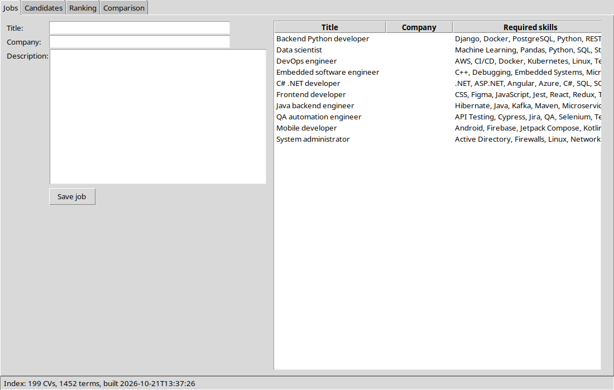
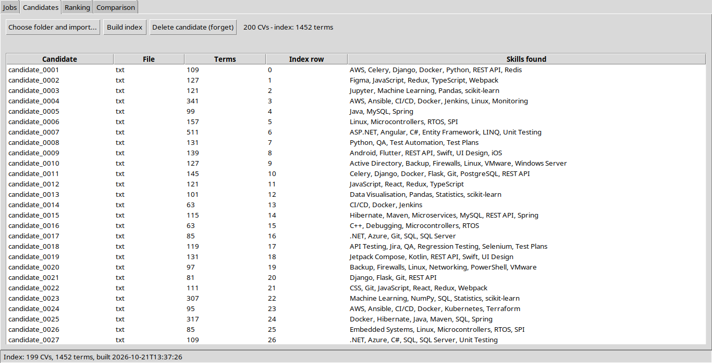
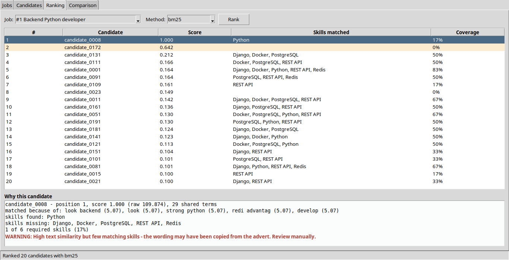
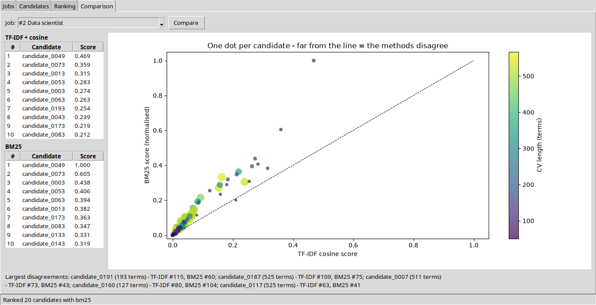

# ResumeMatch — walkthrough

Every function you write in this project (73 of them), in the order of `TASKS.md`. For each one:

- **Problem** — what the function has to do,
- **Solution** — the finished code,
- **Check** — the test that proves it works.

Try each function yourself first, then compare. Run the check after every function, not at the end.

## Where the code goes

Every path below starts in your project folder `ResumeMatch/` (the folder with `TASKS.md`). For each file:

1. **Imports** — if the file section lists imports, add the lines that are missing to the top of the file, next to the other `import` lines.
2. **Helper code** — paste it once, where the section says: *in the file* means below the imports and above the first class; *inside class X* means inside that class, next to its other methods (indented like them).
3. **Each function** — in your skeleton, find the `def` with the same name. Delete the whole function — the `def` line, the TODO text and `raise NotImplementedError` — and paste the solution in its place. Inside a class, every line moves 4 spaces to the right, so the `def` lines up with the other methods.
4. **New files** — at the end, under *Files the solution adds*: create the file at that path and paste the whole code.

Before and after, for a method inside a class:

```python
class Example:

    def total(self, items):          # BEFORE - the skeleton
        """
        TODO stage 3: add up the prices.
        """
        raise NotImplementedError
```

```python
class Example:

    def total(self, items):          # AFTER - the solution pasted in its place
        return sum(item.price for item in items)
```

Then run the **Check** command from the project folder.

## Contents

- [Stage 1 — load documents (≈2 weeks)](#stage-1--load-documents-2-weeks) (6 functions)
- [Stage 2 — the preprocessing pipeline (≈3 weeks) ★ the gatekeeper](#stage-2--the-preprocessing-pipeline-3-weeks--the-gatekeeper) (9 functions)
- [Stage 3 — vocabulary and IDF (≈2 weeks)](#stage-3--vocabulary-and-idf-2-weeks) (3 functions)
- [Stage 4 — TF-IDF + cosine (≈2 weeks)](#stage-4--tf-idf--cosine-2-weeks) (6 functions)
- [Stage 5 — BM25 (≈2 weeks)](#stage-5--bm25-2-weeks) (4 functions)
- [Stage 6 — skills, explanation and metrics (≈2 weeks)](#stage-6--skills-explanation-and-metrics-2-weeks) (12 functions)
- [Stage 7 — the index bundle and two machines (≈1 week)](#stage-7--the-index-bundle-and-two-machines-1-week) (4 functions)
- [Stage 8 — database (≈1 week)](#stage-8--database-1-week) (15 functions)
- [Stage 9 — controller and GUI (≈3 weeks)](#stage-9--controller-and-gui-3-weeks) (6 functions)
- [Stage 10 — controller and GUI (≈3 weeks)](#stage-10--controller-and-gui-3-weeks) (7 functions)
- [Stage 11 — experiments and the book (≈2 weeks)](#stage-11--experiments-and-the-book-2-weeks) (1 functions)
- [Files the solution adds](#files-the-solution-adds)
- [The finished project](#the-finished-project)

## Stage 1 — load documents (≈2 weeks)

### `resumematch/nlp/loader.py`

Open `ResumeMatch/resumematch/nlp/loader.py`.

**Imports** — add these at the top of the file:

```python
import re
```

**Helper code in this file** (used by the functions below, not a TODO in your skeleton):

`SUPPORTED` — paste in the file, below the imports:

```python
SUPPORTED = (".pdf", ".docx", ".txt")
```

`HYPHEN_BREAK` — paste in the file, below the imports:

```python
HYPHEN_BREAK = re.compile(r"(\w)-\n(\w)")
```

`CONTROL` — paste in the file, below the imports:

```python
CONTROL = re.compile(r"[\x00-\x09\x0b-\x1f\x7f]")
```

`SPACES` — paste in the file, below the imports:

```python
SPACES = re.compile(r"[ \t\r\f\v\xa0]+")
```

#### `DocumentLoader.load(path)`

**Problem.** Read one CV file into a Document. Refuse a missing file, a file bigger than the limit, or an unsupported type with a ResumeMatchError. Pick the reader by extension (.pdf, .docx, .txt), clean the text, cut it at the size limit, and use the file name (without extension) as the id.

**Solution.** Paste in `resumematch/nlp/loader.py`, inside class `DocumentLoader` (indented 4 spaces), in place of the skeleton's `def load`:

```python
def load(self, path: str) -> Document:
    if not os.path.isfile(path):
        raise ResumeMatchError(f"File not found: {path}")
    if os.path.getsize(path) > config.MAX_FILE_MB * 1024 * 1024:
        raise ResumeMatchError(f"File too large (over {config.MAX_FILE_MB} MB): {os.path.basename(path)}")
    ext = os.path.splitext(path)[1].lower()
    readers = {".pdf": self._load_pdf, ".docx": self._load_docx, ".txt": self._load_txt}
    if ext not in readers:
        raise ResumeMatchError(f"Unsupported file type '{ext}': {os.path.basename(path)}")
    text, pages = readers[ext](path)
    text = self._clean(text)[:config.MAX_TEXT_CHARS]
    return Document(doc_id=os.path.splitext(os.path.basename(path))[0], raw_text=text,
                    source_file=os.path.abspath(path), file_type=ext[1:], page_count=pages)
```

**Check.** No unit test - run the program and look (see the stage's exit condition in `TASKS.md`).

#### `DocumentLoader._load_pdf(path)`

**Problem.** Read the text of every page of a PDF and return (text, page count). Refuse PDFs with too many pages. A broken PDF must become a ResumeMatchError, never a crash.

**Solution.** Paste in `resumematch/nlp/loader.py`, inside class `DocumentLoader` (indented 4 spaces), in place of the skeleton's `def _load_pdf`:

```python
def _load_pdf(self, path: str) -> tuple:
    try:
        import pdfplumber
        with pdfplumber.open(path) as pdf:
            if len(pdf.pages) > config.MAX_PDF_PAGES:
                raise ResumeMatchError(f"PDF has more than {config.MAX_PDF_PAGES} pages: {os.path.basename(path)}")
            text = "\n".join((page.extract_text() or "") for page in pdf.pages)
            return text, len(pdf.pages)
    except ResumeMatchError:
        raise
    except Exception:
        raise ResumeMatchError(f"Could not read PDF: {os.path.basename(path)}") from None
```

**Check.** No unit test - run the program and look (see the stage's exit condition in `TASKS.md`).

#### `DocumentLoader._load_docx(path)`

**Problem.** Read a Word file: the text of every paragraph and also of every table row - many CVs keep half their content in tables. Return (text, 0).

**Solution.** Paste in `resumematch/nlp/loader.py`, inside class `DocumentLoader` (indented 4 spaces), in place of the skeleton's `def _load_docx`:

```python
def _load_docx(self, path: str) -> tuple:
    try:
        import docx
        doc = docx.Document(path)
    except Exception:
        raise ResumeMatchError(f"Could not read DOCX: {os.path.basename(path)}") from None
    parts = [p.text for p in doc.paragraphs]
    for table in doc.tables:
        for row in table.rows:
            parts.append(" ".join(cell.text for cell in row.cells))
    return "\n".join(parts), 0
```

**Check.** No unit test - run the program and look (see the stage's exit condition in `TASKS.md`).

#### `DocumentLoader._load_txt(path)`

**Problem.** Read a text file as UTF-8, replacing bytes that are not valid UTF-8 instead of crashing. Return (text, 0).

**Solution.** Paste in `resumematch/nlp/loader.py`, inside class `DocumentLoader` (indented 4 spaces), in place of the skeleton's `def _load_txt`:

```python
def _load_txt(self, path: str) -> tuple:
    with open(path, encoding="utf-8", errors="replace") as f:
        return f.read(), 0
```

**Check.** No unit test - run the program and look (see the stage's exit condition in `TASKS.md`).

#### `DocumentLoader._clean(text)`

**Problem.** Fix what real CV files get wrong: join words split by a hyphen at the end of a line ("develo-\nper" -> "developer"), remove control characters and squeeze runs of spaces into one.

**Solution.** Paste in `resumematch/nlp/loader.py`, inside class `DocumentLoader` (indented 4 spaces), in place of the skeleton's `def _clean`:

```python
def _clean(self, text: str) -> str:
    text = HYPHEN_BREAK.sub(r"\1\2", text)
    text = CONTROL.sub(" ", text)
    text = SPACES.sub(" ", text)
    text = re.sub(r" ?\n ?", "\n", text)
    text = re.sub(r"\n{2,}", "\n", text)
    return text.strip()
```

**Check.** No unit test - run the program and look (see the stage's exit condition in `TASKS.md`).

#### `DocumentLoader.load_directory(directory)`

**Problem.** Load every supported file in a folder. One bad file must not stop the batch: collect the failures and return (documents, failures).

**Solution.** Paste in `resumematch/nlp/loader.py`, inside class `DocumentLoader` (indented 4 spaces), in place of the skeleton's `def load_directory`:

```python
def load_directory(self, directory: str) -> list:
    if not os.path.isdir(directory):
        raise ResumeMatchError(f"Folder not found: {directory}")
    documents, failures = [], []
    for name in sorted(os.listdir(directory)):
        path = os.path.join(directory, name)
        if not os.path.isfile(path) or name.startswith("."):
            continue
        if os.path.splitext(name)[1].lower() not in SUPPORTED:
            failures.append((name, "unsupported file type"))
            continue
        try:
            documents.append(self.load(path))
        except ResumeMatchError as err:
            failures.append((name, str(err)))
    return documents, failures
```

**Check.** No unit test - run the program and look (see the stage's exit condition in `TASKS.md`).


## Stage 2 — the preprocessing pipeline (≈3 weeks) ★ the gatekeeper

### `resumematch/nlp/pii.py`

Open `ResumeMatch/resumematch/nlp/pii.py`.

#### `PiiScrubber.scrub(text)`

**Problem.** Replace URLs, e-mail addresses, 9-digit ID numbers and phone numbers with a space, in that order (a URL can contain something that looks like an e-mail). Personal data must never reach the index.

**Solution.** Paste in `resumematch/nlp/pii.py`, inside class `PiiScrubber` (indented 4 spaces), in place of the skeleton's `def scrub`:

```python
def scrub(self, text: str) -> str:
    for pattern in (URL, EMAIL, LONG_ID, PHONE):
        text = pattern.sub(" ", text)
    return text
```

**Check.** No unit test - run the program and look (see the stage's exit condition in `TASKS.md`).

#### `PiiScrubber.find(text)`

**Problem.** Count the e-mails, phones, IDs and URLs in a text without changing it, so the user can see that scrubbing happened.

**Solution.** Paste in `resumematch/nlp/pii.py`, inside class `PiiScrubber` (indented 4 spaces), in place of the skeleton's `def find`:

```python
def find(self, text: str) -> dict:
    return {"emails": len(EMAIL.findall(text)), "phones": len(PHONE.findall(text)),
            "ids": len(LONG_ID.findall(text)), "urls": len(URL.findall(text))}
```

**Check.** No unit test - run the program and look (see the stage's exit condition in `TASKS.md`).

### `resumematch/nlp/preprocessor.py`

Open `ResumeMatch/resumematch/nlp/preprocessor.py`.

**Imports** — add these at the top of the file:

```python
import nltk
from nltk.corpus import stopwords
from nltk.stem import SnowballStemmer
```

**Helper code in this file** (used by the functions below, not a TODO in your skeleton):

`HEBREW_CHAR` — paste in the file, below the imports:

```python
HEBREW_CHAR = re.compile(r"[֐-׿]")
```

`TextPreprocessor.unigrams` — paste inside class `TextPreprocessor`:

```python
def unigrams(self, text: str) -> list:
    return [t for t in self.process(text) if " " not in t]
```

`TextPreprocessor.with_ngrams` — paste inside class `TextPreprocessor`:

```python
def with_ngrams(self, unigrams: list) -> list:
    return list(unigrams) + (self._bigrams(unigrams) if self.ngram_max >= 2 else [])
```

#### `TextPreprocessor.__init__(use_stemming, ngram_max)`

**Problem.** Set up the pipeline once: the stemming and n-gram settings, the PII scrubber, the token regex, the stemmer and both stopword lists. Loading NLTK data inside process() would make it very slow.

**Solution.** Paste in `resumematch/nlp/preprocessor.py`, inside class `TextPreprocessor` (indented 4 spaces), in place of the skeleton's `def __init__`:

```python
def __init__(self, use_stemming: bool = None, ngram_max: int = None):
    self.use_stemming = config.USE_STEMMING if use_stemming is None else use_stemming
    self.ngram_max = config.NGRAM_MAX if ngram_max is None else ngram_max
    self.scrubber = PiiScrubber()
    self.token_re = re.compile(config.TOKEN_PATTERN)
    self.stemmer = SnowballStemmer("english")
    try:
        self.stopwords_en = set(stopwords.words("english"))
    except LookupError:                          # first run on a new computer
        nltk.download("stopwords", quiet=True)
        self.stopwords_en = set(stopwords.words("english"))
    self.stopwords_he = config.HEBREW_STOPWORDS
```

**Check.** No unit test - run the program and look (see the stage's exit condition in `TASKS.md`).

#### `TextPreprocessor.process(text)`

**Problem.** Turn text into the list of terms everything else compares: scrub personal data, split into tokens, lower-case, drop stopwords, stem, drop 1-letter tokens, then add the bigrams. "Python" in a CV and "python" in a job must end up as the same term.

**Solution.** Paste in `resumematch/nlp/preprocessor.py`, inside class `TextPreprocessor` (indented 4 spaces), in place of the skeleton's `def process`:

```python
def process(self, text: str) -> list:
    text = self.scrubber.scrub(text)
    tokens = self.token_re.findall(text)
    if config.LOWERCASE:
        tokens = [t.lower() for t in tokens]
    tokens = [t for t in tokens if not self._is_stopword(t)]
    if self.use_stemming:
        tokens = [self._stem(t) for t in tokens]
    tokens = [t for t in tokens if len(t) > 1]
    terms = tokens + (self._bigrams(tokens) if self.ngram_max >= 2 else [])
    return terms
```

**Check.** `pytest tests/test_preprocessor.py -k "test_technical_tokens_survive or test_lowercase or test_english_stopwords_removed or test_hebrew_stopwords_removed"`

#### `TextPreprocessor._is_stopword(token)`

**Problem.** Return True when the token is in the English or the Hebrew stopword list.

**Solution.** Paste in `resumematch/nlp/preprocessor.py`, inside class `TextPreprocessor` (indented 4 spaces), in place of the skeleton's `def _is_stopword`:

```python
def _is_stopword(self, token: str) -> bool:
    return token in self.stopwords_en or token in self.stopwords_he
```

**Check.** No unit test - run the program and look (see the stage's exit condition in `TASKS.md`).

#### `TextPreprocessor._stem(token)`

**Problem.** Stem a token: Hebrew words go through the simple Hebrew rule, everything else through the English Snowball stemmer ("developing" -> "develop").

**Solution.** Paste in `resumematch/nlp/preprocessor.py`, inside class `TextPreprocessor` (indented 4 spaces), in place of the skeleton's `def _stem`:

```python
def _stem(self, token: str) -> str:
    if HEBREW_CHAR.search(token):
        return self._stem_hebrew(token)
    return self.stemmer.stem(token)
```

**Check.** No unit test - run the program and look (see the stage's exit condition in `TASKS.md`).

#### `TextPreprocessor._stem_hebrew(token)`

**Problem.** Remove one common prefix letter (ה, ו, ב, ל, מ, ש, כ) from Hebrew words longer than 3 letters. Only one letter, never from short words - stripping more merges unrelated words.

**Solution.** Paste in `resumematch/nlp/preprocessor.py`, inside class `TextPreprocessor` (indented 4 spaces), in place of the skeleton's `def _stem_hebrew`:

```python
def _stem_hebrew(self, token: str) -> str:
    if len(token) > 3 and token[0] in config.HEBREW_PREFIXES:
        token = token[1:]
    return token
```

**Check.** No unit test - run the program and look (see the stage's exit condition in `TASKS.md`).

#### `TextPreprocessor._bigrams(tokens)`

**Problem.** Return every pair of neighbouring tokens joined by a space: ["machine", "learning", "engineer"] -> ["machine learning", "learning engineer"]. "Machine learning" is one skill, not two words.

**Solution.** Paste in `resumematch/nlp/preprocessor.py`, inside class `TextPreprocessor` (indented 4 spaces), in place of the skeleton's `def _bigrams`:

```python
def _bigrams(self, tokens: list) -> list:
    return [f"{tokens[i]} {tokens[i + 1]}" for i in range(len(tokens) - 1)]
```

**Check.** No unit test - run the program and look (see the stage's exit condition in `TASKS.md`).

#### `TextPreprocessor.fingerprint()`

**Problem.** Return the settings of this pipeline as a dict (lowercase, regex, stopword versions, stemmer, n-grams, version). It is saved with the index, and machine B refuses to rank if its own fingerprint differs - otherwise every score would silently be 0.

**Solution.** Paste in `resumematch/nlp/preprocessor.py`, inside class `TextPreprocessor` (indented 4 spaces), in place of the skeleton's `def fingerprint`:

```python
def fingerprint(self) -> dict:
    return {"lowercase": config.LOWERCASE, "token_regex": config.TOKEN_PATTERN,
            "stopwords_he": config.STOPWORDS_HE_VERSION, "stopwords_en": config.STOPWORDS_EN_VERSION,
            "stemmer": "snowball_english" if self.use_stemming else "none",
            "hebrew_rules": config.HEBREW_RULES_VERSION, "ngram_max": self.ngram_max,
            "pipeline_version": config.PIPELINE_VERSION}
```

**Check.** `pytest tests/test_preprocessor.py -k "test_fingerprint_has_every_contract_field or test_fingerprint_changes_with_settings"`


## Stage 3 — vocabulary and IDF (≈2 weeks)

### `resumematch/nlp/vocabulary.py`

Open `ResumeMatch/resumematch/nlp/vocabulary.py`.

**Imports** — add these at the top of the file:

```python
from collections import Counter
```

#### `VocabularyBuilder.__init__(min_df, max_df)`

**Problem.** Store min_df and max_df, using the config values only when the argument is None (min_df=0 is a real value).

**Solution.** Paste in `resumematch/nlp/vocabulary.py`, inside class `VocabularyBuilder` (indented 4 spaces), in place of the skeleton's `def __init__`:

```python
def __init__(self, min_df: int = None, max_df: float = None):
    self.min_df = config.MIN_DF if min_df is None else min_df
    self.max_df = config.MAX_DF if max_df is None else max_df
```

**Check.** `pytest tests/test_bm25.py::test_b_zero_disables_length_normalisation` and `pytest tests/test_tfidf.py::test_longer_document_is_not_favoured` and `pytest tests/test_vocabulary.py -k "test_idf_smoothed_formula or test_idf_never_zero_for_a_term_in_every_document or test_rare_term_scores_higher_than_common_term or test_bm25_idf_formula"`

#### `VocabularyBuilder.build(processed_docs)`

**Problem.** Count in how many documents each term appears (once per document), keep the terms with min_df <= df <= max_df x documents, sort them so every build gives the same columns, and return (vocabulary {term: column}, idf list, document frequencies).

**Solution.** Paste in `resumematch/nlp/vocabulary.py`, inside class `VocabularyBuilder` (indented 4 spaces), in place of the skeleton's `def build`:

```python
def build(self, processed_docs: list):
    n_docs = len(processed_docs)
    doc_freq = Counter()
    for doc in processed_docs:
        doc_freq.update(set(doc.terms))              # distinct terms: document frequency
    kept = sorted(t for t, df in doc_freq.items() if self.min_df <= df <= self.max_df * n_docs)
    vocabulary = {term: i for i, term in enumerate(kept)}
    idf = [self.compute_idf(doc_freq[term], n_docs) for term in kept]
    return vocabulary, idf, dict(doc_freq)
```

**Check.** `pytest tests/test_bm25.py::test_b_zero_disables_length_normalisation` and `pytest tests/test_tfidf.py::test_longer_document_is_not_favoured` and `pytest tests/test_vocabulary.py -k "test_min_df_filters_singletons or test_max_df_filters_ubiquitous_terms or test_document_frequency_counts_documents_not_occurrences or test_vocabulary_indices_are_dense_and_unique"`

#### `VocabularyBuilder.compute_idf(df, n_docs)`

**Problem.** The smoothed IDF used for TF-IDF: ln((1 + N) / (1 + df)) + 1. A term in every document still gets 1, not 0.

**Solution.** Paste in `resumematch/nlp/vocabulary.py`, inside class `VocabularyBuilder` (indented 4 spaces), in place of the skeleton's `def compute_idf`:

```python
@staticmethod
def compute_idf(df: int, n_docs: int) -> float:
    return math.log((1 + n_docs) / (1 + df)) + 1
```

**Check.** `pytest tests/test_vocabulary.py -k "test_idf_smoothed_formula or test_idf_never_zero_for_a_term_in_every_document or test_rare_term_scores_higher_than_common_term"`


## Stage 4 — TF-IDF + cosine (≈2 weeks)

### `resumematch/rank/base.py`

Open `ResumeMatch/resumematch/rank/base.py`.

#### `Ranker._normalise(scores)`

**Problem.** Divide every score by the highest one, so the best candidate gets 1.0 (leave the list as it is when the best is 0). This makes scores comparable within one ranking only.

**Solution.** Paste in `resumematch/rank/base.py`, inside class `Ranker` (indented 4 spaces), in place of the skeleton's `def _normalise`:

```python
def _normalise(self, scores):
    scores = list(scores)
    top = max(scores) if scores else 0.0
    return [s / top for s in scores] if top > 0 else scores
```

**Check.** No unit test - run the program and look (see the stage's exit condition in `TASKS.md`).

### `resumematch/rank/tfidf.py`

Open `ResumeMatch/resumematch/rank/tfidf.py`.

**Imports** — add these at the top of the file:

```python
from collections import Counter
```

**Helper code in this file** (used by the functions below, not a TODO in your skeleton):

`TfidfRanker.restore` — paste inside class `TfidfRanker`:

```python
def restore(self, matrix, vocabulary: dict, idf, doc_refs: list) -> None:
    self.matrix = sparse.csr_matrix(matrix)
    self.vocabulary = vocabulary
    self.idf = np.array(idf, dtype=float)
    self.doc_refs = list(doc_refs)
    self.terms = [None] * len(vocabulary)
    for term, col in vocabulary.items():
        self.terms[col] = term
```

#### `TfidfRanker.fit(processed_docs, vocabulary, idf)`

**Problem.** Build the sparse TF-IDF matrix: one row per CV, one column per vocabulary term, value = count x idf. Then scale every row to length 1.

**Solution.** Paste in `resumematch/rank/tfidf.py`, inside class `TfidfRanker` (indented 4 spaces), in place of the skeleton's `def fit`:

```python
def fit(self, processed_docs: list, vocabulary: dict, idf: list) -> None:
    self.vocabulary = vocabulary
    self.idf = np.array(idf, dtype=float)
    self.doc_refs = [d.doc_id for d in processed_docs]
    self.terms = [None] * len(vocabulary)
    for term, col in vocabulary.items():
        self.terms[col] = term
    rows, cols, values = [], [], []
    for row, doc in enumerate(processed_docs):
        counts = Counter(t for t in doc.terms if t in vocabulary)
        for term, tf in counts.items():
            rows.append(row)
            cols.append(vocabulary[term])
            values.append(tf * self.idf[vocabulary[term]])
    m = sparse.coo_matrix((values, (rows, cols)), shape=(len(processed_docs), len(vocabulary))).tocsr()
    self.matrix = self._l2_normalise_rows(m)
```

**Check.** `pytest tests/test_bm25.py::test_b_zero_disables_length_normalisation` and `pytest tests/test_tfidf.py::test_longer_document_is_not_favoured`

#### `TfidfRanker._l2_normalise_rows(m)`

**Problem.** Divide each row by its own length (L2 norm) so every row has length 1; an empty row stays empty. After this, cosine similarity is a plain dot product.

**Solution.** Paste in `resumematch/rank/tfidf.py`, inside class `TfidfRanker` (indented 4 spaces), in place of the skeleton's `def _l2_normalise_rows`:

```python
@staticmethod
def _l2_normalise_rows(m):
    norms = np.sqrt(np.asarray(m.multiply(m).sum(axis=1)).ravel())
    norms[norms == 0] = 1.0
    return sparse.csr_matrix(sparse.diags(1.0 / norms) @ m)
```

**Check.** No unit test - run the program and look (see the stage's exit condition in `TASKS.md`).

#### `TfidfRanker._vectorise_job(job_terms)`

**Problem.** Turn the job's terms into a vector in the same space as the CVs: counts x the collection's idf, then length 1. Never compute idf from the job alone.

**Solution.** Paste in `resumematch/rank/tfidf.py`, inside class `TfidfRanker` (indented 4 spaces), in place of the skeleton's `def _vectorise_job`:

```python
def _vectorise_job(self, job_terms: list):
    q = np.zeros(len(self.vocabulary))
    for term in job_terms:
        if term in self.vocabulary:
            q[self.vocabulary[term]] += 1
    q = q * self.idf
    norm = np.linalg.norm(q)
    return q / norm if norm > 0 else q
```

**Check.** `pytest tests/test_tfidf.py::test_explanation_sums_to_the_score`

#### `TfidfRanker.rank(job_terms, top_k)`

**Problem.** Score every CV in one matrix x vector product, take the top_k, and return RankResults (positions from 1) with the shared-term count and the explanation.

**Solution.** Paste in `resumematch/rank/tfidf.py`, inside class `TfidfRanker` (indented 4 spaces), in place of the skeleton's `def rank`:

```python
def rank(self, job_terms: list, top_k: int) -> list:
    q = self._vectorise_job(job_terms)
    scores = np.asarray(self.matrix @ q).ravel()
    top_k = min(top_k, len(self.doc_refs))
    order = np.argsort(-scores, kind="stable")[:top_k]
    query_cols = set(np.flatnonzero(q))
    results = []
    for position, i in enumerate(order, start=1):
        row = self.matrix.getrow(i)
        shared = len(query_cols.intersection(row.indices))
        score = float(min(max(scores[i], 0.0), 1.0))
        results.append(RankResult(candidate_ref=self.doc_refs[i], score=score, raw_score=float(scores[i]),
                                  rank_position=position, shared_terms=shared,
                                  top_terms=self.explain(i, q) if score > 0 else [],
                                  skills_matched=[], skills_missing=[]))
    return results
```

**Check.** `pytest tests/test_bm25.py -k "test_ranking_is_sorted_and_positioned or test_scores_normalised_to_unit_range or test_raw_score_is_kept"` and `pytest tests/test_tfidf.py -k "test_exact_match_ranks_first or test_scores_are_descending or test_rank_positions_start_at_one or test_unrelated_query_scores_zero"`

#### `TfidfRanker.explain(doc_row, q)`

**Problem.** Split one CV's score into its terms: each shared term adds row value x job value. Return the biggest contributions. Together they add up exactly to the score.

**Solution.** Paste in `resumematch/rank/tfidf.py`, inside class `TfidfRanker` (indented 4 spaces), in place of the skeleton's `def explain`:

```python
def explain(self, doc_row: int, q) -> list:
    row = self.matrix.getrow(doc_row)
    contributions = []
    for col, value in zip(row.indices, row.data):
        if q[col] > 0:
            contributions.append(TermContribution(self.terms[col], float(value * q[col])))
    contributions.sort(key=lambda t: t.contribution, reverse=True)
    return contributions[:config.TOP_TERMS_IN_EXPLANATION]
```

**Check.** No unit test - run the program and look (see the stage's exit condition in `TASKS.md`).


## Stage 5 — BM25 (≈2 weeks)

### `resumematch/nlp/vocabulary.py`

Open `ResumeMatch/resumematch/nlp/vocabulary.py`.

#### `VocabularyBuilder.compute_idf_bm25(df, n_docs)`

**Problem.** The IDF used by BM25: ln((N - df + 0.5) / (df + 0.5) + 1). The +1 inside the log keeps it positive for very common terms.

**Solution.** Paste in `resumematch/nlp/vocabulary.py`, inside class `VocabularyBuilder` (indented 4 spaces), in place of the skeleton's `def compute_idf_bm25`:

```python
@staticmethod
def compute_idf_bm25(df: int, n_docs: int) -> float:
    return math.log((n_docs - df + 0.5) / (df + 0.5) + 1)
```

**Check.** `pytest tests/test_vocabulary.py -k "test_bm25_idf_formula or test_bm25_idf_stays_positive_for_very_common_terms"`

### `resumematch/rank/bm25.py`

Open `ResumeMatch/resumematch/rank/bm25.py`.

#### `Bm25Ranker.fit(processed_docs, vocabulary, idf)`

**Problem.** Build the inverted index: for each term, the list of (CV row, how often it appears). Also store every CV's length, the average length and the BM25 idf of each term.

**Solution.** Paste in `resumematch/rank/bm25.py`, inside class `Bm25Ranker` (indented 4 spaces), in place of the skeleton's `def fit`:

```python
def fit(self, processed_docs: list, vocabulary: dict, idf: list) -> None:
    self.inverted = defaultdict(list)
    self.idf = {}
    self.doc_refs = [d.doc_id for d in processed_docs]
    self.doc_len = [d.term_count for d in processed_docs]
    self.avgdl = sum(self.doc_len) / len(self.doc_len) if self.doc_len else 0.0
    for row, doc in enumerate(processed_docs):
        for term, tf in Counter(doc.terms).items():
            if term in vocabulary:
                self.inverted[term].append((row, tf))
    n_docs = len(processed_docs)
    for term, postings in self.inverted.items():
        self.idf[term] = VocabularyBuilder.compute_idf_bm25(len(postings), n_docs)
    self.last_touched = 0
```

**Check.** `pytest tests/test_bm25.py::test_b_zero_disables_length_normalisation` and `pytest tests/test_tfidf.py::test_longer_document_is_not_favoured`

#### `Bm25Ranker.rank(job_terms, top_k)`

**Problem.** Add up the BM25 score only for CVs that contain a job term (the inverted index gives them directly), sort, normalise, and return top_k results with each one's best terms. Fill up with zero-score CVs if fewer than top_k scored.

**Solution.** Paste in `resumematch/rank/bm25.py`, inside class `Bm25Ranker` (indented 4 spaces), in place of the skeleton's `def rank`:

```python
def rank(self, job_terms: list, top_k: int) -> list:
    scores = defaultdict(float)
    contributions = defaultdict(list)
    for term in set(job_terms):
        if term not in self.inverted:
            continue
        idf = self.idf[term]
        for doc_row, tf in self.inverted[term]:
            c = self._term_score(tf, self.doc_len[doc_row], idf)
            scores[doc_row] += c
            contributions[doc_row].append((term, c))
    self.last_touched = len(scores)            # documents actually scored vs len(self.doc_refs)

    top_k = min(top_k, len(self.doc_refs))
    order = sorted(scores, key=lambda r: (-scores[r], r))[:top_k]
    if len(order) < top_k:                     # pad with the untouched documents, in row order
        seen = set(order)
        order += [r for r in range(len(self.doc_refs)) if r not in seen][:top_k - len(order)]
    raw = [scores.get(r, 0.0) for r in order]
    normalised = self._normalise(raw)
    results = []
    for position, (row, raw_score, score) in enumerate(zip(order, raw, normalised), start=1):
        terms = sorted(contributions.get(row, []), key=lambda tc: tc[1], reverse=True)
        results.append(RankResult(candidate_ref=self.doc_refs[row], score=float(score), raw_score=float(raw_score),
                                  rank_position=position, shared_terms=len(terms),
                                  top_terms=[TermContribution(t, float(c))
                                             for t, c in terms[:config.TOP_TERMS_IN_EXPLANATION]],
                                  skills_matched=[], skills_missing=[]))
    return results
```

**Check.** `pytest tests/test_bm25.py -k "test_ranking_is_sorted_and_positioned or test_scores_normalised_to_unit_range or test_raw_score_is_kept"` and `pytest tests/test_tfidf.py -k "test_exact_match_ranks_first or test_scores_are_descending or test_rank_positions_start_at_one or test_unrelated_query_scores_zero"`

#### `Bm25Ranker._term_score(tf, doc_length, idf)`

**Problem.** The BM25 score of one term in one CV: idf x tf x (k1 + 1) / (tf + k1 x (1 - b + b x length / average length)). Repeats help less and less (saturation), and long CVs are pushed down (b).

**Solution.** Paste in `resumematch/rank/bm25.py`, inside class `Bm25Ranker` (indented 4 spaces), in place of the skeleton's `def _term_score`:

```python
def _term_score(self, tf: int, doc_length: int, idf: float) -> float:
    return idf * (tf * (self.k1 + 1)) / (tf + self.k1 * (1 - self.b + self.b * doc_length / self.avgdl))
```

**Check.** `pytest tests/test_bm25.py -k "test_saturation_is_monotonic or test_saturation_has_diminishing_returns or test_saturation_is_bounded_by_k1_plus_one or test_known_saturation_values"`


## Stage 6 — skills, explanation and metrics (≈2 weeks)

### `evaluate.py`

Open `ResumeMatch/evaluate.py`.

**Imports** — add these at the top of the file:

```python
import config
from resumematch.controllers.app_controller import AppController
from resumematch.models.entities import ResumeMatchError
```

#### `main()`

**Problem.** Load the index, evaluate both methods on the labelled jobs (at least 10), print a comparison table and save each result.

**Solution.** Paste in `evaluate.py`, at the top level of the file, in place of the skeleton's `def main`:

```python
def main():
    controller = AppController()
    try:
        controller.load_index()
        results = controller.evaluate()
    except ResumeMatchError as err:
        print("Cannot evaluate:", err)
        return 1
    print(f"{'method':<14}{'jobs':>6}{'P@5':>8}{'P@10':>8}{'MRR':>8}{'median ms':>11}")
    for r in results:
        print(f"{r.method:<14}{r.jobs_evaluated:>6}{r.precision_at_5:>8.3f}{r.precision_at_10:>8.3f}"
              f"{r.mrr:>8.3f}{r.median_rank_ms:>11.2f}")
    print("saved to the eval_runs table")
    return 0
```

**Check.** No unit test - run the program and look (see the stage's exit condition in `TASKS.md`).

### `resumematch/eval/metrics.py`

Open `ResumeMatch/resumematch/eval/metrics.py`.

**Imports** — add these at the top of the file:

```python
from time import perf_counter
from resumematch.models.entities import EvalResult
```

#### `precision_at_k(ranking, relevant, k)`

**Problem.** Of the first k candidates, what share is relevant? Divide by k, not by the list length: missing places count as misses.

**Solution.** Paste in `resumematch/eval/metrics.py`, at the top level of the file, in place of the skeleton's `def precision_at_k`:

```python
def precision_at_k(ranking: list, relevant: set, k: int) -> float:
    return len([c for c in ranking[:k] if c in relevant]) / k
```

**Check.** `pytest tests/test_metrics.py -k "test_precision_at_2 or test_precision_at_4 or test_precision_at_1_when_first_is_wrong or test_precision_denominator_is_k_not_list_length"`

#### `reciprocal_rank(ranking, relevant)`

**Problem.** 1 / the position of the first relevant candidate (first place 1.0, second 0.5...), or 0.0 when none is relevant.

**Solution.** Paste in `resumematch/eval/metrics.py`, at the top level of the file, in place of the skeleton's `def reciprocal_rank`:

```python
def reciprocal_rank(ranking: list, relevant: set) -> float:
    for position, c in enumerate(ranking, start=1):
        if c in relevant:
            return 1.0 / position
    return 0.0
```

**Check.** `pytest tests/test_metrics.py -k "test_reciprocal_rank_first_relevant_is_second or test_reciprocal_rank_perfect or test_reciprocal_rank_none_found or test_reciprocal_rank_tenth_position"`

#### `mean_reciprocal_rank(rankings, relevant)`

**Problem.** The average reciprocal rank over the jobs that have labels. A job without labels is skipped, not counted as 0.

**Solution.** Paste in `resumematch/eval/metrics.py`, at the top level of the file, in place of the skeleton's `def mean_reciprocal_rank`:

```python
def mean_reciprocal_rank(rankings: dict, relevant: dict) -> float:
    jobs = [j for j in rankings if relevant.get(j)]
    return sum(reciprocal_rank(rankings[j], relevant[j]) for j in jobs) / len(jobs) if jobs else 0.0
```

**Check.** `pytest tests/test_metrics.py -k "test_mrr_averages_over_jobs or test_mrr_ignores_unlabelled_jobs"`

#### `evaluate(ranker, jobs, relevant, preprocessor, k_values)`

**Problem.** Rank every labelled job, time each ranking, and return the average precision@5, precision@10, MRR and the median time. Use the median, so the first slow run does not distort it.

**Solution.** Paste in `resumematch/eval/metrics.py`, at the top level of the file, in place of the skeleton's `def evaluate`:

```python
def evaluate(ranker, jobs: list, relevant: dict, preprocessor, k_values=(5, 10)):
    p_at = {k: [] for k in k_values}
    reciprocal, times = [], []
    for job in jobs:
        wanted = relevant.get(job.id)
        if not wanted:
            continue
        terms = preprocessor.process(job.description)
        t0 = perf_counter()
        results = ranker.rank(terms, top_k=max(k_values))
        times.append((perf_counter() - t0) * 1000)
        ranking = [r.candidate_ref for r in results]
        for k in k_values:
            p_at[k].append(precision_at_k(ranking, wanted, k))
        reciprocal.append(reciprocal_rank(ranking, wanted))
    n = len(reciprocal)
    mean = lambda xs: sum(xs) / len(xs) if xs else 0.0
    params = {"k1": getattr(ranker, "k1", None), "b": getattr(ranker, "b", None)}
    return EvalResult(method=ranker.name, jobs_evaluated=n,
                      precision_at_5=mean(p_at.get(5, [])), precision_at_10=mean(p_at.get(10, [])),
                      mrr=mean(reciprocal), median_rank_ms=statistics.median(times) if times else 0.0,
                      params=params)
```

**Check.** No unit test - run the program and look (see the stage's exit condition in `TASKS.md`).

### `resumematch/rank/explainer.py`

Open `ResumeMatch/resumematch/rank/explainer.py`.

#### `RankExplainer.to_lines(result)`

**Problem.** Turn a result into short lines for the screen: the terms it matched with their weights, the skills found, the skills missing, and "3 of 4 required skills (75%)". Report facts, never judge the person.

**Solution.** Paste in `resumematch/rank/explainer.py`, inside class `RankExplainer` (indented 4 spaces), in place of the skeleton's `def to_lines`:

```python
def to_lines(self, result: RankResult) -> list:
    lines = []
    if result.top_terms:
        lines.append("matched because of: " + ", ".join(f"{t.term} ({t.contribution:.2f})" for t in result.top_terms))
    else:
        lines.append("no term in common with the job description")
    lines.append("skills found: " + (", ".join(result.skills_matched) or "none of the required skills"))
    lines.append("skills missing: " + (", ".join(result.skills_missing) or "none"))
    required = len(result.skills_matched) + len(result.skills_missing)
    if required:
        lines.append(f"{len(result.skills_matched)} of {required} required skills "
                     f"({len(result.skills_matched) / required:.0%})")
    return lines
```

**Check.** No unit test - run the program and look (see the stage's exit condition in `TASKS.md`).

#### `RankExplainer.warning_for(result, coverage)`

**Problem.** Return a warning when the text is very similar (score above 0.6) but few required skills are present (coverage below 0.35) - the CV may have copied the job advert. Otherwise return "".

**Solution.** Paste in `resumematch/rank/explainer.py`, inside class `RankExplainer` (indented 4 spaces), in place of the skeleton's `def warning_for`:

```python
def warning_for(self, result: RankResult, coverage: float) -> str:
    if result.score > 0.6 and coverage < 0.35:
        return ("High text similarity but few matching skills - the wording "
                "may have been copied from the advert. Review manually.")
    return ""
```

**Check.** No unit test - run the program and look (see the stage's exit condition in `TASKS.md`).

### `resumematch/rank/skills.py`

Open `ResumeMatch/resumematch/rank/skills.py`.

**Imports** — add these at the top of the file:

```python
import re
```

**Helper code in this file** (used by the functions below, not a TODO in your skeleton):

`SKILLS_SECTION` — paste in the file, below the imports:

```python
SKILLS_SECTION = re.compile(r"\bskills?\s*:\s*(.*?)(?:\.\s|\n|$)", re.IGNORECASE)
```

`SkillExtractor.evidence_terms` — paste inside class `SkillExtractor`:

```python
def evidence_terms(self, raw_text: str, all_terms: list) -> list:
    match = SKILLS_SECTION.search(raw_text or "")
    if match and match.group(1).strip():
        return self.preprocessor.process(match.group(1))
    return all_terms
```

#### `SkillExtractor.__init__(preprocessor)`

**Problem.** Store the preprocessor and start an empty {normalised form: skill name} dictionary and a dict of skills by category.

**Solution.** Paste in `resumematch/rank/skills.py`, inside class `SkillExtractor` (indented 4 spaces), in place of the skeleton's `def __init__`:

```python
def __init__(self, preprocessor):
    self.preprocessor = preprocessor
    self.skills = {}
    self.by_category = {}
```

**Check.** No unit test - run the program and look (see the stage's exit condition in `TASKS.md`).

#### `SkillExtractor.load(csv_path)`

**Problem.** Read skills.csv and, for every skill and alias, store its preprocessed form ("Machine Learning" -> "machin learn") pointing back to the display name. The dictionary must go through the same pipeline as the CVs or nothing matches.

**Solution.** Paste in `resumematch/rank/skills.py`, inside class `SkillExtractor` (indented 4 spaces), in place of the skeleton's `def load`:

```python
def load(self, csv_path: str = None) -> None:
    path = csv_path or config.SKILLS_CSV
    self.skills, self.by_category = {}, {}
    with open(path, encoding="utf-8-sig", newline="") as fh:
        for row in csv.DictReader(fh):
            skill = (row.get("skill") or "").strip()
            if not skill:
                continue
            category = (row.get("category") or "other").strip()
            self.by_category.setdefault(category, []).append(skill)
            aliases = [a.strip() for a in (row.get("aliases") or "").split("|") if a.strip()]
            for name in [skill] + aliases:
                words = [t for t in self.preprocessor.process(name) if " " not in t]
                if words:
                    self.skills[" ".join(words)] = skill
```

**Check.** No unit test - run the program and look (see the stage's exit condition in `TASKS.md`).

#### `SkillExtractor.extract(terms)`

**Problem.** Return the sorted names of every skill whose normalised form is in the term list. Bigrams are already in the terms, so two-word skills match too.

**Solution.** Paste in `resumematch/rank/skills.py`, inside class `SkillExtractor` (indented 4 spaces), in place of the skeleton's `def extract`:

```python
def extract(self, terms: list) -> list:
    found = set()
    for t in terms:
        if t in self.skills:
            found.add(self.skills[t])
    return sorted(found)
```

**Check.** No unit test - run the program and look (see the stage's exit condition in `TASKS.md`).

#### `SkillExtractor.compare(job_skills, resume_skills)`

**Problem.** Return (matched, missing): the job's skills the CV has, and the job's skills it lacks.

**Solution.** Paste in `resumematch/rank/skills.py`, inside class `SkillExtractor` (indented 4 spaces), in place of the skeleton's `def compare`:

```python
def compare(self, job_skills: list, resume_skills: list) -> tuple:
    matched = sorted(set(job_skills) & set(resume_skills))
    missing = sorted(set(job_skills) - set(resume_skills))
    return matched, missing
```

**Check.** No unit test - run the program and look (see the stage's exit condition in `TASKS.md`).

#### `SkillExtractor.coverage(matched, required)`

**Problem.** The share of required skills that were matched, or 0.0 when the job requires none.

**Solution.** Paste in `resumematch/rank/skills.py`, inside class `SkillExtractor` (indented 4 spaces), in place of the skeleton's `def coverage`:

```python
@staticmethod
def coverage(matched: list, required: list) -> float:
    return len(matched) / len(required) if required else 0.0
```

**Check.** No unit test - run the program and look (see the stage's exit condition in `TASKS.md`).


## Stage 7 — the index bundle and two machines (≈1 week)

### `build_index.py`

Open `ResumeMatch/build_index.py`.

**Imports** — add these at the top of the file:

```python
import os
import config
from resumematch.controllers.app_controller import AppController
from resumematch.models.entities import ResumeMatchError
```

#### `main(argv)`

**Problem.** Machine A: import the CVs from a folder, build the index, and print the counts, the vocabulary size and the SHA-256 to compare on machine B.

**Solution.** Paste in `build_index.py`, at the top level of the file, in place of the skeleton's `def main`:

```python
def main(argv):
    directory = argv[1] if len(argv) > 1 else config.RESUME_DIR
    controller = AppController()
    summary = controller.import_resumes(directory)
    print(f"loaded {summary['loaded']} new CVs ({summary['skipped_existing']} already imported), "
          f"{len(summary['failed'])} failed, {len(summary['flagged_short'])} flagged as too short")
    for name, reason in summary["failed"]:
        print(f"  failed: {name}: {reason}")
    for ref in summary["flagged_short"]:
        print(f"  flagged (probably a scanned PDF): {ref}")
    try:
        stats = controller.build_index()
    except ResumeMatchError as err:
        print("Cannot build the index:", err)
        return 1
    print(f"vocabulary: {stats['vocab_size']} terms   documents: {stats['n_docs']}   avgdl: {stats['avgdl']:.1f}")
    print(f"bundle written to {stats['index_dir']}")
    print(f"sha256 of matrix.npz: {stats['sha256']}")
    if stats["warning"]:
        print("WARNING:", stats["warning"])
    return 0
```

**Check.** No unit test - run the program and look (see the stage's exit condition in `TASKS.md`).

### `resumematch/rank/bundle.py`

Open `ResumeMatch/resumematch/rank/bundle.py`.

**Imports** — add these at the top of the file:

```python
from datetime import datetime
import numpy as np
from scipy import sparse
```

#### `IndexBundle.save(directory)`

**Problem.** Write the index to a folder: vocabulary (JSON), idf (npy), matrix (npz), the preprocessing fingerprint and a meta file with the code version, counts and the SHA-256 of the matrix. No pickle - loading a pickle can run code.

**Solution.** Paste in `resumematch/rank/bundle.py`, inside class `IndexBundle` (indented 4 spaces), in place of the skeleton's `def save`:

```python
def save(self, directory: str) -> None:
    os.makedirs(directory, exist_ok=True)
    with open(os.path.join(directory, "vocabulary.json"), "w", encoding="utf-8") as f:
        json.dump(self.vocabulary, f, ensure_ascii=False, sort_keys=True)
    np.save(os.path.join(directory, "idf.npy"), np.asarray(self.idf, dtype=float))
    matrix_path = os.path.join(directory, "matrix.npz")
    sparse.save_npz(matrix_path, sparse.csr_matrix(self.matrix))
    with open(os.path.join(directory, "preprocess.json"), "w", encoding="utf-8") as f:
        json.dump(self.preprocess, f, ensure_ascii=False, indent=2, sort_keys=True)
    meta = dict(self.meta or {})
    meta.update({"code_version": config.CODE_VERSION,
                 "built_at": datetime.now().isoformat(timespec="seconds"),
                 "n_docs": int(self.matrix.shape[0]), "vocab_size": len(self.vocabulary),
                 "sha256": self._sha256(matrix_path)})
    self.meta = meta
    with open(os.path.join(directory, "meta.json"), "w", encoding="utf-8") as f:
        json.dump(meta, f, ensure_ascii=False, indent=2)
```

**Check.** No unit test - run the program and look (see the stage's exit condition in `TASKS.md`).

#### `IndexBundle.load(directory, local_fingerprint)`

**Problem.** Check before trusting the index: all files present, same code version, matrix SHA-256 unchanged, and every fingerprint field equal to this machine's. Any difference raises IndexContractError; only then load the arrays.

**Solution.** Paste in `resumematch/rank/bundle.py`, inside class `IndexBundle` (indented 4 spaces), in place of the skeleton's `def load`:

```python
@classmethod
def load(cls, directory: str, local_fingerprint: dict):
    missing = [name for name in cls.FILES if not os.path.isfile(os.path.join(directory, name))]
    if missing:
        raise IndexContractError(f"index is missing {', '.join(missing)} in {directory} - build it first")
    with open(os.path.join(directory, "meta.json"), encoding="utf-8") as f:
        meta = json.load(f)
    if meta.get("code_version") != config.CODE_VERSION:
        raise IndexContractError(f"index was built by code version {meta.get('code_version')}, "
                                 f"this machine runs {config.CODE_VERSION}")
    matrix_path = os.path.join(directory, "matrix.npz")
    if cls._sha256(matrix_path) != meta.get("sha256"):
        raise IndexContractError("index was modified after it was built (sha256 mismatch)")
    with open(os.path.join(directory, "preprocess.json"), encoding="utf-8") as f:
        preprocess = json.load(f)
    for name in sorted(set(preprocess) | set(local_fingerprint)):
        value = preprocess.get(name)
        if local_fingerprint.get(name) != value:
            raise IndexContractError(f"preprocessing mismatch on '{name}': "
                                     f"index={value}, this machine={local_fingerprint.get(name)}")
    with open(os.path.join(directory, "vocabulary.json"), encoding="utf-8") as f:
        vocabulary = json.load(f)
    idf = np.load(os.path.join(directory, "idf.npy"), allow_pickle=False)
    matrix = sparse.load_npz(matrix_path)
    return cls(vocabulary=vocabulary, idf=idf, matrix=matrix, preprocess=preprocess, meta=meta)
```

**Check.** No unit test - run the program and look (see the stage's exit condition in `TASKS.md`).

#### `IndexBundle._sha256(path)`

**Problem.** The SHA-256 of a file, read in binary chunks so a big file does not fill the memory.

**Solution.** Paste in `resumematch/rank/bundle.py`, inside class `IndexBundle` (indented 4 spaces), in place of the skeleton's `def _sha256`:

```python
@staticmethod
def _sha256(path: str) -> str:
    h = hashlib.sha256()
    with open(path, "rb") as f:
        for chunk in iter(lambda: f.read(65536), b""):
            h.update(chunk)
    return h.hexdigest()
```

**Check.** No unit test - run the program and look (see the stage's exit condition in `TASKS.md`).


## Stage 8 — database (≈1 week)

### `resumematch/database/db.py`

Open `ResumeMatch/resumematch/database/db.py`.

**Imports** — add these at the top of the file:

```python
from contextlib import contextmanager
```

**Helper code in this file** (used by the functions below, not a TODO in your skeleton):

`Database.connection` — paste inside class `Database`:

```python
@contextmanager
def connection(self):
    try:
        yield self.conn
        self.conn.commit()
    except Exception:
        self.conn.rollback()
        raise
```

#### `Database.__new__(path)`

**Problem.** A singleton: create the one Database object on the first call and return the same one afterwards.

**Solution.** Paste in `resumematch/database/db.py`, inside class `Database` (indented 4 spaces), in place of the skeleton's `def __new__`:

```python
def __new__(cls, path: str = None):
    if cls._instance is None:
        cls._instance = super().__new__(cls)
        cls._instance._init(path or config.DB_PATH)
    return cls._instance
```

**Check.** No unit test - run the program and look (see the stage's exit condition in `TASKS.md`).

#### `Database._init(path)`

**Problem.** Open the one SQLite connection (usable from any thread), make rows behave like dicts, switch foreign keys on and create the tables.

**Solution.** Paste in `resumematch/database/db.py`, inside class `Database` (indented 4 spaces), in place of the skeleton's `def _init`:

```python
def _init(self, path: str) -> None:
    self.path = path
    folder = os.path.dirname(os.path.abspath(path))
    os.makedirs(folder, exist_ok=True)
    self.conn = sqlite3.connect(path, check_same_thread=False)
    self.conn.row_factory = sqlite3.Row
    self.conn.execute("PRAGMA foreign_keys = ON")
    self.conn.executescript(SCHEMA)
```

**Check.** No unit test - run the program and look (see the stage's exit condition in `TASKS.md`).

#### `Database.reset()`

**Problem.** Close the connection and forget the singleton, so the next Database() starts fresh (used between tests).

**Solution.** Paste in `resumematch/database/db.py`, inside class `Database` (indented 4 spaces), in place of the skeleton's `def reset`:

```python
@classmethod
def reset(cls) -> None:
    if cls._instance is not None:
        cls._instance.conn.close()
    cls._instance = None
```

**Check.** No unit test - run the program and look (see the stage's exit condition in `TASKS.md`).

### `resumematch/database/repositories.py`

Open `ResumeMatch/resumematch/database/repositories.py`.

**Imports** — add these at the top of the file:

```python
import os
from resumematch.models.entities import EvalResult, Job, ResumeMatchError
```

**Helper code in this file** (used by the functions below, not a TODO in your skeleton):

`_row_to_job` — paste in the file, below the imports:

```python
def _row_to_job(r) -> Job:
    return Job(id=r["id"], title=r["title"], description=r["description"],
               processed_terms=r["processed_text"].split(" ") if r["processed_text"] else [],
               required_skills=json.loads(r["required_skills"]), company=r["company"],
               is_labelled=bool(r["is_labelled"]))
```

`_row_to_resume` — paste in the file, below the imports:

```python
def _row_to_resume(r) -> dict:
    return {"id": r["id"], "candidate_ref": r["candidate_ref"], "source_file": r["source_file"],
            "file_type": r["file_type"], "processed_text": r["processed_text"],
            "term_count": r["term_count"], "unique_terms": r["unique_terms"],
            "skills_found": json.loads(r["skills_found"]), "matrix_row": r["matrix_row"],
            "extraction_ok": bool(r["extraction_ok"]), "is_synthetic": bool(r["is_synthetic"])}
```

`EvalRepository` — paste in the file, below the imports:

```python
class EvalRepository:

    def __init__(self, db):
        self.db = db

    def save(self, result: EvalResult, vocab_size: int, min_df: int, max_df: float,
             ngram_max: int, stemming: bool) -> int:
        with self.db.connection() as conn:
            cur = conn.execute(
                "INSERT INTO eval_runs (ran_at, method, k1, b, min_df, max_df, ngram_max, stemming, vocab_size, "
                "jobs_evaluated, precision_at_5, precision_at_10, mrr, median_rank_ms) "
                "VALUES (?, ?, ?, ?, ?, ?, ?, ?, ?, ?, ?, ?, ?, ?)",
                (datetime.now().isoformat(timespec="seconds"), result.method, result.params.get("k1"),
                 result.params.get("b"), min_df, max_df, ngram_max, int(stemming), vocab_size,
                 result.jobs_evaluated, result.precision_at_5, result.precision_at_10, result.mrr,
                 result.median_rank_ms))
            return cur.lastrowid

    def list_all(self) -> list:
        with self.db.connection() as conn:
            rows = conn.execute("SELECT * FROM eval_runs ORDER BY id DESC").fetchall()
        return [dict(r) for r in rows]
```

`JobRepository.list_all` — paste inside class `JobRepository`:

```python
def list_all(self) -> list:
    with self.db.connection() as conn:
        rows = conn.execute("SELECT * FROM jobs ORDER BY id").fetchall()
    return [_row_to_job(r) for r in rows]
```

`JobRepository.find_by_title` — paste inside class `JobRepository`:

```python
def find_by_title(self, title: str):
    with self.db.connection() as conn:
        row = conn.execute("SELECT * FROM jobs WHERE title = ?", (title,)).fetchone()
    return _row_to_job(row) if row else None
```

`JobRepository.set_labelled` — paste inside class `JobRepository`:

```python
def set_labelled(self, job_id: int, labelled: bool = True) -> None:
    with self.db.connection() as conn:
        conn.execute("UPDATE jobs SET is_labelled = ? WHERE id = ?", (int(labelled), job_id))
```

`ResumeRepository.list_all` — paste inside class `ResumeRepository`:

```python
def list_all(self) -> list:
    with self.db.connection() as conn:
        rows = conn.execute("SELECT * FROM resumes ORDER BY id").fetchall()
    return [_row_to_resume(r) for r in rows]
```

`ResumeRepository.known_files` — paste inside class `ResumeRepository`:

```python
def known_files(self) -> set:
    with self.db.connection() as conn:
        rows = conn.execute("SELECT source_file FROM resumes").fetchall()
    return {r["source_file"] for r in rows}
```

`ResumeRepository.by_source_name` — paste inside class `ResumeRepository`:

```python
def by_source_name(self) -> dict:
    with self.db.connection() as conn:
        rows = conn.execute("SELECT id, source_file FROM resumes").fetchall()
    return {os.path.splitext(os.path.basename(r["source_file"]))[0]: r["id"] for r in rows}
```

`ResumeRepository.count` — paste inside class `ResumeRepository`:

```python
def count(self) -> int:
    with self.db.connection() as conn:
        return conn.execute("SELECT COUNT(*) FROM resumes WHERE extraction_ok = 1").fetchone()[0]
```

#### `JobRepository.add(title, description, processed_terms, skills, company)`

**Problem.** Insert a job advert with its processed terms and required skills and return its id.

**Solution.** Paste in `resumematch/database/repositories.py`, inside class `JobRepository` (indented 4 spaces), in place of the skeleton's `def add`:

```python
def add(self, title, description, processed_terms, skills, company=None) -> int:
    terms = list(processed_terms)
    if not terms:
        raise ResumeMatchError("The job description has no usable words - write a real description")
    with self.db.connection() as conn:
        cur = conn.execute(
            "INSERT INTO jobs (title, description, processed_text, company, required_skills, term_count, created_at) "
            "VALUES (?, ?, ?, ?, ?, ?, ?)",
            (title, description, " ".join(t for t in terms if " " not in t), company, json.dumps(list(skills)),
             len(terms), datetime.now().isoformat(timespec="seconds")))
        return cur.lastrowid
```

**Check.** No unit test - run the program and look (see the stage's exit condition in `TASKS.md`).

#### `JobRepository.get(job_id)`

**Problem.** Read one job by id; raise ResumeMatchError when it does not exist.

**Solution.** Paste in `resumematch/database/repositories.py`, inside class `JobRepository` (indented 4 spaces), in place of the skeleton's `def get`:

```python
def get(self, job_id: int):
    with self.db.connection() as conn:
        row = conn.execute("SELECT * FROM jobs WHERE id = ?", (job_id,)).fetchone()
    if row is None:
        raise ResumeMatchError(f"Job {job_id} not found")
    return _row_to_job(row)
```

**Check.** No unit test - run the program and look (see the stage's exit condition in `TASKS.md`).

#### `JobRepository.all_labelled()`

**Problem.** Return the jobs marked as labelled - the evaluation set.

**Solution.** Paste in `resumematch/database/repositories.py`, inside class `JobRepository` (indented 4 spaces), in place of the skeleton's `def all_labelled`:

```python
def all_labelled(self) -> list:
    with self.db.connection() as conn:
        rows = conn.execute("SELECT * FROM jobs WHERE is_labelled = 1 ORDER BY id").fetchall()
    return [_row_to_job(r) for r in rows]
```

**Check.** No unit test - run the program and look (see the stage's exit condition in `TASKS.md`).

#### `ResumeRepository.add(processed_doc, source_file, file_type, is_synthetic)`

**Problem.** Insert one processed CV under an anonymous name ("candidate_0142"), storing only the scrubbed terms, never the raw text, name or contact details.

**Solution.** Paste in `resumematch/database/repositories.py`, inside class `ResumeRepository` (indented 4 spaces), in place of the skeleton's `def add`:

```python
def add(self, processed_doc, source_file, file_type, is_synthetic=False) -> int:
    with self.db.connection() as conn:
        n = conn.execute("SELECT COALESCE(MAX(id), 0) + 1 FROM resumes").fetchone()[0]
        unigrams = [t for t in processed_doc.terms if " " not in t]     # bigrams are rebuilt on load
        cur = conn.execute(
            "INSERT INTO resumes (candidate_ref, source_file, file_type, processed_text, term_count, unique_terms, "
            "skills_found, extraction_ok, is_synthetic, added_at) VALUES (?, ?, ?, ?, ?, ?, ?, ?, ?, ?)",
            (f"candidate_{n:04d}", source_file, file_type, " ".join(unigrams), processed_doc.term_count,
             processed_doc.unique_terms, json.dumps(processed_doc.skills_found), int(processed_doc.extraction_ok),
             int(is_synthetic), datetime.now().isoformat(timespec="seconds")))
        return cur.lastrowid
```

**Check.** No unit test - run the program and look (see the stage's exit condition in `TASKS.md`).

#### `ResumeRepository.set_matrix_row(resume_id, row)`

**Problem.** Store which row of the index matrix belongs to this CV.

**Solution.** Paste in `resumematch/database/repositories.py`, inside class `ResumeRepository` (indented 4 spaces), in place of the skeleton's `def set_matrix_row`:

```python
def set_matrix_row(self, resume_id: int, row: int) -> None:
    with self.db.connection() as conn:
        conn.execute("UPDATE resumes SET matrix_row = ? WHERE id = ?", (row, resume_id))
```

**Check.** No unit test - run the program and look (see the stage's exit condition in `TASKS.md`).

#### `ResumeRepository.all_active()`

**Problem.** Return every CV whose text was extracted successfully, in id order.

**Solution.** Paste in `resumematch/database/repositories.py`, inside class `ResumeRepository` (indented 4 spaces), in place of the skeleton's `def all_active`:

```python
def all_active(self) -> list:
    with self.db.connection() as conn:
        rows = conn.execute("SELECT * FROM resumes WHERE extraction_ok = 1 ORDER BY id").fetchall()
    return [_row_to_resume(r) for r in rows]
```

**Check.** No unit test - run the program and look (see the stage's exit condition in `TASKS.md`).

#### `ResumeRepository.delete_completely(resume_id)`

**Problem.** The right to be forgotten: delete the CV file, delete its row (rankings and labels go with it), and report that the index must be rebuilt because every other row number has moved.

**Solution.** Paste in `resumematch/database/repositories.py`, inside class `ResumeRepository` (indented 4 spaces), in place of the skeleton's `def delete_completely`:

```python
def delete_completely(self, resume_id: int) -> None:
    with self.db.connection() as conn:
        row = conn.execute("SELECT source_file FROM resumes WHERE id = ?", (resume_id,)).fetchone()
        if row is None:
            raise ResumeMatchError(f"Candidate {resume_id} not found")
        if os.path.isfile(row["source_file"]):
            os.remove(row["source_file"])
        conn.execute("DELETE FROM resumes WHERE id = ?", (resume_id,))
        conn.execute("UPDATE resumes SET matrix_row = NULL")          # every row number is now stale
    return True                                                        # True = the index must be rebuilt
```

**Check.** No unit test - run the program and look (see the stage's exit condition in `TASKS.md`).

#### `RankingRepository.save_many(job_id, method, results, run_id)`

**Problem.** Save a whole ranking in one executemany call, with each result's top terms as JSON. A new ranking of the same job and method replaces the old one.

**Solution.** Paste in `resumematch/database/repositories.py`, inside class `RankingRepository` (indented 4 spaces), in place of the skeleton's `def save_many`:

```python
def save_many(self, job_id, method, results, run_id=None) -> None:
    refs = {r.candidate_ref for r in results}
    with self.db.connection() as conn:
        ids = {row["candidate_ref"]: row["id"] for row in conn.execute(
            "SELECT id, candidate_ref FROM resumes").fetchall() if row["candidate_ref"] in refs}
        if run_id is None:          # NULL run_id is not covered by the unique index
            conn.execute("DELETE FROM rankings WHERE job_id = ? AND method = ? AND run_id IS NULL", (job_id, method))
        conn.executemany(
            "INSERT OR REPLACE INTO rankings (job_id, resume_id, method, score, raw_score, rank_position, "
            "shared_terms, top_terms, skills_matched, skills_required, run_id) "
            "VALUES (?, ?, ?, ?, ?, ?, ?, ?, ?, ?, ?)",
            [(job_id, ids[r.candidate_ref], method, max(r.score, 0.0), r.raw_score, r.rank_position, r.shared_terms,
              json.dumps([[t.term, t.contribution] for t in r.top_terms]), len(r.skills_matched),
              len(r.skills_matched) + len(r.skills_missing), run_id)
             for r in results if r.candidate_ref in ids])
```

**Check.** No unit test - run the program and look (see the stage's exit condition in `TASKS.md`).

#### `RankingRepository.for_job(job_id, method)`

**Problem.** Return the saved ranking of a job and method, best score first.

**Solution.** Paste in `resumematch/database/repositories.py`, inside class `RankingRepository` (indented 4 spaces), in place of the skeleton's `def for_job`:

```python
def for_job(self, job_id: int, method: str) -> list:
    with self.db.connection() as conn:
        rows = conn.execute(
            "SELECT k.*, r.candidate_ref, r.term_count FROM rankings k JOIN resumes r ON r.id = k.resume_id "
            "WHERE k.job_id = ? AND k.method = ? ORDER BY k.score DESC, k.rank_position", (job_id, method)).fetchall()
    return [{**dict(r), "top_terms": json.loads(r["top_terms"])} for r in rows]
```

**Check.** No unit test - run the program and look (see the stage's exit condition in `TASKS.md`).

#### `RankingRepository.method_disagreement(job_id)`

**Problem.** The research query: for one job, each candidate's position under TF-IDF and under BM25 and the gap between them, with the CV length - to show that the methods disagree on long and short CVs.

**Solution.** Paste in `resumematch/database/repositories.py`, inside class `RankingRepository` (indented 4 spaces), in place of the skeleton's `def method_disagreement`:

```python
def method_disagreement(self, job_id: int) -> list:
    with self.db.connection() as conn:
        rows = conn.execute(
            "SELECT r.candidate_ref, r.term_count, "
            "       t.rank_position AS tfidf_rank, b.rank_position AS bm25_rank, "
            "       t.score AS tfidf_score, b.score AS bm25_score, "
            "       ABS(t.rank_position - b.rank_position) AS rank_gap "
            "FROM rankings t "
            "JOIN rankings b ON b.job_id = t.job_id AND b.resume_id = t.resume_id AND b.method = 'bm25' "
            "JOIN resumes r ON r.id = t.resume_id "
            "WHERE t.job_id = ? AND t.method = 'tfidf_cosine' AND t.run_id IS NULL AND b.run_id IS NULL "
            "ORDER BY rank_gap DESC, r.term_count DESC", (job_id,)).fetchall()
    return [dict(r) for r in rows]
```

**Check.** No unit test - run the program and look (see the stage's exit condition in `TASKS.md`).

#### `LabelRepository.set_label(job_id, resume_id, is_relevant, labeller, before_ranking)`

**Problem.** Store (or replace) whether a candidate is relevant for a job, who labelled it and whether it was labelled before seeing any ranking.

**Solution.** Paste in `resumematch/database/repositories.py`, inside class `LabelRepository` (indented 4 spaces), in place of the skeleton's `def set_label`:

```python
def set_label(self, job_id, resume_id, is_relevant, labeller, before_ranking=True):
    with self.db.connection() as conn:
        conn.execute(
            "INSERT OR REPLACE INTO relevance_labels (job_id, resume_id, is_relevant, labelled_at, labeller, "
            "before_ranking) VALUES (?, ?, ?, ?, ?, ?)",
            (job_id, resume_id, int(bool(is_relevant)), datetime.now().isoformat(timespec="seconds"), labeller,
             int(bool(before_ranking))))
```

**Check.** No unit test - run the program and look (see the stage's exit condition in `TASKS.md`).

#### `LabelRepository.relevant_for(job_id)`

**Problem.** Return the set of candidates labelled relevant for a job, using only labels made before ranking.

**Solution.** Paste in `resumematch/database/repositories.py`, inside class `LabelRepository` (indented 4 spaces), in place of the skeleton's `def relevant_for`:

```python
def relevant_for(self, job_id: int) -> set:
    with self.db.connection() as conn:
        rows = conn.execute(
            "SELECT r.candidate_ref FROM relevance_labels l JOIN resumes r ON r.id = l.resume_id "
            "WHERE l.job_id = ? AND l.is_relevant = 1 AND l.before_ranking = 1", (job_id,)).fetchall()
    return {r["candidate_ref"] for r in rows}
```

**Check.** No unit test - run the program and look (see the stage's exit condition in `TASKS.md`).


## Stage 9 — controller and GUI (≈3 weeks)

### `resumematch/controllers/app_controller.py`

Open `ResumeMatch/resumematch/controllers/app_controller.py`.

**Imports** — add these at the top of the file:

```python
import csv
import os
from dataclasses import replace
from resumematch.database.db import Database
from resumematch.database.repositories import (EvalRepository, JobRepository, LabelRepository, RankingRepository,
                                               ResumeRepository)
from resumematch.eval.metrics import evaluate
from resumematch.models.entities import IndexContractError, ProcessedDoc, ResumeMatchError
from resumematch.nlp.loader import DocumentLoader
from resumematch.nlp.preprocessor import TextPreprocessor
from resumematch.nlp.vocabulary import VocabularyBuilder
from resumematch.rank.bm25 import Bm25Ranker
from resumematch.rank.bundle import IndexBundle
from resumematch.rank.explainer import RankExplainer
from resumematch.rank.skills import SkillExtractor
from resumematch.rank.tfidf import TfidfRanker
```

**Helper code in this file** (used by the functions below, not a TODO in your skeleton):

`METHODS` — paste in the file, below the imports:

```python
METHODS = ("tfidf_cosine", "bm25")
```

`AppController.add_job` — paste inside class `AppController`:

```python
def add_job(self, title: str, description: str, company: str = None) -> tuple:
    title, description = (title or "").strip(), (description or "").strip()
    if not title or not description:
        raise ResumeMatchError("A job needs a title and a description")
    terms = self.preprocessor.process(description)
    skills = self.skills.extract(terms)
    return self.job_repo.add(title, description, terms, skills, (company or "").strip() or None), skills
```

`AppController.list_jobs` — paste inside class `AppController`:

```python
def list_jobs(self) -> list:
    return self.job_repo.list_all()
```

`AppController.import_labelled_jobs` — paste inside class `AppController`:

```python
def import_labelled_jobs(self, csv_path: str, labeller: str = "teacher") -> dict:
    by_name = self.resume_repo.by_source_name()
    if not by_name:
        raise ResumeMatchError("Import the CVs before the labelled jobs")
    added, labels, unknown = 0, 0, []
    with open(csv_path, encoding="utf-8-sig", newline="") as fh:
        for row in csv.DictReader(fh):
            existing = self.job_repo.find_by_title(row["title"])
            job_id = existing.id if existing else self.add_job(row["title"], row["text"])[0]
            added += existing is None
            relevant = set(row.get("relevant_ids", "").split())
            for name, resume_id in by_name.items():
                self.label_repo.set_label(job_id, resume_id, name in relevant, labeller, before_ranking=True)
                labels += name in relevant
            unknown += [r for r in relevant if r not in by_name]
            self.job_repo.set_labelled(job_id, True)
    return {"jobs_added": added, "relevant_labels": labels, "unknown_ids": unknown}
```

`AppController.list_resumes` — paste inside class `AppController`:

```python
def list_resumes(self) -> list:
    return self.resume_repo.list_all()
```

`AppController.delete_candidate` — paste inside class `AppController`:

```python
def delete_candidate(self, resume_id: int) -> None:
    self.resume_repo.delete_completely(resume_id)
    self.rankers = {}
    self.index_stale = True
```

`AppController._processed_docs` — paste inside class `AppController`:

```python
def _processed_docs(self, rows: list) -> list:
    docs = []
    for r in rows:
        unigrams = r["processed_text"].split(" ") if r["processed_text"] else []
        terms = self.preprocessor.with_ngrams(unigrams)
        docs.append(ProcessedDoc(doc_id=r["candidate_ref"], terms=terms, term_count=len(terms),
                                 unique_terms=len(set(terms)), skills_found=r["skills_found"]))
    return docs
```

`AppController.index_info` — paste inside class `AppController`:

```python
def index_info(self) -> dict:
    if not self.bundle:
        return {}
    return {k: self.bundle.meta.get(k) for k in ("built_at", "n_docs", "vocab_size", "avgdl", "sha256")}
```

`AppController._require_index` — paste inside class `AppController`:

```python
def _require_index(self) -> None:
    if not self.rankers:
        raise ResumeMatchError("There is no index yet - import CVs and press 'Build index'")
    if self.index_stale:
        raise ResumeMatchError("The CVs changed since the index was built - press 'Build index' again")
```

`AppController.explain` — paste inside class `AppController`:

```python
def explain(self, result, job_id: int) -> tuple:
    job = self.job_repo.get(job_id)
    coverage = self.skills.coverage(result.skills_matched, job.required_skills)
    return self.explainer.to_lines(result), self.explainer.warning_for(result, coverage)
```

`AppController.labelled_jobs` — paste inside class `AppController`:

```python
def labelled_jobs(self) -> tuple:
    jobs = self.job_repo.all_labelled()
    relevant = {job.id: self.label_repo.relevant_for(job.id) for job in jobs}
    return jobs, relevant
```

`AppController.evaluate` — paste inside class `AppController`:

```python
def evaluate(self, rankers: dict = None, save: bool = True, notes: dict = None) -> list:
    self._require_index()
    jobs, relevant = self.labelled_jobs()
    labelled = [j for j in jobs if relevant.get(j.id)]
    if len(labelled) < 10:
        raise ResumeMatchError(f"Only {len(labelled)} jobs are labelled - at least 10 are needed, "
                               f"metrics on fewer jobs are noise, not evidence")
    out = []
    for ranker in (rankers or self.rankers).values():
        result = evaluate(ranker, labelled, relevant, self.preprocessor)
        if save:
            self.eval_repo.save(result, vocab_size=len(self.bundle.vocabulary),
                                min_df=self.vocab_builder.min_df, max_df=self.vocab_builder.max_df,
                                ngram_max=self.preprocessor.ngram_max,
                                stemming=self.preprocessor.use_stemming)
        out.append(result)
    return out
```

#### `AppController.__init__()`

**Problem.** Create everything once: the database, preprocessor, skill dictionary, loader, explainer, repositories and vocabulary builder. The rankers are filled when the index is built or loaded.

**Solution.** Paste in `resumematch/controllers/app_controller.py`, inside class `AppController` (indented 4 spaces), in place of the skeleton's `def __init__`:

```python
def __init__(self, db_path: str = None, index_dir: str = None, use_stemming: bool = None,
             ngram_max: int = None, min_df: int = None, max_df: float = None):
    self.db = Database(db_path)
    self.index_dir = index_dir or config.INDEX_DIR
    self.preprocessor = TextPreprocessor(use_stemming=use_stemming, ngram_max=ngram_max)
    self.skills = SkillExtractor(self.preprocessor)
    self.skills.load()
    self.loader = DocumentLoader()
    self.explainer = RankExplainer()
    self.job_repo = JobRepository(self.db)
    self.resume_repo = ResumeRepository(self.db)
    self.rank_repo = RankingRepository(self.db)
    self.label_repo = LabelRepository(self.db)
    self.eval_repo = EvalRepository(self.db)
    self.vocab_builder = VocabularyBuilder(min_df=min_df, max_df=max_df)
    self.rankers = {}
    self.bundle = None
    self.index_stale = False
```

**Check.** No unit test - run the program and look (see the stage's exit condition in `TASKS.md`).

#### `AppController.import_resumes(directory)`

**Problem.** Load a folder of CVs, skip files already imported, process each one and store it. Flag CVs with too few terms (probably scanned PDFs) instead of indexing an empty CV. Take skills from the CV's own "Skills:" line when it has one. Return a summary for the screen.

**Solution.** Paste in `resumematch/controllers/app_controller.py`, inside class `AppController` (indented 4 spaces), in place of the skeleton's `def import_resumes`:

```python
def import_resumes(self, directory: str) -> dict:
    documents, failed = self.loader.load_directory(directory)
    known = self.resume_repo.known_files()
    loaded, skipped, flagged = 0, 0, []
    for doc in documents:
        if doc.source_file in known:
            skipped += 1
            continue
        terms = self.preprocessor.process(doc.raw_text)
        ok = len(terms) >= config.MIN_TERMS_PER_RESUME
        processed = ProcessedDoc(doc_id=doc.doc_id, terms=terms, term_count=len(terms),
                                 unique_terms=len(set(terms)),
                                 skills_found=self.skills.extract(self.skills.evidence_terms(doc.raw_text, terms)),
                                 extraction_ok=ok)
        self.resume_repo.add(processed, doc.source_file, doc.file_type)
        loaded += 1
        if not ok:
            flagged.append(f"{doc.doc_id} ({len(terms)} terms)")
    if loaded:
        self.index_stale = True
    return {"loaded": loaded, "skipped_existing": skipped, "failed": failed, "flagged_short": flagged}
```

**Check.** No unit test - run the program and look (see the stage's exit condition in `TASKS.md`).

#### `AppController.build_index()`

**Problem.** Refuse with fewer than 50 CVs. Build the vocabulary, fit both rankers, store each CV's matrix row, save the index bundle, and warn if the vocabulary shrank by more than 20% since the last build.

**Solution.** Paste in `resumematch/controllers/app_controller.py`, inside class `AppController` (indented 4 spaces), in place of the skeleton's `def build_index`:

```python
def build_index(self) -> dict:
    rows = self.resume_repo.all_active()
    if len(rows) < config.MIN_COLLECTION_SIZE:
        raise ResumeMatchError(f"Only {len(rows)} usable CVs - at least {config.MIN_COLLECTION_SIZE} are "
                               f"needed, otherwise the idf values are noise")
    docs = self._processed_docs(rows)
    vocabulary, idf, _ = self.vocab_builder.build(docs)
    if not vocabulary:
        raise ResumeMatchError("The vocabulary is empty - check min_df / max_df")
    tfidf, bm25 = TfidfRanker(), Bm25Ranker()
    tfidf.fit(docs, vocabulary, idf)
    bm25.fit(docs, vocabulary, idf)
    for position, r in enumerate(rows):
        self.resume_repo.set_matrix_row(r["id"], position)

    previous = None
    meta_path = os.path.join(self.index_dir, "meta.json")
    if os.path.isfile(meta_path):
        import json
        with open(meta_path, encoding="utf-8") as fh:
            previous = json.load(fh).get("vocab_size")
    bundle = IndexBundle(vocabulary=vocabulary, idf=idf, matrix=tfidf.matrix,
                         preprocess=self.preprocessor.fingerprint(),
                         meta={"avgdl": bm25.avgdl, "doc_refs": tfidf.doc_refs,
                               "min_df": self.vocab_builder.min_df, "max_df": self.vocab_builder.max_df})
    bundle.save(self.index_dir)
    self.bundle = bundle
    self.rankers = {tfidf.name: tfidf, bm25.name: bm25}
    self.index_stale = False
    warning = ""
    if previous and len(vocabulary) < 0.8 * previous:
        warning = (f"vocabulary shrank from {previous} to {len(vocabulary)} terms (more than 20%) - "
                   f"check that the CVs were extracted correctly")
    return {"n_docs": len(docs), "vocab_size": len(vocabulary), "avgdl": bm25.avgdl,
            "index_dir": self.index_dir, "sha256": bundle.meta["sha256"], "warning": warning}
```

**Check.** No unit test - run the program and look (see the stage's exit condition in `TASKS.md`).

#### `AppController.load_index()`

**Problem.** Machine B: load the bundle with this machine's fingerprint (a mismatch raises), check it matches the CVs in the database, then restore the TF-IDF ranker from the matrix and refit BM25.

**Solution.** Paste in `resumematch/controllers/app_controller.py`, inside class `AppController` (indented 4 spaces), in place of the skeleton's `def load_index`:

```python
def load_index(self) -> None:
    bundle = IndexBundle.load(self.index_dir, self.preprocessor.fingerprint())
    rows = sorted((r for r in self.resume_repo.all_active() if r["matrix_row"] is not None),
                  key=lambda r: r["matrix_row"])
    refs = bundle.meta.get("doc_refs", [])
    if [r["candidate_ref"] for r in rows] != refs:
        raise IndexContractError("the index does not match the candidates in the database "
                                 "(a CV was added or deleted) - rebuild it")
    tfidf = TfidfRanker()
    tfidf.restore(bundle.matrix, bundle.vocabulary, bundle.idf, refs)
    bm25 = Bm25Ranker()
    bm25.fit(self._processed_docs(rows), bundle.vocabulary, list(bundle.idf))
    self.bundle = bundle
    self.rankers = {tfidf.name: tfidf, bm25.name: bm25}
    self.index_stale = False
```

**Check.** No unit test - run the program and look (see the stage's exit condition in `TASKS.md`).

#### `AppController.rank_job(job_id, method, top_k)`

**Problem.** Rank the CVs for one job with the chosen method, add each candidate's matched and missing skills, save the ranking and return it. If every score is 0, raise an error that points at the preprocessing - that is a silent failure, not a result.

**Solution.** Paste in `resumematch/controllers/app_controller.py`, inside class `AppController` (indented 4 spaces), in place of the skeleton's `def rank_job`:

```python
def rank_job(self, job_id: int, method: str, top_k: int = None) -> list:
    self._require_index()
    if method not in self.rankers:
        raise ResumeMatchError(f"Unknown method '{method}'. Valid: {', '.join(self.rankers)}")
    job = self.job_repo.get(job_id)
    terms = self.preprocessor.process(job.description)
    results = self.rankers[method].rank(terms, top_k or config.DEFAULT_TOP_K)
    if not results or all(r.score == 0.0 for r in results):
        raise ResumeMatchError("Every candidate scored 0. The job shares no term with the index - "
                               "check that both machines use the same preprocessing pipeline")
    skills_of = {r["candidate_ref"]: r["skills_found"] for r in self.resume_repo.all_active()}
    enriched = []
    for r in results:
        matched, missing = self.skills.compare(job.required_skills, skills_of.get(r.candidate_ref, []))
        enriched.append(replace(r, skills_matched=matched, skills_missing=missing))
    self.rank_repo.save_many(job_id, method, enriched)
    return enriched
```

**Check.** No unit test - run the program and look (see the stage's exit condition in `TASKS.md`).

#### `AppController.compare_methods(job_id)`

**Problem.** Rank one job with both methods and return both lists plus the disagreement rows for the scatter plot.

**Solution.** Paste in `resumematch/controllers/app_controller.py`, inside class `AppController` (indented 4 spaces), in place of the skeleton's `def compare_methods`:

```python
def compare_methods(self, job_id: int) -> dict:
    n = len(self.rankers.get("bm25").doc_refs) if self.rankers else None
    tfidf = self.rank_job(job_id, "tfidf_cosine", top_k=n)
    bm25 = self.rank_job(job_id, "bm25", top_k=n)
    return {"tfidf": tfidf, "bm25": bm25, "disagreement": self.rank_repo.method_disagreement(job_id)}
```

**Check.** No unit test - run the program and look (see the stage's exit condition in `TASKS.md`).


## Stage 10 — controller and GUI (≈3 weeks)

### `resumematch/views/candidates_view.py`

Open `ResumeMatch/resumematch/views/candidates_view.py`.

**Imports** — add these at the top of the file:

```python
from tkinter import filedialog, ttk
import config
from resumematch.models.entities import ResumeMatchError
```

**Helper code in this file** (used by the functions below, not a TODO in your skeleton):

`CandidatesView.refresh` — paste inside class `CandidatesView`:

```python
def refresh(self) -> None:
    self.tree.delete(*self.tree.get_children())
    rows = self.controller.list_resumes()
    for r in rows:
        self.tree.insert("", "end", iid=str(r["id"]), tags=() if r["extraction_ok"] else ("bad",),
                         values=(r["candidate_ref"], r["file_type"], r["term_count"],
                                 "" if r["matrix_row"] is None else r["matrix_row"],
                                 ", ".join(r["skills_found"])))
    info = self.controller.index_info()
    state = "index is out of date - build it" if self.controller.index_stale else \
        (f"index: {info.get('vocab_size')} terms" if info else "no index yet")
    self.summary.configure(text=f"{len(rows)} CVs - {state}")
```

`CandidatesView.import_folder` — paste inside class `CandidatesView`:

```python
def import_folder(self, directory: str) -> dict:
    try:
        summary = self.controller.import_resumes(directory)
    except ResumeMatchError as err:
        self.winfo_toplevel().show_error(err.args[0])
        return {}
    lines = []
    if summary["flagged_short"]:
        lines.append(f"FLAGGED - fewer than {config.MIN_TERMS_PER_RESUME} terms, probably scanned PDFs "
                     f"(not indexed): " + ", ".join(summary["flagged_short"]))
    if summary["failed"]:
        lines.append("FAILED: " + "; ".join(f"{name}: {why}" for name, why in summary["failed"]))
    self.flagged.configure(text="\n".join(lines))
    self.winfo_toplevel().set_status(f"Loaded {summary['loaded']} CVs ({summary['skipped_existing']} already "
                                     f"imported, {len(summary['failed'])} failed) - now build the index")
    self.refresh()
    return summary
```

`CandidatesView.choose_folder` — paste inside class `CandidatesView`:

```python
def choose_folder(self) -> None:
    directory = filedialog.askdirectory(title="Folder with CVs", initialdir=config.RESUME_DIR)
    if directory:
        self.import_folder(directory)
```

`CandidatesView.build_index` — paste inside class `CandidatesView`:

```python
def build_index(self) -> None:
    try:
        stats = self.controller.build_index()
    except ResumeMatchError as err:
        self.winfo_toplevel().show_error(err.args[0])
        return
    self.winfo_toplevel().set_status(
        f"Index built: {stats['n_docs']} CVs, {stats['vocab_size']} terms, avgdl {stats['avgdl']:.1f}, "
        f"sha256 {stats['sha256'][:12]}..." + (f"  WARNING: {stats['warning']}" if stats["warning"] else ""),
        warning=bool(stats["warning"]))
    self.refresh()
```

`CandidatesView.delete_selected` — paste inside class `CandidatesView`:

```python
def delete_selected(self) -> None:
    selection = self.tree.selection()
    if not selection:
        self.winfo_toplevel().show_error("Select a candidate first")
        return
    from tkinter import messagebox
    if not messagebox.askyesno("ResumeMatch", "Delete this candidate completely (file, data, rankings)?",
                               parent=self):
        return
    try:
        self.controller.delete_candidate(int(selection[0]))
    except ResumeMatchError as err:
        self.winfo_toplevel().show_error(err.args[0])
        return
    self.winfo_toplevel().set_status("Candidate deleted - the index must be rebuilt", warning=True)
    self.refresh()
```

#### `CandidatesView.__init__(parent, controller)`

**Problem.** The candidates tab: choose a folder to import, build the index, delete a candidate, the table of CVs, and a red list of flagged (probably scanned) files.

**Solution.** Paste in `resumematch/views/candidates_view.py`, inside class `CandidatesView` (indented 4 spaces), in place of the skeleton's `def __init__`:

```python
def __init__(self, parent, controller):
    super().__init__(parent, padding=10)
    self.controller = controller
    bar = ttk.Frame(self)
    bar.pack(fill="x")
    ttk.Button(bar, text="Choose folder and import...", command=self.choose_folder).pack(side="left")
    ttk.Button(bar, text="Build index", command=self.build_index).pack(side="left", padx=6)
    ttk.Button(bar, text="Delete candidate (forget)", command=self.delete_selected).pack(side="left")
    self.summary = ttk.Label(bar, text="")
    self.summary.pack(side="left", padx=12)
    self.flagged = tk.Label(self, text="", fg="#b03a2e", anchor="w", justify="left", wraplength=1000)
    self.flagged.pack(fill="x", pady=(6, 0))
    self.tree = ttk.Treeview(self, columns=("ref", "type", "terms", "row", "skills"), show="headings")
    for key, title, width in (("ref", "Candidate", 120), ("type", "File", 50), ("terms", "Terms", 70),
                              ("row", "Index row", 70), ("skills", "Skills found", 600)):
        self.tree.heading(key, text=title)
        self.tree.column(key, width=width, anchor="w")
    self.tree.pack(fill="both", expand=True, pady=(6, 0))
    self.tree.tag_configure("bad", foreground="#b03a2e")
    self.refresh()
```

**Check.** No unit test - run the program and look (see the stage's exit condition in `TASKS.md`).

### `resumematch/views/comparison_view.py`

Open `ResumeMatch/resumematch/views/comparison_view.py`.

**Imports** — add these at the top of the file:

```python
from matplotlib.backends.backend_tkagg import FigureCanvasTkAgg
from matplotlib.figure import Figure
from resumematch.models.entities import ResumeMatchError
```

**Helper code in this file** (used by the functions below, not a TODO in your skeleton):

`ComparisonView.refresh` — paste inside class `ComparisonView`:

```python
def refresh(self) -> None:
    self.job_ids = {f"#{j.id} {j.title}": j.id for j in self.controller.list_jobs()}
    self.job_combo.configure(values=list(self.job_ids))
    if self.job_ids and self.job_var.get() not in self.job_ids:
        self.job_var.set(next(iter(self.job_ids)))
```

`ComparisonView.compare` — paste inside class `ComparisonView`:

```python
def compare(self) -> None:
    job_id = self.job_ids.get(self.job_var.get())
    if job_id is None:
        self.winfo_toplevel().show_error("Add a job first (Jobs tab)")
        return
    try:
        data = self.controller.compare_methods(job_id)
    except ResumeMatchError as err:
        self.winfo_toplevel().show_error(err.args[0])
        return
    for key in ("tfidf", "bm25"):
        tree = self.tables[key]
        tree.delete(*tree.get_children())
        for r in data[key][:20]:
            tree.insert("", "end", values=(r.rank_position, r.candidate_ref, f"{r.score:.3f}"))
    rows = data["disagreement"]
    self.ax.clear()
    if rows:
        xs = [r["tfidf_score"] for r in rows]
        ys = [r["bm25_score"] for r in rows]
        sizes = [max(8, r["term_count"] / 3) for r in rows]
        colours = [r["term_count"] for r in rows]
        points = self.ax.scatter(xs, ys, s=sizes, c=colours, cmap="viridis", alpha=0.7, edgecolors="none")
        self.ax.plot([0, 1], [0, 1], "k--", linewidth=0.8)
        if not hasattr(self, "_colorbar"):
            self._colorbar = self.figure.colorbar(points, ax=self.ax, label="CV length (terms)")
        else:
            self._colorbar.update_normal(points)
    self.ax.set_xlabel("TF-IDF cosine score")
    self.ax.set_ylabel("BM25 score (normalised)")
    self.ax.set_title("One dot per candidate - far from the line = the methods disagree")
    self.ax.set_xlim(-0.02, 1.05)
    self.ax.set_ylim(-0.02, 1.05)
    self.figure.tight_layout()
    self.canvas.draw_idle()
    top = rows[:5]
    self.gap_label.configure(text="Largest disagreements: " + "; ".join(
        f"{r['candidate_ref']} ({r['term_count']} terms) - TF-IDF #{r['tfidf_rank']}, BM25 #{r['bm25_rank']}"
        for r in top))
```

#### `ComparisonView.__init__(parent, controller)`

**Problem.** The comparison tab: both rankings side by side and a scatter plot of TF-IDF score against BM25 score, dot size and colour by CV length. Dots far from the diagonal are where the methods disagree.

**Solution.** Paste in `resumematch/views/comparison_view.py`, inside class `ComparisonView` (indented 4 spaces), in place of the skeleton's `def __init__`:

```python
def __init__(self, parent, controller):
    super().__init__(parent, padding=10)
    self.controller = controller
    bar = ttk.Frame(self)
    bar.pack(fill="x")
    ttk.Label(bar, text="Job:").pack(side="left")
    self.job_var = tk.StringVar()
    self.job_combo = ttk.Combobox(bar, textvariable=self.job_var, state="readonly", width=40)
    self.job_combo.pack(side="left", padx=4)
    ttk.Button(bar, text="Compare", command=self.compare).pack(side="left", padx=4)

    body = ttk.Frame(self)
    body.pack(fill="both", expand=True, pady=(8, 0))
    lists = ttk.Frame(body)
    lists.pack(side="left", fill="y")
    self.tables = {}
    for key, title in (("tfidf", "TF-IDF + cosine"), ("bm25", "BM25")):
        ttk.Label(lists, text=title, font=("TkDefaultFont", 10, "bold")).pack(anchor="w")
        tree = ttk.Treeview(lists, columns=("pos", "candidate", "score"), show="headings", height=10)
        for col, head, width in (("pos", "#", 35), ("candidate", "Candidate", 120), ("score", "Score", 70)):
            tree.heading(col, text=head)
            tree.column(col, width=width, anchor="w")
        tree.pack(anchor="w", pady=(0, 6))
        self.tables[key] = tree
    self.figure = Figure(figsize=(5.5, 4.5), dpi=100)
    self.ax = self.figure.add_subplot(111)
    self.canvas = FigureCanvasTkAgg(self.figure, master=body)
    self.canvas.get_tk_widget().pack(side="left", fill="both", expand=True, padx=(10, 0))
    self.gap_label = ttk.Label(self, text="", wraplength=1000, justify="left")
    self.gap_label.pack(anchor="w", pady=(6, 0))
    self.job_ids = {}
    self.refresh()
```

**Check.** No unit test - run the program and look (see the stage's exit condition in `TASKS.md`).

### `resumematch/views/jobs_view.py`

Open `ResumeMatch/resumematch/views/jobs_view.py`.

**Imports** — add these at the top of the file:

```python
from resumematch.models.entities import ResumeMatchError
```

**Helper code in this file** (used by the functions below, not a TODO in your skeleton):

`JobsView.refresh` — paste inside class `JobsView`:

```python
def refresh(self) -> None:
    self.tree.delete(*self.tree.get_children())
    self.jobs = {j.id: j for j in self.controller.list_jobs()}
    for job in self.jobs.values():
        self.tree.insert("", "end", iid=str(job.id), values=(job.title, job.company or "",
                                                              ", ".join(job.required_skills),
                                                              "yes" if job.is_labelled else ""))
```

`JobsView._on_select` — paste inside class `JobsView`:

```python
def _on_select(self, _event=None) -> None:
    selection = self.tree.selection()
    if not selection:
        return
    job = self.jobs[int(selection[0])]
    self.title_var.set(job.title)
    self.company_var.set(job.company or "")
    self.text.delete("1.0", "end")
    self.text.insert("1.0", job.description)
    self.skills_label.configure(text="Skills found: " + (", ".join(job.required_skills) or "none"))
```

`JobsView.save` — paste inside class `JobsView`:

```python
def save(self) -> None:
    try:
        job_id, skills = self.controller.add_job(self.title_var.get(), self.text.get("1.0", "end"),
                                                 self.company_var.get())
    except ResumeMatchError as err:
        self.winfo_toplevel().show_error(err.args[0])
        return
    self.skills_label.configure(text=f"Saved job #{job_id}. Skills found: " + (", ".join(skills) or
                                "none - check the wording, or add the skill to data/skills.csv"))
    self.refresh()
    self.winfo_toplevel().jobs_changed()
```

#### `JobsView.__init__(parent, controller)`

**Problem.** The jobs tab: title, company and description fields, a Save button, the list of saved jobs, and after saving the skills found in the advert.

**Solution.** Paste in `resumematch/views/jobs_view.py`, inside class `JobsView` (indented 4 spaces), in place of the skeleton's `def __init__`:

```python
def __init__(self, parent, controller):
    super().__init__(parent, padding=10)
    self.controller = controller
    form = ttk.Frame(self)
    form.pack(side="left", fill="y")
    ttk.Label(form, text="Title:").grid(row=0, column=0, sticky="w", pady=2)
    self.title_var = tk.StringVar()
    ttk.Entry(form, textvariable=self.title_var, width=40).grid(row=0, column=1, sticky="w")
    ttk.Label(form, text="Company:").grid(row=1, column=0, sticky="w", pady=2)
    self.company_var = tk.StringVar()
    ttk.Entry(form, textvariable=self.company_var, width=40).grid(row=1, column=1, sticky="w")
    ttk.Label(form, text="Description:").grid(row=2, column=0, sticky="nw", pady=2)
    self.text = tk.Text(form, width=48, height=14, wrap="word")
    self.text.grid(row=2, column=1, sticky="w")
    ttk.Button(form, text="Save job", command=self.save).grid(row=3, column=1, sticky="w", pady=6)
    self.skills_label = ttk.Label(form, text="", wraplength=380, foreground="#1a5276")
    self.skills_label.grid(row=4, column=0, columnspan=2, sticky="w")

    right = ttk.Frame(self, padding=(12, 0))
    right.pack(side="left", fill="both", expand=True)
    self.tree = ttk.Treeview(right, columns=("title", "company", "skills", "labelled"), show="headings")
    for key, title, width in (("title", "Title", 200), ("company", "Company", 120),
                              ("skills", "Required skills", 280), ("labelled", "Labelled", 70)):
        self.tree.heading(key, text=title)
        self.tree.column(key, width=width, anchor="w")
    self.tree.pack(fill="both", expand=True)
    self.tree.bind("<<TreeviewSelect>>", self._on_select)
    self.jobs = {}
    self.refresh()
```

**Check.** No unit test - run the program and look (see the stage's exit condition in `TASKS.md`).

### `resumematch/views/main_window.py`

Open `ResumeMatch/resumematch/views/main_window.py`.

**Imports** — add these at the top of the file:

```python
from tkinter import messagebox, ttk
from resumematch.views.candidates_view import CandidatesView
from resumematch.views.comparison_view import ComparisonView
from resumematch.views.jobs_view import JobsView
from resumematch.views.ranking_view import RankingView
```

**Helper code in this file** (used by the functions below, not a TODO in your skeleton):

`MainWindow._tab_changed` — paste inside class `MainWindow`:

```python
def _tab_changed(self, _event=None) -> None:
    current = self.nametowidget(self.notebook.select())
    if hasattr(current, "refresh"):
        current.refresh()
```

`MainWindow.jobs_changed` — paste inside class `MainWindow`:

```python
def jobs_changed(self) -> None:
    for view in (self.ranking, self.comparison):
        view.refresh()
```

`MainWindow.set_status` — paste inside class `MainWindow`:

```python
def set_status(self, text: str, warning: bool = False) -> None:
    self.status.configure(text=text, foreground="#b03a2e" if warning else "black")
```

`MainWindow.show_info` — paste inside class `MainWindow`:

```python
def show_info(self, message: str) -> None:
    messagebox.showinfo("ResumeMatch", message, parent=self)
```

#### `MainWindow.__init__(controller)`

**Problem.** The window: four tabs (Jobs, Candidates, Ranking, Comparison) and a status bar at the bottom.

**Solution.** Paste in `resumematch/views/main_window.py`, inside class `MainWindow` (indented 4 spaces), in place of the skeleton's `def __init__`:

```python
def __init__(self, controller):
    super().__init__()
    self.controller = controller
    self.title("ResumeMatch")
    self.geometry("1100x700")
    self.notebook = ttk.Notebook(self)
    self.notebook.pack(fill="both", expand=True)
    self.jobs = JobsView(self.notebook, controller)
    self.candidates = CandidatesView(self.notebook, controller)
    self.ranking = RankingView(self.notebook, controller)
    self.comparison = ComparisonView(self.notebook, controller)
    for view, title in ((self.jobs, "Jobs"), (self.candidates, "Candidates"),
                        (self.ranking, "Ranking"), (self.comparison, "Comparison")):
        self.notebook.add(view, text=title)
    self.status = ttk.Label(self, text="", relief="sunken", anchor="w", padding=(6, 2))
    self.status.pack(side="bottom", fill="x")
    self.notebook.bind("<<NotebookTabChanged>>", self._tab_changed)
    info = controller.index_info()
    if info:
        self.set_status(f"Index: {info['n_docs']} CVs, {info['vocab_size']} terms, built {info['built_at']}")
```

**Check.** No unit test - run the program and look (see the stage's exit condition in `TASKS.md`).

#### `MainWindow.show_error(message)`

**Problem.** Show an error message box and put the message in the status bar. Every ResumeMatchError ends here - never a traceback.

**Solution.** Paste in `resumematch/views/main_window.py`, inside class `MainWindow` (indented 4 spaces), in place of the skeleton's `def show_error`:

```python
def show_error(self, message: str) -> None:
    messagebox.showerror("ResumeMatch", message, parent=self)
    self.set_status(message, warning=True)
```

**Check.** No unit test - run the program and look (see the stage's exit condition in `TASKS.md`).

### `resumematch/views/ranking_view.py`

Open `ResumeMatch/resumematch/views/ranking_view.py`.

**Imports** — add these at the top of the file:

```python
from resumematch.models.entities import ResumeMatchError
```

**Helper code in this file** (used by the functions below, not a TODO in your skeleton):

`RankingView.refresh` — paste inside class `RankingView`:

```python
def refresh(self) -> None:
    self.job_ids = {f"#{j.id} {j.title}": j.id for j in self.controller.list_jobs()}
    self.job_combo.configure(values=list(self.job_ids))
    if self.job_ids and self.job_var.get() not in self.job_ids:
        self.job_var.set(next(iter(self.job_ids)))
```

`RankingView.rank` — paste inside class `RankingView`:

```python
def rank(self) -> None:
    job_id = self.job_ids.get(self.job_var.get())
    if job_id is None:
        self.winfo_toplevel().show_error("Add a job first (Jobs tab)")
        return
    try:
        results = self.controller.rank_job(job_id, self.method_var.get())
        explained = {r.candidate_ref: self.controller.explain(r, job_id) for r in results}
    except ResumeMatchError as err:
        self.winfo_toplevel().show_error(err.args[0])
        return
    self.current_job = job_id
    self.results = {r.candidate_ref: (r, *explained[r.candidate_ref]) for r in results}
    self.tree.delete(*self.tree.get_children())
    for r in results:
        required = len(r.skills_matched) + len(r.skills_missing)
        coverage = len(r.skills_matched) / required if required else 0.0
        warning = explained[r.candidate_ref][1]
        self.tree.insert("", "end", iid=r.candidate_ref, tags=("warn",) if warning else (),
                         values=(r.rank_position, r.candidate_ref, f"{r.score:.3f}",
                                 ", ".join(r.skills_matched), f"{coverage:.0%}"))
    if results:
        self.tree.selection_set(results[0].candidate_ref)
    self.winfo_toplevel().set_status(f"Ranked {len(results)} candidates with {self.method_var.get()}")
```

`RankingView._on_select` — paste inside class `RankingView`:

```python
def _on_select(self, _event=None) -> None:
    selection = self.tree.selection()
    if not selection or selection[0] not in self.results:
        return
    result, lines, warning = self.results[selection[0]]
    self.detail.configure(state="normal")
    self.detail.delete("1.0", "end")
    self.detail.insert("end", f"{result.candidate_ref} - position {result.rank_position}, "
                              f"score {result.score:.3f} (raw {result.raw_score:.3f}), "
                              f"{result.shared_terms} shared terms\n")
    for line in lines:
        self.detail.insert("end", line + "\n")
    if warning:
        self.detail.insert("end", "WARNING: " + warning + "\n", "warning")
    self.detail.configure(state="disabled")
```

#### `RankingView.__init__(parent, controller)`

**Problem.** The ranking tab: choose a job and a method, press Rank, see the table (position, candidate, score, skills, coverage). Selecting a row shows its explanation and the copied-advert warning right below.

**Solution.** Paste in `resumematch/views/ranking_view.py`, inside class `RankingView` (indented 4 spaces), in place of the skeleton's `def __init__`:

```python
def __init__(self, parent, controller):
    super().__init__(parent, padding=10)
    self.controller = controller
    bar = ttk.Frame(self)
    bar.pack(fill="x")
    ttk.Label(bar, text="Job:").pack(side="left")
    self.job_var = tk.StringVar()
    self.job_combo = ttk.Combobox(bar, textvariable=self.job_var, state="readonly", width=40)
    self.job_combo.pack(side="left", padx=4)
    ttk.Label(bar, text="Method:").pack(side="left", padx=(8, 0))
    self.method_var = tk.StringVar(value="bm25")
    ttk.Combobox(bar, textvariable=self.method_var, values=["bm25", "tfidf_cosine"], state="readonly",
                 width=14).pack(side="left", padx=4)
    ttk.Button(bar, text="Rank", command=self.rank).pack(side="left", padx=4)

    self.tree = ttk.Treeview(self, columns=("pos", "candidate", "score", "skills", "coverage"),
                             show="headings", height=12)
    for key, title, width in (("pos", "#", 40), ("candidate", "Candidate", 140), ("score", "Score", 80),
                              ("skills", "Skills matched", 420), ("coverage", "Coverage", 80)):
        self.tree.heading(key, text=title)
        self.tree.column(key, width=width, anchor="w")
    self.tree.pack(fill="both", expand=True, pady=(8, 0))
    self.tree.tag_configure("warn", background="#fdebd0")
    self.tree.bind("<<TreeviewSelect>>", self._on_select)

    ttk.Label(self, text="Why this candidate", font=("TkDefaultFont", 10, "bold")).pack(anchor="w", pady=(8, 0))
    self.detail = tk.Text(self, height=7, wrap="word", state="disabled", background="#fbfcfc")
    self.detail.pack(fill="x")
    self.detail.tag_configure("warning", foreground="#b03a2e", font=("TkDefaultFont", 10, "bold"))
    self.job_ids = {}
    self.results = {}
    self.current_job = None
    self.refresh()
```

**Check.** No unit test - run the program and look (see the stage's exit condition in `TASKS.md`).

### `run.py`

Open `ResumeMatch/run.py`.

#### `main()`

**Problem.** Machine B: load the index; if the contract check fails, print why and how to rebuild, and exit with 1. Otherwise open the window.

**Solution.** Paste in `run.py`, at the top level of the file, in place of the skeleton's `def main`:

```python
def main():
    controller = AppController()
    try:
        controller.load_index()
    except IndexContractError as err:
        print("Cannot start:", err)
        print("Rebuild the index with: python3 build_index.py")
        return 1
    MainWindow(controller).mainloop()
    return 0
```

**Check.** No unit test - run the program and look (see the stage's exit condition in `TASKS.md`).


## Stage 11 — experiments and the book (≈2 weeks)

### `tune.py`

Open `ResumeMatch/tune.py`.

**Imports** — add these at the top of the file:

```python
import csv
import os
import config
from resumematch.controllers.app_controller import AppController
from resumematch.database.db import Database
from resumematch.eval.metrics import evaluate
from resumematch.models.entities import ProcessedDoc, ResumeMatchError
from resumematch.nlp.preprocessor import TextPreprocessor
from resumematch.nlp.vocabulary import VocabularyBuilder
from resumematch.rank.bm25 import Bm25Ranker
from resumematch.rank.tfidf import TfidfRanker
```

**Helper code in this file** (used by the functions below, not a TODO in your skeleton):

`REPORTS_DIR` — paste in the file, below the imports:

```python
REPORTS_DIR = os.path.join(config.BASE_DIR, "reports")
```

`_docs_for` — paste in the file, below the imports:

```python
def _docs_for(controller, preprocessor):
    docs = []
    for r in controller.resume_repo.all_active():
        doc = controller.loader.load(r["source_file"])
        terms = preprocessor.process(doc.raw_text)
        docs.append(ProcessedDoc(r["candidate_ref"], terms, len(terms), len(set(terms))))
    return docs
```

`_run` — paste in the file, below the imports:

```python
def _run(controller, ranker, preprocessor, jobs, relevant, vocab_size, min_df, max_df, rows):
    result = evaluate(ranker, jobs, relevant, preprocessor)
    controller.eval_repo.save(result, vocab_size=vocab_size, min_df=min_df, max_df=max_df,
                              ngram_max=preprocessor.ngram_max, stemming=preprocessor.use_stemming)
    row = {"method": result.method, "k1": result.params.get("k1"), "b": result.params.get("b"),
           "min_df": min_df, "max_df": max_df, "ngram_max": preprocessor.ngram_max,
           "stemming": preprocessor.use_stemming, "vocab_size": vocab_size,
           "p@5": round(result.precision_at_5, 4), "p@10": round(result.precision_at_10, 4),
           "mrr": round(result.mrr, 4), "median_ms": round(result.median_rank_ms, 3)}
    rows.append(row)
    return result
```

#### `main()`

**Problem.** The experiments: sweep BM25's k1 and b (keeping the best), then min_df/max_df, stemming and n-grams. Save every run, write a CSV and plot MRR against b - the answer to the research question.

**Solution.** Paste in `tune.py`, at the top level of the file, in place of the skeleton's `def main`:

```python
def main():
    controller = AppController()
    try:
        controller.load_index()
    except ResumeMatchError as err:
        print("Cannot tune:", err)
        return 1
    jobs, relevant = controller.labelled_jobs()
    jobs = [j for j in jobs if relevant.get(j.id)]
    if len(jobs) < 10:
        print(f"Only {len(jobs)} labelled jobs - label at least 10 first.")
        return 1
    rows = []
    pre = controller.preprocessor
    docs = controller._processed_docs(sorted(controller.resume_repo.all_active(), key=lambda r: r["matrix_row"]))
    vocab, idf = controller.bundle.vocabulary, list(controller.bundle.idf)
    min_df, max_df = controller.vocab_builder.min_df, controller.vocab_builder.max_df

    # 1. k1 x b for BM25 (the vocabulary does not change, only the ranker)
    best = (-1.0, None)
    k1_without_gain = 0
    by_b = {}
    for k1 in (0.5, 1.2, 1.5, 2.0):
        best_for_k1 = -1.0
        for b in (0.0, 0.25, 0.5, 0.75, 1.0):
            ranker = Bm25Ranker(k1=k1, b=b)
            ranker.fit(docs, vocab, idf)
            result = _run(controller, ranker, pre, jobs, relevant, len(vocab), min_df, max_df, rows)
            by_b.setdefault(b, []).append(result.mrr)
            best_for_k1 = max(best_for_k1, result.mrr)
            if result.mrr > best[0]:
                best = (result.mrr, {"k1": k1, "b": b})        
        k1_without_gain = 0 if best_for_k1 >= best[0] else k1_without_gain + 1
        if k1_without_gain >= 2:                                 
            print(f"k1 stopped improving after k1={k1}")
            break
    print(f"best BM25: MRR {best[0]:.4f} with {best[1]}")

    # 2. the vocabulary filters, both methods
    for md, xd in ((1, 1.0), (2, 0.9), (3, 0.9), (2, 0.5)):
        v, i, _ = VocabularyBuilder(min_df=md, max_df=xd).build(docs)
        for ranker in (TfidfRanker(), Bm25Ranker(**best[1])):
            ranker.fit(docs, v, i)
            _run(controller, ranker, pre, jobs, relevant, len(v), md, xd, rows)

    # 3. stemming on/off and unigrams/bigrams - these change the preprocessing, so re-read the CVs
    for stemming in (True, False):
        for ngram in (1, 2):
            p = TextPreprocessor(use_stemming=stemming, ngram_max=ngram)
            d = _docs_for(controller, p)
            v, i, _ = VocabularyBuilder(min_df=min_df, max_df=max_df).build(d)
            for ranker in (TfidfRanker(), Bm25Ranker(**best[1])):
                ranker.fit(d, v, i)
                _run(controller, ranker, p, jobs, relevant, len(v), min_df, max_df, rows)

    os.makedirs(REPORTS_DIR, exist_ok=True)
    out = os.path.join(REPORTS_DIR, "tune_results.csv")
    with open(out, "w", newline="", encoding="utf-8") as fh:
        writer = csv.DictWriter(fh, fieldnames=list(rows[0]))
        writer.writeheader()
        writer.writerows(rows)

    import matplotlib
    matplotlib.use("Agg")
    import matplotlib.pyplot as plt
    bs = sorted(by_b)
    fig, ax = plt.subplots(figsize=(6, 4))
    ax.plot(bs, [max(by_b[b]) for b in bs], marker="o")
    ax.set_xlabel("b (0 = no length normalisation)")
    ax.set_ylabel("best MRR over k1")
    ax.set_title("BM25: MRR against b")
    ax.grid(alpha=0.3)
    fig.tight_layout()
    fig.savefig(os.path.join(REPORTS_DIR, "mrr_vs_b.png"), dpi=120)

    print(f"\n{'method':<13}{'k1':>5}{'b':>6}{'min_df':>7}{'max_df':>7}{'ngram':>6}{'stem':>6}"
          f"{'vocab':>7}{'P@5':>7}{'P@10':>7}{'MRR':>7}")
    for r in rows:
        print(f"{r['method']:<13}{str(r['k1'] or '-'):>5}{str(r['b'] if r['b'] is not None else '-'):>6}"
              f"{r['min_df']:>7}{r['max_df']:>7}{r['ngram_max']:>6}{str(r['stemming'])[0]:>6}"
              f"{r['vocab_size']:>7}{r['p@5']:>7.3f}{r['p@10']:>7.3f}{r['mrr']:>7.3f}")
    print(f"\n{len(rows)} runs saved to eval_runs and {out}; chart: reports/mrr_vs_b.png")
    return 0
```

**Check.** No unit test - run the program and look (see the stage's exit condition in `TASKS.md`).


## Files the solution adds

These files are not in your skeleton; the finished project needs them. Create each one at the path shown and paste the whole code.

### `import_jobs.py`

Create `ResumeMatch/import_jobs.py`:

```python
import os
import sys

import config
from resumematch.controllers.app_controller import AppController
from resumematch.models.entities import ResumeMatchError


def main(argv):
    path = argv[1] if len(argv) > 1 else os.path.join(config.DATA_DIR, "jobs.csv")
    try:
        summary = AppController().import_labelled_jobs(path)
    except (ResumeMatchError, OSError) as err:
        print("Cannot import:", err)
        return 1
    print(f"{summary['jobs_added']} jobs added, {summary['relevant_labels']} relevant labels stored")
    if summary["unknown_ids"]:
        print("ids with no matching CV:", " ".join(summary["unknown_ids"]))
    return 0


if __name__ == "__main__":
    sys.exit(main(sys.argv))
```

## The finished project

Run it from the project folder:

```
pytest -q                               # 53 passed
python3 build_index.py data/resumes     # machine A: import the CVs, build the index
python3 import_jobs.py data/jobs.csv    # 10 job adverts with their relevant CVs
python3 evaluate.py                     # P@5, P@10 and MRR for both methods
python3 tune.py                         # the k1 / b / n-gram experiments
python3 run.py                          # machine B: check the index, open the app
```

What the finished project does on the 200 synthetic CVs:

- TF-IDF: P@5 0.90, P@10 0.94, MRR 0.78 - BM25: P@5 0.90, P@10 0.92, MRR 0.78
- MRR is the same in every experiment because a few CVs copied a job advert and come first for every setting - the copied-advert warning flags exactly those CVs
- changing one value in `index/preprocess.json` makes `run.py` refuse to start (the two-machine contract)
- the app ranks candidates for a job with the explanation always visible, and the comparison tab plots TF-IDF against BM25

### Screenshots

**jobs**



**candidates**



**ranking with explanation**



**comparison**


