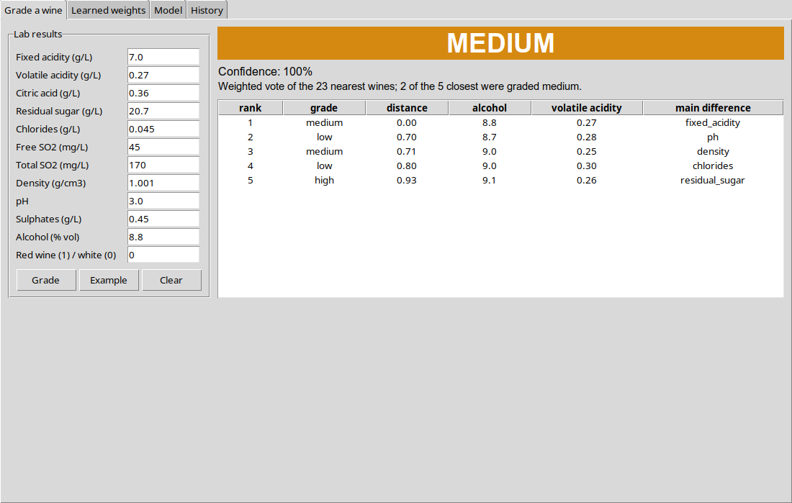
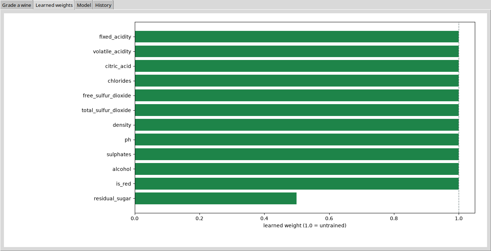
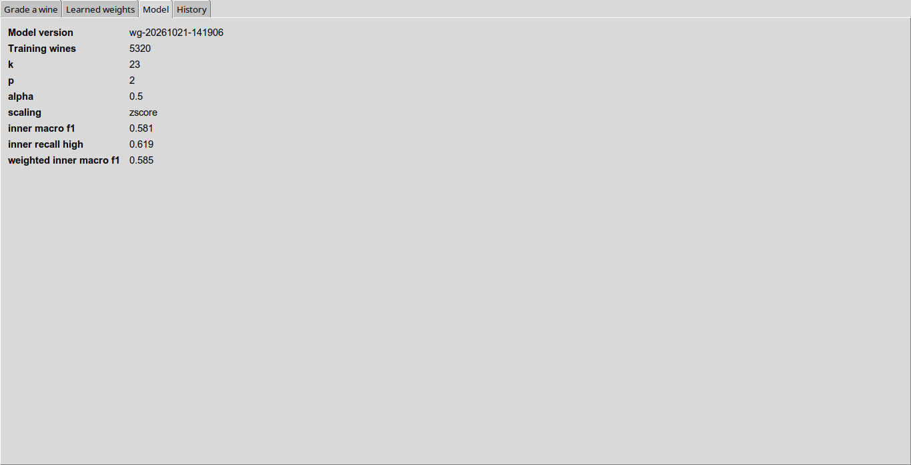
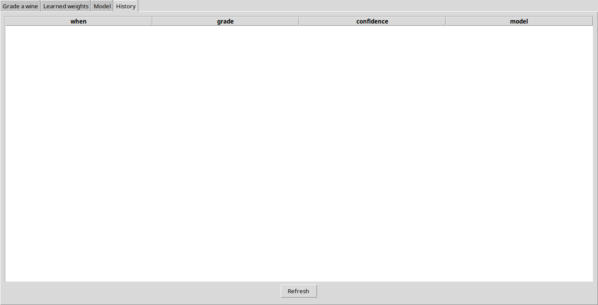

# WineGrader — walkthrough

Every function you write in this project (107 of them), in the order of `TASKS.md`. For each one:

- **Problem** — what the function has to do,
- **Solution** — the finished code,
- **Check** — the test that proves it works.

Try each function yourself first, then compare. Run the check after every function, not at the end.

## Contents

- [Stage 1 — Loading the data (2 weeks)](#stage-1--loading-the-data-2-weeks) (8 functions)
- [Stage 2 — Looking at the data (2 weeks)](#stage-2--looking-at-the-data-2-weeks) (5 functions)
- [Stage 3 — Scaling, distance, linear search (2 weeks)](#stage-3--scaling-distance-linear-search-2-weeks) (14 functions)
- [Stage 4 — k-NN, baselines, measuring (3 weeks) — the heart of the project](#stage-4--k-nn-baselines-measuring-3-weeks--the-heart-of-the-project) (17 functions)
- [Stage 5 — The kd-tree (2 weeks)](#stage-5--the-kd-tree-2-weeks) (3 functions)
- [Stage 6 — Tuning, callbacks, weight learning, nested evaluation (3 weeks)](#stage-6--tuning-callbacks-weight-learning-nested-evaluation-3-weeks) (15 functions)
- [Stage 7 — The two machines (3 weeks)](#stage-7--the-two-machines-3-weeks) (39 functions)
- [Stage 8 — Measure and write (2 weeks)](#stage-8--measure-and-write-2-weeks) (6 functions)
- [The finished project](#the-finished-project)

## Stage 1 — Loading the data (2 weeks)

### `winegrader/data/loader.py`

#### `quality_to_grade(quality)`

**Problem.** Turn the 0-10 tasting score into one of three grades: 5 or less is low, 6 is medium, 7 or more is high. Seven separate scores would leave some classes with only a handful of wines.

**Solution.**

```python
def quality_to_grade(quality: int) -> int:
    if quality <= config.LOW_MAX_QUALITY:
        return config.LOW
    if quality == config.MEDIUM_QUALITY:
        return config.MEDIUM
    return config.HIGH
```

**Check.** `pytest tests/test_loader.py::test_quality_to_grade_cut_points`

#### `grades_from_quality(quality)`

**Problem.** Apply quality_to_grade to every score and return an int array.

**Solution.**

```python
def grades_from_quality(quality: Sequence[int]) -> np.ndarray:
    return np.array([quality_to_grade(int(q)) for q in quality], dtype=int)
```

**Check.** `pytest tests/test_loader.py::test_grades_from_quality_is_int_array`

#### `validate_values(values)`

**Problem.** Check one wine and return None if it is fine, otherwise a sentence a person can act on: exactly 12 values, all real numbers, each inside its valid range ("ph = 15.2 is outside the valid range 0.0..14.0"), and is_red exactly 0 or 1. The file import and the lab form use the same check.

**Solution.**

```python
def validate_values(values: Sequence[float]) -> Optional[str]:
    if len(values) != config.N_FEATURES:
        return f"expected {config.N_FEATURES} values, got {len(values)}"
    for name, value in zip(config.FEATURES, values):
        try:
            value = float(value)
        except (TypeError, ValueError):
            return f"{name} = {value!r} is not a number"
        if not np.isfinite(value):
            return f"{name} is not a finite number"
        low, high = config.VALID_RANGES[name]
        if not low <= value <= high:
            return f"{name} = {value:g} is outside the valid range {low}..{high}"
    if float(values[-1]) not in (0.0, 1.0):
        return "is_red must be 0 or 1"
    return None
```

**Check.** `pytest tests/test_loader.py -k "test_valid_wine_passes or test_wrong_number_of_values or test_nan_is_rejected or test_out_of_range_names_the_feature"`

#### `parse_uci_csv(path, is_red)`

**Problem.** Read one UCI file (";"-separated): refuse a file that is too big before opening it, check the header, and turn every line into 12 values plus the quality. A bad line is listed as rejected with its line number and reason; it does not stop the file.

**Solution.**

```python
def parse_uci_csv(path: str, is_red: bool) -> LoadResult:
    if not os.path.exists(path):
        raise DataError(f"file not found: {path}")
    if os.path.getsize(path) > config.MAX_IMPORT_BYTES:
        raise DataError(f"{os.path.basename(path)} is larger than the import limit")

    result = LoadResult()
    with open(path, newline="", encoding="utf-8") as fh:
        reader = csv.reader(fh, delimiter=";")
        header = next(reader, None)
        if header is None or [h.strip() for h in header] != config.UCI_COLUMNS:
            raise DataError(f"{os.path.basename(path)} does not have the UCI wine-quality header")

        for line_no, row in enumerate(reader, start=2):
            if line_no - 1 > config.MAX_IMPORT_ROWS:
                raise DataError(f"more than {config.MAX_IMPORT_ROWS} rows - refusing to import")
            if not row:
                continue
            if len(row) != len(config.UCI_COLUMNS):
                result.rejected.append((line_no, f"expected {len(config.UCI_COLUMNS)} fields, got {len(row)}"))
                continue
            try:
                numbers = [float(x) for x in row]
            except ValueError:
                result.rejected.append((line_no, "a field is not a number"))
                continue
            quality = numbers[-1]
            if quality != int(quality) or not 0 <= quality <= 10:
                result.rejected.append((line_no, f"quality = {quality:g} is not a whole number 0..10"))
                continue
            values = numbers[:-1] + [1.0 if is_red else 0.0]
            reason = validate_values(values)
            if reason:
                result.rejected.append((line_no, reason))
                continue
            result.X.append(values)
            result.quality.append(int(quality))
    return result
```

**Check.** `pytest tests/test_loader.py -k "test_parse_good_file or test_white_file_gets_is_red_zero or test_wrong_header_is_refused or test_bad_line_is_rejected_with_its_line_number"`

#### `load_wine_quality(red_path, white_path)`

**Problem.** Read the red and the white file, red first, and return all wines and their quality scores. Print how many lines were rejected from each file.

**Solution.**

```python
def load_wine_quality(red_path: str = None, white_path: str = None) -> Tuple[np.ndarray, np.ndarray]:
    red_path = red_path or config.RED_CSV
    white_path = white_path or config.WHITE_CSV
    X: List[List[float]] = []
    quality: List[int] = []
    for path, is_red in ((red_path, True), (white_path, False)):
        result = parse_uci_csv(path, is_red)
        if result.rejected:
            print(f"{os.path.basename(path)}: rejected {len(result.rejected)} lines")
        X.extend(result.X)
        quality.extend(result.quality)
    return np.array(X, dtype=float), np.array(quality, dtype=int)
```

**Check.** `pytest tests/test_loader.py -k "test_load_merges_red_first or test_real_data_has_1177_duplicates"`

#### `duplicate_of(X, quality)`

**Problem.** For every wine, the index of the first identical wine (all 12 values and the quality equal), or None for the first copy: [[1,2], [3,4], [1,2]] with quality [5, 6, 5] gives [None, None, 0]. For k-NN a copy in both train and test is its own nearest neighbour - the score goes up and nothing was learned.

**Solution.**

```python
def duplicate_of(X: np.ndarray, quality: np.ndarray) -> List[Optional[int]]:
    first: Dict[Tuple, int] = {}
    result: List[Optional[int]] = []
    for i, (row, q) in enumerate(zip(X, quality)):
        key = tuple(float(v) for v in row) + (int(q),)
        if key in first:
            result.append(first[key])
        else:
            first[key] = i
            result.append(None)
    return result
```

**Check.** `pytest tests/test_loader.py -k "test_duplicate_of_points_at_first_copy or test_same_features_different_quality_is_not_a_duplicate"`

#### `drop_exact_duplicates(X, quality)`

**Problem.** Keep only the first copy of every wine (order unchanged) and return how many were dropped - 1,177 on the real data.

**Solution.**

```python
def drop_exact_duplicates(X: np.ndarray, quality: np.ndarray) -> Tuple[np.ndarray, np.ndarray, int]:
    dup = duplicate_of(X, quality)
    keep = np.array([d is None for d in dup], dtype=bool)
    return X[keep], quality[keep], int((~keep).sum())
```

**Check.** `pytest tests/test_loader.py -k "test_drop_exact_duplicates_keeps_order_and_counts or test_real_data_has_1177_duplicates"`

#### `class_balance(y)`

**Problem.** The share of each grade, by name: {"low": 0.374, "medium": 0.437, "high": 0.190}. Every grade appears even with 0; an empty list is an error.

**Solution.**

```python
def class_balance(y: Sequence[int]) -> Dict[str, float]:
    y = np.asarray(y)
    if len(y) == 0:
        raise DataError("no wines")
    counts = np.bincount(y, minlength=config.N_CLASSES)
    return {name: float(counts[i]) / len(y) for i, name in enumerate(config.GRADES)}
```

**Check.** `pytest tests/test_loader.py -k "test_class_balance_has_every_grade or test_class_balance_of_nothing_is_an_error"`


## Stage 2 — Looking at the data (2 weeks)

### `analyse.py`

#### `main(argv)`

**Problem.** Load the wines, drop duplicates, and write the analysis report (statistics, correlations, group means) with the histograms.

**Solution.**

```python
def main(argv=None) -> int:
    parser = argparse.ArgumentParser(description="WineGrader data analysis")
    parser.add_argument("--sample", action="store_true")
    args = parser.parse_args(argv)

    from winegrader.data.analysis import correlation_with, describe, means_by_group, plot_histograms
    from winegrader.data.loader import class_balance, drop_exact_duplicates, grades_from_quality, load_wine_quality

    if args.sample:
        folder = os.path.join(config.DATA_DIR, "sample")
        X, q = load_wine_quality(os.path.join(folder, "winequality-red.csv"),
                                 os.path.join(folder, "winequality-white.csv"))
    else:
        X, q = load_wine_quality()
    X, q, dropped = drop_exact_duplicates(X, q)
    y = grades_from_quality(q)
    os.makedirs(config.REPORTS_DIR, exist_ok=True)
    plot_histograms(X, os.path.join(config.REPORTS_DIR, "histograms.png"))

    corr = correlation_with(X, q)
    lines = ["# WineGrader - data analysis", "",
             f"{len(X)} wines after removing {dropped} exact duplicates.", "",
             "| Grade | Share |", "|---|---|"]
    lines += [f"| {g} | {s:.1%} |" for g, s in class_balance(y).items()]
    lines += ["", "## Features", "", "| Feature | Mean | Std | Min | Max | Correlation with quality |",
              "|---|---|---|---|---|---|"]
    for r in sorted(describe(X), key=lambda r: -abs(corr[r["feature"]])):
        lines.append(f"| {r['feature']} | {r['mean']:.3f} | {r['std']:.3f} | {r['min']:.3f} | "
                     f"{r['max']:.3f} | {corr[r['feature']]:+.3f} |")
    lines += ["", "## Mean of each feature by grade", "",
              "| Feature | " + " | ".join(config.GRADES) + " |", "|---|---|---|---|"]
    by_grade = means_by_group(X, y)
    for j, name in enumerate(config.FEATURES):
        lines.append(f"| {name} | " + " | ".join(f"{by_grade[g][j]:.3f}" for g in sorted(by_grade)) + " |")
    by_colour = means_by_group(X, X[:, -1].astype(int))
    lines += ["", "## Red against white", "", "| Feature | white | red |", "|---|---|---|"]
    for j, name in enumerate(config.FEATURES[:-1]):
        lines.append(f"| {name} | {by_colour[0][j]:.3f} | {by_colour[1][j]:.3f} |")
    lines += ["", ""]
    with open(os.path.join(config.REPORTS_DIR, "analysis.md"), "w", encoding="utf-8") as fh:
        fh.write("\n".join(lines) + "\n")
    print(f"written: {os.path.join(config.REPORTS_DIR, 'analysis.md')}")
    return 0
```

**Check.** No unit test - run the program and look (see the stage's exit condition in `TASKS.md`).

### `winegrader/data/analysis.py`

#### `describe(X)`

**Problem.** One row per feature with its mean, standard deviation, minimum and maximum.

**Solution.**

```python
def describe(X: np.ndarray) -> List[Dict]:
    return [{"feature": name, "mean": float(X[:, j].mean()), "std": float(X[:, j].std()),
             "min": float(X[:, j].min()), "max": float(X[:, j].max())}
            for j, name in enumerate(config.FEATURES)]
```

**Check.** `pytest tests/test_analysis.py::test_describe_one_row_per_feature`

#### `correlation_with(X, target)`

**Problem.** The Pearson correlation of every feature with the target (for example the quality score).

**Solution.**

```python
def correlation_with(X: np.ndarray, target: Sequence[float]) -> Dict[str, float]:
    t = np.asarray(target, dtype=float)
    out = {}
    for j, name in enumerate(config.FEATURES):
        x = X[:, j]
        if x.std() == 0 or t.std() == 0:
            out[name] = 0.0
            continue
        out[name] = float(np.mean((x - x.mean()) * (t - t.mean())) / (x.std() * t.std()))
    return out
```

**Check.** `pytest tests/test_analysis.py -k "test_correlation_matches_numpy or test_constant_feature_has_zero_correlation or test_alcohol_correlates_positively_with_quality"`

#### `means_by_group(X, groups)`

**Problem.** The mean of each feature inside each group, for example per grade or red against white.

**Solution.**

```python
def means_by_group(X: np.ndarray, groups: Sequence[int]) -> Dict[int, List[float]]:
    groups = np.asarray(groups)
    return {int(g): X[groups == g].mean(axis=0).tolist() for g in np.unique(groups)}
```

**Check.** `pytest tests/test_analysis.py::test_means_by_group`

#### `plot_histograms(X, path)`

**Problem.** Draw one histogram per feature in a 3x4 grid and save it as a PNG.

**Solution.**

```python
def plot_histograms(X: np.ndarray, path: str) -> None:
    from matplotlib.figure import Figure

    fig = Figure(figsize=(14, 9))
    for j, name in enumerate(config.FEATURES):
        ax = fig.add_subplot(3, 4, j + 1)
        ax.hist(X[:, j], bins=40, color="#1e8449")
        ax.set_title(name, fontsize=9)
    fig.tight_layout()
    fig.savefig(path, dpi=110)
```

**Check.** `pytest tests/test_analysis.py::test_histograms_written`


## Stage 3 — Scaling, distance, linear search (2 weeks)

### `winegrader/ml/index.py`

#### `LinearIndex.build(X)`

**Problem.** Keep the training wines as a float array and reset the counters. Linear search needs nothing else.

**Solution.**

```python
def build(self, X: np.ndarray) -> "LinearIndex":
    self.X = np.asarray(X, dtype=float)
    self.distance_calcs = 0
    self.queries = 0
    return self
```

**Check.** `pytest tests/test_index.py -k "test_linear_returns_nearest_first or test_linear_breaks_ties_by_row or test_linear_counts_distance_calculations or test_batch_matches_single_queries"`

#### `LinearIndex.query(v, k)`

**Problem.** Compute the distance to every training wine and return the k nearest as (distance, row), ties by row number. Count the distance calculations.

**Solution.**

```python
def query(self, v: np.ndarray, k: int) -> List[Pair]:
    d = power_to_many(self.X, np.asarray(v, dtype=float), self.weights, self.p)
    self.distance_calcs += len(self.X)
    self.queries += 1
    order = np.argsort(d, kind="stable")[:k]
    return [(float(d[i]), int(i)) for i in order]
```

**Check.** `pytest tests/test_index.py -k "test_linear_returns_nearest_first or test_linear_breaks_ties_by_row or test_linear_counts_distance_calculations or test_batch_matches_single_queries"`

#### `LinearIndex.query_batch(Q, k, chunk)`

**Problem.** The same for many wines at once, a chunk at a time: a distance matrix, then argpartition to find the k smallest without sorting whole rows, then sort just those k.

**Solution.**

```python
def query_batch(self, Q: np.ndarray, k: int, chunk: int = 512) -> Tuple[np.ndarray, np.ndarray]:
    Q = np.asarray(Q, dtype=float)
    m = len(Q)
    dists = np.empty((m, k))
    idx = np.empty((m, k), dtype=int)
    for start in range(0, m, chunk):
        D = power_matrix(Q[start:start + chunk], self.X, self.weights, self.p)
        if k < D.shape[1]:
            sel = np.argpartition(D, k - 1, axis=1)[:, :k]
        else:
            sel = np.tile(np.arange(D.shape[1]), (len(D), 1))
        d = np.take_along_axis(D, sel, axis=1)
        o = np.lexsort((sel, d), axis=1)
        dists[start:start + chunk] = np.take_along_axis(d, o, axis=1)
        idx[start:start + chunk] = np.take_along_axis(sel, o, axis=1)
    self.distance_calcs += m * len(self.X)
    self.queries += m
    return dists, idx
```

**Check.** `pytest tests/test_index.py -k "test_batch_matches_single_queries or test_batch_with_k_equal_to_n"`

### `winegrader/ml/metrics.py`

#### `minkowski_power(a, b, w, p)`

**Problem.** The weighted distance before the root: sum of w[i] x |a[i] - b[i]| ** p. Ranking by this gives the same order as the real distance and is cheaper.

**Solution.**

```python
def minkowski_power(a: np.ndarray, b: np.ndarray, w: np.ndarray, p: int) -> float:
    return float(np.sum(w * np.abs(np.asarray(a) - np.asarray(b)) ** p))
```

**Check.** `pytest tests/test_scaler_metrics.py -k "test_power_distance_has_no_root or test_weight_two_counts_double or test_skipping_the_root_keeps_the_order or test_power_to_many_matches_loop"`

#### `minkowski(a, b, w, p)`

**Problem.** The real Minkowski distance: minkowski_power to the power 1/p (p=2 is the usual straight-line distance).

**Solution.**

```python
def minkowski(a: np.ndarray, b: np.ndarray, w: np.ndarray, p: int) -> float:
    return minkowski_power(a, b, w, p) ** (1.0 / p)
```

**Check.** `pytest tests/test_scaler_metrics.py -k "test_manhattan_by_hand or test_euclidean_by_hand or test_zero_weight_ignores_feature or test_skipping_the_root_keeps_the_order"`

#### `power_to_many(X, v, w, p)`

**Problem.** The power distance from one wine to every row of X at once, with numpy - one number per row.

**Solution.**

```python
def power_to_many(X: np.ndarray, v: np.ndarray, w: np.ndarray, p: int) -> np.ndarray:
    return np.sum(w * np.abs(X - v) ** p, axis=1)
```

**Check.** `pytest tests/test_scaler_metrics.py::test_power_to_many_matches_loop`

#### `power_matrix(Q, X, w, p)`

**Problem.** The power distances from every row of Q to every row of X, as a matrix (rows of Q x rows of X).

**Solution.**

```python
def power_matrix(Q: np.ndarray, X: np.ndarray, w: np.ndarray, p: int) -> np.ndarray:
    D = np.zeros((Q.shape[0], X.shape[0]))
    for j in range(X.shape[1]):
        if w[j] == 0:
            continue
        t = np.subtract(Q[:, j, None], X[None, :, j])
        np.abs(t, out=t)
        if p == 2:
            np.multiply(t, t, out=t)
        elif p != 1:
            np.power(t, p, out=t)
        if w[j] != 1:
            np.multiply(t, w[j], out=t)
        D += t
    return D
```

**Check.** `pytest tests/test_scaler_metrics.py::test_power_matrix_matches_loop` and `pytest tests/test_tuning_weights.py::test_fold_distances_update_is_exact`

### `winegrader/ml/scaler.py`

#### `StandardScaler.fit(X)`

**Problem.** Learn each column's mean and standard deviation from the TRAINING rows; a column that never changes gets std 1 so it does not divide by zero.

**Solution.**

```python
def fit(self, X: np.ndarray) -> "StandardScaler":
    X = np.asarray(X, dtype=float)
    self.mean = X.mean(axis=0)
    std = X.std(axis=0)
    std[std == 0] = 1.0
    self.std = std
    return self
```

**Check.** `pytest tests/test_classifiers.py -k "test_knn_separates_blobs or test_knn_matches_sklearn or test_predict_one_returns_neighbours_with_real_distance or test_closer_neighbour_outweighs_two_far_ones"` and `pytest tests/test_evaluation_bundle.py -k "test_round_trip_gives_the_same_predictions or test_wrong_number_of_weights_is_not_saved"` and `pytest tests/test_scaler_metrics.py -k "test_fit_uses_only_given_rows or test_inverse_transform_round_trip or test_to_dict_round_trip"`

#### `StandardScaler.transform(X)`

**Problem.** (X - mean) / std. Using it before fit raises RuntimeError.

**Solution.**

```python
def transform(self, X: np.ndarray) -> np.ndarray:
    if self.mean is None:
        raise RuntimeError("scaler is not fitted")
    return (np.asarray(X, dtype=float) - self.mean) / self.std
```

**Check.** `pytest tests/test_evaluation_bundle.py::test_round_trip_gives_the_same_predictions` and `pytest tests/test_scaler_metrics.py -k "test_fit_uses_only_given_rows or test_transform_before_fit_raises or test_inverse_transform_round_trip or test_to_dict_round_trip"`

#### `StandardScaler.inverse_transform(Z)`

**Problem.** Back to lab units: Z x std + mean - used to show a neighbour's real values.

**Solution.**

```python
def inverse_transform(self, Z: np.ndarray) -> np.ndarray:
    if self.mean is None:
        raise RuntimeError("scaler is not fitted")
    return np.asarray(Z, dtype=float) * self.std + self.mean
```

**Check.** `pytest tests/test_scaler_metrics.py::test_inverse_transform_round_trip`

#### `MinMaxScaler.fit(X)`

**Problem.** Learn each column's minimum and range (max - min); a zero range becomes 1.

**Solution.**

```python
def fit(self, X: np.ndarray) -> "MinMaxScaler":
    X = np.asarray(X, dtype=float)
    self.min = X.min(axis=0)
    rng = X.max(axis=0) - self.min
    rng[rng == 0] = 1.0
    self.range = rng
    return self
```

**Check.** `pytest tests/test_classifiers.py -k "test_knn_separates_blobs or test_knn_matches_sklearn or test_predict_one_returns_neighbours_with_real_distance or test_closer_neighbour_outweighs_two_far_ones"` and `pytest tests/test_evaluation_bundle.py -k "test_round_trip_gives_the_same_predictions or test_wrong_number_of_weights_is_not_saved"` and `pytest tests/test_scaler_metrics.py -k "test_fit_uses_only_given_rows or test_inverse_transform_round_trip or test_to_dict_round_trip"`

#### `MinMaxScaler.transform(X)`

**Problem.** (X - min) / range. Test wines may land a little outside 0..1 - that is fine.

**Solution.**

```python
def transform(self, X: np.ndarray) -> np.ndarray:
    if self.min is None:
        raise RuntimeError("scaler is not fitted")
    return (np.asarray(X, dtype=float) - self.min) / self.range
```

**Check.** `pytest tests/test_evaluation_bundle.py::test_round_trip_gives_the_same_predictions` and `pytest tests/test_scaler_metrics.py -k "test_fit_uses_only_given_rows or test_transform_before_fit_raises or test_inverse_transform_round_trip or test_to_dict_round_trip"`

#### `MinMaxScaler.inverse_transform(Z)`

**Problem.** Back to lab units: Z x range + min.

**Solution.**

```python
def inverse_transform(self, Z: np.ndarray) -> np.ndarray:
    if self.min is None:
        raise RuntimeError("scaler is not fitted")
    return np.asarray(Z, dtype=float) * self.range + self.min
```

**Check.** `pytest tests/test_scaler_metrics.py::test_inverse_transform_round_trip`

#### `scaler_from_dict(data)`

**Problem.** Rebuild a fitted scaler from its saved dict.

**Solution.**

```python
def scaler_from_dict(data: Dict) -> Scaler:
    scaler = create_scaler(data["name"])
    if isinstance(scaler, NoScaler):
        return scaler
    if isinstance(scaler, StandardScaler):
        scaler.mean = np.array(data["mean"], dtype=float)
        scaler.std = np.array(data["std"], dtype=float)
    else:
        scaler.min = np.array(data["min"], dtype=float)
        scaler.range = np.array(data["range"], dtype=float)
    return scaler
```

**Check.** `pytest tests/test_scaler_metrics.py::test_to_dict_round_trip`


## Stage 4 — k-NN, baselines, measuring (3 weeks) — the heart of the project

### `winegrader/ml/classifiers.py`

#### `class_priors(y, n_classes)`

**Problem.** The share of each grade in the training labels. A grade that is absent gets 1.0 instead of 0, so the imbalance correction never divides by zero.

**Solution.**

```python
def class_priors(y: Sequence[int], n_classes: int = config.N_CLASSES) -> np.ndarray:
    y = np.asarray(y, dtype=int)
    counts = np.bincount(y, minlength=n_classes).astype(float)
    priors = counts / len(y)
    priors[counts == 0] = 1.0
    return priors
```

**Check.** `pytest tests/test_classifiers.py::test_class_priors`

#### `vote(dist_power, labels, p, alpha, priors, weighted)`

**Problem.** The vote for many wines at once from their k nearest neighbours: each neighbour votes with 1 / distance (or 1), divided by its grade's share ** alpha so a rare grade is not drowned out. The grade with the most votes wins; on a tie, the grade of the nearest neighbour among them. Confidence = winner's votes / all votes.

**Solution.**

```python
def vote(dist_power: np.ndarray, labels: np.ndarray, p: int, alpha: float,
         priors: np.ndarray, weighted: bool = True) -> Tuple[np.ndarray, np.ndarray, np.ndarray]:
    dist = dist_power ** (1.0 / p)
    v = 1.0 / (dist + config.VOTE_EPSILON) if weighted else np.ones_like(dist)
    v = v / priors[labels] ** alpha
    n_classes = len(priors)
    score = np.zeros((len(labels), n_classes))
    for c in range(n_classes):
        score[:, c] = np.sum(v * (labels == c), axis=1)
    best = np.argmax(score, axis=1)
    top = score.max(axis=1, keepdims=True)
    tied = np.flatnonzero((np.isclose(score, top, rtol=1e-12, atol=0)).sum(axis=1) > 1)
    for r in tied:
        candidates = set(np.flatnonzero(np.isclose(score[r], top[r, 0], rtol=1e-12, atol=0)))
        for lab in labels[r]:
            if lab in candidates:
                best[r] = lab
                break
    conf = score[np.arange(len(best)), best] / score.sum(axis=1)
    return best, conf, score
```

**Check.** `pytest tests/test_app.py::test_classify_formats_and_records` and `pytest tests/test_classifiers.py -k "test_knn_matches_sklearn or test_alpha_zero_means_no_correction or test_alpha_one_rescues_the_rare_class or test_tie_goes_to_nearest_neighbours_grade"`

#### `KNNClassifier.fit(X, y)`

**Problem.** All that k-NN training does: keep the labels, compute the class shares and build the search index with the given weights and p.

**Solution.**

```python
def fit(self, X: np.ndarray, y: np.ndarray) -> "KNNClassifier":
    if len(X) != len(y):
        raise ValueError("X and y have different lengths")
    self.y = np.asarray(y, dtype=int)
    self.priors = class_priors(self.y)
    self.index = create_index(self.index_name, self.weights, self.p).build(X)
    return self
```

**Check.** `pytest tests/test_classifiers.py -k "test_knn_separates_blobs or test_knn_matches_sklearn or test_predict_one_returns_neighbours_with_real_distance or test_closer_neighbour_outweighs_two_far_ones"` and `pytest tests/test_evaluation_bundle.py -k "test_round_trip_gives_the_same_predictions or test_wrong_number_of_weights_is_not_saved"` and `pytest tests/test_scaler_metrics.py -k "test_fit_uses_only_given_rows or test_inverse_transform_round_trip or test_to_dict_round_trip"`

#### `KNNClassifier.predict_one(v)`

**Problem.** Find the k nearest training wines, vote, and return the Prediction with its neighbours - they are the explanation the lab screen shows.

**Solution.**

```python
def predict_one(self, v: np.ndarray) -> Prediction:
    pairs = self.index.query(np.asarray(v, dtype=float), self._k())
    dist_power = np.array([[d for d, _ in pairs]])
    rows = np.array([[i for _, i in pairs]])
    labels = self.y[rows]
    best, conf, score = vote(dist_power, labels, self.p, self.alpha, self.priors, self.weighted_vote)
    neighbours = tuple(Neighbour(int(i), int(self.y[i]), float(d) ** (1.0 / self.p)) for d, i in pairs)
    return Prediction(int(best[0]), float(conf[0]), neighbours, tuple(float(s) for s in score[0]))
```

**Check.** `pytest tests/test_classifiers.py -k "test_predict_one_returns_neighbours_with_real_distance or test_closer_neighbour_outweighs_two_far_ones or test_unweighted_vote_is_a_plain_majority or test_confidence_is_a_share"`

#### `KNNClassifier.predict(X)`

**Problem.** Grade many wines at once (batch search, then vote) - the same answers as predict_one in a loop.

**Solution.**

```python
def predict(self, X: np.ndarray) -> np.ndarray:
    dist_power, rows = self.index.query_batch(np.asarray(X, dtype=float), self._k())
    best, _, _ = vote(dist_power, self.y[rows], self.p, self.alpha, self.priors, self.weighted_vote)
    return best
```

**Check.** `pytest tests/test_classifiers.py -k "test_knn_separates_blobs or test_knn_matches_sklearn or test_alpha_raises_recall_of_minority or test_batch_predict_equals_single"` and `pytest tests/test_evaluation_bundle.py::test_round_trip_gives_the_same_predictions`

#### `MajorityClassifier.fit(X, y)`

**Problem.** Remember the most common grade.

**Solution.**

```python
def fit(self, X: np.ndarray, y: np.ndarray) -> "MajorityClassifier":
    self.label = int(np.argmax(np.bincount(np.asarray(y, dtype=int), minlength=config.N_CLASSES)))
    return self
```

**Check.** `pytest tests/test_classifiers.py -k "test_knn_separates_blobs or test_knn_matches_sklearn or test_predict_one_returns_neighbours_with_real_distance or test_closer_neighbour_outweighs_two_far_ones"` and `pytest tests/test_evaluation_bundle.py -k "test_round_trip_gives_the_same_predictions or test_wrong_number_of_weights_is_not_saved"` and `pytest tests/test_scaler_metrics.py -k "test_fit_uses_only_given_rows or test_inverse_transform_round_trip or test_to_dict_round_trip"`

#### `MajorityClassifier.predict_one(v)`

**Problem.** Always answer the most common grade with confidence 1 - the baseline every real model must beat.

**Solution.**

```python
def predict_one(self, v: np.ndarray) -> Prediction:
    scores = tuple(1.0 if c == self.label else 0.0 for c in range(config.N_CLASSES))
    return Prediction(self.label, 1.0, (), scores)
```

**Check.** `pytest tests/test_classifiers.py -k "test_predict_one_returns_neighbours_with_real_distance or test_closer_neighbour_outweighs_two_far_ones or test_unweighted_vote_is_a_plain_majority or test_confidence_is_a_share"`

#### `CentroidClassifier.fit(X, y)`

**Problem.** Compute the average wine of each grade.

**Solution.**

```python
def fit(self, X: np.ndarray, y: np.ndarray) -> "CentroidClassifier":
    X = np.asarray(X, dtype=float)
    y = np.asarray(y, dtype=int)
    self.centroids = np.array([X[y == c].mean(axis=0) if np.any(y == c) else np.full(X.shape[1], np.inf)
                               for c in range(config.N_CLASSES)])
    return self
```

**Check.** `pytest tests/test_classifiers.py -k "test_knn_separates_blobs or test_knn_matches_sklearn or test_predict_one_returns_neighbours_with_real_distance or test_closer_neighbour_outweighs_two_far_ones"` and `pytest tests/test_evaluation_bundle.py -k "test_round_trip_gives_the_same_predictions or test_wrong_number_of_weights_is_not_saved"` and `pytest tests/test_scaler_metrics.py -k "test_fit_uses_only_given_rows or test_inverse_transform_round_trip or test_to_dict_round_trip"`

#### `CentroidClassifier.predict_one(v)`

**Problem.** Answer the grade whose average wine is nearest; confidence from 1 / distance to each average, normalised.

**Solution.**

```python
def predict_one(self, v: np.ndarray) -> Prediction:
    d = np.sqrt(np.sum((self.centroids - np.asarray(v, dtype=float)) ** 2, axis=1))
    inv = 1.0 / (d + config.VOTE_EPSILON)
    label = int(np.argmin(d))
    return Prediction(label, float(inv[label] / inv.sum()), (), tuple(float(s) for s in inv))
```

**Check.** `pytest tests/test_classifiers.py -k "test_predict_one_returns_neighbours_with_real_distance or test_closer_neighbour_outweighs_two_far_ones or test_unweighted_vote_is_a_plain_majority or test_confidence_is_a_share"`

### `winegrader/ml/evaluation.py`

#### `evaluate_split(factory, X, y, train, test, scaling, time_single)`

**Problem.** Fit the scaler and the model on the training rows only, grade the test rows, and return the scores, the median time to grade one wine and the distance calculations per query.

**Solution.**

```python
def evaluate_split(factory: ModelFactory, X: np.ndarray, y: np.ndarray,
                   train: np.ndarray, test: np.ndarray, scaling: str = config.DEFAULT_SCALING,
                   time_single: int = 50) -> FoldResult:
    scaler = create_scaler(scaling).fit(X[train])
    model = factory().fit(scaler.transform(X[train]), y[train])
    Xte = scaler.transform(X[test])
    pred = model.predict(Xte)
    cm = confusion_matrix(y[test], pred)
    _, recall, f1 = precision_recall_f1(cm)

    index = getattr(model, "index", None)
    if index is not None:
        index.distance_calcs = 0
        index.queries = 0
    times = []
    for v in Xte[:time_single]:
        start = time.perf_counter()
        model.predict_one(v)
        times.append((time.perf_counter() - start) * 1000)
    calcs = index.avg_distance_calcs if index is not None else 0.0

    return FoldResult(
        accuracy=float(np.trace(cm) / cm.sum()),
        macro_f1=float(f1.mean()),
        recall_high=float(recall[config.HIGH]),
        confusion=tuple(tuple(int(v) for v in row) for row in cm),
        median_predict_ms=float(np.median(times)) if times else 0.0,
        avg_distance_calcs=float(calcs),
    )
```

**Check.** `pytest tests/test_evaluation_bundle.py -k "test_evaluate_split_fields or test_baseline_has_no_distance_calcs"`

#### `cross_validate(factory, X, y, splits, scaling)`

**Problem.** Run evaluate_split on every fold. All models use the same splits, so the differences are differences between models.

**Solution.**

```python
def cross_validate(factory: ModelFactory, X: np.ndarray, y: np.ndarray,
                   splits: Optional[Sequence[Split]] = None,
                   scaling: str = config.DEFAULT_SCALING) -> List[FoldResult]:
    splits = splits if splits is not None else stratified_kfold(y, config.OUTER_FOLDS)
    return [evaluate_split(factory, X, y, train, test, scaling) for train, test in splits]
```

**Check.** `pytest tests/test_evaluation_bundle.py::test_cross_validate_one_result_per_fold`

#### `summarise(results)`

**Problem.** The mean and standard deviation of every score across the folds. Always report the spread - 0.61 against 0.60 means nothing when the folds differ by 0.02.

**Solution.**

```python
def summarise(results: Sequence[FoldResult]) -> Dict[str, float]:
    out: Dict[str, float] = {}
    for name in ("accuracy", "macro_f1", "recall_high"):
        values = np.array([getattr(r, name) for r in results])
        out[f"{name}_mean"] = float(values.mean())
        out[f"{name}_std"] = float(values.std())
    out["median_predict_ms"] = float(np.mean([r.median_predict_ms for r in results]))
    out["avg_distance_calcs"] = float(np.mean([r.avg_distance_calcs for r in results]))
    return out
```

**Check.** `pytest tests/test_evaluation_bundle.py::test_summarise_mean_and_std`

### `winegrader/ml/folds.py`

#### `stratified_kfold(y, folds, seed)`

**Problem.** Split the rows into `folds` (train, test) pairs with the same grade shares in each, using a fixed seed. Every row is in exactly one test set.

**Solution.**

```python
def stratified_kfold(y: Sequence[int], folds: int, seed: int = config.RANDOM_SEED) -> List[Split]:
    y = np.asarray(y)
    if folds < 2 or folds > len(y):
        raise ValueError(f"cannot make {folds} folds from {len(y)} rows")
    rng = np.random.default_rng(seed)
    fold_of = np.empty(len(y), dtype=int)
    for c in np.unique(y):
        rows = np.flatnonzero(y == c)
        rng.shuffle(rows)
        fold_of[rows] = np.arange(len(rows)) % folds
    splits = []
    for f in range(folds):
        test = np.flatnonzero(fold_of == f)
        train = np.flatnonzero(fold_of != f)
        splits.append((train, test))
    return splits
```

**Check.** `pytest tests/test_classifiers.py -k "test_alpha_raises_recall_of_minority or test_every_row_tested_exactly_once or test_train_and_test_are_disjoint or test_folds_keep_the_class_mix"` and `pytest tests/test_evaluation_bundle.py -k "test_evaluate_split_fields or test_baseline_has_no_distance_calcs or test_cross_validate_one_result_per_fold or test_nested_cv_runs_and_reports"` and `pytest tests/test_tuning_weights.py -k "test_prepare_folds_scales_with_training_rows_only or test_fold_neighbours_returns_labels or test_grid_search_returns_a_configuration_from_the_grid or test_k_sweep_stops_early"`

### `winegrader/ml/scoring.py`

#### `confusion_matrix(y_true, y_pred, n_classes)`

**Problem.** cm[true][pred] = how many wines of grade `true` were called `pred`.

**Solution.**

```python
def confusion_matrix(y_true: Sequence[int], y_pred: Sequence[int],
                     n_classes: int = config.N_CLASSES) -> np.ndarray:
    cm = np.zeros((n_classes, n_classes), dtype=int)
    np.add.at(cm, (np.asarray(y_true, dtype=int), np.asarray(y_pred, dtype=int)), 1)
    return cm
```

**Check.** `pytest tests/test_classifiers.py -k "test_confusion_matrix_by_hand or test_precision_recall_by_hand or test_class_never_predicted_scores_zero_not_nan"`

#### `precision_recall_f1(cm)`

**Problem.** Per grade: precision (of those called this grade, how many were right), recall (of the real ones, how many were found) and F1, from the confusion matrix. Divide-by-zero gives 0.

**Solution.**

```python
def precision_recall_f1(cm: np.ndarray) -> Tuple[np.ndarray, np.ndarray, np.ndarray]:
    cm = np.asarray(cm, dtype=float)
    tp = np.diag(cm)
    col = cm.sum(axis=0)
    row = cm.sum(axis=1)
    precision = np.divide(tp, col, out=np.zeros_like(tp), where=col > 0)
    recall = np.divide(tp, row, out=np.zeros_like(tp), where=row > 0)
    denom = precision + recall
    f1 = np.divide(2 * precision * recall, denom, out=np.zeros_like(tp), where=denom > 0)
    return precision, recall, f1
```

**Check.** `pytest tests/test_classifiers.py -k "test_precision_recall_by_hand or test_class_never_predicted_scores_zero_not_nan"`

#### `macro_f1(y_true, y_pred)`

**Problem.** The plain average of the three F1 values, so the small "high" class counts as much as the others.

**Solution.**

```python
def macro_f1(y_true: Sequence[int], y_pred: Sequence[int]) -> float:
    _, _, f1 = precision_recall_f1(confusion_matrix(y_true, y_pred))
    return float(f1.mean())
```

**Check.** `pytest tests/test_classifiers.py -k "test_macro_f1_matches_sklearn or test_always_medium_scores_badly_on_macro_f1"` and `pytest tests/test_evaluation_bundle.py::test_evaluate_split_fields` and `pytest tests/test_tuning_weights.py -k "test_grid_search_returns_a_configuration_from_the_grid or test_choice_prefers_recall_among_near_ties or test_choice_without_ties_is_the_best_f1"`

#### `accuracy(y_true, y_pred)`

**Problem.** The share of exact matches; 0 for empty input.

**Solution.**

```python
def accuracy(y_true: Sequence[int], y_pred: Sequence[int]) -> float:
    y_true = np.asarray(y_true)
    if len(y_true) == 0:
        return 0.0
    return float(np.mean(y_true == np.asarray(y_pred)))
```

**Check.** `pytest tests/test_classifiers.py -k "test_knn_separates_blobs or test_always_medium_scores_badly_on_macro_f1 or test_accuracy_of_nothing"` and `pytest tests/test_evaluation_bundle.py::test_evaluate_split_fields`


## Stage 5 — The kd-tree (2 weeks)

### `winegrader/ml/index.py`

#### `KDTreeIndex.build(X)`

**Problem.** Keep the wines, reset the counters and build the tree from all rows.

**Solution.**

```python
def build(self, X: np.ndarray) -> "KDTreeIndex":
    self.X = np.asarray(X, dtype=float)
    self.distance_calcs = 0
    self.queries = 0
    self.root = self._build(np.arange(len(self.X)))
    return self
```

**Check.** `pytest tests/test_index.py -k "test_linear_returns_nearest_first or test_linear_breaks_ties_by_row or test_linear_counts_distance_calculations or test_batch_matches_single_queries"`

#### `KDTreeIndex._build(rows)`

**Problem.** Split the rows recursively: stop at a small leaf; otherwise pick the column with the widest (weighted) spread, sort by it and split at the middle position. Splitting by position, not by "< median", keeps both halves non-empty even with many equal values.

**Solution.**

```python
def _build(self, rows: np.ndarray):
    if len(rows) <= self.leaf_size:
        return _Leaf(rows)
    pts = self.X[rows]
    spread = (pts.max(axis=0) - pts.min(axis=0)) * self.weights
    axis = int(np.argmax(spread))
    if spread[axis] == 0:
        return _Leaf(rows)
    order = rows[np.argsort(pts[:, axis], kind="stable")]
    mid = len(order) // 2
    threshold = float(self.X[order[mid], axis])
    return _Node(axis, threshold, self._build(order[:mid]), self._build(order[mid:]))
```

**Check.** No unit test - run the program and look (see the stage's exit condition in `TASKS.md`).

#### `KDTreeIndex.query(v, k)`

**Problem.** Search the tree depth-first, keeping the k best in a heap, and skip a whole branch when it cannot contain anything closer than the current k-th best. The answers must equal the linear search.

**Solution.**

```python
def query(self, v: np.ndarray, k: int) -> List[Pair]:
    v = np.asarray(v, dtype=float)
    k = min(k, len(self.X))
    heap: List[Tuple[float, int]] = []
    w, p = self.weights, self.p

    def offer(dist: float, row: int) -> None:
        entry = (-dist, -row)
        if len(heap) < k:
            heapq.heappush(heap, entry)
        elif entry > heap[0]:            # strictly better than the worst kept
            heapq.heapreplace(heap, entry)

    def search(node) -> None:
        if isinstance(node, _Leaf):
            d = power_to_many(self.X[node.rows], v, w, p)
            self.distance_calcs += len(node.rows)
            for dist, row in zip(d, node.rows):
                offer(float(dist), int(row))
            return
        diff = v[node.axis] - node.threshold
        near, far = (node.left, node.right) if diff < 0 else (node.right, node.left)
        search(near)
        gap = w[node.axis] * abs(diff) ** p
        if len(heap) < k or gap <= -heap[0][0]:
            search(far)

    search(self.root)
    self.queries += 1
    return sorted(((-nd, -nr) for nd, nr in heap))
```

**Check.** `pytest tests/test_index.py -k "test_linear_returns_nearest_first or test_linear_breaks_ties_by_row or test_linear_counts_distance_calculations or test_batch_matches_single_queries"`


## Stage 6 — Tuning, callbacks, weight learning, nested evaluation (3 weeks)

### `winegrader/ml/callbacks.py`

#### `EarlyStopping.update(score)`

**Problem.** Record a score and return True when it is time to stop: an improvement smaller than min_delta counts as none, and after `patience` steps without improvement it stops.

**Solution.**

```python
def update(self, score: float) -> bool:
    if score > self.best + self.min_delta:
        self.best = score
        self.bad_steps = 0
    else:
        self.bad_steps += 1
    return self.bad_steps >= self.patience
```

**Check.** `pytest tests/test_tuning_weights.py -k "test_early_stopping_waits_for_patience or test_early_stopping_ignores_tiny_improvements"`

#### `HistoryLogger.on_round_end(round_no, score, weights)`

**Problem.** Keep the round number, the score and the weights of every round.

**Solution.**

```python
def on_round_end(self, round_no: int, score: float, weights: Sequence[float]) -> None:
    self.history.append({"round": round_no, "score": float(score), "weights": [float(w) for w in weights]})
```

**Check.** `pytest tests/test_tuning_weights.py -k "test_history_logger_records_rounds or test_checkpoint_keeps_only_the_best"`

#### `Checkpoint.on_round_end(round_no, score, weights)`

**Problem.** When the score is the best so far, save the round, score and weights - write a temporary file and rename it, so a crash never leaves half a file.

**Solution.**

```python
def on_round_end(self, round_no: int, score: float, weights: Sequence[float]) -> None:
    if self.best is not None and score <= self.best:
        return
    self.best = float(score)
    tmp = self.path + ".tmp"
    with open(tmp, "w", encoding="utf-8") as fh:
        json.dump({"round": round_no, "score": float(score), "weights": [float(w) for w in weights]}, fh)
    os.replace(tmp, self.path)
```

**Check.** `pytest tests/test_tuning_weights.py -k "test_history_logger_records_rounds or test_checkpoint_keeps_only_the_best"`

### `winegrader/ml/evaluation.py`

#### `nested_cv(X, y, outer_splits, learn, index, grid, weight_kwargs, callbacks, progress)`

**Problem.** The honest estimate: for every outer fold, tune (and learn weights) on its training part only, with inner folds, then measure once on the untouched outer test part.

**Solution.**

```python
def nested_cv(X: np.ndarray, y: np.ndarray, outer_splits: Optional[Sequence[Split]] = None,
              learn: bool = True, index: str = "linear",
              grid: Optional[Dict] = None, weight_kwargs: Optional[Dict] = None,
              callbacks: Sequence[Callback] = (), progress: Callable[[str], None] = None) -> NestedResult:
    outer_splits = outer_splits if outer_splits is not None else stratified_kfold(y, config.OUTER_FOLDS)
    grid = grid or {}
    weight_kwargs = weight_kwargs or {}
    out = NestedResult()
    for outer_no, (train, test) in enumerate(outer_splits):
        Xtr, ytr = X[train], y[train]
        inner = stratified_kfold(ytr, config.INNER_FOLDS)
        tuned = grid_search(Xtr, ytr, inner, **grid)
        params = tuned.best
        if learn:
            learned = learn_weights(Xtr, ytr, params, inner, callbacks=callbacks, **weight_kwargs)
            w, inner_score = learned.weights, learned.score
        else:
            w, inner_score = np.ones(X.shape[1]), tuned.best_score

        def factory(params=params, w=w):
            return KNNClassifier(params.k, params.p, params.alpha, weights=w, index=index)

        result = evaluate_split(factory, X, y, train, test, params.scaling)
        out.folds.append(OuterFold(params, w, inner_score, result))
        if progress:
            progress(f"outer fold {outer_no + 1}/{len(outer_splits)}: {params} "
                     f"macro-F1 {result.macro_f1:.3f}")
    return out
```

**Check.** `pytest tests/test_evaluation_bundle.py -k "test_nested_cv_runs_and_reports or test_nested_never_sees_outer_test"`

### `winegrader/ml/tuning.py`

#### `prepare_folds(X, y, splits, scaling)`

**Problem.** Scale every fold once, fitting the scaler on that fold's training rows only, and return the scaled folds.

**Solution.**

```python
def prepare_folds(X: np.ndarray, y: np.ndarray, splits: Sequence[Split], scaling: str) -> List[PreparedFold]:
    prepared = []
    for train, test in splits:
        scaler = create_scaler(scaling).fit(X[train])
        prepared.append((scaler.transform(X[train]), y[train], scaler.transform(X[test]), y[test]))
    return prepared
```

**Check.** `pytest tests/test_tuning_weights.py -k "test_prepare_folds_scales_with_training_rows_only or test_fold_neighbours_returns_labels or test_fold_distances_update_is_exact or test_incremental_matches_full_recompute"`

#### `fold_neighbours(fold, weights, p, k)`

**Problem.** For every test wine of a fold, the distances and grades of its k nearest training wines.

**Solution.**

```python
def fold_neighbours(fold: PreparedFold, weights: np.ndarray, p: int, k: int) -> Tuple[np.ndarray, np.ndarray]:
    Xtr, ytr, Xte, _ = fold
    k = min(k, len(Xtr))
    dist_power, rows = LinearIndex(weights, p).build(Xtr).query_batch(Xte, k)
    return dist_power, ytr[rows]
```

**Check.** `pytest tests/test_tuning_weights.py::test_fold_neighbours_returns_labels`

#### `score_votes(fold, dist_power, labels, k, p, alpha)`

**Problem.** Vote with the first k neighbours and return (macro-F1, recall of high) for one fold.

**Solution.**

```python
def score_votes(fold: PreparedFold, dist_power: np.ndarray, labels: np.ndarray,
                k: int, p: int, alpha: float) -> Tuple[float, float]:
    _, ytr, _, yte = fold
    pred, _, _ = vote(dist_power[:, :k], labels[:, :k], p, alpha, class_priors(ytr))
    cm = confusion_matrix(yte, pred)
    _, recall, f1 = precision_recall_f1(cm)
    return float(f1.mean()), float(recall[config.HIGH])
```

**Check.** No unit test - run the program and look (see the stage's exit condition in `TASKS.md`).

#### `choose_configuration(rows, tolerance)`

**Problem.** The selection rule: among the configurations whose macro-F1 is within the tolerance of the best, take the one with the highest recall of "high" (the first on a tie).

**Solution.**

```python
def choose_configuration(rows: Sequence[Dict], tolerance: float = None) -> Dict:
    tolerance = config.F1_TOLERANCE if tolerance is None else tolerance
    top = max(r["macro_f1"] for r in rows)
    candidates = [r for r in rows if r["macro_f1"] >= top - tolerance]
    return max(candidates, key=lambda r: r["recall_high"])
```

**Check.** `pytest tests/test_tuning_weights.py -k "test_choice_prefers_recall_among_near_ties or test_choice_without_ties_is_the_best_f1"`

#### `grid_search(X, y, splits, weights, scalings, ps, alphas, ks, patience)`

**Problem.** Try every scaling x p x alpha x k on the inner folds, stop the k sweep early when it stops improving, and return the best configuration and all result rows.

**Solution.**

```python
def grid_search(X: np.ndarray, y: np.ndarray, splits: Optional[Sequence[Split]] = None,
                weights: Optional[np.ndarray] = None,
                scalings: Sequence[str] = None, ps: Sequence[int] = None,
                alphas: Sequence[float] = None, ks: Sequence[int] = None,
                patience: int = config.K_PATIENCE) -> TuningResult:
    weights = np.ones(X.shape[1]) if weights is None else np.asarray(weights, dtype=float)
    splits = splits if splits is not None else stratified_kfold(y, config.INNER_FOLDS)
    scalings = scalings or config.GRID_SCALINGS
    ps = ps or config.GRID_P
    alphas = alphas if alphas is not None else config.GRID_ALPHA
    ks = sorted(ks or config.GRID_K)

    rows: List[Dict] = []
    for scaling in scalings:
        folds = prepare_folds(X, y, splits, scaling)
        for p in ps:
            neighbours = [fold_neighbours(f, weights, p, max(ks)) for f in folds]
            for alpha in alphas:
                stopper = EarlyStopping(patience)
                for k in ks:
                    scores = [score_votes(f, d, lab, k, p, alpha) for f, (d, lab) in zip(folds, neighbours)]
                    f1 = float(np.mean([s[0] for s in scores]))
                    rec = float(np.mean([s[1] for s in scores]))
                    rows.append({"scaling": scaling, "p": p, "alpha": alpha, "k": k,
                                 "macro_f1": f1, "recall_high": rec})
                    if stopper.update(f1):
                        break
    chosen = choose_configuration(rows)
    best = Params(k=chosen["k"], p=chosen["p"], alpha=chosen["alpha"], scaling=chosen["scaling"])
    return TuningResult(best, chosen["macro_f1"], rows)
```

**Check.** `pytest tests/test_tuning_weights.py -k "test_grid_search_returns_a_configuration_from_the_grid or test_k_sweep_stops_early"`

### `winegrader/ml/weights.py`

#### `cv_score(folds, weights, params)`

**Problem.** The mean macro-F1 over the folds with given feature weights - the simple, slow reference the fast version must agree with.

**Solution.**

```python
def cv_score(folds: Sequence[PreparedFold], weights: np.ndarray, params: Params) -> float:
    scores = []
    for fold in folds:
        d, labels = fold_neighbours(fold, weights, params.p, params.k)
        scores.append(score_votes(fold, d, labels, params.k, params.p, params.alpha)[0])
    return float(np.mean(scores))
```

**Check.** `pytest tests/test_tuning_weights.py::test_incremental_matches_full_recompute`

#### `neighbours_from_matrix(D, k)`

**Problem.** The k smallest of every row of a distance matrix, nearest first - exactly like LinearIndex.query_batch.

**Solution.**

```python
def neighbours_from_matrix(D: np.ndarray, k: int) -> Tuple[np.ndarray, np.ndarray]:
    k = min(k, D.shape[1])
    if k < D.shape[1]:
        sel = np.argpartition(D, k - 1, axis=1)[:, :k]
    else:
        sel = np.tile(np.arange(D.shape[1]), (len(D), 1))
    d = np.take_along_axis(D, sel, axis=1)
    o = np.lexsort((sel, d), axis=1)
    return np.take_along_axis(d, o, axis=1), np.take_along_axis(sel, o, axis=1)
```

**Check.** `pytest tests/test_tuning_weights.py::test_neighbours_from_matrix_matches_sorting`

#### `FoldDistances.__init__(fold, weights, p)`

**Problem.** Keep a fold and p, and compute its full distance matrix with the current weights.

**Solution.**

```python
def __init__(self, fold: PreparedFold, weights: np.ndarray, p: int) -> None:
    self.Xtr, self.ytr, self.Xte, self.yte = fold
    self.p = p
    self.D = power_matrix(self.Xte, self.Xtr, weights, p)
```

**Check.** `pytest tests/test_tuning_weights.py::test_fold_distances_update_is_exact`

#### `FoldDistances.term(i)`

**Problem.** One feature's part of the distance matrix, without its weight: |test value - train value| ** p.

**Solution.**

```python
def term(self, i: int) -> np.ndarray:
    t = np.abs(self.Xte[:, i, None] - self.Xtr[None, :, i])
    return t if self.p == 1 else t ** self.p
```

**Check.** `pytest tests/test_tuning_weights.py::test_fold_distances_update_is_exact`

#### `FoldDistances.score(D, params)`

**Problem.** The fold's macro-F1 for a given distance matrix.

**Solution.**

```python
def score(self, D: np.ndarray, params: Params) -> float:
    d, rows = neighbours_from_matrix(D, params.k)
    pred, _, _ = vote(d, self.ytr[rows], params.p, params.alpha, class_priors(self.ytr))
    return macro_f1(self.yte, pred)
```

**Check.** `pytest tests/test_scaler_metrics.py::test_one_outlier_squeezes_minmax_but_not_zscore` and `pytest tests/test_tuning_weights.py -k "test_checkpoint_keeps_only_the_best or test_incremental_matches_full_recompute or test_learning_drops_a_noise_feature or test_score_never_gets_worse"`

#### `learn_weights(X, y, params, splits, factors, max_rounds, tolerance, callbacks)`

**Problem.** Learn a weight per feature by coordinate search: for each feature try a few factors (including 0 = remove it), keep a change only when the cross-validated macro-F1 improves by more than the tolerance, and repeat rounds until nothing improves. Update the distance matrices by changing one feature's term instead of recomputing everything.

**Solution.**

```python
def learn_weights(X: np.ndarray, y: np.ndarray, params: Params,
                  splits: Optional[Sequence[Split]] = None,
                  factors: Sequence[float] = None, max_rounds: int = None,
                  tolerance: float = None, callbacks: Sequence[Callback] = ()) -> WeightResult:
    factors = factors or config.WEIGHT_FACTORS
    max_rounds = max_rounds or config.WEIGHT_MAX_ROUNDS
    tolerance = config.WEIGHT_TOLERANCE if tolerance is None else tolerance
    splits = splits if splits is not None else stratified_kfold(y, config.INNER_FOLDS)

    folds = prepare_folds(X, y, splits, params.scaling)
    w = np.ones(X.shape[1])
    fds = [FoldDistances(f, w, params.p) for f in folds]
    best = float(np.mean([fd.score(fd.D, params) for fd in fds]))
    start = best
    evaluations = 1
    stopper = EarlyStopping(patience=1, min_delta=tolerance)
    stopper.update(best)
    history: List[Dict] = [{"round": 0, "score": best, "weights": w.tolist()}]
    rounds = 0
    for round_no in range(1, max_rounds + 1):
        rounds = round_no
        for i in range(len(w)):
            if w[i] == 0:
                continue
            terms = [fd.term(i) for fd in fds]
            for factor in factors:
                new = w[i] * factor
                if new == w[i]:
                    continue
                if new == 0 and not np.any(np.delete(w, i)):
                    continue
                trial_D = [fd.D + (new - w[i]) * t for fd, t in zip(fds, terms)]
                score = float(np.mean([fd.score(D, params) for fd, D in zip(fds, trial_D)]))
                evaluations += 1
                if score > best + tolerance:
                    best = score
                    w[i] = new
                    for fd, D in zip(fds, trial_D):
                        fd.D = D
        history.append({"round": round_no, "score": best, "weights": w.tolist()})
        for cb in callbacks:
            cb.on_round_end(round_no, best, w)
        if stopper.update(best):
            break
    return WeightResult(w.copy(), best, start, rounds, evaluations, history)
```

**Check.** `pytest tests/test_tuning_weights.py -k "test_incremental_matches_full_recompute or test_learning_drops_a_noise_feature or test_weights_are_never_all_zero or test_score_never_gets_worse"`


## Stage 7 — The two machines (3 weeks)

### `run.py`

#### `main(argv)`

**Problem.** Load the newest bundle (or say "run train.py first"), build the controller and open the window.

**Solution.**

```python
def main(argv=None) -> int:
    parser = argparse.ArgumentParser(description="WineGrader lab station")
    parser.add_argument("--bundle", help="bundle folder (default: the newest in models/)")
    args = parser.parse_args(argv)

    from winegrader.controllers.app_controller import AppController
    from winegrader.database import db
    from winegrader.database.repositories import GradingRepository, WineRepository
    from winegrader.service import GradingService
    from winegrader.views.main_window import MainWindow

    conn = db.connect()
    db.initialise(conn)
    try:
        service = GradingService.from_bundle(args.bundle)
    except FileNotFoundError:
        print("No trained model found. Run:  python train.py")
        return 1
    except BundleError as exc:
        print(f"Cannot load the model: {exc}")
        return 1
    MainWindow(AppController(service, GradingRepository(conn), WineRepository(conn))).run()
    return 0
```

**Check.** No unit test - run the program and look (see the stage's exit condition in `TASKS.md`).

### `train.py`

#### `main(argv)`

**Problem.** The training pipeline: import the wines into the database on the first run, read the training set, tune k-NN, learn the feature weights (unless --no-weights) and save a model bundle, printing every step.

**Solution.**

```python
def main(argv=None) -> int:
    parser = argparse.ArgumentParser(description="WineGrader training station")
    parser.add_argument("--sample", action="store_true", help="use data/sample/ instead of data/corpus/")
    parser.add_argument("--no-weights", action="store_true", help="keep uniform feature weights")
    parser.add_argument("--db", default=None, help="database path (default: config.DB_PATH)")
    args = parser.parse_args(argv)

    from winegrader.data.loader import class_balance, grades_from_quality, load_wine_quality
    from winegrader.database import db
    from winegrader.database.repositories import WineRepository
    from winegrader.errors import DataError
    from winegrader.ml import bundle
    from winegrader.ml.callbacks import Checkpoint, HistoryLogger
    from winegrader.ml.scaler import create_scaler
    from winegrader.ml.tuning import grid_search
    from winegrader.ml.weights import learn_weights

    sample_dir = os.path.join(config.DATA_DIR, "sample")
    red, white = ((os.path.join(sample_dir, "winequality-red.csv"), os.path.join(sample_dir, "winequality-white.csv"))
                  if args.sample else (config.RED_CSV, config.WHITE_CSV))
    db_path = args.db or (os.path.join(config.HERE, "winegrader-sample.sqlite3") if args.sample else config.DB_PATH)

    conn = db.connect(db_path)
    db.initialise(conn)
    wines = WineRepository(conn)
    if wines.count() == 0:
        try:
            X, q = load_wine_quality(red, white)
        except DataError as exc:
            print(f"Cannot read the data: {exc}\nSee data/README.md for where to put the files.")
            return 1
        inserted, dups = wines.import_arrays(X, q)
        print(f"imported {inserted} wines, {dups} of them exact duplicates (kept, marked, never trained on)")

    ids, X, q = wines.training_set()
    y = grades_from_quality(q)
    balance = class_balance(y)
    print(f"training wines: {len(X)}   " + "  ".join(f"{g} {s:.1%}" for g, s in balance.items()))

    t0 = time.time()
    tuned = grid_search(X, y)
    row = next(r for r in tuned.rows if r["k"] == tuned.best.k and r["p"] == tuned.best.p
               and r["alpha"] == tuned.best.alpha and r["scaling"] == tuned.best.scaling)
    print(f"grid search ({len(tuned.rows)} configurations, {time.time() - t0:.1f}s): {tuned.best}")
    print(f"    macro-F1 {row['macro_f1']:.3f}   recall(high) {row['recall_high']:.3f}   (inner CV, optimistic)")

    weights = np.ones(config.N_FEATURES)
    scores = {"inner_macro_f1": row["macro_f1"], "inner_recall_high": row["recall_high"]}
    if not args.no_weights:
        os.makedirs(config.MODELS_DIR, exist_ok=True)
        logger = HistoryLogger()
        t0 = time.time()
        result = learn_weights(X, y, tuned.best,
                               callbacks=[Checkpoint(os.path.join(config.MODELS_DIR, "checkpoint.json")), logger])
        weights = result.weights
        print(f"weights learned in {time.time() - t0:.1f}s: macro-F1 {result.start_score:.3f} -> "
              f"{result.score:.3f}  ({result.rounds} rounds, {result.evaluations} evaluations)")
        for name, w in zip(config.FEATURES, weights):
            print(f"    {name:22s} {w:.2f}")
        scores["weighted_inner_macro_f1"] = result.score
        scores["weight_history"] = logger.history

    scaler = create_scaler(tuned.best.scaling).fit(X)
    version = bundle.new_version()
    folder = os.path.join(config.MODELS_DIR, version)
    bundle.save(folder, scaler.transform(X), y, scaler, tuned.best, weights, scores, version)
    print(f"bundle written: {folder}")
    return 0
```

**Check.** No unit test - run the program and look (see the stage's exit condition in `TASKS.md`).

### `winegrader/controllers/app_controller.py`

#### `AppController.parse_form(fields)`

**Problem.** Turn the form's 12 strings into numbers in feature order. An empty field or text that is not a number raises DataError naming the field ("Alcohol (% vol): 'twelve' is not a number"). Accept "9,5" as 9.5.

**Solution.**

```python
def parse_form(self, fields: Dict[str, str]) -> List[float]:
    values = []
    for name in config.FEATURES:
        raw = (fields.get(name) or "").strip().replace(",", ".")
        if not raw:
            raise DataError(f"{LABELS[name]}: missing")
        try:
            values.append(float(raw))
        except ValueError:
            raise DataError(f"{LABELS[name]}: {raw!r} is not a number") from None
    return values
```

**Check.** `pytest tests/test_app.py -k "test_parse_form_accepts_decimal_comma or test_parse_form_names_the_bad_field"`

#### `AppController.classify(fields)`

**Problem.** Parse the form, grade the wine, save the grading and return what the screen shows: the grade, its colour, the confidence, a sentence, and the five nearest neighbours.

**Solution.**

```python
def classify(self, fields: Dict[str, str]) -> Dict:
    values = self.parse_form(fields)
    prediction = self.service.grade(values)
    self.gradings.add(values, prediction, self.service.version)
    return self.format(values, prediction)
```

**Check.** `pytest tests/test_app.py::test_classify_formats_and_records`

#### `AppController.format(values, prediction)`

**Problem.** Build the display dict from a prediction, including each shown neighbour's main difference (the feature that keeps it furthest away).

**Solution.**

```python
def format(self, values: Sequence[float], prediction: Prediction) -> Dict:
    shown = prediction.neighbours[:config.SHOW_NEIGHBOURS]
    agree = sum(1 for n in shown if n.label == prediction.label)
    rows = []
    for rank, n in enumerate(shown, start=1):
        raw = self.service.neighbour_values(n)
        gaps = self.service.feature_gaps(values, n)
        rows.append({
            "rank": rank,
            "grade": n.grade,
            "distance": f"{n.distance:.2f}",
            "alcohol": raw[config.FEATURES.index("alcohol")],
            "volatile_acidity": raw[config.FEATURES.index("volatile_acidity")],
            "main_difference": config.FEATURES[max(range(len(gaps)), key=gaps.__getitem__)],
        })
    return {
        "grade": prediction.grade,
        "colour": GRADE_COLOURS[prediction.grade],
        "confidence": f"{prediction.confidence:.0%}",
        "sentence": (f"Weighted vote of the {len(prediction.neighbours)} nearest wines; "
                     f"{agree} of the {len(shown)} closest were graded {prediction.grade}."),
        "neighbours": rows,
    }
```

**Check.** No unit test - run the program and look (see the stage's exit condition in `TASKS.md`).

#### `AppController.add_manual_wine(fields, quality)`

**Problem.** Save a wine typed at the lab, validated like a grading and with a whole quality 0-10. It is not approved, so it does not join training yet.

**Solution.**

```python
def add_manual_wine(self, fields: Dict[str, str], quality: str) -> int:
    values = self.parse_form(fields)
    reason = validate_values(values)
    if reason:
        raise DataError(reason)
    try:
        q = int(quality)
    except ValueError:
        raise DataError(f"quality {quality!r} is not a whole number") from None
    if not 0 <= q <= 10:
        raise DataError("quality must be between 0 and 10")
    return self.wines.add(values, q, source="manual")
```

**Check.** `pytest tests/test_app.py::test_manual_wine_is_validated_and_pending`

#### `AppController.weights()`

**Problem.** The learned feature weights, largest first.

**Solution.**

```python
def weights(self) -> List[tuple]:
    pairs = list(zip(config.FEATURES, (float(w) for w in self.service.bundle.weights)))
    return sorted(pairs, key=lambda fw: -fw[1])
```

**Check.** `pytest tests/test_app.py::test_weights_sorted_largest_first` and `pytest tests/test_classifiers.py -k "test_knn_matches_sklearn or test_predict_one_returns_neighbours_with_real_distance or test_closer_neighbour_outweighs_two_far_ones or test_unweighted_vote_is_a_plain_majority"` and `pytest tests/test_evaluation_bundle.py -k "test_nested_never_sees_outer_test or test_round_trip_gives_the_same_predictions"` and `pytest tests/test_index.py::test_kdtree_matches_linear` and `pytest tests/test_tuning_weights.py -k "test_history_logger_records_rounds or test_checkpoint_keeps_only_the_best or test_incremental_matches_full_recompute or test_learning_drops_a_noise_feature"`

#### `AppController.model_info()`

**Problem.** The model's version, parameters, training size and stored scores for the Model tab.

**Solution.**

```python
def model_info(self) -> Dict:
    b = self.service.bundle
    return {"version": b.version, "params": b.params.as_dict(),
            "n_train": int(len(b.y)), "scores": b.meta.get("scores", {})}
```

**Check.** `pytest tests/test_app.py::test_model_info`

#### `AppController.history(limit)`

**Problem.** The recent gradings as dicts for the history table.

**Solution.**

```python
def history(self, limit: int = 20) -> List[Dict]:
    return [{"when": r["graded_at"], "grade": r["grade"],
             "confidence": f"{r['confidence']:.0%}", "model": r["model_version"]}
            for r in self.gradings.recent(limit)]
```

**Check.** `pytest tests/test_app.py::test_classify_formats_and_records` and `pytest tests/test_tuning_weights.py -k "test_history_logger_records_rounds or test_callbacks_are_called_every_round"`

### `winegrader/database/db.py`

#### `connect(path)`

**Problem.** Open the database with dict-like rows and foreign keys switched on.

**Solution.**

```python
def connect(path: Optional[str] = None) -> sqlite3.Connection:
    conn = sqlite3.connect(path or config.DB_PATH)
    conn.execute("PRAGMA foreign_keys = ON")
    conn.row_factory = sqlite3.Row
    return conn
```

**Check.** No unit test - run the program and look (see the stage's exit condition in `TASKS.md`).

#### `initialise(conn)`

**Problem.** Create the tables (safe on every start) and commit.

**Solution.**

```python
def initialise(conn: sqlite3.Connection) -> None:
    conn.executescript(SCHEMA)
    conn.commit()
```

**Check.** No unit test - run the program and look (see the stage's exit condition in `TASKS.md`).

### `winegrader/database/repositories.py`

#### `WineRepository.add(values, quality, source, approved, dup_of, commit)`

**Problem.** Insert one wine and return its id. A wine typed at the lab is not approved by default, so one wrong label cannot quietly change the model. commit=False lets an import insert thousands in one transaction.

**Solution.**

```python
def add(self, values: Sequence[float], quality: int, source: str = "manual",
        approved: Optional[bool] = None, dup_of: Optional[int] = None, commit: bool = True) -> int:
    if approved is None:
        approved = source != "manual"
    named = dict(zip(config.FEATURES, (float(v) for v in values)))
    cols = _COLUMNS + ["quality", "grade", "source", "approved", "dup_of"]
    row = [int(named["is_red"])] + [named[f] for f in _MEASURED] + \
          [int(quality), config.GRADES[quality_to_grade(int(quality))], source, int(approved), dup_of]
    cur = self.conn.execute(
        f"INSERT INTO wines ({', '.join(cols)}) VALUES ({', '.join('?' * len(cols))})", row)
    if commit:
        self.conn.commit()
    return int(cur.lastrowid)
```

**Check.** `pytest tests/test_app.py -k "test_training_set_excludes_duplicates_and_unapproved or test_training_set_column_order_puts_is_red_last or test_manual_wine_needs_approval or test_evaluation_rows_and_weight_stability"`

#### `WineRepository.import_arrays(X, quality, source)`

**Problem.** Insert every wine in one transaction, marking each duplicate with the database id of its first copy (duplicates are kept, marked). Return (inserted, duplicates).

**Solution.**

```python
def import_arrays(self, X: np.ndarray, quality: np.ndarray, source: str = "uci") -> Tuple[int, int]:
    dup = duplicate_of(X, quality)
    ids: List[int] = []
    for row, q, d in zip(X, quality, dup):
        ids.append(self.add(row, int(q), source, approved=True,
                            dup_of=None if d is None else ids[d], commit=False))
    self.conn.commit()
    return len(ids), sum(d is not None for d in dup)
```

**Check.** `pytest tests/test_app.py -k "test_import_marks_duplicates_with_database_ids or test_training_set_excludes_duplicates_and_unapproved or test_balance_by_grade_and_colour"`

#### `WineRepository.training_set()`

**Problem.** The ids, values and quality of every approved, non-duplicate wine. Build the SELECT from config.FEATURES so the columns come out in the right order.

**Solution.**

```python
def training_set(self) -> Tuple[np.ndarray, np.ndarray, np.ndarray]:
    cols = ", ".join(config.FEATURES)
    rows = self.conn.execute(
        f"SELECT id, {cols}, quality FROM wines WHERE approved = 1 AND dup_of IS NULL ORDER BY id"
    ).fetchall()
    ids = np.array([r[0] for r in rows], dtype=int)
    X = np.array([list(r)[1:-1] for r in rows], dtype=float).reshape(len(rows), config.N_FEATURES)
    quality = np.array([r[-1] for r in rows], dtype=int)
    return ids, X, quality
```

**Check.** `pytest tests/test_app.py -k "test_training_set_excludes_duplicates_and_unapproved or test_training_set_column_order_puts_is_red_last or test_manual_wine_needs_approval"`

#### `WineRepository.balance()`

**Problem.** The number of training wines per grade and colour.

**Solution.**

```python
def balance(self) -> Dict[str, Dict[str, int]]:
    out = {g: {"red": 0, "white": 0} for g in config.GRADES}
    for row in self.conn.execute(
            "SELECT grade, is_red, COUNT(*) FROM wines WHERE approved = 1 AND dup_of IS NULL "
            "GROUP BY grade, is_red"):
        out[row[0]]["red" if row[1] else "white"] = int(row[2])
    return out
```

**Check.** `pytest tests/test_app.py::test_balance_by_grade_and_colour` and `pytest tests/test_loader.py::test_class_balance_has_every_grade`

#### `EvaluationRepository.add(run, classifier, params, index_type, outer_fold, result)`

**Problem.** Save one fold's result (scores and parameters) with its non-zero confusion cells and return the id.

**Solution.**

```python
def add(self, run: str, classifier: str, params: Optional[Params], index_type: Optional[str],
        outer_fold: int, result: FoldResult) -> int:
    p = params.as_dict() if params else {"k": None, "p": None, "alpha": None, "scaling": None}
    cur = self.conn.execute(
        "INSERT INTO evaluations (run, classifier, k, p, alpha, scaling, index_type, outer_fold, "
        "accuracy, macro_f1, recall_high, median_predict_ms, avg_distance_calcs) "
        "VALUES (?, ?, ?, ?, ?, ?, ?, ?, ?, ?, ?, ?, ?)",
        (run, classifier, p["k"], p["p"], p["alpha"], p["scaling"], index_type, outer_fold,
         result.accuracy, result.macro_f1, result.recall_high,
         result.median_predict_ms, result.avg_distance_calcs))
    eval_id = int(cur.lastrowid)
    for t, row in enumerate(result.confusion):
        for q, n in enumerate(row):
            if n:
                self.conn.execute("INSERT INTO confusion VALUES (?, ?, ?, ?)",
                                  (eval_id, config.GRADES[t], config.GRADES[q], int(n)))
    self.conn.commit()
    return eval_id
```

**Check.** `pytest tests/test_app.py -k "test_training_set_excludes_duplicates_and_unapproved or test_training_set_column_order_puts_is_red_last or test_manual_wine_needs_approval or test_evaluation_rows_and_weight_stability"`

#### `EvaluationRepository.add_weights(eval_id, weights, round_no)`

**Problem.** Save the learned weight of every feature for one evaluation.

**Solution.**

```python
def add_weights(self, eval_id: int, weights: Sequence[float], round_no: int) -> None:
    self.conn.executemany("INSERT INTO learned_weights VALUES (?, ?, ?, ?)",
                          [(eval_id, f, float(w), round_no) for f, w in zip(config.FEATURES, weights)])
    self.conn.commit()
```

**Check.** `pytest tests/test_app.py::test_evaluation_rows_and_weight_stability`

#### `EvaluationRepository.summary(run)`

**Problem.** For one run, the mean macro-F1, mean recall of high and fold count per configuration, best first - the tuning table.

**Solution.**

```python
def summary(self, run: str) -> List[sqlite3.Row]:
    return self.conn.execute(
        "SELECT classifier, k, p, alpha, scaling, index_type, "
        "AVG(macro_f1) AS mean_f1, AVG(recall_high) AS mean_recall_high, "
        "AVG(avg_distance_calcs) AS distance_calcs, AVG(median_predict_ms) AS predict_ms, "
        "COUNT(*) AS folds FROM evaluations WHERE run = ? "
        "GROUP BY classifier, k, p, alpha, scaling, index_type ORDER BY mean_f1 DESC", (run,)).fetchall()
```

**Check.** `pytest tests/test_app.py::test_evaluation_rows_and_weight_stability` and `pytest tests/test_evaluation_bundle.py::test_nested_cv_runs_and_reports`

#### `EvaluationRepository.weight_stability(run)`

**Problem.** For each feature, the mean, minimum and maximum learned weight across the folds - a weight that jumps around was chosen by chance.

**Solution.**

```python
def weight_stability(self, run: str) -> List[sqlite3.Row]:
    return self.conn.execute(
        "SELECT lw.feature, AVG(lw.weight) AS mean_w, MIN(lw.weight) AS min_w, MAX(lw.weight) AS max_w "
        "FROM learned_weights lw JOIN evaluations e ON e.id = lw.eval_id WHERE e.run = ? "
        "GROUP BY lw.feature ORDER BY mean_w DESC", (run,)).fetchall()
```

**Check.** `pytest tests/test_app.py::test_evaluation_rows_and_weight_stability`

#### `GradingRepository.add(values, prediction, model_version)`

**Problem.** Save one grading done at the lab (the 12 values as JSON and the answer) and return its id.

**Solution.**

```python
def add(self, values: Sequence[float], prediction: Prediction, model_version: str) -> int:
    cur = self.conn.execute(
        "INSERT INTO gradings (values_json, grade, confidence, model_version) VALUES (?, ?, ?, ?)",
        (json.dumps([float(v) for v in values]), prediction.grade,
         min(1.0, max(0.0, prediction.confidence)), model_version))
    self.conn.commit()
    return int(cur.lastrowid)
```

**Check.** `pytest tests/test_app.py -k "test_training_set_excludes_duplicates_and_unapproved or test_training_set_column_order_puts_is_red_last or test_manual_wine_needs_approval or test_evaluation_rows_and_weight_stability"`

#### `GradingRepository.recent(limit)`

**Problem.** The newest gradings first.

**Solution.**

```python
def recent(self, limit: int = 20) -> List[sqlite3.Row]:
    return self.conn.execute("SELECT * FROM gradings ORDER BY id DESC LIMIT ?", (limit,)).fetchall()
```

**Check.** No unit test - run the program and look (see the stage's exit condition in `TASKS.md`).

### `winegrader/ml/bundle.py`

#### `compute_checksum(folder)`

**Problem.** One SHA-256 over the bundle files in a fixed order, including each file's name, so swapping two files changes it.

**Solution.**

```python
def compute_checksum(folder: str) -> str:
    h = hashlib.sha256()
    for name in FILES:
        h.update(name.encode())
        with open(os.path.join(folder, name), "rb") as fh:
            h.update(fh.read())
    return h.hexdigest()
```

**Check.** No unit test - run the program and look (see the stage's exit condition in `TASKS.md`).

#### `save(folder, X_scaled, y, scaler, params, weights, scores, version)`

**Problem.** Write the model folder: the training wines, the scaler, the model (features, weights, parameters) and meta.json with the version, scores and checksum - meta.json last, because its checksum covers the others.

**Solution.**

```python
def save(folder: str, X_scaled: np.ndarray, y: np.ndarray, scaler: Scaler, params: Params,
         weights: np.ndarray, scores: Optional[Dict] = None, version: Optional[str] = None) -> str:
    if len(weights) != len(config.FEATURES):
        raise ValueError("one weight per feature")
    version = version or new_version()
    os.makedirs(folder, exist_ok=True)

    def write(name, data):
        with open(os.path.join(folder, name), "w", encoding="utf-8") as fh:
            json.dump(data, fh)

    write("train.json", {"X": np.asarray(X_scaled).tolist(), "y": [int(v) for v in y]})
    write("scaler.json", scaler.to_dict())
    write("model.json", {"features": list(config.FEATURES),
                         "weights": [float(w) for w in weights], **params.as_dict()})
    write("meta.json", {"version": version,
                        "created": datetime.now().isoformat(timespec="seconds"),
                        "n_train": int(len(y)),
                        "scores": scores or {},
                        "sha256": compute_checksum(folder)})
    return version
```

**Check.** `pytest tests/test_evaluation_bundle.py::test_wrong_number_of_weights_is_not_saved`

#### `load(folder, expected_features)`

**Problem.** Check before using: all files present, checksum unchanged, the feature list exactly config's, sizes consistent - every failure is a BundleError in plain words. Then rebuild the scaler, parameters and arrays.

**Solution.**

```python
def load(folder: str, expected_features: Optional[List[str]] = None) -> Bundle:
    expected = list(expected_features or config.FEATURES)
    for name in FILES + ("meta.json",):
        if not os.path.exists(os.path.join(folder, name)):
            raise BundleError(f"incomplete bundle: {name} is missing")

    def read(name):
        with open(os.path.join(folder, name), encoding="utf-8") as fh:
            return json.load(fh)

    meta = read("meta.json")
    if compute_checksum(folder) != meta.get("sha256"):
        raise BundleError("the model files were modified after training - refusing to load")
    model = read("model.json")
    if model["features"] != expected:
        diff = [f"{i}: {a} != {b}" for i, (a, b) in enumerate(zip(model["features"], expected)) if a != b]
        raise BundleError("feature order mismatch: " + ("; ".join(diff) or "different number of features"))
    train = read("train.json")
    X = np.array(train["X"], dtype=float)
    y = np.array(train["y"], dtype=int)
    weights = np.array(model["weights"], dtype=float)
    if not (len(weights) == len(expected) == X.shape[1]) or len(X) != len(y):
        raise BundleError("inconsistent sizes inside the bundle")
    params = Params(k=int(model["k"]), p=int(model["p"]), alpha=float(model["alpha"]),
                    scaling=model["scaling"])
    return Bundle(meta["version"], X, y, scaler_from_dict(read("scaler.json")),
                  params, weights, model["features"], meta)
```

**Check.** `pytest tests/test_evaluation_bundle.py -k "test_round_trip_gives_the_same_predictions or test_modified_bundle_is_refused or test_feature_order_mismatch_is_refused or test_incomplete_bundle"` and `pytest tests/test_tuning_weights.py::test_checkpoint_keeps_only_the_best`

#### `latest(models_dir)`

**Problem.** The newest bundle folder (names start with "wg-" and a timestamp, so the newest is the largest name); FileNotFoundError when there is none.

**Solution.**

```python
def latest(models_dir: str = None) -> str:
    models_dir = models_dir or config.MODELS_DIR
    names = sorted(n for n in os.listdir(models_dir)
                   if n.startswith("wg-") and os.path.isdir(os.path.join(models_dir, n))) \
        if os.path.isdir(models_dir) else []
    if not names:
        raise FileNotFoundError("no model bundle found")
    return os.path.join(models_dir, names[-1])
```

**Check.** `pytest tests/test_evaluation_bundle.py -k "test_latest_picks_the_newest or test_latest_with_no_bundle"`

### `winegrader/service.py`

#### `GradingService.from_bundle(folder, index)`

**Problem.** Load a bundle (the newest by default) and build the grading service from it.

**Solution.**

```python
@classmethod
def from_bundle(cls, folder: Optional[str] = None, index: str = config.DEFAULT_INDEX) -> "GradingService":
    folder = folder or bundle_io.latest()
    return cls(bundle_io.load(folder), index)
```

**Check.** `pytest tests/test_app.py -k "test_service_grades_a_valid_wine or test_service_rejects_impossible_values or test_neighbour_values_are_in_lab_units or test_feature_gaps_add_up_to_the_distance"`

#### `GradingService.grade(values)`

**Problem.** Grade 12 raw lab values: validate them, scale them with the scaler saved at training time (never a new one), and ask the model.

**Solution.**

```python
def grade(self, values: Sequence[float]) -> Prediction:
    reason = validate_values(values)
    if reason:
        raise DataError(reason)
    z = self.bundle.scaler.transform(np.array([values], dtype=float))[0]
    return self.model.predict_one(z)
```

**Check.** `pytest tests/test_app.py -k "test_invalid_grade_is_refused_by_the_database or test_service_grades_a_valid_wine or test_service_rejects_impossible_values or test_neighbour_values_are_in_lab_units"` and `pytest tests/test_classifiers.py::test_tie_goes_to_nearest_neighbours_grade` and `pytest tests/test_loader.py::test_quality_to_grade_cut_points`

#### `GradingService.neighbour_values(neighbour)`

**Problem.** A neighbour's 12 values in lab units, for display.

**Solution.**

```python
def neighbour_values(self, neighbour: Neighbour) -> List[float]:
    return [float(v) for v in self._raw_train[neighbour.index]]
```

**Check.** `pytest tests/test_app.py::test_neighbour_values_are_in_lab_units`

#### `GradingService.feature_gaps(values, neighbour)`

**Problem.** How much each feature adds to the distance to a neighbour (weight x |difference| ** p) - they add up to the distance. The screen shows the biggest one.

**Solution.**

```python
def feature_gaps(self, values: Sequence[float], neighbour: Neighbour) -> List[float]:
    z = self.bundle.scaler.transform(np.array([values], dtype=float))[0]
    x = self.bundle.X[neighbour.index]
    return [float(g) for g in self.bundle.weights * np.abs(z - x) ** self.bundle.params.p]
```

**Check.** `pytest tests/test_app.py::test_feature_gaps_add_up_to_the_distance`

### `winegrader/views/classify_view.py`

#### `ClassifyView.build()`

**Problem.** Lay out the grading tab: an entry for each of the 12 values, Example / Clear / Grade buttons, a coloured result banner, the confidence and sentence, and the neighbours table.

**Solution.**

```python
def build(self) -> None:
    form = ttk.LabelFrame(self, text="Lab results", padding=8)
    form.grid(row=0, column=0, sticky="nsw", padx=(0, 10))
    for r, name in enumerate(config.FEATURES):
        ttk.Label(form, text=LABELS[name]).grid(row=r, column=0, sticky="w", pady=1)
        entry = ttk.Entry(form, width=12)
        entry.grid(row=r, column=1, pady=1)
        self.entries[name] = entry
    buttons = ttk.Frame(form)
    buttons.grid(row=len(config.FEATURES), column=0, columnspan=2, pady=(8, 0))
    ttk.Button(buttons, text="Grade", command=self.on_grade).pack(side="left", padx=2)
    ttk.Button(buttons, text="Example", command=self.on_example).pack(side="left", padx=2)
    ttk.Button(buttons, text="Clear", command=self.on_clear).pack(side="left", padx=2)

    result = ttk.Frame(self)
    result.grid(row=0, column=1, sticky="nsew")
    self.columnconfigure(1, weight=1)
    self.banner = tk.Label(result, text="—", font=("Arial", 28, "bold"), width=12, fg="white", bg="#7f8c8d")
    self.banner.pack(fill="x", pady=(0, 6))
    self.confidence = ttk.Label(result, text="", font=("Arial", 12))
    self.confidence.pack(anchor="w")
    self.sentence = ttk.Label(result, text="", font=("Arial", 11))
    self.sentence.pack(anchor="w", pady=(0, 8))
    columns = ("rank", "grade", "distance", "alcohol", "volatile_acidity", "main_difference")
    self.table = ttk.Treeview(result, columns=columns, show="headings", height=6)
    for col, width in zip(columns, (45, 70, 70, 70, 110, 150)):
        self.table.heading(col, text=col.replace("_", " "))
        self.table.column(col, width=width, anchor="center")
    self.table.pack(fill="both", expand=True)
```

**Check.** `pytest tests/test_index.py -k "test_linear_returns_nearest_first or test_linear_breaks_ties_by_row or test_linear_counts_distance_calculations or test_batch_matches_single_queries"`

#### `ClassifyView.on_example()`

**Problem.** Fill the form with a real example wine, so the screen can be tried at once.

**Solution.**

```python
def on_example(self) -> None:
    for name, value in EXAMPLE.items():
        self.entries[name].delete(0, "end")
        self.entries[name].insert(0, value)
```

**Check.** No unit test - run the program and look (see the stage's exit condition in `TASKS.md`).

#### `ClassifyView.on_clear()`

**Problem.** Empty every field and reset the result area.

**Solution.**

```python
def on_clear(self) -> None:
    for entry in self.entries.values():
        entry.delete(0, "end")
    self.banner.config(text="—", bg="#7f8c8d")
    self.confidence.config(text="")
    self.sentence.config(text="")
    self.table.delete(*self.table.get_children())
```

**Check.** No unit test - run the program and look (see the stage's exit condition in `TASKS.md`).

#### `ClassifyView.on_grade()`

**Problem.** Send the field strings to the controller and show the result; a DataError is shown as a message.

**Solution.**

```python
def on_grade(self) -> None:
    fields = {name: entry.get() for name, entry in self.entries.items()}
    try:
        result = self.controller.classify(fields)
    except WineGraderError as exc:
        messagebox.showwarning("Cannot grade this wine", str(exc))
        return
    self.display(result)
```

**Check.** No unit test - run the program and look (see the stage's exit condition in `TASKS.md`).

#### `ClassifyView.display(result)`

**Problem.** Show the result: banner text and colour, confidence, sentence and the neighbour rows.

**Solution.**

```python
def display(self, result: dict) -> None:
    self.banner.config(text=result["grade"].upper(), bg=result["colour"])
    self.confidence.config(text=f"Confidence: {result['confidence']}")
    self.sentence.config(text=result["sentence"])
    self.table.delete(*self.table.get_children())
    for row in result["neighbours"]:
        self.table.insert("", "end", values=(row["rank"], row["grade"], row["distance"],
                                             f"{row['alcohol']:.1f}", f"{row['volatile_acidity']:.2f}",
                                             row["main_difference"]))
```

**Check.** No unit test - run the program and look (see the stage's exit condition in `TASKS.md`).

### `winegrader/views/main_window.py`

#### `MainWindow.build()`

**Problem.** Set the title and size and create the notebook with the four tabs.

**Solution.**

```python
def build(self) -> None:
    self.root.title(f"WineGrader - lab station - model {self.controller.service.version}")
    self.root.geometry("980x560")
    notebook = ttk.Notebook(self.root)
    notebook.pack(fill="both", expand=True)
    for title, cls in (("Grade a wine", ClassifyView), ("Learned weights", WeightsView),
                       ("Model", ModelView), ("History", HistoryView)):
        tab = cls(notebook, self.controller)
        tab.build()
        notebook.add(tab, text=title)
```

**Check.** `pytest tests/test_index.py -k "test_linear_returns_nearest_first or test_linear_breaks_ties_by_row or test_linear_counts_distance_calculations or test_batch_matches_single_queries"`

### `winegrader/views/model_views.py`

#### `WeightsView.build()`

**Problem.** A horizontal bar chart of the learned weights inside the tab.

**Solution.**

```python
def build(self) -> None:
    from matplotlib.backends.backend_tkagg import FigureCanvasTkAgg
    from matplotlib.figure import Figure

    pairs = self.controller.weights()
    fig = Figure(figsize=(6, 4), dpi=100)
    ax = fig.add_subplot()
    ax.barh([n for n, _ in pairs], [w for _, w in pairs], color="#1e8449")
    ax.invert_yaxis()
    ax.axvline(1.0, color="#7f8c8d", linestyle="--", linewidth=1)
    ax.set_xlabel("learned weight (1.0 = untrained)")
    fig.tight_layout()
    FigureCanvasTkAgg(fig, master=self).get_tk_widget().pack(fill="both", expand=True)
```

**Check.** `pytest tests/test_index.py -k "test_linear_returns_nearest_first or test_linear_breaks_ties_by_row or test_linear_counts_distance_calculations or test_batch_matches_single_queries"`

#### `ModelView.build()`

**Problem.** Show the model information as rows of labels.

**Solution.**

```python
def build(self) -> None:
    info = self.controller.model_info()
    rows = [("Model version", info["version"]), ("Training wines", info["n_train"])]
    rows += [(name, value) for name, value in info["params"].items()]
    rows += [(name.replace("_", " "), f"{v:.3f}" if isinstance(v, float) else v)
             for name, v in info["scores"].items() if not isinstance(v, (list, dict))]
    for r, (name, value) in enumerate(rows):
        ttk.Label(self, text=str(name), font=("Arial", 11, "bold")).grid(row=r, column=0, sticky="w", pady=2)
        ttk.Label(self, text=str(value), font=("Arial", 11)).grid(row=r, column=1, sticky="w", padx=12)
```

**Check.** `pytest tests/test_index.py -k "test_linear_returns_nearest_first or test_linear_breaks_ties_by_row or test_linear_counts_distance_calculations or test_batch_matches_single_queries"`

#### `HistoryView.build()`

**Problem.** A table of past gradings (when, grade, confidence, model) and a Refresh button.

**Solution.**

```python
def build(self) -> None:
    columns = ("when", "grade", "confidence", "model")
    self.table = ttk.Treeview(self, columns=columns, show="headings", height=15)
    for col in columns:
        self.table.heading(col, text=col)
        self.table.column(col, width=150, anchor="center")
    self.table.pack(fill="both", expand=True)
    ttk.Button(self, text="Refresh", command=self.refresh).pack(pady=6)
    self.refresh()
```

**Check.** `pytest tests/test_index.py -k "test_linear_returns_nearest_first or test_linear_breaks_ties_by_row or test_linear_counts_distance_calculations or test_batch_matches_single_queries"`

#### `HistoryView.refresh()`

**Problem.** Reload the history rows.

**Solution.**

```python
def refresh(self) -> None:
    self.table.delete(*self.table.get_children())
    for row in self.controller.history():
        self.table.insert("", "end", values=(row["when"], row["grade"], row["confidence"], row["model"]))
```

**Check.** No unit test - run the program and look (see the stage's exit condition in `TASKS.md`).


## Stage 8 — Measure and write (2 weeks)

### `evaluate.py`

#### `main(argv)`

**Problem.** The final comparison: on the same outer folds, run the baselines, k-NN without scaling, and nested k-NN with uniform and learned weights. Store every result and write the report with the targets of the proposal.

**Solution.**

```python
def main(argv=None) -> int:
    parser = argparse.ArgumentParser(description="WineGrader final evaluation")
    parser.add_argument("--sample", action="store_true", help="use the sample database")
    parser.add_argument("--db", default=None)
    args = parser.parse_args(argv)

    from winegrader.data.loader import class_balance, grades_from_quality
    from winegrader.database import db
    from winegrader.database.repositories import EvaluationRepository, WineRepository
    from winegrader.ml.classifiers import CentroidClassifier, KNNClassifier, MajorityClassifier
    from winegrader.ml.evaluation import (cross_validate, evaluate_split, kdtree_dimension_curve, nested_cv,
                                          summarise)
    from winegrader.ml.folds import stratified_kfold
    from winegrader.ml.scaler import create_scaler

    db_path = args.db or (os.path.join(config.HERE, "winegrader-sample.sqlite3") if args.sample else config.DB_PATH)
    conn = db.connect(db_path)
    db.initialise(conn)
    wines = WineRepository(conn)
    evals = EvaluationRepository(conn)
    ids, X, q = wines.training_set()
    if len(X) == 0:
        print("The database is empty. Run:  python train.py" + (" --sample" if args.sample else ""))
        return 1
    y = grades_from_quality(q)
    outer = stratified_kfold(y, config.OUTER_FOLDS)
    evals.save_folds(ids, outer, config.RANDOM_SEED)
    print(f"{len(X)} wines, {config.OUTER_FOLDS} outer folds")

    def store(run, classifier, params, index, results, weights=None, models_pred=None):
        for f, r in enumerate(results):
            eid = evals.add(run, classifier, params[f] if params else None, index, f, r)
            if weights is not None:
                evals.add_weights(eid, weights[f], 0)
            if models_pred is not None:
                test_rows, pred = models_pred[f]
                evals.add_predictions(eid, ids[test_rows], pred)

    summaries = {}
    for name, cls in (("majority", MajorityClassifier), ("centroid", CentroidClassifier)):
        results = cross_validate(cls, X, y, outer)
        store(name, name, None, None, results)
        summaries[name] = summarise(results)
        print(f"{name:14s} macro-F1 {summaries[name]['macro_f1_mean']:.3f}")

    raw = cross_validate(lambda: KNNClassifier(k=config.DEFAULT_K, p=2, alpha=0.0, index="linear"),
                         X, y, outer, scaling="none")
    store("knn-unscaled", "knn", None, "linear", raw)
    summaries["knn-unscaled"] = summarise(raw)
    print(f"{'knn-unscaled':14s} macro-F1 {summaries['knn-unscaled']['macro_f1_mean']:.3f}")

    nested = {}
    for run, learn in (("knn-uniform", False), ("knn-weighted", True)):
        t0 = time.time()
        res = nested_cv(X, y, outer, learn=learn, progress=lambda m: print("   ", m))
        nested[run] = res
        preds = []
        for (train, test), fold in zip(outer, res.folds):
            scaler = create_scaler(fold.params.scaling).fit(X[train])
            model = KNNClassifier(fold.params.k, fold.params.p, fold.params.alpha, weights=fold.weights,
                                  index="linear").fit(scaler.transform(X[train]), y[train])
            preds.append((test, model.predict(scaler.transform(X[test]))))
        store(run, "knn", [f.params for f in res.folds], "linear", [f.result for f in res.folds],
              [f.weights for f in res.folds], preds)
        summaries[run] = res.summary
        print(f"{run:14s} macro-F1 {res.summary['macro_f1_mean']:.3f}  ({time.time() - t0:.0f}s)")

    # kd-tree against linear search, same model, same fold
    fold0 = nested["knn-weighted"].folds[0]
    train, test = outer[0]
    index_rows = {}
    for index in ("linear", "kdtree"):
        def factory(index=index):
            return KNNClassifier(fold0.params.k, fold0.params.p, fold0.params.alpha,
                                 weights=fold0.weights, index=index)
        r = evaluate_split(factory, X, y, train, test, fold0.params.scaling, time_single=200)
        evals.add("index-benchmark", "knn", fold0.params, index, 0, r)
        index_rows[index] = r

    curve = kdtree_dimension_curve(X, y, train, test, fold0.params.k)

    by_colour = evals.accuracy_by_colour("knn-weighted")
    stability = evals.weight_stability("knn-weighted")
    write_report(summaries, nested, index_rows, curve, by_colour, stability, class_balance(y), len(X))
    print(f"report written: {os.path.join(config.REPORTS_DIR, 'evaluation.md')}")
    return 0
```

**Check.** No unit test - run the program and look (see the stage's exit condition in `TASKS.md`).

#### `write_report(summaries, nested, index_rows, curve, by_colour, stability, balance, n)`

**Problem.** Write reports/evaluation.md: the comparison table with spreads, the targets with PASS/FAIL, the weight stability and the accuracy by colour.

**Solution.**

```python
def write_report(summaries, nested, index_rows, curve, by_colour, stability, balance, n) -> None:
    def ms(s, key):
        return f"{s[key + '_mean']:.3f} ± {s[key + '_std']:.3f}"

    lines = ["# WineGrader - evaluation report", "",
             f"{n} wines after removing duplicates. Grades: " +
             ", ".join(f"{g} {v:.1%}" for g, v in balance.items()) + ".",
             f"Stratified {config.OUTER_FOLDS}-fold outer cross-validation; every row below uses the same folds.",
             "", "## Comparison", "",
             "| Model | Accuracy | Macro-F1 | Recall (high) |", "|---|---|---|---|"]
    for name in ("majority", "centroid", "knn-unscaled", "knn-uniform", "knn-weighted"):
        s = summaries[name]
        lines.append(f"| {name} | {ms(s, 'accuracy')} | {ms(s, 'macro_f1')} | {ms(s, 'recall_high')} |")

    lines += ["", "## Optimism of the inner loop", "",
              "| Run | Mean inner score (optimistic) | Mean outer score (honest) |", "|---|---|---|"]
    for run, res in nested.items():
        inner = np.mean([f.inner_score for f in res.folds])
        lines.append(f"| {run} | {inner:.3f} | {res.summary['macro_f1_mean']:.3f} |")

    lines += ["", "## Parameters chosen in each outer fold", "", "| Fold | k | p | alpha | scaling |", "|---|---|---|---|---|"]
    for f, fold in enumerate(nested["knn-weighted"].folds):
        p = fold.params
        lines.append(f"| {f} | {p.k} | {p.p} | {p.alpha} | {p.scaling} |")

    lines += ["", "## Learned weights across the outer folds", "", "| Feature | Mean | Min | Max |", "|---|---|---|---|"]
    for r in stability:
        lines.append(f"| {r['feature']} | {r['mean_w']:.2f} | {r['min_w']:.2f} | {r['max_w']:.2f} |")

    lin, kd = index_rows["linear"], index_rows["kdtree"]
    lines += ["", "## kd-tree against linear search (outer fold 0, 200 single predictions)", "",
              "| Index | Distance calculations per prediction | Median ms per prediction |", "|---|---|---|",
              f"| linear | {lin.avg_distance_calcs:.0f} | {lin.median_predict_ms:.2f} |",
              f"| kd-tree | {kd.avg_distance_calcs:.0f} | {kd.median_predict_ms:.2f} |",
              "", f"The kd-tree computes {kd.avg_distance_calcs / max(lin.avg_distance_calcs, 1):.0%} "
              "of the distances. Whether that also saves time in Python is the table's second column.",
              "", "### Pruning against the number of features", "",
              "| Features kept | Share of the training wines the kd-tree measures |", "|---|---|"]
    lines += [f"| {r['dims']} | {r['share']:.0%} |" for r in curve]
    lines += ["", "## Accuracy by colour (knn-weighted)", "", "| Colour | Wines | Accuracy |", "|---|---|---|"]
    for colour, (count, acc) in sorted(by_colour.items()):
        lines.append(f"| {colour} | {count} | {acc:.3f} |")

    best = summaries["knn-weighted"]
    lines += ["", "## Targets from the proposal", "", "| Target | Required | Measured | Result |", "|---|---|---|---|"]
    for label, key, op, target in TARGETS:
        value = best[key]
        ok = value >= target if op == ">=" else value <= target
        lines.append(f"| {label} | {op} {target} | {value:.3f} | {'PASS' if ok else 'FAIL'} |")
    gain = best["accuracy_mean"] - summaries["majority"]["accuracy_mean"]
    lines.append(f"| Accuracy above the majority baseline | >= 0.10 | {gain:.3f} | {'PASS' if gain >= 0.10 else 'FAIL'} |")
    cgain = best["macro_f1_mean"] - summaries["centroid"]["macro_f1_mean"]
    lines.append(f"| Macro-F1 above the centroid baseline | >= 0.05 | {cgain:.3f} | {'PASS' if cgain >= 0.05 else 'FAIL'} |")
    wgain = best["macro_f1_mean"] - summaries["knn-uniform"]["macro_f1_mean"]
    spread = summaries["knn-uniform"]["macro_f1_std"]
    lines.append(f"| Learned weights against uniform weights | measured and explained | {wgain:+.3f} "
                 f"(fold std {spread:.3f}) | REPORTED |")
    low_d = next((r["share"] for r in curve if r["dims"] == 4), None)
    if low_d is not None:
        lines.append(f"| kd-tree share of distances with 4 features | < 25% | {low_d:.0%} | "
                     f"{'PASS' if low_d < 0.25 else 'FAIL'} |")
    lines.append(f"| Time to grade one wine (linear index) | < 20 ms | {lin.median_predict_ms:.2f} ms | "
                 f"{'PASS' if lin.median_predict_ms < 20 else 'FAIL'} |")

    os.makedirs(config.REPORTS_DIR, exist_ok=True)
    with open(os.path.join(config.REPORTS_DIR, "evaluation.md"), "w", encoding="utf-8") as fh:
        fh.write("\n".join(lines) + "\n")
```

**Check.** No unit test - run the program and look (see the stage's exit condition in `TASKS.md`).

### `winegrader/database/repositories.py`

#### `EvaluationRepository.add_predictions(eval_id, wine_ids, predicted)`

**Problem.** Save one row per graded test wine - the raw material for the error analysis.

**Solution.**

```python
def add_predictions(self, eval_id: int, wine_ids: Sequence[int], predicted: Sequence[int]) -> None:
    self.conn.executemany("INSERT INTO predictions VALUES (?, ?, ?)",
                          [(eval_id, int(w), config.GRADES[int(g)]) for w, g in zip(wine_ids, predicted)])
    self.conn.commit()
```

**Check.** No unit test - run the program and look (see the stage's exit condition in `TASKS.md`).

#### `EvaluationRepository.accuracy_by_colour(run)`

**Problem.** The number of wines and the accuracy for red and for white over one run - if the model is clearly worse on red, it learned mostly white wine.

**Solution.**

```python
def accuracy_by_colour(self, run: str) -> Dict[str, Tuple[int, float]]:
    out = {}
    for row in self.conn.execute(
            "SELECT w.is_red, COUNT(*), AVG(CASE WHEN pr.pred_grade = w.grade THEN 1.0 ELSE 0 END) "
            "FROM predictions pr JOIN wines w ON w.id = pr.wine_id "
            "JOIN evaluations e ON e.id = pr.eval_id WHERE e.run = ? GROUP BY w.is_red", (run,)):
        out["red" if row[0] else "white"] = (int(row[1]), float(row[2]))
    return out
```

**Check.** No unit test - run the program and look (see the stage's exit condition in `TASKS.md`).

#### `EvaluationRepository.save_folds(wine_ids, splits, seed)`

**Problem.** Record which outer fold each wine was tested in, so a run can be repeated exactly.

**Solution.**

```python
def save_folds(self, wine_ids: Sequence[int], splits: Sequence, seed: int) -> None:
    rows = []
    for f, (_, test) in enumerate(splits):
        rows.extend((int(wine_ids[i]), seed, f) for i in test)
    self.conn.executemany("INSERT OR REPLACE INTO folds VALUES (?, ?, ?)", rows)
    self.conn.commit()
```

**Check.** No unit test - run the program and look (see the stage's exit condition in `TASKS.md`).

### `winegrader/ml/evaluation.py`

#### `kdtree_dimension_curve(X, y, train, test, k, dims, queries)`

**Problem.** How much the k-d tree saves as the number of features grows: keep the d features most related to the grade, build a tree, and measure what share of the wines a search still looks at. It is the curse of dimensionality, measured.

**Solution.**

```python
def kdtree_dimension_curve(X: np.ndarray, y: np.ndarray, train: np.ndarray, test: np.ndarray,
                           k: int, dims: Sequence[int] = (2, 4, 6, 8, 10, 12),
                           queries: int = 200) -> List[Dict]:
    Xtr = X[train]
    corr = [abs(np.corrcoef(Xtr[:, j], y[train])[0, 1]) if Xtr[:, j].std() > 0 else 0.0
            for j in range(X.shape[1])]
    order = np.argsort(corr)[::-1]
    from winegrader.ml.index import KDTreeIndex
    from winegrader.ml.scaler import StandardScaler
    rows = []
    for d in dims:
        kept = order[:d]
        scaler = StandardScaler().fit(Xtr[:, kept])
        kd = KDTreeIndex(np.ones(d), 2).build(scaler.transform(Xtr[:, kept]))
        for v in scaler.transform(X[test][:queries][:, kept]):
            kd.query(v, k)
        rows.append({"dims": int(d), "share": kd.avg_distance_calcs / len(train)})
    return rows
```

**Check.** No unit test - run the program and look (see the stage's exit condition in `TASKS.md`).


## The finished project

Run it from the project folder:

```
pytest -q             # 158 passed (with the real data in data/corpus)
python analyse.py     # statistics and histograms of the data
python train.py       # imports the wines, tunes k-NN, learns the weights - about 30 seconds
python evaluate.py    # the honest comparison table, about 2 minutes
python run.py         # the lab station
```

What the finished project does on the 5,320 unique wines:

- macro-F1: majority guess 0.20, nearest centroid 0.49, k-NN without scaling 0.45, k-NN tuned with nested cross-validation 0.58
- scaling the values matters more than any other choice - compare the unscaled row
- the lab station grades a wine, shows the five most similar wines and what makes each one different, and keeps a history

### Screenshots

**grade a wine**



**feature weights**



**model**



**history**


