# Lesson 00 — The maths toolkit: all the maths you need, from zero

> **For:** everyone, before any other lesson &nbsp;·&nbsp; **Time:** 3 × 45 min (or one section before each lesson)
> **You need:** a calculator (a phone is fine), a pencil, and no fear. Every section starts from zero.

**In one sentence:** the projects only use about twelve small pieces of maths — this lesson shows each one with a story, a
picture, an everyday example, and a calculation you can do on paper.

## 🗺️ The map: which tool is used where

You don't need to learn all of this today. When a later lesson says *"see 00 §7"*, come back to that section.

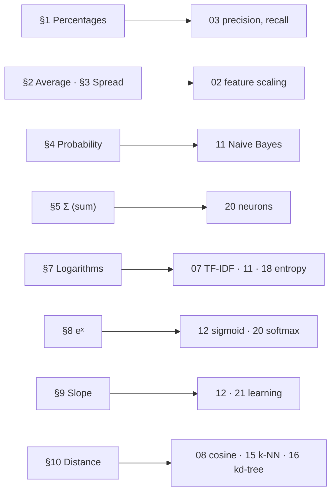

## The story

> **Noor runs the school canteen.** She is curious, so she writes everything down: how many students paid by card, how tall
> they are, what the sweets cost, how far the canteen is from the gate. Every day she has a new question — and every question
> needs one small maths tool. We follow Noor through her week.

## Words you need

| word | simple meaning | example |
|---|---|---|
| **fraction** | a part of a whole, "how many out of how many" | 13 out of 100 = 13/100 |
| **decimal** | the same, written with a point | 0.13 |
| **percentage** | out of 100 | 13 % |
| **average (mean)** | the "normal value" of a group | the typical height |
| **standard deviation (std)** | how spread out the values are | everyone similar → small std |
| **probability** | how likely something is, from 0 (never) to 1 (always) | rain tomorrow: 0.7 |
| **logarithm (log)** | "how many times do I multiply?" | log₁₀(1000) = 3 |
| **slope** | how steep a line or a hill is | +0.1 = 10 % uphill |
| **vector** | a list of numbers, drawn as an arrow | a wine = (12.8, 0.30, 2.0) |

---

## 1. Fractions and percentages — "how many out of how many"

> 📖 **Monday.** 100 students bought lunch. 13 paid by card. Noor wants to tell the principal "how many pay by card" in a
> way that works for any day, big or small. Tomorrow there may be 250 students; "13" alone will mean nothing.

### 🧠 The idea

"13 out of 100" is a **fraction**: 13 / 100. Percent means **"out of every 100"** — imagine 100 squares, colour 13:

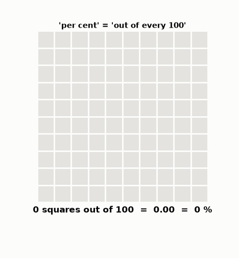

* Divide → a decimal: 13 ÷ 100 = **0.13**
* Multiply by 100 → a percentage: 0.13 × 100 = **13 %**

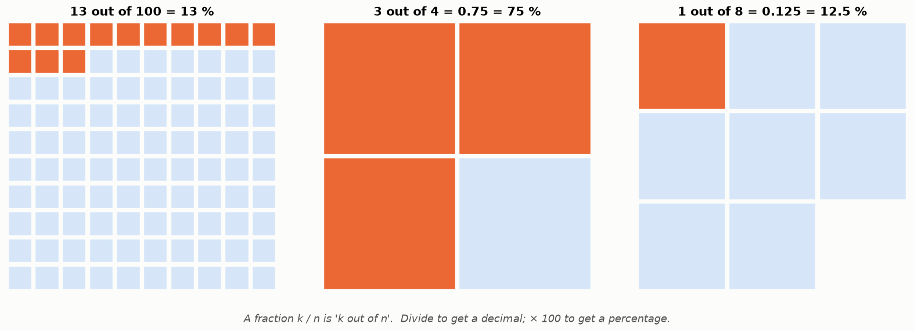

### ✍️ Three things you'll do again and again

```
(a) "how many out of how many" → %:      3 out of 4   →  3 ÷ 4 = 0.75   →  75 %
                                         45 out of 360 → 45 ÷ 360 = 0.125 → 12.5 %
(b) "x % of a number":                   15 % of 200 ₪  →  0.15 × 200 = 30 ₪
(c) "from a % back to a count":          13 % of 5,574 SMS are spam → 0.13 × 5,574 ≈ 725 SMS
```

The trick for (b) and (c): **"of" means ×**, and a % becomes a decimal by dividing by 100.

### 🌍 Real world

* A shop sign: "**−20 %** on a 150 ₪ jacket" → you save 0.20 × 150 = 30 ₪, you pay 120 ₪.
* Your phone battery: **35 %** = 35 out of every 100 parts of a full battery.
* VAT in Israel is 18 %: a 100 ₪ price becomes 100 + 0.18 × 100 = 118 ₪.

**In the projects:** "13 % of the SMS are spam". "Precision 0.97" = "97 % of what we flagged was right". "Split 70 / 15 / 15".

<details><summary>✅ Quick check: 30 out of 120 students are left-handed. What %? And how many in a school of 900?</summary>

30 ÷ 120 = 0.25 = **25 %**. In 900: 0.25 × 900 = **225**.
</details>

## 2. The average — "a normal value"

> 📖 **Tuesday.** Seven students are in the queue. Noor wants one number for "how tall is a typical student here?".

### 🧠 The idea

Add everything, then divide by how many there are.

```
heights: 150, 158, 162, 165, 171, 174, 180
step 1 — add them:       150 + 158 + 162 + 165 + 171 + 174 + 180 = 1160
step 2 — count them:     7
step 3 — divide:         1160 ÷ 7 = 165.7 cm
```

Picture the heights as weights on a ruler: the average is the point where the ruler **balances**. Watch the balance point
move as each student steps on:

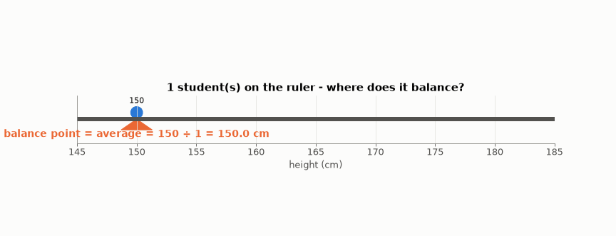

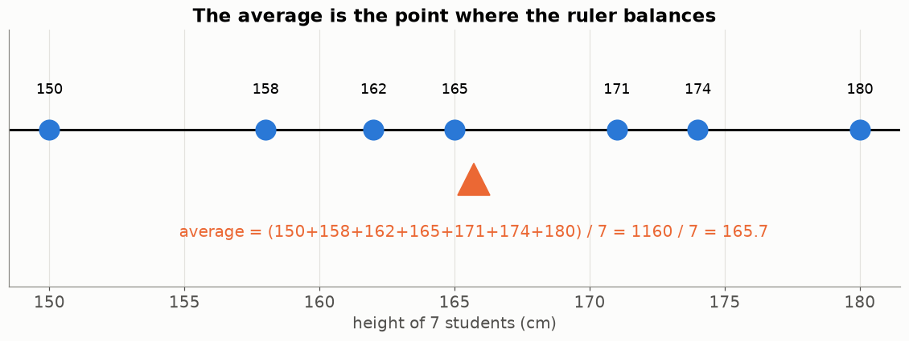

Nobody has to be exactly 165.7 cm. The average is a summary, not a person.

```python
heights = [150, 158, 162, 165, 171, 174, 180]
sum(heights) / len(heights)       # 165.71...
```

### ⚠️ When the average lies: the median

> 📖 Seven café workers earn 6–11 thousand ₪ a month. The café owner, who earns 500 thousand, sits down with them. A newspaper
> reports: *"The average salary at this table is 69,800 ₪!"*

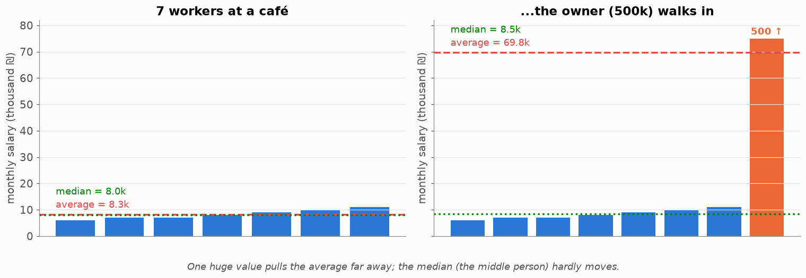

One huge value pulls the average far away. The **median** = sort the values and take the **middle** one. It hardly moves.
(With an even count, average the two middle ones: 8 and 9 → 8.5.)

**Real world:** news about "average salary" or "average house price" is often pulled up by a few very rich people — that's
why statistics offices report the **median**. **In the projects:** a few extreme wines or very long URLs can pull an
average — Lesson 02 shows what to do.

<details><summary>✅ Quick check: grades 60, 70, 80, 90, 100. Average and median? Now the 100 becomes 1000 (a typo). Which one changes?</summary>

Average 400 ÷ 5 = **80**, median **80**. With the typo: average 1300 ÷ 5 = **260** (nonsense!), median still **80**.
</details>

## 3. Spread — "how different are they from normal?"

> 📖 **Wednesday.** Two classes visit. Both have an average height of 170 cm. But in class A everyone is about 170, and in
> class B some are 150 and some are 188. Noor wants a number for **how spread out** they are.

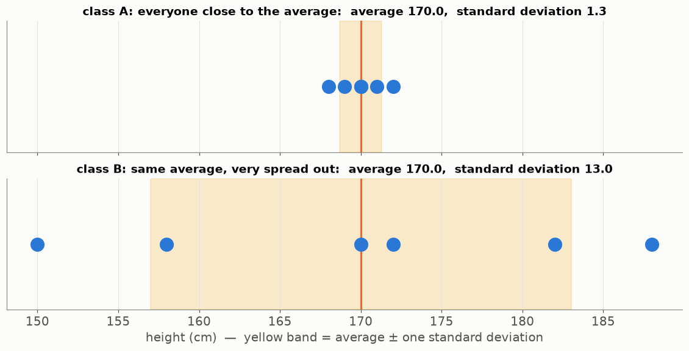

That number is the **standard deviation** ("std"): the typical distance from the average. Small std = everyone close
together. Big std = very different.

### 🌍 Real world: same average, different life

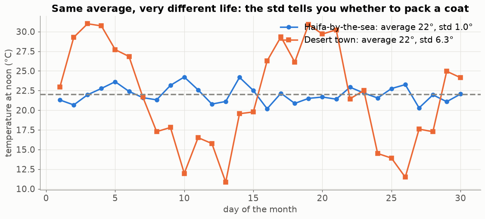

Both towns have an average of 22° at noon. By the sea it is always about 22° — pack a T-shirt. In the desert it swings from
cold to very hot — pack for both. **The average alone doesn't tell you what to pack; the std does.**

### ✍️ By hand for 4 numbers: 2, 4, 4, 6

```
step 1 — the average:               (2 + 4 + 4 + 6) ÷ 4 = 16 ÷ 4 = 4
step 2 — each one's distance:        2−4 = −2     4−4 = 0     4−4 = 0     6−4 = +2
step 3 — square each distance:       4            0           0           4      (squaring removes the minus)
step 4 — average of the squares:     (4 + 0 + 0 + 4) ÷ 4 = 2                     ← called the "variance"
step 5 — square root:                √2 = 1.41      ← the standard deviation
```

The word "square" is meant literally. Draw each distance as a real square, find the average square, and measure its side:

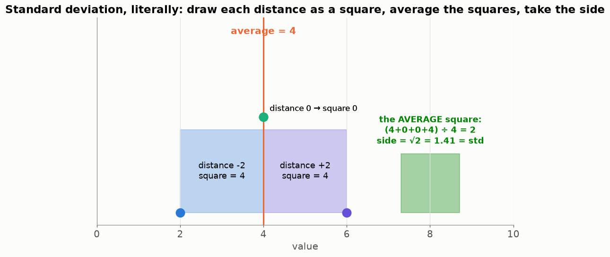

**Why square at all?** Without it, −2 and +2 would cancel and we'd get 0 — "no spread" — which is wrong. The square root at
the end brings us back to normal units (cm, not cm²).

```python
import statistics
statistics.pstdev([2, 4, 4, 6])     # 1.414...
```

**In the projects:** Lesson 02 uses the average and std to make every feature "the same size": z = (value − average) ÷ std.

<details><summary>✅ Quick check: which has the bigger std: (10, 10, 10, 10) or (1, 19, 1, 19)? Compute both.</summary>

(10, 10, 10, 10): every distance is 0 → std **0**. (1, 19, 1, 19): average 10, distances −9, 9, −9, 9, squares all 81,
average 81, √81 = **9**.
</details>

## 4. Probability — "how likely?"

> 📖 **Thursday.** A bag of 10 sweets at the till: 3 orange, 7 blue. A student takes one without looking. *"What are the
> chances it's orange?"*

### 🧠 The idea

Probability = **(ways it can happen) ÷ (all possibilities)**. Always between 0 (never) and 1 (always).

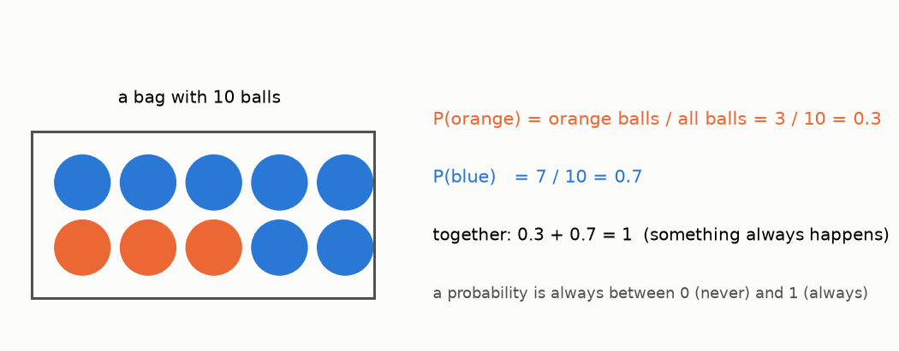

```
P(orange) = 3 ÷ 10 = 0.3        P(blue) = 7 ÷ 10 = 0.7        together 0.3 + 0.7 = 1
P(not orange) = 1 − 0.3 = 0.7   ← "not" = 1 minus
```

### 🖼️ Probability is what happens "in the long run"

0.3 does **not** mean "exactly 3 of every 10 draws". Noor's students draw a sweet, write down the colour, put it back, and
repeat 400 times. At first the share jumps around; in the long run it settles at 0.3:

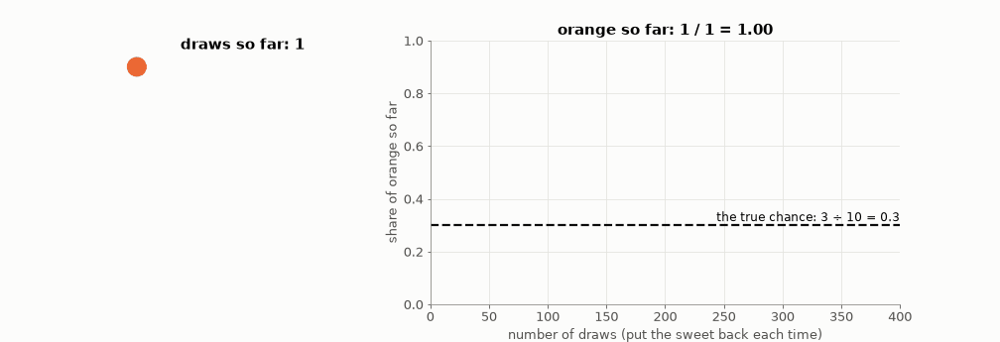

That's why a model needs **many** examples: with 10 SMS you can't know the real share of spam; with 5,574 you can.

### "Given that" — the line |

> 📖 40 people bought lunch: 8 teachers and 32 students. 13 paid by card: 6 teachers and 7 students. Noor asks two different
> questions: "how likely is a person to pay by card?" and "how likely is **a teacher** to pay by card?"

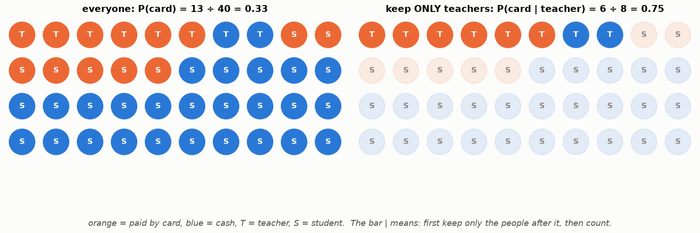

* P(card) = 13 ÷ 40 = **0.33** — count everyone.
* P(card | teacher) = 6 ÷ 8 = **0.75** — the line | means **"given that"**: first keep **only the teachers**, then count.

This one idea is the whole spam filter in Lesson 11: P(spam | the SMS contains "free") = keep only the SMS that contain
"free", and count how many of them are spam.

### 🌍 Real world

* The weather app says **70 % rain**: on days like tomorrow, it rained on 7 of every 10.
* A die: P(6) = 1 ÷ 6 ≈ 0.17. P(even) = 3 ÷ 6 = 0.5.
* P(late | it rains) is much higher than P(late) — "given that" changes the answer.

<details><summary>✅ Quick check: a class has 12 girls and 18 boys; 9 girls and 6 boys wear glasses. P(glasses)? P(glasses | girl)?</summary>

P(glasses) = 15 ÷ 30 = **0.5**. P(glasses | girl) = keep only girls: 9 ÷ 12 = **0.75**.
</details>

## 5. The Σ sign — "add them all up"

> 📖 Noor's receipts for the day: 3, 5, 2, 6 shekels. Her accountant writes Σ on the page. Noor panics. She shouldn't.

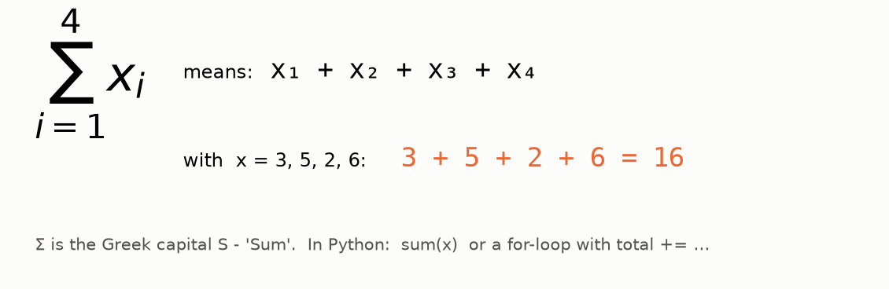

Σ (the Greek capital S, for "Sum") just means **add them all**: 3 + 5 + 2 + 6 = **16**. In Python it's `sum(...)` or a loop:

```python
total = 0
for x in [3, 5, 2, 6]:
    total += x            # this loop IS the Σ sign
```

**Σ wᵢ · xᵢ** means "multiply each pair, then add". 🌍 It's a **shopping receipt**: w = prices, x = how many you bought.

```
item:        sandwich   juice   apple
price w:        12        6       2
count x:         2        3       5
Σ wᵢ·xᵢ  =  12·2 + 6·3 + 2·5 = 24 + 18 + 10 = 52 ₪
```

This "multiply pairs and add" is the most common calculation in all of machine learning — a neuron (Lesson 20) does exactly
this receipt, with "importance" instead of prices.

## 6. Squares and square roots

> 📖 Noor tiles the canteen floor. A square area 5 tiles wide needs how many tiles?

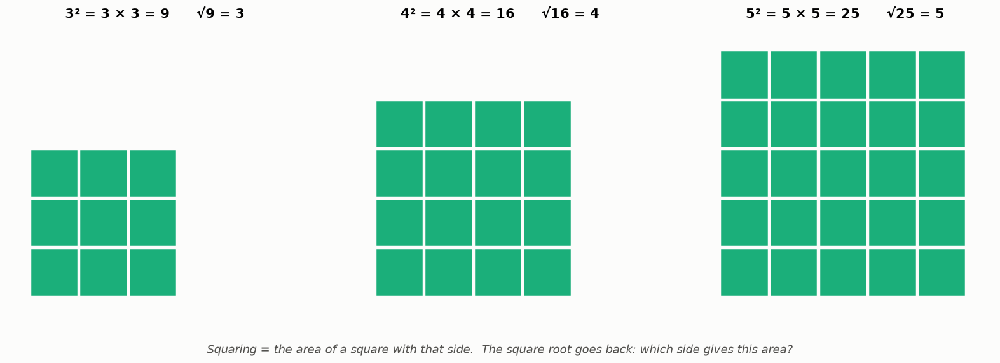

* **5²** ("5 squared") = 5 × 5 = **25** tiles — the area of the square.
* **√25** ("square root") goes back: what side gives 25 tiles? **5**.
* 5³ = 5 × 5 × 5 = 125 (a cube). 10⁶ = a 1 with six zeros = 1,000,000. Anything to the power 0 = 1.

🌍 A "4K" TV has 3,840 × 2,160 ≈ 8.3 million pixels. A 48 × 48 face photo (Ryan's project) has 48² = 2,304 pixels.

## 7. Logarithms — "how many times do I multiply?"

> 📖 **Friday.** Noor reads that a rumour doubles every day: 1 person, 2, 4, 8 … *"After how many days have 1,000 people
> heard it?"* She needs the opposite of "multiply again and again". That's a logarithm.

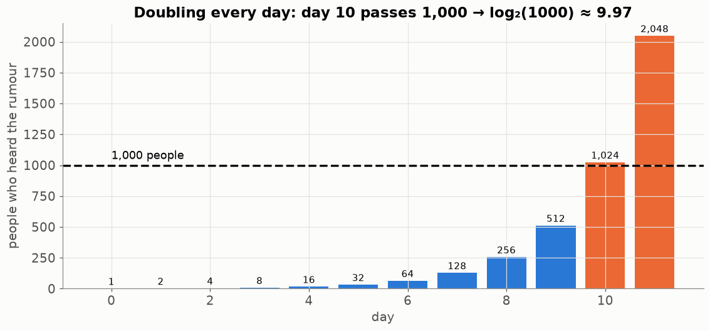

### 🧠 The idea

**log₁₀(1000)** asks "how many times do I multiply **10** to get 1000?" → 10 × 10 × 10 → **3**.
**log₂(1000)** asks "how many times do I multiply **2**?" → about 10 (2¹⁰ = 1024). So: about 10 days for the rumour.

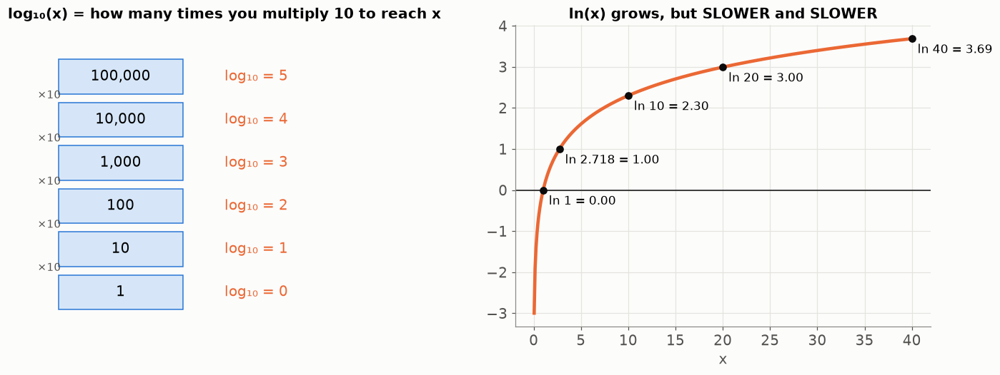

```
log₁₀(10) = 1      log₁₀(100) = 2      log₁₀(1000) = 3      log₁₀(1) = 0      log₁₀(0.01) = −2
```

The projects use **ln** — the same idea with the number e ≈ 2.718 (§8). You never compute it by hand: press **ln** on the
calculator, or `math.log(x)` in Python.

### 🖼️ A log ruler: for things that grow by "times", not by "plus"

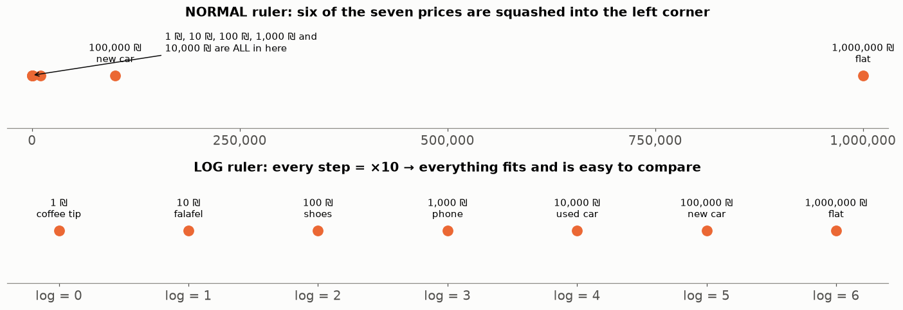

On a normal ruler, a coffee tip and a used car sit on top of each other. On a log ruler every step is "×10" and everything
fits. **🌍 Real world:** the Richter scale for earthquakes is a log ruler (a 7 is 10 times stronger than a 6), and so are
decibels for sound and pH for acids.

### Two things to remember

1. **log grows slowly.** ln(10) = 2.3, ln(100) = 4.6, ln(1000) = 6.9. Ten times bigger only **adds** 2.3. (Used in TF-IDF,
   Lesson 07: a word in 1,000 documents is not 1,000 times less special than a word in 1.)
2. **log turns × into +:** log(a × b) = log(a) + log(b).

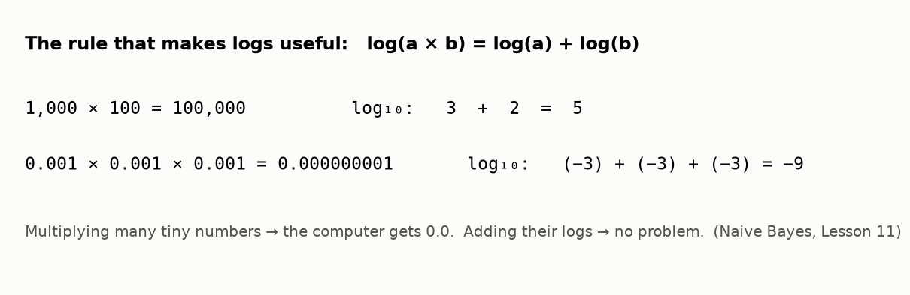

A computer can't store a number with 900 zeros after the decimal point — it becomes 0. But its log is an ordinary number
(about −2072). So instead of multiplying many tiny numbers, we **add their logs** (the spam filter, Lesson 11).

<details><summary>✅ Quick check: log₁₀(1,000,000)? log₂(32)? Is ln(5000) bigger or smaller than 10?</summary>

**6** (six tens). **5** (2·2·2·2·2 = 32). ln(5000) ≈ **8.5** — smaller than 10, because log grows slowly.
</details>

## 8. e and eˣ — the opposite of ln

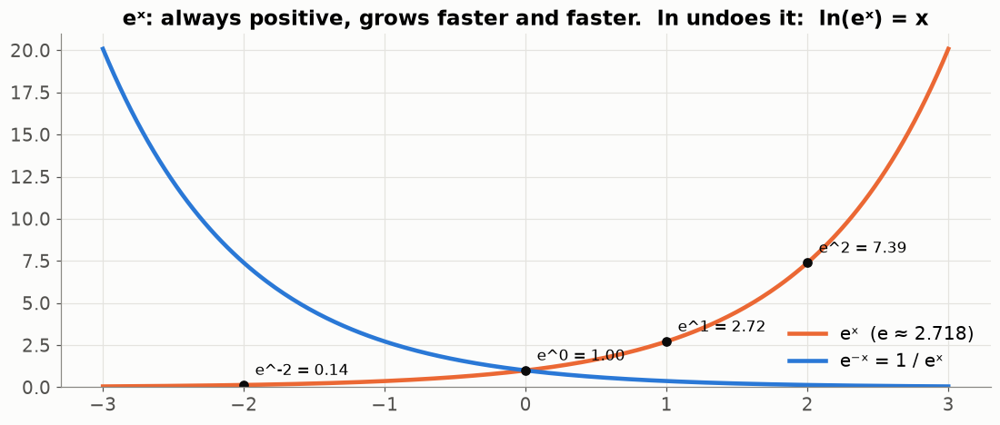

e ≈ 2.718 is a special number, like π. **eˣ** means e multiplied by itself x times:

* eˣ is **always positive** (even e⁻¹⁰⁰ is a tiny positive number).
* It grows **faster and faster** — like a viral video, or bacteria that double.
* **ln undoes it:** ln(eˣ) = x, and e^(ln x) = x. Like "+5" and "−5".

You'll see eˣ inside the **sigmoid** (Lesson 12) and **softmax** (Lesson 20) — always just "press the eˣ button"
(`math.exp(x)`). The reason it's used there is the first bullet: it turns any number, even a negative one, into a positive
one.

```python
import math
math.exp(0)     # 1.0
math.exp(2)     # 7.389
math.exp(-2)    # 0.135  (positive, small)
math.log(math.exp(2))   # 2.0  (ln undoes exp)
```

## 9. Slope — "which way is downhill?"

> 📖 Noor walks down a dark hill to the school at night, without a torch. She feels the slope under her feet and always
> steps downhill. Eventually she reaches the bottom.

### 🧠 The idea

The **slope** says how much you go **up** for every **1 step to the right**:

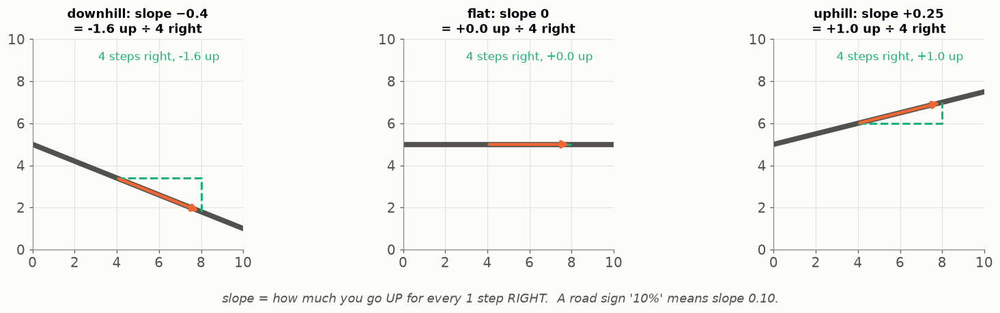

* negative = it goes **down** to the right
* positive = it goes **up**
* **0 = flat — you're at the bottom** (or the top)

🌍 A road sign "**10 %**" means: for every 100 m forward, you climb 10 m — a slope of 0.10.

On a curved hill the slope is different at every point. Watch the orange line touch the curve: its slope tells you which way
is down:

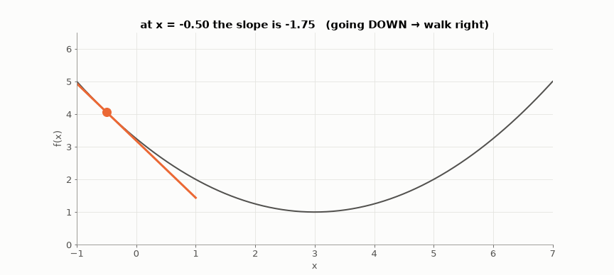

Machine learning finds its best settings exactly like Noor in the dark: feel the slope, step downhill, repeat (Lessons 12,
21). The fancy name for slope is **derivative** or **gradient** — same idea.

<details><summary>✅ Quick check: you are at a point where the slope is +3. Which way should you step to go down? And if it is −0.01?</summary>

Slope +3 → going right goes up, so step **left**. Slope −0.01 → step **right**, but it's almost flat: you're very close to
the bottom.
</details>

## 10. Points and distance

> 📖 The canteen is at (1, 1) on the school map, the gate at (4, 5). How far is it in a straight line?

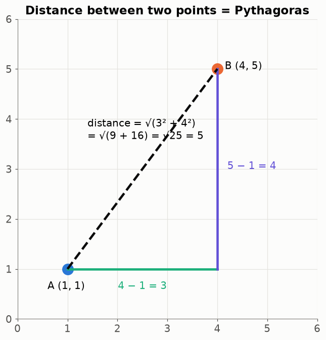

Walk 3 across and 4 up. The straight line is **Pythagoras**: √(3² + 4²) = √(9 + 16) = √25 = **5**.

### More than two numbers

A list of numbers is called a **vector**, and we can draw it as an arrow (or a point). Two wines with similar numbers are
**close** to each other:

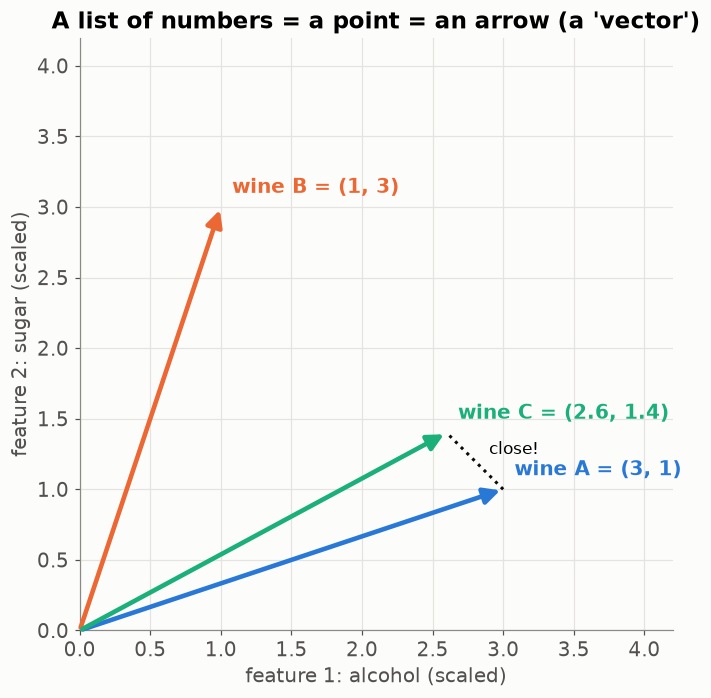

With more than two numbers (a wine has 11 measurements) the recipe is the same — square every difference, add them all,
square root:

```
wine A = (12.8, 0.30, 2.0)        wine B = (12.0, 0.50, 2.6)
differences:    0.8     −0.2     −0.6
squares:        0.64    0.04     0.36
add:            0.64 + 0.04 + 0.36 = 1.04
square root:    √1.04 = 1.02      ← the distance between the two wines
```

```python
import math
math.dist((1, 1), (4, 5))                         # 5.0
math.dist((12.8, 0.30, 2.0), (12.0, 0.50, 2.6))   # 1.02
```

🌍 Your phone does this all day: "the nearest petrol station", "people near you", "songs similar to this one" (a song as a
list of numbers: tempo, loudness, …). Seif's WineGrader finds the wines **nearest** to a new wine (Lesson 15).

## 11. Big and small numbers on a computer

> 📖 Noor's computer prints `3.2e-05`. She thinks it's an error. It isn't.

| the computer writes | it means | read it as |
|---|---|---|
| `1e6` | 1 × 10⁶ = 1,000,000 | one million |
| `2.5e3` | 2.5 × 1,000 = 2,500 | |
| `3.2e-05` | 3.2 ÷ 100,000 = 0.000032 | "move the point 5 places left" |
| `inf`, `nan` | infinity, "not a number" | usually a bug: dividing by 0, or log(0) |

When you see `nan` in a project, look for a division by zero or a log of 0 (Lessons 02, 11).

## 12. Data is a table

> 📖 At the end of the week Noor puts everything in one table: one row per student, one column per thing she measured.

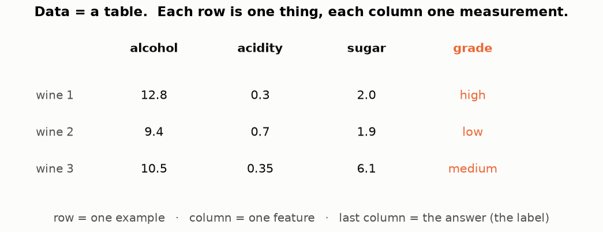

Every project starts like this: **one row per example** (a wine, an SMS, a URL), **one column per feature** (a measured
number), and one column with **the right answer** (the label). Keep this picture in mind for every lesson — Lesson 01
starts right here.

---

## 📝 Summary — the toolkit on one card

| tool | the question it answers | in Python |
|---|---|---|
| percentage | how many out of 100? | `part / whole * 100` |
| average | what is normal? | `sum(xs) / len(xs)` |
| median | what is the middle one? | `statistics.median(xs)` |
| std | how spread out? | `statistics.pstdev(xs)` |
| probability | how likely? | `count / total` |
| P(A \| B) | how likely, counting only B? | `count(A and B) / count(B)` |
| Σ | add them all | `sum(...)` |
| log | how many times do I multiply? | `math.log(x)`, `math.log10(x)` |
| eˣ | the opposite of ln; always positive | `math.exp(x)` |
| slope | which way is downhill? | (Lesson 12) |
| distance | how far apart? | `math.dist(a, b)` |

## Try it yourself (answers hidden — try first!)

<details><summary>1. 🟢 45 of 360 SMS are spam. Decimal and percentage?</summary>

45 ÷ 360 = 0.125 = **12.5 %**.
</details>

<details><summary>2. 🟢 A 250 ₪ pair of shoes is 30 % off. What do you pay?</summary>

Discount 0.30 × 250 = 75 ₪. You pay 250 − 75 = **175 ₪** (or directly 0.70 × 250).
</details>

<details><summary>3. 🟢 Average and standard deviation of 1, 3, 5.</summary>

Average 9 ÷ 3 = 3 · distances −2, 0, 2 · squares 4, 0, 4 · average 8 ÷ 3 = 2.67 · √2.67 = **1.63**.
</details>

<details><summary>4. 🟢 20 sweets, 5 red. P(red)? P(not red)?</summary>

5 ÷ 20 = **0.25** · 1 − 0.25 = **0.75**.
</details>

<details><summary>5. 🟡 Of 1,000 SMS, 200 contain "win". Of those 200, 150 are spam. What is P(spam | contains "win")?</summary>

Keep only the 200 that contain "win": 150 ÷ 200 = **0.75**.
</details>

<details><summary>6. 🟡 log₁₀(10,000)? And log₁₀(0.001)?</summary>

**4** (10 × 10 × 10 × 10). **−3** (divide by 10 three times).
</details>

<details><summary>7. 🟡 Σ wᵢ·xᵢ for w = (0.5, −1, 2) and x = (4, 3, 1).</summary>

0.5·4 + (−1)·3 + 2·1 = 2 − 3 + 2 = **1**.
</details>

<details><summary>8. 🟡 Distance from (2, 3) to (5, 7)? And from (0, 0, 0) to (1, 2, 2)?</summary>

3 across, 4 up → √(9 + 16) = **5**. √(1 + 4 + 4) = √9 = **3**.
</details>

<details><summary>9. 🔴 House prices in a street (thousand ₪): 1200, 1300, 1250, 1400, 9000. Average or median for "a typical house"? Why?</summary>

Average = 14,150 ÷ 5 = 2,830 — higher than 4 of the 5 houses. Median = **1,300**. The median, because one villa pulls the
average.
</details>

<details><summary>10. 🔴 Multiply 0.01 by itself 400 times. What does Python give, and how do logs save us?</summary>

Python gives **0.0** (the true answer, 10⁻⁸⁰⁰, is too small to store). With logs: 400 × log₁₀(0.01) = 400 × (−2) = **−800**,
an ordinary number.
</details>

## Class activities

1. **Human average (5 min).** 7 students stand in height order along a rope; find the balance point. Then the tallest
   student stands on a chair (an "outlier") — how does the average move? The median?
2. **Sweet bag (10 min).** Guess P(red), then each student draws 20 times and counts. Put all results together — the class
   total is much closer to the truth than any one student (§4).
3. **Paper folding (5 min).** Fold a paper again and again: 1, 2, 4, 8 … layers. "How many folds for 1,000 layers?" (≈ 10 —
   that's log₂.)
4. **Marble downhill (5 min).** A marble on a slightly tilted tray always rolls down — that's gradient descent.
5. **Receipt (5 min).** Each student writes a canteen receipt, then writes it again as Σ wᵢ·xᵢ.

## 🎬 Watch & explore

| | |
|---|---|
| <a href="https://www.youtube.com/watch?v=SzZ6GpcfoQY"></a> | **StatQuest — Calculating the mean, variance and standard deviation, clearly explained**. §2 and §3 with drawings. |
| <a href="https://www.youtube.com/watch?v=Z5myJ8dg_rM"></a> | **Khan Academy — Logarithms**. §7, slowly, with many examples. |
| <a href="https://www.youtube.com/watch?v=WUvTyaaNkzM"></a> | **3Blue1Brown — The essence of calculus**. What a slope (derivative) really is — §9. Beautiful animations. |

**Play with it:**
* Seeing Theory — [Basic probability](https://seeing-theory.brown.edu/basic-probability/index.html) — flip coins and roll
  dice; watch the share settle (§4).
* Seeing Theory — [Compound probability / conditional](https://seeing-theory.brown.edu/compound-probability/index.html) —
  "given that", drawn.
* At home: `python visualize.py --only sweets` redraws the sweet experiment; change `0.3` in `visualize.py` and run again.
