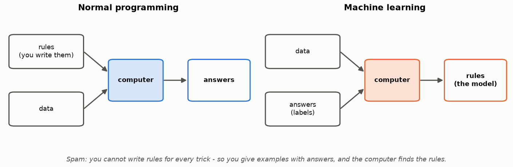
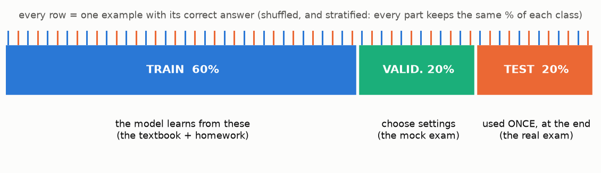
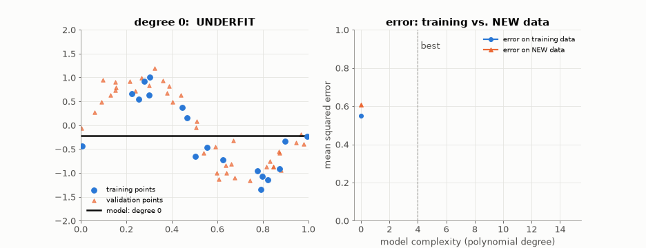
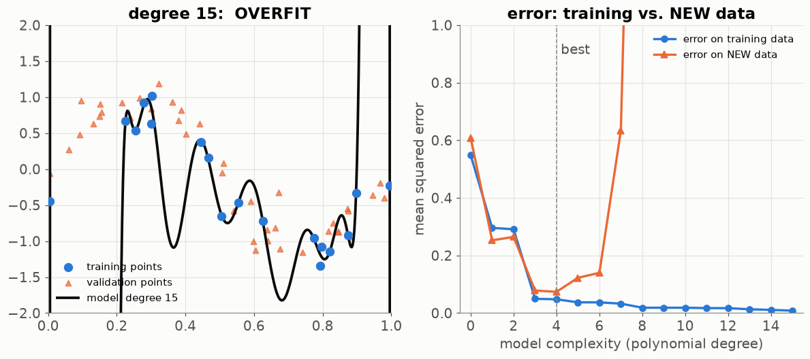
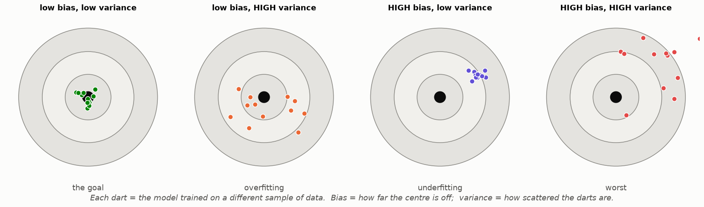

# Lesson 01 — What "learning" means: data, splits and overfitting

> **For:** Laith (Spam) · Ryan (FaceEmotion) · Dani (PhishGuard) · Seif (WineGrader) &nbsp;·&nbsp; **Time:** 1 × 45 min
> **Before:** nothing &nbsp;·&nbsp; **After this:** every other ML lesson (02 – 05, 11 – 24)

## 🎯 By the end, the student can

1. Say in one sentence how machine learning differs from normal programming.
2. Explain what *train*, *validation* and *test* data are for, and why the test set is used only once.
3. Recognise **overfitting** and **underfitting** on a picture, and say how to detect them with numbers.

---

## 1. The picture to start with



**Say it:** in normal programming *you* write the rules. In machine learning you give the computer **examples
with the correct answers**, and it finds the rules. The rules it finds are called **the model**.

**Ask the class:** *"Write me a rule that catches every spam SMS."* Collect 3 answers ("contains FREE",
"contains a link" …) and break each one with a counter-example ("FREE parking at the meeting tomorrow").
That is why the projects learn instead.

## 2. Words you must know

| Word | Meaning | In the projects |
|---|---|---|
| **example** (sample, row) | one thing we know the answer for | one SMS · one URL · one wine · one face picture |
| **feature** | one number that describes the example | `num_dots` of a URL · `alcohol` of a wine · one pixel |
| **label** | the correct answer | spam/ham · good/bad · low/medium/high · one of 7 emotions |
| **model** | the rules the computer learned | Naive Bayes · logistic regression · k-NN · EmotionNet |
| **training** | finding the model from labelled examples | `fit(X, y)` |
| **prediction** | using the model on a new example | `predict(x)` |
| **hyper-parameter** | a setting **you** choose, not learned | `alpha`, `C`, `k`, learning rate |
| **generalisation** | doing well on examples it never saw | the **only** thing that counts |

## 3. The three piles of data



| Pile | What it is for | School analogy |
|---|---|---|
| **train** | the model learns from it | the textbook and the homework |
| **validation** | you compare models and choose settings (`k`, `C`, threshold) | the mock exam |
| **test** | measured **once**, at the end, and reported | the real exam |

> 🔑 If you look at the test set while choosing anything, it is no longer an exam — it is homework you
> already saw. The number you report is then a lie (a too-good one). This is called **leakage** (Lesson 05).

**Stratified** split: every pile keeps the same percentage of each class. In the SMS data only 13 % is spam;
a random split could put almost no spam in the test pile by bad luck.

## 4. Overfitting — watch it happen



*(Projector version: `videos/overfitting.mp4`. Live version with a slider: `python visualize.py --live`.)*

The blue dots are the training data: a wave plus noise. We fit a polynomial of growing degree.

| Degree | What you see | Name |
|---|---|---|
| 0 – 2 | a flat or bent line that misses the wave | **underfitting** — too simple |
| 3 – 6 | follows the wave, ignores the noise | **good fit** |
| 7 – 15 | wiggles through every blue dot, wild between them | **overfitting** — memorised the noise |



**The right panel is the whole lesson:** the error on the **training** data (blue) only goes down — a more
complex model can always memorise more. The error on **new** data (orange) goes down, then **up**. We choose
the model at the bottom of the orange curve, and we can only see that curve with data the model did not train on.

**Analogy:** a student who memorises the answers of last year's exam gets 100 on it, and fails this year's.

## 5. Bias and variance — the dartboard



Imagine training the same model on 12 different samples of data — every dart is one trained model.

* **Bias** = the model is systematically wrong (centre of the darts is off) → too simple → *underfitting*.
* **Variance** = the model changes a lot with the data (darts scattered) → too complex → *overfitting*.

| You see in your results | Diagnosis | What to try |
|---|---|---|
| train score low, validation score low | high bias | more features, bigger model, less regularisation |
| train score high, validation score much lower | high variance | more data, simpler model, more regularisation, augmentation |
| both high and close | 🎉 | stop tuning, write the book |

## 6. Common misconceptions

| Student says | The truth | How to show it |
|---|---|---|
| "99 % on training data — my model is great" | training score says nothing about new data | the blue curve in the animation reaches ~0 at degree 15 |
| "I'll just test on the test set a few times while I tune" | every look leaks; the final number becomes optimistic | Lesson 05, the leakage demo |
| "More complex model = better" | only until the orange curve turns up | the animation |
| "Accuracy is enough" | with 87 % ham, "always ham" scores 87 % | Lesson 03 |

## 7. Activities

1. **Predict, then watch (5 min).** Before showing the GIF ask: *"what will degree 15 look like?"* Each student
   draws their guess on paper. Then play it.
2. **Human overfitting (10 min).** Give 6 cards with made-up "wine" data (alcohol, colour → good/bad), one of them
   mislabelled. Students write the rule. Someone always writes a rule that fits the wrong card too — show them it
   fails on 4 new cards.
3. **Find the pile (5 min).** Read sentences aloud; the class shouts *train / validation / test*:
   "choose `k` for k-NN" (validation) · "the number in the book's results chapter" (test) ·
   "count words per class for Naive Bayes" (train) · "choose the spam threshold" (validation).

## 8. Check yourself

<details><summary>1. Why can't we choose the threshold of the spam filter on the test set?</summary>

Because then the test set took part in building the system. The precision we then report from the same data
is no longer a measurement on unseen data — it is optimistic, and we cannot know by how much.
</details>

<details><summary>2. Train accuracy 0.99, validation 0.71. What is happening, and two things you try?</summary>

Overfitting (high variance). Try a simpler model / more regularisation (smaller `C`, bigger `alpha`, more
dropout), more data, or data augmentation (FaceEmotion).
</details>

<details><summary>3. A wine dataset has 19 % "high" wines. Why do we split stratified?</summary>

So that every pile has ≈19 % high wines. Otherwise by luck the validation pile might have very few, and every
number measured on it (recall of "high") would be noise.
</details>

## 9. In your project

| Project | Where this lives |
|---|---|
| Spam | `spamclassifier/ml/dataset.py` → `stratified_split` (**70 / 15 / 15**), `assert_no_leakage` · theory `08_SpamClassifier/01_theory/02_ml_basics.md` |
| FaceEmotion | FER-2013 comes with train/test; `app/ml/dataset.py` → `build_dataloaders` cuts validation from train · `13_FaceEmotion/01_theory/02_ml_basics.md` |
| PhishGuard | `phishguard/ml/dataset.py` → `DatasetLoader` · `25_PhishGuard/01_theory/02_ml_basics.md` §2.3 |
| WineGrader | `winegrader/ml/folds.py` → `stratified_kfold`, then nested CV (Lesson 05) · `32_WineGrader/01_theory/02_ml_basics.md` |

## 10. Play with it

```bash
cd lessons/01_what_is_learning
python visualize.py --live        # drag the degree slider
```

Challenges: change the noise `0.25` to `0.05` in `visualize.py` — does the best degree change? Change the 18
training points to 200 — does degree 15 still overfit? (*More data tames complexity.*)

## 🎬 Watch & explore

* StatQuest — *Machine Learning Fundamentals: Bias and Variance* — [search on YouTube](https://www.youtube.com/results?search_query=StatQuest+Machine+Learning+Fundamentals+Bias+and+Variance)
* MLU-Explain — [Train, Test, and Validation Sets](https://mlu-explain.github.io/train-test-validation/) (interactive)
* MLU-Explain — [The Bias-Variance Tradeoff](https://mlu-explain.github.io/bias-variance/) (interactive)
* R2D3 — [A visual introduction to machine learning](https://r2d3.us/visual-intro-to-machine-learning-part-1/) (scroll-story)
