# Lesson 01 — What is "machine learning"?

> **For:** Laith (Spam) · Ryan (FaceEmotion) · Dani (PhishGuard) · Seif (WineGrader) &nbsp;·&nbsp; **Time:** 3 × 45 min
> **Before:** Lesson 00 §1 (percentages), §2 (average) &nbsp;·&nbsp; **You need:** nothing else, no maths beyond percentages

**In one sentence:** instead of writing the rules yourself, you show the computer many examples **with the right answers**,
and it finds the rules by itself.

## 🗺️ The map of this lesson

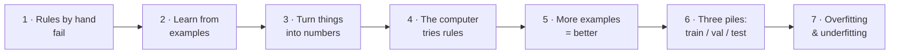

Each part has: 📖 a moment from the story · 🧠 the idea in plain words · 🖼️ a picture or animation · ✍️ something to do by
hand · ✅ a quick check (click to see the answer).

## The story

> **Maya has a small phone shop.** Her number is on Google, so every morning she has 200 SMS: customers ("is my phone
> ready?") and **spam** ("WINNER!! Claim your FREE prize now"). She wastes half an hour every morning deleting spam, and
> twice last month she deleted a real customer's message by mistake. Her nephew **Omar**, a programmer, promises:
> *"Give me a week. I'll write a program that recognises spam."* We follow Omar through that week.

## Words you need

Read this table now, and come back to it whenever a word is unclear. Every word is also in the [glossary](../GLOSSARY.md).

| word | simple meaning | in Maya's shop |
|---|---|---|
| **example** (or *sample*, *row*) | one thing we know the answer for | one SMS |
| **feature** | one number that describes the example | how many digits the SMS has |
| **label** | the right answer for an example | "spam" or "ham" (ham = a normal message) |
| **dataset** | all the examples together, in a table | Maya's 5,574 old SMS |
| **model** | the rules the computer found | "5 or more digits → spam" |
| **training** | the computer studying the examples to find the rules | |
| **prediction** | the model's answer for a new example | "this new SMS is spam" |
| **accuracy** | the % of examples the model gets right | "97 % right" |
| **overfitting** | remembering the examples instead of learning the rule | the student who memorises answers |

---

## Part 1 — Writing rules by hand fails

> 📖 **Monday.** Omar starts the "normal" way. He writes rules in Python:
>
> ```python
> if "FREE" in sms or "WINNER" in sms:
>     return "spam"
> ```
>
> On Monday it works. By Friday Maya is angry.

What went wrong during the week:

* **Tuesday:** a customer writes *"Is the repair **free** under warranty?"* → hidden as spam. Maya almost lost a customer. ❌
* **Wednesday:** a spammer writes *"Y0u w0n a pr1ze"* (zeros instead of o's) → it passes. ❌
* **Thursday:** Omar adds 40 new rules. Two of them fight each other: one says "prize → spam", another says "from a known
  number → ham". Which one wins?
* **Friday:** the spammers change their words again. Omar now has 300 rules and nobody understands them.

### 🧠 The idea

Some problems have **no rules a person can write down**, even though a person can easily say the answer:

| problem | can you write the rules? | can you say the answer for one example? |
|---|---|---|
| is this SMS spam? | no — spammers change tricks every week | yes, in one second |
| is this face happy or angry? | no — try describing "happy" in pixels! | yes, instantly |
| is this link a phishing link? | no — criminals invent new ones daily | an expert can |
| is this wine good? | no — taste depends on 11 chemicals together | a wine taster can |
| what is 15 % VAT on 200 ₪? | **yes** — `200 * 0.15` | yes |

The last row is important: when you **can** write the rule (VAT, a hotel price, a game score), write it! Machine learning is
for the rows where you can't.

### 🌍 Real world

Before 2000, e-mail companies tried exactly what Omar tried: lists of "bad words". Spammers beat them within days. Today
every spam filter (Gmail, Outlook) **learns** from millions of messages that people marked with the "Report spam" button.
Every time *you* press that button, you are giving a **label** to a learning program.

<details><summary>✅ Quick check: which of these need machine learning? (a) the area of a circle (b) recognising a cat in a photo (c) a hotel's price for 3 nights (d) guessing tomorrow's number of hotel guests</summary>

(b) and (d). For (a) and (c) we know the exact rule (π·r², price × nights). For (b) nobody can write the rule. For (d) there
is no fixed rule — but old data (past years' bookings) can teach a model.
</details>

## Part 2 — Let the computer find the rules

> 📖 **Saturday.** Omar gives up on rules. He asks Maya to spend one afternoon marking her old SMS: "spam" or "not spam". She
> marks 5,574 messages. *"Now,"* says Omar, *"the computer will study your answers and find the rules itself."*

### 🧠 The idea: how a child learns

You did not learn "apple" from a definition. Nobody told you *"an apple is a fruit of 130–200 grams with a red to green
skin"*. Your parents showed you apples and lemons and said the name — **examples with labels** — and your brain found the rule.
A computer can do the same. Watch it "see" fruits one by one. Each fruit is a dot: how heavy (left–right) and how yellow
(up–down). After each fruit the computer moves its border (the dashed line):

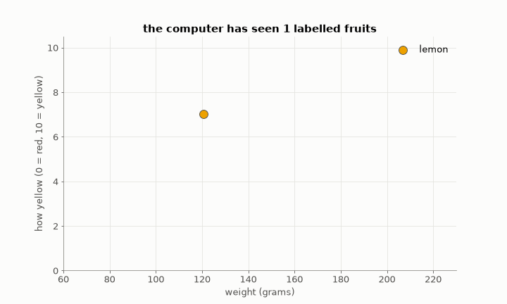

At the end it has never been told what a lemon is — but when a new fruit arrives (the ★), it can answer:

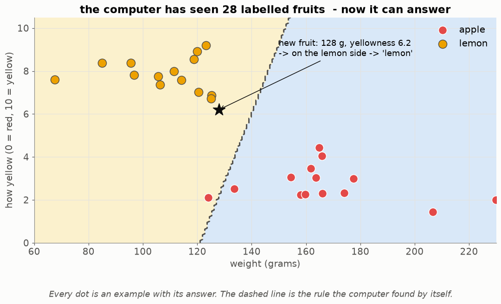

Notice three things:

1. With **2 or 3 fruits** the border is bad. With **28** it is good. More examples → a better rule (Part 5).
2. The computer never "understands" lemons. It only finds a **border between groups of dots**. That is all most machine
   learning is: finding a good border.
3. The new fruit is answered by **which side of the border** it falls on. That is a **prediction**.

### The two ways of programming, side by side


| | normal programming | machine learning |
|---|---|---|
| **you give** | the rules + the data | the data + the right answers |
| **you get** | answers | the rules (the **model**) |
| **good for** | VAT, prices, games, bookings | spam, faces, phishing, wine |
| **when the world changes** | you rewrite the rules | you give new examples and train again |

### 🌍 Real world: you use this every day

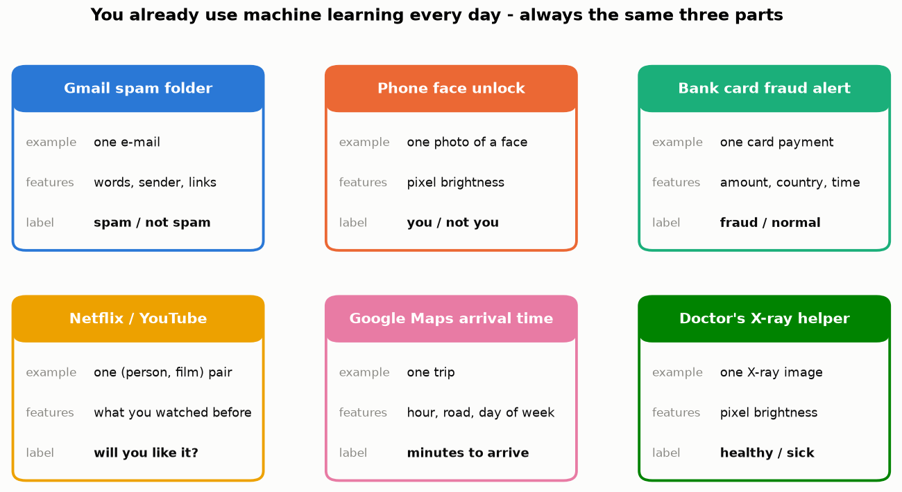

Look at the six cards: every one has the **same three parts** — an *example*, its *features* (numbers), and a *label*.
Once you see these three parts, you understand the shape of every machine-learning project, including yours:

| project | one example | features | label |
|---|---|---|---|
| Laith — SpamClassifier | one SMS | which words it contains | spam / ham |
| Ryan — FaceEmotion | one 48×48 photo of a face | 2,304 pixel brightnesses | 7 emotions |
| Dani — PhishGuard | one URL | 20 numbers (length, dots, "@", …) | phishing / legitimate |
| Seif — WineGrader | one wine | 11 chemical measurements | quality 3 … 9 |

<details><summary>✅ Quick check: for a "will this student pass the exam?" model, what are the example, two features, and the label?</summary>

Example: one student. Features: e.g. hours studied, grade in the last test, number of missed lessons. Label: pass / fail
(known for last year's students).
</details>

## Part 3 — Everything becomes a table of numbers

> 📖 **Sunday.** Omar tries to give the SMS to the computer and hits a problem: *the computer can't read.* It can only
> compare and add numbers. So he must turn each SMS into numbers.

### 🧠 The idea

A **feature** is a question about the example whose answer is a number. Omar asks three questions about each SMS:
"does it contain the word *free*?" (1 = yes, 0 = no), "how many *!* does it have?", "does it contain a link?".

| SMS | has "free"? | number of "!" | has a link? | **label** |
|---|---|---|---|---|
| "WINNER!! claim your prize www.x.com" | 0 | 2 | 1 | **spam** |
| "Is my phone ready tomorrow?" | 0 | 0 | 0 | **ham** |
| "FREE entry to win!!! txt now" | 1 | 3 | 0 | **spam** |
| "Is the repair free under warranty?" | 1 | 0 | 0 | **ham** |

Each **row** is an example. Each **column** is a feature. The last column is the label. This table is called the **dataset**.

✍️ **Do it yourself.** Add a row for *"Call 0905 now to claim £1000!"*. <details><summary>answer</summary>has "free" = 0,
"!" = 1, link = 0, label = spam. (Notice: our three features can't see the phone number — a feature like "number of digits"
would.)</details>

### 🖼️ What the table looks like on real data

Omar picks two simple features — **the length of the SMS** and **how many digits it contains** — and draws every one of
Maya's 5,574 SMS as a dot:

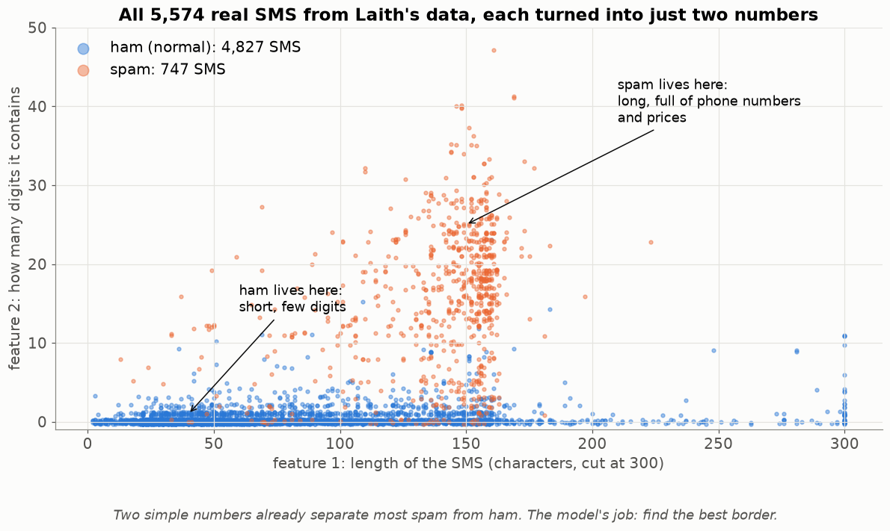

Without any "intelligence" you can already see it: spam (orange) is long and full of digits — phone numbers like
*09050000301* and prices like *£1000*. Ham (blue) is short with almost no digits. **Good features make the groups separate.**
Choosing good features is a big part of every project:

* Laith turns words into counts (Lesson 06, 07).
* Ryan's photos are already numbers — every pixel is a brightness 0–255 (Lesson 19).
* Dani invents 20 numbers that describe a URL (Lesson 18).
* Seif's wines come as numbers from the laboratory, but on very different scales (Lesson 02).

## Part 4 — How does the computer "find the rule"?

> 📖 **Monday again.** Maya asks the obvious question: *"But how does the computer find the rule? It isn't clever."*
> Omar shows her the simplest possible way.

### 🧠 The idea: try many rules, keep the best

Take only **one** feature: the number of digits. A rule of the shape *"if digits ≥ **t** → spam"* has one unknown number,
the cut-off **t**. The computer does what you would do with a lot of patience:

1. Try t = 1. Count how many of the 5,574 SMS this rule gets right.
2. Try t = 2. Count again.
3. … try every t up to 20.
4. **Keep the t with the most right answers.** That t *is* the model.

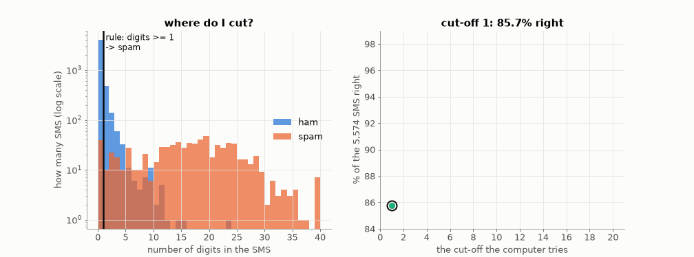

✍️ **The real numbers** (computed on all 5,574 SMS):

| cut-off t | rule | % right | spam caught | ham wrongly called spam |
|---|---|---|---|---|
| 1 | ≥ 1 digit → spam | 85.7 % | 708 | 756 😱 |
| 3 | ≥ 3 digits → spam | 96.2 % | 676 | 142 |
| **5** | **≥ 5 digits → spam** | **97.3 %** ⭐ | **648** | **50** |
| 10 | ≥ 10 digits → spam | 96.7 % | 573 | 11 |
| 15 | ≥ 15 digits → spam | 94.3 % | 434 | 2 |

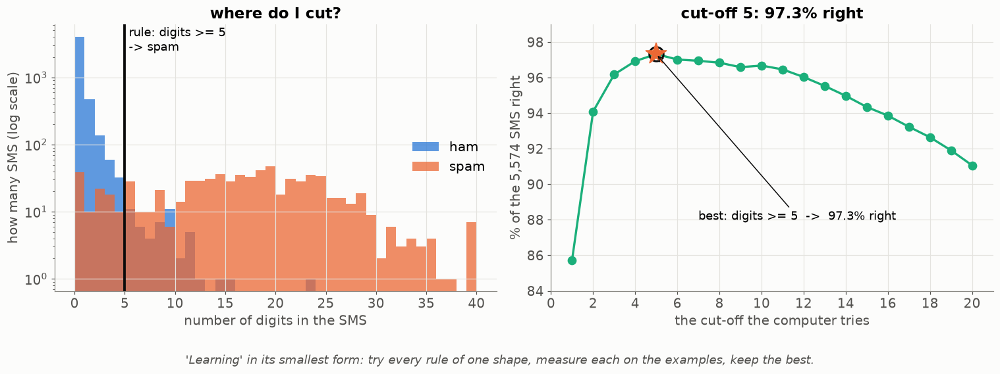

Read the table like a story: a low cut-off catches almost all spam but also hides 756 real customers. A high cut-off almost
never hides a customer but lets a lot of spam through. t = 5 is the best balance **for accuracy**. (In Lesson 03 you'll see
that "best" depends on what mistakes cost — Maya may prefer t = 10, because a lost customer costs more than one spam.)

**This is learning.** Real models have more numbers to choose than one cut-off (Laith's Naive Bayes has thousands, Ryan's
network has millions), and they use cleverer ways than trying every value (Lesson 12, 21) — but the idea never changes:
**a rule with unknown numbers + examples + a way to measure "how good" → choose the numbers that are best on the examples.**

<details><summary>✅ Quick check: 5 SMS have 0, 2, 7, 12, 1 digits and labels ham, ham, spam, spam, spam. How many does "digits ≥ 5 → spam" get right?</summary>

0 → ham ✔, 2 → ham ✔, 7 → spam ✔, 12 → spam ✔, 1 → ham ✘ (it was spam). **4 out of 5 = 80 %.**
</details>

## Part 5 — More examples make a better model

> 📖 Maya is tired. *"Do I really have to mark all 5,574? Isn't 50 enough?"*

Omar tests it on the real data. He trains the same simple spam model (it uses the words, Lesson 11) on 10 SMS, then 20, then
50 … and each time grades it on **1,672 SMS it has never seen**:

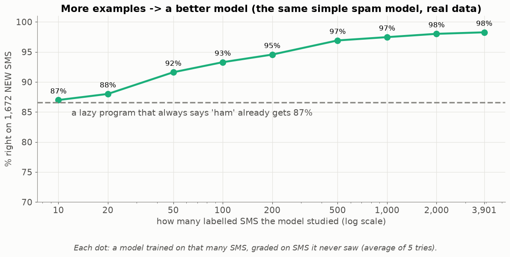

* With **10** examples: 87 % — no better than a lazy program that always answers "ham" (87 % of SMS are ham!).
* With **500**: 97 %.
* With **3,901**: 98.3 %.

So Maya's afternoon was worth it. Notice also that the curve **flattens**: going from 2,000 to 3,901 helps much less than
going from 50 to 500. At some point more data is not the answer — better features or a better model are.

### 🌍 Real world

This is why Google, Meta and banks collect so much data, and why "labelling" is a real job: companies pay people to draw
boxes around cars in photos for self-driving cars, or to mark medical images. **Labels are expensive; the model is cheap.**

## Part 6 — Never test on what it studied: the three piles

> 📖 **Tuesday.** Omar tests his program on the same 5,574 SMS it learned from: **100 % right!** He calls Maya, very proud.
> Maya is not impressed: *"Of course — it has already seen them. What about tomorrow's SMS?"*

### 🧠 The idea

A model can score 100 % on old examples just by **remembering** them, like a student who has seen the exam in advance. But
Maya doesn't care about old SMS; she cares about **tomorrow's**. The only honest way to know how the model does on new
examples is to **hide some examples** during training and grade it on them afterwards.

So, *before* training, Omar cuts the SMS into three piles:


| pile | used for | like at school |
|---|---|---|
| **training** (70 %) | the model learns from these | the textbook and the homework |
| **validation** (15 %) | try different settings, keep the best one | the practice exams |
| **test** (15 %) | graded **once**, at the very end | the real final exam |

✍️ **The arithmetic** for Maya's 5,574 SMS:

```
training:    70 % of 5,574 = 0.70 × 5,574 = 3,901.8  → 3,901 SMS
validation:  15 % of 5,574 = 0.15 × 5,574 =   836.1  →   836 SMS
test:        the rest         5,574 − 3,901 − 836  =   837 SMS
check:       3,901 + 836 + 837 = 5,574  ✔
```

### Why must the test pile be used only **once**?

Imagine a student who may see the final exam, change their answers, and see it again — 20 times. Their grade would be
high, but it no longer shows what they **know**; it shows what they **learned about this exam**. The same happens to a model
if you keep looking at the test score and changing things: you slowly "fit" the test pile. That's why settings are chosen
on the **validation** pile, and the test pile is opened once, at the end, like a sealed envelope.

### Dealing the piles fairly ("stratified")

Only 13 % of Maya's SMS are spam. If you cut the piles at random, bad luck could put almost no spam in the test pile — and
then the test says nothing about catching spam. So we **deal spam and ham separately**, like dealing a pack of cards suit by
suit, so that every pile gets the same share of spam:

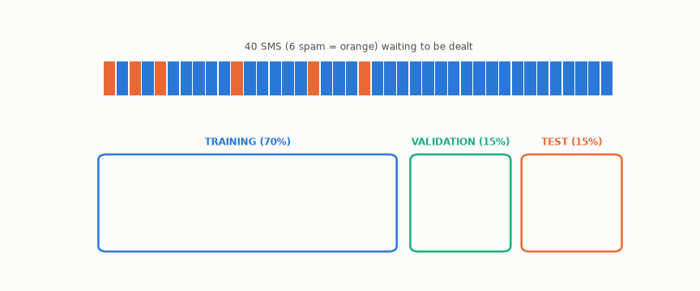

Every pile ends with about 15 % spam (4/28, 1/6, 1/6) — the same as the whole deck. This is called a **stratified** split.

<details><summary>✅ Quick check: 2,000 wines, split 60 / 20 / 20. How many in each pile? And if 10 % of wines are "excellent", how many excellent wines should each pile get?</summary>

0.6 × 2,000 = **1,200**, 0.2 × 2,000 = **400**, and **400**. Excellent: 10 % of each pile → **120, 40, 40**.
</details>

## Part 7 — Overfitting: remembering instead of understanding

> 📖 **Wednesday.** Omar makes his model more and more powerful. It gets 100 % on the training pile — but only 89 % on the
> validation pile, worse than his simple model. Maya, who was a teacher, laughs: *"I know this student."*

### 🧠 The idea: two students

Two students prepare for a maths exam with last year's exam. **Dana memorises** the 20 answers. **Her friend learns the
methods.** Then the real exam comes, with the same kind of questions but new numbers:

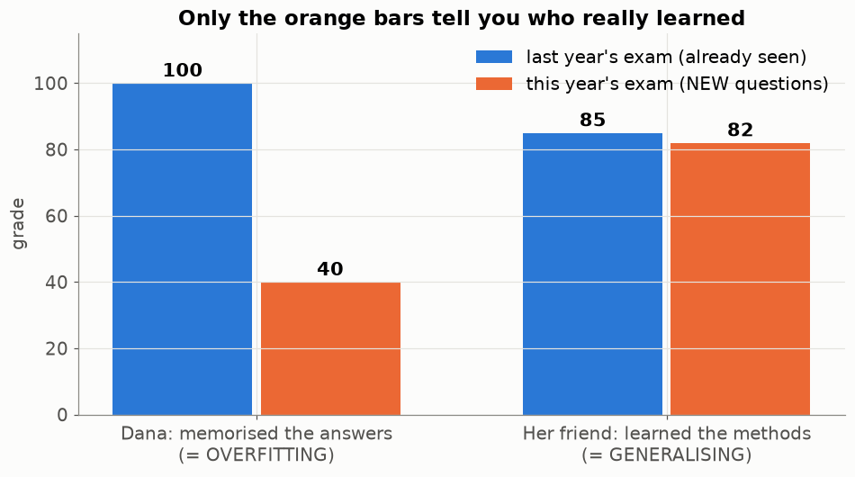

On the questions she had seen, Dana is perfect. On new questions she collapses. **Dana overfitted.** Her friend
**generalised**: she learned something that works on new questions too. A model can do exactly the same.

### 🖼️ Watch a model overfit

In the animation, the blue dots follow a smooth wave plus some random "noise" (small errors — like spam that looks a bit
like ham by chance). The computer draws a curve through the dots. The **degree** is how bendy the curve is allowed to be:
degree 1 = a straight line, degree 15 = it can wiggle 15 times.


| how bendy | what you see | name |
|---|---|---|
| too stiff (degree 0–2) | misses the wave completely | **underfitting** — too simple to learn the rule |
| just right (3–6) | follows the wave, ignores the noise | **a good fit** |
| too bendy (7–15) | goes through every blue dot, crazy between them | **overfitting** — it learned the noise |


**The right side is the most important picture in this lesson.** Two lines:

* **Blue — the error on the training dots** only goes **down**. A more bendy curve can always get closer to dots it has seen.
* **Orange — the error on new dots** goes down, then **up again**. After "best", every extra bend makes the model *worse* at the
  thing we care about.

The best model is at the bottom of the orange line — and you can only draw the orange line with examples the model did
**not** study. **That is the whole reason the validation pile exists.**

### What to do about it

| what you see | diagnosis | what to try |
|---|---|---|
| bad on training **and** on validation | **underfitting** | a more powerful model, better features, train longer |
| great on training, bad on validation | **overfitting** | a simpler model, more examples, a "brake" (regularisation — Lessons 12, 23), stop earlier (Lesson 24) |
| good on both, close to each other | 🎉 | test it once on the test pile, write the grade in your book |

### 🌍 Real world: models that learned the wrong thing

* **The husky and the wolf.** Researchers (Ribeiro et al., 2016) trained a model to tell huskies from wolves. It was very
  accurate — until they looked at *what* it used: **snow**. All the wolf photos had snow in the background. It had learned
  "snow → wolf", a rule that works on the training photos and fails in the real world.
* **Amazon's CV robot (2018).** Amazon built a model to rank job applicants, trained on 10 years of past hiring. Most past
  hires were men, so the model learned to give lower scores to CVs containing the word "women's" (as in "women's chess
  club"). Amazon stopped using it. *A model learns whatever pattern is in the data, including the unfair ones.*

Both stories have the same lesson as Dana: **a high score on the examples you studied proves nothing.** Always ask: does it
work on new examples, and what has it really learned?

<details><summary>✅ Quick check: 99 % right on training, 71 % on validation. What happened, and name two things to try.</summary>

Overfitting — it memorised the training pile. Try a simpler model, more training examples, or a stronger "brake"
(regularisation).
</details>

---

## 🔁 The whole recipe in one picture

Every machine-learning project, including yours, follows these steps. Point at your project's file for each box.

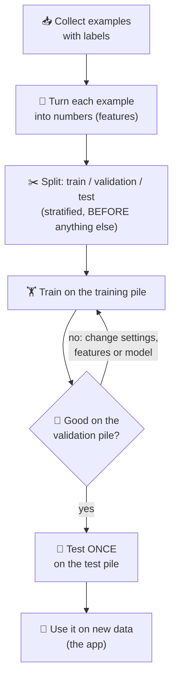

## 🧪 Worked example: Omar's spam filter, start to finish

This short program does the whole recipe on Maya's real SMS. Read it line by line; the comments say which Part of the lesson
each line is. (You don't need to understand `CountVectorizer` and `MultinomialNB` yet — Lessons 07 and 11 open them up.)

```python
import csv
from sklearn.model_selection import train_test_split
from sklearn.feature_extraction.text import CountVectorizer
from sklearn.naive_bayes import MultinomialNB

# 1. Collect examples with labels (Part 2)
rows = list(csv.DictReader(open("08_SpamClassifier/data/sms_spam.csv", encoding="utf-8")))
texts  = [r["text"] for r in rows]
labels = [r["label"] for r in rows]                # "spam" or "ham"

# 2. Split BEFORE anything else: 70 % train, 30 % kept hidden; stratify = deal spam and ham separately (Part 6)
tr_text, te_text, tr_y, te_y = train_test_split(texts, labels, test_size=0.3,
                                                stratify=labels, random_state=0)

# 3. Turn text into numbers - learned from the TRAINING pile only (Part 3)
vec = CountVectorizer().fit(tr_text)

# 4. Train (Part 4)
model = MultinomialNB().fit(vec.transform(tr_text), tr_y)

# 5. Grade on SMS it never saw (Part 6)
right = sum(p == y for p, y in zip(model.predict(vec.transform(te_text)), te_y))
print(f"{right} / {len(te_y)} right = {right / len(te_y):.1%}")          # ≈ 98 %

# 6. Use it on a brand-new SMS (prediction)
print(model.predict(vec.transform(["WINNER! Call 09061701461 to claim your £900 prize"])))   # ['spam']
print(model.predict(vec.transform(["Is my phone ready? I can come at 5"])))                 # ['ham']
```

## Try it yourself

Easy ones first. Try each on paper before you open the answer.

<details><summary>1. 🟢 Name the example, two features and the label for: "will this flight be late?"</summary>

Example: one flight. Features: e.g. hour of departure, airport, weather (rain 0/1), day of the week. Label: late / on time
(from past flights).
</details>

<details><summary>2. 🟢 1,000 photos, split 80 / 10 / 10. How many in each pile?</summary>

800 / 100 / 100.
</details>

<details><summary>3. 🟢 Normal programming or machine learning? (a) the price of a hotel stay, (b) reading a handwritten postcode, (c) the winner of a tic-tac-toe position.</summary>

(a) normal — the hotel has exact price rules (Lesson 29). (b) machine learning — no one can write rules for every
handwriting. (c) normal — the rules of the game decide it.
</details>

<details><summary>4. 🟡 Using the real table of Part 4: with t = 10, Maya gets 11 real customers hidden and 573 spam caught. With t = 5, 50 customers hidden and 648 spam caught. Which would you choose for Maya, and why?</summary>

There is no single right answer — that's the point. If losing a customer is much worse than seeing a spam, choose t = 10
(only 11 customers hidden). If Maya hates spam more, t = 5. Lesson 03 gives the words for this (precision vs recall).
</details>

<details><summary>5. 🟡 A model gets 87 % on Maya's SMS. Is it good?</summary>

No! A program that always says "ham" already gets 87 %, because 87 % of the SMS are ham. Always compare with the "lazy"
answer (Lesson 03 explains why accuracy can lie).
</details>

<details><summary>6. 🟡 Training error 2 %, validation error 3 %. Then training error 0.1 %, validation error 9 %. What happened between the two?</summary>

The model became too complex and started to overfit: training error kept falling, validation error went up. Go back to
the first model.
</details>

<details><summary>7. 🟡 Why can't Laith choose his spam settings using the test pile?</summary>

Then the test pile helped build the model — it's no longer a fair "sealed" exam, and its grade will be too optimistic.
</details>

<details><summary>8. 🔴 A hospital model reads X-rays. All "sick" X-rays came from hospital A; all "healthy" from hospital B. It gets 99 % on validation. What might it really have learned?</summary>

Like the husky/wolf model, it may have learned to recognise **hospital A's machine** (its marks, its brightness), not the
illness. On X-rays from a new hospital it may fail. This really happened in research on chest X-rays.
</details>

<details><summary>9. 🔴 Why do we split BEFORE turning texts into numbers (look at step 3 of the worked example)?</summary>

If the vectoriser learns its words from all SMS, information from the test pile "leaks" into the model — it has peeked at
the exam. Lesson 05 is all about this (leakage).
</details>

## Common mistakes

| student says | the truth |
|---|---|
| "99 % on training — great!" | That says nothing about new data. Look at validation. |
| "More complex is always better" | Only until the orange line turns up (overfitting). |
| "I'll peek at the test pile a few times" | Every peek makes the final grade less honest. |
| "90 % accuracy is always good" | Not if 90 % of examples are one class — "always say the big class" already scores 90 %. |
| "The model understands spam" | It only found numbers that separate dots. It can learn silly rules (snow → wolf). |
| "Machine learning is better than normal code" | Only when you can't write the rules. For prices, bookings, games — write the rules. |

## 📝 Summary — the whole lesson on one card

> * **Machine learning** = examples + right answers → the computer finds the rules (the **model**).
> * Use it when you **can't write the rules** but a person can **give the answers**.
> * Every example becomes a row of **features** (numbers), with a **label**.
> * **Training** = trying values of the model's unknown numbers and keeping what works best on the examples.
> * More examples → better, up to a point.
> * Split **train / validation / test** first, **stratified**. Choose settings on validation. Open test **once**.
> * **Overfitting** = great on training, bad on new data (memorising). **Underfitting** = bad on both (too simple).

## Class activities

1. **Write the rules (10 min).** Read 15 real SMS aloud from `08_SpamClassifier/data/sms_spam.csv`. Groups write rules on
   paper. Then read 10 new SMS — how many rules broke? (This is Part 1, felt for real.)
2. **Human learning (10 min).** Show 8 made-up "glorps" and "blicks" (shapes with two features: size, colour) with names. Then
   show 4 new shapes: the class must name them and say which rule they used. They just trained a model in their heads.
3. **Be the computer (10 min).** Give each group the digit counts and labels of 12 SMS on cards. Each group tries cut-offs
   1–10 and finds the best one. Compare with the real best (5).
4. **Guess first (5 min).** Before the overfitting animation: "draw what the most bendy curve will look like".
5. **Which pile? (5 min).** "Choosing a setting" (validation) · "the grade in the book" (test) · "learning the words of spam"
   (training).

## In your project

| Project | Where |
|---|---|
| Spam | `spamclassifier/ml/dataset.py` → `stratified_split` (70 / 15 / 15), `assert_no_leakage` |
| FaceEmotion | `app/ml/dataset.py` → `build_dataloaders` |
| PhishGuard | `phishguard/ml/dataset.py` → `DatasetLoader` |
| WineGrader | `winegrader/ml/folds.py` → `stratified_kfold` (Lesson 05) |

## 🎬 Watch & explore

| | |
|---|---|
| <a href="https://www.youtube.com/watch?v=Gv9_4yMHFhI"></a> | **StatQuest — A Gentle Introduction to Machine Learning** (12 min). The same ideas as this lesson with drawings: what a model is, why we test on new data. Start here. |
| <a href="https://www.youtube.com/watch?v=f_uwKZIAeM0"></a> | **Oxford Sparks — What is Machine Learning?** (3 min). A short cartoon: learning from examples instead of rules. |
| <a href="https://www.youtube.com/watch?v=EuBBz3bI-aA"></a> | **StatQuest — Bias and Variance** (6 min). Underfitting and overfitting with a simple example; watch after Part 7. |
| <a href="https://www.youtube.com/watch?v=R9OHn5ZF4Uo"></a> | **CGP Grey — How machines learn** (9 min). A funny animation of "teacher bots" and "student bots": why nobody knows exactly what a trained model learned. |

**Play with it:**
* R2D3 — [A visual introduction to machine learning](https://r2d3.us/visual-intro-to-machine-learning-part-1/) — scroll
  and watch a model learn to tell New York homes from San Francisco homes. Beautiful.
* MLU-Explain — [Train, Test, and Validation Sets](https://mlu-explain.github.io/train-test-validation/) — the three piles,
  animated.
* Google — [Teachable Machine](https://teachablemachine.withgoogle.com/) — train a real model on your webcam in 2 minutes:
  show it "hand up" and "hand down" examples, then test it. Try to make it overfit (train only with your face, then test a
  friend).
* At home: `python visualize.py --live` opens the overfitting picture with a slider — move it and watch the orange line.

<details><summary>🎓 <b>For the defence (advanced)</b></summary>

* **Stratified split:** each pile keeps the same share of each class. Maya's data is 13 % spam; a random split could put
  only 8 % spam in the test pile by bad luck. Stratifying deals spam and ham separately, like dealing cards suit by suit.
* **Bias and variance:**

  

  Train the same kind of model 12 times on different samples — each dart is one model. **Bias** = the darts miss on
  average (too simple, underfitting). **Variance** = the darts are scattered (too sensitive to the sample, overfitting).
* **Generalisation** = doing well on examples never seen. It is the only thing that counts.
* **Hyper-parameter** = a setting *you* choose (k, C, the threshold, the degree) — chosen on validation, never on test.
  **Parameter** = a number the model learns during training (a weight, a cut-off).
* **Supervised** learning (this lesson, all four ML projects) = examples come with labels. **Unsupervised** = no labels, the
  computer looks for groups by itself (e.g. grouping customers).
* **Classification** (spam/ham, 7 emotions) vs **regression** (a number: minutes to arrive, a price). WineGrader predicts a
  quality score — it can be treated as either.
</details>
