# Lesson 02 — Feature scaling: putting all numbers on the same ruler

> **For:** Seif (WineGrader) · Dani (PhishGuard) · Laith (SVM) · Ryan (pixels) &nbsp;·&nbsp; **Time:** 2 × 45 min
> **Before:** Lesson 00 §2 (average), §3 (std), §10 (distance); Lesson 01

**In one sentence:** before comparing examples, change every feature so that "1 step" means the same thing for all of
them — otherwise the feature with the biggest numbers wins every comparison.

## 🗺️ The map of this lesson

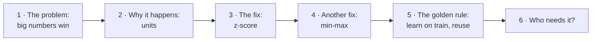

## The story

> **Sami owns a wine shop.** A regular customer loved a white wine with **10.4 % alcohol** and **140 mg/l of SO₂** (sulphur
> dioxide, a preservative that keeps wine fresh). It's sold out. *"Give me the most similar wine you have,"* she says. Sami
> has 4,898 wines in his computer, each with 11 laboratory measurements, so he asks the computer to find the wine with the
> closest numbers. The computer suggests a wine that tastes completely different. The customer is not happy. What went wrong?

## Words you need

| word | simple meaning | in Sami's shop |
|---|---|---|
| **feature** | one measured number | alcohol, SO₂ |
| **unit** | what one step of the number means | % alcohol, mg per litre |
| **distance** | how different two examples are, using all their numbers (Lesson 00 §10) | how different two wines are |
| **scale** | how big a feature's numbers usually are | alcohol ≈ 10, SO₂ ≈ 140 |
| **scaling** | changing the numbers so all features have a similar size | |
| **z-score** | "how many typical steps above or below the average" | "this wine is 2 steps stronger than usual" |
| **outlier** | one value far away from all the others | one wine with 440 SO₂ |

---

## Part 1 — See the problem

> 📖 Sami has two candidate wines on the shelf.

```
                 alcohol   SO₂
customer's wine    10.4    140
wine A             10.5    155      ← almost the same alcohol, a bit more preservative
wine B             13.0    142      ← MUCH stronger, almost the same preservative
```

Any wine expert says **A** is similar: 15 mg/l of preservative you cannot taste, but 2.6 % more alcohol you certainly can.
Let's compute the distance like the computer does (Lesson 00 §10: square the differences, add, square root):

```
to A:  alcohol 0.1 → 0.1² = 0.01      SO₂ 15 → 15² = 225       √(0.01 + 225) = 15.0
to B:  alcohol 2.6 → 2.6² = 6.76      SO₂ 2  → 2²  = 4         √(6.76 + 4)   =  3.3
```

The computer says **B is closer** (3.3 < 15). Look at where the numbers come from: 225 of A's distance is SO₂, and only 0.01
is alcohol. SO₂ numbers are **big** (hundreds), so their differences are big and **drown** the alcohol.

### 🖼️ On the real wines

Here are 300 of Sami's real white wines. The star is the customer's wine; the orange dots are the 7 wines the computer calls
"nearest":

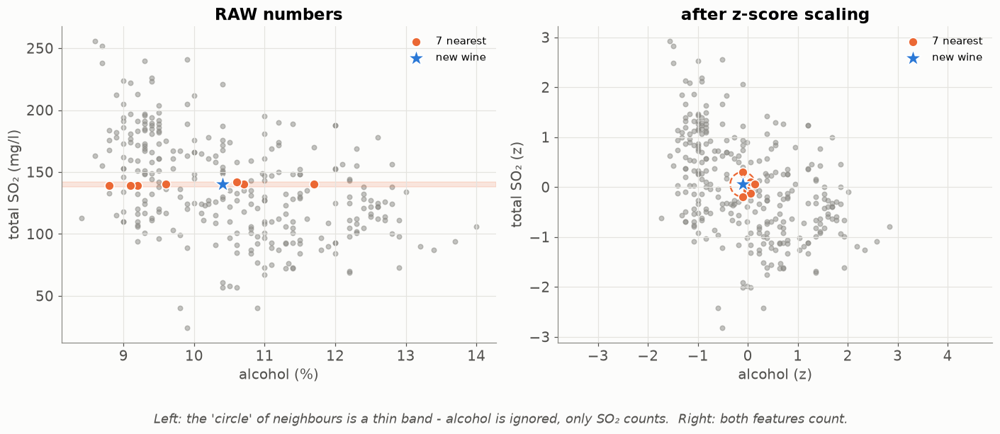

* **Left (raw numbers):** the 7 "nearest" wines all have SO₂ ≈ 140 — and any alcohol at all, from 8.8 % to 11.7 %. The
  "circle" of neighbours is really a flat band. Alcohol is ignored.
* **Right (after scaling):** the nearest wines are close in **both** alcohol and SO₂. That's what "similar" means.

### 🧠 It's like comparing people by "height in millimetres + age in years"

Two people: a child of 8 who is 1,700 mm tall (very tall child!) and a grown-up of 40 who is also 1,700 mm. Height
difference 0, age difference 32. Another pair: two 16-year-olds, 1,600 mm and 1,700 mm: height difference **100**. The
computer would say the child and the grown-up are "twins" and the two teenagers are "very different" — only because
millimetres make big numbers.

### 🌍 Real world

* **Money:** compare a price in ₪ (≈ 3.7 per $) and a price in $ without converting — nonsense. Scaling is "converting to the
  same currency".
* **Recipes:** "200 g flour, 2 eggs, 1 tsp salt" — 200 is not "more important" than 2. The numbers are in different units.
* **Maps apps** compare distance (thousands of metres) and traffic lights (a handful). They must put both on one scale before
  adding them.

<details><summary>✅ Quick check: two features, "salary in ₪" (≈ 10,000) and "years of experience" (≈ 5). Without scaling, which one decides who is "similar"?</summary>

Salary — its differences are thousands, experience differences are a few years. Experience would almost not count.
</details>

## Part 2 — Watch the problem disappear

> 📖 Sami tries a trick: *"What if I measure SO₂ in bigger steps, so its numbers are smaller?"* He divides SO₂ by 1.5, then
> by 2, then 3 … and watches which wines the computer picks.

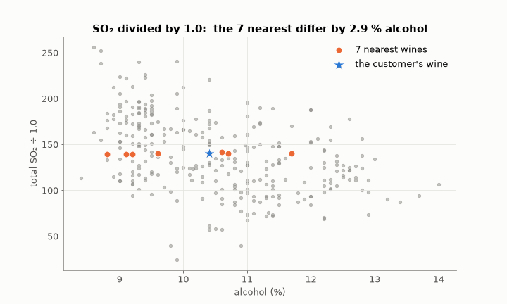

At "÷ 1" the 7 nearest wines differ by almost 3 % alcohol. As SO₂ shrinks, alcohol starts to count, and at "÷ 32.8" the
7 nearest are all within 0.3 % alcohol **and** close in SO₂.

Where does 32.8 come from? It's how much bigger SO₂'s *typical spread* is than alcohol's: SO₂'s std is 42.5 and alcohol's
std is 1.23 (on all 4,898 wines) — and 42.5 ÷ 1.23 ≈ 34 (about 33 on these 300). So the real fix is: **divide each
feature by its own typical spread**. That is exactly the z-score.

## Part 3 — The fix: z-score

> 📖 Sami's idea: measure each feature in **its own** typical step. "One step of alcohol" and "one step of SO₂" should mean
> the same thing: "one typical difference between wines".

### 🧠 The idea in words

Take the value, **subtract the average** (so "normal" becomes 0), then **divide by the standard deviation** (so "one typical
difference" becomes 1).

$$z = \frac{\text{value} - \text{average}}{\text{std}}$$

### 🌍 You've seen this at school

Rami got **80** in a hard maths exam. Lina got **90** in an easy one. Who did better?

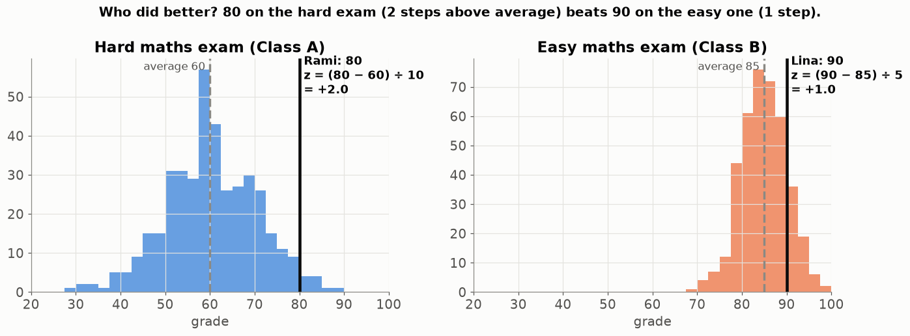

* Hard exam: average 60, std 10 → Rami's z = (80 − 60) ÷ 10 = **+2.0** — two typical steps above everybody.
* Easy exam: average 85, std 5 → Lina's z = (90 − 85) ÷ 5 = **+1.0** — one step above.

**Rami did better**, even though 80 < 90. The z-score lets you compare things measured differently. (Israel's psychometric
exam does something similar: the raw score is converted so that every exam date is comparable.)

### ✍️ By hand — alcohol of 3 wines: 8, 10, 12

```
step 1 — average:     (8 + 10 + 12) ÷ 3 = 10
step 2 — std:         distances −2, 0, +2 → squares 4, 0, 4 → average 8 ÷ 3 = 2.67 → √2.67 = 1.63
step 3 — z-scores:    (8 − 10) ÷ 1.63 = −1.22      (10 − 10) ÷ 1.63 = 0      (12 − 10) ÷ 1.63 = +1.22
```

Say it aloud: "wine 1 is 1.2 steps **below** average, wine 2 is exactly average, wine 3 is 1.2 steps **above**".

### 🖼️ The two moves, animated

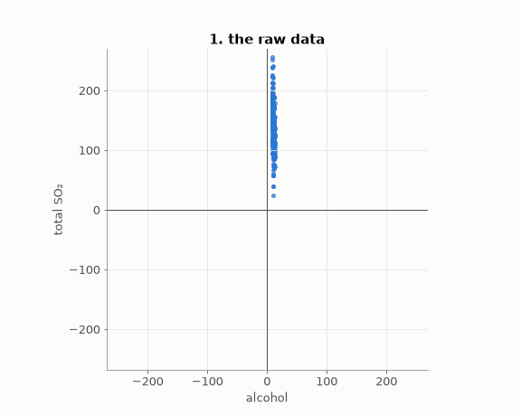

1. **Subtract the average** — slide the whole cloud so its centre sits on (0, 0).
2. **Divide by the std** — squeeze or stretch each direction so its spread is 1.

### 🖼️ What it does to the real data

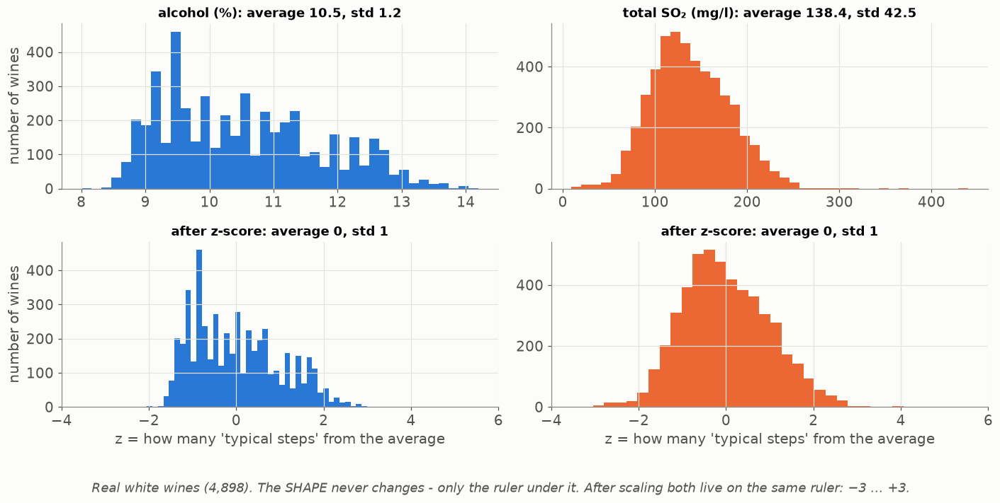

Look closely: the **shape** of each histogram doesn't change at all. Only the numbers under it change. Before: alcohol lives
around 8–14 and SO₂ around 0–440. After: both live around −3 … +3. Scaling never changes the **order** of wines inside one
feature — the strongest wine is still the strongest.

### ✍️ Sami's two wines, solved

Using the averages and stds of all 4,898 white wines (alcohol: 10.51, 1.23 · SO₂: 138.4, 42.5):

```
                  alcohol z                       SO₂ z
customer:   (10.4 − 10.51) ÷ 1.23 = −0.09   (140 − 138.4) ÷ 42.5 = +0.04
wine A:     (10.5 − 10.51) ÷ 1.23 = −0.01   (155 − 138.4) ÷ 42.5 = +0.39
wine B:     (13.0 − 10.51) ÷ 1.23 = +2.02   (142 − 138.4) ÷ 42.5 = +0.09

distance to A = √(0.08² + 0.35²) = 0.36
distance to B = √(2.11² + 0.05²) = 2.11     → A is now much closer ✔
```

> 📖 After scaling, Sami's computer suggests **wine A**. The customer buys two bottles.

```python
import numpy as np
X = np.array([[10.4, 140], [10.5, 155], [13.0, 142]])
mean, std = X_train.mean(axis=0), X_train.std(axis=0)   # learned from the TRAINING wines
Z = (X - mean) / std                                     # every column: average 0, std 1
```

<details><summary>✅ Quick check: average alcohol 10.5, std 1.2. A wine has 12.3 %. Its z-score? And a wine with z = −2?</summary>

(12.3 − 10.5) ÷ 1.2 = 1.8 ÷ 1.2 = **+1.5**. For z = −2: value = 10.5 + (−2) × 1.2 = **8.1 %**.
</details>

## Part 4 — Another way: min-max scaling

Instead of "average and std", you can use "smallest and biggest":

$$x' = \frac{x - \min}{\max - \min}$$

The smallest value becomes 0, the biggest becomes 1, everything else in between. **By hand:** alcohol 8, 10, 12 → min 8,
max 12 → (8−8)/4 = **0**, (10−8)/4 = **0.5**, (12−8)/4 = **1**.

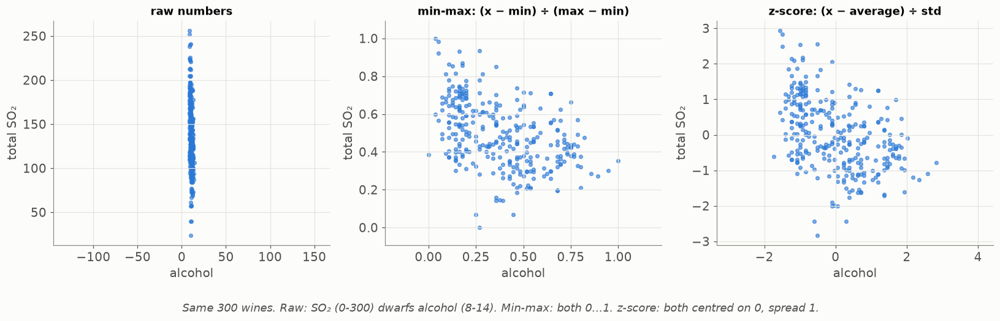

Both fixes make the features comparable. Which is better?

| | **z-score** | **min-max** |
|---|---|---|
| result | centred on 0, most values in −3 … +3 | always between 0 and 1 |
| one extreme value (outlier) | hurts a little | **hurts a lot** — see below |
| use when | almost always (k-NN, SVM, logistic regression) | pixels (0–255 → 0–1), or when you need 0…1 |

**The outlier problem:** one white wine has **440** mg/l SO₂ (most have 100–180). With min-max, max = 440, so every normal
wine is squeezed into 0.2–0.4 and their differences almost vanish:

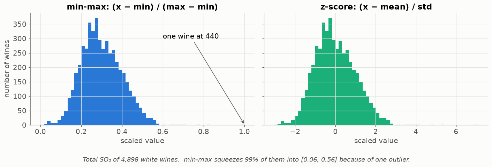

**Ryan's pixels** are a natural min-max: a pixel is 0 (black) to 255 (white), so `pixel / 255` gives 0 … 1. Then he
also does a z-score with the dataset's average 0.5013 and std 0.2916 (Lesson 19).

## Part 5 — The golden rule: learn on training, reuse forever

> 📖 A new wine arrives at the shop with 13 % alcohol. Sami's nephew scales it by itself: average of one wine = 13, std of
> one wine = 0, (13 − 13) ÷ 0 → **crash** (division by zero). Even with 10 new wines, their average is not the average the
> model learned with.

The average and std are **learned from the training wines** and **saved with the model**. Every later wine — validation,
test, or a customer's wine next year — is scaled with **those saved numbers**:

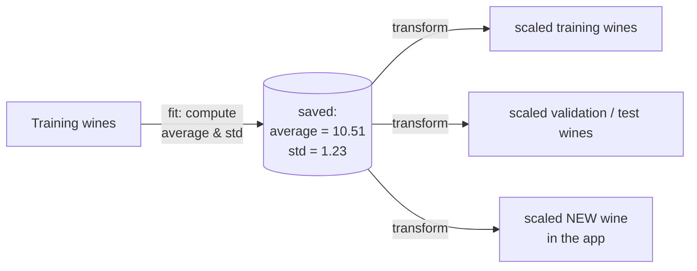

Why not compute them on all the data, test included? Because then the test pile has influenced the model — it has
"peeked" at the exam (Lesson 01 Part 6). That's **leakage**, and Lesson 05 shows how it inflates your grade.

```python
scaler = StandardScaler().fit(X_train)     # learns average and std from TRAINING only
X_train_s = scaler.transform(X_train)
X_test_s  = scaler.transform(X_test)       # same numbers, no new fitting
new_s     = scaler.transform([[13.0, 142]])   # (13 − 10.51) ÷ 1.23 = 2.02, ...
```

## Part 6 — Which models need scaling?

| model | needs scaling? | why |
|---|---|---|
| k-NN (Seif, Lesson 15) | **yes, always** | it measures distances — exactly Sami's problem |
| SVM (Laith, Lesson 14) | **yes** | it measures distances to the border |
| logistic regression (Dani, Lesson 12) | **yes** | it learns by gradient descent, which zig-zags without scaling |
| neural networks (Ryan, Lesson 20) | **yes** | same reason |
| Naive Bayes (Laith, Lesson 11) | no | it counts words |
| decision trees / forests (Dani, Lesson 13) | no | it asks "is alcohol > 10.5?" — units don't matter |

**Gradient descent and scaling.** Models that learn by "walking downhill" (Lesson 00 §9) walk in a long narrow valley when the
features are unscaled — they zig-zag from wall to wall. After scaling, the valley is round and they walk straight down:

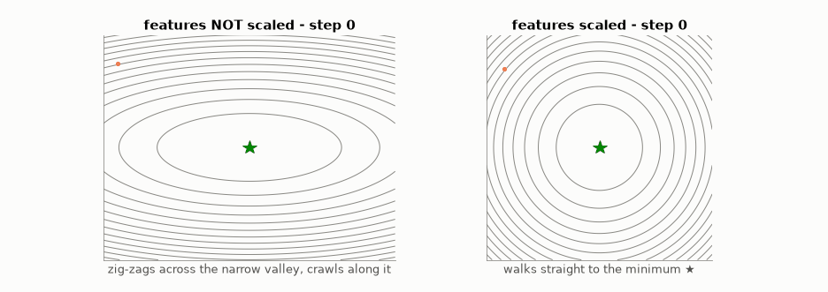

That's why the SVM in Laith's project prints *"failed to converge"* without a scaler.

---

## 🧪 Worked example: Sami's "most similar wine" on all 4,898 wines

```python
import numpy as np
w = np.genfromtxt("32_WineGrader/data/winequality-white.csv", delimiter=";", skip_header=1)
X = w[:, [10, 6]]                                   # columns: alcohol, total SO₂
customer = np.array([10.4, 140])

def nearest(A, p):
    return np.argmin(np.sqrt(((A - p) ** 2).sum(axis=1)))

i = nearest(X, customer)                                       # RAW
print("raw    :", X[i])

mean, std = X.mean(axis=0), X.std(axis=0)
j = nearest((X - mean) / std, (customer - mean) / std)         # SCALED
print("scaled :", X[j])
```

Run it and compare the two wines it prints. Then try with all 11 columns (`X = w[:, :11]`) — the difference is even bigger,
because density (≈ 0.99) and chlorides (≈ 0.04) are completely invisible without scaling.

## Try it yourself

<details><summary>1. 🟢 Average 50, std 10. z-scores of 30, 50, 75?</summary>

(30 − 50) ÷ 10 = **−2** · **0** · (75 − 50) ÷ 10 = **+2.5**.
</details>

<details><summary>2. 🟢 Min-max scale 2, 5, 11.</summary>

min 2, max 11, range 9 → (2−2)/9 = **0**, (5−2)/9 = **0.33**, (11−2)/9 = **1**.
</details>

<details><summary>3. 🟡 z-scores of 4, 6, 8, 10.</summary>

average 7 · distances −3, −1, 1, 3 · squares 9, 1, 1, 9 · average 5 · std √5 = 2.24 → **−1.34, −0.45, 0.45, 1.34**.
</details>

<details><summary>4. 🟡 A pixel is 200. What is it after /255? And after the FaceEmotion normalisation (x − 0.5013) / 0.2916?</summary>

200 / 255 = **0.784**. (0.784 − 0.5013) ÷ 0.2916 = **0.97** — about one step brighter than the average pixel.
</details>

<details><summary>5. 🟡 Two people: (height 170 cm, age 30) and (height 180 cm, age 32). Heights have std 10, ages std 2. Distance before and after z-scoring?</summary>

Before: √(10² + 2²) = √104 = **10.2** (height decides). After: height difference 10/10 = 1, age difference 2/2 = 1 →
√(1 + 1) = **1.41** — both count equally.
</details>

<details><summary>6. 🟡 Every wine in the dataset has the same citric acid: 0.3. What is its std, and what goes wrong?</summary>

std = **0** → dividing by 0 → `nan` or `inf`. The fix in the projects: if std is 0, use 1 — the column becomes all zeros and
simply adds nothing.
</details>

<details><summary>7. 🔴 Dani's random forest gets the same accuracy with and without scaling, but his logistic regression gets better with scaling. Why?</summary>

A tree only asks "is feature > some value?" — dividing a feature by its std just moves the question's value, the answers
don't change. Logistic regression learns by gradient descent, which is slow and zig-zags on unscaled features, and its
"brake" (regularisation) treats all weights equally, which only makes sense when features are on the same scale.
</details>

<details><summary>8. 🔴 Seif scales all wines first, then splits them into folds. Why is that a (small) leak?</summary>

The average and std were computed with the validation wines too, so information from the validation fold entered the
training. The projects scale **inside** each fold: fit on that fold's training part only (`tuning.prepare_folds`).
</details>

## Common mistakes

| student says | the truth |
|---|---|
| "Scaling changes my data" | It changes how features are **compared** — that's the point. The order inside one feature stays the same. |
| "Fit the scaler on all the data" | Only on training data, then reuse the saved numbers (Lesson 05: leakage). |
| "Scale each new wine by itself" | One wine has std 0. Always use the saved training average and std. |
| "Scale the label (quality) too" | No — only the features. The label is the answer, not a measurement to compare. |
| "Trees need scaling" | No. Distances and gradient descent need it; questions like "x > 3?" don't. |

## 📝 Summary

> * Features with **big numbers** win every distance — without scaling, alcohol is invisible next to SO₂.
> * **z-score** = (value − average) ÷ std → "how many typical steps from normal". Average 0, std 1.
> * **min-max** = (value − min) ÷ (max − min) → 0…1. Easily broken by one outlier.
> * **Learn** the average and std on the **training** data; **reuse** them for every other example, forever.
> * Needed for distances and gradient descent (k-NN, SVM, logistic regression, networks). Not for Naive Bayes and trees.

## Class activities

1. **Human comparison (10 min).** 5 "people" on the board as (height mm, age). Who is closest to a new person? Convert to
   z-scores — the answer changes.
2. **Two exams (5 min).** Give two made-up class grade lists; each student computes their own z in both. Who "really" did
   best?
3. **Slider (5 min).** `python visualize.py --live`: a slider makes SO₂ count more or less — watch the orange neighbours move.

## In your project

| Project | Where |
|---|---|
| WineGrader | `winegrader/ml/scaler.py` → `StandardScaler`, `MinMaxScaler` · scaled inside each fold in `tuning.prepare_folds` |
| PhishGuard | `ModelTrainer.build_logistic` — `StandardScaler` inside the `Pipeline` |
| Spam | `SVMClassifier.fit` — `StandardScaler` before the SVM |
| FaceEmotion | pixels: `/255`, then `(x − 0.5013) / 0.2916` (Lesson 19) |

## 🎬 Watch & explore

| | |
|---|---|
| <a href="https://www.youtube.com/watch?v=sxEqtjLC0aM"></a> | **Normalized Nerd — Standardization vs Normalization, clearly explained**. z-score vs min-max with pictures — Parts 3 and 4. |
| <a href="https://www.youtube.com/watch?v=bqhQ2LWBheQ"></a> | **Normalization vs. Standardization (feature scaling)**. A second explanation, with code. |

**Play with it:**
* scikit-learn — [Importance of feature scaling](https://scikit-learn.org/stable/auto_examples/preprocessing/plot_scaling_importance.html)
  — the same experiment on a real wine dataset.
* At home: `python visualize.py --live` (the SO₂ slider).

<details><summary>🎓 <b>For the defence (advanced)</b></summary>

* **All 11 features live on different scales:**

  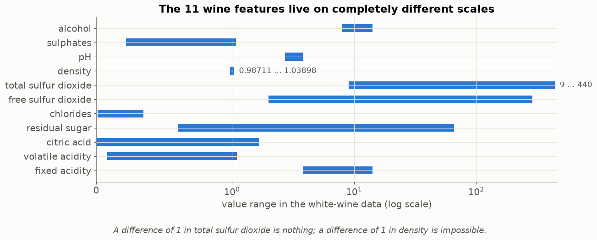

* **Population vs sample std.** The projects divide by n (NumPy's default `std`), not n − 1. With thousands of wines the
  difference is invisible; be ready to say which you used.
* **A feature that is the same for every wine:** std = 0 → set std to 1 (the column becomes zeros and adds nothing).
* **Robust scaling** uses the median and the "middle half" (IQR) instead of average and std — even less sensitive to
  outliers. Not needed in the projects.
* Test names: `test_one_outlier_squeezes_minmax_but_not_zscore`, `test_fit_uses_only_given_rows`.
</details>
