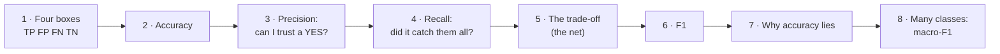
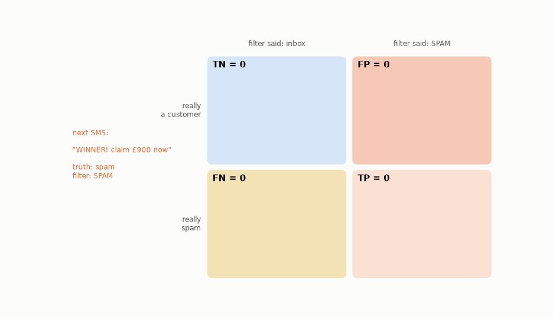
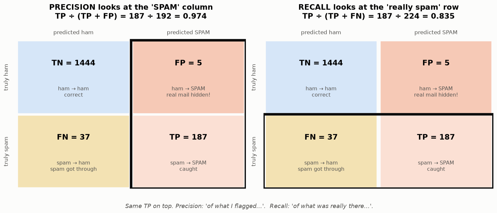
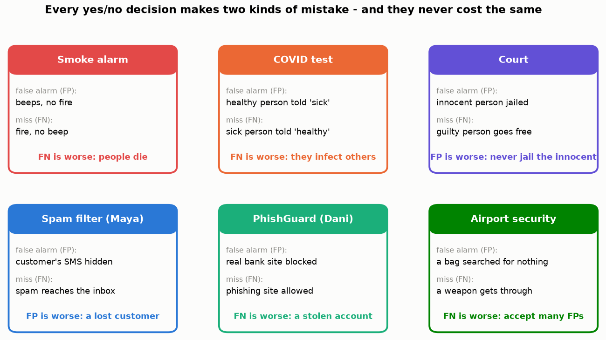
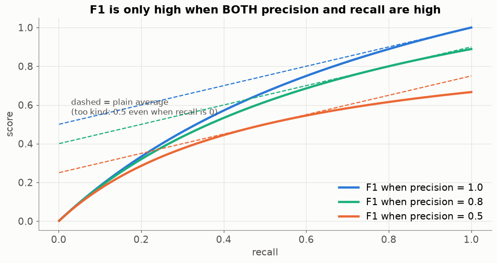
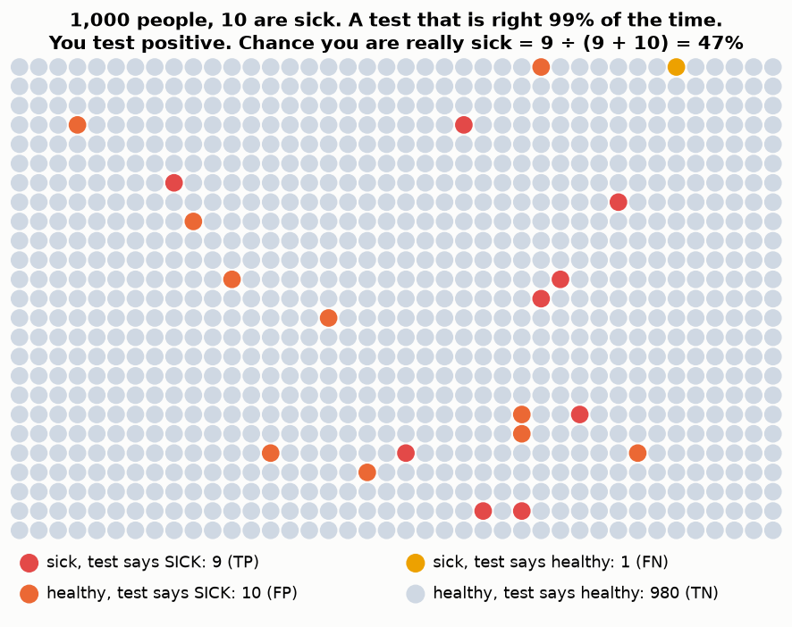

# Lesson 03 — Is the model good? Counting its right and wrong answers

> **For:** Laith · Dani · Seif · Ryan &nbsp;·&nbsp; **Time:** 2 × 45 min
> **Before:** Lesson 00 §1 (percentages), §4 (probability); Lesson 01

**In one sentence:** sort every answer into four boxes (caught, false alarm, missed, correct "no"), and from those four
counts compute numbers that answer different questions: *can I trust it when it says yes?* and *does it catch everything?*

## 🗺️ The map of this lesson



## The story

> Omar's spam filter (Lesson 01) is ready. It sorted 1,673 new SMS into "inbox" and "spam folder". Omar proudly says:
> *"97.5 % correct!"* Maya asks two sharper questions: **"Did it hide any message from a customer?"** and **"How much spam
> still reaches me?"** One number can't answer both. Let's build the numbers that can.

## Words you need

| word | simple meaning | in Maya's shop |
|---|---|---|
| **positive** | the thing we are looking for | spam (in PhishGuard: phishing; in a COVID test: sick) |
| **negative** | the other thing | a normal message ("ham") |
| **prediction** | what the model said | "spam" / "inbox" |
| **truth** | what it really was | Maya checks by hand |
| **false alarm** (false positive) | the model said "yes" but the truth is "no" | a customer hidden in the spam folder |
| **miss** (false negative) | the model said "no" but the truth is "yes" | spam in the inbox |

---

## Part 1 — Four boxes

> 📖 Maya opens her phone and checks every SMS: what did the filter say, and what was it really? She sorts them into four
> piles on the table.

There are only two possible truths and two possible answers, so there are exactly **four** combinations:

| | filter said **SPAM** | filter said **inbox** |
|---|---|---|
| **really spam** | **TP** — spam caught ✓ | **FN** — spam slipped into the inbox ✗ |
| **really a customer** | **FP** — a customer hidden in spam ✗ | **TN** — customer delivered ✓ |

**How to read the names:** the second letter (**P**/**N**) is what the filter **said** (Positive = "spam"). The first letter
(**T**/**F**) says whether it was **True** (right) or **False** (wrong). So FP = "said Positive, and was wrong" = a false alarm.

This table is called the **confusion matrix** — it shows where the model gets confused.

### 🖼️ Watch Maya sort 16 SMS



### ✍️ Fill one by hand — 8 SMS

```
truth:      S   S   H   H   H   S   H   H          (S = spam, H = ham)
filter:     S   H   H   S   H   S   H   H
box:        TP  FN  TN  FP  TN  TP  TN  TN
count:      TP = 2     FN = 1     FP = 1     TN = 4         (2 + 1 + 1 + 4 = 8 ✔)
```

**Check:** the four counts always add up to the number of examples.

### The real counts

On the 1,673 SMS Omar's filter never saw:


TP = 187 · FN = 37 · FP = 5 · TN = 1,444.

<details><summary>✅ Quick check: a COVID test says "sick" to a healthy person. Which box?</summary>

**FP** — it said Positive ("sick") and it was False. A false alarm.
</details>

## Part 2 — "How often is it right?" → accuracy

> 📖 Omar's number.

```
accuracy = right answers ÷ all answers = (TP + TN) ÷ everything
         = (187 + 1,444) ÷ 1,673 = 1,631 ÷ 1,673 = 0.975 → 97.5 %
```

Accuracy treats every mistake as equal. But Maya **doesn't** feel them as equal: a hidden customer can cost her a sale; a spam
in the inbox costs her two seconds. So she asks two separate questions.

## Part 3 — "When it says spam, can I trust it?" → precision

> 📖 Maya opens the **spam folder**. She doesn't care about the inbox right now — only: *"of the messages in here, how many
> really are spam?"*

Precision looks only at what the filter **flagged** — the "SPAM" **column**:

```
precision = TP ÷ (TP + FP) = 187 ÷ (187 + 5) = 187 ÷ 192 = 0.974
```

In words: "Of 192 messages in the spam folder, 187 really were spam." The other 5 are customers Maya never answered.

## Part 4 — "Of all the spam, how much did it catch?" → recall

> 📖 Then Maya thinks about **all the spam that arrived** — wherever it ended up. *"Of all the real spam, how much did the
> filter catch?"*

Recall looks only at what was **really** spam — the "really spam" **row**:

```
recall = TP ÷ (TP + FN) = 187 ÷ (187 + 37) = 187 ÷ 224 = 0.835
```

In words: "It caught 83 % of the spam; 37 still reached the inbox."

### 🖼️ Precision is a column, recall is a row



Both have **TP on top**. They differ only in what they divide by:

* **P**recision divides by what the model **P**redicted as spam (the column).
* **R**ecall divides by what was **R**eally spam (the row).

### ✍️ The 16 SMS from the animation

TP 5 · FN 2 · FP 1 · TN 8:

```
accuracy  = (5 + 8) ÷ 16 = 13 ÷ 16 = 0.81
precision = 5 ÷ (5 + 1)  =  5 ÷ 6  = 0.83     "5 of the 6 in the spam folder were spam"
recall    = 5 ÷ (5 + 2)  =  5 ÷ 7  = 0.71     "it caught 5 of the 7 spam"
```

### 🌍 Real world: two kinds of mistakes, never the same cost



* A **smoke alarm** must have high **recall** — a missed fire kills. We accept that it beeps when you burn toast (false alarms).
* A **court** wants high **precision** — "guilty" must be right, so we accept that some guilty people go free.
* **Laith's spam filter:** precision matters most — a hidden customer is expensive.
* **Dani's PhishGuard:** recall matters most — one missed phishing site can empty a bank account.

<details><summary>✅ Quick check: TP 40, FP 10, FN 20. Precision? Recall? Which one is weaker?</summary>

Precision 40 ÷ 50 = **0.80**. Recall 40 ÷ 60 = **0.67**. Recall is weaker: it misses a third of the positives.
</details>

## Part 5 — The fishing net: you can't have both for free

> 📖 Maya's cousin is a fisherman. *"If I use a small net, everything I catch is the fish I want — but I miss most of them.
> If I use a huge net, I catch all the fish — and also boots and seaweed."*


* Small net → **high precision, low recall**.
* Huge net → **high recall, low precision**.

A spam filter has the same "net size": a **threshold** (Lesson 04). The filter really gives each SMS a score from 0 to 1,
and a line decides "above it = spam". Move the line and all four boxes change:


Which net is right depends on what each mistake costs — that's a **business** decision, not a maths one.

## Part 6 — One number for both: F1

Sometimes you need one number (to compare two models, or to choose a setting). The plain average of precision and recall is
too kind: a "filter" with precision 1 and recall 0 would get 0.5. **F1** is a stricter average:

$$F1 = \frac{2 \times P \times R}{P + R}$$

```
Omar's filter:   F1 = 2 × 0.974 × 0.835 ÷ (0.974 + 0.835) = 1.627 ÷ 1.809 = 0.899
P = 1, R = 0:    F1 = 2 × 1 × 0 ÷ (1 + 0) = 0          (the plain average would say 0.5!)
P = 0.9, R = 0.9: F1 = 0.9                             (when both are equal, F1 = that value)
```



The solid lines (F1) drop to 0 when recall drops to 0; the dashed lines (plain average) don't. **F1 is only high when both
are high.**

## Part 7 — Why "97 % correct" can be a lie

> 📖 Omar's lazy friend writes a "filter" in one line: `return "inbox"` — *always say inbox*. It never catches any spam.

```
it gets every customer right (1,449 of 1,673) → accuracy 1,449 ÷ 1,673 = 86.6 %
it catches 0 spam                              → recall 0 ÷ 224 = 0
```

86.6 % "correct" and **completely useless** — because most messages are normal anyway. When one class is rare, **accuracy
alone lies**.


### 🌍 Real world: the rare disease

> 📖 Maya's aunt takes a test for a rare disease (1 in 100 people have it). The test is right 99 % of the time. It says
> **positive**. She is terrified. Should she be?

Draw 1,000 people:



* 10 are sick; the test catches 9 (TP) and misses 1 (FN).
* 990 are healthy; the test wrongly says "sick" to about 1 % of them = **10** (FP).
* Positive results: 9 + 10 = 19. Really sick among them: 9.

**Precision = 9 ÷ 19 = 47 %.** A "99 % accurate" test, and a positive result is still more likely wrong than right! The
reason: the healthy group is so big that even 1 % of it (10 people) outnumbers the sick. That's why doctors repeat a
positive test. It's also why Laith must look at precision, not accuracy: spam is the "rare disease" of his data.

<details><summary>✅ Quick check: a fraud model on 10,000 card payments (20 frauds) always answers "normal". Accuracy? Recall?</summary>

Accuracy 9,980 ÷ 10,000 = **99.8 %**. Recall 0 ÷ 20 = **0**. Useless, despite 99.8 %.
</details>

## Part 8 — More than two classes (wine grades, emotions)

> 📖 Seif's wines are "low", "medium" or "high". Ryan's faces have 7 emotions. There is no single "positive".

The confusion matrix just grows: **row = truth, column = prediction, the diagonal = correct**. To get precision and recall,
take **one class at a time** and treat it as "positive", all the others as "negative":


```
class "high":  TP = 472 (diagonal)
               FP = everything predicted "high" that wasn't:  109 + 433 = 542
               FN = everything really "high" predicted as something else:  248 + 557 = 805
               P = 472 ÷ (472 + 542) = 0.465      R = 472 ÷ (472 + 805) = 0.370      F1 = 0.412
```

Do the same for "low" and "medium", then **macro-F1 = the plain average of the three F1s**. Why "plain"? So that the small
"high" class counts as much as the huge "medium" class — otherwise a model could ignore the small class and still look good.

---

## 🧪 Worked example: all the numbers in a few lines

```python
truth = ["S", "S", "H", "H", "H", "S", "H", "H"]
pred  = ["S", "H", "H", "S", "H", "S", "H", "H"]

TP = sum(t == "S" and p == "S" for t, p in zip(truth, pred))   # 2
FN = sum(t == "S" and p == "H" for t, p in zip(truth, pred))   # 1
FP = sum(t == "H" and p == "S" for t, p in zip(truth, pred))   # 1
TN = sum(t == "H" and p == "H" for t, p in zip(truth, pred))   # 4

accuracy  = (TP + TN) / len(truth)                 # 0.75
precision = TP / (TP + FP) if TP + FP else 0.0     # 0.667  (guard: nothing flagged → avoid ÷ 0)
recall    = TP / (TP + FN) if TP + FN else 0.0     # 0.667
f1 = 2 * precision * recall / (precision + recall) if precision + recall else 0.0
print(TP, FN, FP, TN, accuracy, round(precision, 3), round(recall, 3), round(f1, 3))
```

## Try it yourself

<details><summary>1. 🟢 TP 90, FP 10, FN 30, TN 870. Accuracy, precision, recall.</summary>

accuracy (90 + 870) ÷ 1000 = **0.96** · precision 90 ÷ 100 = **0.90** · recall 90 ÷ 120 = **0.75**.
</details>

<details><summary>2. 🟢 Which box? (a) a phishing site the model allowed, (b) a real bank site the model blocked.</summary>

Positive = phishing. (a) said "not phishing", was wrong → **FN**. (b) said "phishing", was wrong → **FP**.
</details>

<details><summary>3. 🟢 Which number matters most for PhishGuard, and which for the spam filter?</summary>

PhishGuard: **recall** — a missed phishing site can empty a bank account. Spam: **precision** — a hidden customer message
is expensive.
</details>

<details><summary>4. 🟡 F1 for P = 0.6, R = 0.9. And for P = 0.75, R = 0.75?</summary>

2 × 0.6 × 0.9 ÷ 1.5 = 1.08 ÷ 1.5 = **0.72**. Equal values → **0.75**. Same plain average (0.75), but the balanced one wins.
</details>

<details><summary>5. 🟡 A model flags nothing at all as spam. What are TP and FP? What is its precision?</summary>

TP = 0, FP = 0 → precision = 0 ÷ 0, undefined. The projects define it as 0 (or 1) by convention — check your skeleton's
docstring — and the guard in the code above avoids the crash.
</details>

<details><summary>6. 🟡 An airport scanner: of 1,000 bags, 2 contain a weapon. It flags 50 bags, including both weapons. Precision and recall?</summary>

TP = 2, FP = 48, FN = 0. Precision 2 ÷ 50 = **0.04**. Recall 2 ÷ 2 = **1.0**. Terrible precision, perfect recall — and that's
exactly what an airport wants.
</details>

<details><summary>7. 🔴 A disease affects 1 in 1,000. A test catches all sick people and wrongly flags 2 % of healthy ones. In 100,000 people, what is the precision?</summary>

Sick: 100. TP = 100. Healthy: 99,900; FP = 2 % = 1,998. Precision = 100 ÷ 2,098 = **4.8 %**. Rare → a positive is usually
wrong.
</details>

<details><summary>8. 🔴 Ryan's model has 7 emotions; "disgust" has only 111 test faces of 7,178. Why does he report macro-F1, not accuracy?</summary>

A model that never predicts "disgust" loses only 111 faces (1.5 %) of accuracy. In macro-F1, disgust's F1 = 0 counts as
1/7 of the score — the weakness becomes visible.
</details>

## Common mistakes

| student says | the truth |
|---|---|
| "Precision and recall are the same" | Same top (TP), different bottom: what it flagged (column) vs what was really there (row). |
| "97 % — done" | First compare with "always say the common answer". |
| "FP and FN cost the same" | Almost never. Ask: what happens to a person after each mistake? |
| "F1 is the average of P and R" | It's a stricter average: one low value pulls it down. |
| "I'll make recall 100 %" | Easy: flag everything. Then precision collapses. Always report both. |

## 📝 Summary

> * Four boxes: **TP** caught · **FN** missed · **FP** false alarm · **TN** correct "no".
> * **Accuracy** = (TP + TN) ÷ all — misleading when one class is rare.
> * **Precision** = TP ÷ (TP + FP) — "when it says yes, is it right?" (a column)
> * **Recall** = TP ÷ (TP + FN) — "of all the real yeses, how many did it find?" (a row)
> * **F1** = 2PR ÷ (P + R) — high only when both are high.
> * Many classes: one class at a time, then **macro-F1** = plain average.
> * Which mistake is worse is a **business** question. Ask it first.

## Class activities

1. **Be the filter (15 min).** Print 20 real SMS (5 spam). Each student labels them in 3 minutes, then fills their 4 boxes.
   Who had the best precision? The best recall? Did anyone get both?
2. **Mistake cards (10 min).** Groups get a situation (smoke alarm, exam cheating detector, a dating app's "match", a self-
   driving car's "pedestrian!") and must say: what is FP, what is FN, which is worse.
3. **1,000 people (10 min).** Draw the rare-disease grid on squared paper with a different disease rate (1 in 20). How does
   precision change?

## In your project

| Project | Where |
|---|---|
| Spam | `spamclassifier/ml/threshold.py` → `confusion_at` · `ModelComparator.confusion_matrix` |
| PhishGuard | `phishguard/ml/evaluator.py` → `ModelEvaluator.metrics` |
| WineGrader | `winegrader/ml/scoring.py` → `confusion_matrix`, `precision_recall_f1`, `macro_f1`, `accuracy` |
| FaceEmotion | `app/ml/evaluator.py` → `evaluate`, `plot_confusion_matrix` |

## 🎬 Watch & explore

| | |
|---|---|
| <a href="https://www.youtube.com/watch?v=Kdsp6soqA7o"></a> | **StatQuest — The Confusion Matrix** (7 min). The four boxes, drawn slowly. |
| <a href="https://www.youtube.com/watch?v=vP06aMoz4v8"></a> | **StatQuest — Sensitivity and Specificity** (12 min). Recall has a second name in medicine: *sensitivity*. Also covers the many-class matrix. |

**Play with it:**
* MLU-Explain — [Precision & Recall](https://mlu-explain.github.io/precision-recall/) — drag the threshold and watch the
  boxes change.
* At home: `python visualize.py --live` — the threshold slider on the real SMS.

<details><summary>🎓 <b>For the defence (advanced)</b></summary>

* **Other names:** recall = sensitivity = true-positive rate (TPR). Specificity = TN ÷ (TN + FP) — "of the real negatives,
  how many did it leave alone?". FPR = 1 − specificity (Lesson 04's ROC uses TPR and FPR).
* **Why F1 is a "harmonic mean":** F1 = 1 ÷ average(1/P, 1/R). Dividing by a small number gives a huge number, so the weak
  side dominates.
* **Micro vs macro F1:** micro adds up all TP, FP, FN across classes first (for single-label problems it equals accuracy);
  macro averages per-class F1s (small classes count equally). The projects use macro.
* **Weighted F1** weights each class's F1 by its size — between the two.
* **Base-rate fallacy:** the rare-disease result. Precision depends on how rare the positive class is; recall doesn't.
</details>
