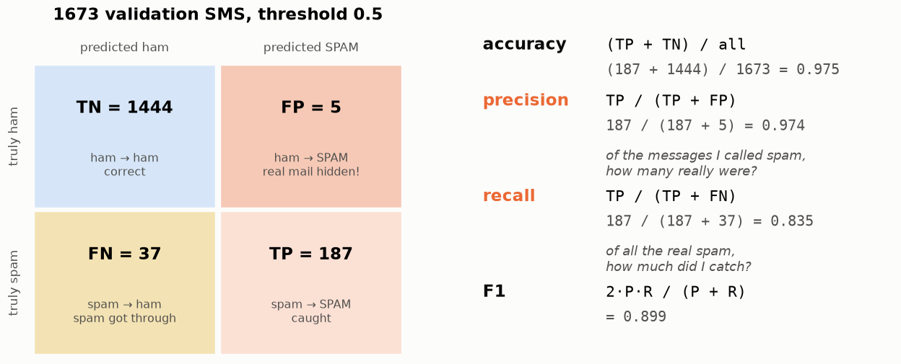
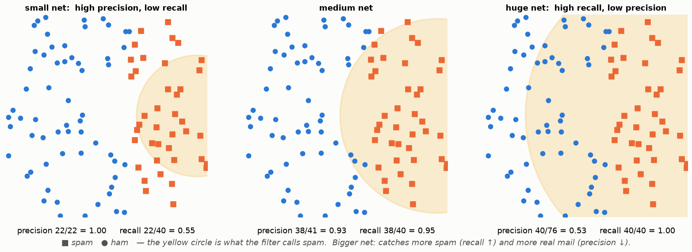
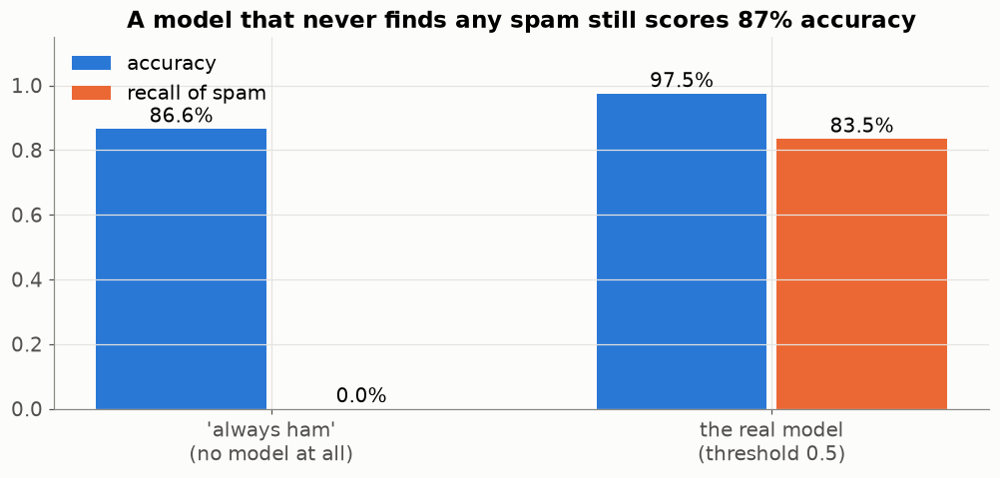
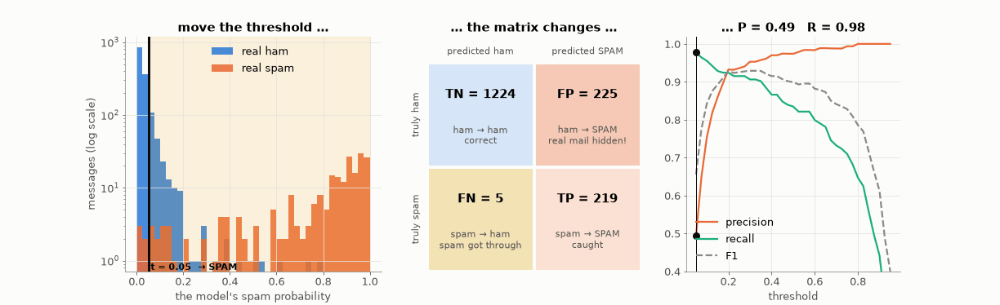
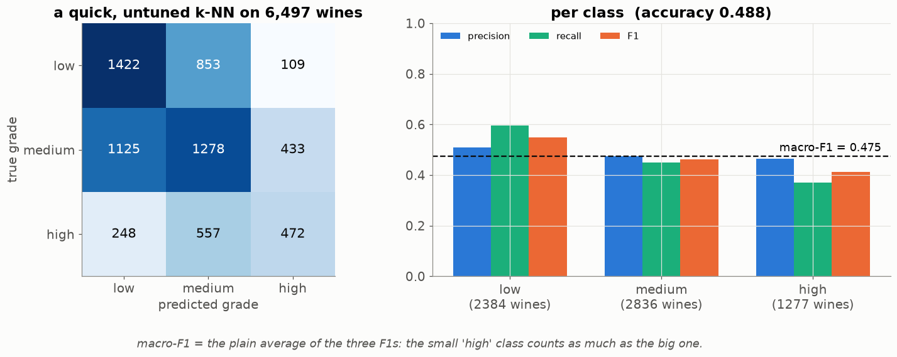

# Lesson 03 — Is the model good? Confusion matrix, precision, recall, F1

> **For:** Laith · Dani · Seif · Ryan &nbsp;·&nbsp; **Time:** 2 × 45 min
> **Before:** Lesson 00 §1, Lesson 01 &nbsp;·&nbsp; **After this:** Lesson 04 (thresholds, ROC)

## The story

> Maya's nephew finished the spam filter (Lesson 01). It looked at 1,673 SMS it had **never seen** and sorted them into
> "inbox" and "spam folder". Maya asks one question: **"Is it good?"** The nephew says "97.5 % accuracy!". Maya: "But did
> it hide any message from a customer? And how much spam still gets through?" One number can't answer both. This lesson
> builds the tools that can.

## 🎯 By the end, the student can

1. Fill a confusion matrix from a list of answers, and explain each cell in the project's own words.
2. Compute accuracy, precision, recall and F1 by hand, step by step, and say what each one *means*.
3. Explain why accuracy lies when one class is rare.
4. Explain macro-F1 for more than two classes.

## Words you need

| word | meaning |
|---|---|
| **positive** | the class we are looking for — "spam" (in PhishGuard: "phishing") |
| **negative** | the other class — "ham" (a normal message) |
| **prediction** | what the model said |
| **truth / label** | what it really was (Maya marked it) |
| **TP, FP, FN, TN** | the four combinations of prediction and truth — below |
| **accuracy, precision, recall, F1** | four ways to score — below |

---

## 1. Four kinds of answer

Every SMS ends up in exactly one of four boxes. The names have two parts: **True/False** = was the model right?
**Positive/Negative** = what did the model *say*?

| | the model said **SPAM** | the model said **ham** |
|---|---|---|
| **it really was spam** | **TP** — true positive: spam caught ✓ | **FN** — false negative: spam slipped into the inbox ✗ |
| **it really was ham** | **FP** — false positive: a real message hidden in spam ✗ | **TN** — true negative: real message delivered ✓ |

This 2 × 2 table is the **confusion matrix** — it shows where the model gets *confused*.

### Fill one by hand first

8 SMS. Truth and prediction (S = spam, H = ham):

```
SMS:         1   2   3   4   5   6   7   8
truth:       S   S   H   H   H   S   H   H
prediction:  S   H   H   S   H   S   H   H
box:         TP  FN  TN  FP  TN  TP  TN  TN
```

Count: **TP = 2, FN = 1, FP = 1, TN = 4** (total 8 ✓).

## 2. The real filter on 1,673 SMS



TP = 187 spam caught · FN = 37 spam got through · FP = 5 real messages hidden · TN = 1,444 real messages delivered.

## 3. Four scores — each one answers a different question

**Accuracy — "how often was it right?"**

```
accuracy = (right answers) / (all answers) = (TP + TN) / all
         = (187 + 1444) / 1673 = 1631 / 1673 = 0.975          → 97.5 %
```

**Precision — "when it says SPAM, can I trust it?"** Look only at the **SPAM column** (everything it flagged):

```
precision = TP / (TP + FP)                      ← the predicted-spam column
          = 187 / (187 + 5) = 187 / 192 = 0.974
```

In words: "of 192 messages it put in the spam folder, 187 really were spam". Maya cares a lot: every FP is a customer she
never answers.

**Recall — "of all the spam, how much did it catch?"** Look only at the **really-spam row**:

```
recall = TP / (TP + FN)                         ← the truly-spam row
       = 187 / (187 + 37) = 187 / 224 = 0.835
```

In words: "of 224 spam messages, it caught 187 (83 %); 37 still reached the inbox".

**Memory trick:** **P**recision → the **P**redicted column. **R**ecall → the **R**eal row.

**F1 — one number that needs both:**

```
F1 = 2 × P × R / (P + R)
   = 2 × 0.974 × 0.835 / (0.974 + 0.835)
   = 1.627 / 1.809 = 0.899
```

Why this strange formula and not just (P + R) / 2? Try a silly filter with P = 1.0 and R = 0.0 (it flagged one spam and
nothing else): the plain average says 0.5 — "half good". F1 says 2 × 1 × 0 / 1 = **0**. F1 is only high when **both**
are high.

## 4. The fishing net — precision and recall fight each other



Orange squares = spam, blue dots = real messages. The yellow circle is "what the filter calls spam".

* **Small net** (left): only very obvious spam is caught → precision 1.00, but recall 0.55.
* **Huge net** (right): catches all the spam → recall 1.00, but also many real messages → precision 0.53.

You can't have both for free. **Which one matters more depends on the cost of each mistake** — Lesson 04.

## 5. Why accuracy lies



A "filter" that **never** flags anything — no model at all — gets TN = 1,449 and everything else wrong:
accuracy = 1449 / 1673 = **86.6 %**. It sounds good and it catches **zero** spam (recall 0). When one class is rare
(**imbalanced** data), accuracy is useless alone. All our ML projects are imbalanced: spam 13 %, high-quality wines 19 %,
"disgust" faces 1.5 %.

## 6. Watch everything move together



The model actually gives each SMS a **score** between 0 and 1 ("how spammy"). A **threshold** decides: score above it →
spam. Left: the scores of real ham (blue) and real spam (orange); the black line is the threshold. Middle: the four
boxes. Right: precision, recall and F1. **Pause the video three times and read the four numbers aloud.** Move the line
left (bigger net) → FP explodes, recall goes up. Move it right → precision up, recall down.

## 7. More than two classes: macro-F1

Seif's wines have **three** grades (low, medium, high); Ryan's faces have **seven** emotions. The matrix gets bigger:



How to read it: **row = truth, column = prediction, the diagonal = correct**. E.g. row "high", column "medium" = 557 high
wines that the model called medium.

For each grade separately, pretend it is "the positive" and everything else is "negative", and compute P, R, F1:

```
"high":  TP = 472 (row high, column high)
         FP = 109 + 433 = 542 (column high, other rows)
         FN = 248 + 557 = 805 (row high, other columns)
         P = 472 / (472 + 542) = 0.465       R = 472 / (472 + 805) = 0.370       F1 = 0.412
```

**macro-F1** = the plain average of the three F1s. Every grade counts the same, even the small "high" one — so a model
can't look good by ignoring it. (This quick model is untuned; Seif's tuned k-NN reaches ≈ 0.58.)

## 8. Common mistakes

| student says | the truth |
|---|---|
| "Precision and recall are the same" | Same top (TP), different bottom: the predicted column vs the real row. |
| "97 % accuracy — done" | First compare with "always say the common class". |
| "High recall is always good" | Calling everything positive gives recall 1.0. Always report both. |

## 9. Activities

1. **Be the filter (15 min).** Print 20 real SMS (5 spam). Each student labels them in 3 minutes. Build each one's matrix;
   who had the best precision? the best recall? Same person?
2. **Doctor's test (5 min).** A COVID test: what is an FP and an FN here? Which is worse? (Discussion leads to Lesson 04.)
3. **Pause-and-read** the GIF above.

## 10. Do it yourself

<details><summary>1. TP 90, FP 10, FN 30, TN 870. Accuracy, precision, recall, F1 — every step.</summary>

all = 1000 · accuracy (90 + 870)/1000 = 0.96 · precision 90/(90+10) = 0.90 · recall 90/(90+30) = 0.75 ·
F1 = 2·0.9·0.75 / (0.9+0.75) = 1.35 / 1.65 = **0.818**.
</details>

<details><summary>2. Which number must PhishGuard keep high, and which one the spam filter? Why?</summary>

PhishGuard: **recall** — a missed phishing site can empty a bank account. Spam: **precision** — a hidden real message
can cost a customer or a job interview.
</details>

<details><summary>3. In the wine matrix, compute P and R for "low".</summary>

TP 1,422 · FP = 1,125 + 248 = 1,373 · FN = 853 + 109 = 962 · P = 1422/2795 = 0.509 · R = 1422/2384 = 0.596.
</details>

## 11. In your project

| Project | Where |
|---|---|
| Spam | `spamclassifier/ml/threshold.py` → `confusion_at`, `precision_recall_curve` · `ModelComparator.confusion_matrix` |
| PhishGuard | `phishguard/ml/evaluator.py` → `ModelEvaluator.metrics`, `worst_mistakes` |
| WineGrader | `winegrader/ml/scoring.py` → `confusion_matrix`, `precision_recall_f1`, `macro_f1`, `accuracy` |
| FaceEmotion | `app/ml/evaluator.py` → `ModelEvaluator.evaluate`, `plot_confusion_matrix` (7 × 7) |

## 🎬 Watch & explore

* StatQuest — *The Confusion Matrix* — [search on YouTube](https://www.youtube.com/results?search_query=StatQuest+confusion+matrix)
* MLU-Explain — [Precision & Recall](https://mlu-explain.github.io/precision-recall/) (interactive)
* Google ML Crash Course — [Accuracy, precision, recall](https://developers.google.com/machine-learning/crash-course/classification/accuracy-precision-recall)
