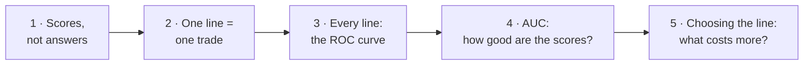
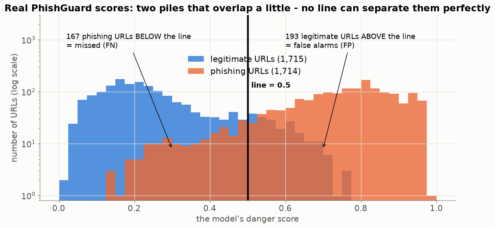
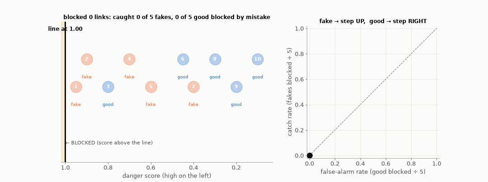
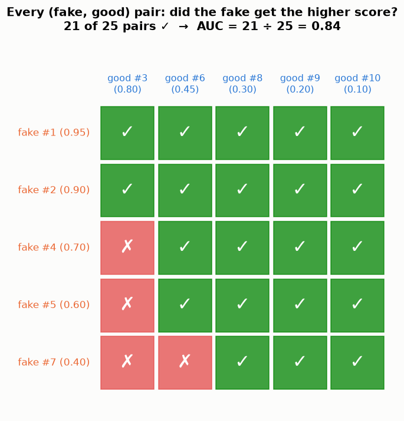
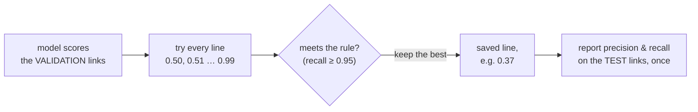

# Lesson 04 — Where do we draw the line? Thresholds and the ROC curve

> **For:** Laith (spam threshold) · Dani (PhishGuard threshold, ROC) &nbsp;·&nbsp; **Time:** 2 × 45 min
> **Before:** Lesson 03 (TP, FP, precision, recall)

**In one sentence:** a model gives each example a **score** from 0 to 1; **people** choose the line (threshold) above which
we say "yes" — and the right line depends on which mistake costs more.

## 🗺️ The map of this lesson



## The story

> **Rana works at a bank's help desk.** Every day customers forward her strange links: *"Is this really the bank?"* The bank
> buys a program that gives every link a **danger score** from 0 to 1. Rana's boss asks: *"From what score do we block a
> link?"*
>
> If they block only above 0.9, some fake links get through and a customer may lose her savings. If they block everything
> above 0.1, half of the normal websites are blocked and customers call angrily all day. The program can't decide this.
> **Rana must.**

## Words you need

| word | simple meaning | at Rana's bank |
|---|---|---|
| **score** | the model's number for one example, 0 … 1 | "how dangerous this link looks" |
| **threshold** (the line) | score ≥ threshold → say "yes" | score ≥ 0.6 → block |
| **catch rate** (recall, TPR) | of all the positives, the share we say "yes" to (Lesson 03) | of all fake links, the share blocked |
| **false-alarm rate** (FPR) | of all the **negatives**, the share we say "yes" to by mistake | of all **good** links, the share blocked |
| **ROC curve** | a picture of catch rate vs false-alarm rate for **every** threshold | |
| **AUC** | one number for how good the scores are: 0.5 = useless, 1 = perfect | |

---

## Part 1 — The model gives scores, not answers

> 📖 Rana expected the program to answer "fake" or "good". Instead it says things like *0.83* and *0.12*.

Most models don't say "yes/no". They say **how sure** they are. Laith's Naive Bayes, Dani's logistic regression and forest,
Ryan's network — all of them produce a number between 0 and 1. Turning the number into a decision needs one more thing: a
**line**.

### 🖼️ On the real PhishGuard URLs

Dani's model scored 3,429 URLs it had never seen. Here are their scores — legitimate URLs in blue, phishing in orange:



Two piles. Most legitimate URLs score low, most phishing URLs score high — the model is good. But the piles **overlap** in the
middle: some phishing URLs look innocent and some honest URLs look dangerous. **No line can separate them perfectly.** With
the line at 0.5:

* the orange bars **left** of the line are **missed** phishing URLs (FN = 167)
* the blue bars **right** of the line are **false alarms** (FP = 193)

Slide the line right → fewer false alarms, more missed phish. Slide it left → the opposite. Every line is a trade.

### 🌍 Real world: lines are everywhere

| situation | the score | the line | lower line → |
|---|---|---|---|
| airport metal detector | how much metal | the beep level | more searches, fewer weapons missed |
| a COVID test | amount of virus | "positive" cut-off | more positives, fewer sick people missed |
| a bank's fraud system | "unusual payment" score | block the card | more blocked cards, fewer frauds missed |
| a university | entrance-exam score | the admission line | more students admitted, more who struggle |
| Gmail | spam score | "move to Spam" | more spam caught, more real mail hidden |

## Part 2 — Ten links, one line

> 📖 Rana tests the program on 10 links where she already knows the truth. She sorts them by score, highest first.

```
link:    1     2     3     4     5     6     7     8     9     10
score:  0.95  0.90  0.80  0.70  0.60  0.45  0.40  0.30  0.20  0.10
truth:  fake  fake  good  fake  fake  good  fake  good  good  good
```

5 fake (1, 2, 4, 5, 7) and 5 good (3, 6, 8, 9, 10).

**Line at 0.65** → block links 1, 2, 3, 4:

```
fake ones blocked: 1, 2, 4 → 3 of 5 → catch rate      3 ÷ 5 = 0.6
good ones blocked: 3       → 1 of 5 → false-alarm rate 1 ÷ 5 = 0.2
```

**Line at 0.35** → block links 1 to 7:

```
fake blocked: 1, 2, 4, 5, 7 → 5 of 5 → catch rate      1.0
good blocked: 3, 6          → 2 of 5 → false-alarm rate 0.4
```

A lower line catches more fakes **and** makes more false alarms.

<details><summary>✅ Quick check: line at 0.5. Catch rate and false-alarm rate?</summary>

Blocked: 1–5. Fake blocked: 1, 2, 4, 5 → **0.8**. Good blocked: 3 → **0.2**.
</details>

## Part 3 — Try every line: the ROC curve

> 📖 Rana's boss doesn't want one line; he wants to *see all the choices*. Rana tries every possible line, one link at a
> time, and marks each result as a point on squared paper: across = false alarms, up = catches.

Watch her do it. Each time the line passes a link, the point moves: a **fake** link moves it **up** (one more caught — good!),
a **good** link moves it **right** (one more false alarm — bad):



```
line just below link:  none  1    2    3    4    5    6    7    8    9    10
catch rate:             0   .2   .4   .4   .6   .8   .8   1.0  1.0  1.0  1.0
false-alarm rate:       0    0    0   .2   .2   .2   .4   .4   .6   .8   1.0
```

Join the points: that staircase is the **ROC curve** ("Receiver Operating Characteristic" — an old name from radar
operators in World War II, who had to decide which blips on the screen were enemy planes).

The same thing on the real PhishGuard URLs: as the line slides down (left), the point draws the curve (right):


### 🧠 How to read a ROC curve

* **Bottom-left corner (0, 0):** the line is above everything — block nothing. No catches, no false alarms.
* **Top-right corner (1, 1):** block everything. Catch all fakes, and block all good links too.
* **Top-left corner (0, 1):** the dream — catch every fake, block no good link.
* **The diagonal:** a coin flip. Every step up costs one step right.


A good model gives fakes high scores and good links low scores — the two piles barely overlap, and the curve shoots
straight up first, towards the top-left corner. A useless model mixes them — the curve hugs the diagonal.

## Part 4 — AUC: one number for "how good are the scores?"

**AUC** = the **A**rea **U**nder the **C**urve. The whole square has area 1, so AUC is between 0 and 1.

✍️ **Count the squares** for Rana's 10 links: the grid is 5 × 5 = 25 little squares; under the staircase there are **21** →
AUC = 21 ÷ 25 = **0.84**.

### 🧠 What AUC really means: pairs

Take **one fake** and **one good** link at random. AUC is the chance that the fake one got the **higher** score. With 5 fakes
and 5 goods there are 5 × 5 = 25 pairs — check them all:



21 pairs ✓ (the fake scored higher) and 4 pairs ✗ → **21 ÷ 25 = 0.84** — the same number as the area. Not a coincidence:
each ✓ is one square under the staircase.

| AUC | meaning |
|---|---|
| 1.0 | every fake scores above every good link — a perfect line exists |
| 0.9 – 0.99 | very good (Dani's real model: **0.965**) |
| 0.5 | coin flip — the scores are useless |
| below 0.5 | worse than a coin… flip the answers and it's good! (usually a bug: labels swapped) |

**Important:** AUC judges the **scores**, not a line. It doesn't tell you which line to use — that's Part 5.

<details><summary>✅ Quick check: 3 fakes score 0.9, 0.6, 0.3; 2 goods score 0.5, 0.1. AUC?</summary>

Pairs: (0.9, 0.5) ✓ (0.9, 0.1) ✓ (0.6, 0.5) ✓ (0.6, 0.1) ✓ (0.3, 0.5) ✗ (0.3, 0.1) ✓ → 5 of 6 = **0.83**.
</details>

## Part 5 — Choosing the line: which mistake hurts more?

> 📖 The bank and Maya's phone shop (Lesson 01) face the same question with **opposite** answers.


| | Laith's spam filter | Dani's PhishGuard |
|---|---|---|
| the painful mistake | hiding a customer's message (FP) | letting a fake bank link through (FN) |
| so we demand | precision ≥ 0.98 | catch rate (recall) ≥ 0.95 |
| then pick | among lines with precision ≥ 0.98, the one that catches the most spam | among lines with recall ≥ 0.95, the **highest** (fewest false alarms) |

### ✍️ Rana's rule on her 10 links: "catch rate ≥ 0.8, as few false alarms as possible"

```
line at 0.65 → catch 0.6  ✗ (not enough)
line at 0.55 → catch 0.8  ✓  false alarms 0.2
line at 0.42 → catch 0.8  ✓  false alarms 0.4    ← worse
line at 0.35 → catch 1.0  ✓  false alarms 0.4
best: 0.55 — the highest line that still catches 80 %
```

### Giving each mistake a price

Another way: put a price on each mistake and choose the **cheapest** line. If a missed phishing link costs the bank 10× more
than a blocked good link, the best line moves **down** (block more):


Why not just use 0.5? Because 0.5 silently assumes both mistakes cost the same — almost never true.

### ⚠️ Where to choose it

The line is a **setting** — so it's chosen on the **validation** pile, never on the test pile (Lesson 01 Part 6). Then the
test pile reports the precision and recall at that line, once.



---

## 🧪 Worked example: the ROC of the 10 links in Python

```python
scores = [0.95, 0.90, 0.80, 0.70, 0.60, 0.45, 0.40, 0.30, 0.20, 0.10]
truth  = [1,    1,    0,    1,    1,    0,    1,    0,    0,    0]   # 1 = fake
P, N = sum(truth), len(truth) - sum(truth)

# one ROC point per line
for line in [1.0, 0.92, 0.85, 0.75, 0.65, 0.55, 0.42, 0.35, 0.25, 0.15, 0.0]:
    blocked = [t for s, t in zip(scores, truth) if s >= line]
    catch = sum(blocked) / P
    false_alarm = (len(blocked) - sum(blocked)) / N
    print(f"line {line:.2f}:  catch {catch:.1f}   false alarm {false_alarm:.1f}")

# AUC as pairs
fakes = [s for s, t in zip(scores, truth) if t == 1]
goods = [s for s, t in zip(scores, truth) if t == 0]
right = sum(f > g for f in fakes for g in goods)
print("AUC =", right, "/", len(fakes) * len(goods), "=", right / (len(fakes) * len(goods)))   # 21 / 25 = 0.84
```

## Try it yourself

<details><summary>1. 🟢 Rana's links, line at 0.25. Catch rate and false-alarm rate?</summary>

Blocked 1–8. Fakes blocked: all 5 → **1.0**. Good blocked: 3, 6, 8 → **0.6**.
</details>

<details><summary>2. 🟢 A model's AUC is 0.5. What does that mean?</summary>

Its scores are no better than a coin flip: a fake is as likely to score lower than a good link as higher.
</details>

<details><summary>3. 🟢 Which corner of the ROC square is "block everything"?</summary>

Top-right (1, 1): every fake caught, every good link blocked too.
</details>

<details><summary>4. 🟡 A smoke alarm company and a spam filter company each choose a line. Who chooses a low line, and why?</summary>

The smoke alarm: a missed fire (FN) is deadly, so it beeps easily (low line, many false alarms). The spam filter chooses a
high line: a hidden customer message (FP) is expensive.
</details>

<details><summary>5. 🟡 4 fakes score 0.8, 0.7, 0.4, 0.2. 4 goods score 0.6, 0.3, 0.1, 0.05. Compute the AUC by pairs.</summary>

0.8 beats all 4 · 0.7 beats all 4 · 0.4 beats 0.3, 0.1, 0.05 = 3 · 0.2 beats 0.1, 0.05 = 2 → 13 of 16 = **0.81**.
</details>

<details><summary>6. 🟡 Rule "catch rate ≥ 1.0" on Rana's links. Which line, and how many false alarms?</summary>

The highest line that blocks all 5 fakes: just below link 7 (0.40), e.g. 0.35 → false alarms 2 of 5 = **0.4**.
</details>

<details><summary>7. 🔴 Model A has AUC 0.95, model B has AUC 0.90. Is A always better for Dani?</summary>

Not necessarily. AUC averages over all lines. Dani only cares about the region where recall ≥ 0.95. B's curve might be
higher exactly there. Compare the false-alarm rate **at recall 0.95**, which is what PhishGuard's evaluator does.
</details>

<details><summary>8. 🔴 Dani gets AUC = 0.12. Is the model terrible?</summary>

It's actually very good but **upside down** — almost always the good links score higher. Most likely the labels are swapped
(1 = legitimate). Check `y = (label == "bad")`.
</details>

## Common mistakes

| student says | the truth |
|---|---|
| "The model decides" | It gives scores; people choose the line. |
| "0.5 is the natural line" | 0.5 assumes both mistakes cost the same. Choose with a rule. |
| "AUC 0.97 = 97 % correct" | AUC is about the **order** of the scores, not about one line. |
| "I chose the line on the test set" | Then the test grade is optimistic. Choose on validation. |
| "A higher line is always safer" | Safer against false alarms; more dangerous for misses. |

## 📝 Summary

> * Models give **scores**; a **threshold** turns a score into yes/no.
> * Every line is a trade between **catch rate** (recall) and **false-alarm rate**.
> * The **ROC curve** shows all the trades: fake → step up, good → step right.
> * **AUC** = area under it = the chance a random positive outscores a random negative. 0.5 = coin, 1 = perfect.
> * Choose the line with a **rule from the business** (precision ≥ 0.98, recall ≥ 0.95) or with **prices**, on
>   **validation**.

## Class activities

1. **Human ROC (15 min).** Hand out the 10 link cards. Walk the line down card by card; plot each point on squared paper;
   count the squares under the curve (21).
2. **Bank vs news site (5 min).** Role-play: the bank's security chief and the marketing manager argue about the line. Who
   wants a low line, who a high one?
3. **Make your own scores (10 min).** Each group invents 6 scores for 3 fakes and 3 goods so that AUC = 1, then = 0.5, then
   = 0.
4. `python visualize.py --live` — slide the line yourself on the real URLs.

## In your project

| Project | Where |
|---|---|
| Spam | `spamclassifier/ml/threshold.py` → `choose_threshold` (precision ≥ 0.98) |
| PhishGuard | `phishguard/ml/evaluator.py` → `ModelEvaluator.choose_threshold` (recall ≥ 0.95), `compare` · exercises ex10–ex12 |

## 🎬 Watch & explore

| | |
|---|---|
| <a href="https://www.youtube.com/watch?v=4jRBRDbJemM"></a> | **StatQuest — ROC and AUC, Clearly Explained!** (16 min). Builds the curve point by point like Part 3, with mice and obesity instead of links. |
| <a href="https://www.youtube.com/watch?v=vP06aMoz4v8"></a> | **StatQuest — Sensitivity and Specificity**. The two rates on the ROC axes, under their medical names. |

**Play with it:**
* MLU-Explain — [ROC & AUC](https://mlu-explain.github.io/roc-auc/) — drag the two piles apart and watch the curve change.
* At home: `python visualize.py --live`.

<details><summary>🎓 <b>For the defence (advanced)</b></summary>

* **Laith's algorithm:** for t = 0.50, 0.51 … 0.99 compute precision and recall on validation; keep the t with precision ≥
  0.98 and the highest recall; if none reaches 0.98, **raise an error** (never silently use 0.5).
  Dani: if no line reaches 0.95, fall back to `config.DEFAULT_THRESHOLD`.
* **AUC as pairs on real URLs:**

  

* **Ties:** if a fake and a good link have the same score, the pair counts as ½.
* **ROC vs precision-recall curve:** when positives are very rare, the ROC can look great while precision is poor (Lesson 03,
  the rare disease). The PR curve shows that directly.
* **Cost decides:** 0.5 and "best F1" both pretend the mistakes cost the same; a cost-based line doesn't.
</details>
