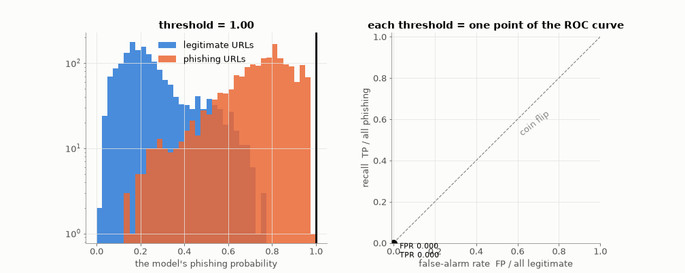
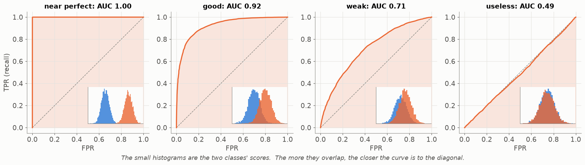
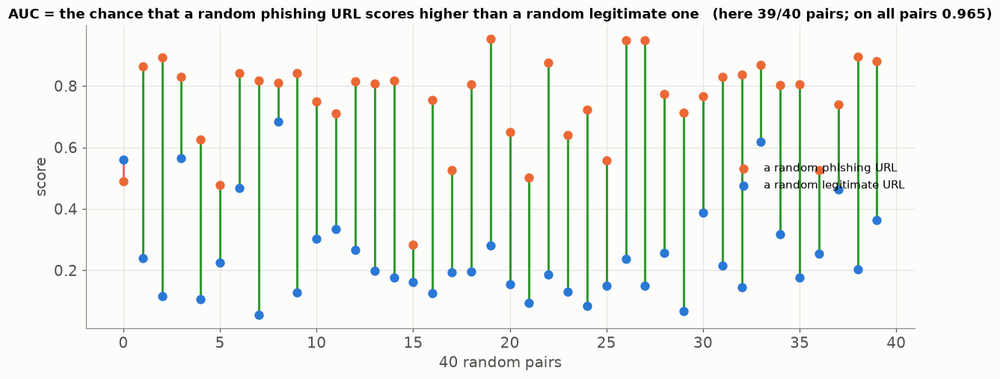
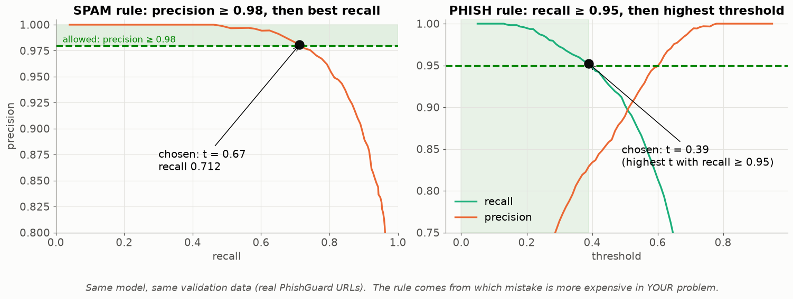
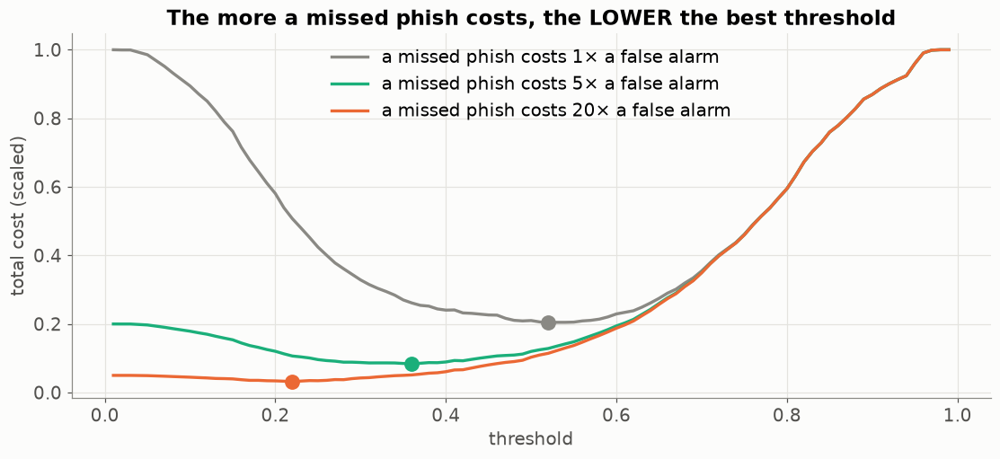

# Lesson 04 — The threshold is a decision: ROC, AUC and choosing where to cut

> **For:** Laith (precision floor) · Dani (ROC, recall target) · Ryan, Seif (reading curves) &nbsp;·&nbsp; **Time:** 45 min
> **Before:** Lesson 03 &nbsp;·&nbsp; **After this:** the threshold stage of Spam (stage 6) and PhishGuard (stage 4)

## 🎯 By the end, the student can

1. Explain that a classifier outputs a **score**, and the **threshold** turns it into a decision.
2. Read and draw a ROC curve; say what AUC = 0.5 and AUC = 1 mean; explain AUC as "the chance a random positive
   outranks a random negative".
3. Apply their project's rule for choosing the threshold, **on the validation set only**, and defend it.

---

## 1. Every threshold is one point of the ROC curve



Real PhishGuard URLs, a simple model. Left: the scores of legitimate URLs (blue) and phishing URLs (orange). The
black line is the threshold; everything to its right is blocked. Right: for that threshold we plot

* **x = false-alarm rate** (FPR) = FP / all legitimate — "how many good sites did I block?"
* **y = recall** (TPR) = TP / all phishing — "how many attacks did I catch?"

At threshold 1.0 nothing is blocked → (0, 0). At 0.0 everything is blocked → (1, 1). In between the line slides,
and the dot draws the curve. **The area under it is the AUC.**

## 2. Shapes of ROC curves



| AUC | Meaning |
|---|---|
| 1.0 | the two piles do not overlap at all — some threshold is perfect |
| 0.9 – 0.99 | good: little overlap (PhishGuard target ≥ 0.97) |
| 0.5 | the diagonal — the scores carry no information, a coin flip |
| < 0.5 | worse than a coin… flip the model's answers and it becomes good (a bug, usually swapped labels) |

## 3. What AUC means, in one sentence



Take one random phishing URL and one random legitimate URL. **AUC is the probability that the phishing one gets
the higher score.** Green lines are pairs in the right order, red ones are wrong. That is why AUC does not
depend on any threshold — it is about the **ranking**, which makes it the fairest single number to compare two
models (Dani: logistic regression vs random forest).

## 4. Choosing the threshold — two projects, two opposite rules



| | Spam (Laith) | PhishGuard (Dani) |
|---|---|---|
| expensive mistake | **FP** — real mail hidden | **FN** — phishing let through |
| constraint | precision ≥ **0.98** | recall ≥ **0.95** |
| then | the threshold with the **highest recall** | the **highest threshold** (fewest false alarms) |
| nothing meets the constraint | **raise an error** (never fall back to 0.5) | fall back to `config.DEFAULT_THRESHOLD` |
| function | `choose_threshold` in `ml/threshold.py` | `ModelEvaluator.choose_threshold` |

Both are scanned **on the validation split**. The test split only measures the chosen threshold, once.

Algorithm (Laith's version) — write it on the board:

```
best = none
for t from START to STOP in steps of STEP:
    P, R = precision and recall when "spam" means p >= t
    if P >= 0.98 and (best is none or R > best.R):
        best = (t, P, R)
if best is none: raise ValueError("no threshold reaches precision 0.98; best was ...")
return best
```

## 5. Why not just 0.5 or "best F1"?



Give each mistake a price. When a missed phish costs the same as a false alarm, the cheapest threshold is in the
middle. When it costs 20×, the cheapest threshold moves **left** — block more, accept more false alarms. 0.5 and
max-F1 both secretly assume the two mistakes cost the same.

## 6. Misconceptions

| Student says | Truth |
|---|---|
| "The model decides spam or not" | The model gives a score; **you** decide where to cut. |
| "AUC 0.97 means 97 % accuracy" | AUC is about ranking, accuracy about one threshold. Different things. |
| "I'll tune the threshold on the test set — it's just one number" | It is a decision → leakage. Validation only. |
| "Lower threshold = better model" | It is the same model; you are only moving along its curve. |

## 7. Activities

1. **Human ROC (15 min).** Give each student 10 cards with a score and a hidden label (6 good, 4 phishing). Sort
   by score. Walk the threshold down card by card; after each card plot the point (FP/6, TP/4) on squared paper.
   They have drawn a ROC curve by hand. Count the squares under it → AUC.
2. **Pick for the client (5 min).** Show the table of the PhishGuard theory (§5.1: thresholds 0.70 / 0.50 / 0.30).
   Role-play: one student is the bank, one is a newspaper site. Which threshold does each want?
3. `python visualize.py --live` — slide the threshold and watch the dot.

## 8. Check yourself

<details><summary>1. The ROC curve passes through (0.02, 0.90). Say it in words.</summary>

At some threshold the model blocks 90 % of phishing URLs while blocking only 2 % of the legitimate ones.
</details>

<details><summary>2. Why does Laith's choose_threshold raise an error instead of returning 0.5 when nothing reaches 0.98?</summary>

Because then the model does not meet the requirement. Silently using 0.5 would show users verdicts nobody chose
and that break the precision promise. The error forces a human decision. (`test_impossible_floor_raises_rather_than_defaulting`.)
</details>

<details><summary>3. A model's AUC is 0.35. What happened?</summary>

The ranking is mostly reversed — almost certainly the labels are swapped somewhere (0/1 or good/bad). Flipping the
scores would give 0.65.
</details>

## 9. In your project

| Project | Where |
|---|---|
| Spam | `spamclassifier/ml/threshold.py` → `confusion_at`, `choose_threshold`, `precision_recall_curve`; the threshold is stored in the bundle (`threshold.json`, `chosen_on`) · theory `08_SpamClassifier/01_theory/06_evaluation.md` |
| PhishGuard | `phishguard/ml/evaluator.py` → `ModelEvaluator.choose_threshold`, `compare` (ROC for both models) · theory `25_PhishGuard/01_theory/05_evaluation.md` |

## 🎬 Watch & explore

* StatQuest — *ROC and AUC, Clearly Explained!* — [search on YouTube](https://www.youtube.com/results?search_query=StatQuest+ROC+and+AUC+clearly+explained)
* MLU-Explain — [ROC & AUC](https://mlu-explain.github.io/roc-auc/) (interactive)
* Google ML Crash Course — [ROC and AUC](https://developers.google.com/machine-learning/crash-course/classification/roc-and-auc)
