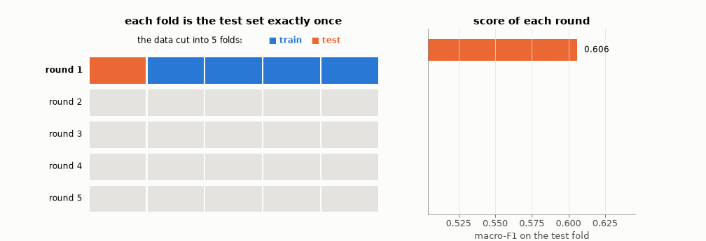
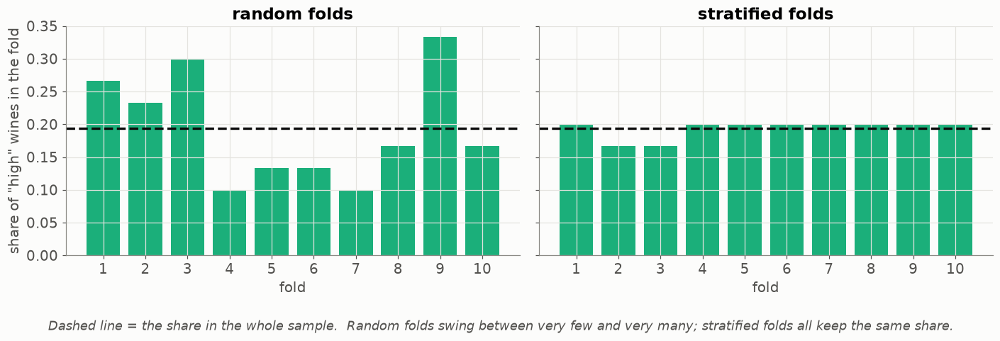
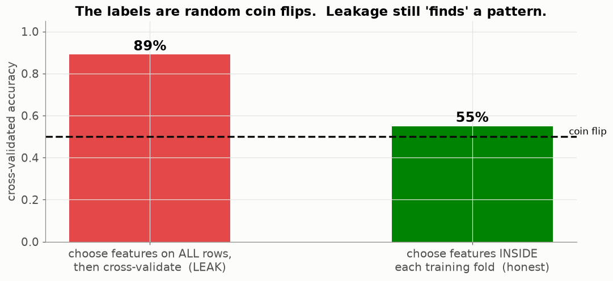
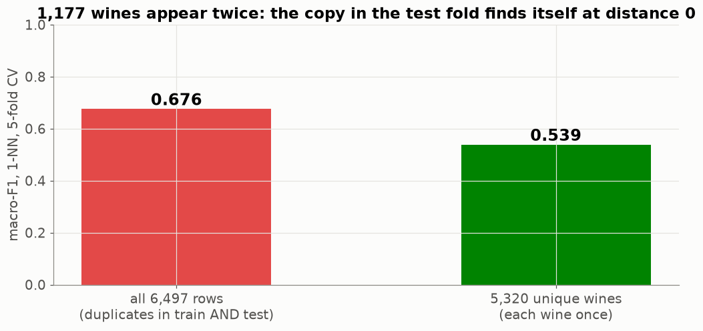
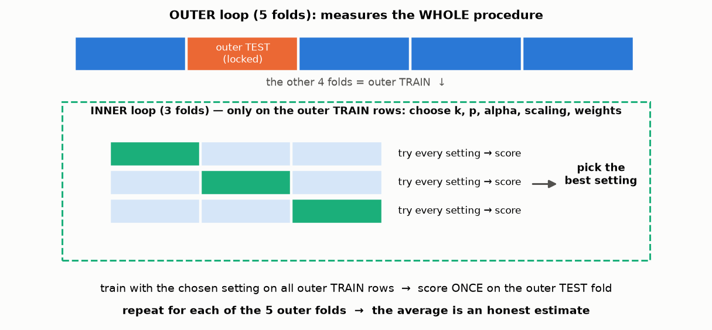

# Lesson 05 — Honest evaluation: cross-validation, nested CV and leakage

> **For:** Seif (nested CV — the heart of his evaluation) · Laith (SVM grid search) · Dani (grid search) · everyone (leakage)
> **Time:** 60 min &nbsp;·&nbsp; **Before:** Lessons 01, 03 &nbsp;·&nbsp; **After this:** the tuning stages of the ML projects

## 🎯 By the end, the student can

1. Explain k-fold cross-validation with the picture, and why it is better than one validation split.
2. Explain why folds must be **stratified**, and why duplicates must be removed **before** splitting.
3. Draw nested cross-validation and explain what each loop is for.
4. Name the four common leaks and the guard against each.

---

## 1. One validation split is one roll of the dice

With 300 validation wines, which wines happened to land there can move the score by a few points. Choosing
`k = 15` over `k = 17` on such noise means choosing by luck. **Cross-validation** uses every row for testing once,
and averages.

## 2. k-fold cross-validation — watch it



1. Cut the (shuffled) data into **k** folds (here 5).
2. Round *i*: fold *i* is the test set, the other 4 folds are training. Train, score.
3. Report the **mean ± standard deviation** of the 5 scores.

Real wine numbers (5,320 unique wines, k-NN): `0.606, 0.573, 0.574, 0.564, 0.593` → **0.582 ± 0.015**.
The ± is as important as the mean: if two settings differ by less than it, they are a tie.

## 3. Stratified folds



On a small sample, random folds can have 5 % "high" wines in one fold and 30 % in another — every fold measures a
different problem. **Stratified** folds deal each class out separately, like dealing cards suit by suit, so each fold
keeps the overall share. (Seif writes this by hand: `stratified_kfold` in `winegrader/ml/folds.py`.)

## 4. Leakage — the test set must know NOTHING

**Leakage** = information from the test rows gets into the model or into a decision. The score becomes too good, and
nothing crashes. Two real demonstrations:

### 4a. Pure noise, 89 % accuracy



100 rows, 5,000 random features, labels are **coin flips** — nothing can be learned. Picking the 20 features "most
related to the label" using **all** rows, then cross-validating, scores **89 %**. Doing the same selection *inside each
training fold* scores 55 % — a coin flip, the truth. *The leak is invisible in the code unless you know to look for it.*

### 4b. The duplicate trap (WineGrader, real data)



1,177 wines are exact copies of other wines. With them, a 1-NN finds the test wine's own twin at distance 0 and
"predicts" its label: macro-F1 0.676. Without them: 0.539. **Remove duplicates before splitting** — after splitting is
too late, because each copy looks unique in its own part.

### The four leaks and their guards

| Leak | Guard | Projects |
|---|---|---|
| a row (or its copy) in both train and test | remove duplicates **before** splitting; `assert_no_leakage` | Wine, Spam |
| scaler / vocabulary / IDF / feature selection fitted on all rows | fit inside the training part (a `Pipeline`) | all ML |
| hyper-parameters or threshold chosen on test | validation set, or **nested** CV | all ML |
| looking at the final test number and trying again | run the final evaluation **once** | all — "your discipline" |

## 5. Nested cross-validation



If we use CV both to *choose* `k, p, alpha` **and** to report the score, the reported score is the best of many tries —
optimistic. Nested CV separates the two jobs:

* **inner loop** (3 folds, only on the outer-training rows) → *chooses* the setting;
* **outer loop** (5 folds) → *measures* the whole procedure "tune, then train", each outer test fold scored once.

```python
for train, test in outer_splits:                       # 5 times
    inner  = stratified_kfold(y[train], 3)
    tuned  = grid_search(X[train], y[train], inner)    # never sees X[test]
    w      = learn_weights(X[train], y[train], tuned.best, inner).weights
    result = evaluate_split(model_with(tuned.best, w), X, y, train, test, ...)
```

**How Seif proves it:** `test_nested_never_sees_outer_test` scrambles the outer test labels and runs again. The chosen
parameters must be **identical** — the procedure cannot react to labels it never looked at.

## 6. Misconceptions

| Student says | Truth |
|---|---|
| "CV trains one model 5 times" | It trains 5 *different* models; CV measures the **procedure**, then you train one final model on all training data. |
| "Higher CV score with duplicates = better" | Better at looking up answers, not at grading wine. |
| "Nested CV gives me the best parameters" | It gives an honest **score**. Different outer folds may choose different parameters; that's expected and goes in the book. |
| "A small leak doesn't matter" | You cannot know how big it is — that is why it matters. |

## 7. Activities

1. **Deal the folds (10 min).** 20 cards: 12 red, 8 black. Deal 4 folds randomly, count colours per fold. Then
   deal stratified (reds first, round-robin, then blacks). Compare.
2. **Spot the leak (15 min).** Show 4 code snippets (on the board) — scaler fitted before split, `TfidfVectorizer.fit` on
   all texts, threshold chosen on `X_test`, duplicates dropped after `train_test_split`. Pairs find the leak and fix it.
3. **Run the noise demo** (`python visualize.py --only leakage`) and change `k=20` to `k=200`. What happens to the leak?

## 8. Check yourself

<details><summary>1. Five fold scores: 0.61, 0.55, 0.58, 0.60, 0.56. What do you report?</summary>

mean 0.58, std ≈ 0.023 → "0.58 ± 0.02 (5-fold)". Another setting with 0.59 is a tie, not a win.
</details>

<details><summary>2. Why is the vocabulary of the spam filter part of "the model" for leakage purposes?</summary>

It is learned from data (which words exist, their document frequencies → IDF). If test messages helped build it, the
model already "knows" their rare words. Fit it on the training split only.
</details>

<details><summary>3. In nested CV, outer fold 2 chose k = 15 and fold 4 chose k = 25. Is that a bug?</summary>

No. Each outer fold has different training rows; nearby `k` values score almost the same. What is reported is the
procedure's score. The table of choices shows how stable the tuning is — good material for the book.
</details>

## 9. In your project

| Project | Where |
|---|---|
| WineGrader | `winegrader/ml/folds.py` → `stratified_kfold` · `winegrader/data/loader.py` → `drop_exact_duplicates` · `winegrader/ml/evaluation.py` → `cross_validate`, `nested_cv` · `winegrader/ml/tuning.py` → `prepare_folds`, `grid_search` · theory `32_WineGrader/01_theory/07_evaluation.md` |
| Spam | `ModelComparator.cross_validate`, `assert_no_leakage` · grid search for `C` inside CV |
| PhishGuard | `ModelTrainer.fit_with_search` (grid search with CV, on train only) |

## 🎬 Watch & explore

* StatQuest — *Machine Learning Fundamentals: Cross Validation* — [search on YouTube](https://www.youtube.com/results?search_query=StatQuest+cross+validation)
* MLU-Explain — [Cross-Validation](https://mlu-explain.github.io/cross-validation/) (interactive)
* scikit-learn — [Nested versus non-nested cross-validation](https://scikit-learn.org/stable/auto_examples/model_selection/plot_nested_cross_validation_iris.html)
