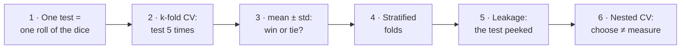
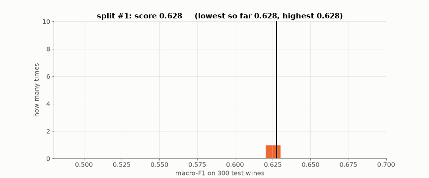
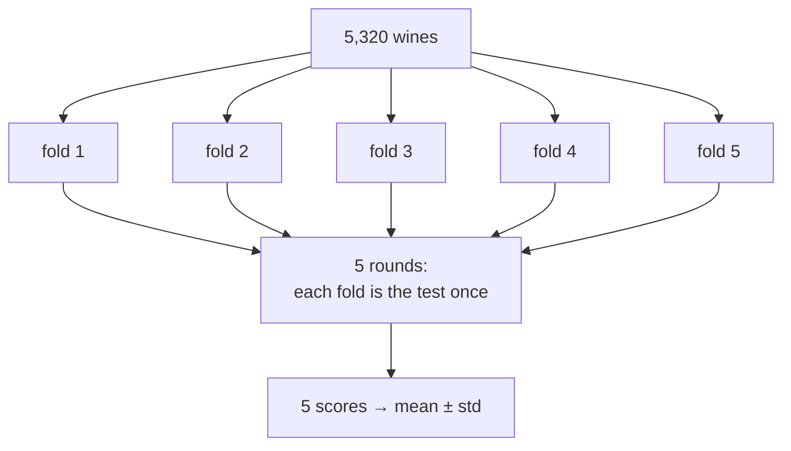
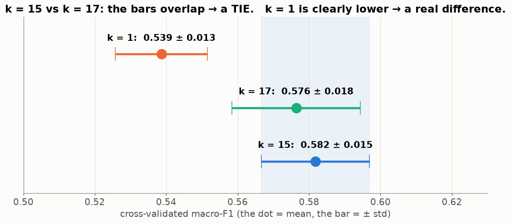
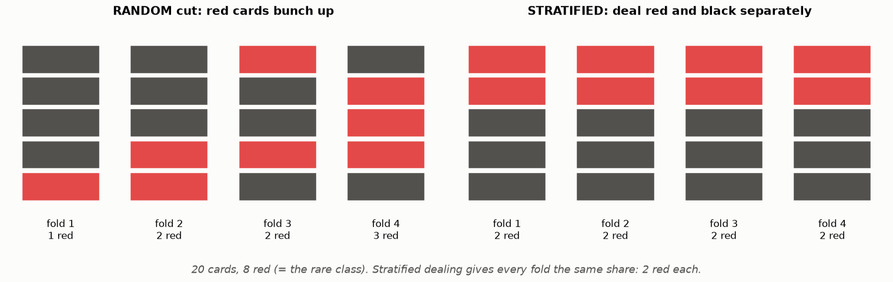
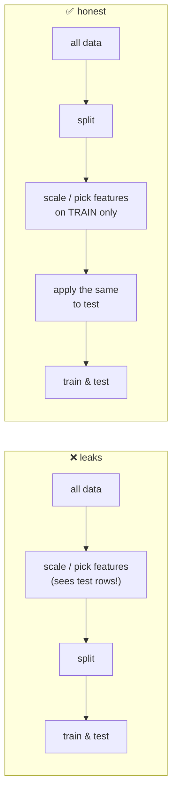
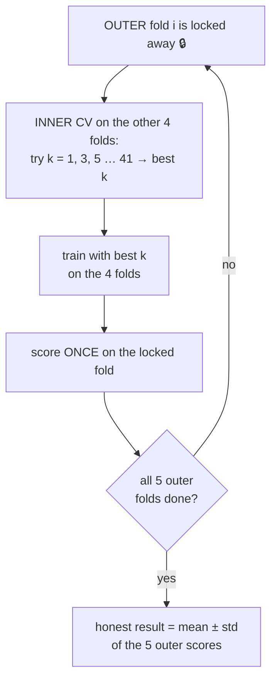

# Lesson 05 — Honest testing: cross-validation, nested CV and leakage

> **For:** Seif (nested CV is the heart of his evaluation) · Laith · Dani · everyone (leakage) &nbsp;·&nbsp; **Time:** 2 × 45 min
> **Before:** Lesson 00 §2–3 (average, std); Lessons 01, 03 &nbsp;·&nbsp; **After this:** the tuning stages of the ML projects

**In one sentence:** test many times on different slices so that luck averages out, and make sure the test data never
— not even a little — helps build the model.

## 🗺️ The map of this lesson



## The story

> Sami (the wine shop, Lesson 02) now has a program that grades a wine as low / medium / high. A wine company offers to buy
> it — **if it is really good**. Sami tests it on 300 wines: score **0.61**. His nephew tests again on 300 *other* wines:
> **0.55**. Which number is true?
>
> Then the company's expert warns him: *"Half the programs people sell us score great at home and badly with us. Usually
> the programmer accidentally let the test wines help."* This lesson is how Sami gets **one honest number** — and how he
> never fools himself.

## Words you need

| word | simple meaning | in Sami's shop |
|---|---|---|
| **fold** | one slice of the data | one fifth of the wines |
| **k-fold cross-validation (CV)** | test k times, each time on a different fold, train on the rest; average the k scores | 5 rounds, 5 scores |
| **mean ± std** | the average score, and how much it jumps between folds (Lesson 00 §2–3) | 0.582 ± 0.015 |
| **hyper-parameter** | a setting chosen by people, not learned (Lesson 01) | k in k-NN |
| **tuning** (grid search) | trying many settings and keeping the best | try k = 1, 3, 5 … 41 |
| **leakage** | information from the test data sneaks into training or a decision → a falsely good score | |
| **nested CV** | an inner CV to choose settings, inside an outer CV that measures | |

---

## Part 1 — One test is one roll of the dice

> 📖 Sami's nephew is curious. He cuts the 5,320 wines into "train" and "300 test wines" **40 times**, each time at random,
> and writes down the score each time.



The **same program** on the **same data** scores anywhere from **0.527** to **0.662**, depending only on which 300 wines landed
in the test pile. Some piles happen to contain more "hard" wines than others.

So "0.61" and "0.55" were both true — and neither tells Sami how good the program is. If he now chooses between two
settings whose scores differ by 0.02, he's choosing **by luck**.

### 🌍 Real world

* A football team's quality is not one match — it's a season. One match = one roll of the dice.
* A restaurant critic eats there several times before writing a review.
* A teacher doesn't grade you on one question — an exam has 20 questions, so one unlucky question doesn't decide your grade.

## Part 2 — k-fold cross-validation: every wine is tested once

> 📖 The expert gives Sami a better recipe: *"Don't test once. Cut the wines into 5 slices and test 5 times."*


1. Shuffle the wines and cut them into **5 folds** (slices).
2. **Round 1:** fold 1 is the test, folds 2–5 are training. Train, then score on fold 1.
3. **Round 2:** fold 2 is the test, the others train. … and so on, 5 rounds.
4. Report the **mean** of the 5 scores, and their **std** (how much they jump).

Every wine is tested **exactly once**, every score comes from wines the model didn't train on, and no wine is wasted.



### ✍️ By hand: Sami's 5 real scores

(real wine data, 5,320 unique wines, a k-NN with k = 15)

```
round:   1      2      3      4      5
score:  0.606  0.573  0.574  0.564  0.593

mean  = (0.606 + 0.573 + 0.574 + 0.564 + 0.593) ÷ 5 = 2.910 ÷ 5 = 0.582
std:    differences from 0.582:     +0.024  −0.009  −0.008  −0.018  +0.011
        squares:                    0.000576 0.000081 0.000064 0.000324 0.000121
        average of the squares:     0.001166 ÷ 5 = 0.000233
        square root:                √0.000233 = 0.015
report:  0.582 ± 0.015
```

```python
import numpy as np
scores = np.array([0.606, 0.573, 0.574, 0.564, 0.593])
print(f"{scores.mean():.3f} ± {scores.std():.3f}")      # 0.582 ± 0.015
```

## Part 3 — mean ± std: a win or a tie?

> 📖 Sami tries k = 17 next to k = 15. k = 15 scores 0.582, k = 17 scores 0.576. *"So 15 is better!"* he says.

Look at the jumping range (± std) of each:



* **k = 15** (0.582 ± 0.015) and **k = 17** (0.576 ± 0.018): the bars **overlap a lot** → a **tie**. The difference is smaller
  than the normal jumping between folds. Pick either.
* **k = 1** (0.539 ± 0.013): its bar doesn't reach the others → a **real difference**. k = 1 is worse.

**Rule of thumb:** if the difference between two settings is smaller than their ± std, don't call it a win.

## Part 4 — Stratified folds: deal like cards

> 📖 "High" wines are only 19 % of Sami's wines. His first CV gave one fold with almost no high wines — that fold tested a
> completely different problem.



A random cut can put the rare class unevenly into folds. **Stratified** folds deal each class separately, like dealing a
pack of cards suit by suit, so every fold gets the same share. On the real wines:


Seif writes this himself in `stratified_kfold`: group the wine indices by grade, shuffle each group, deal each group round
the folds one by one.

## Part 5 — Leakage: the test must know NOTHING

> 📖 A teacher's assistant accidentally sees the exam on Sunday. On Wednesday she gets 100. Does she know the material? We
> can't tell anymore — the exam has **leaked**.

**Leakage** = something from the test data helped build the model or make a decision. Nothing crashes, no error appears. The
score is just **too good** — and the program fails with the real customer. It's the most dangerous bug in machine learning
because it looks like success.

### Demonstration 1 — 89 % on pure noise

The experiment: 100 rows, 5,000 columns of **random numbers**, and labels that are **coin flips**. There is *nothing* to
learn — any honest method must score about 50 %.


* **The leak:** first choose the 20 columns "most related to the label" using **all 100 rows**, then cross-validate on
  those 20 columns → **89 %**. The choosing step already looked at the test rows' labels: among 5,000 random columns, some
  match the coin flips by pure luck — and the leak picked exactly those.
* **Honest:** do the choosing **inside** each training fold only → **55 %** (≈ a coin flip — the truth).

Same data, same model. The **only** difference is the order of two steps.

### Demonstration 2 — the duplicate trap (Seif's real data)

1,177 wines in the dataset are **exact copies** of other wines (the same 11 numbers and grade).


If one copy lands in training and its twin in the test fold, the 1-NN finds the twin at distance 0 and copies its grade:
score **0.676**. Without duplicates: **0.539**. The program didn't get better at grading wine — it got better at **looking up
answers**. Remove duplicates **before** splitting; after is too late.

### 🌍 Real world leaks

* **The same patient twice.** Medical-image studies have reported excellent scores that dropped when checked properly: X-rays
  of the **same patient** were in both training and test, so the model recognised the person, not the illness.
* **The future in the past.** A model predicts "will this customer leave?" using a column `cancellation_date` — which only
  exists **after** they left. Perfect at home, useless in real life.
* **The ID number.** In some datasets, sick patients came from one hospital whose IDs start with "9". The model learns "ID
  starts with 9 → sick".

### The four leaks and their guards

| leak | the trap in one line | guard |
|---|---|---|
| the same example (or a copy) in train and test | `train_test_split` before removing duplicates | remove duplicates **before** splitting; `assert_no_leakage` |
| a "learning step" fitted on all rows | `scaler.fit(X)` or `TfidfVectorizer.fit(all_texts)` before the split | fit on the **training** part only — a `Pipeline` does it for you |
| a setting chosen using the test set | `threshold = best_on(X_test)` | a validation set, or **nested** CV |
| trying again after looking at the test score | "84 %… let me tweak and run test again" | run the final test **once** |



<details><summary>✅ Quick check: Laith builds the word list (vocabulary) from all 5,574 SMS, then splits. Leak?</summary>

Yes — a small one. The vocabulary and the IDF numbers (Lesson 07) already "know" the test messages' rare words. Build them
from the training SMS only.
</details>

## Part 6 — Nested cross-validation: choosing and measuring separately

> 📖 Sami tries 20 values of k with 5-fold CV and reports the best one: 0.582. The expert frowns: *"You tried 20 times and
> kept the luckiest. Of course it's high."*

If you use the same folds to **choose** the best k (out of 20) **and** to **report** the score, the reported score is "the
best of 20 tries" — slightly lucky, so too high. Like a student who takes 20 practice exams and tells everyone their best
grade.

Nested CV gives each job its own data:


* **Outer loop (5 folds) — measures.** One fold is locked away as the outer test.
* **Inner loop (3 folds, inside the other 4 outer folds only) — chooses.** Try every setting, pick the best.
* Train with the chosen setting on the 4 outer folds, score **once** on the locked fold.
* Repeat for each outer fold; the average of the 5 outer scores is the honest number.



**Analogy:** to pick the best study method you do practice tests (inner loop). The real exam (outer fold) is written by
someone else, and you never see it while practising.

```python
for train, test in outer_splits:                       # 5 times
    inner  = stratified_kfold(y[train], 3)
    tuned  = grid_search(X[train], y[train], inner)    # never sees X[test]
    w      = learn_weights(X[train], y[train], tuned.best, inner).weights
    result = evaluate_split(model_with(tuned.best, w), X, y, train, test, ...)
```

Seif's proof that nothing leaks: `test_nested_never_sees_outer_test` scrambles the outer test labels and runs again — the
chosen settings must stay **identical**, because the procedure never looked at them.

---

## 🧪 Worked example: the leak, in 15 lines

Run this. The only difference between the two numbers is **where** the feature selection happens.

```python
import numpy as np
from sklearn.feature_selection import SelectKBest, f_classif
from sklearn.linear_model import LogisticRegression
from sklearn.model_selection import cross_val_score
from sklearn.pipeline import make_pipeline

rng = np.random.default_rng(0)
X = rng.normal(size=(100, 5000))          # pure noise
y = rng.integers(0, 2, 100)               # coin flips: nothing to learn

# LEAK: choose 20 columns using ALL rows, then cross-validate
X20 = SelectKBest(f_classif, k=20).fit_transform(X, y)
print("leaky :", cross_val_score(LogisticRegression(), X20, y, cv=5).mean())

# HONEST: the choosing happens inside each training fold (a Pipeline)
honest = make_pipeline(SelectKBest(f_classif, k=20), LogisticRegression())
print("honest:", cross_val_score(honest, X, y, cv=5).mean())
```

Expect something like **0.8–0.9** for the leaky one and **≈ 0.5** for the honest one.

## Try it yourself

<details><summary>1. 🟢 1,000 wines, 5-fold CV. How many wines in each test fold? How many models are trained?</summary>

1,000 ÷ 5 = **200** per fold. **5** models (one per round).
</details>

<details><summary>2. 🟢 Fold scores 0.61, 0.55, 0.58, 0.60, 0.56. Mean ± std, step by step.</summary>

mean = 2.90 ÷ 5 = 0.58 · differences +0.03, −0.03, 0, +0.02, −0.02 · squares 0.0009, 0.0009, 0, 0.0004, 0.0004 · average
0.0026 ÷ 5 = 0.00052 · √ = **0.023** → "0.58 ± 0.02".
</details>

<details><summary>3. 🟡 Setting A: 0.71 ± 0.03. Setting B: 0.73 ± 0.03. Is B better?</summary>

The difference (0.02) is smaller than the jumping range (0.03) → a **tie**. Pick the simpler one, or test more.
</details>

<details><summary>4. 🟡 Spot the leak: `X = scaler.fit_transform(X); X_tr, X_te = train_test_split(X)`.</summary>

The scaler's average and std were computed with the test rows. Split first, then `scaler.fit(X_tr)`, then transform both.
</details>

<details><summary>5. 🟡 Why is the spam vocabulary part of "the model" for leakage?</summary>

It is learned from data (which words exist, how common they are → IDF). If test messages helped build it, the model
already knows their rare words. Fit it on the training split only.
</details>

<details><summary>6. 🟡 Outer fold 2 chose k = 15, fold 4 chose k = 25. A bug?</summary>

No. Different training rows, and nearby k values score almost the same (Part 3: a tie). The table of choices shows how
stable tuning is.
</details>

<details><summary>7. 🔴 A student removes duplicates AFTER train_test_split, from each part separately. Why doesn't that help?</summary>

A wine in train and its twin in test are each unique **inside** their own part, so nothing is removed — the twin pair
survives across the split. Duplicates must be removed from the whole dataset first.
</details>

<details><summary>8. 🔴 With 5-fold outer and 3-fold inner CV, trying 20 values of k, how many models are trained?</summary>

Per outer fold: 20 settings × 3 inner folds = 60, plus 1 final = 61. Times 5 outer folds = **305** models.
</details>

## Common mistakes

| student says | the truth |
|---|---|
| "CV trains one model 5 times" | It trains 5 **different** models; CV measures the **procedure**. Afterwards you train one final model on all training data. |
| "0.582 beats 0.576" | Not if the ± ranges overlap. It's a tie. |
| "With duplicates my score is higher — great" | It is better at looking up answers, not at grading wine. |
| "A small leak doesn't matter" | You can't know how big it is — demonstration 1 turned 50 % into 89 %. |
| "I'll report the best CV score of my grid search" | That's the luckiest of many tries. Use nested CV or a separate test set. |

## 📝 Summary

> * One test split is **one roll of the dice** — scores jumped from 0.53 to 0.66 on the same program.
> * **k-fold CV**: every example is tested once; report **mean ± std**.
> * Two settings whose difference is smaller than their **±** are a **tie**.
> * **Stratified** folds keep the class shares equal — deal like cards.
> * **Leakage** = the test helped build the model. Guards: remove duplicates first, fit every learning step on train only
>   (Pipeline), choose settings on validation, test once.
> * **Nested CV**: an inner loop **chooses**, an outer loop **measures**.

## Class activities

1. **Deal the folds (10 min).** 20 cards: 12 red, 8 black. Deal 4 folds randomly; count colours. Then deal stratified.
2. **Spot the leak (15 min).** On the board: (a) scaler fitted before the split, (b) `TfidfVectorizer.fit` on all texts,
   (c) threshold chosen on `X_test`, (d) duplicates removed after `train_test_split`. Pairs find and fix each leak.
3. **Run the noise demo** (the worked example) and change `k=20` to `k=200`, and 100 rows to 1,000. What happens to the leak?
4. **Football season (5 min).** "Our team won one match 5–0. Is it the best team?" — connect to Part 1.

## In your project

| Project | Where |
|---|---|
| WineGrader | `winegrader/ml/folds.py` → `stratified_kfold` · `data/loader.py` → `drop_exact_duplicates` · `ml/evaluation.py` → `cross_validate`, `nested_cv` · `ml/tuning.py` → `prepare_folds`, `grid_search` · theory `32_WineGrader/01_theory/07_evaluation.md` |
| Spam | `ModelComparator.cross_validate`, `assert_no_leakage` |
| PhishGuard | `ModelTrainer.fit_with_search` (grid search with CV on train only) |

## 🎬 Watch & explore

| | |
|---|---|
| <a href="https://www.youtube.com/watch?v=fSytzGwwBVw"></a> | **StatQuest — Machine Learning Fundamentals: Cross Validation** (6 min). Part 2 with pictures. |

**Play with it:**
* MLU-Explain — [Cross-Validation](https://mlu-explain.github.io/cross-validation/) — watch the folds rotate, interactive.
* scikit-learn — [Nested versus non-nested cross-validation](https://scikit-learn.org/stable/auto_examples/model_selection/plot_nested_cross_validation_iris.html)
  — the "best of many tries" bias, measured.
* At home: `python visualize.py --only leakage` — then edit the numbers.

<details><summary>🎓 <b>For the defence (advanced)</b></summary>

* **Why the final model is trained on everything:** CV estimates how well *the procedure* (scaling + k-NN + k chosen this way)
  works on new data. The model you deliver uses all training data with the same procedure.
* **Leave-one-out CV** = k-fold with k = number of examples. Very slow, very little bias.
* **Repeated CV**: run 5-fold several times with different shuffles to shrink the ± further.
* **Group k-fold**: when examples come in groups (patients, users), put a whole group in one fold — the "same patient twice"
  leak.
* **Time series**: never shuffle; always train on the past and test on the future.
</details>
