# Lesson 06 — Cleaning text: from a message to a list of words the computer can count

> **For:** Laith (SpamClassifier stage 2) · Kosai (ResumeMatch stage 2 — "the gatekeeper") &nbsp;·&nbsp; **Time:** 2 × 45 min
> **Before:** Lesson 01; Python strings and lists &nbsp;·&nbsp; **After this:** Lesson 07 (TF-IDF)

**In one sentence:** before a computer can compare texts it must cut them into words and make "the same word" really look
the same — and every small choice in that cleaning decides what the computer is allowed to see.

## 🗺️ The map of this lesson

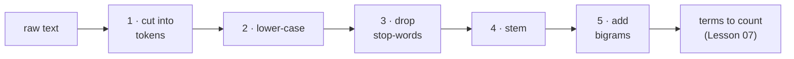

## The story

> **Hila is a recruiter at a software company.** A job for a "C++ developer" gets 200 CVs. She asks Kosai's program to
> find the CVs that mention C++. The program finds **none** — although she *knows* at least ten do. The reason is not the
> clever ranking maths. It's the very first step, where the program cut the text into words and turned "C++" into "C".
> This lesson is about that first step — the one that decides what the computer is allowed to see.

## Words you need

| word | simple meaning | example |
|---|---|---|
| **text** | for the computer: a long string of characters | `"Developed REST APIs in C++"` |
| **token** | one piece the text is cut into | `Developed`, `REST`, `C++` |
| **tokenizing** | cutting text into tokens | |
| **lower-casing** | making every letter small, so "Python" = "python" | |
| **stop-word** | a very common word that carries no meaning on its own | the, and, in, with |
| **stemming** | cutting a word to a common root, so its forms match | developed / developing → develop |
| **n-gram** | n neighbouring tokens glued into one term; **bigram** = 2 | "machine learning" |
| **term** | a token after all cleaning — what will be counted | `develop`, `machin learn` |
| **vocabulary** | the list of all different terms | |
| **pipeline** | the fixed order of cleaning steps | |
| **regular expression (regex)** | a mini-language that describes a pattern of characters | `[a-z]+` = "one or more small letters" |

---

## Part 1 — Why cleaning decides everything

> 📖 Hila types "Python". One CV says "python", another "PYTHON", a third "Python3". For her they're the same skill. For the
> computer, `"Python" == "python"` is **False**.

The computer cannot read. To compare a CV with a job advert it will **count words** (Lesson 07). So we must turn the text
into a clean list of words, and every decision matters:

| question | what we want | what goes wrong without cleaning |
|---|---|---|
| Is "Python" the same word as "python"? | yes | the CV is missed |
| Is "developed" the same as "development"? | for search: yes | "developer" job misses "developed APIs" |
| Is "C++" a word? | for Hila: absolutely | C++ becomes "C", every C++ developer vanishes |
| Do "the" and "and" matter? | no | they're in every CV and drown the real words |

### 🌍 Real world

You use text cleaning every day without noticing:

* **Google** finds "running shoes" when you type "Run Shoe" — it lower-cases and matches word forms.
* **Your phone's search** in contacts finds "Noa" when you type "noa".
* **Online shops** treat "iphone", "iPhone" and "I-Phone" as one product.
* **Hebrew search engines** must remove prefixes: "ובבית" (and in the house) should match "בית" (house).

## Part 2 — Cutting text into tokens (and the C++ disaster)

> 📖 Kosai's first version used the most common Python line for cutting text: `re.findall(r"\w+", text)`.

A **regular expression** describes what a token looks like. `\w+` means "one or more letters, digits or underscores". Watch
both patterns slide along the same sentence:

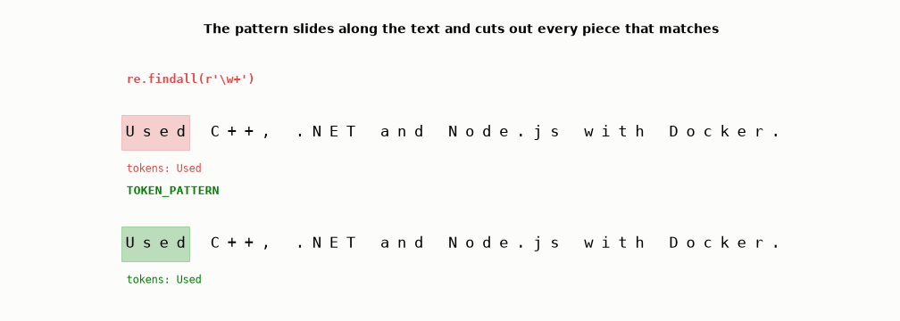

The red pattern cuts `C++` into `C`, `.NET` into `NET`, and `Node.js` into two tokens. Hila's C++ developers vanish. On more
technical words:

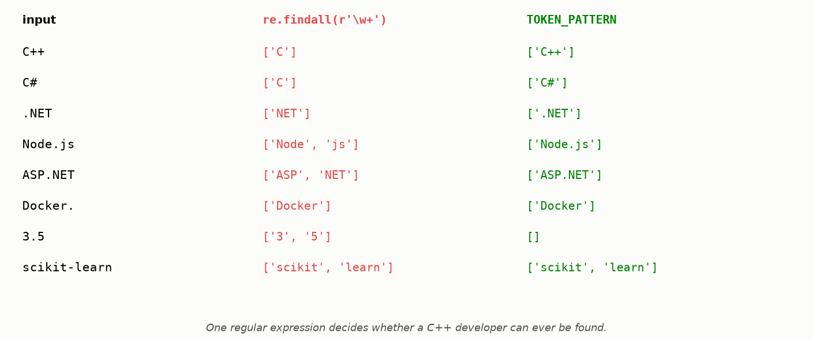

### 🧠 Reading Kosai's pattern, piece by piece

```
\.?                      maybe one dot at the very start            → keeps .NET
[A-Za-z֐-׿]              then one letter, English or Hebrew         → a token never starts with a digit, so 3.5 isn't a word
[A-Za-z0-9֐-׿+#.]*       then any number of letters, digits, + # .  → C++, C#, Node.js, ASP.NET stay whole
(?<!\.)                  the token may NOT end with a dot           → "Docker." at the end of a sentence becomes Docker
```

**Regex mini-dictionary:**

| symbol | means | example | matches |
|---|---|---|---|
| `[abc]` | one of these characters | `[aeiou]` | a vowel |
| `[a-z]` | one character in this range | `[0-9]` | one digit |
| `*` | the thing before: zero or more times | `a*` | "", a, aaa |
| `+` | the thing before: one or more times | `[a-z]+` | cat, hello |
| `?` | the thing before: maybe (0 or 1) | `colou?r` | color, colour |
| `\.` | a real dot | | . |
| `.` | **any** character (careful!) | | a, 7, % |

✍️ **Try it:** what does `[a-z]+` find in `"win £500 NOW!!"`? <details><summary>answer</summary>Only `win` — "NOW" is capital
letters (unless you lower-case first) and "500" is digits.</details>

## Part 3 — Lower-casing

> 📖 Simple: make every letter small. "Docker" → "docker". Now "Python", "python" and "PYTHON" are one word.

But be careful about **when**. Laith's spam filter measures **how much an SMS shouts** (`caps_ratio` = capital letters ÷ all
letters). "WINNER!! CLAIM NOW" has a lot; "ok see u later" has none. If you lower-case first, every SMS has caps_ratio 0 and
the signal is gone. So Laith **measures first, then lower-cases** — order matters
(`test_parse_measures_caps_before_lowercasing`).

## Part 4 — Stop-words: the words that are everywhere

> 📖 Laith counts the commonest words in the 747 spam SMS. The top of the list is disappointing: *to, a, you, your, the*.

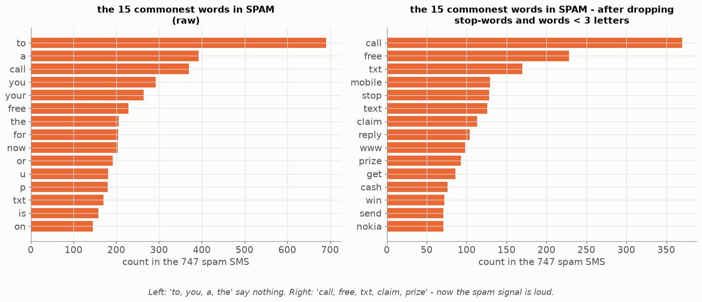

**Left:** the commonest "spam words" are just the commonest English words — they're in ham too, so they can't tell spam from
ham. **Right:** after dropping stop-words (and words shorter than 3 letters), the real spam signal appears: **call, free, txt,
claim, prize, cash, win**.

### Why are a few words everywhere? Zipf's law

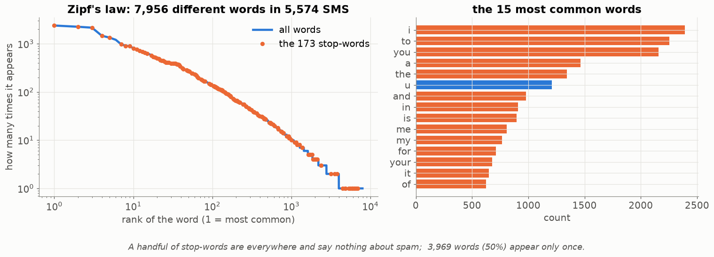

Count every word in the 5,574 SMS and sort them. A handful of words appear **thousands** of times; **half** of all different
words appear only **once**. This shape appears in every language, in every book, even in Hebrew and in computer code, and is
called **Zipf's law**: the 2nd commonest word appears about half as often as the 1st, the 3rd about a third as often…

Words that are everywhere carry no information — so we drop them, and the important words become louder.

## Part 5 — Stemming: one key for a family of words

> 📖 A job asks for "development experience". A CV says "I developed three apps". Same skill, different words.

**Stemming** chops the end of a word with simple rules ("remove -ing", "remove -ed", "remove -ment") so a family of words
becomes one **key**:

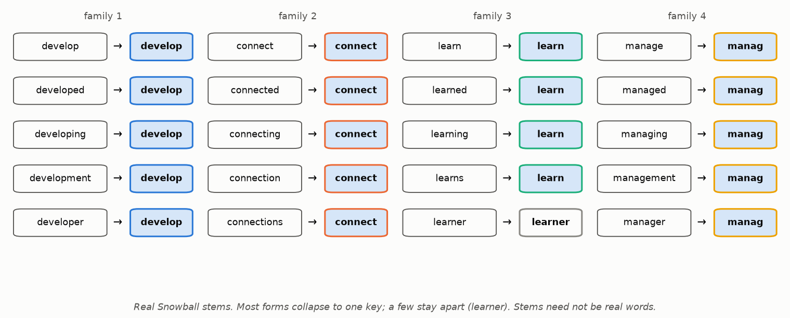

Notice:

* **Stems are not always real words:** `manag`, `machin`, `compani`. That's fine — they're only matching keys, like a
  locker number.
* **Stemmers are rough:** Snowball even turns `node.js` into `node.j` (it removes an "s" ending). Harmless — the job
  advert gets exactly the same treatment, so the keys still match. "learner" (a person) stays different from "learn". "Running" and "runs" → `run`, but "runner" →
  `runner`.
* A smarter cousin, **lemmatization**, uses a dictionary to return real words ("better" → "good"). It's slower; the
  projects use stemming.

## Part 6 — Bigrams: when two words together mean something new

> 📖 Two CVs reach Hila's "machine learning engineer" job. One says "Built machine learning models"; the other "Learning to
> repair a sewing machine". Both contain `machin` and `learn`.

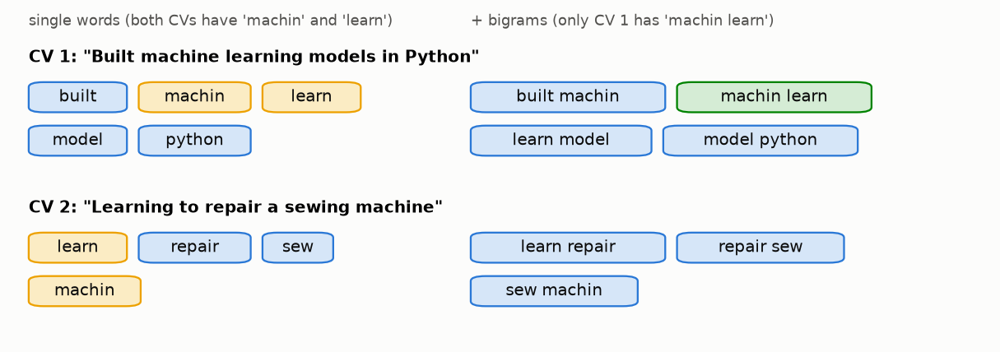

A **bigram** glues every pair of neighbouring terms into one more term. Only CV 1 contains the term **machin learn**. With
bigrams, the search can tell them apart. Other examples: "New York" ≠ "new" + "york"; "click here" (spam!) means more than
"click" and "here".

**Why not trigrams (3 words)?** The vocabulary would explode, and each 3-word term appears so rarely that it barely helps.

## Part 7 — The two pipelines, step by step

### Kosai's CV pipeline

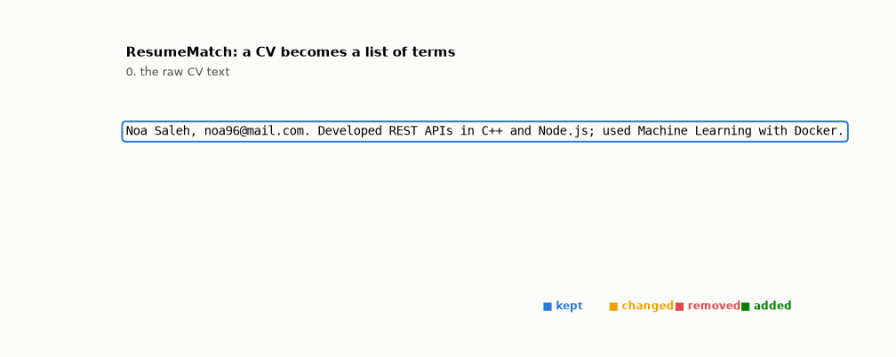

| step | what happens | result |
|---|---|---|
| 0. raw | | `Noa Saleh, noa96@mail.com. Developed REST APIs in C++ and Node.js; used Machine Learning with Docker.` |
| 1. scrub personal data | names, e-mails, phones removed — they must not influence the ranking, and they're private | `Developed REST APIs in C++ and Node.js; used Machine Learning with Docker.` |
| 2. tokenize | Kosai's careful pattern (Part 2) | `Developed · REST · APIs · in · C++ · and · Node.js · used · Machine · Learning · with · Docker` |
| 3. lower-case | so "Docker" = "docker" | `developed · rest · apis · in · c++ · …` |
| 4. drop stop-words | in, and, with disappear | `developed · rest · apis · c++ · node.js · used · machine · learning · docker` |
| 5. stem | words cut to roots | `develop · rest · api · c++ · node.j · use · machin · learn · docker` |
| 6. add bigrams | every neighbouring pair becomes one more term | `… · machin learn · learn docker · …` |

**Why scrub names first?** Fairness and privacy: a model must not learn that "Noa" or a certain e-mail domain is a good
candidate.

### Laith's SMS pipeline

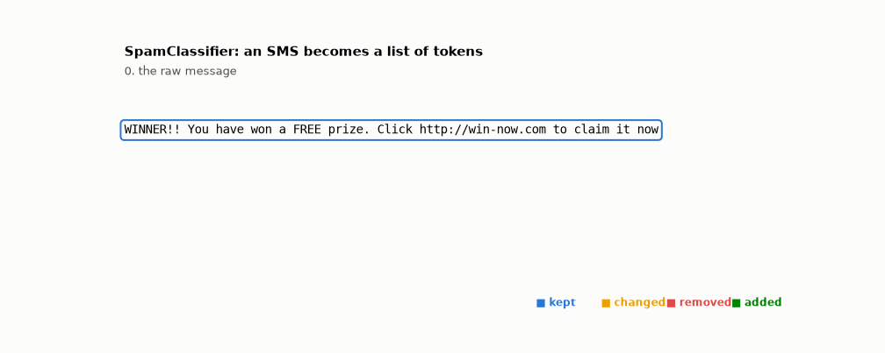

| step | what happens | why |
|---|---|---|
| 1. **measure first** | count capitals (caps_ratio), "!" and links on the **raw** text | after lower-casing, caps_ratio would always be 0 |
| 2. links → `URLTOKEN` | every URL becomes the same token | "there is a link" is a spam signal; the exact address (bit.ly/x7) never repeats |
| 3. lower-case (keep `URLTOKEN`) | | |
| 4. words = runs of letters `[a-z']+` | | numbers and symbols are dropped |
| 5. drop words < 3 letters and stop-words | "a", "to", "you", "now" go | |
| 6. n-grams (1, 2) | words + neighbouring pairs | "click here" means more than "click" + "here" |

### The order matters

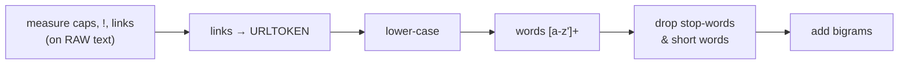

What goes wrong if you swap steps?

* lower-case **before** measuring → caps_ratio is always 0.
* bigrams **before** dropping stop-words → junk terms like `in c++`, `and node.js`.
* tokenize with `[a-z]+` **before** replacing links → `www`, `cash4u`, `com` become words.

## Part 8 — The contract: the same cleaning, always

> 📖 Kosai's app works perfectly in testing. In the demo, a job advert for "Developing web services" finds nothing. The app
> forgot to stem the advert: `developing` ≠ `develop`.

The cleaning is **part of the model**. The words the model learned were cleaned in a certain way; every new text must be
cleaned in exactly the same way. If not, there's **zero match and no error message** — the worst kind of bug.

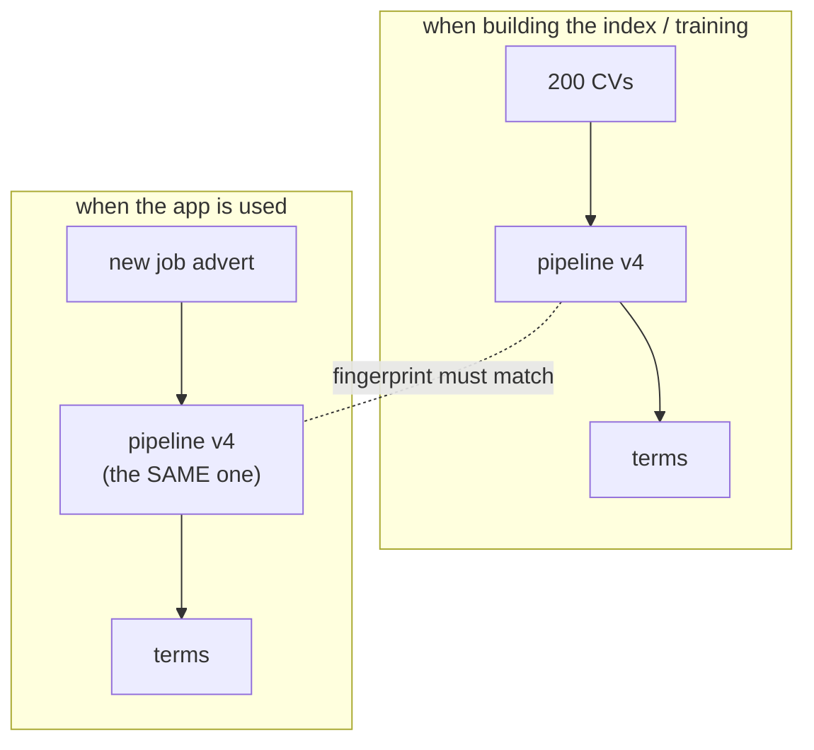

The projects protect against this:

* **Kosai:** `TextPreprocessor.fingerprint()` — a code made from all cleaning settings, saved with the index and checked when
  loading. Different settings → a loud error instead of silent zero matches.
* **Laith:** the feature names and their order are saved in `features.json` and checked when loading.

---

## 🧪 Worked example: a tiny pipeline you can run

```python
import re
from nltk.corpus import stopwords                      # once: import nltk; nltk.download("stopwords")
from nltk.stem.snowball import SnowballStemmer

STOP = set(stopwords.words("english"))
stem = SnowballStemmer("english").stem
TOKEN = r"\.?[A-Za-z][A-Za-z0-9+#.]*(?<!\.)"

def clean(text):
    tokens = re.findall(TOKEN, text)                      # 1. cut
    tokens = [t.lower() for t in tokens]                  # 2. lower-case
    tokens = [t for t in tokens if t not in STOP]         # 3. drop stop-words
    tokens = [stem(t) for t in tokens]                    # 4. stem
    bigrams = [a + " " + b for a, b in zip(tokens, tokens[1:])]   # 5. pairs
    return tokens + bigrams

print(clean("Developed REST APIs in C++ and Node.js; used Machine Learning with Docker."))
# ['develop', 'rest', 'api', 'c++', 'node.j', 'use', 'machin', 'learn', 'docker',
#  'develop rest', 'rest api', 'api c++', 'c++ node.j', ..., 'machin learn', 'learn docker']
```

## Try it yourself

<details><summary>1. 🟢 Lower-case and drop stop-words: "The Python and the Java developers".</summary>

`python`, `java`, `developers` (then stemmed: `python`, `java`, `develop`).
</details>

<details><summary>2. 🟢 Which tokens does `\w+` give for "Used C# and ASP.NET"?</summary>

`Used`, `C`, `and`, `ASP`, `NET` — C# and ASP.NET are broken.
</details>

<details><summary>3. 🟢 Stem with Snowball: "running", "runs", "runner". Do they all match?</summary>

`run`, `run`, `runner` — the first two match; "runner" stays different (a person, not an action). Stemmers are rough.
</details>

<details><summary>4. 🟡 Run Laith's pipeline on: "Call NOW to claim your £500 prize!! www.cash4u.com"</summary>

1. measure: capitals C, N, O, W = 4 of all letters; 2 "!"; 1 link. 2. → `… prize!! URLTOKEN`. 3. lower-case.
4. words: call, now, to, claim, your, prize, URLTOKEN (£500 has no letters). 5. drop "to" (short) and "now", "your"
(stop-words) → `call, claim, prize, URLTOKEN`. 6. bigrams: `call claim, claim prize, prize URLTOKEN`.
</details>

<details><summary>5. 🟡 List the bigrams of: develop · rest · api · docker.</summary>

`develop rest`, `rest api`, `api docker` — always one fewer than the words.
</details>

<details><summary>6. 🟡 Write a regex for an Israeli mobile number like 050-1234567.</summary>

`05[0-9]-[0-9]{7}` — "05", one digit, a dash, exactly seven digits (`{7}` = seven times). Laith's spam SMS have many numbers
like these; this is how PII scrubbers find phones too.
</details>

<details><summary>7. 🔴 The app finds no CV for "Docker" although many mention it. Two possible pipeline bugs?</summary>

The job text is not cleaned with the same pipeline (not lower-cased / not stemmed), or the tokenizer keeps the trailing
dot (`docker.` ≠ `docker`).
</details>

<details><summary>8. 🔴 Why does Laith replace every link with the same word URLTOKEN instead of keeping the real address?</summary>

Each spam address (bit.ly/x7Kq) appears once or twice — the model can't learn from it. But "contains a link" appears in
hundreds of spam SMS. One shared token turns 300 useless rare words into one strong signal.
</details>

## Common mistakes

| student says | the truth |
|---|---|
| "Stemming gives real words" | `machin`, `learn`, `compani` — matching keys, not words. Fine. |
| "Lower-case first, it's simpler" | Not in Spam: you destroy `caps_ratio` before measuring it. |
| "More n-grams = better" | Trigrams multiply the vocabulary for little gain. Measure it. |
| "`\w+` is a good tokenizer" | Not for technical words: see Part 2. |
| "I'll clean the job advert a bit differently, it's just one text" | Then it won't match the CVs. Same pipeline, always. |

## 📝 Summary

> * The computer counts words, so **cleaning decides what it can see**.
> * **Tokenize** with a pattern that respects your domain (C++, .NET, Node.js).
> * **Lower-case** so forms match — but measure capital-letter features first.
> * **Drop stop-words**: by Zipf's law a few words are everywhere and say nothing.
> * **Stem** so word families share a key; stems needn't be real words.
> * **Bigrams** keep meaning that lives in word pairs ("machine learning").
> * The **same pipeline** must run at training and in the app — guard it with a fingerprint.

## Class activities

1. **Be the pipeline (10 min).** Each student gets one step on a card. Pass a paper strip with a sentence around; each
   student applies only their step, out loud.
2. **Break the tokenizer (10 min).** Pairs try words like `F#`, `R`, `3D`, `Vue.js`, `C` on regex101.com with Kosai's
   pattern. Which ones are a real problem for a CV search?
3. **Order matters (5 min).** What if bigrams are added **before** removing stop-words? (Junk terms like `in c++`.)
4. **Zipf in Hebrew (10 min).** Count the words in a page of a Hebrew news article. Is the top of the list "של", "את",
   "ה"…?

## In your project

| Project | Where |
|---|---|
| Spam | `spamclassifier/preprocessing/email_parser.py` → `EmailParser.parse` · `tokenizer.py` → `Tokenizer.tokenize`, `ngrams` · theory `08_SpamClassifier/01_theory/03_features.md` §3.6–3.9 · notebook `01_text_to_numbers.ipynb` |
| ResumeMatch | `resumematch/nlp/preprocessor.py` → `TextPreprocessor.process`, `_stem`, `_stem_hebrew`, `_bigrams`, `fingerprint` · `nlp/pii.py` → `PiiScrubber` · theory `31_ResumeMatch/01_theory/04_pipeline.md` · notebook `01_preprocessing.ipynb` |

## 🎬 Watch & explore

| | |
|---|---|
| <a href="https://www.youtube.com/watch?v=dh06AQP-kY8"></a> | **Coursera — Stemming vs Lemmatization: NLP made simple**. Part 5 and its smarter cousin. |
| <a href="https://www.youtube.com/watch?v=JpxCt3kvbLk"></a> | **Krish Naik — Stemming and lemmatization intuition**. With NLTK code, like the projects. |
| <a href="https://www.youtube.com/watch?v=rhzKDrUiJVk"></a> | **Web Dev Simplified — Learn regular expressions in 20 minutes**. Part 2's mini-language, from zero. |

**Play with it:**
* regex101 — [test TOKEN_PATTERN live](https://regex101.com/) (choose the Python flavour; paste a CV sentence).
* At home: change one step's order in the worked example and see what breaks.
