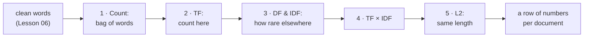
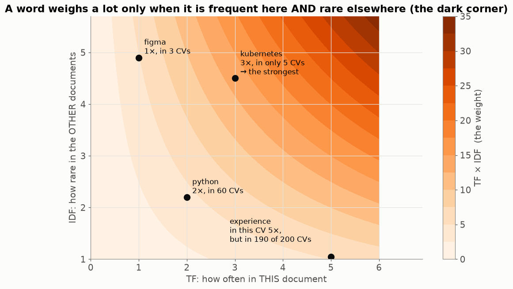
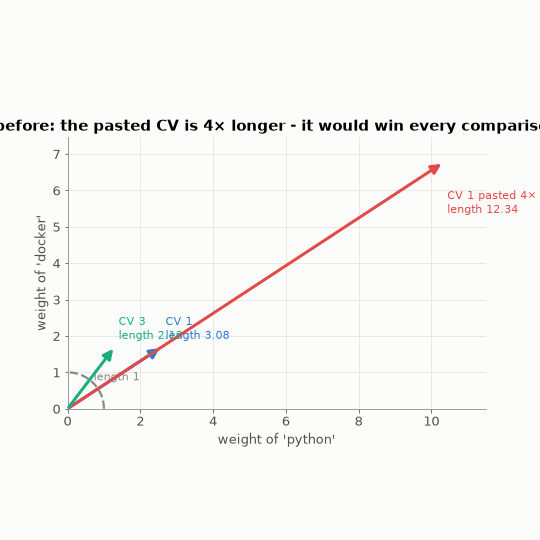
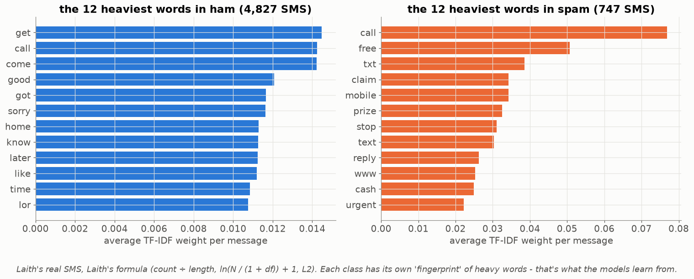
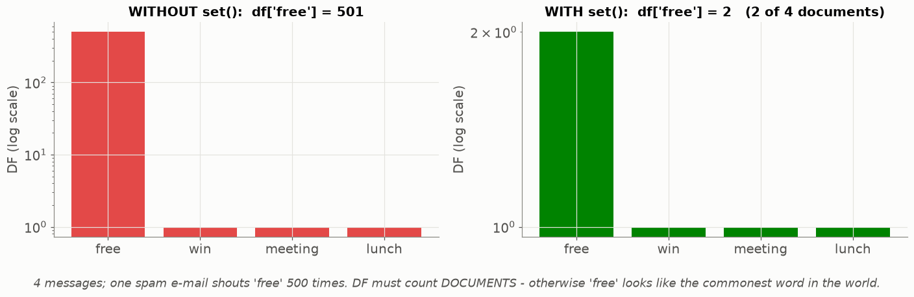
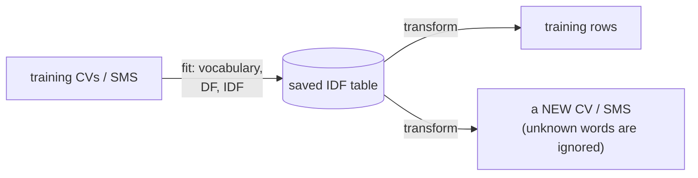

# Lesson 07 — TF-IDF: turning text into numbers that mean something

> **For:** Kosai (ResumeMatch stages 3–4) · Laith (SpamClassifier stage 3) &nbsp;·&nbsp; **Time:** 2 × 45 min
> **Before:** Lesson 00 §7 (logarithms), §10 (distance); Lesson 06 &nbsp;·&nbsp; **After this:** Lessons 08, 09, 11

**In one sentence:** a word is important for a document if it is **frequent in it** and **rare in the others** — TF-IDF is
that sentence turned into arithmetic.

## 🗺️ The map of this lesson



## The story

> Hila the recruiter (Lesson 06) now has clean word lists for 200 CVs. She asks: *"Which words describe each candidate?"*
> Counting words is the obvious answer — but in every CV the most common words are "experience", "team", "worked". Those
> tell her nothing; everyone has them. What she wants are the words that make a CV **different**: "kubernetes", "figma".

## Words you need

| word | simple meaning | in Hila's office |
|---|---|---|
| **document** | one text | one CV, one SMS |
| **collection** (corpus) | all the documents | the 200 CVs |
| **term** | one cleaned word (Lesson 06) | `python`, `machin learn` |
| **TF** — term frequency | how many times the term is in **this** document | "python" 2× in CV 1 |
| **DF** — document frequency | in how many **documents** the term appears (each document counts once) | "python" in 60 CVs |
| **N** | the number of documents | 200 |
| **IDF** — inverse document frequency | a weight: big for rare terms, small for common ones | |
| **TF-IDF** | TF × IDF — the final weight | |
| **vector** | the row of numbers describing one document (Lesson 00 §10) | |
| **L2 normalisation** | dividing a vector by its length so its length becomes 1 | |

---

## Part 1 — Bag of words: just count

> 📖 Hila starts simple. Three tiny CVs (already cleaned):

```
CV 1:  python python sql docker
CV 2:  java sql spring
CV 3:  python sql pandas
```

Make a table: one **row per CV**, one **column per term**, and in each cell **how many times** the term appears.


That's a **bag of words**: pour the words into a bag and count them — the order is forgotten ("dog bites man" = "man bites
dog"). Each CV is now a row of numbers, which a computer can compare.

**The problem:** `sql` is in **every** CV. It describes *none* of them better than the others. We want it to weigh **less**.

### 🧠 An everyday picture

At a party you're told *"find Dana — she's wearing jeans"*. Useless: everyone is wearing jeans. *"She's wearing a red hat"*
— now you find her at once. A word in every document is "jeans"; a rare word is "the red hat". **IDF measures how much of a
red hat a word is.**

## Part 2 — TF-IDF, step by step


### Step 1 — TF: count in this document

`python` appears 2 times in CV 1 → TF = 2. (Kosai uses the raw count; Laith divides by the message length — Part 6.)

### Step 2 — DF: in how many documents?

Count each **document** once, no matter how many times the word appears in it:

```
python: CV 1, CV 3          → DF = 2
sql:    CV 1, CV 2, CV 3    → DF = 3
docker: CV 1                → DF = 1     (java, spring, pandas: also 1)
```

### Step 3 — IDF: rare → big weight

Kosai's formula (N = 3 documents):

$$\text{idf} = \ln\frac{1+N}{1+\text{DF}} + 1$$

Read it in three parts:

1. **N ÷ DF** — "one in how many documents has this word?" Rare word → big number.
2. **ln( … )** — shrink it so it grows slowly (Lesson 00 §7). Without the log, a word in 1 of 200 CVs would weigh 200× more
   than a word in all of them — far too much.
3. **+1** in two places — explained below.

```
python:  (1 + 3) ÷ (1 + 2) = 4 ÷ 3 = 1.333    ln(1.333) = 0.2877    + 1  →  idf = 1.2877
sql:     (1 + 3) ÷ (1 + 3) = 4 ÷ 4 = 1        ln(1)     = 0         + 1  →  idf = 1.0000
docker:  (1 + 3) ÷ (1 + 1) = 4 ÷ 2 = 2        ln(2)     = 0.6931    + 1  →  idf = 1.6931
```

(`ln` on the calculator, or `math.log(...)` in Python.)

**The two `+1`s:**
* `1 +` inside: avoids dividing by zero (a new word with DF 0), and smooths the numbers a little.
* `+ 1` at the end: a word in *every* document gets 1, not 0 — it is **weakened, not deleted**.

### The IDF curve


With 200 CVs: "kubernetes" (in 5 CVs) gets a big weight, "python" (60) a medium one, "experience" (190) almost the minimum.
The curve drops fast and then flattens — that's the log.

### Step 4 — TF × IDF

```
CV 1:   python 2 × 1.2877 = 2.58     sql 1 × 1.0 = 1.00     docker 1 × 1.6931 = 1.69
```

Read it: *"`docker` describes CV 1 better than `sql`, even though each appears once — because docker is rare."*

Multiplying means a word needs **both** to weigh a lot:



"experience" appears 5 times but is in almost every CV → light. "figma" is very rare but appears once → medium.
"kubernetes" is rare **and** repeated → the heaviest word of the CV.

### Step 5 — L2 normalisation: make every CV the same length

> 📖 A clever candidate pastes the same paragraph into his CV four times. Every number in his row becomes 4× bigger, and he
> wins every comparison. Hila is not impressed.

The **length** of a row of numbers is Pythagoras (Lesson 00 §10): the root of the sum of the squares. Divide every number by
the length and every row has length 1:

```
length of CV 1 = √(2.58² + 1.00² + 1.69²) = √(6.66 + 1.00 + 2.86) = √10.52 = 3.24
divide every number by 3.24:   python 2.58 ÷ 3.24 = 0.79    sql 0.31    docker 0.52
check: √(0.79² + 0.31² + 0.52²) = √(0.62 + 0.10 + 0.27) = √0.99 ≈ 1 ✓
```

Watch it on arrows (only two words, so we can draw it). The pasted CV is 4× longer — after dividing, it lands **exactly on
top** of the original CV 1:



After normalising, only the **proportions** remain — which words, in what mix — not how much text there is.


## Part 3 — On the project's real CVs


**Left:** the words this CV repeats. **Right:** the words with the highest TF-IDF — the ones that make it **different**:
skills like `figma`, `webpack` — and the candidate's **name** (rare!). A name is not a skill — that's exactly why Kosai's
pipeline removes personal data **before** counting (Lesson 06).

## Part 4 — On Laith's real SMS



Each class has its own "fingerprint": ham is "get, come, sorry, home, later"; spam is "call, free, txt, claim, prize, urgent".
TF-IDF has turned 5,574 messages into numbers in which this difference is visible — and that's what Laith's models (Lessons
11, 14) learn from.

### 🌍 Real world

* **Early search engines** (and library catalogues) ranked pages with TF-IDF: a page about "kubernetes" that mentions it 20
  times beats one that mentions it once.
* **News sites** pick an article's keywords/tags with TF-IDF: the words frequent in this article and rare in others.
* **Plagiarism checkers** compare TF-IDF rows of two essays (Lesson 08 shows how).
* **Hashtags** work like IDF in reverse: #love is on millions of posts (useless for finding anything); #TelAvivMarathon2026
  is rare and precise.

## Part 5 — The bug everyone makes once

```python
df = Counter()
for doc in docs:
    df.update(set(doc))      # set() !  — each term counts ONCE per document
```



Without `set()`, a spam e-mail that shouts "free" 500 times gives "free" a DF of 501 — it looks like the commonest word in
the world, gets a tiny IDF, and the spam signal disappears. Tests: `test_document_frequency_counts_documents_not_occurrences`
(Kosai), the vocabulary test (Laith).

## Part 6 — ⚠️ The two projects use slightly different formulas

| | TF | IDF | check values |
|---|---|---|---|
| ResumeMatch (Kosai) | raw count | `ln((1 + N) / (1 + df)) + 1` | N = 3: df 2 → 1.2877, df 1 → 1.6931, df 3 → 1.0000 |
| SpamClassifier (Laith) | count ÷ number of terms in the message | `ln(N / (1 + df)) + 1` | N = 1000: "the" (1000) ≈ 1.0, "meeting" (100) ≈ 3.3, "viagra" (5) ≈ 6.1 |

Laith's "meeting", step by step: N ÷ (1 + df) = 1000 ÷ 101 = 9.90 → ln(9.90) = 2.29 → + 1 = **3.29**.

Why does Laith divide TF by the length? An SMS can be 3 words or 30. "free" once in a 3-word SMS is a much stronger signal than
"free" once in a 30-word SMS.

Use your own project's formula exactly — the tests check the numbers.

## Part 7 — Fit once, reuse forever

IDF is **learned** from the training documents — like the average and std of Lesson 02. A new CV or SMS is turned into numbers
with the **saved** vocabulary and IDF:



A word the training documents never contained has no column — it's simply ignored. And computing IDF with the test documents
included is leakage (Lesson 05).

---

## 🧪 Worked example: the three CVs in Python

```python
import math
from collections import Counter

docs = [["python", "python", "sql", "docker"],
        ["java", "sql", "spring"],
        ["python", "sql", "pandas"]]
N = len(docs)

df = Counter()
for d in docs:
    df.update(set(d))                                   # each document once

idf = {t: math.log((1 + N) / (1 + c)) + 1 for t, c in df.items()}

def tfidf(doc):
    row = {t: c * idf[t] for t, c in Counter(doc).items()}    # TF × IDF
    length = math.sqrt(sum(v * v for v in row.values()))
    return {t: round(v / length, 2) for t, v in row.items()}   # L2

print(round(idf["python"], 4), round(idf["sql"], 4), round(idf["docker"], 4))   # 1.2877 1.0 1.6931
print(tfidf(docs[0]))      # {'python': 0.8, 'sql': 0.31, 'docker': 0.52}
```

## Try it yourself

<details><summary>1. 🟢 Bag of words for "spam spam eggs" and "eggs ham". Columns: eggs, ham, spam.</summary>

Row 1: eggs 1, ham 0, spam 2. Row 2: eggs 1, ham 1, spam 0.
</details>

<details><summary>2. 🟢 4 documents. "free" appears 3 times in doc 1 and once in doc 3. DF?</summary>

**2** — it's in two documents. The 3 times inside doc 1 don't matter for DF.
</details>

<details><summary>3. 🟡 N = 5 CVs, "docker" in 1 of them. Kosai's IDF, every step.</summary>

(1 + 5) ÷ (1 + 1) = 6 ÷ 2 = 3 → ln(3) = 1.0986 → + 1 = **2.0986**.
</details>

<details><summary>4. 🟡 CV 3 = "python sql pandas". Its TF-IDF row and normalised row.</summary>

python 1 × 1.2877 = 1.29 · sql 1.00 · pandas 1.69 · length √(1.66 + 1 + 2.86) = √5.52 = 2.35 → **0.55, 0.43, 0.72**.
</details>

<details><summary>5. 🟡 Normalise the row (3, 4). Then (30, 40).</summary>

length √(9 + 16) = 5 → **(0.6, 0.8)**. (30, 40) has length 50 → also **(0.6, 0.8)** — the same proportions.
</details>

<details><summary>6. 🟡 Laith's formula, N = 1000, "viagra" in 5 messages. IDF?</summary>

1000 ÷ (1 + 5) = 166.7 → ln(166.7) = 5.12 → + 1 = **6.12**.
</details>

<details><summary>7. 🔴 A word appears in every training SMS. Laith's IDF with N = 1000, df = 1000? What's strange?</summary>

1000 ÷ 1001 = 0.999 → ln = −0.001 → + 1 = **0.999**. Slightly below 1 — Laith's version (no `1 +` on top) can go a bit below 1
for very common words; Kosai's can't. Both effectively "weaken, don't delete".
</details>

<details><summary>8. 🔴 Why can TF-IDF think "java" in "Java developer" and "java" in "I love java coffee" are the same?</summary>

It only counts letters-in-a-row; it has no idea of meaning. Bigrams help a little ("java develop" vs "java coffe"); real
meaning needs much bigger models (word embeddings), which the projects don't use.
</details>

## Common mistakes

| student says | the truth |
|---|---|
| "IDF is per document" | IDF is per **term**, computed once over the whole training collection. TF is per document. |
| "Compute IDF with the test documents too" | Leakage (Lesson 05). Fit on training; reuse for new documents. |
| "TF-IDF understands meaning" | It counts. "java" (coffee) = "java" (language). |
| "DF = how many times the word appears" | How many **documents** contain it. Use `set()`. |
| "Normalising loses information" | It loses only the **length** — which we don't want anyway. |

## 📝 Summary

> * **Bag of words**: one row per document, one column per term, count.
> * **TF** = count here. **DF** = number of documents containing it. **IDF** = ln((1 + N) / (1 + DF)) + 1 — rare → heavy.
> * **TF × IDF**: heavy only if frequent **here** and rare **elsewhere**.
> * **L2**: divide by the length so long documents don't win by being long.
> * IDF is **learned** from training documents and reused.

## Class activities

1. **Paper TF-IDF (20 min).** 4 short job ads on cards. Groups compute DF and IDF (calculator: `ln`), then TF-IDF for one
   ad, then its length and the normalised row.
2. **Guess the weight (5 min).** 6 words from the CV data — the class orders them by IDF before seeing the DF counts.
3. **The party game (5 min).** "Find the student who…" — the class must give the rarest description. Connect to IDF.
4. **Break it (5 min).** Remove `set()` in the notebook and see how the weights change.

## In your project

| Project | Where |
|---|---|
| ResumeMatch | `resumematch/nlp/vocabulary.py` → `VocabularyBuilder.build`, `compute_idf` · `rank/tfidf.py` → `TfidfRanker.fit`, `_l2_normalise_rows` · theory `31_ResumeMatch/01_theory/01_vectors.md` · notebook `02_tfidf_cosine.ipynb` |
| Spam | `spamclassifier/features/feature_engineer.py` → `fit`, `transform`, `idf_value`, `l2_normalise` · theory `08_SpamClassifier/01_theory/03_features.md` §3.3–3.5 |

## 🎬 Watch & explore

| | |
|---|---|
| <a href="https://www.youtube.com/watch?v=zLMEnNbdh4Q"></a> | **DataMListic — TF-IDF explained**. TF, IDF and their product with pictures. |
| <a href="https://www.youtube.com/watch?v=vZAXpvHhQow"></a> | **Calculate TF-IDF in NLP (simple example)**. A full calculation by hand, like Part 2. |

**Read more:**
* Stanford IR book — [Inverse document frequency](https://nlp.stanford.edu/IR-book/html/htmledition/inverse-document-frequency-1.html)
* At home: run the worked example, then add a 4th CV and watch every IDF change.
