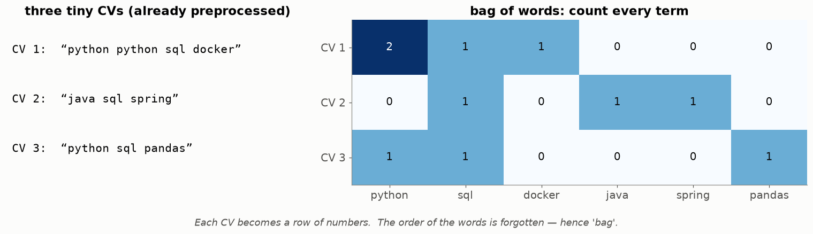
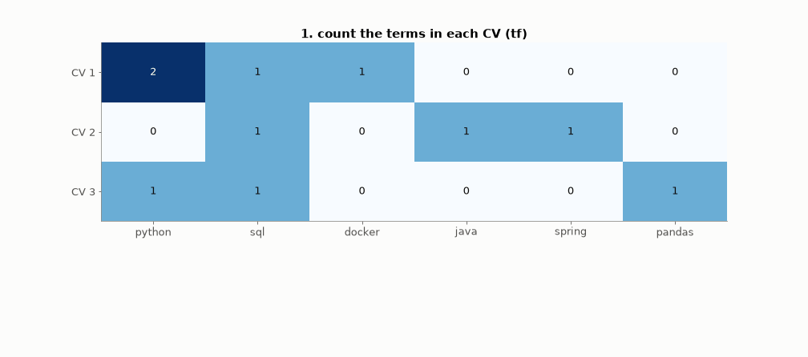
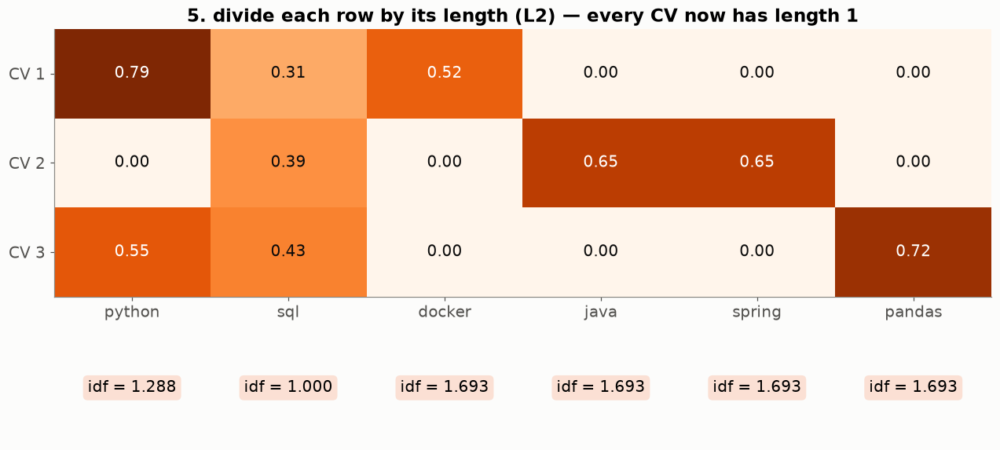
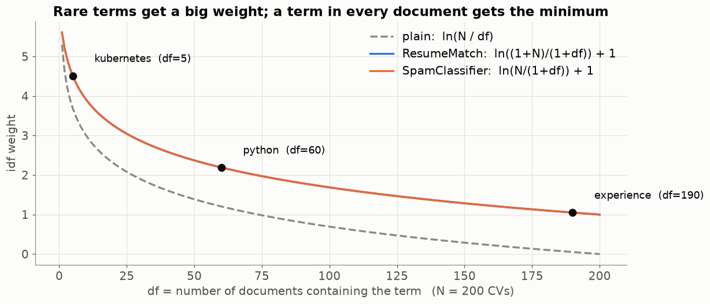
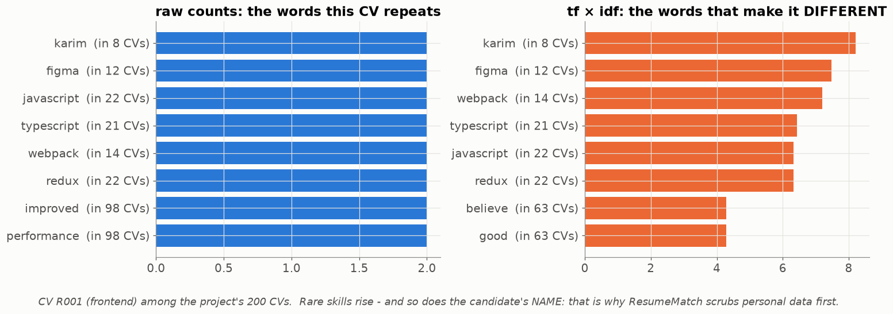

# Lesson 07 — TF-IDF: turning text into numbers that mean something

> **For:** Kosai (ResumeMatch stages 3–4) · Laith (SpamClassifier stage 3) &nbsp;·&nbsp; **Time:** 45 – 60 min
> **Before:** Lesson 06 &nbsp;·&nbsp; **After this:** Lesson 08 (cosine), 09 (BM25), 11 (Naive Bayes)

## 🎯 By the end, the student can

1. Build a bag-of-words matrix by hand.
2. Compute df, idf and tf-idf for a small example — with **their project's exact formula** — and explain each `+1`.
3. Explain L2 normalisation and why a long document must not win just by being long.

---

## 1. Bag of words



Every document becomes a **row**, every term a **column**, every cell a count. Word order is lost (a "bag"). A real CV
row has thousands of columns and almost all are 0 — a **sparse vector** — so we store it as a dictionary
`{"python": 2, "sql": 1}` instead of a long list of zeros.

**Problem:** raw counts reward words that are everywhere ("experience", "team") and long documents.

## 2. TF-IDF, built step by step



| Step | Formula (ResumeMatch) | On the example |
|---|---|---|
| tf | count of the term in this document | `python` in CV 1 = 2 |
| df | number of **documents** that contain the term | `python` = 2, `sql` = 3, `docker` = 1 |
| idf | $\ln\frac{1+N}{1+df}+1$ | `python` = ln(4/3)+1 = **1.2877** · `sql` = ln(4/4)+1 = **1.0** · `docker` = ln(4/2)+1 = **1.6931** |
| tf-idf | tf × idf | CV 1: python 2 × 1.2877 = **2.58**, sql 1.00, docker 1.69 |
| L2 | divide the row by $\sqrt{\sum v^2}$ | CV 1: √(2.58² + 1² + 1.69²) = 3.24 → **0.79, 0.31, 0.52** |



Read it aloud: *"`sql` is in every CV, so it barely matters. `docker` is only in CV 1, so it's what makes CV 1 special."*

## 3. The IDF curve — and the two `+1`s



| Piece | Why |
|---|---|
| the **log** | without it, a term in 5 docs would be 40× a term in 190 docs; the log makes importance grow slowly |
| `1 +` inside | no division by zero; a little smoothing |
| `+ 1` outside | a term in every document gets weight 1, not 0 — weakened, **not deleted** |

⚠️ **The two projects use slightly different formulas.** Use your own, exactly:

| | tf | idf |
|---|---|---|
| ResumeMatch (Kosai) | raw count | `ln((1 + N) / (1 + df)) + 1` → check values 1.2877 / 1.6931 / 1.0000 |
| SpamClassifier (Laith) | count / number of terms in the message | `ln(N / (1 + df)) + 1` → N = 1000: "the" ≈ 1.0, "meeting" (100) ≈ 3.3, "viagra" (5) ≈ 6.1 |

## 4. On the project's real CVs



Left: what the CV repeats. Right: what makes it *different*. Skills like `figma` and `webpack` rise — and so does the
candidate's **name**, because it is rare. That is not a feature, it is a bias: the reason Kosai's pipeline scrubs names,
e-mails and phone numbers *before* counting.

## 5. L2 normalisation — why

Two CVs: one says "python" once in 50 words, the other pastes the same paragraph 4 times. Without normalisation the
second has 4× bigger numbers everywhere and wins every comparison. After dividing by the length, both rows have
length 1 and only the **proportions** (the direction, Lesson 08) remain. Laith: `test_long_and_short_messages_are_comparable`.

## 6. The bug everyone makes once

```python
df = Counter()
for doc in docs:
    df.update(set(doc))      # set()! each term counts ONCE per document
```

Without `set()` you count **occurrences**, not documents. A word shouted 500 times in one e-mail gets df = 500 and looks
"common". Tests: `test_document_frequency_counts_documents_not_occurrences` (Kosai), the vocabulary test (Laith).

## 7. Misconceptions

| Student says | Truth |
|---|---|
| "IDF is per document" | IDF is per **term**, computed once over the whole training collection. TF is per document. |
| "Compute IDF on all documents including test" | Leakage (Lesson 05). Fit on training; the same IDF transforms new documents. |
| "A term in every document gets IDF 0" | Not with these formulas — it gets 1 (the `+1` outside). |
| "TF-IDF understands meaning" | It counts. "java" (coffee) = "java" (language). Synonyms do not match. |

## 8. Activities

1. **Paper TF-IDF (15 min).** Give 4 short "job ads" on cards. Groups compute df and idf with a calculator, then the
   tf-idf of one term. Compare with the person next to them. (Use the exact project formula.)
2. **Guess the weight (5 min).** Show 6 words from the CV data and ask the class to order them by idf before revealing
   the df counts.
3. **Break it (5 min).** In the notebook, remove the `set()` and see how the weights change.

## 9. Check yourself

<details><summary>1. N = 3, df = 2. Compute Kosai's idf.</summary>

ln(4/3) + 1 = 0.2877 + 1 = **1.2877**.
</details>

<details><summary>2. A row is (3, 4). What is it after L2 normalisation?</summary>

length = √(9+16) = 5 → (0.6, 0.8).
</details>

<details><summary>3. Why is the vocabulary of the spam filter chosen by document frequency and not total count?</summary>

A word repeated 500 times in one rant has total count 500 but df 1 — it is one person shouting, not a common word. df
measures how widespread a word is.
</details>

## 10. In your project

| Project | Where |
|---|---|
| ResumeMatch | `resumematch/nlp/vocabulary.py` → `VocabularyBuilder.build`, `compute_idf` · `rank/tfidf.py` → `TfidfRanker.fit`, `_l2_normalise_rows` · theory `31_ResumeMatch/01_theory/01_vectors.md` · notebook `02_tfidf_cosine.ipynb` |
| Spam | `spamclassifier/features/feature_engineer.py` → `FeatureEngineer.fit`, `transform`, `idf_value`, `l2_normalise` · theory `08_SpamClassifier/01_theory/03_features.md` §3.3–3.5 |

## 🎬 Watch & explore

* *TF-IDF explained* — [search on YouTube](https://www.youtube.com/results?search_query=TF-IDF+explained+visually)
* Stanford IR book (Manning et al.), ch. 6 — [Inverse document frequency](https://nlp.stanford.edu/IR-book/html/htmledition/inverse-document-frequency-1.html)
* scikit-learn — [Tf–idf term weighting](https://scikit-learn.org/stable/modules/feature_extraction.html#tfidf-term-weighting)
