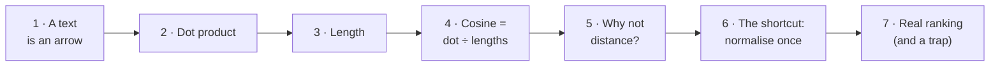
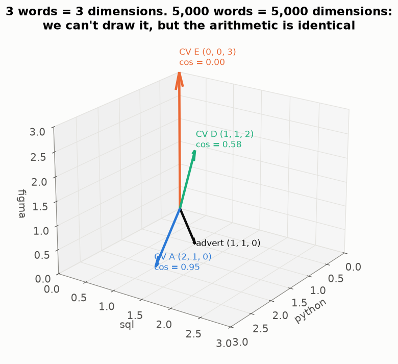
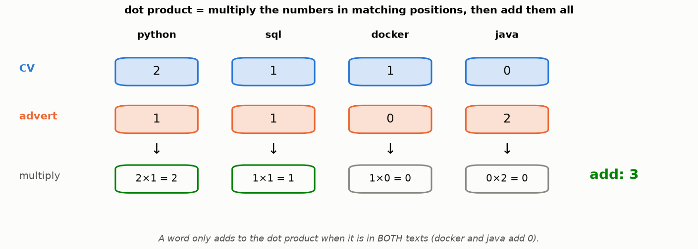
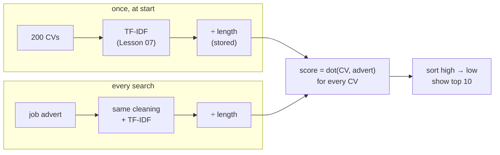
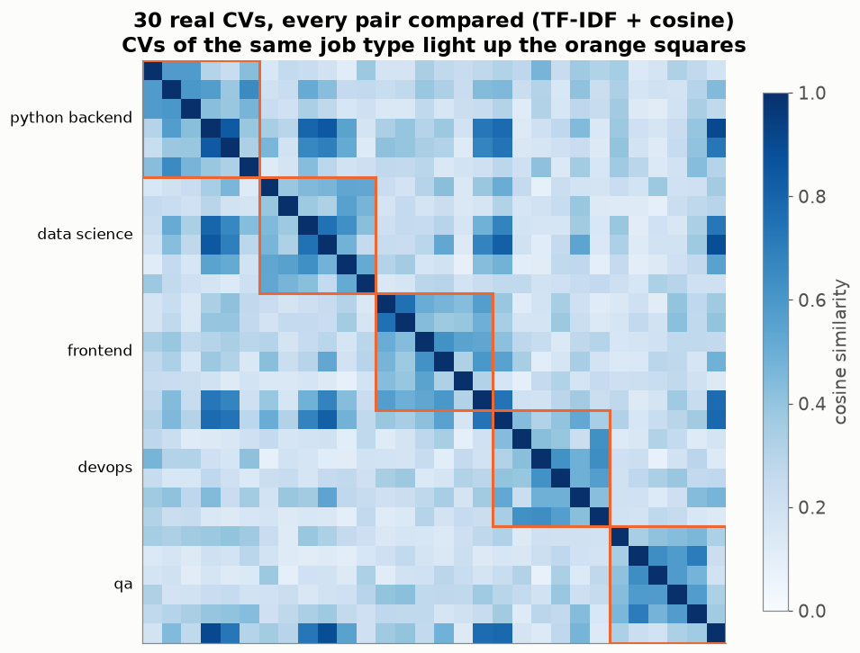
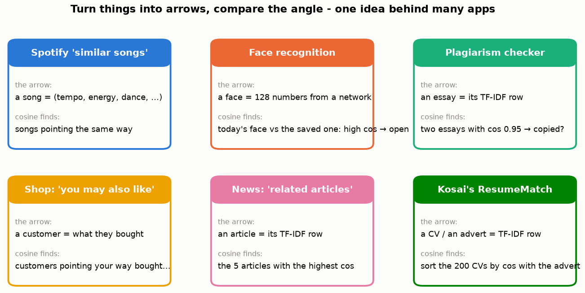

# Lesson 08 — How similar are two texts? Arrows, the dot product and cosine similarity

> **For:** Kosai (ResumeMatch stage 4) &nbsp;·&nbsp; **Time:** 2 × 45 min
> **Before:** Lesson 00 §5 (Σ), §6 (roots), §10 (distance); Lesson 07 &nbsp;·&nbsp; **After this:** Lessons 09, 10

**In one sentence:** draw every text as an arrow; two texts are similar when their arrows **point the same way** — and the
cosine of the angle between them is that similarity, as one number from 0 to 1.

## 🗺️ The map of this lesson



## The story

> Hila has a job advert: *"Python and SQL developer"*. Every CV is now a row of TF-IDF numbers (Lesson 07), and so is the
> advert. She needs **one number per CV**: "how similar is this CV to the advert?" — then she can sort the 200 CVs and read
> only the top 10. This lesson builds that number, using an idea from geometry: **the angle between two arrows**.

## Words you need

| word | simple meaning | example |
|---|---|---|
| **vector** | a list of numbers, drawn as an arrow from (0, 0) — Lesson 00 §10 | CV A = (2, 1) |
| **dimension** | one position in the list = one word | 2 words → a page; 5,000 words → can't draw, same maths |
| **length** of a vector | Pythagoras: √(sum of the squares) | |(3, 4)| = 5 |
| **dot product** a · b | multiply the numbers in matching positions, then add | (1, 1) · (2, 1) = 3 |
| **angle** | how far apart two arrows point | 0° = same direction |
| **cosine** of an angle | a number: 1 when the angle is 0°, 0 when it is 90° | |
| **cosine similarity** | dot product ÷ (length × length) = the cosine of the angle | 0.949 |

---

## Part 1 — A document is an arrow

> 📖 Hila keeps only two words to start: `python` and `sql`. Now every document is just two numbers — a point on squared
> paper, or an **arrow** from the corner to that point.


* The job advert J = (1, 1): equally python and sql.
* CV A = (2, 1): more python.
* CV B = (4, 2): exactly A **said twice** — same words, same proportions, twice the text. **Same direction, longer arrow.**
* CV C = (0, 3): only sql. A different direction.

**The key idea:** two documents about the same things in the same proportions point the **same way**, no matter how long
they are. So we measure the **angle**, not the distance.

### 🧠 An everyday picture

Two friends leave school. One walks 100 m north-east, the other 2 km north-east. They're far apart — but they're going **the
same way** (maybe to the same mall). A third friend walks 100 m south. Close by, but going somewhere completely different.
For texts, "the same way" is what matters.

### More words = more dimensions

With three words we need a 3-D picture. CV D also mentions `figma`; CV E is only `figma`:



With 5,000 words each text is an arrow in 5,000 dimensions. Nobody can draw that — but the arithmetic below works exactly the
same, just with longer lists.

## Part 2 — The dot product: multiply and add

The **dot product** compares two lists position by position (Lesson 00 §5 — the shopping receipt):



```
J · A = (1 × 2) + (1 × 1) = 2 + 1 = 3
```

A word only adds something when it's in **both** texts. Words that only one text has multiply by 0 and vanish.

## Part 3 — The length of an arrow

Pythagoras (Lesson 00 §10): square each number, add, take the root.

```
|J| = √(1² + 1²) = √2 = 1.414
|A| = √(2² + 1²) = √5 = 2.236
```

## Part 4 — Cosine similarity

Divide the dot product by both lengths:

$$\cos(J, A) = \frac{J\cdot A}{|J|\times|A|} = \frac{3}{1.414\times 2.236} = \frac{3}{3.162} = 0.949$$

The same for B and C:

```
J · B = 1·4 + 1·2 = 6        |B| = √(16 + 4) = √20 = 4.472     cos = 6 ÷ (1.414 × 4.472) = 6 ÷ 6.325 = 0.949
J · C = 1·0 + 1·3 = 3        |C| = √(0 + 9) = 3                cos = 3 ÷ (1.414 × 3)     = 3 ÷ 4.243 = 0.707
```

**A and B get exactly the same score** — B is just longer. C is less similar.

Why divide by the lengths? The dot product grows when arrows are long; dividing removes the length and leaves only the
**direction**.

### What the cosine number means

Watch an arrow rotate away from the advert and the cosine fall:


| cosine | angle | meaning for texts |
|---|---|---|
| 1 | 0° | the same words in the same proportions |
| 0.7 | 45° | partly the same |
| 0 | 90° | not one word in common |
| below 0 | over 90° | impossible with word counts: they are never negative |

So for texts, cosine is always between **0 and 1** — a clean score to show a recruiter.

<details><summary>✅ Quick check: a = (3, 4), b = (4, 3). Cosine, every step.</summary>

a · b = 12 + 12 = 24 · |a| = √(9 + 16) = 5 · |b| = 5 · cos = 24 ÷ 25 = **0.96**.
</details>

## Part 5 — Why not just the distance?

> 📖 Kosai's first idea was the straight-line distance between arrows (like the wines in Lesson 02). Hila tests it with a
> trick: she takes a perfect CV and pastes it 5 times.


The distance says "the same CV × 5" is the **farthest** from the job — just because it's longer. Cosine says it's identical.
For texts, length mostly measures **how much someone wrote**, not **what they know**. (For wines, Lesson 02, the opposite is
true: 13 % alcohol really is different from 10 % — so wines use distance.)

## Part 6 — The shortcut that makes the code simple

If every arrow was already divided by its length (L2 normalisation, Lesson 07), all lengths are 1 and

$$\cos(a, b) = \frac{a\cdot b}{1\times 1} = a\cdot b$$

Kosai normalises every CV row **once**, when the program starts. Ranking 200 CVs is then just 200 dot products — fast.



## Part 7 — On the real data

### Who resembles whom?

Kosai's 200 CVs come from 10 job types. Take 6 CVs from each of 5 types and compare **every pair** with cosine:



Dark = similar. The dark squares along the diagonal show it: CVs of the **same job type** resemble each other, with no one
telling the computer what the job types are. (Some python-backend and data-science CVs also resemble each other — both
mention Python.)

### A real ranking — and a surprise


The advert "Backend Python developer" against the 200 CVs. Green = a CV a human marked as relevant. 8 of the top 10 are
relevant. But the **top two are wrong**: CVs that **copied the job advert** into their text. Cosine measures *shared words*,
not skill. That's why Kosai's system has a **reliability check** (`RankExplainer.warning_for`) that warns when a CV repeats
the advert's sentences but lacks its skills.

### 🌍 Real world



The same idea — "turn it into an arrow, compare the angle" — is behind song recommendations, "related articles", plagiarism
checkers and many face-recognition systems. Only what the numbers in the arrow mean changes.

---

## 🧪 Worked example: rank three CVs in Python

```python
import math

def cosine(a, b):
    dot = sum(x * y for x, y in zip(a, b))
    len_a = math.sqrt(sum(x * x for x in a))
    len_b = math.sqrt(sum(y * y for y in b))
    return dot / (len_a * len_b)

job = [1, 1]                                  # python, sql
cvs = {"A": [2, 1], "B": [4, 2], "C": [0, 3]}

for name, v in sorted(cvs.items(), key=lambda kv: -cosine(job, kv[1])):
    print(name, round(cosine(job, v), 3))
# A 0.949
# B 0.949
# C 0.707
```

## Try it yourself

<details><summary>1. 🟢 Dot product of (2, 0, 3) and (1, 5, 1).</summary>

2 + 0 + 3 = **5**.
</details>

<details><summary>2. 🟢 Length of (1, 2, 2).</summary>

√(1 + 4 + 4) = √9 = **3**.
</details>

<details><summary>3. 🟢 Two texts share no word at all. Their cosine?</summary>

**0** — every product in the dot product is 0.
</details>

<details><summary>4. 🟡 J = (1, 0, 1). A = (2, 0, 2), B = (1, 1, 0), C = (0, 3, 0). Rank by cosine.</summary>

|J| = √2. A: (2 + 2) ÷ (√2 · √8) = 4 ÷ 4 = **1** · B: 1 ÷ (√2 · √2) = **0.5** · C: 0 ÷ … = **0**. Order: A, B, C.
</details>

<details><summary>5. 🟡 Normalise (6, 8), then compute its dot product with the normalised (3, 4). What do you notice?</summary>

(6, 8) ÷ 10 = (0.6, 0.8); (3, 4) ÷ 5 = (0.6, 0.8). Dot = 0.36 + 0.64 = **1** — same direction, cosine 1.
</details>

<details><summary>6. 🟡 CV₁ has every advert word once; CV₂ has only "python" 50 times. Advert = "python django rest". Which cosine is higher?</summary>

CV₁ points the same way as the advert: cos = 1. CV₂ = (50, 0, 0): dot = 50, lengths 50 and √3 → cos = 50 ÷ (50 · 1.732) =
**0.58**. Repeating a word doesn't help.
</details>

<details><summary>7. 🔴 Why can cosine never be negative for TF-IDF rows?</summary>

All TF-IDF numbers are ≥ 0, so every product in the dot product is ≥ 0, so the dot product is ≥ 0. The angle is at most 90°.
</details>

<details><summary>8. 🔴 A CV writes "PostgreSQL", the advert "Postgres". Cosine sees no match. Name two ways to fix it.</summary>

A synonym table in the preprocessing (map both to one term), or character n-grams (pieces like "postg", "ostgr" are shared).
The projects use the first idea for a few known skills.
</details>

## Common mistakes

| student says | the truth |
|---|---|
| "Cosine 0.6 = 60 % match of skills" | It measures similarity of word use, not a share of skills. |
| "Bigger dot product = more similar" | Only after normalising; without it, long documents win. |
| "Cosine knows postgres = postgresql" | They are different words → different directions. |
| "Cosine is always better than distance" | For texts, yes. For wines (Lesson 02, 15) the size of the numbers matters — use distance. |

## 📝 Summary

> * A text = an **arrow** (one dimension per word).
> * **Dot product**: multiply matching positions, add. **Length**: √(sum of squares).
> * **Cosine** = dot ÷ (length × length) = how much two arrows point the same way: 1 same, 0 nothing in common.
> * It ignores length — a CV pasted 5 times isn't "more similar".
> * Normalise once → cosine = dot product → fast ranking.
> * Cosine measures **shared words**, not skill: guard against copied adverts.

## Class activities

1. **Arrows on the floor (10 min).** Tape two axes (python, sql). Students stand at their CV's point; a rope from the corner
   is the job. Who has the smallest angle? Who is closest? Are they the same student?
2. **Compute (10 min).** Try-it 4 in groups, then compare.
3. **Cheat the system (10 min).** In the notebook, paste the advert into a bad CV and watch it jump to rank 1. Then discuss
   how a human would notice.

## In your project

| Project | Where |
|---|---|
| ResumeMatch | `resumematch/rank/tfidf.py` → `TfidfRanker._l2_normalise_rows`, `_vectorise_job`, `rank`, `explain` · `rank/base.py` → `Ranker._normalise` · `rank/explainer.py` → `RankExplainer.warning_for` · theory `31_ResumeMatch/01_theory/02_cosine.md` · notebook `02_tfidf_cosine.ipynb` |

## 🎬 Watch & explore

| | |
|---|---|
| <a href="https://www.youtube.com/watch?v=e9U0QAFbfLI"></a> | **StatQuest — Cosine Similarity, Clearly Explained!!!** Two texts as arrows and the angle — exactly Parts 1–4. |
| <a href="https://www.youtube.com/watch?v=m_CooIRM3UI"></a> | **codebasics — Cosine similarity, cosine distance explained**. A second explanation with Python code. |

**Play with it:**
* Khan Academy — [Vectors](https://www.khanacademy.org/math/linear-algebra/vectors-and-spaces) — if arrows still feel strange.
* At home: run the worked example, then add a third word and a CV D of your own.
