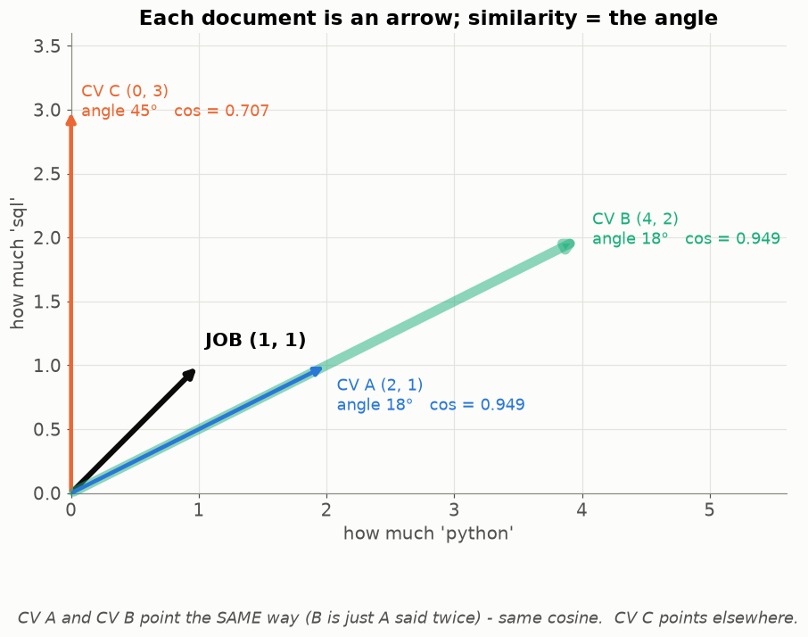
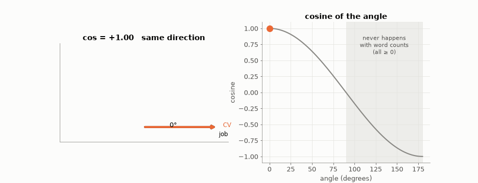
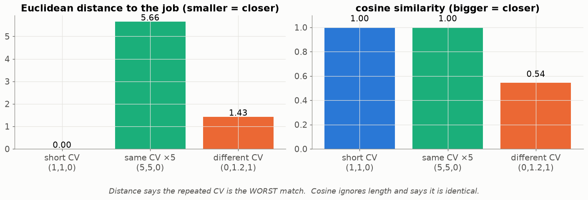
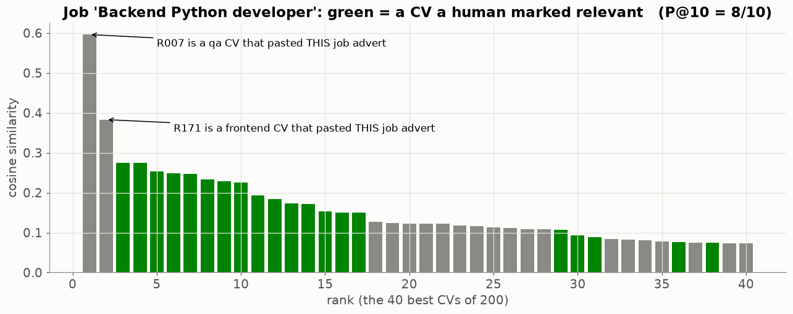

# Lesson 08 — How similar are two texts? Arrows, the dot product and cosine similarity

> **For:** Kosai (ResumeMatch stage 4) &nbsp;·&nbsp; **Time:** 45 – 60 min
> **Before:** Lesson 00 §5, §6, §10; Lesson 07 &nbsp;·&nbsp; **After this:** Lessons 09, 10

## The story

> Hila has a job advert: *"Python and SQL developer"*. Every CV is now a row of TF-IDF numbers (Lesson 07), and so is the
> advert. She needs **one number per CV**: "how similar is this CV to the advert?" — then she can sort the 200 CVs and
> read the top 10. This lesson builds that number, using an idea from geometry: **the angle between two arrows**.

## 🎯 By the end, the student can

1. Draw a document as an arrow and explain similarity as the **angle** between arrows.
2. Compute a dot product, a length and a cosine by hand, step by step.
3. Explain why cosine (and not distance) is used for texts.
4. Explain why, after normalisation, cosine is just the dot product.

## Words you need

| word | meaning |
|---|---|
| **vector** | a list of numbers, drawn as an arrow from (0, 0) — Lesson 00 §10 |
| **dimension** | one position in the list = one word. 2 words → 2-D (a page), 5,000 words → 5,000-D (can't draw, same maths) |
| **length** of a vector | Pythagoras: √(sum of the squares) |
| **dot product** a · b | multiply the numbers in matching positions, then add |
| **angle** | how far apart two arrows point |
| **cosine** of an angle | a number: 1 when the angle is 0°, 0 when it is 90° |
| **cosine similarity** | dot product ÷ (length × length) = the cosine of the angle |

---

## 1. A document is an arrow

Keep only two words, `python` and `sql`. Then every document is two numbers — a point on squared paper, or an **arrow**
from the corner to that point.



* The job advert J = (1, 1): equally python and sql.
* CV A = (2, 1): more python.
* CV B = (4, 2): exactly A **said twice** — same words, same proportions, twice the text. **Same direction.**
* CV C = (0, 3): only sql. A different direction.

**The key idea:** two documents about the same things in the same proportions point the **same way**, no matter how
long they are. So we measure the **angle**, not the distance.

## 2. The tools, step by step

**Dot product** — multiply matching positions, add (Lesson 00 §5):

```
J · A = (1 × 2) + (1 × 1) = 2 + 1 = 3
```

**Length** — Pythagoras:

```
|J| = √(1² + 1²) = √2 = 1.414
|A| = √(2² + 1²) = √5 = 2.236
```

**Cosine similarity:**

$$\cos(J, A) = \frac{J\cdot A}{|J|\times|A|} = \frac{3}{1.414\times 2.236} = \frac{3}{3.162} = 0.949$$

The same for B and C:

```
J · B = 1·4 + 1·2 = 6        |B| = √(16 + 4) = √20 = 4.472     cos = 6 / (1.414 × 4.472) = 6 / 6.325 = 0.949
J · C = 1·0 + 1·3 = 3        |C| = √(0 + 9) = 3                cos = 3 / (1.414 × 3)     = 3 / 4.243 = 0.707
```

**A and B get exactly the same score** — B is just longer. C is less similar.

## 3. What the cosine number means



| cosine | angle | meaning for texts |
|---|---|---|
| 1 | 0° | the same words in the same proportions |
| 0.7 | 45° | partly the same |
| 0 | 90° | not one word in common |
| below 0 | over 90° | impossible with word counts: they are never negative |

So for texts, cosine is always between **0 and 1** — a clean score to show a recruiter.

## 4. Why not just the distance?



The straight-line distance (Lesson 02) says "the same CV × 5" is the **farthest** from the job — just because it's
longer. Cosine ignores length and says it is identical. For texts, length mostly measures how much someone wrote, not
what they know.

## 5. The trick that makes the code simple

If every vector was already divided by its length (L2 normalisation, Lesson 07), then all lengths are 1 and

$$\cos(a, b) = \frac{a\cdot b}{1\times 1} = a\cdot b$$

Kosai normalises every CV row once, at training time. Ranking 200 CVs is then 200 dot products.

```
fit:   every CV → counts → × idf → ÷ its length         (stored)
rank:  advert → the same cleaning → × idf → ÷ its length
       score[i] = dot(CV_i, advert)  for every CV, sort from high to low
```

## 6. On the real data — and a surprise



The advert "Backend Python developer" against the project's 200 CVs. Green = a CV a human marked as relevant. 8 of the top
10 are relevant. But the **top two are wrong**: CVs that **copied the job advert** into their text. Cosine measures
*shared words*, not skill. That's why Kosai's system has a **reliability check** (`RankExplainer.warning_for`) that warns
when a CV repeats the advert's sentences but lacks its skills.

## 7. Common mistakes

| student says | the truth |
|---|---|
| "Cosine 0.6 = 60 % match of skills" | It measures similarity of word use, not a share of skills. |
| "Bigger dot product = more similar" | Only after normalising; without it, long documents win. |
| "Cosine knows postgres = postgresql" | They are different words → different directions. |

## 8. Activities

1. **Arrows on the floor (10 min).** Tape two axes (python, sql). Students stand at their CV's point; a rope from the
   corner is the job. Who has the smallest angle?
2. **Compute (10 min).** J = (1, 0, 1). A = (2, 0, 2), B = (1, 1, 0), C = (0, 3, 0). Rank by cosine.
3. **Cheat the system (10 min).** In the notebook, paste the advert into a bad CV and watch it jump to rank 1.

## 9. Do it yourself

<details><summary>1. a = (3, 4), b = (4, 3). Cosine, every step.</summary>

a · b = 12 + 12 = 24 · |a| = √(9 + 16) = 5 · |b| = 5 · cos = 24 / 25 = **0.96**.
</details>

<details><summary>2. Activity 2's answers.</summary>

|J| = √2. A: (2 + 2)/(√2 · √8) = 4/4 = **1** · B: 1/(√2 · √2) = **0.5** · C: 0/… = **0**.
</details>

<details><summary>3. CV₁ has every advert word once; CV₂ has only "python" 50 times. Advert = "python django rest". Which cosine is higher?</summary>

CV₁ points the same way as the advert: cos = 1. CV₂ = (50, 0, 0): dot = 50, lengths 50 and √3 → cos = 50/(50 · 1.732) =
**0.58**. Repeating a word doesn't help.
</details>

## 10. In your project

| Project | Where |
|---|---|
| ResumeMatch | `resumematch/rank/tfidf.py` → `TfidfRanker._l2_normalise_rows`, `_vectorise_job`, `rank`, `explain` · `rank/base.py` → `Ranker._normalise` · `rank/explainer.py` → `RankExplainer.warning_for` · theory `31_ResumeMatch/01_theory/02_cosine.md` · notebook `02_tfidf_cosine.ipynb` |

## 🎬 Watch & explore

* 3Blue1Brown — *Dot products and duality* — [search on YouTube](https://www.youtube.com/results?search_query=3Blue1Brown+dot+products+and+duality)
* StatQuest — *Cosine Similarity, Clearly Explained* — [search on YouTube](https://www.youtube.com/results?search_query=StatQuest+cosine+similarity)
* Khan Academy — [Vectors](https://www.khanacademy.org/math/linear-algebra/vectors-and-spaces)
