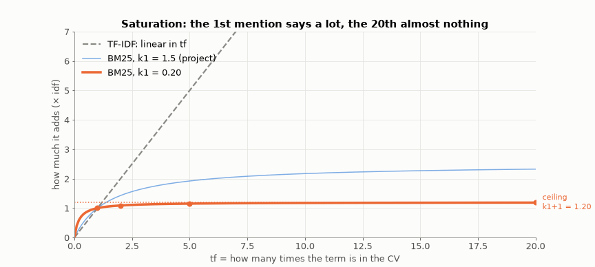
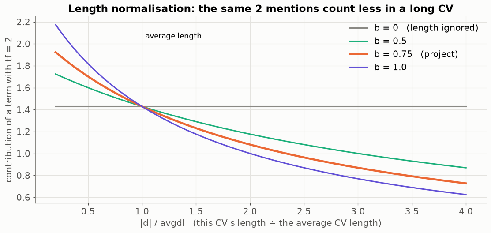
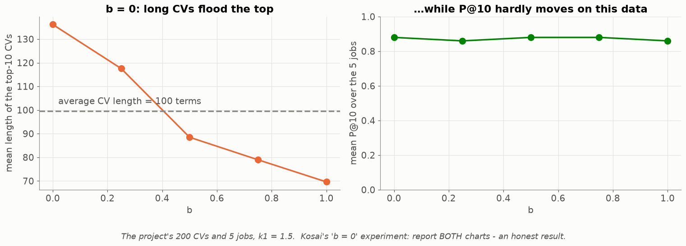
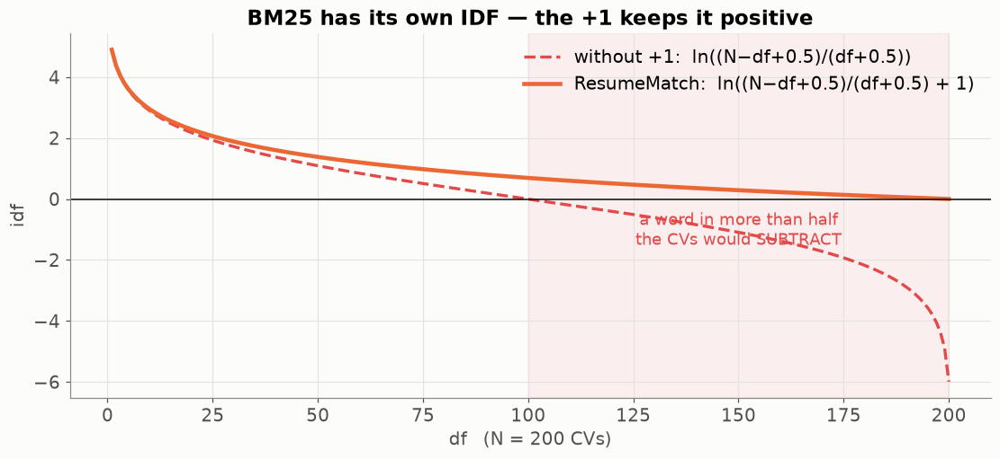
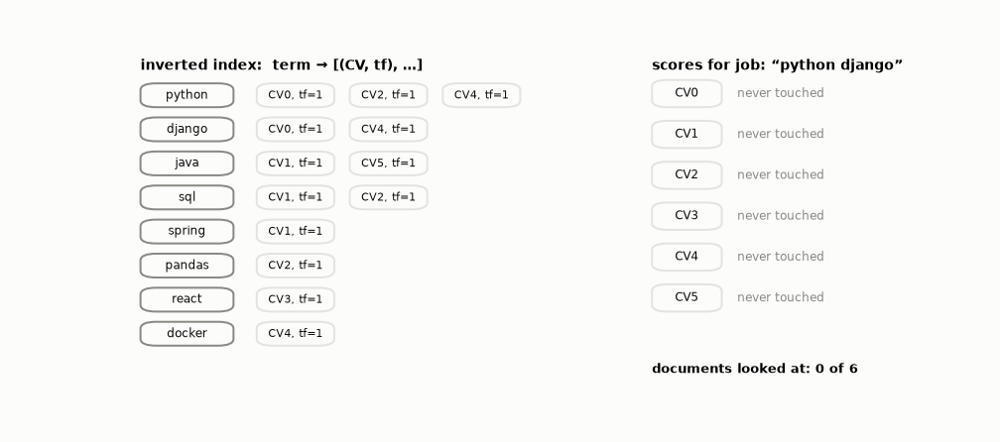
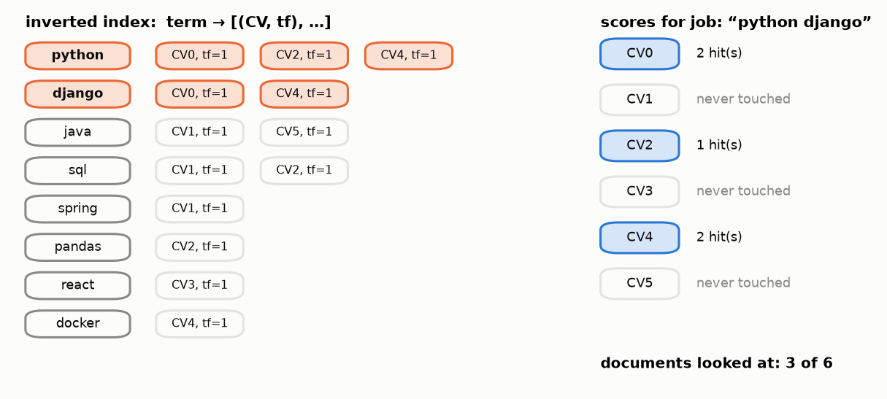

# Lesson 09 — BM25 and the inverted index: how real search engines rank

> **For:** Kosai (ResumeMatch stage 5 — the comparison that *is* his project) &nbsp;·&nbsp; **Time:** 2 × 45 min
> **Before:** Lessons 00 §7, 07, 08 &nbsp;·&nbsp; **After this:** Lesson 10

## The story

> Hila's TF-IDF ranking works — but she notices two annoying things.
>
> 1. One candidate wrote **"Python Python Python …" 15 times** (a "keyword stuffer"). TF-IDF thinks he is 15× more of a
>    Python person than someone who wrote it once. He isn't.
> 2. Some CVs are 3 pages long and list **every technology ever invented** ("also familiar with …"). They match every
>    job a little, just by being long.
>
> Search engines (Google, Elasticsearch) solved both problems decades ago with a formula called **BM25**. This lesson
> builds it from those two problems, one piece at a time — and then shows how a search engine avoids reading all
> documents at all.

## 🎯 By the end, the student can

1. Explain **saturation** and compute the BM25 "repeat factor" by hand for tf = 1, 2, 5, 20.
2. Explain length normalisation and what the knobs **k1** and **b** do, and predict what b = 0 does.
3. Compute one full BM25 term score by hand, with BM25's own IDF.
4. Explain the inverted index with the book-index analogy.

## Words you need

| word | meaning |
|---|---|
| **tf** | how many times the word is in this CV (Lesson 07) |
| **saturation** | after a few mentions, more mentions add almost nothing |
| **k1** | a knob: how fast saturation happens (project: 1.5) |
| **\|d\|** | the length of this CV (number of terms) |
| **avgdl** | the average length of all CVs |
| **b** | a knob: how strongly long CVs are punished (0 = not at all, 1 = fully; project: 0.75) |
| **inverted index** | for every word, the list of CVs that contain it — like the index at the back of a book |

---

## 1. Problem 1 — repeating a word counts too much → saturation

In TF-IDF, "python" 20 times counts **10×** more than 2 times. BM25 replaces the raw count tf with this **repeat
factor**:

$$\text{repeat factor} = \frac{tf\,(k_1+1)}{tf+k_1}\qquad k_1 = 1.5$$

Step by step:

```
tf = 1:    1 × 2.5 / (1 + 1.5)   = 2.5 / 2.5   = 1.00
tf = 2:    2 × 2.5 / (2 + 1.5)   = 5.0 / 3.5   = 1.43     (+0.43 for the 2nd mention)
tf = 5:    5 × 2.5 / (5 + 1.5)   = 12.5 / 6.5  = 1.92
tf = 20:  20 × 2.5 / (20 + 1.5)  = 50 / 21.5   = 2.33     (18 more mentions added only 0.4)
tf = ∞:   approaches k1 + 1      = 2.50       (the ceiling — it can never be more)
```

Why does it flatten? When tf is big, the top (tf × 2.5) and the bottom (tf + 1.5) both grow with tf, so their ratio
stops growing and approaches 2.5.



The animation sweeps k1: **small k1** → the first mention is almost all that counts; **big k1** → almost a straight line,
like TF-IDF. The keyword stuffer's 15 mentions now count only a little more than 2 mentions.

## 2. Problem 2 — long CVs → length normalisation

BM25 adds the CV's length into the bottom of the fraction:

$$\frac{tf\,(k_1+1)}{tf + k_1\left(1 - b + b\cdot\frac{|d|}{avgdl}\right)}$$

Look only at the bracket. **|d| / avgdl** = "how long is this CV compared to an average CV":

```
average length (|d|/avgdl = 1):    1 − 0.75 + 0.75 × 1   = 1       → nothing changes
twice as long  (= 2):              1 − 0.75 + 0.75 × 2   = 1.75    → the bottom gets bigger → score smaller
half as long   (= 0.5):            1 − 0.75 + 0.75 × 0.5 = 0.625   → the bottom gets smaller → score bigger
```



The knob **b** says how strongly: b = 0 → the bracket is always 1 → length ignored; b = 1 → full correction.

### Kosai's experiment, on the project's data



With b = 0 the top-10 CVs are on average **136 terms** long (average CV: 100) — long CVs flood the top. With b = 0.75
they are 79. On this data the precision of the top 10 hardly changes (0.86–0.88). **That is a result too** — Kosai shows
both charts in his book and explains them.

## 3. BM25 has its own IDF

$$\text{idf}_{bm25} = \ln\left(\frac{N - df + 0.5}{df + 0.5} + 1\right)$$



Without the `+ 1` inside the log, a word in more than half of the CVs would get a **negative** weight — mentioning it
would *lower* your score. Using the TF-IDF formula here by mistake is a silent bug: nothing crashes, the ranking is just
worse.

## 4. One full term score, by hand

N = 200 CVs, "python" in 60 of them, average length 100. One CV mentions python **2** times and has **150** terms.

```
1. idf    = ln((200 − 60 + 0.5) / (60 + 0.5) + 1)
          = ln(140.5 / 60.5 + 1) = ln(2.322 + 1) = ln(3.322) = 1.2006
2. bracket = 1 − 0.75 + 0.75 × (150 / 100) = 0.25 + 1.125 = 1.375
3. bottom  = tf + k1 × bracket = 2 + 1.5 × 1.375 = 2 + 2.0625 = 4.0625
4. top     = tf × (k1 + 1) = 2 × 2.5 = 5
5. factor  = 5 / 4.0625 = 1.2308
6. score   = idf × factor = 1.2006 × 1.2308 = 1.4777
```

The CV's total score for a job = the sum of these term scores over the job's words (Σ, Lesson 00 §5).

The same CV if it were average length (150 → 100): bracket 1, bottom 3.5, factor 1.4286, score **1.7151** — higher,
because it is shorter.

## 5. The inverted index — don't read what you don't need

To rank 200 CVs, TF-IDF computes 200 dot products. Google has billions of pages. The trick: an **inverted index** — like
the index at the back of a textbook.



For every word, keep the list of CVs that contain it (and how many times). To rank the job "python django", walk **only**
those two lists. A CV with neither word is **never touched** — its score is 0 without even looking.



```python
for term in set(job_terms):
    if term not in self.inverted:
        continue
    for doc_row, tf in self.inverted[term]:
        scores[doc_row] += self._term_score(tf, self.doc_len[doc_row], idf[term])
```

Put "CVs touched / total" in the book — proof that the index does its job.

## 6. Comparing BM25 and cosine fairly

Cosine is between 0 and 1; a BM25 score can be 3.7 or 41.2. So: normalise each ranking by its top score
(`Ranker._normalise`), and compare the methods by **rank positions** and P@k / MRR (Lesson 10), never by raw numbers.

## 7. Common mistakes

| student says | the truth |
|---|---|
| "BM25 uses the same IDF as TF-IDF" | No — §3. A separate function, `compute_idf_bm25`. |
| "b = 0.75 is magic" | A common default. The project **measures** it instead of trusting it. |
| "The index changes the scores" | It only changes which CVs are *looked at*. Same scores. |

## 8. Activities

1. **The book index (5 min).** Open a textbook's index; find "loop". How many pages did you **not** read?
2. **Human BM25 (15 min).** 5 tiny CVs on cards. Groups build the inverted index on paper, then score "python sql" with the
   repeat factor only. Then add b.
3. **Slider:** `python visualize.py --live` — move k1, watch the ceiling.

## 9. Do it yourself

<details><summary>1. Repeat factor for tf = 3 with k1 = 1.5.</summary>

3 × 2.5 / (3 + 1.5) = 7.5 / 4.5 = **1.67**.
</details>

<details><summary>2. With b = 0, does length matter at all?</summary>

No: the bracket = 1 − 0 + 0 = 1 for every CV, so |d| disappears.
</details>

<details><summary>3. N = 200, df = 150. BM25 idf with and without the +1.</summary>

Without: ln(50.5 / 150.5) = ln(0.3355) = **−1.09** (negative!). With: ln(0.3355 + 1) = ln(1.3355) = **0.289**.
</details>

## 10. In your project

| Project | Where |
|---|---|
| ResumeMatch | `resumematch/nlp/vocabulary.py` → `compute_idf_bm25` · `resumematch/rank/bm25.py` → `Bm25Ranker.fit` (inverted index, `doc_len`, `avgdl`), `rank`, `_term_score` · config `BM25_K1 = 1.5`, `BM25_B = 0.75` · theory `31_ResumeMatch/01_theory/03_bm25.md` · notebook `03_bm25.ipynb` |

## 🎬 Watch & explore

* *BM25 explained* — [search on YouTube](https://www.youtube.com/results?search_query=BM25+ranking+function+explained)
* Stanford IR book — [Okapi BM25](https://nlp.stanford.edu/IR-book/html/htmledition/okapi-bm25-a-non-binary-model-1.html) · [the inverted index](https://nlp.stanford.edu/IR-book/html/htmledition/an-example-information-retrieval-problem-1.html)
