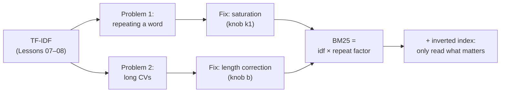
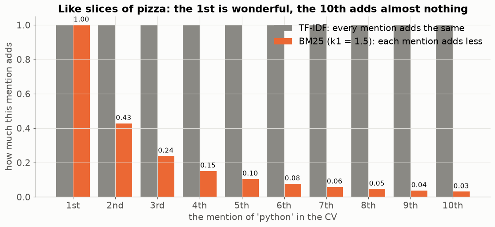
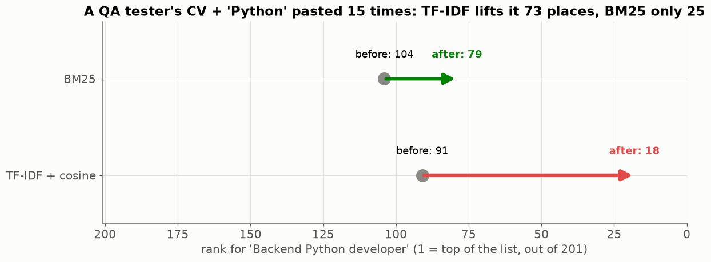
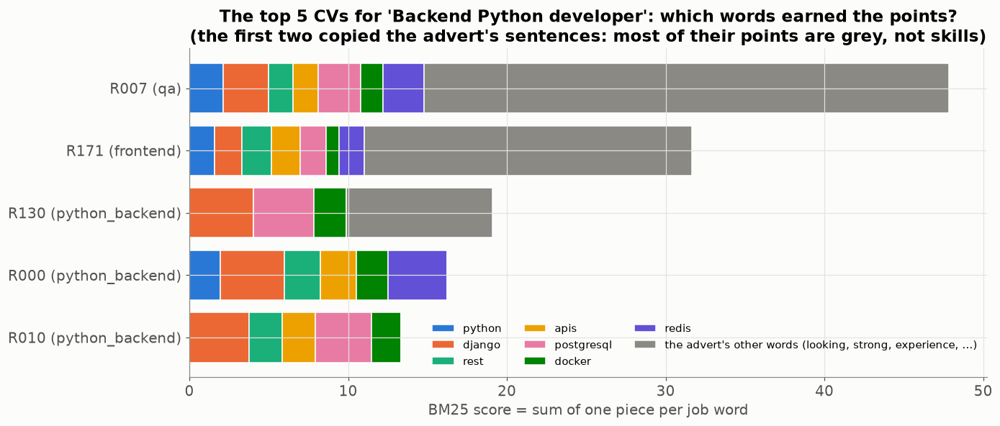
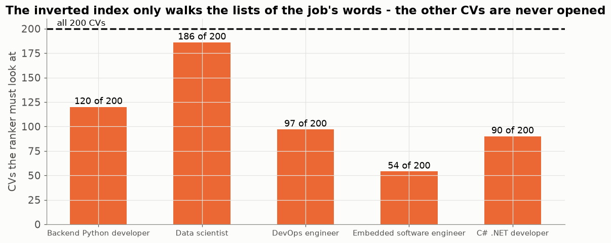
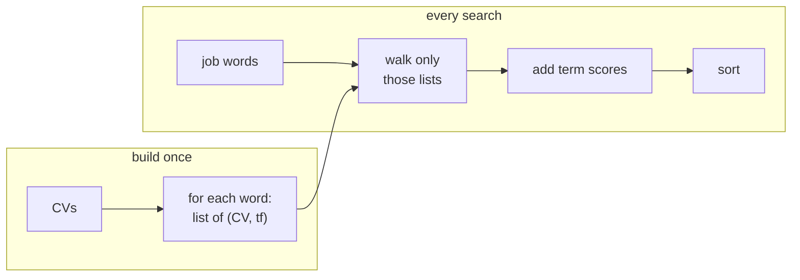

# Lesson 09 — BM25 and the inverted index: how real search engines rank

> **For:** Kosai (ResumeMatch stage 5 — the comparison that *is* his project) &nbsp;·&nbsp; **Time:** 2 × 45 min
> **Before:** Lesson 00 §7 (logarithms); Lessons 07, 08 &nbsp;·&nbsp; **After this:** Lesson 10

**In one sentence:** BM25 fixes two weaknesses of TF-IDF — repeating a word counts too much, and long documents match
everything — and the inverted index lets a search engine skip every document that doesn't contain the query's words.

## 🗺️ The map of this lesson



## The story

> Hila's TF-IDF ranking works — but she notices two annoying things.
>
> 1. One candidate wrote **"Python Python Python …" 15 times** (a "keyword stuffer"). TF-IDF thinks he is a much bigger
>    Python person than someone who wrote it once. He isn't.
> 2. Some CVs are 3 pages long and list **every technology ever invented** ("also familiar with …"). They match every job
>    a little, just by being long.
>
> Search engines solved both problems decades ago with a formula called **BM25** ("Best Match, version 25"). This lesson
> builds it from those two problems, one piece at a time — and then shows how a search engine avoids reading all the
> documents at all.

## Words you need

| word | simple meaning |
|---|---|
| **tf** | how many times the word is in this CV (Lesson 07) |
| **saturation** | after a few mentions, more mentions add almost nothing |
| **k1** | a knob: how fast saturation happens (project: 1.5) |
| **\|d\|** | the length of this CV (number of terms) |
| **avgdl** | the average length of all CVs |
| **b** | a knob: how strongly long CVs are corrected (0 = not at all, 1 = fully; project: 0.75) |
| **term score** | the points one job word gives one CV |
| **inverted index** | for every word, the list of CVs that contain it — like the index at the back of a book |

### 🌍 Where BM25 lives

BM25 isn't a school exercise: it's the default ranking in **Elasticsearch** and **Apache Lucene** (the engines behind the
search boxes of Wikipedia, GitHub, many online shops and job sites). Kosai is building the real thing, in small.

---

## Part 1 — Problem 1: repeating a word counts too much → saturation

> 📖 Hila: *"If someone mentions Python once, I know they know Python. Twice — fine, a bit more sure. Fifteen times? That
> tells me nothing new. He's just shouting."*

### 🧠 The idea: diminishing returns

Think of slices of pizza when you're hungry. The first slice is wonderful, the second very good, the fifth… you barely
notice it. Each extra slice adds **less**. BM25 treats mentions the same way:



In TF-IDF (grey) every mention adds the same. In BM25 (orange) the 1st mention adds 1.00, the 2nd only 0.43, the 10th only
0.03.

### The formula: the repeat factor

BM25 replaces the raw count tf with this **repeat factor**:

$$\text{repeat factor} = \frac{tf\,(k_1+1)}{tf+k_1}\qquad k_1 = 1.5$$

✍️ Step by step:

```
tf = 1:    1 × 2.5 ÷ (1 + 1.5)   = 2.5 ÷ 2.5   = 1.00
tf = 2:    2 × 2.5 ÷ (2 + 1.5)   = 5.0 ÷ 3.5   = 1.43     (+0.43 for the 2nd mention)
tf = 5:    5 × 2.5 ÷ (5 + 1.5)   = 12.5 ÷ 6.5  = 1.92
tf = 20:  20 × 2.5 ÷ (20 + 1.5)  = 50 ÷ 21.5   = 2.33     (18 more mentions added only 0.4)
tf = ∞:   approaches k1 + 1      = 2.50       (the ceiling — it can never be more)
```

**Why does it flatten?** When tf is big, the top (tf × 2.5) and the bottom (tf + 1.5) both grow with tf, so their ratio stops
growing and approaches 2.5. (Like 100 ÷ 101.5 and 1000 ÷ 1001.5 — both almost 1.)

### The knob k1


The animation sweeps k1: **small k1** → the first mention is almost all that counts; **big k1** → almost a straight line,
like TF-IDF. Kosai uses 1.5, a common default.

### 🖼️ The keyword stuffer, on the real CVs

Kosai takes a real QA tester's CV, which ranks far down for "Backend Python developer", and pastes "Python" into it 15 times:



TF-IDF lifts the stuffed CV **73 places** (91 → 18) — into the part of the list Hila actually reads. BM25 lifts it only 25
(104 → 79): the 15 extra mentions hit the ceiling.

<details><summary>✅ Quick check: repeat factor for tf = 3 with k1 = 1.5.</summary>

3 × 2.5 ÷ (3 + 1.5) = 7.5 ÷ 4.5 = **1.67**.
</details>

## Part 2 — Problem 2: long CVs → length correction

> 📖 Hila: *"A one-page CV that says 'Docker' is telling me something. A five-page CV that lists 80 technologies including
> Docker is telling me much less."*

BM25 puts the CV's length into the bottom of the fraction:

$$\frac{tf\,(k_1+1)}{tf + k_1\left(1 - b + b\cdot\frac{|d|}{avgdl}\right)}$$

Look only at the bracket. **|d| ÷ avgdl** = "how long is this CV compared to an average CV":

```
average length (|d|/avgdl = 1):    1 − 0.75 + 0.75 × 1   = 1       → nothing changes
twice as long  (= 2):              1 − 0.75 + 0.75 × 2   = 1.75    → the bottom gets bigger → score smaller
half as long   (= 0.5):            1 − 0.75 + 0.75 × 0.5 = 0.625   → the bottom gets smaller → score bigger
```


The knob **b** says how strongly: b = 0 → the bracket is always 1 → length ignored; b = 1 → full correction.

### 🌍 Real world

A shop's search for "red shoes": a short product page titled "Red running shoes" should beat a 30-page catalogue that
mentions red shoes once on page 17. That's length correction.

### Kosai's experiment, on the project's data


With b = 0 the top-10 CVs are on average **136 terms** long (average CV: 100) — long CVs flood the top. With b = 0.75 they
are 79. On this data the precision of the top 10 hardly changes (0.86–0.88). **That is a result too** — Kosai shows both
charts in his book and explains them.

<details><summary>✅ Quick check: with b = 0, does length matter at all?</summary>

No: the bracket = 1 − 0 + 0 = 1 for every CV, so |d| disappears.
</details>

## Part 3 — BM25 has its own IDF

$$\text{idf}_{bm25} = \ln\left(\frac{N - df + 0.5}{df + 0.5} + 1\right)$$

The idea is the same as Lesson 07 (rare → heavy), only the formula is different:


Without the `+ 1` inside the log, a word in more than half of the CVs would get a **negative** weight — mentioning it would
*lower* your score. Using the TF-IDF formula here by mistake is a silent bug: nothing crashes, the ranking is just worse.

## Part 4 — One full term score, by hand

> 📖 Hila wants to see the arithmetic once, with real-sized numbers.

N = 200 CVs, "python" in 60 of them, average length 100. One CV mentions python **2** times and has **150** terms.

```
1. idf     = ln((200 − 60 + 0.5) ÷ (60 + 0.5) + 1)
           = ln(140.5 ÷ 60.5 + 1) = ln(2.322 + 1) = ln(3.322) = 1.2006
2. bracket = 1 − 0.75 + 0.75 × (150 ÷ 100) = 0.25 + 1.125 = 1.375
3. bottom  = tf + k1 × bracket = 2 + 1.5 × 1.375 = 2 + 2.0625 = 4.0625
4. top     = tf × (k1 + 1) = 2 × 2.5 = 5
5. factor  = 5 ÷ 4.0625 = 1.2308
6. score   = idf × factor = 1.2006 × 1.2308 = 1.4777
```

The same CV if it were average length (150 → 100): bracket 1, bottom 3.5, factor 1.4286, score **1.7151** — higher, because
it is shorter.

### A CV's total = the sum over the job's words

The CV's total score for a job = the sum of these term scores over the job's words (Σ, Lesson 00 §5). On the real data, you
can see where each top CV's points came from:



The three real Python developers earn their points from **skills** (django, postgresql, docker…). The first two CVs earn
most of theirs from the advert's ordinary words — "looking", "strong", "experience" — because they **copied the advert**
(the trap from Lesson 08). BM25 doesn't fix that; Kosai's reliability warning does.

## Part 5 — The inverted index: don't read what you don't need

> 📖 Hila's company grows: 200 CVs become 200,000. Computing a score for every CV for every search becomes slow. How does
> Google search billions of pages in a fraction of a second?

### 🧠 The book index

Open a textbook's index at the back: "loop … pages 12, 45, 88". To read about loops you open **three pages**, not the whole
book. An **inverted index** is that, for documents: for every word, the list of CVs that contain it (and how many times).


To rank the job "python django", walk **only** those two lists. A CV with neither word is **never touched** — its score is 0
without even looking.


```python
for term in set(job_terms):
    if term not in self.inverted:
        continue
    for doc_row, tf in self.inverted[term]:
        scores[doc_row] += self._term_score(tf, self.doc_len[doc_row], idf[term])
```

### On the real jobs



For the embedded-engineer job only 54 of 200 CVs are opened at all. With 200 CVs the saving is small; with 200 million web
pages it is the difference between a search engine and no search engine. Put "CVs touched / total" in the book — proof that
the index does its job.



## Part 6 — Comparing BM25 and cosine fairly

Cosine is between 0 and 1; a BM25 score can be 3.7 or 41.2. So: normalise each ranking by its top score
(`Ranker._normalise`), and compare the methods by **rank positions** and P@k / MRR (Lesson 10), never by raw numbers.

---

## 🧪 Worked example: BM25 for three tiny CVs

```python
import math
from collections import Counter

cvs = [["python", "python", "django", "sql"],
       ["java", "spring", "sql", "docker", "kafka", "aws", "python"],
       ["python"] * 15 + ["selenium"]]                 # the keyword stuffer
k1, b = 1.5, 0.75
N = len(cvs)
avgdl = sum(len(d) for d in cvs) / N
df = Counter(t for d in cvs for t in set(d))

def bm25(doc, query):
    tf = Counter(doc)
    score = 0.0
    for t in query:
        if t not in tf:
            continue
        idf = math.log((N - df[t] + 0.5) / (df[t] + 0.5) + 1)
        bracket = 1 - b + b * len(doc) / avgdl
        score += idf * tf[t] * (k1 + 1) / (tf[t] + k1 * bracket)
    return score

for i, d in enumerate(cvs):
    print(i, round(bm25(d, ["python", "django"]), 3))
```

Run it, then change k1 to 100 (almost no saturation) and watch the stuffer (CV 2) climb.

## Try it yourself

<details><summary>1. 🟢 Repeat factor for tf = 1, 2, 3 with k1 = 1.</summary>

tf × 2 ÷ (tf + 1): **1.00, 1.33, 1.50** — the ceiling is k1 + 1 = 2.
</details>

<details><summary>2. 🟢 A CV is exactly average length. What is the bracket with b = 0.75?</summary>

1 − 0.75 + 0.75 × 1 = **1** — no correction.
</details>

<details><summary>3. 🟡 N = 200, df = 150. BM25 idf with and without the +1.</summary>

Without: ln(50.5 ÷ 150.5) = ln(0.3355) = **−1.09** (negative!). With: ln(0.3355 + 1) = ln(1.3355) = **0.289**.
</details>

<details><summary>4. 🟡 A CV is half the average length, tf = 1, k1 = 1.5, b = 0.75. Repeat factor?</summary>

bracket = 0.25 + 0.75 × 0.5 = 0.625 · bottom = 1 + 1.5 × 0.625 = 1.9375 · factor = 2.5 ÷ 1.9375 = **1.29** (more than 1:
short CVs get a bonus).
</details>

<details><summary>5. 🟡 The index for "sql" is [(CV1, 1), (CV4, 3)] and for "java" [(CV2, 2)]. Which CVs are touched for the query "sql java"? Which are not?</summary>

Touched: CV1, CV4, CV2. Every other CV is never opened and scores 0.
</details>

<details><summary>6. 🔴 Why does BM25 use a ceiling instead of simply log(tf)?</summary>

log(tf) also grows slowly but has no ceiling — 1,000 mentions would still keep adding. BM25's ceiling (k1 + 1) means a word
can never give more than a fixed amount, and k1 lets you tune how quickly it gets there.
</details>

<details><summary>7. 🔴 Kosai sets b = 1 and a 20-word CV that says "Python Django" jumps to the top. Why?</summary>

With b = 1 the bracket is |d| ÷ avgdl = 0.2, so the bottom is tiny and every match is worth a lot. Very short CVs get a huge
bonus — that's why b is usually below 1.
</details>

## Common mistakes

| student says | the truth |
|---|---|
| "BM25 uses the same IDF as TF-IDF" | No — Part 3. A separate function, `compute_idf_bm25`. |
| "b = 0.75 is magic" | A common default. The project **measures** it instead of trusting it. |
| "The index changes the scores" | It only changes which CVs are *looked at*. Same scores. |
| "BM25 understands skills" | It counts words more cleverly; it still can't tell a copied advert from a real CV. |

## 📝 Summary

> * **Saturation**: repeat factor = tf (k1 + 1) ÷ (tf + k1) — each mention adds less, ceiling k1 + 1.
> * **Length correction**: the bracket 1 − b + b·|d|/avgdl — long CVs are corrected, b sets how much.
> * **BM25 idf** = ln((N − df + 0.5) ÷ (df + 0.5) + 1) — never negative.
> * A CV's score = **Σ** of term scores over the job's words.
> * The **inverted index** only walks the lists of the query's words — the rest is never opened.

## Class activities

1. **The book index (5 min).** Open a textbook's index; find "loop". How many pages did you **not** read?
2. **Human BM25 (15 min).** 5 tiny CVs on cards. Groups build the inverted index on paper, then score "python sql" with the
   repeat factor only. Then add b.
3. **Pizza (5 min).** "How happy does the 1st, 2nd, 10th slice make you?" — draw it, compare with the orange bars.
4. **Slider:** `python visualize.py --live` — move k1, watch the ceiling.

## In your project

| Project | Where |
|---|---|
| ResumeMatch | `resumematch/nlp/vocabulary.py` → `compute_idf_bm25` · `resumematch/rank/bm25.py` → `Bm25Ranker.fit` (inverted index, `doc_len`, `avgdl`), `rank`, `_term_score` · config `BM25_K1 = 1.5`, `BM25_B = 0.75` · theory `31_ResumeMatch/01_theory/03_bm25.md` · notebook `03_bm25.ipynb` |

## 🎬 Watch & explore

| | |
|---|---|
| <a href="https://www.youtube.com/watch?v=TW9vHU1GpU4"></a> | **Abhishek Thakur — A no-nonsense intro to BM25**. The formula, piece by piece, like Parts 1–3. |
| <a href="https://www.youtube.com/watch?v=hiJcEaiuw_E"></a> | **What is BM25 and how does it work?** A second, shorter explanation. |
| <a href="https://www.youtube.com/watch?v=bFrO8piASKg"></a> | **Victor Lavrenko — Indexing 2: the inverted index**. A university lecture on Part 5, drawn on a whiteboard. |

**Read more:**
* Stanford IR book — [Okapi BM25](https://nlp.stanford.edu/IR-book/html/htmledition/okapi-bm25-a-non-binary-model-1.html) ·
  [the inverted index](https://nlp.stanford.edu/IR-book/html/htmledition/an-example-information-retrieval-problem-1.html)
