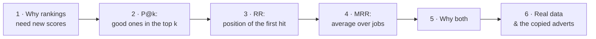
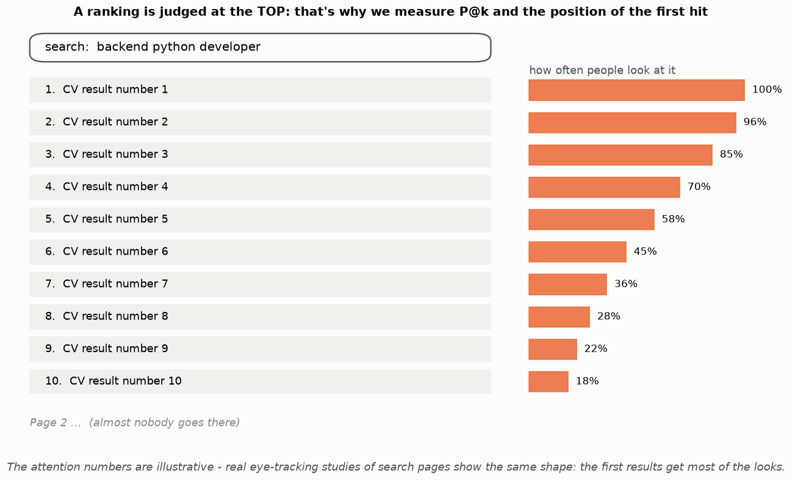
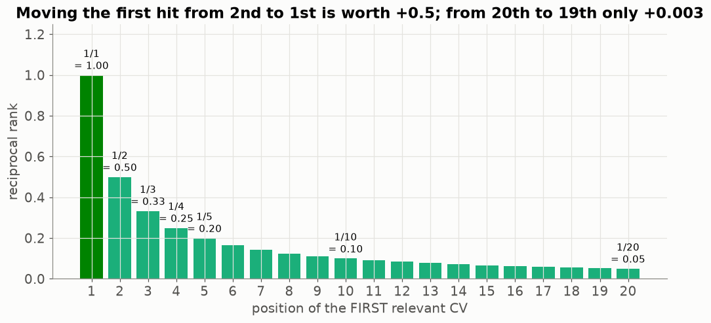
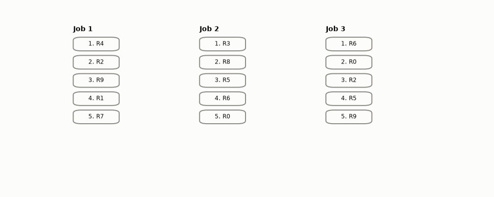
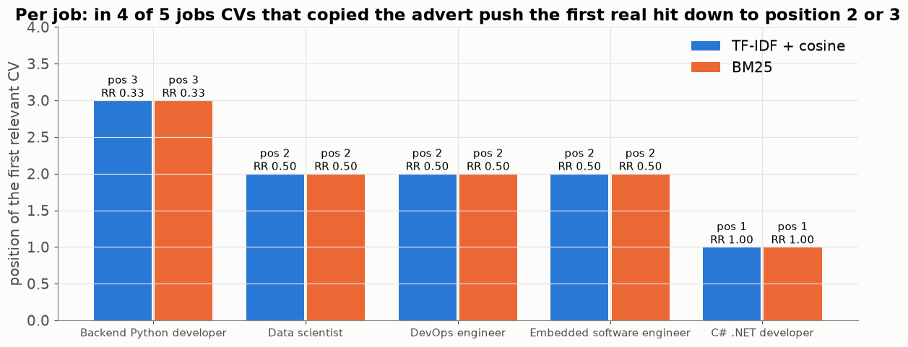
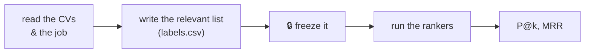

# Lesson 10 — Is the ranking good? Precision@k and MRR

> **For:** Kosai (ResumeMatch stage 6) &nbsp;·&nbsp; **Time:** 2 × 45 min
> **Before:** Lessons 03, 08, 09 &nbsp;·&nbsp; **After this:** the experiments chapter of the book

**In one sentence:** a ranking is judged at the top — **P@k** asks "how many of the first k are good?" and **MRR** asks
"how high is the first good one?".

## 🗺️ The map of this lesson



## The story

> Hila doesn't read 200 CVs. She opens the program, reads the **first 10** in the ranking, and calls the good ones. So for
> her, a "good ranking" means two things: **(1) many good CVs among the first 10**, and **(2) a good CV at the very top**, so
> she doesn't waste her first call. Accuracy (Lesson 03) measures neither. This lesson gives two numbers that measure exactly
> Hila's two wishes.

## Words you need

| word | simple meaning |
|---|---|
| **ranking** | the list of all CVs from best to worst, as the program sorted them |
| **relevant** | a CV a **human** marked as a good fit for the job, *before* seeing the program's ranking |
| **k** | how many top results we look at (Hila: 10) |
| **P@k** (precision at k) | of the first k results, the share that are relevant |
| **RR** (reciprocal rank) | 1 ÷ (position of the first relevant result) |
| **MRR** (mean reciprocal rank) | the average RR over all jobs (queries) |

---

## Part 1 — Why a ranking needs its own scores

> 📖 Kosai tries accuracy first: "of 200 CVs, how many are correctly placed in 'good' or 'bad'?" It says 90 %. Hila shrugs:
> *"I don't care about the order of CVs 150 to 200. I never see them."*



The same is true for every search: Google, YouTube, a shop, a job site. People look at the first few results and rarely go
to page 2. So a good ranking score must:

* look only at the **top** of the list, and
* care about **position**: a good result at #1 is worth more than at #9.

### 🌍 Real world

* **Google / YouTube** measure their search quality with scores like these, on queries labelled by human raters.
* **Netflix's "Top picks for you"** row only shows about 10 titles — what matters is how many of those 10 you'd watch.
* **Your phone's contacts search:** if the friend you want is first, you're happy; if she's 7th, you're annoyed — that's RR.

## Part 2 — Precision@k: "how many of the first k are good?"

$$P@k = \frac{\text{relevant results among the first } k}{k}$$


✍️ The ranking: C3, C7, C1, C9, C4, C2, C8, C5, C6, C0. Relevant (marked by a human): C1, C5, C7.

```
k = 1:   [C3]                 relevant: none          P@1 = 0 ÷ 1 = 0.00
k = 2:   [C3, C7]             relevant: C7            P@2 = 1 ÷ 2 = 0.50
k = 3:   [C3, C7, C1]         relevant: C7, C1        P@3 = 2 ÷ 3 = 0.67
k = 4:   + C9                 still 2                 P@4 = 2 ÷ 4 = 0.50
k = 10:  all                  C7, C1, C5              P@10 = 3 ÷ 10 = 0.30
```

It's Lesson 03's **precision** ("of what I showed, how much was right?"), but only for the first k.

⚠️ Always divide by **k**, even if the list is shorter than k (missing places count as misses) —
`test_precision_denominator_is_k_not_list_length`. Otherwise a system that returns just 1 good CV would get P@10 = 1.0.

<details><summary>✅ Quick check: ranking [R4, R1, R9, R2, R7], relevant {R2, R7, R8}. P@3 and P@5?</summary>

top 3: R4, R1, R9 → 0 relevant → **P@3 = 0**. Top 5 adds R2, R7 → 2 ÷ 5 = **0.4**.
</details>

## Part 3 — Reciprocal rank: "how high is the first good one?"

$$RR = \frac{1}{\text{position of the first relevant result}}\qquad(0 \text{ if there is none})$$

| first relevant at position | 1 | 2 | 3 | 4 | 10 | never |
|---|---|---|---|---|---|---|
| RR | 1/1 = 1.0 | 1/2 = 0.5 | 1/3 = 0.33 | 1/4 = 0.25 | 1/10 = 0.1 | 0 |



**Why "1 divided by"?** So that position 1 is worth the most, and every step down is worth less — but the difference between
position 19 and 20 barely matters (both are bad). Moving the first hit from 2nd to 1st is worth +0.5; from 20th to 19th only
+0.003. That's exactly how annoyed a user feels.

In the example of Part 2, the first relevant CV (C7) is at position 2 → **RR = 0.5**.

## Part 4 — MRR: the average over many jobs

One job is one roll of the dice (Lesson 05). So we compute RR for **every** job and average:



```
Job 1: first hit at position 1 → RR = 1.00
Job 2: first hit at position 2 → RR = 0.50
Job 3: first hit at position 4 → RR = 0.25
MRR = (1.00 + 0.50 + 0.25) ÷ 3 = 1.75 ÷ 3 = 0.58
```

How to read 0.58: "on average, the first good CV is between 1st and 2nd place" (1 ÷ 0.58 ≈ 1.7).

## Part 5 — Why we need both


* **Ranking A:** 4 good CVs in the top 5, but not first → P@5 = 0.80, RR = 0.50.
* **Ranking B:** the best one first, then nothing good → P@5 = 0.20, RR = 1.00.

P@k doesn't care about the order **inside** the top k. RR only cares about the **first** hit. Each one alone can be fooled —
report both.

| what Hila wants | the score |
|---|---|
| "give me a shortlist to call" | P@10 |
| "the first CV should be worth my first call" | RR / MRR |

## Part 6 — On the project's data


Simple versions of both methods on the 200 CVs and 5 labelled jobs:

| | P@5 | P@10 | MRR |
|---|---|---|---|
| TF-IDF + cosine | 0.80 | 0.90 | 0.57 |
| BM25 | 0.80 | 0.88 | 0.57 |

**Why is MRR low when P@10 is high?** Look at every job separately:



In four of the five jobs, CVs that **copied the job advert** (Lessons 08, 09) take the first places, so the first real hit is
at position 2 or 3. The system finds good candidates (high P@10) but doesn't put a real one first (low MRR). A precise,
explainable finding for the book — and the reason for the reliability check (`RankExplainer.warning_for`).

## Part 7 — The golden rule of labelling

The "relevant" lists must be made **before** looking at the program's ranking, by reading the CVs. If you label after seeing
the ranking, you start agreeing with the program's mistakes ("well, it ranked this first, so it must be OK…").



---

## 🧪 Worked example: the three functions

```python
def precision_at_k(ranking, relevant, k):
    return sum(1 for c in ranking[:k] if c in relevant) / k        # divide by k, always

def reciprocal_rank(ranking, relevant):
    for position, c in enumerate(ranking, start=1):
        if c in relevant:
            return 1 / position
    return 0.0

def mean_reciprocal_rank(rankings, relevants):
    return sum(reciprocal_rank(r, rel) for r, rel in zip(rankings, relevants)) / len(rankings)

ranking = ["C3", "C7", "C1", "C9", "C4", "C2", "C8", "C5", "C6", "C0"]
relevant = {"C1", "C5", "C7"}
print(precision_at_k(ranking, relevant, 3))     # 0.666...
print(reciprocal_rank(ranking, relevant))       # 0.5
print(mean_reciprocal_rank([["R4", "R2"], ["R3", "R8"], ["R6", "R0", "R2", "R5"]],
                           [{"R4"}, {"R8"}, {"R5"}]))      # (1 + 0.5 + 0.25) / 3 = 0.583
```

## Try it yourself

<details><summary>1. 🟢 Ranking [A, B, C, D], relevant {B, D}. P@2, P@4, RR?</summary>

P@2 = 1 ÷ 2 = **0.5**. P@4 = 2 ÷ 4 = **0.5**. First relevant B at 2 → RR = **0.5**.
</details>

<details><summary>2. 🟢 Three jobs: RR 1, 0.5 and 0. MRR?</summary>

(1 + 0.5 + 0) ÷ 3 = **0.5**.
</details>

<details><summary>3. 🟡 The program returns only 3 CVs, 2 of them relevant. P@10?</summary>

2 ÷ **10** = **0.2** — divide by k, not by 3.
</details>

<details><summary>4. 🟡 Design a ranking of 5 with P@5 = 0.6 and RR = 0.2.</summary>

The first relevant must be at position 5 (RR = 1/5) — but then only 1 relevant is in the top 5 (P@5 = 0.2). Impossible! With
RR = 0.2 the top 5 can have at most one relevant. Nice trap: the two scores are connected.
</details>

<details><summary>5. 🟡 MRR = 0.25. Roughly where is the first good CV, on average?</summary>

1 ÷ 0.25 = 4 → around **position 4** (an average of reciprocals, so it's a rough reading).
</details>

<details><summary>6. 🔴 P@5 is high but MRR is low. What do you write in the book?</summary>

The system finds good candidates but doesn't put the best one first — something pushes wrong CVs to the top (here: copied
advert text). Then show which CVs and why, with the per-job chart.
</details>

<details><summary>7. 🔴 Why must the relevant lists be written before running the rankers?</summary>

Seeing the ranking biases the labeller towards the program's choices; the scores would then measure "how much the
program agrees with itself", not with the truth.
</details>

## Common mistakes

| student says | the truth |
|---|---|
| "P@10 = 0.9 means 90 % accuracy" | 9 of the first 10 are good. Nothing about the other 190. |
| "Divide by the number of results returned" | Divide by k. |
| "MRR 0.57 means position 0.57" | It is an average of 1/position: "between 1st and 2nd on average". |
| "One job is enough to compare two rankers" | One job is one roll of the dice — average over all jobs. |

## 📝 Summary

> * Rankings are judged at the **top**, by **position**.
> * **P@k** = relevant in the first k ÷ **k**.
> * **RR** = 1 ÷ position of the first relevant (0 if none). **MRR** = average RR over all jobs.
> * They measure different wishes — report **both**, and look at each job separately.
> * Write the relevant lists **before** you run the rankers.

## Class activities

1. **Be the search engine (10 min).** 8 short "CVs" on cards; each student ranks them for one job. Swap papers; the neighbour
   computes P@3 and RR using the teacher's labels.
2. **Design a bad ranking (5 min).** One with high P@5 but RR = 0.33. Then one with RR = 1 but P@5 = 0.2.
3. **Search yourself (5 min).** Everyone searches the same question on their phone; write down the position of the first
   useful result. Compute the class MRR.

## In your project

| Project | Where |
|---|---|
| ResumeMatch | `resumematch/eval/metrics.py` → `precision_at_k`, `reciprocal_rank`, `mean_reciprocal_rank`, `evaluate` · `evaluate.py` · `LabelRepository` · theory `31_ResumeMatch/01_theory/06_evaluate.md` · notebook `04_evaluate.ipynb` |

## 🎬 Watch & explore

| | |
|---|---|
| <a href="https://www.youtube.com/watch?v=bFrO8piASKg"></a> | **Victor Lavrenko's information-retrieval lectures** — this one is on the index; the same series covers evaluating rankings. |

**Read more:**
* Stanford IR book — [Evaluation of ranked retrieval results](https://nlp.stanford.edu/IR-book/html/htmledition/evaluation-of-ranked-retrieval-results-1.html)
* At home: run the worked example and add your own job with 3 rankings.
