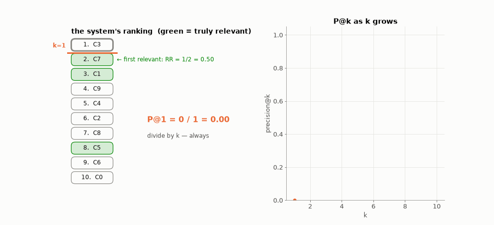
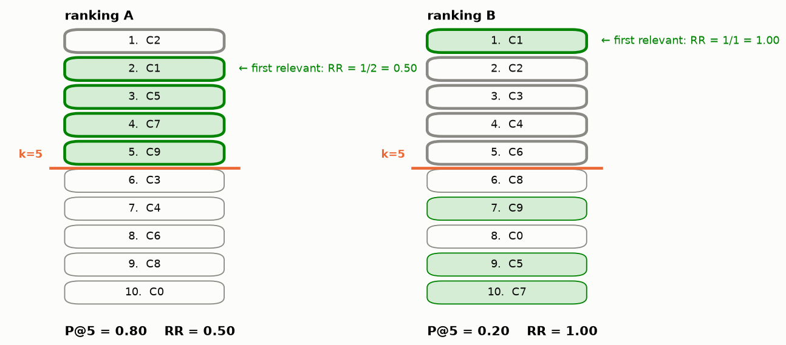
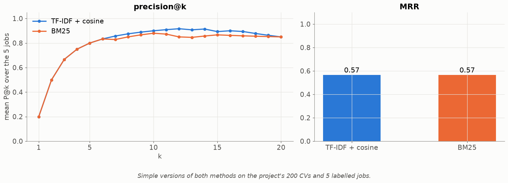

# Lesson 10 — Is the ranking good? Precision@k and MRR

> **For:** Kosai (ResumeMatch stage 6) &nbsp;·&nbsp; **Time:** 45 min
> **Before:** Lessons 03, 08, 09 &nbsp;·&nbsp; **After this:** the experiments chapter of the book

## The story

> Hila doesn't read 200 CVs. She opens the program, reads the **first 10** in the ranking, and calls the good ones. So
> for her, a "good ranking" means two things: **(1) many good CVs among the first 10**, and **(2) a good CV at the very
> top**, so she doesn't waste her first call. Accuracy (Lesson 03) measures neither. This lesson gives two numbers that
> measure exactly Hila's two wishes.

## 🎯 By the end, the student can

1. Explain why a ranking needs different scores than a classifier.
2. Compute P@k and the reciprocal rank by hand, and MRR over several jobs.
3. Read a ranking that is good by one score and bad by the other, and explain what it means.

## Words you need

| word | meaning |
|---|---|
| **ranking** | the list of all CVs from best to worst, as the program sorted them |
| **relevant** | a CV a **human** marked as a good fit for the job, *before* seeing the program's ranking |
| **k** | how many top results we look at (Hila: 10) |
| **P@k (precision at k)** | of the first k results, the share that are relevant |
| **RR (reciprocal rank)** | 1 / (position of the first relevant result) |
| **MRR** | the average RR over all jobs |

---

## 1. Precision@k — "how many of the first k are good?"

$$P@k = \frac{\text{relevant results among the first } k}{k}$$



The ranking: C3, C7, C1, C9, C4, C2, C8, C5, C6, C0. Relevant (marked by a human): C1, C5, C7.

```
k = 1:   [C3]                 relevant: none          P@1 = 0 / 1 = 0.00
k = 2:   [C3, C7]             relevant: C7            P@2 = 1 / 2 = 0.50
k = 3:   [C3, C7, C1]         relevant: C7, C1        P@3 = 2 / 3 = 0.67
k = 4:   + C9                 still 2                 P@4 = 2 / 4 = 0.50
k = 10:  all                  C7, C1, C5              P@10 = 3 / 10 = 0.30
```

⚠️ Always divide by **k**, even if the list is shorter than k (missing places count as misses) —
`test_precision_denominator_is_k_not_list_length`.

## 2. Reciprocal rank — "how high is the first good one?"

$$RR = \frac{1}{\text{position of the first relevant result}}\qquad(0 \text{ if there is none})$$

| first relevant at position | 1 | 2 | 3 | 4 | 10 | never |
|---|---|---|---|---|---|---|
| RR | 1/1 = 1.0 | 1/2 = 0.5 | 1/3 = 0.33 | 1/4 = 0.25 | 1/10 = 0.1 | 0 |

Why "1 divided by"? So that position 1 is worth the most and every step down is worth less — but position 30 vs 31
barely matters.

In the example above the first relevant CV (C7) is at position 2 → **RR = 0.5**.

**MRR** = the average RR over all jobs. Three jobs with RR 1, 0.5 and 0.25 → (1 + 0.5 + 0.25) / 3 = **0.58**.

## 3. Why we need both



* **Ranking A:** 4 good CVs in the top 5, but not first → P@5 = 0.80, RR = 0.50.
* **Ranking B:** the best one first, then nothing good → P@5 = 0.20, RR = 1.00.

P@k doesn't care about the order **inside** the top k. RR only cares about the **first** hit. Report both.

## 4. On the project's data



Simple versions of both methods on the 200 CVs and 5 labelled jobs: P@5 = 0.80 for both; P@10 = 0.90 (TF-IDF) vs 0.88
(BM25); MRR = 0.57 for both. **Why is MRR low when P@10 is high?** Because in four of the five jobs a CV that **copied the
job advert** (Lesson 08) takes position 1. A precise, explainable finding for the book — and the reason for the reliability
check.

## 5. The golden rule of labelling

The "relevant" lists must be made **before** looking at the program's ranking, by reading the CVs. If you label after
seeing the ranking, you start agreeing with the program's mistakes.

## 6. Common mistakes

| student says | the truth |
|---|---|
| "P@10 = 0.9 means 90 % accuracy" | 9 of the first 10 are good. Nothing about the other 190. |
| "Divide by the number of results returned" | Divide by k. |
| "MRR 0.57 means position 0.57" | It is an average of 1/position: "between 1st and 2nd on average". |

## 7. Activities

1. **Be the search engine (10 min).** 8 short "CVs" on cards; each student ranks them for one job. Swap papers; the
   neighbour computes P@3 and RR using the teacher's labels.
2. **Design a bad ranking (5 min).** Make one with P@5 = 0.6 and RR = 0.2.

## 8. Do it yourself

<details><summary>1. Ranking [R4, R1, R9, R2, R7], relevant {R2, R7, R8}. P@3, P@5, RR?</summary>

top 3: R4, R1, R9 → 0 relevant → P@3 = 0 · top 5 adds R2, R7 → 2/5 = **0.4** · first relevant R2 at position 4 → RR =
**0.25**.
</details>

<details><summary>2. Three jobs: RR 1, 0.5 and 0. MRR?</summary>

(1 + 0.5 + 0) / 3 = **0.5**.
</details>

<details><summary>3. P@5 is high but MRR is low. What do you write in the book?</summary>

The system finds good candidates but doesn't put the best one first — something pushes wrong CVs to the top (here: copied
advert text). Then show which CVs and why.
</details>

## 9. In your project

| Project | Where |
|---|---|
| ResumeMatch | `resumematch/eval/metrics.py` → `precision_at_k`, `reciprocal_rank`, `mean_reciprocal_rank`, `evaluate` · `evaluate.py` · `LabelRepository` · theory `31_ResumeMatch/01_theory/06_evaluate.md` · notebook `04_evaluate.ipynb` |

## 🎬 Watch & explore

* *Evaluation metrics for ranking: precision@k, MRR* — [search on YouTube](https://www.youtube.com/results?search_query=information+retrieval+evaluation+precision+at+k+MRR)
* Stanford IR book — [Evaluation of ranked retrieval results](https://nlp.stanford.edu/IR-book/html/htmledition/evaluation-of-ranked-retrieval-results-1.html)
