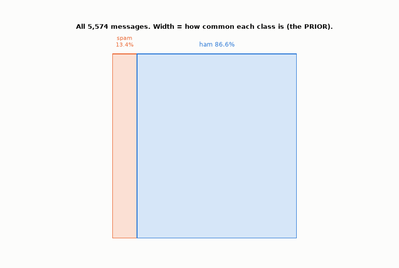
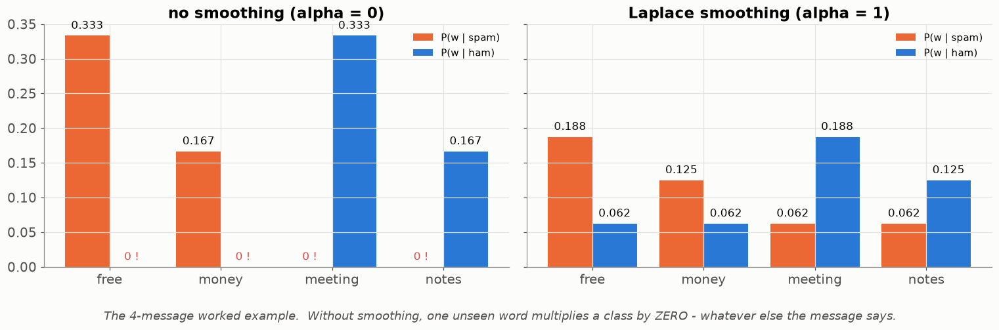
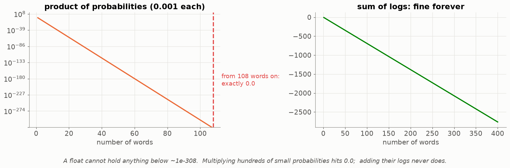
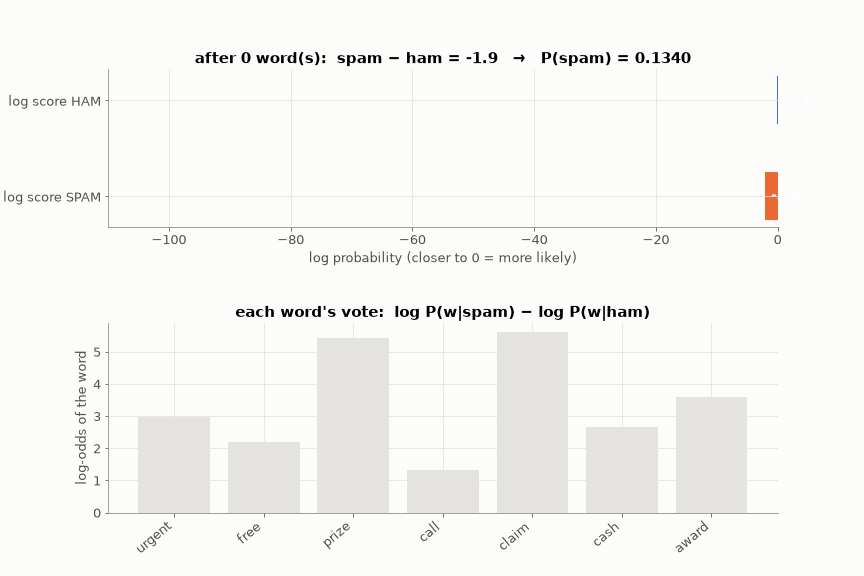
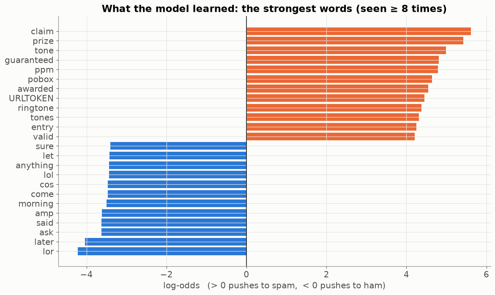

# Lesson 11 — Naive Bayes from scratch: counting your way to a spam filter

> **For:** Laith (SpamClassifier stage 4 — the heart of the project) &nbsp;·&nbsp; **Time:** 2 × 45 min
> **Before:** Lessons 03, 06, 07 &nbsp;·&nbsp; **After this:** Lesson 04 (choosing the threshold), Lesson 14 (the SVM it is compared with)

## 🎯 By the end, the student can

1. Explain Bayes' theorem with the **area picture**, and compute P(spam | "free") from counts.
2. Say what is "naive" about Naive Bayes, and why it works anyway.
3. Train Multinomial NB by hand (priors, counts, Laplace smoothing) and classify a message in **log space**.
4. Explain the two classic bugs (zero probabilities, underflow) and how the code prevents each.
5. Read a word's **log-odds** as the explanation of a verdict.

---

## 1. Bayes' theorem as a picture



Real counts from the 5,574 SMS:

* 13.4 % of messages are spam → the **prior** P(spam) = 0.134
* "free" appears in 23.3 % of spam and 1.2 % of ham → the **likelihoods**
* among messages with "free": **174 spam, 59 ham** → the **posterior** P(spam | free) = 174 / 233 = **0.75**

$$P(\text{spam}\mid w)=\frac{P(w\mid\text{spam})\,P(\text{spam})}{P(w)}$$

Say it in words: **posterior ∝ likelihood × prior.** We knew 13 % before; after seeing "free" we believe 75 %.

**Analogy — the doctor's test:** a test that catches 99 % of a rare disease still gives mostly false alarms if only 1 in
1,000 people has it. The prior matters. (Ask the class to guess first; almost everyone says 99 %.)

## 2. The naive assumption

A message has many words. NB assumes the words are **independent given the class**:

$$P(w_1,\dots,w_n\mid c)\approx P(w_1\mid c)\cdot P(w_2\mid c)\cdots P(w_n\mid c)$$

It is false ("click" and "here" come together), but for **deciding** between two classes it works surprisingly well — the
errors push both classes in similar ways, and the ranking of the two scores is usually right.

## 3. Training is just counting

```
prior[c]   = (messages of class c) / (all messages)
count[c][w]= how many times w appears in all messages of class c
total[c]   = sum of count[c][·]
P(w | c)   = (count[c][w] + α) / (total[c] + α·|V|)          ← Laplace smoothing, α = 1
```

One pass over the data, no iterations — so "retrain" can be a button in the UI.

### Worked example (from Laith's guide — do it on the board)

```
spam:  [free, money, now]          [free, prize, winner]
ham:   [meeting, tomorrow, office] [project, meeting, notes]
|V| = 10 words,  spam total = 6,  ham total = 6,  priors 0.5 / 0.5

P(free | spam) = (2 + 1) / (6 + 10) = 3/16 = 0.1875
P(free | ham)  = (0 + 1) / (6 + 10) = 1/16 = 0.0625
log_odds(free) = ln(0.1875) − ln(0.0625) = ln 3 ≈ 1.10        → pushes to spam
```

## 4. Bug 1 — zeros → Laplace smoothing



Without smoothing, "free" never appears in ham → P(free | ham) = 0 → **any** message containing "free" has ham probability
exactly 0, no matter what else it says. Adding α to every count gives unseen words a small probability instead of none.
The `α·|V|` in the denominator keeps the probabilities summing to 1.

## 5. Bug 2 — underflow → work in logs



300 words × probability 0.001 = 10⁻⁹⁰⁰ — a float holds nothing below ~10⁻³⁰⁸, so it becomes **exactly 0.0** for both
classes. Fix: $\log(a\cdot b)=\log a+\log b$ — store log-probabilities and **add**.

$$\text{score}(c)=\log P(c)+\sum_{w\in\text{msg}}\log P(w\mid c)$$

Getting a probability back **without leaving log space**:

$$P(\text{spam})=\frac{1}{1+e^{\,\text{score(ham)}-\text{score(spam)}}}$$

(and clamp the difference at ±700 — `exp(710)` overflows.) Never `exp()` each score separately: 0.0 / 0.0.

## 6. Watch a message being classified



"URGENT! You have won a free prize. Call now to claim your cash award" → tokens `urgent free prize call claim cash award`.
Each word adds its log-likelihood to both scores (bars grow left); the gap between them is the evidence. Bottom: every
word's **log-odds** = its vote.

## 7. The explanation comes for free



$$\text{log\_odds}(w)=\log P(w\mid\text{spam})-\log P(w\mid\text{ham})$$

These numbers **are** the model — not an approximation of it. "Flagged because: *claim* (+5.6), *prize* (+5.4), *URLTOKEN*
(+4.5)". This is why NB is Laith's **primary** model even if the SVM scores slightly higher: the project requires an exact
reason for every verdict.

## 8. Proving it is right

`test_matches_sklearn` trains scikit-learn's `MultinomialNB(alpha=1.0)` on the same data and demands agreement to `1e-9`.

| Symptom | Likely cause |
|---|---|
| way off everywhere | smoothing in the numerator but not the denominator |
| right order, wrong values | forgot `+ α·|V|`, or wrong `|V|` |
| right for short, wrong for long | left log space too early |
| wrong only with unseen words | smoothing unknown tokens at predict time instead of skipping them |

## 9. Misconceptions

| Student says | Truth |
|---|---|
| "P(free \| spam) is the chance a 'free' message is spam" | That is P(spam \| free). The bar `|` is not symmetric — the doctor example. |
| "Unknown words should get a smoothed probability at predict time" | Skip them: they'd add the same constant to both classes and change nothing. |
| "NB's probabilities are well calibrated" | They are extreme (0.0001 / 0.9999) because of the naive assumption. The **ranking** is good; the threshold is chosen on validation (Lesson 04). |
| "Repeated words count once" | In **Multinomial** NB each occurrence counts. (`explain` de-duplicates only for display.) |

## 10. Activities

1. **The doctor (5 min).** 1 in 1,000 sick; test 99 % sensitive, 5 % false alarm. Guess P(sick | positive), then draw the
   square. (≈ 2 %.)
2. **Paper NB (20 min).** Give 6 tiny messages (3 spam / 3 ham). Pairs build the count table, apply smoothing, classify
   "free meeting now" — in log space with a calculator.
3. **Break it (10 min).** In the notebook set `alpha = 0` and classify a message with one ham-only word. Then multiply
   300 probabilities without logs.
4. **Explain a verdict (5 min).** Pick a real SMS, read the top-3 log-odds aloud as a sentence for the user.

## 11. Check yourself

<details><summary>1. Prior spam 0.2. "win" in 30 % of spam and 2 % of ham. P(spam | win)?</summary>

0.3·0.2 / (0.3·0.2 + 0.02·0.8) = 0.06 / 0.076 = **0.79**.
</details>

<details><summary>2. In the worked example, compute log_odds(meeting).</summary>

P(meeting | spam) = (0+1)/16, P(meeting | ham) = (2+1)/16 → ln(1/3) = **−1.10** (pushes to ham).
</details>

<details><summary>3. Scores: ham −52.3, spam −47.1. P(spam)?</summary>

1 / (1 + e^(−52.3 + 47.1)) = 1 / (1 + e^(−5.2)) = 1 / 1.0055 = **0.9945**.
</details>

## 12. In your project

| Project | Where |
|---|---|
| Spam | `spamclassifier/ml/naive_bayes.py` → `NaiveBayesClassifier.fit`, `predict_log_scores`, `predict_proba`, `predict`, `log_odds`, `explain`, `most_discriminative`, `to_dict/from_dict` · `ml/explainer.py` · config `laplace_alpha: 1.0` · theory `08_SpamClassifier/01_theory/04_naive_bayes.md` · notebook `02_naive_bayes_from_scratch.ipynb` · exercises `03_exercises` |

## 🎬 Watch & explore

* StatQuest — *Naive Bayes, Clearly Explained!!!* — [search on YouTube](https://www.youtube.com/results?search_query=StatQuest+Naive+Bayes+clearly+explained)
* 3Blue1Brown — *Bayes theorem, the geometry of changing beliefs* — [search on YouTube](https://www.youtube.com/results?search_query=3Blue1Brown+Bayes+theorem+geometry+of+changing+beliefs)
* Seeing Theory (Brown University) — [Bayesian inference, interactive](https://seeing-theory.brown.edu/bayesian-inference/index.html)
