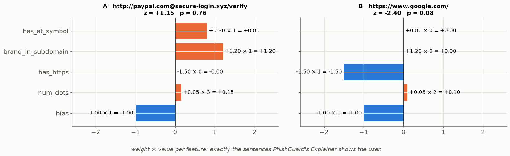
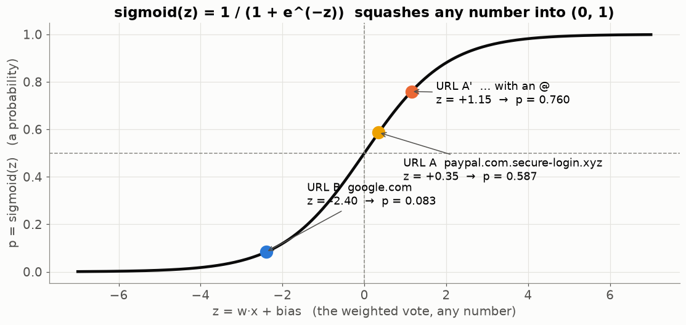
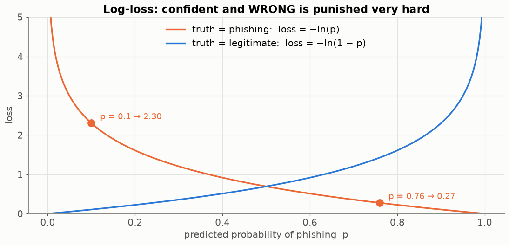
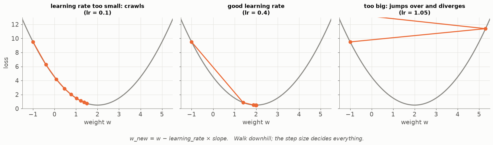
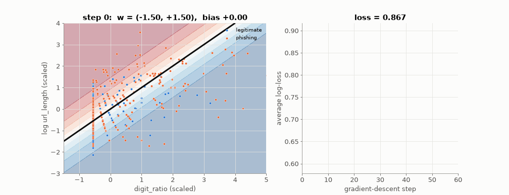
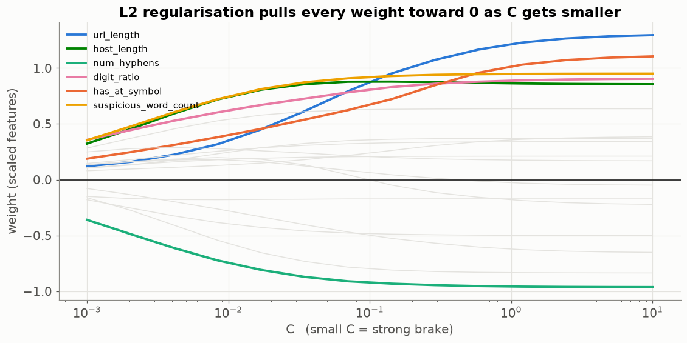

# Lesson 12 — Logistic regression: a points system that learns its own points

> **For:** Dani (PhishGuard — first model, explanations) · the gradient-descent part also for Ryan (Lesson 21)
> **Time:** 3 × 45 min &nbsp;·&nbsp; **Before:** Lesson 00 §5, §7, §8, §9; Lessons 02, 03, 18 &nbsp;·&nbsp; **After this:** Lessons 13, 21

## The story

> Rana at the bank (Lesson 04) used to judge links by experience: *"An @ in the address? Suspicious. The word 'paypal'
> before the real domain? Very suspicious. HTTPS? A bit more trustworthy."* Her manager asks her to write it down as a
> **points system**: each warning sign gets points, add them up, and decide. Rana writes one — but how many points should
> each sign get? She guesses. **Logistic regression is a points system that learns the best points from thousands of
> examples**, and then turns the total into a probability.

## 🎯 By the end, the student can

1. Compute a link's total score z = Σ weight × feature + bias, by hand.
2. Turn z into a probability with the sigmoid, and explain what the sigmoid does.
3. Compute the log-loss for one example and explain why "confident and wrong" costs a lot.
4. Do **one gradient-descent step by hand** and explain the update rule.
5. Read the weights as an explanation, and explain what C (regularisation) does.

## Words you need

| word | meaning | Rana's version |
|---|---|---|
| **feature x** | one number about the link (Lesson 18) | has_at_symbol = 1 |
| **weight w** | the points that feature is worth; can be negative | @ is worth +0.8 |
| **bias b** | the starting points, before looking at any feature | everyone starts at −1.0 |
| **z** | the total: Σ wᵢ·xᵢ + b — any number | |
| **sigmoid σ(z)** | the S-curve that turns any number into a probability 0 … 1 | |
| **p** | the predicted probability of phishing | 0.76 |
| **y (truth)** | 1 = phishing, 0 = legitimate | |
| **loss** | a number that measures how wrong one prediction was | |
| **training** | finding the weights with the smallest total loss | |
| **gradient descent** | improving the weights by small steps "downhill" on the loss (Lesson 00 §9) | |
| **learning rate (lr)** | how big each step is | |

---

## 1. Step 1: add up the points

Rana's first guess of the points (invented weights — the real ones are learned in §4):

| feature | weight |
|---|---|
| has_at_symbol (an @ in the URL) | +0.8 |
| brand_in_subdomain ("paypal" before the real domain) | +1.2 |
| has_https | −1.5 (HTTPS lowers suspicion) |
| num_dots | +0.05 per dot |
| bias (start) | −1.0 |

$$z = w_1x_1 + w_2x_2 + w_3x_3 + w_4x_4 + b$$

**URL A: `http://paypal.com.secure-login.xyz/verify`** → has_at 0, brand 1, https 0, dots 3:

```
z = 0.8×0 + 1.2×1 + (−1.5)×0 + 0.05×3 + (−1.0)
  = 0     + 1.2   + 0        + 0.15   − 1.0
  = 0.35
```

**URL B: `https://www.google.com/`** → has_at 0, brand 0, https 1, dots 2:

```
z = 0 + 0 + (−1.5)×1 + 0.05×2 − 1.0 = −1.5 + 0.10 − 1.0 = −2.40
```

Positive z leans phishing, negative leans legitimate. But "0.35" isn't a probability yet.



Each bar is weight × value — the explanation PhishGuard shows: "this URL was flagged mostly because of a brand name in
the subdomain".

## 2. Step 2: squash into a probability — the sigmoid

$$p = \sigma(z) = \frac{1}{1+e^{-z}}$$

(e ≈ 2.718 — Lesson 00 §8. The calculator has an eˣ button.)

```
URL A:  z = 0.35   →  e^(−0.35) = 0.705   →  1 / (1 + 0.705) = 1 / 1.705 = 0.59    → 59 % phishing
URL B:  z = −2.40  →  e^(2.40)  = 11.02   →  1 / (1 + 11.02) = 1 / 12.02 = 0.083   → 8 % phishing
```



What the sigmoid does: very negative z → close to 0; z = 0 → exactly 0.5; very positive z → close to 1. It never goes
below 0 or above 1 — exactly what a probability needs.

## 3. How wrong was it? The log-loss

To learn good weights, the computer needs a number for "how wrong". For one example:

```
if the truth is phishing (y = 1):    loss = −ln(p)          ← p should be close to 1
if the truth is legitimate (y = 0):  loss = −ln(1 − p)      ← p should be close to 0
```

```
phishing, model said p = 0.76:   −ln(0.76) = 0.27     (fairly right → small loss)
phishing, model said p = 0.10:   −ln(0.10) = 2.30     (confident and WRONG → big loss)
legitimate, model said p = 0.08: −ln(0.92) = 0.08     (right)
```



The curve shoots up near the wrong end: **confident mistakes are punished hard**. The total loss = the average over all
training URLs. **Training = finding the weights that make this average as small as possible.**

## 4. How the weights are learned — gradient descent

Imagine the loss as a landscape: every possible set of weights is a place, its height is the loss. We start somewhere
random and **walk downhill** (Lesson 00 §9):

$$w_{\text{new}} = w - \text{lr}\times\text{slope}$$



The step size (lr) matters: too small → crawls; good → arrives; too big → jumps over the bottom and gets worse.

For logistic regression, the slope for each weight has a beautifully simple form — **error × input**:

$$\text{slope for } w_i = (p - y)\times x_i \qquad\text{slope for } b = p - y$$

### One step by hand

One training URL: x = (has_at = 1, brand = 0). Truth y = 1 (phishing). Start: w = (0, 0), b = 0, lr = 0.5.

```
1. z = 0×1 + 0×0 + 0 = 0
2. p = σ(0) = 0.5                       (no idea yet)
3. error = p − y = 0.5 − 1 = −0.5        (it said too little)
4. slopes:  w₁: −0.5 × 1 = −0.5    w₂: −0.5 × 0 = 0    b: −0.5
5. update:  w₁ = 0 − 0.5 × (−0.5) = +0.25
            w₂ = 0 − 0.5 × 0      = 0          (feature was 0: not involved, not changed)
            b  = 0 − 0.5 × (−0.5) = +0.25
6. check:   z = 0.25 × 1 + 0.25 = 0.5  →  p = σ(0.5) = 0.62    (closer to the truth 1 ✓)
```

Read step 5 in words: *"the model said too little for a phishing URL, so the weights of the features this URL has go
**up**"*. Repeat for thousands of URLs, hundreds of times.

### Watch it learn, on 500 real PhishGuard URLs



Two features only (digit ratio, URL length), so we can draw it. Left: the black line is where p = 0.5; it turns step by
step. Right: the average loss falls. (Two features can't separate the classes well — the real model uses all 20.)

```python
for epoch in range(2000):
    p = sigmoid(X @ w + b)
    w -= lr * X.T @ (p - y) / len(y)      # average of "error × input"
    b -= lr * (p - y).mean()
```

## 5. Regularisation — a brake on big weights



Without a brake, the model can make some weights huge to fit noise in the training URLs (overfitting, Lesson 01).
Regularisation adds a penalty for big weights. In scikit-learn the knob is **C**, and it works **backwards**: **small C =
strong brake** → all weights pulled toward 0. Dani tries C ∈ {0.01, 0.1, 1, 10} with cross-validation (Lesson 05).

## 6. Why the features must be scaled

`url_length` is around 50; `has_https` is 0 or 1. Gradient descent then zig-zags (Lesson 02 §4), and the weights can't be
compared. So a `StandardScaler` comes first, inside the `Pipeline` — fitted on training URLs only and saved with the
model.

## 7. Common mistakes

| student says | the truth |
|---|---|
| "Logistic *regression* predicts a number, so it's not a classifier" | It predicts a probability; the threshold makes a class. The name is historical. |
| "Bigger weight = more important feature" | Only if the features are scaled the same. |
| "A bigger learning rate learns faster" | Too big jumps over the minimum. |
| "It can learn any pattern" | It draws a straight line (a flat boundary). For curves: trees (Lesson 13) or networks (Lesson 20). |

## 8. Activities

1. **Human points system (10 min).** The class invents points for 4 warning signs, then scores 5 printed URLs. Compare
   with the real model's weights.
2. **Blindfolded hill (5 min).** A tilted table and a marble — gradient descent. What happens if the marble jumps?
3. **One step (15 min).** Pairs repeat §4 "one step by hand" with lr = 1.0. Is p closer to 1 than with lr = 0.5?

## 9. Do it yourself

<details><summary>1. Rana's points: URL with has_at 1, brand 1, https 0, dots 5. z and p.</summary>

z = 0.8 + 1.2 + 0 + 0.25 − 1.0 = **1.25** · e^(−1.25) = 0.287 · p = 1 / 1.287 = **0.78**.
</details>

<details><summary>2. σ(0)? σ(+10)? σ(−10)?</summary>

0.5 · 0.99995 · 0.00005.
</details>

<details><summary>3. One step: x = (1, 1), y = 0, w = (0, 0), b = 0, lr = 0.5.</summary>

p = 0.5, error = +0.5, slopes 0.5, 0.5, 0.5 → w = (−0.25, −0.25), b = −0.25 → z = −0.75 → p = 0.32 (closer to 0 ✓).
</details>

## 10. In your project

| Project | Where |
|---|---|
| PhishGuard | exercises `ex05_sigmoid`, `ex06_log_loss`, `ex07_gradient`, `ex08_fit_logistic` · `phishguard/ml/trainer.py` → `ModelTrainer.build_logistic` · `ml/explainer.py` → `Explainer.contributions`, `explain` · theory `25_PhishGuard/01_theory/04_models.md` §4.1–4.4 · notebook `02_models.ipynb` |

## 🎬 Watch & explore

* StatQuest — *Logistic Regression* — [search on YouTube](https://www.youtube.com/results?search_query=StatQuest+logistic+regression)
* StatQuest — *Gradient Descent, Step-by-Step* — [search on YouTube](https://www.youtube.com/results?search_query=StatQuest+gradient+descent+step+by+step)
* MLU-Explain — [Logistic Regression](https://mlu-explain.github.io/logistic-regression/) (interactive)
