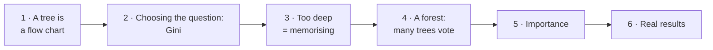
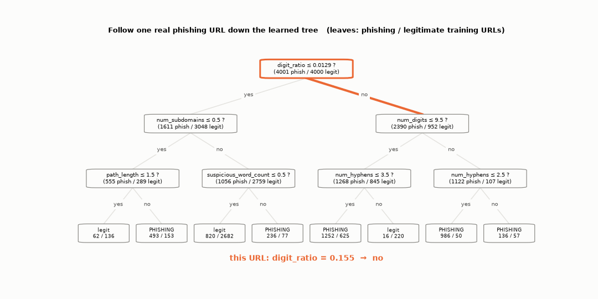
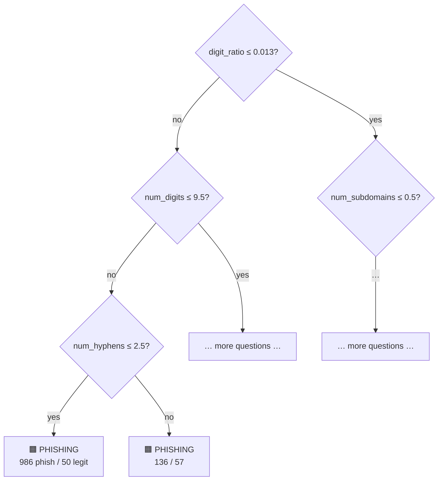
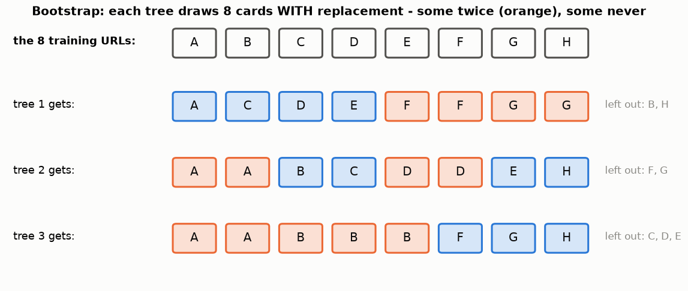
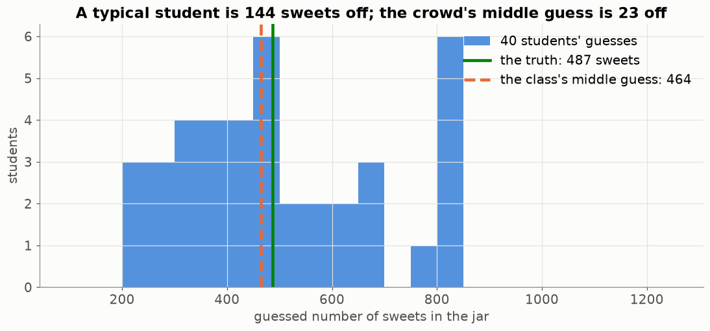
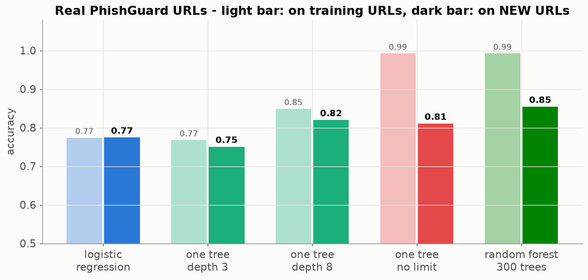

# Lesson 13 — Decision trees and random forests: a flow chart that writes itself

> **For:** Dani (PhishGuard — second model, feature importance) &nbsp;·&nbsp; **Time:** 2 × 45 min
> **Before:** Lesson 00 §1, §4; Lessons 01, 03, 12 &nbsp;·&nbsp; **After this:** comparing the two models (Lesson 04)

**In one sentence:** a decision tree is a flow chart of yes/no questions that the computer builds by always asking the
question that separates the classes best; a random forest asks a hundred slightly different trees and lets them vote.

## 🗺️ The map of this lesson



## The story

> New staff at the bank's help desk don't know Rana's points system. So Rana draws them a **flow chart**: *"Is there
> HTTPS? No → is a brand name in front of the real domain? Yes → block it."* It's easy to follow and explain. But which
> question should come first? Which ones after? A **decision tree** builds this flow chart by itself, from thousands of
> labelled URLs — and a **random forest** asks a hundred slightly different flow charts and lets them vote.

### 🌍 Real world

* The game **"20 questions"** (and the app *Akinator*, which guesses the character you're thinking of) is a decision tree:
  every good question splits the remaining possibilities roughly in half.
* **Hospitals** use triage flow charts: "breathing? → bleeding? → conscious?" to decide who is treated first.
* **Banks** have used decision trees for loan decisions for decades, because a tree can be **explained** to a customer.
* **Random forests** are a favourite in industry for tables of numbers — fraud detection, medicine, credit risk — because
  they work well with almost no tuning.

## Words you need

| word | meaning |
|---|---|
| **node** | one question in the flow chart: "is num_digits ≤ 9.5?" |
| **split** | dividing a group of URLs into two by one question |
| **leaf** | an end of the flow chart: the answer for everyone who reaches it |
| **depth** | how many questions in a row, from the top to the deepest leaf |
| **pure group** | everyone in it has the same label |
| **Gini impurity** | how mixed a group is: 0 = pure, 0.5 = half-half |
| **gain** | how much a split reduces the mixing |
| **bootstrap sample** | a random sample of the rows, drawn *with replacement* (some twice, some not at all) |
| **random forest** | many trees, each from its own bootstrap sample and random features; they vote |
| **feature importance** | how much each feature helped the trees' splits, in total |

---

## 1. A tree is a flow chart


This tree was learned from the 20 PhishGuard features of real URLs (orange = mostly phishing, blue = mostly legitimate).
**Follow one URL from the top:**

1. "digit_ratio ≤ 0.013?" — a URL with many digits → **False** → go right.
2. "num_digits ≤ 9.5?" → it has 14 digits → **False** → right.
3. "num_hyphens ≤ 2.5?" → 1 hyphen → **True** → left.
4. Leaf: 1,036 training URLs ended here, **986 of them phishing** → answer: phishing (986 / 1,036 = 95 %).

Watch the same journey, one question at a time:



The same tree as a flow chart:



Trees can learn **combinations** a points system can't: "hyphens matter only when there are many digits". And they need no
scaling — a question like "≤ 9.5?" doesn't care about units.

## 2. How the tree chooses its question — Gini impurity

The tree wants questions that **separate** phishing from legitimate as cleanly as possible. To measure "cleanly" it uses
**Gini impurity**:

$$\text{Gini} = 1 - (\text{share of class 1})^2 - (\text{share of class 2})^2$$

```
a group of 10 URLs, all phishing:     shares 1.0 and 0.0  →  1 − 1.0² − 0.0² = 1 − 1 − 0       = 0     (pure)
5 phishing, 5 good:                   shares 0.5 and 0.5  →  1 − 0.25 − 0.25                   = 0.5   (worst)
8 phishing, 2 good:                   shares 0.8 and 0.2  →  1 − 0.64 − 0.04                   = 0.32
```


### Choosing between two questions (Dani's guide)

10 URLs: 5 good, 5 phishing. Gini of the whole group = 0.5.

**Question A: "has HTTPS?"**

```
yes-group: 4 good, 1 phishing → shares 0.8, 0.2 → Gini = 1 − 0.64 − 0.04 = 0.32
no-group:  1 good, 4 phishing → Gini = 0.32
weighted average (each group is half the URLs):  0.5 × 0.32 + 0.5 × 0.32 = 0.32
gain = 0.5 − 0.32 = 0.18
```

**Question B: "more than 2 dots?"**

```
yes-group: 3 good, 3 phishing → Gini 0.5
no-group:  2 good, 2 phishing → Gini 0.5
weighted: 0.6 × 0.5 + 0.4 × 0.5 = 0.5        gain = 0.5 − 0.5 = 0
```

Question A separates; question B doesn't → the tree asks about HTTPS first. Then it does the same thing again **inside
each group** — that's how the whole flow chart grows. (The computer tries every feature and every possible cut point.)

## 3. Watch a tree overfit


*(A toy dataset you can see in 2-D.)* Each colour region is "what the tree would answer here".

* **Depth 1:** one question, one straight cut. Too simple.
* **Depth 5:** a sensible shape. Test accuracy 0.89.
* **No limit:** 101 leaves, tiny boxes around single points. **100 % on training**, 0.85 on test — it memorised
  (Lesson 01).

The brakes: `max_depth` (how many questions in a row) and `min_samples_leaf` (a leaf needs at least that many URLs) —
chosen by cross-validation (Lesson 05).

## 4. Random forest — ask a hundred colleagues


Breiman's idea (2001): grow **many** trees, each a bit different, and let them **vote** (or average their probabilities).
Each tree is made different in two ways:

1. **Bootstrap sample:** draw N rows **with replacement**. Example with 5 URLs (A–E): one tree might get A, A, C, D, E
   (B missing, A twice), another B, C, C, D, E. About a third of the rows are left out of each tree.
2. **Random features:** at each question, the tree may only choose among a random few features.

Each tree makes its own mistakes; when you average, **different mistakes cancel**, the common truth remains.


### The two random ingredients, drawn



Each tree gets its own "deck": some URLs twice, some not at all. Different decks → different trees → different mistakes.

### Why voting works — the wisdom of the crowd

**Guess the number of sweets in a jar.** Each student is far off; the **class's middle guess** is usually close — *if they
guessed independently*:



In 1906 the scientist Francis Galton saw this at a country fair: about 800 people guessed the weight of an ox, and the middle
guess was within 1 % of the true weight — closer than almost every single guesser, including cattle experts. A forest is a
crowd of trees; the two random ingredients are what keep the trees independent.

## 5. Feature importance


For each feature: add up how much Gini it removed, over all the splits of all 300 trees. On the real URLs (test accuracy
≈ 0.85 with default settings), `entropy`, `host_length`, `path_length` and `url_length` help most. (The single tree in §1 started with digits — a forest spreads the work over many features.)

⚠️ What importance does **not** tell you: the **direction** (do many digits mean phishing, or legitimate?) and the reason
for **one** URL. That's why PhishGuard's explanation for the forest is only an approximation, while for logistic
regression it is exact (Lesson 12).

## 6. The real comparison on PhishGuard

All models trained on the same 70 % of the real URLs, graded on the other 30 %:



* **Logistic regression (Lesson 12):** 0.77 — a straight-line boundary is not enough here.
* **One tree, no limit:** 0.99 on training, 0.81 on new URLs — the overfitting of Part 3, on real data.
* **Random forest:** also 0.99 on training (each tree is deep), but **0.85** on new URLs — the vote cancels the trees'
  individual mistakes. That's why the forest is PhishGuard's strongest model.

## 🧪 Worked example: Gini gain in Python

```python
def gini(counts):
    n = sum(counts)
    return 1 - sum((c / n) ** 2 for c in counts)

def gain(parent, left, right):
    n = sum(parent)
    weighted = sum(left) / n * gini(left) + sum(right) / n * gini(right)
    return gini(parent) - weighted

parent = [5, 5]                                   # [good, phishing]
print("A: has HTTPS?   ", round(gain(parent, [4, 1], [1, 4]), 2))    # 0.18
print("B: > 2 dots?    ", round(gain(parent, [3, 3], [2, 2]), 2))    # 0.0
print("perfect question", round(gain(parent, [5, 0], [0, 5]), 2))    # 0.5
```

## 7. Common mistakes

| student says | the truth |
|---|---|
| "100 % on training — perfect tree" | It memorised. Look at the test curve. |
| "A forest is one big tree" | Many independent trees + a vote. |
| "More trees can overfit" | More trees only cost time. Depth and leaf size are what overfit. |
| "Important feature = it *causes* phishing" | Only "it helped separate in this data". |
| "Trees need scaled features" | No — "≤ 9.5?" works in any units. |

## 📝 Summary

> * A **tree** = a flow chart of yes/no questions, learned from data.
> * It chooses the question with the biggest **Gini gain** (Gini = 1 − Σ share²: 0 pure, 0.5 half-half), then repeats inside
>   each group.
> * Unlimited depth = **memorising** (100 % train, worse test). Brakes: `max_depth`, `min_samples_leaf`.
> * A **forest** = many trees on **bootstrap samples** with **random features**, voting — their mistakes cancel.
> * **Importance** says which features helped, not in which direction or why for one URL.

## 8. Activities

1. **20 questions (5 min).** One student thinks of an animal; the class asks yes/no questions. Which first question splits
   best? That's Gini gain.
2. **Build a tree by hand (20 min).** 10 cards with 3 URL features + label. Groups compute the Gini gain of 3 candidate
   questions, choose the best, then split once more.
3. **Sweets jar (5 min).** Collect guesses, compare the average with the truth.

## 9. Do it yourself

<details><summary>1. A group: 6 phishing, 2 good. Gini?</summary>

shares 0.75 and 0.25 → 1 − 0.5625 − 0.0625 = **0.375**.
</details>

<details><summary>2. Parent: 4 phishing, 4 good. A question gives (4 ph, 1 good) and (0 ph, 3 good). Gain?</summary>

parent 0.5 · left: 0.8/0.2 → 0.32 · right: pure → 0 · weighted: 5/8 × 0.32 + 3/8 × 0 = 0.2 · gain **0.3**.
</details>

<details><summary>3. Why does every tree in the forest get a different sample?</summary>

So they make different mistakes. Identical trees would vote identically and averaging would change nothing.
</details>

<details><summary>4. 🟢 Follow the tree in Part 1 for a URL with digit_ratio 0.05, num_digits 4. Which question comes next?</summary>

digit_ratio ≤ 0.013? No → right. num_digits ≤ 9.5? **Yes** → left → the next question is "num_hyphens ≤ 3.5?".
</details>

<details><summary>5. 🟡 5 trees vote: phishing, legit, phishing, phishing, legit. The forest's answer? Its probability?</summary>

3 of 5 say phishing → **phishing**, probability 3 ÷ 5 = **0.6**.
</details>

<details><summary>6. 🟡 A bootstrap sample of 1,000 rows. About how many different rows does it contain?</summary>

About **632** (≈ 63 %); the other ~368 rows are left out of this tree. (The chance a row is never picked is (1 − 1/1000)¹⁰⁰⁰
≈ 0.37.)
</details>

<details><summary>7. 🔴 Why can't logistic regression learn "hyphens matter only when there are many digits", but a tree can?</summary>

Logistic regression gives each feature one fixed weight, added up — the effect of hyphens is the same whatever the digits
are. A tree asks about digits first and then asks about hyphens **only in one branch**, so it can learn combinations.
</details>

## 10. In your project

| Project | Where |
|---|---|
| PhishGuard | exercise `ex09_gini_gain` · `phishguard/ml/trainer.py` → `ModelTrainer.build_forest`, `fit_with_search` · `ml/evaluator.py` → `importances`, `compare` · theory `25_PhishGuard/01_theory/04_models.md` §4.5–4.7 · notebook `02_models.ipynb` |

## 🎬 Watch & explore

| | |
|---|---|
| <a href="https://www.youtube.com/watch?v=_L39rN6gz7Y"></a> | **StatQuest — Decision and Classification Trees, Clearly Explained!!!** Gini and choosing the question, step by step. |
| <a href="https://www.youtube.com/watch?v=J4Wdy0Wc_xQ"></a> | **StatQuest — Random Forests Part 1**. Bootstrap, random features and voting. |

**Play with it:**
* R2D3 — [A visual introduction to machine learning](https://r2d3.us/visual-intro-to-machine-learning-part-1/) — a tree
  grows as you scroll. The best page on the internet for this lesson.
* MLU-Explain — [Decision Trees](https://mlu-explain.github.io/decision-tree/) and [Random Forest](https://mlu-explain.github.io/random-forest/)
