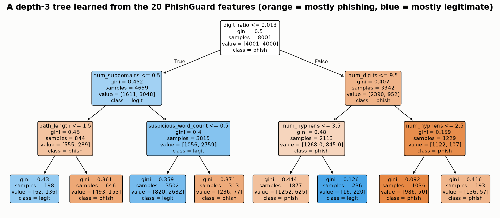
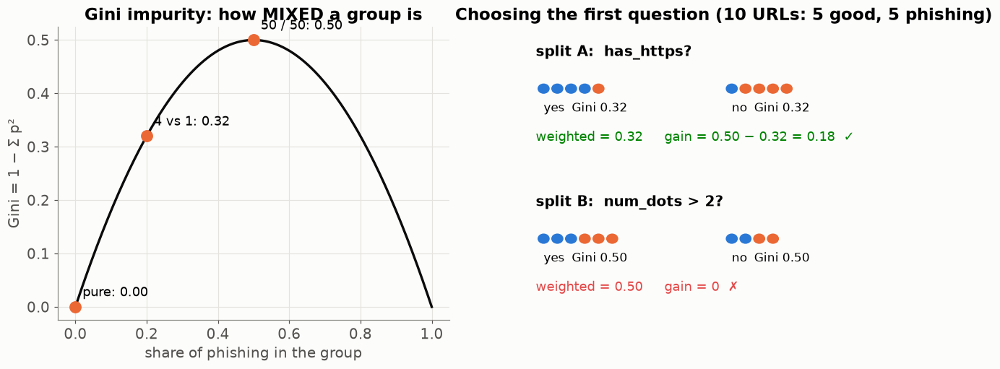
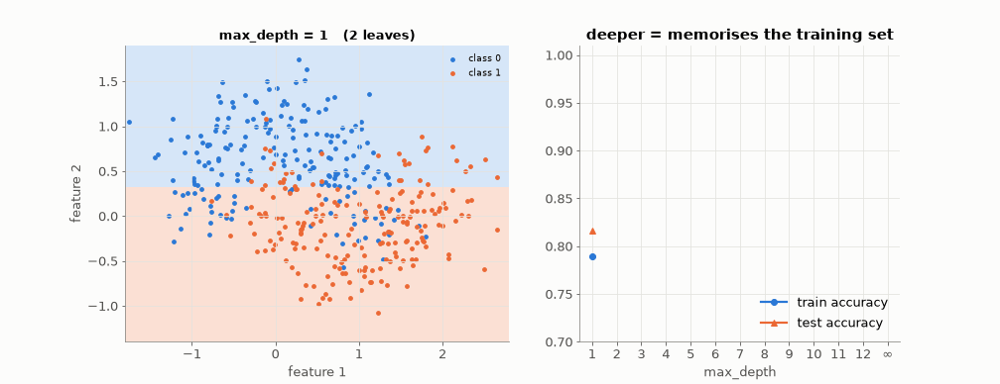
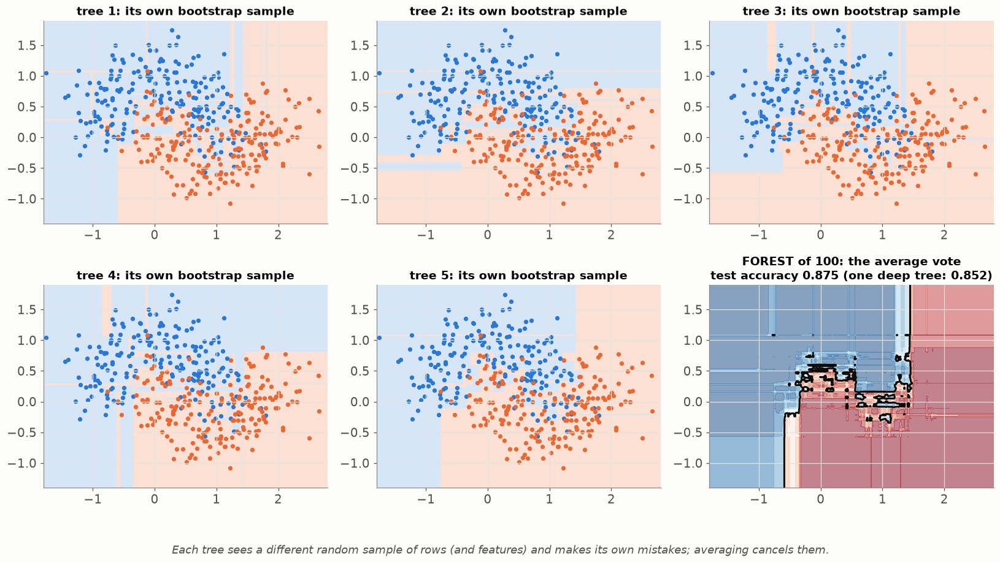
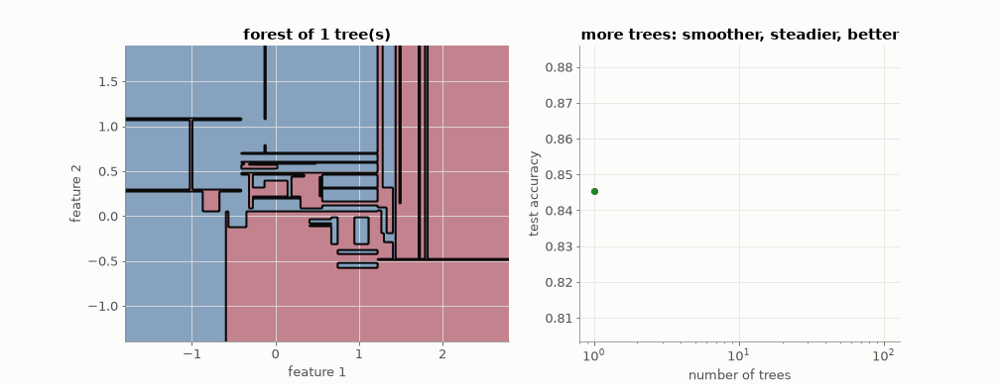
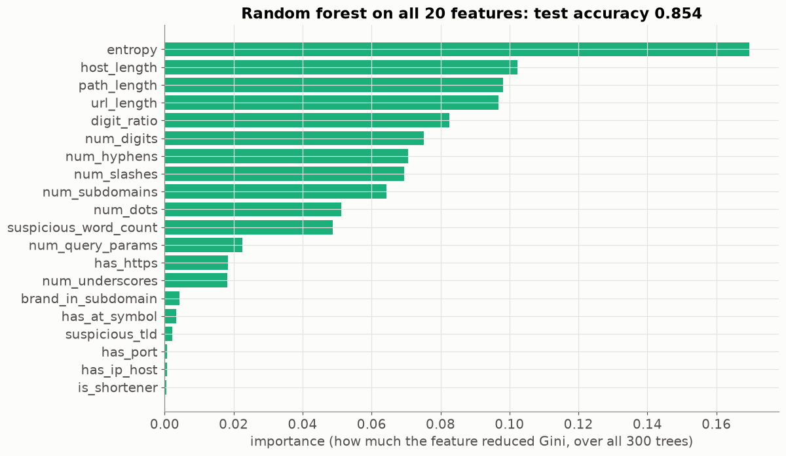

# Lesson 13 — Decision trees and random forests: a flow chart learned from data

> **For:** Dani (PhishGuard — second model, feature importance) &nbsp;·&nbsp; **Time:** 45 – 60 min
> **Before:** Lessons 01, 03, 12 &nbsp;·&nbsp; **After this:** comparing the two models (Lesson 04 ROC)

## 🎯 By the end, the student can

1. Compute Gini impurity and the gain of a split by hand, and say how a tree picks its question.
2. Explain why a deep tree overfits, with the animation.
3. Explain the two random ingredients of a forest (bootstrap rows, random features) and why averaging helps.
4. Read a feature-importance chart — and say what it does **not** tell you.

---

## 1. A tree is a flow chart

Trained on the 20 PhishGuard features. Each box asks one yes/no question; a URL falls down to a leaf and gets the
majority class there. **Read one path aloud:** "digit_ratio > 0.013 and num_digits > 9.5 and num_hyphens ≤ 2.5 → 1,036
URLs, 986 phishing → phishing."

Trees handle what logistic regression cannot: **interactions** ("hyphens matter only when there are many digits"), and
they need **no scaling** (a threshold is a threshold).

## 2. How a tree picks the question — Gini impurity

$$\text{Gini}=1-\sum_k p_k^2\qquad\text{pure group}=0,\quad 50/50=0.5$$

For every feature and every threshold: split, compute the **weighted** Gini of the two children, and keep the split
with the biggest **gain** = Gini(parent) − weighted Gini(children). The guide's example: `has_https` gives gain 0.18,
`num_dots > 2` gives 0 → the tree asks about HTTPS first. Then it repeats inside each child (**recursion**).

## 3. Watch a tree overfit

*(Toy 2-D data — two real URL features overlap too much to see anything.)* Depth 1: one cut. Depth 5: a sensible
shape. Unlimited depth: 101 leaves, tiny boxes around single points — **100 % on training, worse on test** (0.89 → 0.85).
The brakes: `max_depth`, `min_samples_leaf` — chosen by cross-validation.

## 4. A random forest — many trees, one vote

Breiman (2001): grow many deep trees, each one

1. on a **bootstrap** sample — N rows drawn *with replacement* (some twice, about a third not at all);
2. choosing each split among a **random subset of features**.

Each tree is wrong in its own way; their mistakes are **different**, so the **average** of their votes cancels much of it.

**Analogy — the wisdom of crowds:** guess the number of sweets in a jar. Individuals are far off; the average of the
class is usually close — *as long as they guessed independently*. The two random ingredients are what make the trees
independent.

## 5. Feature importance

How much each feature reduced Gini, summed over all trees (here: test accuracy ≈ 0.85 with default settings). Dani's
chart `feature_importance.png`.

⚠️ What importance does **not** say: the **direction** (does a high value mean phishing or legitimate?), or the reason for
**one** URL. That's why PhishGuard's explainer for the forest is an honest approximation
(`importance × sign(scaled value)`) while for logistic regression it is exact.

## 6. Misconceptions

| Student says | Truth |
|---|---|
| "A tree with 100 % training accuracy is perfect" | It memorised. Look at the test curve. |
| "A forest is one big tree" | Many independent trees + a vote. |
| "More trees can overfit" | Adding trees doesn't overfit; it just costs time. Depth / leaf size is what overfits. |
| "Importance = the feature causes phishing" | Correlation in this data, nothing more. Correlated features also share importance. |

## 7. Activities

1. **20 questions (5 min).** One student thinks of an animal; the class asks yes/no questions. Which first question
   splits best? That *is* Gini gain.
2. **Build a tree by hand (15 min).** 10 cards (URL features + label). Groups compute the Gini gain of 3 candidate splits,
   choose the best, recurse once.
3. **Crowd wisdom (5 min).** Jar of sweets; collect guesses; compare the average with the truth.
4. In `25_PhishGuard/02_examples/02_models.ipynb`, set `max_depth=None` for one tree and compare train/test accuracy.

## 8. Check yourself

1. A group has 8 phishing and 2 legitimate URLs. Gini?

1 − (0.8² + 0.2²) = 1 − 0.68 = **0.32**.

2. Why does every tree in the forest get a different sample of rows?

So the trees make different mistakes. Identical trees would vote identically, and averaging would change nothing.

3. Does the random forest need the StandardScaler?

No — splits are thresholds, unaffected by scaling. It is harmless to keep it in the pipeline for a uniform interface,
and the explainer uses the scaled value's sign.

## 9. In your project

| Project | Where |
|---|---|
| PhishGuard | exercise `ex09_gini_gain` · `phishguard/ml/trainer.py` → `ModelTrainer.build_forest`, `fit_with_search` · `ml/evaluator.py` → `ModelEvaluator.importances`, `compare` · theory `25_PhishGuard/01_theory/04_models.md` §4.5–4.7 · notebook `02_models.ipynb` |

## 🎬 Watch & explore

* R2D3 — [A visual introduction to machine learning](https://r2d3.us/visual-intro-to-machine-learning-part-1/) (a decision tree, scroll-animated)
* MLU-Explain — [Decision Trees](https://mlu-explain.github.io/decision-tree/) and [Random Forest](https://mlu-explain.github.io/random-forest/)
* StatQuest — *Decision and Classification Trees, Clearly Explained* · *Random Forests Part 1* — [search on YouTube](https://www.youtube.com/results?search_query=StatQuest+decision+trees+random+forests)
