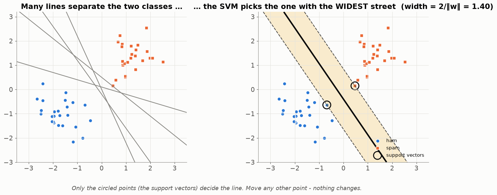
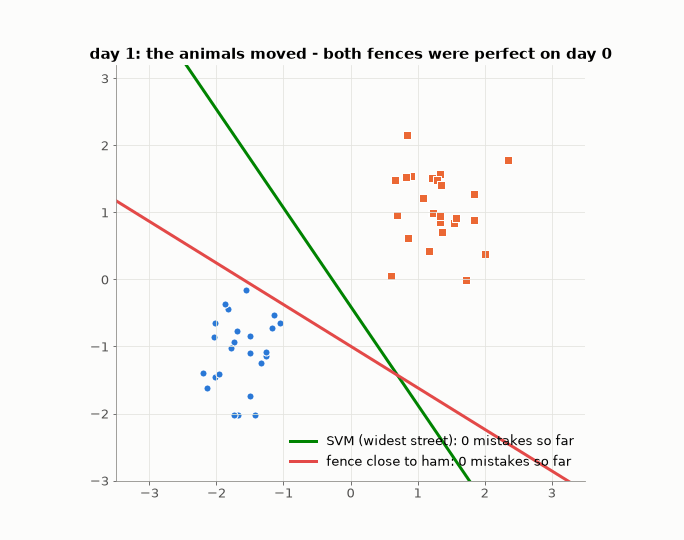
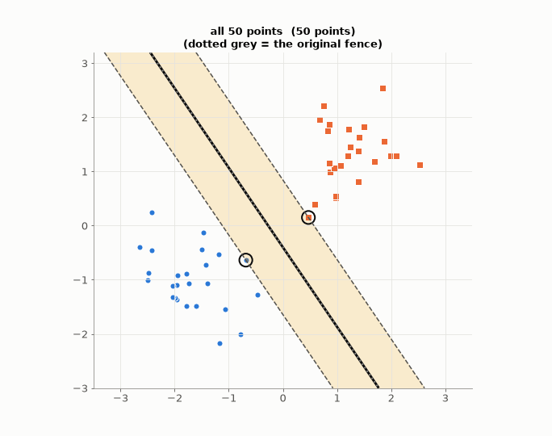
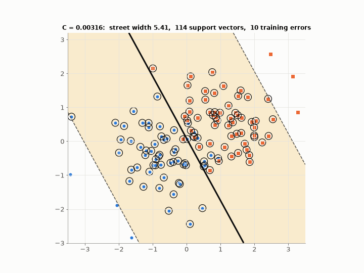
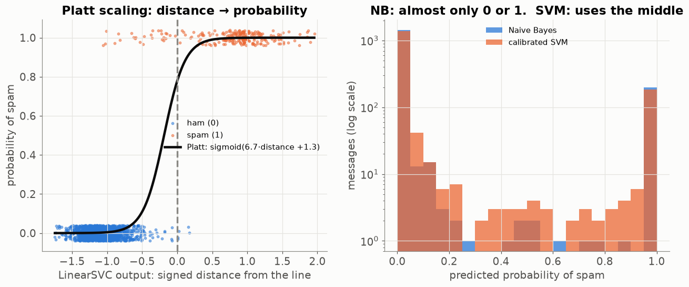
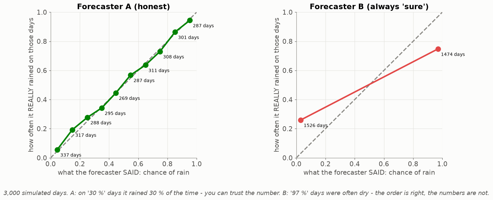
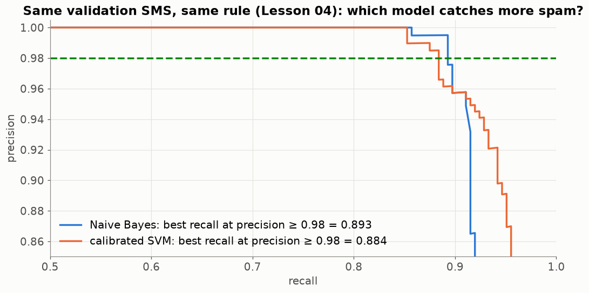

# Lesson 14 — The SVM: the widest street between two classes (and how to get a probability out of it)

> **For:** Laith (SpamClassifier stage 5) &nbsp;·&nbsp; **Time:** 2 × 45 min
> **Before:** Lessons 02, 04, 05, 11, 12 &nbsp;·&nbsp; **After this:** the comparison chapter of Laith's book

**In one sentence:** the SVM draws the fence between two classes that stays as far as possible from both — and because
its answer is a distance, not a probability, we "calibrate" it into an honest percentage.

## 🗺️ The map of this lesson


## The story

> A farmer has sheep on one side of a field and goats on the other, and wants to build a **straight fence** between them.
> Many fences would separate today's animals. But tomorrow the animals move a little. The wise farmer builds the fence
> **as far as possible from both flocks** — in the middle of the widest empty strip. That fence is the most likely to stay
> correct tomorrow. The **SVM** (support vector machine) builds exactly that fence between spam and ham — in thousands of
> dimensions instead of a field.

### 🌍 Real world

* A **road** between two neighbourhoods: planners put it where it leaves the most room on both sides.
* A **football referee** standing between two teams: the fairest place is in the middle of the gap.
* SVMs were *the* best classifiers for text and handwriting in the late 1990s and 2000s (before deep learning), and are still
  used for small and medium text problems — like Laith's.

## Words you need

| word | meaning |
|---|---|
| **boundary / fence** | the line (in many dimensions: a flat sheet) that separates the classes |
| **margin / street** | the empty strip on both sides of the fence |
| **support vectors** | the examples standing right at the edge of the street — they alone decide where the fence goes |
| **C** | how expensive a mistake (an example inside the street or on the wrong side) is |
| **signed distance** | the SVM's output: how far an example is from the fence, + on the spam side, − on the ham side |
| **calibration** | turning a score into a probability you can trust: when it says 70 %, it's right 70 % of the time |
| **Platt scaling** | a calibration method: fit a sigmoid (Lesson 12) from distance to label |

---

## 1. Many fences — which one?



Left: four different lines all separate today's examples perfectly. Right: the SVM's choice — the line in the middle of
the **widest street** (yellow). Only the circled examples, the **support vectors**, touch the edges of the street. Move any
other example (without crossing the street) and the fence doesn't move at all.

### Why the widest street? Because tomorrow the animals move

Both fences below separated **yesterday's** animals perfectly. Each new day the animals move a little (new random sheep and
goats from the same fields). Count the mistakes:



The fence that hugs one flock starts making mistakes as soon as the animals move; the widest street keeps working. That's
the whole reason for the SVM: **leave the most room for tomorrow's examples** — generalisation (Lesson 01).

### Only the support vectors matter

Remove ordinary points and retrain: the fence doesn't move. Remove **one** support vector and it moves at once:



The width of the street is 2 / |w| (|w| = the length of the weight vector, Lesson 00 §10) — so "widest street" =
"smallest weights", the same idea as the regularisation brake of Lesson 12.

## 2. Real data overlaps — the C knob

Real spam and ham are mixed near the middle: no fence separates them perfectly. So the SVM allows some examples inside
the street or on the wrong side, and charges a price **C** for each.



| C | the SVM thinks | street | risk |
|---|---|---|---|
| small (0.003) | "mistakes are cheap, I want a wide street" | wide, many support vectors | underfitting |
| large (100) | "mistakes are expensive" | narrow, bends to every example | overfitting |

C is chosen by cross-validation (Lesson 05), never on the test set.

## 3. Naive Bayes vs SVM — two different ways of thinking

| | Naive Bayes (Lesson 11) | SVM |
|---|---|---|
| learns | how each class **writes**: which words, how often | only **where the fence is** |
| training | counting, one pass | an optimisation that searches for the widest street |
| needs scaling | no (it counts) | **yes** — `StandardScaler` first, or `message_length` (thousands) dominates every distance (Lesson 02) |
| explanation | exact: each word's log-odds | only approximate |

## 4. Distance is not a probability — calibration

`LinearSVC` returns a **signed distance**: +2.3 = "deep on the spam side", −1.1 = "on the ham side". That is not 2.3 %
or 2.3 anything — and it can't be compared with NB's "92 %". To use one shared threshold (Lesson 04), both models must speak
**probability**.



**Platt scaling (left):** take many held-out messages; for each we know the distance and the truth (0 or 1). Fit an
S-curve (a sigmoid, Lesson 12) through them: p = σ(A × distance + B). On the SMS data: p = σ(6.7 × distance + 1.3).

```
a message at distance 0      → σ(1.3)  = 0.79
a message at distance −0.5   → σ(−2.05) = 0.11
a message at distance +0.5   → σ(4.65) = 0.99
```

In Laith's code:

```python
base = make_pipeline(StandardScaler(), LinearSVC(C=self.c, random_state=config.RANDOM_SEED))
self._model = CalibratedClassifierCV(base, method="sigmoid", cv=5)    # sigmoid = Platt scaling
```

`cv=5` means the S-curve is fitted on messages the SVM didn't train on — on its own training data the SVM is
over-confident.

### What "calibrated" means — two weather forecasters



A calibrated model is like forecaster A: on all the days it says "30 %", it rains on about 30 % of them. Forecaster B always
says "3 %" or "97 %": the **order** of his days is right (rainier days get 97 %), but his numbers can't be trusted.

**Right panel (above):** Naive Bayes' probabilities are almost only 0 or 1 (it multiplies the evidence of every word as if they
were independent → over-confident). The calibrated SVM uses the whole range. **Analogy:** a weather forecaster who says
"0 % or 100 %" every day vs. one who says "30 %" when unsure — the second can be trusted.

## 5. The fair comparison



Same validation SMS, same rule (precision ≥ 0.98, best recall — Lesson 04): NB catches 89 % of spam, the SVM 88 % — almost
the same. **Fair** means: the same split, the same cleaning, scaler and C chosen inside CV, both calibrated, one rule.

**Why NB stays Laith's main model** even if the SVM were a little better: the project requires an **exact reason** for
every verdict. In NB the reason *is* the model; after calibration, the SVM's reason is only an approximation.

## 🧪 Worked example: the widest street in scikit-learn

```python
import numpy as np
from sklearn.svm import SVC

# 6 messages, 2 features (e.g. scaled 'number of digits', scaled 'number of !')
X = np.array([[-2, -1], [-1.5, -2], [-1, -0.5], [1, 1.2], [1.5, 0.5], [2, 2]])
y = np.array([0, 0, 0, 1, 1, 1])                        # 0 ham, 1 spam

svm = SVC(kernel="linear", C=1000).fit(X, y)
w, b = svm.coef_[0], svm.intercept_[0]
print("fence: %.2f·x1 + %.2f·x2 + %.2f = 0" % (w[0], w[1], b))
print("street width:", round(2 / np.linalg.norm(w), 2))
print("support vectors:", svm.support_vectors_.tolist())
print("signed distances:", svm.decision_function([[0, 0], [2, 1], [-2, -2]]).round(2))   # [-0.16  1.53 -2.29]
```

## 6. Common mistakes

| student says | the truth |
|---|---|
| "The SVM gives a probability" | It gives a distance. Calibration makes a probability. |
| "Higher C is better — fewer training errors" | Fewer *training* errors, often more test errors. |
| "Calibration changes which messages are spam" | It keeps the order; it only changes the numbers, so one threshold works for both models. |
| "All training points shape the fence" | Only the support vectors do. |

## 📝 Summary

> * The SVM picks the fence in the middle of the **widest street** — the safest for tomorrow's examples.
> * Only the **support vectors** (on the street's edges) decide it.
> * **C** = the price of a mistake: small C → wide street, some mistakes; big C → narrow street, overfitting risk.
> * The SVM needs **scaling** (it measures distances).
> * Its output is a **signed distance**; **Platt scaling** (a sigmoid fitted on held-out data) turns it into a probability.
> * **Calibrated** = "when it says 70 %, it's right 70 % of the time".

## 7. Activities

1. **The fence (10 min).** Two colours of counters on a table. Pairs lay a ruler (the fence) and two pencils (the street
   edges). Widest street wins. Which counters touch the pencils? (support vectors)
2. **Predict, then watch (5 min).** "What happens to the street as C grows?" — then play the GIF.
3. **The forecaster (5 min).** On which share of "70 % rain" days should it rain? That's calibration.

## 8. Do it yourself

<details><summary>1. Remove an example that is NOT a support vector and retrain. What changes?</summary>

Nothing. The fence depends only on the support vectors.
</details>

<details><summary>2. With p = σ(6.7 × d + 1.3), which distance gives exactly 50 %?</summary>

σ(z) = 0.5 when z = 0 → 6.7 d + 1.3 = 0 → d = −1.3 / 6.7 = **−0.19**.
</details>

<details><summary>3. Why does the SVM need scaling and Naive Bayes doesn't?</summary>

The SVM measures distances to the fence, so a feature in the thousands dominates. NB multiplies per-word probabilities
from counts — no distances.
</details>

<details><summary>4. 🟢 The SVM's output for a message is −2.4. Which side, and how sure?</summary>

The ham side (negative), fairly deep — but "−2.4" is not a percentage; calibrate it to get one.
</details>

<details><summary>5. 🟡 With p = σ(6.7 × d + 1.3), compute p for d = +0.2.</summary>

z = 6.7 × 0.2 + 1.3 = 2.64 · e^(−2.64) = 0.071 · p = 1 ÷ 1.071 = **0.93**.
</details>

<details><summary>6. 🟡 Your training accuracy goes up as you raise C from 0.1 to 100, but validation accuracy goes down. Which C do you keep?</summary>

The C with the best **validation** (cross-validated) score — higher training accuracy with lower validation is overfitting.
</details>

<details><summary>7. 🔴 Why is Platt's sigmoid fitted with cv=5 instead of on the SVM's own training messages?</summary>

On its own training messages the SVM is too sure (they are far from the fence because it learned them). The sigmoid would
learn "distance 1 = 100 % sure" and be over-confident on new messages. Held-out distances look like real new messages.
</details>

## 9. In your project

| Project | Where |
|---|---|
| Spam | `spamclassifier/ml/svm_classifier.py` → `fit`, `predict_proba`, `predict`, `explain` · `ml/comparator.py` → `cross_validate`, `compare` · `views/compare_view.py` → `draw_curves` · theory `08_SpamClassifier/01_theory/05_svm_comparison.md` · notebook `03_compare_and_threshold.ipynb` |

## 🎬 Watch & explore

| | |
|---|---|
| <a href="https://www.youtube.com/watch?v=efR1C6CvhmE"></a> | **StatQuest — Support Vector Machines Part 1: Main Ideas** (20 min). Margins, support vectors, and the soft margin (C). |
| <a href="https://www.youtube.com/watch?v=_PwhiWxHK8o"></a> | **MIT 6.034 — Patrick Winston: Support Vector Machines** (50 min). A famous university lecture — "the widest street" is his phrase. For the curious. |

**Read more:**
* scikit-learn — [Probability calibration](https://scikit-learn.org/stable/modules/calibration.html)
