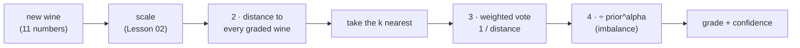
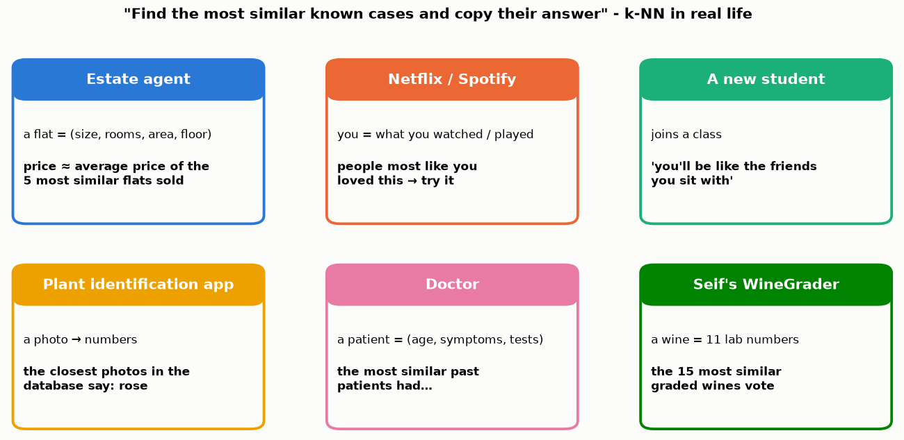
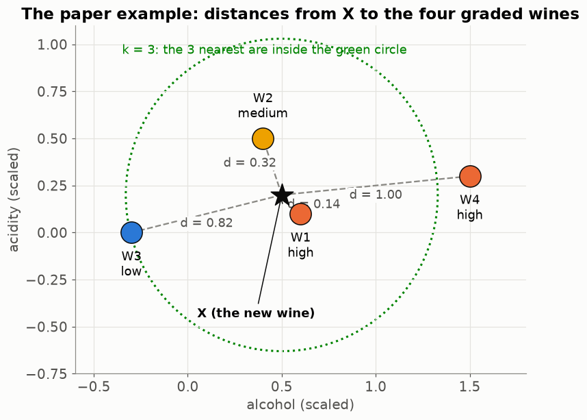
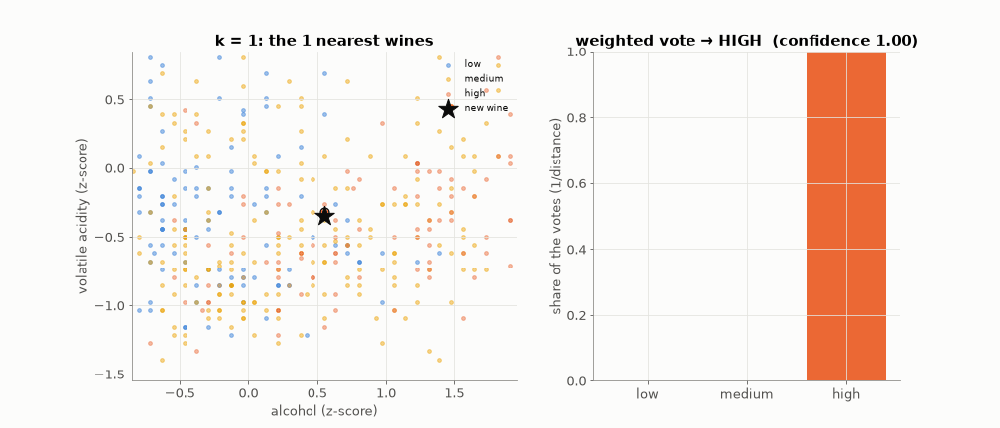
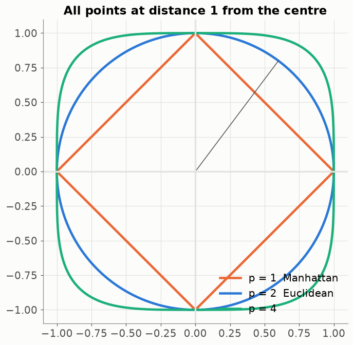
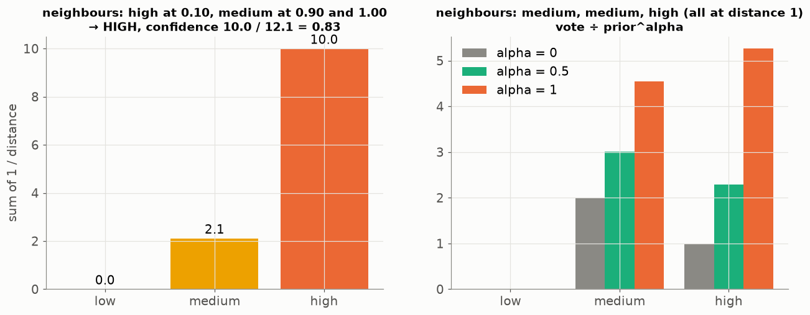
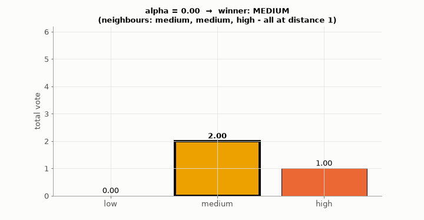
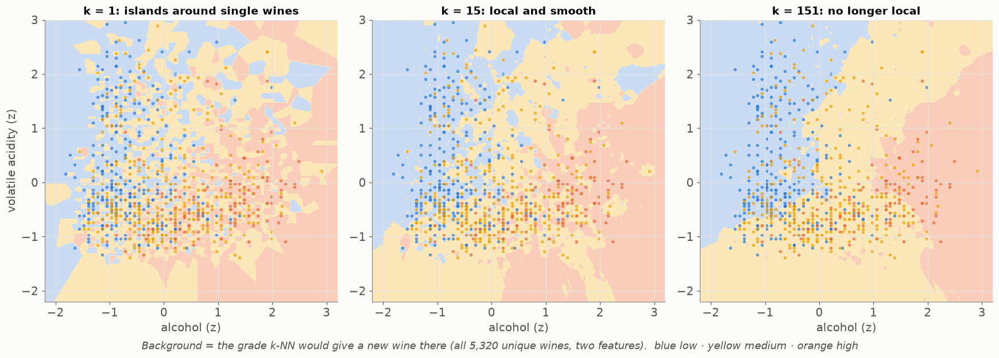
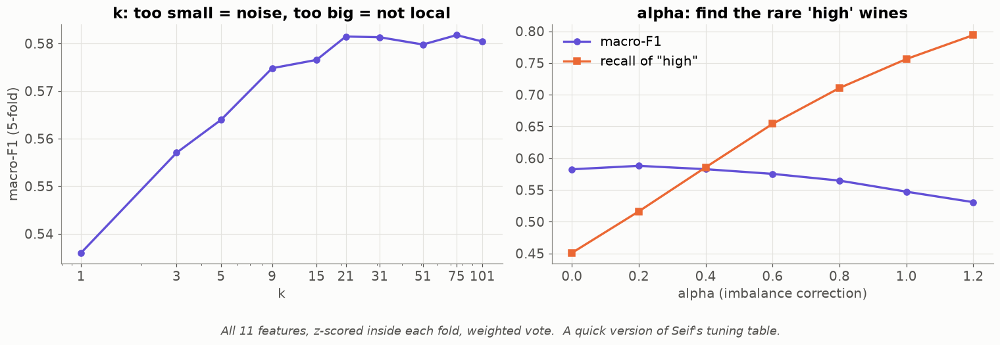

# Lesson 15 — k-nearest neighbours: "tell me who your neighbours are, and I'll tell you who you are"

> **For:** Seif (WineGrader stage 4 — the heart of the project) &nbsp;·&nbsp; **Time:** 3 × 45 min
> **Before:** Lesson 00 §6, §10; Lessons 02, 03, 05 &nbsp;·&nbsp; **After this:** Lessons 16, 17

**In one sentence:** to grade a new wine, find the k most similar wines whose grades you already know, and let them vote —
closer wines louder, and with a small correction so the common grade doesn't win just by being common.

## 🗺️ The map of this lesson



## The story

> A wine lab sends Sami a new wine with its measurements (alcohol, acidity, sugar …) but no grade. Sami has **5,000 wines
> that experts already graded**. His idea: *"Find the wines in my list whose measurements are most similar to this one,
> and look at their grades. If most of the 15 closest wines are 'high', this one probably is too."* That is the whole
> k-NN algorithm. The interesting questions are the details: how to measure "similar", how many neighbours (k), whether a
> very close neighbour should count more, and what to do because "high" wines are rare.

### 🌍 Real world



You use this idea all the time: "what's this flat worth? — look at similar flats that sold"; "will I like this film? — people
like me did". It's the oldest and simplest idea in machine learning — and, with good distances, surprisingly strong.

## Words you need

| word | meaning |
|---|---|
| **neighbour** | a known (graded) wine close to the new one |
| **k** | how many neighbours vote |
| **distance** | how different two wines are, from all their numbers (Lessons 00 §10, 02) |
| **Manhattan distance (p = 1)** | add the differences — like walking city blocks |
| **Euclidean distance (p = 2)** | Pythagoras — the straight line |
| **weighted vote** | closer neighbours get a louder vote: 1 / distance |
| **confidence** | the winning grade's share of all the votes |
| **prior** | how common each grade is: low 37 %, medium 44 %, high 19 % |
| **alpha** | how strongly we correct for "medium is everywhere" |
| **lazy learner** | a model that stores the examples and does the work only when asked |

---

## 1. The idea, on paper first

Four graded wines, two features (already scaled — Lesson 02), and a new wine X = (0.5, 0.2):

```
wine    alcohol   acidity   grade
W1        0.6       0.1     high
W2        0.4       0.5     medium
W3       −0.3       0.0     low
W4        1.5       0.3     high
```

**Distances to X (Euclidean):**

```
W1: differences 0.1, −0.1  → squares 0.01 + 0.01 = 0.02  → √0.02 = 0.14
W2: −0.1, 0.3              → 0.01 + 0.09 = 0.10           → √0.10 = 0.32
W3: −0.8, −0.2             → 0.64 + 0.04 = 0.68           → √0.68 = 0.82
W4: 1.0, 0.1               → 1.00 + 0.01 = 1.01           → √1.01 = 1.00
```



**k = 3:** the 3 nearest are W1 (high), W2 (medium), W3 (low). One vote each → a tie! (§5 deals with ties — and with
weights the tie disappears.)

There is **no training** — the "model" *is* the table of graded wines. All the work happens when a new wine arrives. That's
called a **lazy** learner.



On real wines (two features shown): the star is the new wine, the dashed circle grows with k, and on the right the vote.
**Watch the answer change:** k = 1 says *high* (one very close high wine), k = 15 says *medium*.

## 2. Distance — Minkowski

$$d(a,b) = \Big(\sum_i w_i\,|a_i - b_i|^p\Big)^{1/p}$$

Read it slowly: for each feature i, take the difference, make it positive (|…|), raise it to the power p, multiply by the
feature's weight wᵢ (normally 1; Lesson 17); add them all up (Σ); finally take the p-th root.



By hand, a = (0, 0), b = (3, 4), weights 1:

```
p = 2 (Euclidean):   (3² + 4²)^(1/2) = (9 + 16)^0.5 = √25 = 5
p = 1 (Manhattan):   (3¹ + 4¹)^(1/1) = 3 + 4 = 7          (walking the blocks)
```

**Skip the root while searching.** If 25 < 36 then √25 < √36 (5 < 6): the root never changes **which** wine is closer. So
the search compares the sums without the root ("power distance") and takes the root only for the k winners
(`test_skipping_the_root_keeps_the_order`).

## 3. The weighted vote

A neighbour almost identical to the new wine should count more than one far away:

$$\text{vote} = \frac{1}{\text{distance} + \varepsilon}\qquad(\varepsilon = \text{a billionth, only to avoid dividing by 0})$$



The guide's example (left), k = 3:

```
neighbour 1:  high,    distance 0.10  → vote 1 / 0.10 = 10.0
neighbour 2:  medium,  distance 0.90  → vote 1 / 0.90 =  1.1
neighbour 3:  medium,  distance 1.00  → vote 1 / 1.00 =  1.0

high: 10.0      medium: 1.1 + 1.0 = 2.1      total: 12.1
winner: HIGH,   confidence = 10.0 / 12.1 = 0.83
```

Without weights, the two far medium wines would out-vote the almost identical high wine 2 to 1.

Our paper example with weights: W1 1/0.14 = 7.1 (high), W2 1/0.32 = 3.1 (medium), W3 1/0.82 = 1.2 (low) → **high**,
confidence 7.1 / 11.4 = 0.62.

## 4. The imbalance correction (alpha)

44 % of wines are medium, only 19 % are high. Any random neighbour is 2.3× more likely to be medium than high — before we
even look at the wine. So in a mixed neighbourhood, medium wins "by population". The correction divides each vote by how
common its grade is, raised to a power alpha:

$$\text{vote} = \frac{1/(d+\varepsilon)}{\text{prior}[\text{grade}]^{\alpha}}$$

Right panel of the picture: neighbours medium, medium, high, all at distance 1 (each vote = 1):

```
alpha = 0:    prior^0 = 1 for everyone →  medium 1 + 1 = 2.0      high 1.0           → MEDIUM
alpha = 1:    medium: 1/0.44 = 2.27 each → 4.5      high: 1/0.19 = 5.3            → HIGH
alpha = 0.5:  √0.44 = 0.66 → medium 2 × 1/0.66 = 3.0;   √0.19 = 0.44 → high 1/0.44 = 2.3   → MEDIUM
```

Watch the winner flip as alpha grows from 0 to 1:



Too much correction and medium wines get called high; too little and high wines are never found.

## 5. Ties

With equal votes, `np.argmax` would always pick the first grade (low) — an arbitrary bias. The project's rule: **the grade of
the nearest neighbour among the tied grades wins**. In the paper example without weights (k = 3, one vote each), W1 (high)
is the nearest → **high**.

## 6. Choosing k and alpha — the real curves



Each colour region = the grade a new wine at that spot would get. k = 1: islands around single wines (one mislabelled wine
causes errors around it). k = 15: smooth. k = 151: not local any more — mostly medium.



Real data (5,320 wines, all 11 features, 5-fold CV): macro-F1 (Lesson 03) rises from 0.54 at k = 1 to ≈ 0.58 around
k = 21, then stays flat. Alpha: macro-F1 stays about the same up to ≈ 0.4–0.5 while the recall of *high* wines rises from
0.45 to ≈ 0.6 — so Seif's tuning rule prefers alpha = 0.5.

## 7. Proving it is right

`test_knn_matches_sklearn` runs your k-NN and scikit-learn's `KNeighborsClassifier(weights="distance")` on the same data
and demands **identical** answers. If it fails: compare the neighbours first, then the votes.

## 🧪 Worked example: k-NN in 15 lines

```python
import math
from collections import defaultdict

wines = [((0.6, 0.1), "high"), ((0.4, 0.5), "medium"), ((-0.3, 0.0), "low"), ((1.5, 0.3), "high")]
prior = {"low": 0.37, "medium": 0.44, "high": 0.19}

def knn(x, k=3, alpha=0.0, eps=1e-9):
    dist = sorted((math.dist(x, p), g) for p, g in wines)[:k]     # the k nearest
    votes = defaultdict(float)
    for d, g in dist:
        votes[g] += (1 / (d + eps)) / prior[g] ** alpha           # closer = louder, ÷ prior^alpha
    winner = max(votes, key=votes.get)
    return winner, round(votes[winner] / sum(votes.values()), 2), dist

print(knn((0.5, 0.2)))          # ('high', 0.62, [(0.141.., 'high'), (0.316.., 'medium'), (0.824.., 'low')])
```

## 8. Common mistakes

| student says | the truth |
|---|---|
| "k-NN trains a model" | It stores the wines (and the scaler). The work happens at prediction time. |
| "k = 1 is the most accurate" | The most **noisy**: one mislabelled wine decides. |
| "Bigger k is safer" | Too big = the most common grade everywhere. |
| "Forget scaling, k-NN will manage" | SO₂ would decide everything (Lesson 02). |
| "k-NN is fast" | Training is instant; **predicting** means comparing with every wine — Lesson 16 speeds it up. |

## 📝 Summary

> * k-NN: find the **k nearest** known examples, let them **vote**. No training — a **lazy** learner.
> * Distance: **Minkowski** (p = 2 straight line, p = 1 city blocks), on **scaled** features. Skip the root while searching.
> * **Weighted vote** 1 / distance: a near twin beats several far wines. Confidence = winner's share.
> * **alpha** divides by prior^alpha so rare grades (high) aren't drowned by common ones.
> * Small k = noisy islands; huge k = "medium" everywhere. Choose k and alpha by CV.

## 9. Activities

1. **Human k-NN (15 min).** Tape an alcohol × acidity grid on the floor. 15 students hold "wine cards" with a grade and
   stand at their spot. A new student enters; the class counts the 1, 3, 5 nearest. Change k, change the answer.
2. **Vote by hand (10 min).** §10 question 2.
3. **Slider:** `python visualize.py --live` — drag k from 1 to 60.

## 10. Do it yourself

<details><summary>1. p = 1, weights (1, 2): distance between (1, 5) and (4, 3)?</summary>

1 × |1 − 4| + 2 × |5 − 3| = 3 + 4 = **7**.
</details>

<details><summary>2. k = 5, distances 0.2 (high), 0.5 (medium), 0.6 (medium), 1.0 (low), 1.1 (medium). Weighted vote and confidence.</summary>

high 1/0.2 = 5.0 · medium 2.0 + 1.67 + 0.91 = 4.58 · low 1.0 · total 10.58 → **high**, confidence 5.0 / 10.58 = **0.47**.
</details>

<details><summary>3. Why does k-NN beat the "centroid" baseline (one average wine per grade)?</summary>

One average point can't describe a grade spread over several regions (high reds and high whites differ). k-NN keeps every
wine and can follow any shape.
</details>

<details><summary>4. 🟢 The paper example with k = 1. Answer?</summary>

The single nearest is W1 (0.14) → **high**.
</details>

<details><summary>5. 🟡 alpha = 1, neighbours: low at distance 0.5, high at distance 1.0. Votes?</summary>

low: (1/0.5) ÷ 0.37 = 2 ÷ 0.37 = **5.4**. high: (1/1) ÷ 0.19 = **5.3**. Low wins — barely.
</details>

<details><summary>6. 🟡 5,000 graded wines, 100 new wines to grade. How many distances does a plain k-NN compute?</summary>

5,000 × 100 = **500,000** — every new wine against every graded wine. That's why Lesson 16 builds a kd-tree.
</details>

<details><summary>7. 🔴 Why does `power_to_many` skip the p-th root?</summary>

The root keeps the order (if a < b then √a < √b), and k-NN only needs the order to find the nearest. Taking roots of
5,000 numbers would be wasted work — take it only for the k winners.
</details>

## 11. In your project

| Project | Where |
|---|---|
| WineGrader | `winegrader/ml/metrics.py` → `minkowski_power`, `minkowski`, `power_to_many`, `power_matrix` · `ml/index.py` → `LinearIndex` · `ml/classifiers.py` → `class_priors`, `vote`, `KNNClassifier`, `MajorityClassifier`, `CentroidClassifier` · theory `32_WineGrader/01_theory/04_knn.md` · notebook `02_knn_from_scratch.ipynb` |

## 🎬 Watch & explore

| | |
|---|---|
| <a href="https://www.youtube.com/watch?v=HVXime0nQeI"></a> | **StatQuest — K-nearest neighbors, Clearly Explained** (5 min). The whole idea in five minutes. |

**Play with it:**
* scikit-learn — [Nearest Neighbors Classification example](https://scikit-learn.org/stable/auto_examples/neighbors/plot_classification.html)
* At home: `python visualize.py --live` — drag k from 1 to 60 on the real wines.
