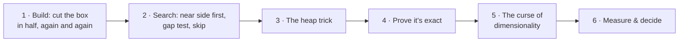
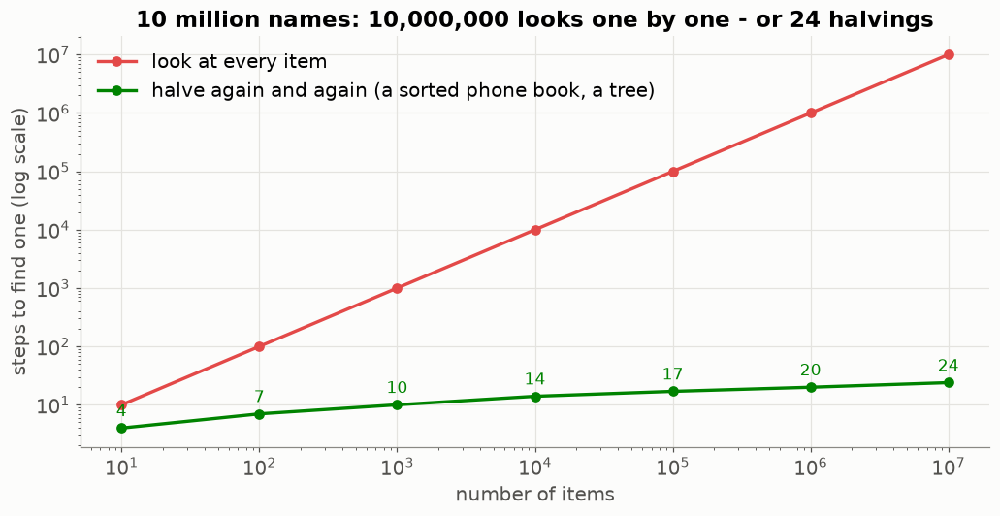
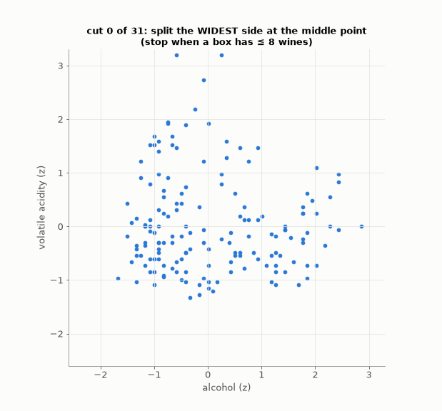
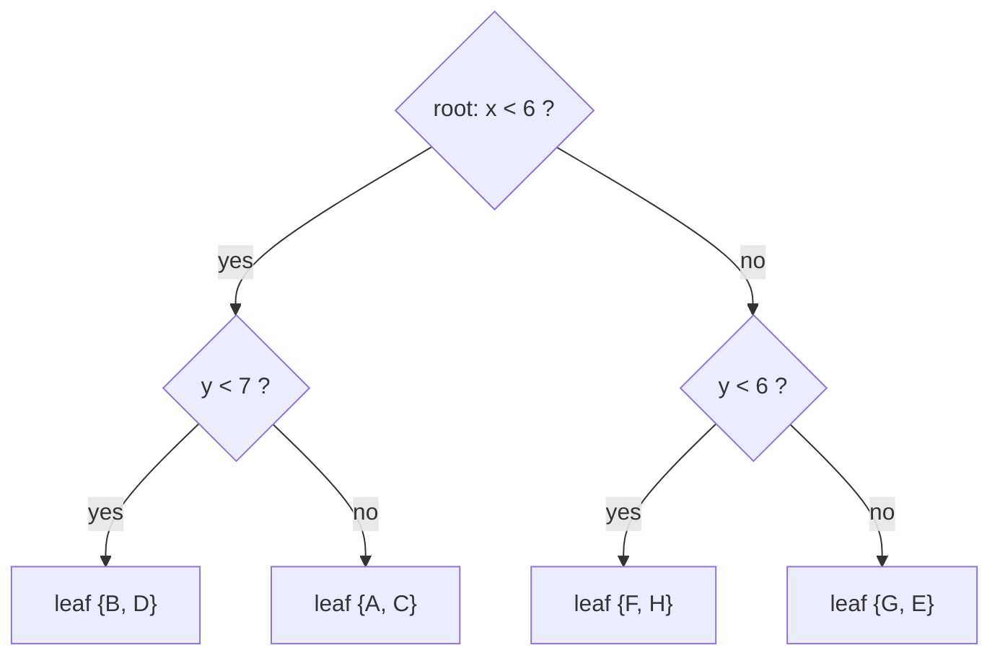
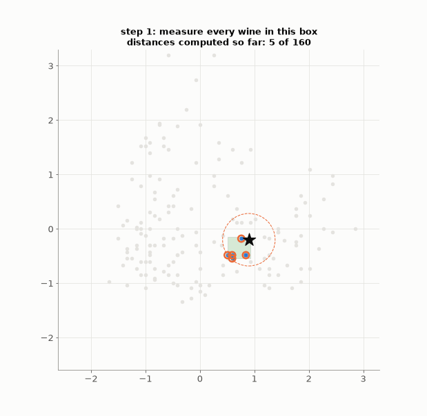
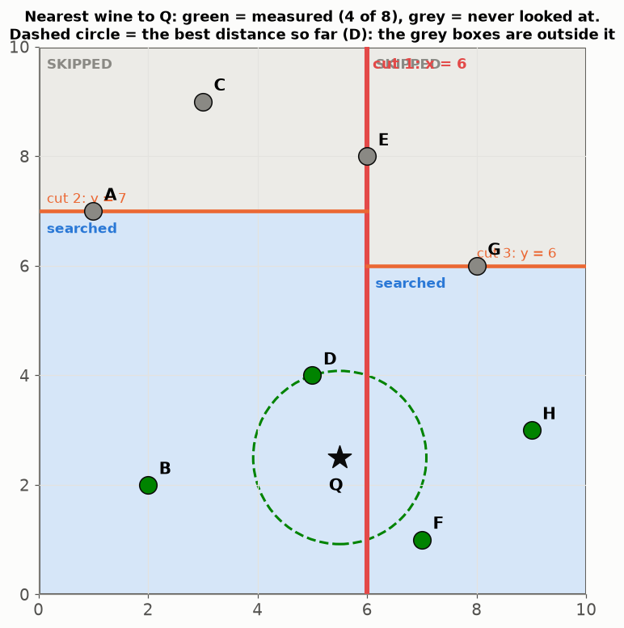
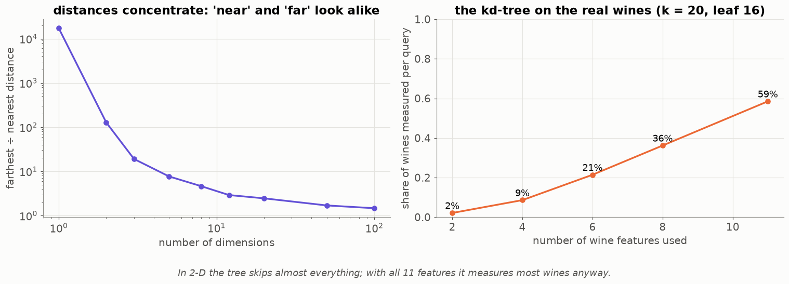
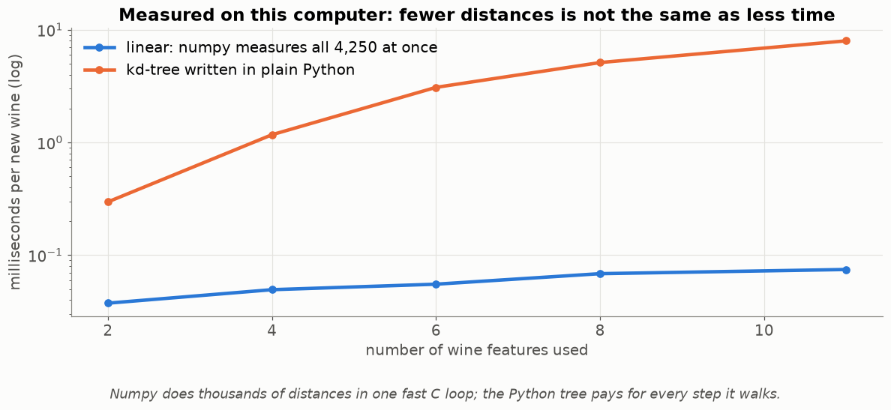

# Lesson 16 — The kd-tree: skipping work, and when skipping stops working

> **For:** Seif (WineGrader stage 5) &nbsp;·&nbsp; **Time:** 2 × 45 min
> **Before:** Lesson 15; Python recursion; `heapq` &nbsp;·&nbsp; **After this:** the "measure and decide" chapter of the book

**In one sentence:** a kd-tree cuts the space into boxes inside boxes so a nearest-neighbour search can skip whole boxes
that can't contain a closer wine — which works beautifully in 2–4 dimensions and hardly at all in 11.

## 🗺️ The map of this lesson



## The story

> Sami's k-NN (Lesson 15) measures the distance from the new wine to **all 4,250** wines in the list, every time. That's
> fine today. But think of a taxi app finding the nearest taxi among 100,000: you wouldn't measure the distance to taxis
> in another city. You'd first look at the right **city**, then the right **neighbourhood**, then the right **street**.
> A **kd-tree** organises the wines like that: it cuts the space into boxes inside boxes, so the search can **skip whole
> boxes** that can't contain a closer wine. This lesson builds it — and then shows the honest result: with 11 features it
> barely helps, and explains why.

### 🌍 Real world: halving is how computers find things fast

Looking up a name in a printed phone book, you don't read every page: you open the middle, see whether the name is before or
after, and throw away half the book — again and again.



10 million names take only 24 halvings. Trees use this idea everywhere: **maps apps** ("restaurants near me" uses spatial
trees), **taxi apps** (the nearest driver), **video games** (which objects might collide), **astronomy** (the stars near a
point in the sky). A kd-tree is halving in several directions at once.

## Words you need

| word | meaning |
|---|---|
| **tree** | a structure of boxes inside boxes: the root is the whole space, each node splits into two |
| **node** | one cut: "split on alcohol at 10.5" |
| **leaf** | a small box that isn't cut further (≤ 16 wines) |
| **axis** | one feature (one direction of the space) |
| **threshold** | where the cut is |
| **pruning** | skipping a whole box without measuring anything inside it |
| **gap** | the distance from the new wine to the cutting line, along one axis only |
| **heap** | a structure that always gives you the smallest item instantly (Python's `heapq`) |
| **dimension** | the number of features: 2 = a page, 11 = Seif's wines |

---

## 1. Building: cut the box in half, again and again



The rule (Seif's guide):

1. If ≤ 16 wines are left (8 in the animation, to see it), stop: this box is a **leaf**.
2. Otherwise find the feature with the **largest spread** (max − min).
3. Sort the wines by that feature and cut at the **middle position**: first half left, second half right.
4. Do the same inside each half (**recursion**).

### By hand — 8 wines in 2-D, leaf size 2

```
wines: A(1,7) B(2,2) C(3,9) D(5,4) E(6,8) F(7,1) G(8,6) H(9,3)
x spread: 9 − 1 = 8      y spread: 9 − 1 = 8       tie → take x
sorted by x: A B C D | E F G H      → cut at x = 6 (E's x). left box: A B C D, right box: E F G H
left box  A B C D:   x spread 4, y spread 7 → cut on y. sorted by y: B(2) D(4) | A(7) C(9) → leaves {B, D} {A, C}
right box E F G H:   x spread 3, y spread 7 → cut on y: F(1) H(3) | G(6) E(8) → leaves {F, H} {G, E}
```

Draw the 4 boxes on squared paper — that is the whole tree. As a diagram:



**Why the middle position and not "less than the median goes left"?** If 300 wines share the same pH, "less than the
median" might send all 300 to one side; the cut does nothing and the recursion never ends. The middle position always
halves.

## 2. Searching: go near first, then ask "could the far side matter?"



Keep a list of the k best wines so far (orange rings; dashed circle = the k-th best distance). At each cut:

1. Go to the side the new wine is on (**near side**) first.
2. Coming back, compute the **gap**: how far the new wine is from the cutting line, **along that one axis**. Every wine on
   the far side is **at least** that far away (the other features can only add distance).
3. If the gap is already bigger than the k-th best distance → **skip the whole far box** (grey).

### By hand — the gap test

New wine Q = (5.5, 2.5), k = 1, the 8 wines above. Q has x = 5.5 < 6 → near side = left box.

```
left box: y-cut at 7 → Q (y = 2.5) goes to leaf {B, D}
   B(2,2): squared distance (3.5² + 0.5²) = 12.25 + 0.25 = 12.5
   D(5,4): (0.5² + 1.5²) = 0.25 + 2.25 = 2.5        → best so far: D, 2.5
back in the left box: far leaf {A, C} is above y = 7. gap = (7 − 2.5)² = 20.25 > 2.5 → SKIP (A and C never measured)
back at the root: far box = right (x ≥ 6). gap = (6 − 5.5)² = 0.25 ≤ 2.5 → must look
   right box: y-cut at 6 → Q goes to {F, H}
   F(7,1): (1.5² + 1.5²) = 4.5         H(9,3): (3.5² + 0.5²) = 12.5      → D still best
   far leaf {G, E} above y = 6: gap (6 − 2.5)² = 12.25 > 2.5 → SKIP
answer: D.   measured 4 of 8 wines.
```



(The tree compares **squared** distances — the root isn't needed, Lesson 15 §2.)

```python
search(near)
gap = w[axis] * abs(diff) ** p
if len(heap) < k or gap <= worst_distance_in_heap:    # <= so ties are still found
    search(far)                                       # otherwise: skipped entirely
```

## 3. The heap trick

We always need the **worst** of the k best (to compare with the gap and to replace it). Python's `heapq` gives the
**smallest** item instantly. Trick: store **minus** the distance. The smallest of (−5, −3, −1) is −5 → distance 5, the
largest. So `heap[0]` is always the worst kept wine.

## 4. Correctness first

A tree that skips one box too many still returns k wines — just not the nearest — and **nothing else would notice**.
`test_kdtree_matches_linear` asks both methods for the neighbours of 1,000 random wines and demands identical answers.

## 5. The curse of dimensionality



**Left:** random points: in 1-D the farthest point is 10,000× farther than the nearest; in 100-D only 1.5×. In many
dimensions "near" and "far" become almost the same — so the gap test rarely wins.

**Right (real wines, k = 20, leaves of 16):**

```
features used:          2      4      6      8      11
share of wines measured: 2 %    9 %   21 %   36 %   59 %
```

With 2 features the tree skips almost everything. With all 11 it measures most wines anyway — and the Python overhead
of walking the tree makes it ~10× **slower** than numpy measuring all of them at once (Seif's guide). Two reasons:

1. **Too few cuts per feature.** 4,000 wines / leaves of 16 → about 8 levels → 8 cuts in total. In 2-D that's 4 cuts per
   feature (a fine grid). In 11-D some features are never cut — the boxes are long slabs, and the "far side" is rarely far.
2. **Distances concentrate** (left picture).

That's why `config.DEFAULT_INDEX = "linear"`: **the measurement decided**.

### Distances saved ≠ time saved

Counting distances is one thing; the clock is another. Measured on this computer, per new wine:



Even in 2-D, where the tree measures only 2 % of the wines, the plain-Python tree is slower than numpy measuring **all** of
them — numpy does thousands of distances in one fast C loop, while the Python tree pays for every step it walks. With 11
features the tree is about **100× slower**. (A kd-tree written in C, like scikit-learn's, does win in low dimensions.)

❓ *"You built a kd-tree and didn't use it — wasted work?"* No: the claim is "here is how to decide whether it helps". It
is built, proven correct, measured, and the curves explain the result: 50× fewer distances in 2-D, almost no saving in
11-D, and Python overhead on top.

## 🧪 Worked example: the gap test in Python

```python
pts = {"A": (1, 7), "B": (2, 2), "C": (3, 9), "D": (5, 4), "E": (6, 8), "F": (7, 1), "G": (8, 6), "H": (9, 3)}
leaves = {"BD": ["B", "D"], "AC": ["A", "C"], "FH": ["F", "H"], "GE": ["G", "E"]}
Q = (5.5, 2.5)
best, best_d, measured = None, float("inf"), []

def look(leaf):
    global best, best_d
    for n in leaves[leaf]:
        d = (pts[n][0] - Q[0]) ** 2 + (pts[n][1] - Q[1]) ** 2     # squared distance
        measured.append(n)
        if d < best_d:
            best, best_d = n, d

look("BD")                                        # near side of x<6, then of y<7
if (7 - Q[1]) ** 2 <= best_d: look("AC")           # gap 20.25 > 2.5 → skipped
if (6 - Q[0]) ** 2 <= best_d:                      # gap 0.25 ≤ 2.5 → must look right
    look("FH")
    if (6 - Q[1]) ** 2 <= best_d: look("GE")       # gap 12.25 > 2.5 → skipped
print(best, best_d, "measured:", measured)         # D 2.5 measured: ['B', 'D', 'F', 'H']
```

## 6. Common mistakes

| student says | the truth |
|---|---|
| "The kd-tree gives approximate neighbours" | It is **exact**: it only skips boxes that provably can't contain a better wine. |
| "A tree is always faster" | Not in many dimensions, and not against vectorised numpy. Measure. |
| "Fewer distances = faster" | Only if each step is cheap. Python steps are expensive. |

## 📝 Summary

> * **Build:** cut on the widest feature at the middle position, recursively, until ≤ 16 wines per leaf.
> * **Search:** near side first; then the **gap test** — if even the gap to the cut is bigger than the k-th best distance,
>   skip the whole far box. It's **exact**.
> * **Heap** with minus distances → the worst of the k best is always at `heap[0]`.
> * **Curse of dimensionality:** in 11-D, few cuts per feature and distances that all look alike → the tree measures most
>   wines anyway.
> * **Measure, then decide**: WineGrader uses the linear index.

## 7. Activities

1. **Paper tree (15 min).** The 8 wines of §1 on squared paper; build the tree with coloured pencils, one colour per level.
2. **Search by hand (10 min).** Find the nearest wine to (2, 8). How many did you measure? (Should be few.)
3. **Measure (10 min).** In `32_WineGrader/02_examples/03_kdtree.ipynb`, change the number of features and time both
   methods.

## 8. Do it yourself

<details><summary>1. The new wine is at x = 3.0, the cut at x = 2.0, the current k-th best squared distance is 0.8. Look at the far side?</summary>

gap = (3 − 2)² = 1.0 > 0.8 → **skip** it.
</details>

<details><summary>2. Activity 2: the nearest wine to (2, 8).</summary>

x = 2 < 6 → left box; y = 8 ≥ 7 → leaf {A, C}: A(1,7): 1 + 1 = 2; C(3,9): 1 + 1 = 2 → tie, best 2. Far leaf {B, D}: gap
(8 − 7)² = 1 ≤ 2 → look: B 0 + 36, D 9 + 16 → no better. Root far box: gap (6 − 2)² = 16 > 2 → skip. Answer A (or C) — 4
measured.
</details>

<details><summary>3. Why store (−distance, −row) in the heap?</summary>

`heapq` gives the smallest first; negated, the smallest is the **largest** distance = the worst of the k best.
</details>

<details><summary>4. 🟢 How many halvings to get from 4,096 wines down to leaves of 16?</summary>

4,096 → 2,048 → … → 16: 4,096 ÷ 16 = 256 = 2⁸ → **8** levels.
</details>

<details><summary>5. 🟡 Build the first cut for: (1,1), (2,8), (3,3), (4,6). Which feature, and where?</summary>

x spread 3, y spread 7 → cut on **y**. Sorted by y: 1, 3, 6, 8 → middle position 2 → cut at **y = 6**: {(1,1),(3,3)} below,
{(4,6),(2,8)} above.
</details>

## 9. In your project

| Project | Where |
|---|---|
| WineGrader | `winegrader/ml/index.py` → `KDTreeIndex.build`, `_build`, `query` (and `LinearIndex`) · `ml/evaluation.py` → `kdtree_dimension_curve` · theory `32_WineGrader/01_theory/05_kdtree.md` · notebook `03_kdtree.ipynb` |

## 🎬 Watch & explore

| | |
|---|---|
| <a href="https://www.youtube.com/watch?v=BK5x7IUTIyU"></a> | **Computerphile — K-d Trees**. Building and searching, drawn on paper like Parts 1–2. |
| <a href="https://www.youtube.com/watch?v=Glp7THUpGow"></a> | **Stable Sort — KD-Tree nearest neighbour**. The search and the pruning, animated. |
| <a href="https://www.youtube.com/watch?v=Y4ZgLlDfKDg"></a> | **Victor Lavrenko — K-d tree algorithm**. A short university lecture, part of a k-NN series. |

**Play with it:**
* VisuAlgo — [binary heaps, animated](https://visualgo.net/en/heap) — watch `heappush` and `heappop` step by step.
* scikit-learn — [KD tree and ball tree](https://scikit-learn.org/stable/modules/neighbors.html#kd-tree)
