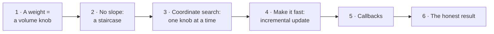
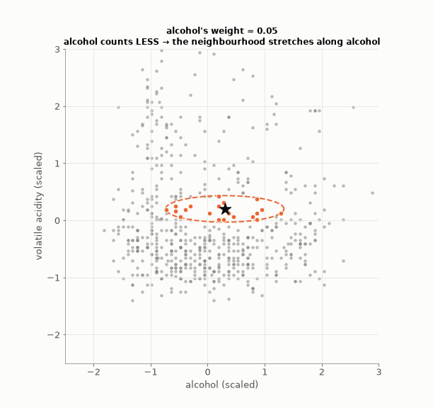
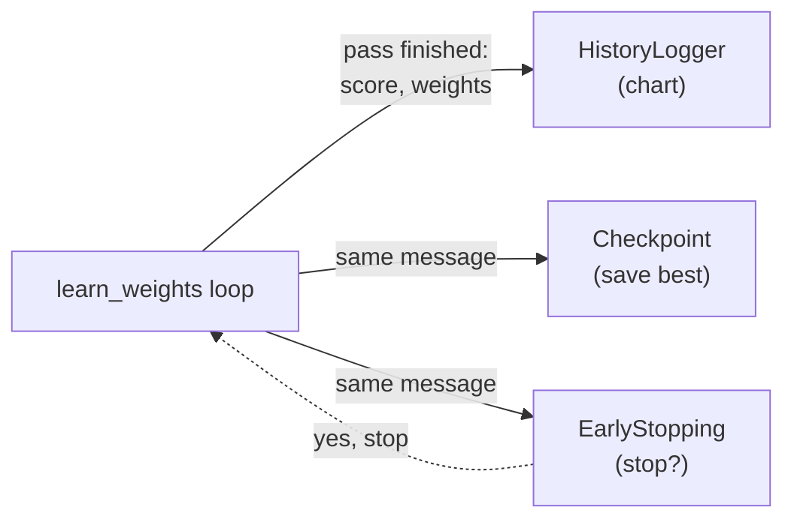
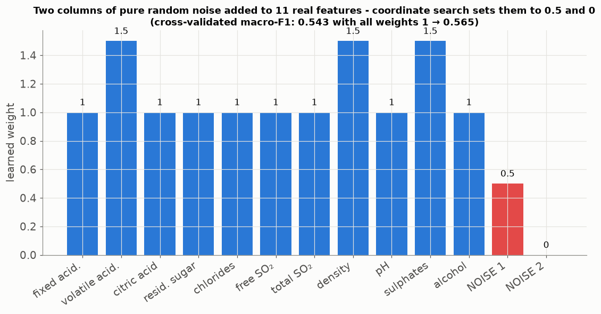

# Lesson 17 — Learning how much each feature matters: coordinate search

> **For:** Seif (WineGrader stage 6) &nbsp;·&nbsp; **Time:** 2 × 45 min
> **Before:** Lessons 02, 05, 15 &nbsp;·&nbsp; **After this:** the tuning / results chapter of the book

**In one sentence:** give each feature a "volume knob" in the distance, and let the computer turn one knob at a time,
keeping a change only when the cross-validated score really improves.

## 🗺️ The map of this lesson



## The story

> A wine expert tells Sami: *"For quality, alcohol matters a lot; chlorides (salt) hardly at all."* Right now Sami's k-NN
> treats all 11 measurements as **equally important** in the distance. Could the computer find, from the data, how much
> each measurement should count? Think of a **sound mixer** with 11 volume knobs, one per feature: turn a knob up and that
> feature counts more in "similar"; turn it to 0 and it is ignored. This lesson is how the computer turns the knobs — and
> the honest answer it found.

### 🌍 Real world

* A **music equaliser**: bass, mid, treble — you turn one slider, listen, keep it if it sounds better, move to the next.
* **Cooking**: a cook adjusts one ingredient at a time ("a bit more salt?"), tastes, and keeps only what helps.
* **Old TVs and radios** were tuned knob by knob the same way. That's exactly coordinate search.

## Words you need

| word | meaning |
|---|---|
| **feature weight wᵢ** | how much feature i counts in the distance; 1 = normal, 2 = double, 0 = ignored |
| **cross-validated score** | the average macro-F1 over the folds (Lessons 03, 05) |
| **coordinate search** | change one weight at a time, keep a change only if the score improves |
| **pass** | one round through all 11 features |
| **tolerance** | the minimum improvement we accept (0.002) — smaller ones are probably luck |
| **incremental update** | changing the stored distances instead of computing them all again |

---

## 1. What a weight does

$$d(a, b) = \Big(\sum_i w_i\,|a_i - b_i|^p\Big)^{1/p}\qquad\text{(Lesson 15, with weights)}$$

Two wines differ by 1.0 in alcohol and 1.0 in chlorides (scaled units), p = 2:

```
weights (1, 1):     1 × 1² + 1 × 1² = 2      distance √2 = 1.41
weights (2, 1):     2 × 1² + 1 × 1² = 3      distance √3 = 1.73   (alcohol counts double)
weights (1, 0):     1 × 1² + 0 × 1² = 1      distance √1 = 1.00   (chlorides ignored)
```

### Watch what one knob does

Turning alcohol's weight up or down changes the **shape** of the neighbourhood (the 21 nearest wines, orange):



Weight 1 → a circle. Weight 4 → alcohol differences count 4× → only wines with almost the same alcohol are "near" (a narrow
oval). Weight near 0 → alcohol hardly matters → the oval stretches along alcohol.

## 2. Why not gradient descent?


Gradient descent (Lessons 12, 21) needs a smooth hill to walk down. Here, turn one knob a tiny bit: either **no**
neighbour changes (the score stays exactly the same — flat) or one neighbour swaps (the score **jumps**). The score is a
staircase — there's no slope to follow. We need a method that only **compares scores**.

## 3. Coordinate search — one knob at a time


```
all weights = 1;  best = score(weights)
repeat (at most 3 passes):
    for each feature i that is not already 0:
        for factor in ×0, ×0.5, ×1.5, ×2:
            try weight i × factor;  s = cross-validated score
            if s > best + 0.002:  keep it, best = s, go to the next feature
    if a whole pass changed nothing: stop
```

### By hand — a made-up first pass with 3 features

Start: weights (1, 1, 1), best = 0.560.

```
feature 1 (alcohol):  ×0 → 0.541   ×0.5 → 0.552   ×1.5 → 0.565  (0.565 > 0.560 + 0.002 ✓ keep)
                      weights (1.5, 1, 1), best 0.565
feature 2 (acidity):  ×0 → 0.548   ×0.5 → 0.563   ×1.5 → 0.566 (not > 0.567 ✗)   ×2 → 0.562    → no change
feature 3 (chlorides):×0 → 0.570  (0.570 > 0.567 ✓ keep)
                      weights (1.5, 1, 0), best 0.570          ← chlorides removed: feature selection for free
pass 1 changed something → do pass 2 …
```

**Why the 0.002 tolerance?** With ~1,400 wines per fold, one wine changing grade moves macro-F1 by about 0.001.
Accepting smaller "improvements" means fitting which wines happen to be in which fold — luck, not wine.

**Analogy:** tuning an old radio with several knobs — turn one, listen; keep it if it's clearer; move to the next.

## 4. Making it fast — the incremental update

Every trial needs the distances between every test wine and every training wine, in every fold. Computing them from
scratch took ~2.8 seconds per trial — with hundreds of trials, far too slow.

The insight: the distance (before the root) is a **sum over features**. Changing one weight changes only **one term**:

$$D_{\text{new}} = D + (w_{\text{new}} - w_{\text{old}})\times|\Delta_i|^p$$


### Check it with numbers

One pair of wines: differences per feature (2, 1), p = 2, weights (1, 1).

```
D = 1 × 2² + 1 × 1² = 4 + 1 = 5
change weight 2 from 1 to 3:
   incremental:   D_new = 5 + (3 − 1) × 1² = 5 + 2 = 7
   from scratch:  1 × 4 + 3 × 1 = 7   ✓ the same
```

One addition instead of recomputing all 11 features → Seif's run dropped from ~5 minutes to ~20 seconds.
`test_incremental_matches_full_recompute` checks that the fast way gives exactly the slow way's score.

## 5. Callbacks — small helpers that listen

After every pass, the loop tells its helpers "round finished, here is the score and the weights": `HistoryLogger` (for the
chart), `Checkpoint` (saves the best weights safely), `EarlyStopping` (says when to stop). The loop doesn't need to know
about files or charts. This is the **Observer pattern** — like a YouTube channel and its subscribers: the channel just
announces "new video", and each subscriber decides what to do with it.



## 6. The honest result

| weights | nested macro-F1 (real data, Seif's guide) |
|---|---|
| all equal | 0.583 ± 0.018 |
| learned | 0.579 ± 0.015 |

Inside the inner folds the learning helped a little (0.581 → 0.585); on the untouched outer folds the gain **disappeared**.
That's overfitting to the inner folds — exactly what nested CV (Lesson 05) is built to catch. The conclusion for the book:
*once the features are scaled, no wine feature is useless or dominant enough for re-weighting to help.*

### Proof the method works: the noise test

To show the method itself isn't broken, add two columns of **pure random numbers** to the 11 real features and run the
search (2 passes, 3 folds, a sample of 2,400 wines):



One noise column is removed (weight 0), the other is halved, and the score goes up from 0.543 to 0.565. So when there **is**
something to fix, the search fixes it. On the real 11 features, there was nothing to fix.

## 🧪 Worked example: coordinate search on made-up scores

```python
# a pretend "cross-validated score" for 3 weights (in the project: macro-F1 from 5 folds)
def score(w):
    alcohol, acidity, chlorides = w
    return 0.56 + 0.02 * min(alcohol, 1.5) - 0.01 * abs(acidity - 1) - 0.01 * chlorides

w, best, tol = [1.0, 1.0, 1.0], None, 0.002
best = score(w)
for pass_no in range(3):
    changed = False
    for i in range(3):
        if w[i] == 0:
            continue
        for factor in (0, 0.5, 1.5, 2):
            trial = w.copy()
            trial[i] *= factor
            s = score(trial)
            if s > best + tol:                     # only real improvements
                w, best, changed = trial, s, True
                print(f"pass {pass_no + 1}: weight {i} ×{factor} → {w}  score {best:.3f}")
                break
    if not changed:
        break
print("final", w, round(best, 3))
```

## 7. Common mistakes

| student says | the truth |
|---|---|
| "The learned weights are better — the inner score went up" | Only the outer (nested) score counts. |
| "Try every combination of weights" | 4¹¹ ≈ 4 million combinations × CV — impossible. Coordinate search tries ~100. |
| "The incremental update is an approximation" | It's exact — §4 checks it. |
| "A result that didn't improve is a failure" | A measured, explained "no" is a result — and the noise test proves the method works. |

## 📝 Summary

> * A **weight** per feature = a volume knob in the distance; 0 removes the feature.
> * The score is a **staircase** — no slope, so no gradient descent.
> * **Coordinate search**: one knob at a time, try ×0, ×0.5, ×1.5, ×2, keep only gains > **0.002**.
> * **Incremental update**: D_new = D + (w_new − w_old)·|Δᵢ|ᵖ — exact and ~15× faster.
> * Honest result: no gain on the real wines (nested CV), but noise columns are found and removed.

## 8. Activities

1. **The mixer (5 min).** Any music app's equaliser: tune one slider at a time to make a song clearer.
2. **Paper update (10 min).** Give a 2 × 3 distance table and the table of one feature's squared differences; students
   compute the new table for weight 0.5, then check one cell from scratch.
3. **Noise test (10 min).** Add two random columns in the notebook; run coordinate search; watch their weights go to 0.

## 9. Do it yourself

<details><summary>1. D = 2.0 between two wines (weights 1); the pH term |Δ|² is 0.5. D after setting pH's weight to 0?</summary>

2.0 + (0 − 1) × 0.5 = **1.5**.
</details>

<details><summary>2. Best 0.570. A trial scores 0.571. Keep it?</summary>

No: 0.571 is not > 0.570 + 0.002 = 0.572.
</details>

<details><summary>3. Learned 0.579, equal 0.583 ± 0.018. Did learning make it worse?</summary>

No — the difference (0.004) is far smaller than the jump between folds (0.018): a tie. The conclusion is "re-weighting
doesn't help on this data", and why.
</details>

## 10. In your project

| Project | Where |
|---|---|
| WineGrader | `winegrader/ml/weights.py` → `cv_score`, `neighbours_from_matrix`, `FoldDistances` (`term`, `score`), `learn_weights` · `ml/callbacks.py` → `EarlyStopping`, `HistoryLogger`, `Checkpoint` · `ml/evaluation.py` → `nested_cv` · theory `32_WineGrader/01_theory/06_tuning_weights.md` · notebook `05_feature_weights.ipynb` |

## 🎬 Watch & explore

* Refactoring Guru — [The Observer pattern](https://refactoring.guru/design-patterns/observer) — with pictures and Python code.
* *Coordinate descent explained* — [search on YouTube](https://www.youtube.com/results?search_query=coordinate+descent+optimization+explained)
* At home: run the worked example, then change the tolerance to 0 — how many more (tiny) changes does it accept?
