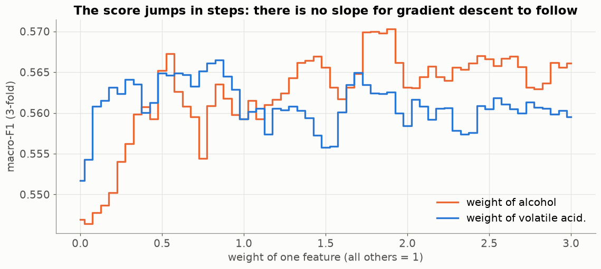
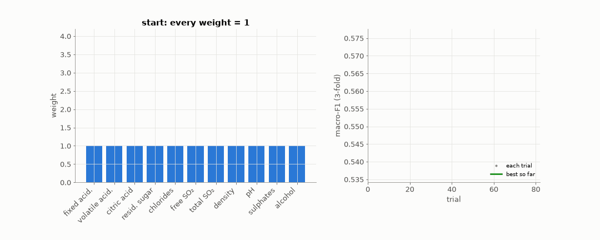
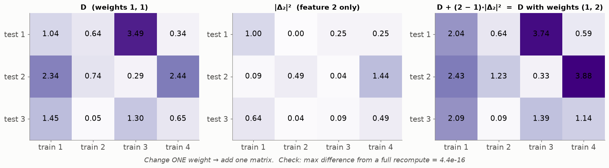

# Lesson 17 — Learning a weight per feature: coordinate search and the incremental update

> **For:** Seif (WineGrader stage 6) &nbsp;·&nbsp; **Time:** 45 – 60 min
> **Before:** Lessons 05, 15 &nbsp;·&nbsp; **After this:** the tuning / results chapter of the book

## 🎯 By the end, the student can

1. Explain what a feature weight does to the distance (and that weight 0 = feature removed).
2. Explain why gradient descent cannot be used here, with the staircase picture.
3. Run coordinate search by hand: try ×0, ×0.5, ×1.5, ×2; keep only improvements > 0.002; stop when a pass changes nothing.
4. Explain the incremental update `D_new = D + (w_new − w_old)·|Δᵢ|ᵖ` and why it is correct.
5. Report an honest "it did not help" result.

---

## 1. What a weight is

$$d(a,b)=\Big(\sum_i w_i|a_i-b_i|^p\Big)^{1/p}$$

Weight 2 on alcohol: one standard deviation of alcohol counts like two. Weight 0 on pH: pH is ignored. Learning the
weights = letting the data decide which features matter for "similar wine". (Remember the slider in Lesson 02.)

## 2. Why not gradient descent?



Nudge a weight a little: either **no** neighbour changes (score exactly the same — slope 0) or one neighbour swaps (score
**jumps**). There is no slope to follow — gradient descent (Lessons 12, 21) has nothing to work with. We need a method that
only *compares scores*.

## 3. Coordinate search — one knob at a time



```
w = all ones
repeat (at most 3 passes):
    for each feature i (that is not already 0):
        for factor in (×0, ×0.5, ×1.5, ×2):
            score = cross-validated macro-F1 with w[i] · factor
            if score > best + 0.002:  accept it, go to the next feature
    if a whole pass changed nothing: stop                 (early stopping, patience 1)
```

**Analogy:** tuning an old radio with several knobs — turn one, listen; keep it if it's clearer; move to the next knob.

* **Why the 0.002 tolerance?** One wine changing grade moves macro-F1 by ≈ 0.001. Accepting smaller "improvements"
  means fitting which wines happen to be in which fold — noise.
* **×0 removes a feature** for good: feature selection for free. (In the animation, *chlorides* is removed.)

## 4. Making it fast — the incremental update



Every trial needs all test-to-train distances of every fold. Recomputing from scratch: ~2.8 s per trial × ~100 trials ×
5 nested runs — far too slow. The insight: the distance (before the root) is a **sum over features**, so changing one
weight changes the matrix by one term only:

$$D_{new}=D+(w_{new}-w_{old})\cdot|\Delta_i|^p$$

One matrix addition instead of eleven. Seif's run fell from ~5 minutes to ~20 seconds. A fast version you can't trust is
worthless: `test_incremental_matches_full_recompute` checks the final score equals a full recompute (the script prints
both: 0.5676 = 0.5676).

## 5. Callbacks — the Observer pattern

The loop doesn't know about files or stopping rules. After each round it calls `on_round_end(round, score, weights)` on
every callback: `HistoryLogger` (the convergence plot), `Checkpoint` (best weights to a `.tmp` file, then rename — a
crash never leaves half a file), `EarlyStopping`. Same idea as Keras callbacks.

## 6. The honest result

| weights | nested macro-F1 (real data, Seif's guide) |
|---|---|
| uniform | 0.583 ± 0.018 |
| learned | 0.579 ± 0.015 |

Inside the inner folds learning helped a little (0.581 → 0.585); on the untouched outer folds the gain **disappeared**.
That is overfitting to the inner folds, in miniature — exactly what nested CV (Lesson 05) exists to reveal. Once the
features are scaled, no wine feature is useless or dominant enough for reweighting to help. On data with pure-noise features
(the test with two noise columns) the same code finds and removes them.

## 7. Misconceptions

| Student says | Truth |
|---|---|
| "The learned weights are better, the inner score went up" | Only the outer (nested) score counts. |
| "Try every combination of weights" | 4¹¹ ≈ 4 million combinations × CV — impossible. Coordinate search tries ~50–100. |
| "The incremental update is an approximation" | It is exact (a sum changes by exactly one term). The test proves it. |

## 8. Activities

1. **Radio knobs (5 min).** Three volume sliders on a web page / phone mixer: tune one at a time to match a target sound.
2. **Paper update (10 min).** Give a 2×3 distance matrix D and the matrix |Δ₂|²; students compute D for w₂ = 0.5 by the
   update, then by recomputing — same numbers.
3. **Noise test (10 min).** Add two random columns to the wine data in the notebook; run coordinate search; watch their
   weights go to 0.

## 9. Check yourself

<details><summary>1. D = 2.0 between two wines with weights all 1; the pH term |Δ|² is 0.5. What is D after setting pH's weight to 0?</summary>

2.0 + (0 − 1)·0.5 = **1.5**.
</details>

<details><summary>2. Why does coordinate search never "un-remove" a feature?</summary>

×0.5, ×1.5, ×2 of 0 is still 0. Removed stays removed — a deliberate, simple rule.
</details>

<details><summary>3. Learned weights scored 0.579, uniform 0.583 ± 0.018. Did learning make it worse?</summary>

No — the difference is a fifth of the fold-to-fold spread: a tie. The conclusion is "reweighting doesn't help on this
data", and why.
</details>

## 10. In your project

| Project | Where |
|---|---|
| WineGrader | `winegrader/ml/weights.py` → `cv_score`, `neighbours_from_matrix`, `FoldDistances` (`term`, `score`), `learn_weights` · `ml/callbacks.py` → `EarlyStopping`, `HistoryLogger`, `Checkpoint` · `ml/evaluation.py` → `nested_cv` · theory `32_WineGrader/01_theory/06_tuning_weights.md` · notebook `05_feature_weights.ipynb` |

## 🎬 Watch & explore

* *Coordinate descent explained* — [search on YouTube](https://www.youtube.com/results?search_query=coordinate+descent+optimization+explained)
* Refactoring Guru — [The Observer pattern](https://refactoring.guru/design-patterns/observer) (illustrated)
