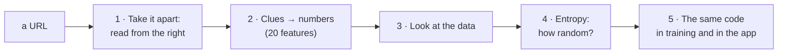
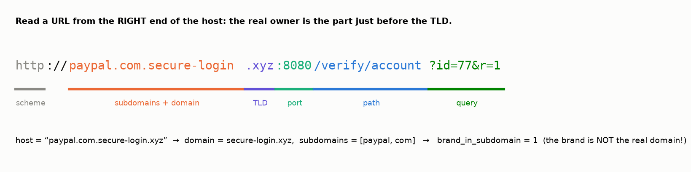
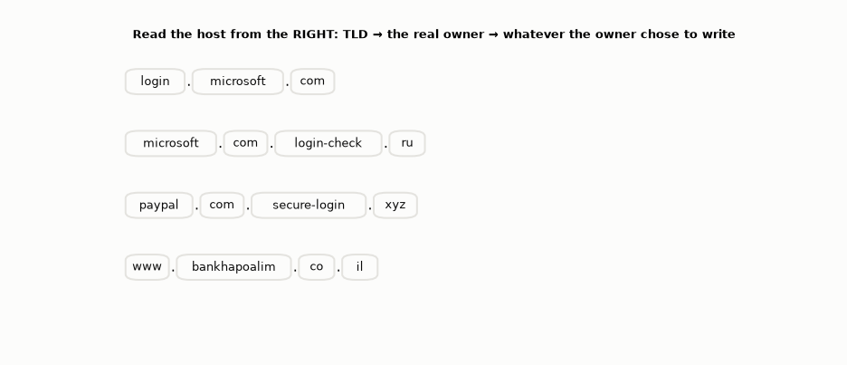
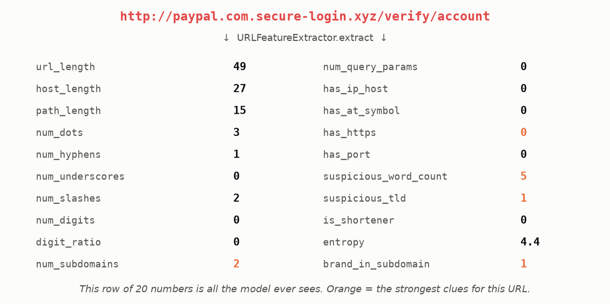
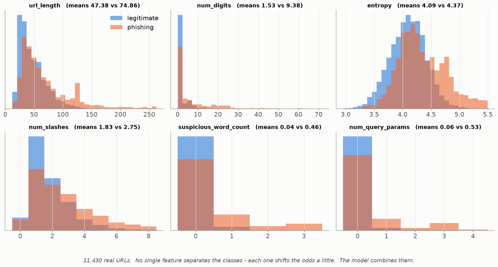
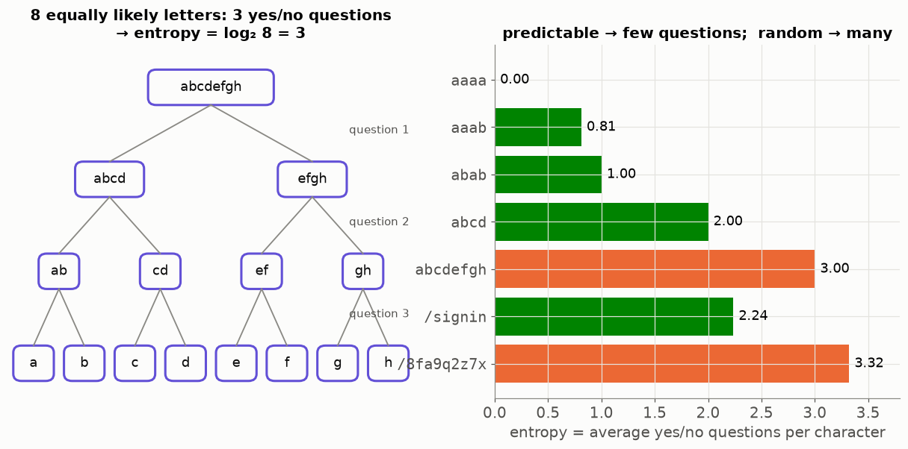
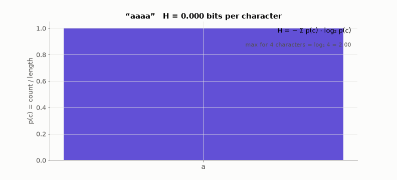
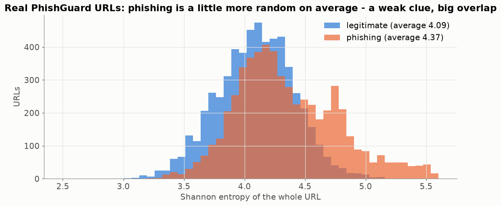
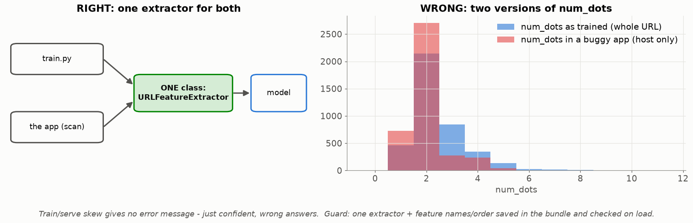

# Lesson 18 — A URL as numbers: feature engineering and Shannon entropy

> **For:** Dani (PhishGuard stage 1 — the heart of the project) &nbsp;·&nbsp; **Time:** 2 × 45 min
> **Before:** Lesson 00 §1, §4, §7; Lesson 01; Python strings &nbsp;·&nbsp; **After this:** Lessons 12, 13

**In one sentence:** a model can't "look" at a link, so we turn each clue a person would notice — who really owns the
address, strange endings, suspicious words, random-looking characters — into a number.

## 🗺️ The map of this lesson



## The story

> Dani's grandmother gets an SMS: *"Your PayPal account is locked. Verify here: http://paypal.com.secure-login.xyz/verify"*.
> She asks Dani: *"It says PayPal — is it real?"* Dani looks and says *"No! The real owner of this address is
> 'secure-login.xyz', not PayPal."* How did he know so fast? He looked at **clues**: where "paypal" appears, the strange
> ending ".xyz", the words "verify" and "login", no HTTPS. A model can't "look" — it needs each clue as a **number**.
> Turning a URL into well-chosen numbers is called **feature engineering**, and it decides how good PhishGuard can be.

### 🌍 Real world

* Your **browser** (Chrome, Firefox, Safari) warns *"Deceptive site ahead"* — it checks addresses against lists of known
  phishing pages, and services like Google Safe Browsing use machine learning to find new ones.
* **E-mail providers** score every link in every e-mail before it reaches you.
* Banks and the Israeli National Cyber Directorate publish the same advice Dani's features encode: check the real domain,
  beware of urgent words, don't trust the padlock alone.

## Words you need

| word | meaning | example |
|---|---|---|
| **URL** | a web address | `http://paypal.com.secure-login.xyz/verify` |
| **scheme** | how to connect: http or https (secure) | `http` |
| **host** | the server's name | `paypal.com.secure-login.xyz` |
| **TLD** | the last part of the host | `xyz` |
| **domain** | the part just before the TLD — the **real owner** | `secure-login.xyz` |
| **subdomain** | anything to the left of the domain — the owner can write anything here | `paypal.com` |
| **path** | what comes after the host | `/verify` |
| **query** | after `?`: extra parameters | `?id=77` |
| **feature** | one number describing the URL (Lesson 01) | `num_dots = 3` |
| **entropy** | how unpredictable the characters are | `aaaa` → 0, `x7k2` → 2 |

---

## 1. Anatomy of a URL — read the host from the right



Practise on four hosts — watch each one being read from the right:



**The trick attackers use:** whoever owns `secure-login.xyz` can create **any** subdomain: `paypal.com.secure-login.xyz`,
`bank.secure-login.xyz`, anything. People read from the left and see "paypal"; the real owner is just before the TLD —
read the host **from the right**. That's the feature `brand_in_subdomain`: a brand name appears in the subdomain but not in
the real domain.

## 2. Features computed by hand (Dani's guide)

| feature | `https://www.google.com/search?q=x` | `http://paypal.com.secure-login.xyz/verify/account` |
|---|---|---|
| url_length (characters) | 33 | 49 |
| host_length | 14 (`www.google.com`) | 27 |
| num_dots | 2 | 3 |
| num_hyphens | 0 | 1 |
| num_subdomains | 1 (www) | 2 (paypal, com) |
| has_https | 1 | 0 |
| suspicious_word_count | 0 | 5 (paypal, secure, login, verify, account) |
| suspicious_tld | 0 (com) | 1 (xyz) |
| entropy | 4.19 | 4.40 |
| brand_in_subdomain | 0 | 1 |

This is what the model actually receives for the fake PayPal link — one row of 20 numbers:



**Why hand-made features and not a neural network on the raw text?** Each number has a meaning a person can read — so the
model's decision can be **explained**: "flagged because a brand name is in the subdomain".

## 3. Look at the data before any model



11,430 real URLs, blue = legitimate, orange = phishing. Phishing URLs tend to be longer, with more digits, slashes and
query parameters — but **every** distribution overlaps. No single feature decides; each one moves the odds a little, and
the model combines them (Lessons 12, 13).

## 4. Shannon entropy — how unpredictable is a string?

Attackers' tools create random paths like `/8fa9q2z7x`. Humans write `/signin`. **Entropy** measures this randomness.

**The idea first:** imagine guessing the next character of a string with yes/no questions (like the game "20 questions"). In `aaaa` you never need to
ask — it's always "a" → 0 questions. In `abab`, one question ("is it a?") → 1. In a string where all 8 characters are
different, you need 3 questions (8 → 4 → 2 → 1). Entropy = the average number of yes/no questions per character.

$$H = -\sum_{c} p(c)\,\log_2 p(c)\qquad p(c) = \frac{\text{how many times } c \text{ appears}}{\text{length}}$$

(log₂ = "how many times do I multiply 2" — Lesson 00 §7. log₂(½) = −1, log₂(¼) = −2. The minus sign in front makes the
result positive.)



**Step by step for `aaab`:**

```
1. count:         a: 3,  b: 1,  length 4
2. probabilities: p(a) = 3/4 = 0.75      p(b) = 1/4 = 0.25
3. logs (base 2): log₂(0.75) = −0.415    log₂(0.25) = −2
4. multiply:      0.75 × (−0.415) = −0.311     0.25 × (−2) = −0.5
5. add and flip the sign:   −(−0.311 + −0.5) = 0.811
```



| string | H | why |
|---|---|---|
| `aaaa` | 0 | totally predictable |
| `aaab` | 0.811 | mostly a |
| `abab` | 1.0 | a fair coin: one question per character |
| `abcdefgh` | 3.0 | 8 equally likely → log₂ 8 |
| `/signin` | 2.24 | a human word |
| `/8fa9q2z7x` | 3.32 | machine-made: every character different |

Normal URLs land around 3.8–4.3; random tokens push it up. On all the real URLs:



A weak clue alone (the piles overlap a lot), useful together with the others.

## 5. Train/serve skew — the bug with no error message



If training counted dots in the **whole URL** and the app counts them in the **host only**, the model gets numbers from a
different distribution and gives **confident, wrong** answers — no crash, no warning. PhishGuard's guards:

1. **one class** (`URLFeatureExtractor`) computes the features for training **and** for the app;
2. the feature **names and order** are saved inside the model file;
3. a **check when loading** (`ModelBundle.load`) — plus `test_same_url_same_features`.

## 🧪 Worked example: parse a URL and compute its entropy

```python
import math
from collections import Counter
from urllib.parse import urlparse

def entropy(s):
    n = len(s)
    return -sum(c / n * math.log2(c / n) for c in Counter(s).values())

url = "http://paypal.com.secure-login.xyz/verify/account"
p = urlparse(url)
labels = p.hostname.split(".")
tld, domain, subdomains = labels[-1], labels[-2], labels[:-2]      # read from the RIGHT

print("owner      :", domain + "." + tld)                    # secure-login.xyz
print("subdomains :", subdomains)                            # ['paypal', 'com']
print("brand in subdomain:", any(b in subdomains for b in ["paypal", "apple", "amazon"]))   # True
print("https      :", p.scheme == "https")                   # False
print("entropy    :", round(entropy(url), 2))                # 4.4
print("aaab       :", round(entropy("aaab"), 3))             # 0.811
```

(The project's parser also handles two-part endings like `.co.il` — this short version doesn't.)

## 6. Common mistakes

| student says | the truth |
|---|---|
| "HTTPS means safe" | Most phishing sites have HTTPS today. One weak clue. |
| "The domain is right after www." | It is just before the TLD — read from the right. |
| "High entropy = phishing" | Raises the odds a little; many real URLs have IDs. |
| "A slightly different calculation in the app is fine" | That's skew. Same code, always. |
| "More features is always better" | Each must be computable the same way in the app, and meaningful. |

## 📝 Summary

> * Read a host **from the right**: TLD → the **real owner** → anything the owner wants (where fake brand names hide).
> * **Feature engineering**: turn each human clue into a number (20 in PhishGuard) — explainable.
> * No single feature decides; the distributions overlap. The model combines them.
> * **Entropy** H = −Σ p log₂ p = average yes/no questions per character: `aaaa` 0, random strings high.
> * **Train/serve skew**: the same extractor class, saved feature names, a check on load.

## 7. Activities

1. **Who owns it? (10 min).** 8 URLs on the board (`login.microsoft.com`, `microsoft.com.login-check.ru`, `bit.ly/3xYz`,
   `paypal-support.help` …). Students circle the real domain and list the clues.
2. **Entropy by hand (10 min).** `abba`, `banana`, `x7k2`.
3. **Google's phishing quiz** — [phishingquiz.withgoogle.com](https://phishingquiz.withgoogle.com/) as a warm-up.

## 8. Do it yourself

<details><summary>1. Entropy of "abba", step by step.</summary>

a 2, b 2 → p = 0.5 each → log₂ 0.5 = −1 → 0.5 × (−1) + 0.5 × (−1) = −1 → H = **1.0**.
</details>

<details><summary>2. Entropy of "banana".</summary>

a 3, n 2, b 1 of 6 → p = 0.5, 0.333, 0.167 → logs −1, −1.585, −2.585 → products −0.5, −0.528, −0.431 → H = **1.459**.
</details>

<details><summary>3. In `http://amazon.com@203.0.113.55/prize`, where does the browser really go?</summary>

To `203.0.113.55` — everything before `@` is treated as a user name. Features: `has_at_symbol = 1`, `has_ip_host = 1`.
</details>

<details><summary>4. 🟢 Who owns `accounts.google.com.verify-user.top`?</summary>

Read from the right: TLD `top`, owner **verify-user.top**. "accounts.google.com" is just a subdomain the owner chose.
</details>

<details><summary>5. 🟢 Entropy of "aabb"? Of "abcd"?</summary>

"aabb": p = 0.5, 0.5 → **1.0**. "abcd": four letters, p = 0.25 each → 4 × 0.25 × 2 = **2.0**.
</details>

<details><summary>6. 🟡 url_length, num_dots and num_hyphens for `https://my-bank.secure-pay.net/a-b`.</summary>

Length: 34 characters. Dots: 2. Hyphens: 3.
</details>

<details><summary>7. 🔴 Training counted `num_digits` on the whole URL; the app counts it on the host only. A URL `http://shop.com/item/123456` — what goes wrong?</summary>

Training would see 6 digits; the app sees 0. The model gets a number from a different "world" and may call a phishing URL
safe (or the reverse) — confidently and silently. That's train/serve skew.
</details>

## 9. In your project

| Project | Where |
|---|---|
| PhishGuard | `phishguard/features/url_parser.py` → `URLParser.parse` · `features/extractor.py` → `shannon_entropy`, `URLFeatureExtractor.extract`, `extract_many` · `models/entities.py` → `FeatureVector.as_list` · exercises ex01–ex04 · theory `25_PhishGuard/01_theory/03_features.md` · notebook `01_url_features.ipynb` |

## 🎬 Watch & explore

| | |
|---|---|
| <a href="https://www.youtube.com/watch?v=YtebGVx-Fxw"></a> | **StatQuest — Entropy (for data science) Clearly Explained!!!** Where the formula comes from, with pictures. |
| <a href="https://www.youtube.com/watch?v=2s3aJfRr9gE"></a> | **Khan Academy — Information entropy**. The yes/no-questions idea of Part 4. |
| <a href="https://www.youtube.com/watch?v=v68zYyaEmEA"></a> | **3Blue1Brown — Solving Wordle using information theory**. Entropy used to play a word game — great fun, for the curious. |

**Play with it:**
* Google — [Phishing quiz](https://phishingquiz.withgoogle.com/) — can you beat Dani's model?
