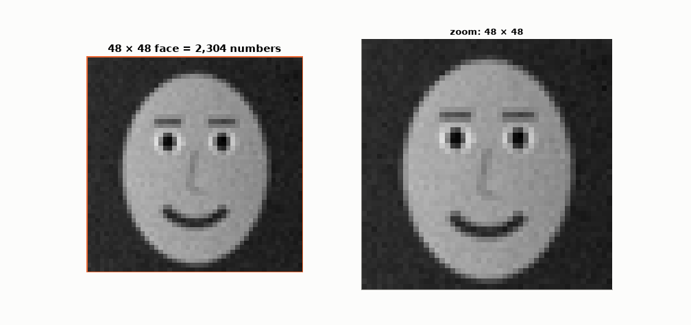
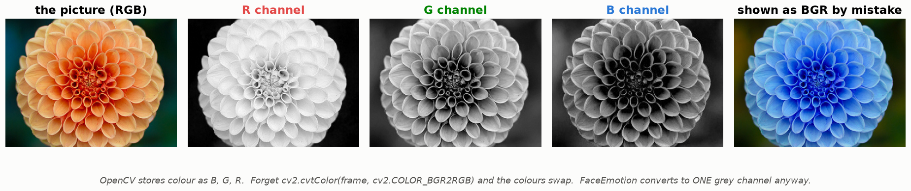
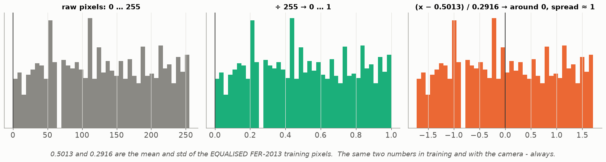
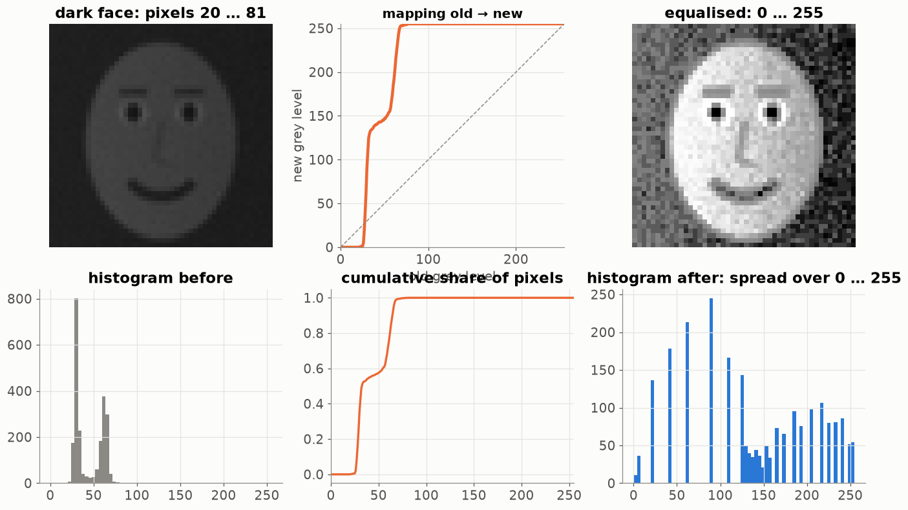

# Lesson 19 — How a computer sees a picture: pixels, normalisation, equalisation

> **For:** Ryan (FaceEmotion stages 2–3) &nbsp;·&nbsp; **Time:** 45 min
> **Before:** Lesson 02 (scaling) &nbsp;·&nbsp; **After this:** Lessons 20–22 (the network that reads these numbers)

## 🎯 By the end, the student can

1. Explain that a grey picture is a matrix of numbers 0–255 and a colour picture is three matrices.
2. Explain the BGR trap in OpenCV.
3. Normalise a pixel by hand with the project's numbers, and explain why the **same** numbers must be used in training
   and in real time.
4. Explain histogram equalisation with the cumulative-histogram picture, and why it is part of **both** paths.

---

## 1. Zoom in until you see numbers



*(The lessons draw their own faces: FER-2013 pictures may not be redistributed.)* A 48 × 48 grey face is **2,304 numbers**;
0 = black, 255 = white. The network never "sees a face" — it sees this table.

## 2. Colour = three tables — and the BGR trap



A colour picture has a red, a green and a blue table. **OpenCV stores them as B, G, R.** Show a camera frame with matplotlib
or Tkinter without `cv2.cvtColor(frame, cv2.COLOR_BGR2RGB)` and blue faces appear. FaceEmotion converts every face to one
grey channel (`cv2.COLOR_BGR2GRAY`) — colour doesn't tell us the emotion, and 1 channel = 3× less work.

## 3. Normalisation



```
pixel / 255.0               → 0 … 1
(x − 0.5013) / 0.2916       → mean ≈ 0, std ≈ 1          (Lesson 02: z-score)
```

By hand: pixel 200 → 200/255 = 0.784 → (0.784 − 0.5013)/0.2916 = **0.97**. Pixel 30 → 0.118 → **−1.31**.

0.5013 and 0.2916 are the mean and std of all FER-2013 **training** pixels **after equalisation**. They live in
`config.py` and are used everywhere. Use other numbers with the camera and the network gets values it never saw —
accuracy collapses with **no error message** (train/serve skew, the same bug as Lesson 18).

## 4. Histogram equalisation



A face in bad light has all its pixels squeezed into a narrow range (here 20…81). Equalisation maps every grey level
through the **cumulative histogram** (middle): crowded ranges are stretched, empty ranges skipped. Result: the pixels
spread over 0…255 — the dark face looks like a well-lit one.

```python
hist = np.bincount(img.ravel(), minlength=256)
cdf  = hist.cumsum()
lut  = round((cdf − cdf_min) / (N − cdf_min) × 255)       # what cv2.equalizeHist does
new  = lut[img]
```

⚠️ It is pre-processing, so it must happen in **training and in real time**. That is why Ryan's `dataset.py` has an
`EqualizeHist` transform in both `build_train_transform` and `build_eval_transform`, and
`test_eval_transform_matches_realtime_preprocessing` checks a face becomes the same numbers on both paths.
(This was a real bug fixed in the project in October 2026.)

## 5. Misconceptions

| Student says | Truth |
|---|---|
| "The network sees the face like we do" | It sees 2,304 numbers. Shift the light and every number changes. |
| "Normalising with the camera's own mean is more accurate" | It's skew. Use the saved training numbers. |
| "Equalisation is just for nicer pictures" | It's input pre-processing → part of the model's contract. |
| "Colour would help" | Not for FER-2013 (it's grey) — and 3× the work. |

## 6. Activities

1. **Pixel art (10 min).** Squared paper, 8 × 8: students write numbers 0–255 to draw a smiley; a neighbour shades it.
2. **By hand (5 min).** Normalise the pixels 0, 128, 255 with the project's numbers. (−1.72, 0.00, 1.71)
3. **Live:** in `13_FaceEmotion/02_examples/01_images_and_data.ipynb`, darken a face and run `cv2.equalizeHist`.

## 7. Check yourself

<details><summary>1. How many numbers does a 640 × 480 colour camera frame have?</summary>

640 × 480 × 3 = **921,600**.
</details>

<details><summary>2. Why were the normalisation numbers re-measured AFTER equalisation?</summary>

Because the network only ever sees equalised faces. The mean/std must describe the numbers that actually enter the network.
</details>

<details><summary>3. The model is great on the test set but bad with the camera. First two things to check?</summary>

That the camera path does exactly the same pre-processing (grey, crop, resize to 48, equalise, ÷255, same mean/std), and
that `model.eval()` was called (Lesson 23).
</details>

## 8. In your project

| Project | Where |
|---|---|
| FaceEmotion | `app/vision/preprocessor.py` → `FacePreprocessor.crop_face`, `to_model_input`, `process` · `app/ml/dataset.py` → `EqualizeHist`, `build_train_transform`, `build_eval_transform` · `config.py` → `NORMALIZE_MEAN/STD` · theory `13_FaceEmotion/01_theory/03_images_nn.md` §3 · notebook `01_images_and_data.ipynb` |

## 🎬 Watch & explore

* Computerphile — *Digital Images* / *How JPEG works* — [search on YouTube](https://www.youtube.com/results?search_query=Computerphile+digital+images+pixels)
* Setosa — [Image Kernels explained visually](https://setosa.io/ev/image-kernels/) (also for Lesson 22)
* OpenCV docs — [Histogram equalization](https://docs.opencv.org/4.x/d5/daf/tutorial_py_histogram_equalization.html)
