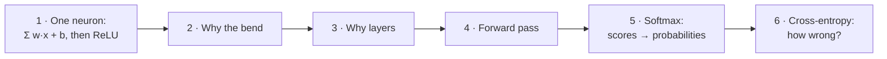
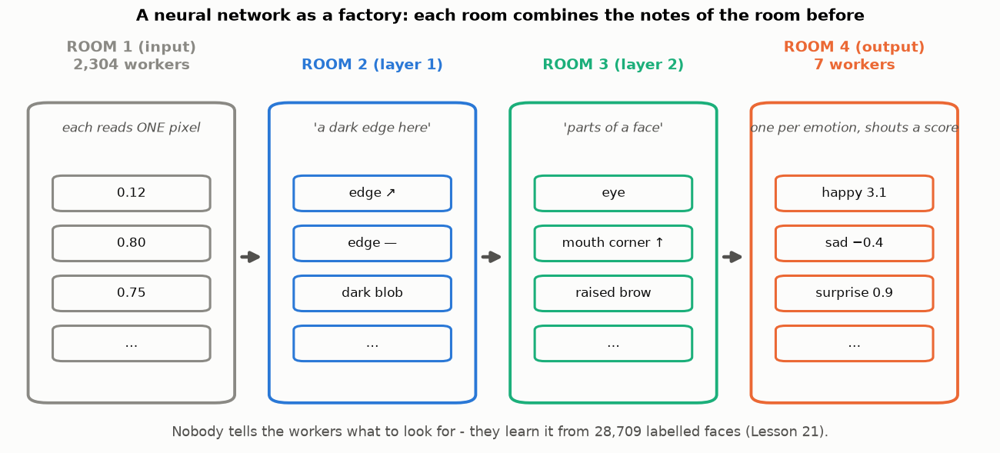
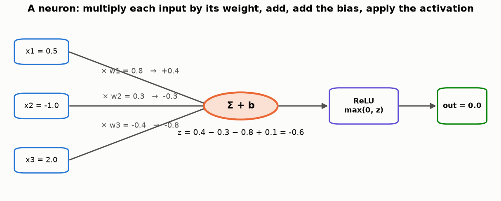
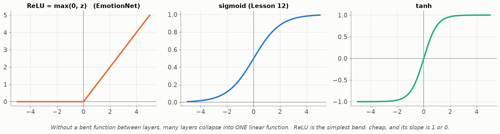
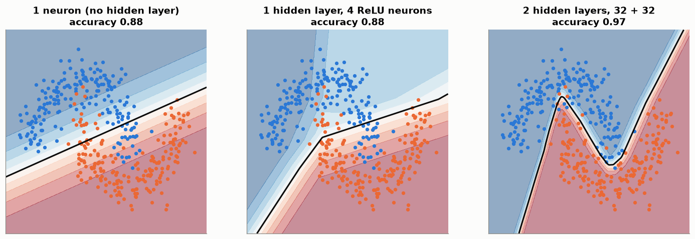
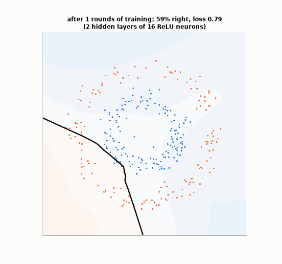
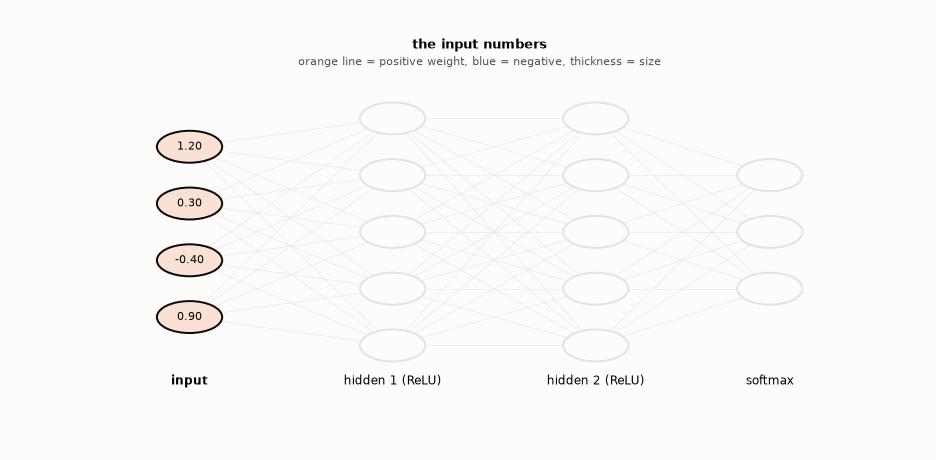
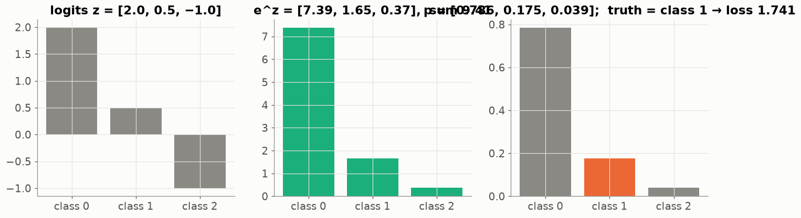
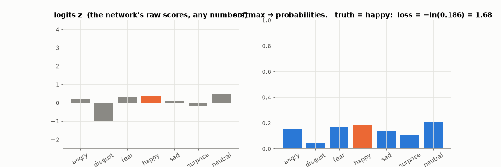

# Lesson 20 — A neural network from zero: neurons, layers, softmax, cross-entropy

> **For:** Ryan (FaceEmotion stage 3) · background for everyone &nbsp;·&nbsp; **Time:** 3 × 45 min
> **Before:** Lesson 00 §5, §8; Lessons 12 (logistic regression), 19 &nbsp;·&nbsp; **After this:** Lessons 21, 22

**In one sentence:** a neural network is many tiny "multiply, add, bend" units arranged in layers, each layer building
more complex clues from the one before, ending in one score per class that softmax turns into probabilities.

## 🗺️ The map of this lesson



## The story

> Ryan's little sister asks: *"How can a computer know that a face is happy?"* Ryan explains with a **factory**. At the
> door, 2,304 workers each look at one pixel. They pass notes to the next room, where each worker combines a few notes:
> *"I see a dark curve here"*. The next room combines those: *"the corners of the mouth go up"*. The last room has 7
> workers — one per emotion — who each shout how sure they are. Nobody told the workers what to look for: they **learned**
> it from 28,709 labelled faces. Each worker is a **neuron**, each room a **layer**, the factory a **neural network**.



### 🌍 Real world

Neural networks are behind most "smart" things you use: **face unlock**, **voice assistants** (Siri, Google), **Google
Translate**, **photo search** ("show me my photos of dogs"), self-driving features in cars, and chatbots like ChatGPT and
Claude. All of them are built from the same small unit you'll compute by hand in Part 1 — just billions of them.

**Is it a brain?** The name comes from brain cells (neurons), which receive signals and "fire" when the total is strong
enough. Artificial neurons borrow only that idea; a network is a lot of simple arithmetic, not a thinking brain.

## Words you need

| word | meaning | factory |
|---|---|---|
| **neuron** | weighted sum of its inputs + bias, then an activation | one worker |
| **weight** | how much the neuron listens to one input (Lesson 12) | how much she trusts each note |
| **bias** | the neuron's starting point | her mood before reading notes |
| **activation (ReLU)** | ReLU(z) = max(0, z): negatives become 0 | "if I have nothing positive to say, I say nothing" |
| **layer** | many neurons side by side, all reading the same inputs | one room |
| **logits** | the raw scores of the last layer, any numbers | the last room's shouts |
| **softmax** | turns the logits into probabilities that add up to 1 | |
| **cross-entropy** | the loss: −ln(probability given to the correct emotion) | |

---

## 1. One neuron



Ryan's guide, by hand. Inputs x = (0.5, −1.0, 2.0), weights w = (0.8, 0.3, −0.4), bias b = 0.1:

```
step 1  multiply each input by its weight:   0.5 × 0.8 = 0.4      −1.0 × 0.3 = −0.3      2.0 × (−0.4) = −0.8
step 2  add them and the bias:               z = 0.4 − 0.3 − 0.8 + 0.1 = −0.6
step 3  activation ReLU:                     max(0, −0.6) = 0
```

The neuron says **0** — "nothing to report". It's the same weighted sum as logistic regression (Lesson 12); only the last
step is a different "squash".

## 2. Why the bend (activation)?



Without an activation, two layers in a row are just "multiply and add" twice — which is again "multiply and add": one
layer. However many layers you stack, you'd get a single straight-line model. A **bend** after each layer lets the network
build curved, complicated decisions. ReLU is the simplest bend: keep positive numbers, turn negatives into 0.

## 3. Why layers?



* 1 neuron: one straight line → 88 % on this curved problem.
* 1 hidden layer of 4 ReLU neurons: a few straight pieces glued together.
* 2 layers of 32: follows the curve → 97 %.

### Watch a network learn a curved border

Two hidden layers of 16 ReLU neurons, trained on dots in two rings (blue inside, orange outside). A straight line could
never separate them:



At first the border is meaningless; after a few hundred rounds it wraps around the inner ring. Look closely: the border is
made of **straight pieces** — each ReLU neuron contributes one "fold", and many folds make a curve.

Each layer builds new, more complex features from the previous layer's features. In a face network: edges → eyes and
mouth corners → whole expressions (Lesson 22).

## 4. Watch numbers flow through a network



Left to right: every circle = weighted sum of the previous layer + bias, then ReLU (many become exactly 0). The last layer
gives one number per class; softmax turns them into probabilities. This left-to-right computation is the **forward pass**.

## 5. Softmax — from scores to probabilities

The last layer gives **logits** — any numbers, e.g. (2.0, 0.5, −1.0) for 3 classes. We need probabilities: all positive,
adding up to 1.

$$p_i = \frac{e^{z_i}}{e^{z_1} + e^{z_2} + e^{z_3}}$$



**Step by step:**

```
1. e to the power of each logit (Lesson 00 §8):   e^2.0 = 7.389    e^0.5 = 1.649    e^(−1.0) = 0.368
   → all positive now; bigger logits grow much faster
2. add them:                                       7.389 + 1.649 + 0.368 = 9.406
3. divide each by the total:                       7.389/9.406 = 0.785   1.649/9.406 = 0.175   0.368/9.406 = 0.039
check: 0.785 + 0.175 + 0.039 = 0.999 ≈ 1 ✓
```

## 6. Cross-entropy — how wrong were we?

$$L = -\ln(\text{probability given to the correct class})$$

If the truth is class 1 (probability 0.175): L = −ln(0.175) = **1.743**. If the network had given it 0.9: L = −ln(0.9) =
0.105. It's Dani's log-loss (Lesson 12) for many classes: confident and wrong → big loss.



During training the "happy" logit is pushed up, its probability rises, the loss falls toward 0.

**A beautiful result (for the defence):** for softmax + cross-entropy, how much each logit should change is simply
**p − y** (y = 1 for the correct class, 0 for the others):

```
p = (0.785, 0.175, 0.039),   truth = class 1 → y = (0, 1, 0)
p − y = (0.785, −0.825, 0.039)
→ push the correct logit UP (its value is negative), push the others DOWN by the probability they wrongly got
```

That's why PyTorch joins them in one layer — `nn.CrossEntropyLoss` takes the **logits** — and why Ryan's `forward()` returns
logits; softmax is applied only to display the percentages.

## 🧪 Worked example: one neuron, softmax and cross-entropy in numpy

```python
import numpy as np

# Part 1: one neuron
x = np.array([0.5, -1.0, 2.0])
w = np.array([0.8, 0.3, -0.4])
b = 0.1
z = x @ w + b
print("z =", round(z, 2), " ReLU =", max(0.0, z))          # z = -0.6  ReLU = 0.0

# Part 5: softmax
logits = np.array([2.0, 0.5, -1.0])
p = np.exp(logits) / np.exp(logits).sum()
print("softmax =", p.round(3))                             # [0.786 0.175 0.039]

# Part 6: cross-entropy when the truth is class 1
print("loss =", round(-np.log(p[1]), 3))                   # 1.741
print("p - y =", (p - np.array([0, 1, 0])).round(3))       # [ 0.786 -0.825  0.039]
```

(The hand calculation rounds to 3 digits on the way, so it gets 0.785 and 1.743; numpy keeps every digit: 0.786 and 1.741.)

## 7. Common mistakes

| student says | the truth |
|---|---|
| "Put softmax in forward() *and* use CrossEntropyLoss — double safe" | Softmax twice → a wrong loss and slow learning. |
| "0.9 probability = right 90 % of the time" | Only if the model is calibrated (Lessons 14, 24). |
| "ReLU(−0.6) = −0.6" | 0. Negative in → 0 out. |
| "More layers are always better" | More layers need more data and time, and can overfit (Lessons 23, 24). |

## 📝 Summary

> * A **neuron**: z = Σ wᵢxᵢ + b, then a bend — **ReLU** = max(0, z).
> * Without bends, any number of layers = one straight line. Bends + layers → curved, complex decisions.
> * **Forward pass**: compute layer by layer, left to right.
> * The last layer gives **logits**; **softmax** eᶻ ÷ Σeᶻ turns them into probabilities that add to 1.
> * **Cross-entropy** = −ln(p of the correct class); its push on the logits is simply **p − y**.
> * `forward()` returns logits; `nn.CrossEntropyLoss` does softmax inside.

## 8. Activities

1. **Human neurons (15 min).** 3 "input" students hold numbers; 2 "hidden" students have weight cards, compute their sum,
   apply ReLU and pass it on; 1 "output" student adds up. Change one weight — what changes downstream?
2. **Softmax by hand (10 min).** z = (1, 0, −1).
3. **TensorFlow Playground (10 min).** The spiral data: 0 hidden layers vs 2 layers of 8 neurons; ReLU vs linear.

## 9. Do it yourself

<details><summary>1. Inputs (1, 2), weights (0.5, −1), bias 0.5. Output after ReLU?</summary>

0.5 − 2 + 0.5 = −1 → ReLU = **0**.
</details>

<details><summary>2. Softmax of (1, 0, −1).</summary>

e¹ = 2.718, e⁰ = 1, e⁻¹ = 0.368, total 4.086 → **(0.665, 0.245, 0.090)**.
</details>

<details><summary>3. Logits (3, 3, 3). Softmax, and the loss if the truth is class 0?</summary>

All equal → (⅓, ⅓, ⅓); loss = −ln ⅓ = **1.099**. For 7 emotions: ln 7 = 1.946 — the loss of pure guessing, a useful number
to recognise at the start of training.
</details>

<details><summary>4. 🟢 ReLU of −3, 0 and 2.5?</summary>

**0, 0, 2.5**.
</details>

<details><summary>5. 🟡 Add 10 to every logit: (12, 10.5, 9). Does softmax change?</summary>

No — e^(z+10) = e^z × e^10, and the e^10 cancels in the division. Softmax only cares about the **differences** between
logits. (Real code subtracts the largest logit first for exactly this reason: it avoids overflow.)
</details>

<details><summary>6. 🟡 A layer has 2,304 inputs and 64 neurons. How many weights and biases?</summary>

2,304 × 64 = **147,456** weights + **64** biases.
</details>

<details><summary>7. 🔴 Show that two layers without activation are one layer: y = W₂(W₁x).</summary>

W₂(W₁x) = (W₂W₁)x — multiplying two matrices gives one matrix, so it's a single linear layer. That's why we need the bend.
</details>

## 10. In your project

| Project | Where |
|---|---|
| FaceEmotion | `app/ml/network.py` → `EmotionNet.forward` (returns logits) · `app/ml/predictor.py` → `predict` (softmax for display) · `trainer.py` → `nn.CrossEntropyLoss` · theory `13_FaceEmotion/01_theory/03_images_nn.md` §4.1–4.4, 4.9 · notebook `02_neurons_to_resnet.ipynb` |

## 🎬 Watch & explore

| | |
|---|---|
| <a href="https://www.youtube.com/watch?v=aircAruvnKk"></a> | **3Blue1Brown — But what is a neural network?** (19 min). Layers of neurons recognising handwritten digits — the best visual explanation there is. Watch first. |
| <a href="https://www.youtube.com/watch?v=CqOfi41LfDw"></a> | **StatQuest — The Essential Main Ideas of Neural Networks**. How bent pieces add up to a curve (Part 3). |
| <a href="https://www.youtube.com/watch?v=KpKog-L9veg"></a> | **StatQuest — Neural Networks Part 5: ArgMax and SoftMax**. Part 5, slowly. |

**Play with it:**
* TensorFlow Playground — [playground.tensorflow.org](https://playground.tensorflow.org/)
* 3Blue1Brown — [Neural networks lessons](https://www.3blue1brown.com/topics/neural-networks)
