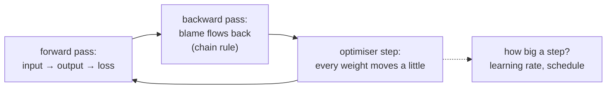
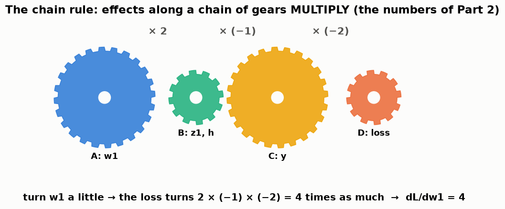
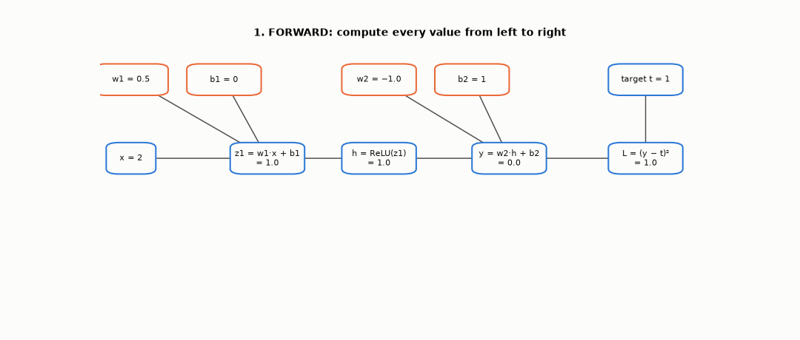
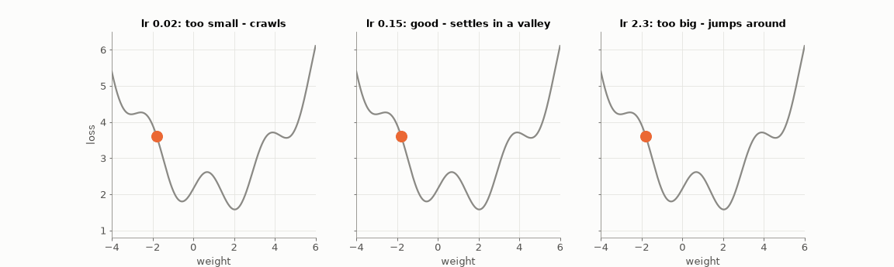
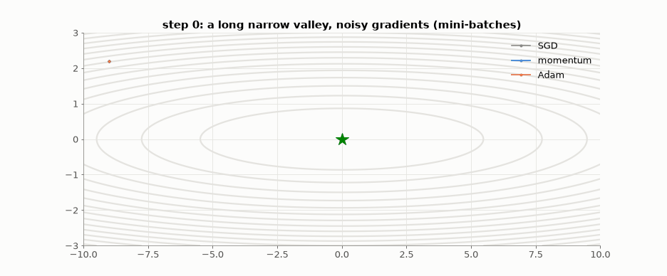
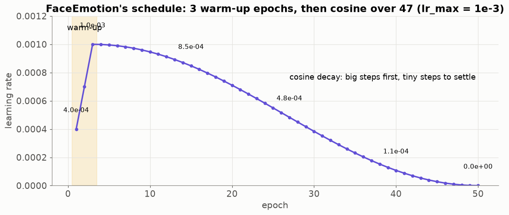
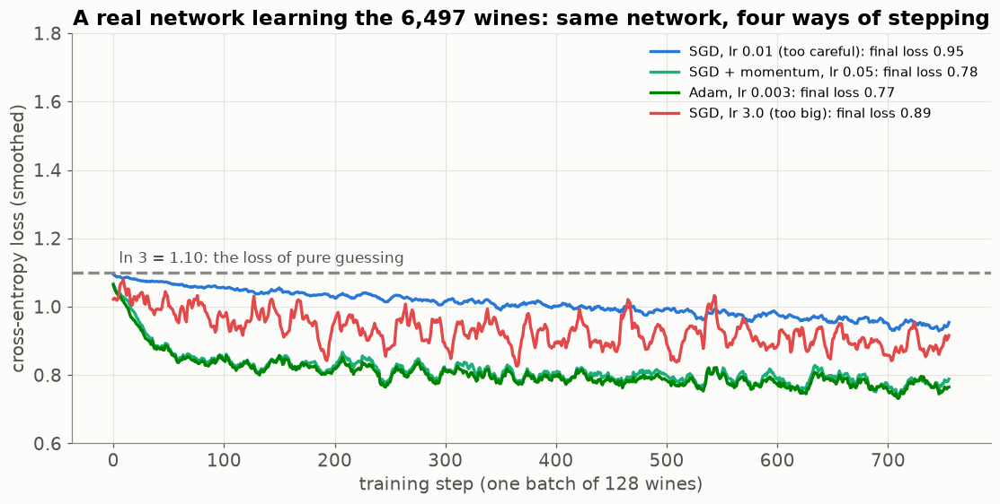

# Lesson 21 — How a network learns: backpropagation, optimisers and the learning-rate schedule

> **For:** Ryan (FaceEmotion stage 4 — the training loop) &nbsp;·&nbsp; **Time:** 3 × 45 min
> **Before:** Lesson 00 §9 (slope); Lessons 12 (gradient descent), 20 &nbsp;·&nbsp; **After this:** Lesson 24

**In one sentence:** after each wrong answer, backpropagation passes the blame backwards through the network to find how
every weight should change, and the optimiser moves every weight a small step in that direction — a million times.

## 🗺️ The map of this lesson



## The story

> Back in Ryan's factory (Lesson 20): a smiling face came in, and the last room shouted "sad". Wrong. Someone has to tell
> **each worker** how to change their habits — but which workers caused the mistake, and by how much? The boss starts at
> the end: *"Sad-shouter, you were too loud. Who gave you your notes? You, and you — your notes pushed toward sad, so
> change them a bit."* Each worker passes the blame **backwards** to whoever fed them, in proportion to how much they
> mattered. That is **backpropagation**. Then every worker adjusts a little — that's one **step** of training. Repeat a
> million times.

### 🌍 Real world: learning from mistakes, step by step

* **Throwing darts:** you miss to the left, so next time you aim a little to the right — not all the way to the right, a
  little. That's one gradient step.
* **The shower:** too cold → turn the knob. Turn it too far (a too-big learning rate) and it's boiling, so you turn back too
  far again — the loss goes up and down.
* **A sports team after a lost match:** the coach doesn't blame everyone equally; each player's share of the blame depends on
  how much they affected the result. That's backpropagation.

## Words you need

| word | meaning |
|---|---|
| **forward pass** | computing the output from the input, left to right (Lesson 20) |
| **loss** | how wrong the output is (Lessons 12, 20) |
| **gradient / slope / derivative** | for one weight: "if I increase this weight a tiny bit, how much does the loss change?" (Lesson 00 §9) |
| **chain rule** | when A affects B and B affects C: (effect of A on C) = (effect of A on B) × (effect of B on C) |
| **backward pass / backpropagation** | computing every weight's gradient, from the loss back to the input |
| **learning rate (lr)** | how big a step each weight takes |
| **batch, step, epoch** | a group of examples · one update · one pass over all training examples |
| **optimiser** | the rule that turns gradients into weight changes (SGD, momentum, Adam) |

---

## 1. The chain rule — gears

Three gears in a row. Turn gear A once → gear B turns 2 times. Gear B once → gear C turns 3 times. How many times does C
turn when A turns once? **2 × 3 = 6**. Effects along a chain **multiply**. That's the chain rule — the only maths behind
backpropagation. With the numbers of Part 2:



## 2. Backpropagation with numbers



The guide's network: one input, one hidden ReLU neuron, one output, squared loss L = (y − t)².

### Forward (left to right)

```
x = 2,   w1 = 0.5, b1 = 0,   w2 = −1.0, b2 = 1,   target t = 1
z1 = w1 × x + b1 = 0.5 × 2 + 0 = 1.0
h  = ReLU(z1)    = 1.0
y  = w2 × h + b2 = −1 × 1 + 1  = 0.0
L  = (y − t)²    = (0 − 1)²    = 1.0
```

### Backward (right to left) — "how does L change if I nudge each thing?"

```
dL/dy  = 2 × (y − t) = 2 × (0 − 1) = −2          (from L = (y − t)²: the slope of a square is 2 × the inside)
   → y is too small; raising y would lower the loss

dL/dw2 = dL/dy × h   = −2 × 1.0 = −2              (y = w2·h + b2: nudging w2 changes y by h)
dL/db2 = dL/dy × 1   = −2
dL/dh  = dL/dy × w2  = −2 × (−1) = +2             (nudging h changes y by w2)
dL/dz1 = dL/dh × 1   = +2                         (ReLU's slope is 1 when z1 > 0, else 0)
dL/dw1 = dL/dz1 × x  = 2 × 2 = 4                  (z1 = w1·x + b1: nudging w1 changes z1 by x)
dL/db1 = dL/dz1 × 1  = 2
```

Each line is one gear: "how much the next thing changes" × "how much the loss cares about the next thing".

### Update: step downhill (lr = 0.1)

```
w1 = 0.5 − 0.1 × 4    = 0.1          b1 = 0 − 0.1 × 2     = −0.2
w2 = −1 − 0.1 × (−2)  = −0.8         b2 = 1 − 0.1 × (−2)  = 1.2
```

### Check: forward again

```
z1 = 0.1 × 2 − 0.2 = 0.0     h = 0     y = −0.8 × 0 + 1.2 = 1.2     L = (1.2 − 1)² = 0.04
```

The loss fell from **1.0 to 0.04** in one step. EmotionNet does exactly this — for 4.9 million weights at once, averaged
over 128 faces.

⚠️ Notice h became exactly 0. If z1 goes negative, ReLU's slope is 0 and that neuron stops learning ("dead ReLU") — one
reason for BatchNorm (Lesson 23) and a gentle start (warm-up, §5).

**In PyTorch** — the three lines of every training step:

```python
optimizer.zero_grad()      # erase last step's gradients (otherwise they ADD UP)
loss.backward()            # backpropagation: fill in every weight's gradient
optimizer.step()           # move every weight a little downhill
```

## 3. The learning rate



Too small: crawls. Good: walks into a valley and settles. Too big: jumps over valleys, the loss goes up and down — or
becomes `nan`. Also: gradient descent finds **a** valley, not necessarily the deepest one.

## 4. Better steps: momentum and Adam



A long narrow valley, with noisy gradients (each batch gives a slightly different slope):

| optimiser | idea | analogy |
|---|---|---|
| **SGD** | w = w − lr × gradient | a careful walker: crawls along the valley floor |
| **momentum** | keep a running average of the gradients | a heavy ball: keeps rolling, smooths the noise |
| **Adam** | momentum **and** each weight gets its own step size | a ball that also adjusts its speed per direction |

**AdamW** (Ryan's optimiser) = Adam + **weight decay**: every step, pull each weight a tiny bit toward 0 (w = w − lr × λ ×
w, λ = 0.0001) — a brake against memorising, like C in Lesson 12.

## 5. The learning-rate schedule — warm-up, then cosine



```
epochs 1–3 (warm-up):     lr = lr_max × (0.1 + 0.9 × t / 3)          rises from 10 % to 100 % of 0.001
epochs 4–50 (cosine):     lr = 0.5 × lr_max × (1 + cos(π × t / 47))  falls smoothly to 0
```

Start gently (random weights → wild gradients); big steps in the middle to travel; tiny steps at the end to settle into
the bottom instead of shaking around it.

## 6. Watch a real network train

The same small network (11 → 32 → 32 → 3) learning the wine grades, with four different ways of stepping:



* **SGD with a tiny lr** (blue) barely moves away from "pure guessing" (1.10).
* **SGD with lr 3.0** (red) jumps around — the shower knob turned too far each time.
* **Momentum** and **Adam** (greens) go down fastest and smoothest.

## 7. Batches, steps, epochs

| word | FaceEmotion |
|---|---|
| batch | 128 faces; the gradient is the **average** over them |
| step | one `zero_grad → backward → step` |
| epoch | one pass over all 28,709 training faces ≈ 225 steps |

## 8. Common mistakes

| student says | the truth |
|---|---|
| "`backward()` updates the weights" | It only computes gradients. `step()` updates. |
| "I can skip `zero_grad()`" | Gradients pile up — each step uses the sum of all previous batches. |
| "Loss became `nan`, the data is broken" | Usually the learning rate is too high. Lower it first. |
| "Backprop is a different algorithm from gradient descent" | Backprop **computes** the slopes; gradient descent **uses** them. |

## 🧪 Worked example: Part 2 in PyTorch — let the computer check your hand calculation

```python
import torch

x, t = torch.tensor(2.0), torch.tensor(1.0)
w1 = torch.tensor(0.5, requires_grad=True);  b1 = torch.tensor(0.0, requires_grad=True)
w2 = torch.tensor(-1.0, requires_grad=True); b2 = torch.tensor(1.0, requires_grad=True)

y = w2 * torch.relu(w1 * x + b1) + b2          # forward
loss = (y - t) ** 2
loss.backward()                                 # backward: PyTorch does the chain rule for you
print(loss.item(), w1.grad.item(), b1.grad.item(), w2.grad.item(), b2.grad.item())   # 1.0 4.0 2.0 -2.0 -2.0

with torch.no_grad():                           # the update, lr = 0.1
    for p in (w1, b1, w2, b2):
        p -= 0.1 * p.grad
y = w2 * torch.relu(w1 * x + b1) + b2
print("loss after one step:", round(((y - t) ** 2).item(), 2))                       # 0.04
```

## 📝 Summary

> * **Chain rule**: effects along a chain multiply (gears).
> * **Backprop**: starting from the loss, compute every weight's slope, right to left.
> * **Update**: w ← w − lr × slope. In PyTorch: `zero_grad()`, `backward()`, `step()`.
> * **Learning rate**: too small crawls, too big jumps. **Momentum** smooths, **Adam** adapts per weight, **AdamW** adds a
>   brake (weight decay).
> * **Schedule**: warm up gently, big steps in the middle, tiny steps at the end (cosine).

## 9. Activities

1. **Gears (5 min).** Real gears or drawn ones: count turns; multiply ratios.
2. **The chain on paper (20 min).** Repeat §2 with x = 1 (everything else the same).
3. **Heavy ball (5 min).** A marble and a heavier ball down a bent ruler with a small bump: which one gets past? (momentum)
4. **Break it (10 min).** In `03_training_loop.ipynb`: lr = 1.0; remove `zero_grad()`; forget `eval()`.

## 10. Do it yourself

<details><summary>1. §2 with x = 1: forward pass and the gradient of w1.</summary>

z1 = 0.5 · h = 0.5 · y = −0.5 + 1 = 0.5 · L = 0.25 · dL/dy = 2(0.5 − 1) = −1 · dL/dh = −1 × (−1) = 1 · dL/dz1 = 1 ·
dL/dw1 = 1 × x = **1**.
</details>

<details><summary>2. Training loss goes down, validation loss goes up. Is the optimiser broken?</summary>

No — overfitting (Lessons 01, 24). It's doing its job on the training data too well.
</details>

<details><summary>3. Warm-up at epoch 2 with lr_max = 0.001?</summary>

0.001 × (0.1 + 0.9 × 2/3) = 0.001 × 0.7 = **0.0007**.
</details>

<details><summary>4. 🟢 A weight is 0.3, its gradient is −0.5, lr = 0.2. The new weight?</summary>

0.3 − 0.2 × (−0.5) = 0.3 + 0.1 = **0.4** (negative slope → increasing the weight lowers the loss → go up).
</details>

<details><summary>5. 🟡 28,709 faces, batch 128. Steps per epoch? Steps in 50 epochs?</summary>

28,709 ÷ 128 = 224.3 → **225** steps (the last batch is smaller). × 50 = **11,250** steps.
</details>

<details><summary>6. 🔴 Gears: A → B ×3, B → C ×0 (a ReLU that is "off"), C → loss ×5. dLoss/dA?</summary>

3 × 0 × 5 = **0** — the whole chain is blocked by the dead ReLU; A gets no learning signal. That's the "dead ReLU" problem.
</details>

## 11. In your project

| Project | Where |
|---|---|
| FaceEmotion | `app/ml/trainer.py` → `ModelTrainer.__init__` (AdamW, scheduler), `train_one_epoch` (the 3 lines), `validate`, `fit`, `plot_history` · theory `13_FaceEmotion/01_theory/03_images_nn.md` §4.5, 4.7–4.11 · notebook `03_training_loop.ipynb` |
| PhishGuard | the same step by hand: exercises `ex07_gradient`, `ex08_fit_logistic` (Lesson 12) |

## 🎬 Watch & explore

| | |
|---|---|
| <a href="https://www.youtube.com/watch?v=IHZwWFHWa-w"></a> | **3Blue1Brown — Gradient descent, how neural networks learn**. The loss landscape and walking downhill. |
| <a href="https://www.youtube.com/watch?v=Ilg3gGewQ5U"></a> | **3Blue1Brown — Backpropagation, intuitively**. Blame flowing backwards — the factory boss of the story. |
| <a href="https://www.youtube.com/watch?v=tIeHLnjs5U8"></a> | **3Blue1Brown — Backpropagation calculus**. The chain rule of Part 2 with symbols — for the defence. |
| <a href="https://www.youtube.com/watch?v=VMj-3S1tku0"></a> | **Andrej Karpathy — building micrograd** (2.5 hours). Backprop written from scratch in Python. For the very curious. |

**Read more:**
* Distill — [Why Momentum Really Works](https://distill.pub/2017/momentum/) — interactive.
