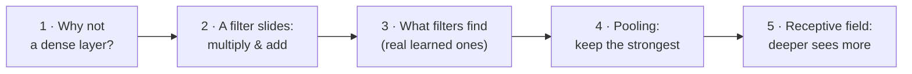
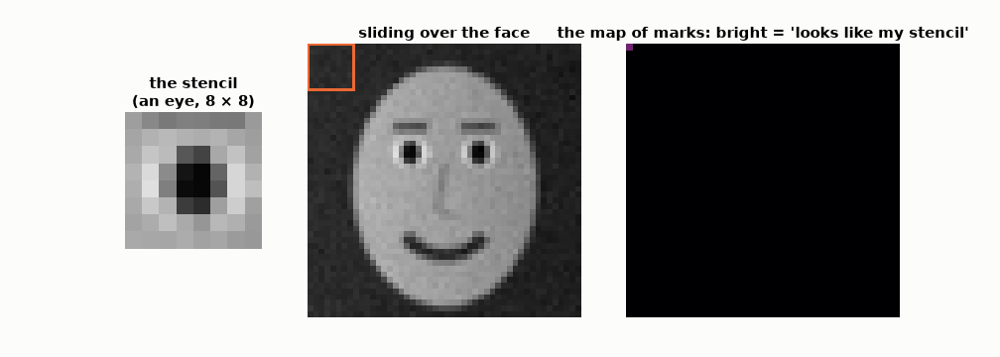
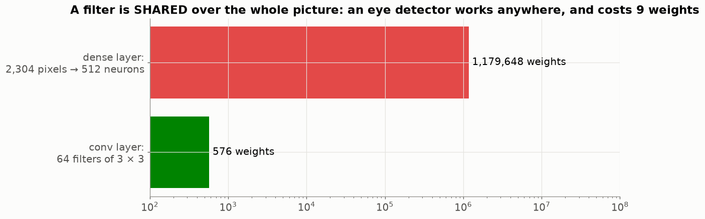
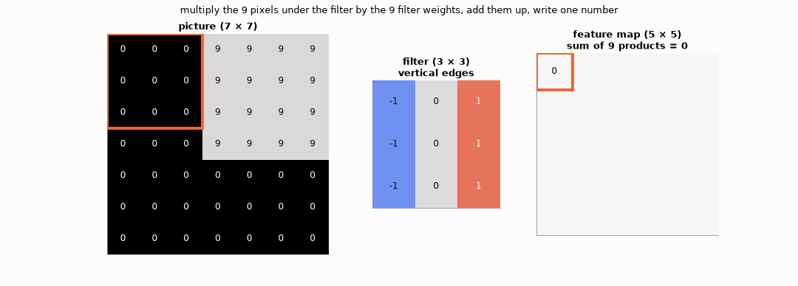
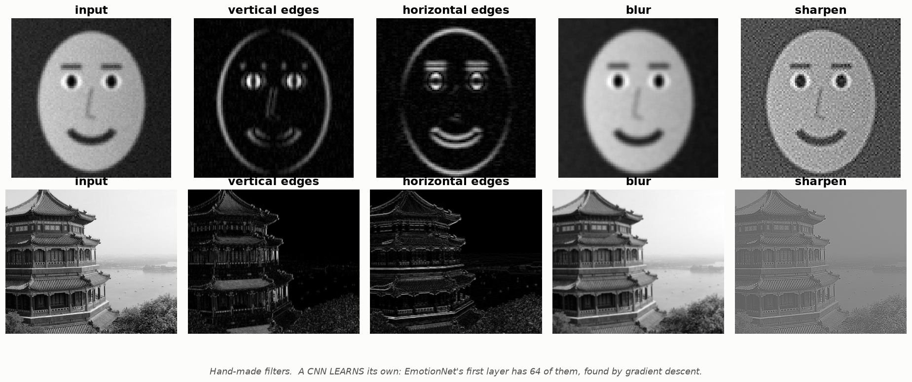
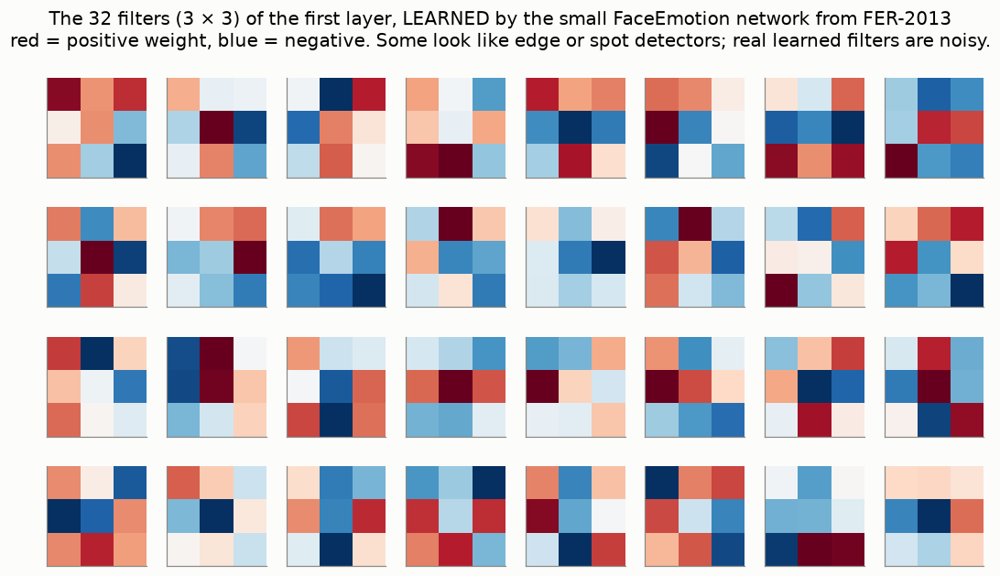
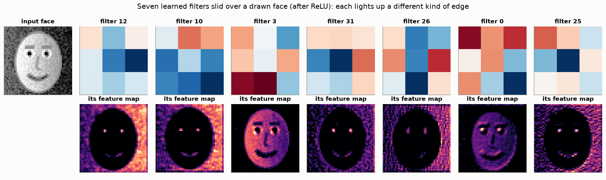
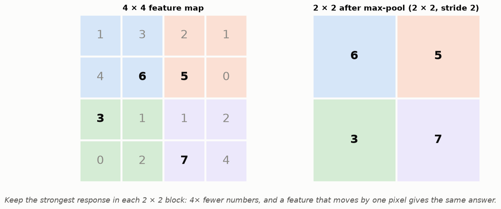
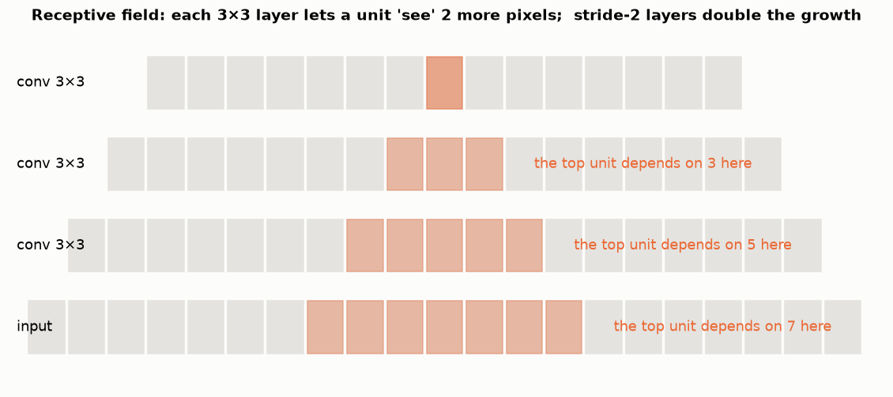

# Lesson 22 — Convolution: a small stencil that slides over the picture

> **For:** Ryan (FaceEmotion — EmotionNet) &nbsp;·&nbsp; **Time:** 2 × 45 min
> **Before:** Lessons 19, 20 &nbsp;·&nbsp; **After this:** Lesson 23

**In one sentence:** instead of one giant layer looking at all pixels at once, a CNN slides small stencils (filters) over
the picture, making maps of where each pattern appears — and stacks of such layers see edges, then face parts, then
expressions.

## 🗺️ The map of this lesson



## The story

> A detective looks for a **smile** in a big photo. She doesn't stare at the whole photo at once: she takes a small
> **stencil** cut in the shape of a mouth corner and **slides it** over the photo, square by square, asking at each spot
> *"does this patch look like my stencil?"*. Where it matches, she makes a mark. At the end she has a **map of marks**:
> where the mouth corners are. A convolutional network does the same with thousands of stencils — and it invents the
> stencils itself, from the training faces.

Here is the detective's search, for real: the stencil is an eye cut from a drawn face; at every position we measure "how
much does this patch look like the stencil?":



The map is brightest exactly on the **two eyes**. That's convolution.

### 🌍 Real world

* Every **photo filter** on your phone — blur, sharpen, "edge" effects — is a convolution with a hand-made stencil.
* **CNNs** read X-rays and skin photos in hospitals, find pedestrians for cars' emergency braking, unlock phones with your
  face, and sort photos by what's in them.
* The famous turning point: in **2012** a CNN called AlexNet won the ImageNet picture-recognition contest by a huge margin —
  and since then almost all computer vision uses CNNs (or their newer cousins).

## Words you need

| word | meaning | detective |
|---|---|---|
| **filter / kernel** | a small table of weights, e.g. 3 × 3 | the stencil |
| **convolution** | slide the filter over the picture; at each spot multiply and add | sliding and comparing |
| **feature map** | the output picture: one number per position | the map of marks |
| **padding** | an extra border of zeros so the output keeps the input's size | |
| **stride** | how many pixels the filter jumps each time (1 or 2) | |
| **pooling** | shrinking a map by keeping the strongest value in each small block | |
| **receptive field** | how much of the original picture one number "depends on" | |
| **CNN** | a network made mainly of convolution layers | |

---

## 1. Why not a normal (dense) layer?



A normal layer from 2,304 pixels to 512 neurons has **1.2 million** weights, and it must learn "an eye corner" separately
for every position in the picture. A filter is **shared**: one 3 × 3 eye-corner stencil (9 weights) is slid everywhere — an
eye corner is an eye corner wherever it is.

## 2. Watch a filter slide — and compute it



The filter:

```
−1  0  +1
−1  0  +1
−1  0  +1
```

It asks: *"is the right side of this 3 × 3 patch brighter than the left side?"* — a **vertical edge** detector.

**One output number, by hand.** The patch at the top-left of the edge:

```
patch:          filter:          multiply each pair:
 0  0  9        −1  0  +1         0×(−1)  0×0  9×(+1)   =  0  0  9
 0  0  9        −1  0  +1         0×(−1)  0×0  9×(+1)   =  0  0  9
 0  0  9        −1  0  +1         0×(−1)  0×0  9×(+1)   =  0  0  9
add all 9 products: 9 + 9 + 9 = 27        → a big number: an edge is here
```

On a flat patch (all 9) the −1s and +1s cancel: −9 − 9 − 9 + 9 + 9 + 9 = **0** → no edge.

Every output position gets one such number — that's the **feature map** (right side of the animation).

### Output size

A 3 × 3 filter fits in a 7 × 7 picture at 5 positions per row (columns 1–3, 2–4, …, 5–7) → output **5 × 5**. In general
`output = input − filter + 1`.

| on a 48 × 48 face, 3 × 3 filter | output |
|---|---|
| no padding | 48 − 3 + 1 = **46 × 46** (loses the border) |
| `padding=1` (a border of zeros) — EmotionNet | 48 + 2 − 3 + 1 = **48 × 48** (same size) |
| `stride=2` (jump 2 pixels) | about half: **24 × 24** |

## 3. What filters find



Hand-made filters on a drawn face and a photo: edge filters light up outlines (eyes, mouth, face contour); blur averages;
sharpen exaggerates differences. In a CNN nobody writes them — EmotionNet's first layer has **64 filters learned by
gradient descent** (Lesson 21), and they end up looking like edge and blob detectors.

With several input maps (e.g. 64 maps in), each filter is 3 × 3 × 64: it looks at the same 3 × 3 spot on all 64 maps and adds
everything up.

### The filters Ryan's network really learned

These are the 32 first-layer filters of the small network trained on FER-2013 in the project's notebook (`_smallnet.pt`).
Nobody designed them:



Slide a few of them over a drawn face (then ReLU):



Each one lights up a different thing — the face's outline, the eyes, the mouth, the left or right edges. The next layer
combines these 32 maps into more complex patterns.

## 4. Pooling — keep the strongest



Max-pooling 2 × 2: cut the map into 2 × 2 blocks; from each block keep only the **biggest** number.

```
block [1 3 / 4 6] → 6      block [2 1 / 5 0] → 5
block [3 1 / 0 2] → 3      block [1 2 / 7 4] → 7
```

4× fewer numbers, and if the feature moves by one pixel the answer stays the same. EmotionNet shrinks with stride-2
convolutions instead (48 → 24 → 12 → 6), and at the very end uses **global average pooling**: each of the 512 maps becomes
one number (its average).

## 5. The receptive field — how much does one number see?



A number in layer 1 depends on 3 × 3 pixels. A number in layer 2 depends on 3 × 3 numbers of layer 1 — each of which saw
3 × 3 pixels → together **5 × 5** pixels. Layer 3: 7 × 7. With stride 2 it grows even faster. So: early layers see edges,
middle layers see eyes and mouth corners, the last layers see the **whole face** — an expression.

## 🧪 Worked example: one convolution in numpy, checked against PyTorch

```python
import numpy as np
import torch

img = np.array([[0, 0, 0, 9, 9, 9, 9]] * 4 + [[0] * 7] * 3, dtype=float)    # the picture of Part 2
K = np.array([[-1, 0, 1], [-1, 0, 1], [-1, 0, 1]], dtype=float)            # vertical-edge filter

out = np.zeros((5, 5))                                   # 7 − 3 + 1 = 5
for i in range(5):
    for j in range(5):
        out[i, j] = (img[i:i + 3, j:j + 3] * K).sum()    # multiply the 9 pairs, add
print(out)

# PyTorch does the same thing (it calls it conv2d)
t = torch.nn.functional.conv2d(torch.tensor(img)[None, None], torch.tensor(K)[None, None])
print(np.allclose(t[0, 0].numpy(), out))                 # True

pooled = out[:4, :4].reshape(2, 2, 2, 2).max(axis=(1, 3))   # 2×2 max-pooling of the top-left 4×4
print(pooled)
```

## 6. Common mistakes

| student says | the truth |
|---|---|
| "Each position has its own filter" | One filter, shared everywhere — that's the point. |
| "The CNN looks for things I programmed" | It learns its filters from data. |
| "A 3 × 3 filter only sees 3 × 3" | In layer 1. Stacked layers see more. |
| "Convolution flips the filter" | In maths it does; in deep learning (and in PyTorch) it doesn't — it's really "cross-correlation". Same idea. |

## 📝 Summary

> * A **filter** (3 × 3 weights) slides over the picture; at each spot: multiply the 9 pairs, add → one number of the
>   **feature map**.
> * One filter is **shared** everywhere → few weights, and a pattern is found wherever it is.
> * Size: output = input − filter + 1; **padding 1** keeps the size; **stride 2** halves it.
> * **Pooling** keeps the strongest value per block → smaller, and tolerant to small shifts.
> * **Receptive field** grows with depth: edges → face parts → expressions.
> * The filters are **learned** (Lesson 21), not designed.

## 7. Activities

1. **Paper convolution (15 min).** A 6 × 6 grid of numbers and a 3 × 3 card with the filter. Slide it, compute the 4 × 4
   output. Then the horizontal-edge filter.
2. **Setosa (10 min).** [Image Kernels](https://setosa.io/ev/image-kernels/): try outline, sharpen, custom.
3. **CNN Explainer (15 min).** [poloclub.github.io/cnn-explainer](https://poloclub.github.io/cnn-explainer/): click any
   neuron and watch the convolution on a real network.

## 8. Do it yourself

<details><summary>1. Patch [5 5 5 / 5 5 5 / 5 5 5] with the vertical-edge filter.</summary>

−5 − 5 − 5 + 5 + 5 + 5 = **0** — flat, no edge.
</details>

<details><summary>2. A 12 × 12 map, 3 × 3 filter, padding 1, stride 2. Output size?</summary>

With padding the map is effectively 14 wide; positions every 2 pixels: ⌊(14 − 3) / 2⌋ + 1 = 5 + 1 = **6 × 6**.
</details>

<details><summary>3. Weights of one conv layer: 64 maps in, 128 filters out, 3 × 3, no bias.</summary>

3 × 3 × 64 × 128 = **73,728**.
</details>

<details><summary>4. 🟢 Blur filter: all nine weights are 1/9. Patch [0 0 9 / 0 0 9 / 0 0 9]. Output?</summary>

(9 + 9 + 9) ÷ 9 = **3** — the average of the patch.
</details>

<details><summary>5. 🟡 Max-pool 2 × 2 the map [[1, 5, 2, 0], [3, 2, 8, 1], [0, 0, 4, 4], [6, 1, 2, 9]].</summary>

Blocks: [1 5 / 3 2] → 5 · [2 0 / 8 1] → 8 · [0 0 / 6 1] → 6 · [4 4 / 2 9] → 9 → **[[5, 8], [6, 9]]**.
</details>

<details><summary>6. 🔴 Receptive field after three 3 × 3 layers with stride 1? After the third, if layer 2 has stride 2?</summary>

Stride 1: 3 → 5 → **7**. With stride 2 in layer 2, each later step adds 2 × 2 = 4 instead of 2: 3 → 5 → **9**.
</details>

## 9. In your project

| Project | Where |
|---|---|
| FaceEmotion | `app/ml/network.py` → the stem `Conv3x3 → BN → ReLU`, `ResidualBlock` (stride 2 to shrink), global average pooling · theory `13_FaceEmotion/01_theory/05_cnn.md` §5.1–5.3, 5.7 · notebook `02_neurons_to_resnet.ipynb` |

## 🎬 Watch & explore

* CNN Explainer — [interactive CNN](https://poloclub.github.io/cnn-explainer/)
| | |
|---|---|
| <a href="https://www.youtube.com/watch?v=KuXjwB4LzSA"></a> | **3Blue1Brown — But what is a convolution?** (23 min). Sliding and multiplying, including blur and edge filters on images. |
| <a href="https://www.youtube.com/watch?v=uihBwtPIBxM"></a> | **Computerphile — Finding the Edges (Sobel Operator)**. The edge filter of Part 2 on real photos. |

* Setosa — [Image Kernels explained visually](https://setosa.io/ev/image-kernels/)
