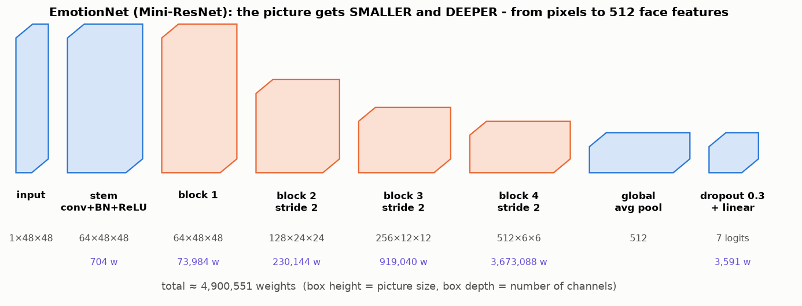
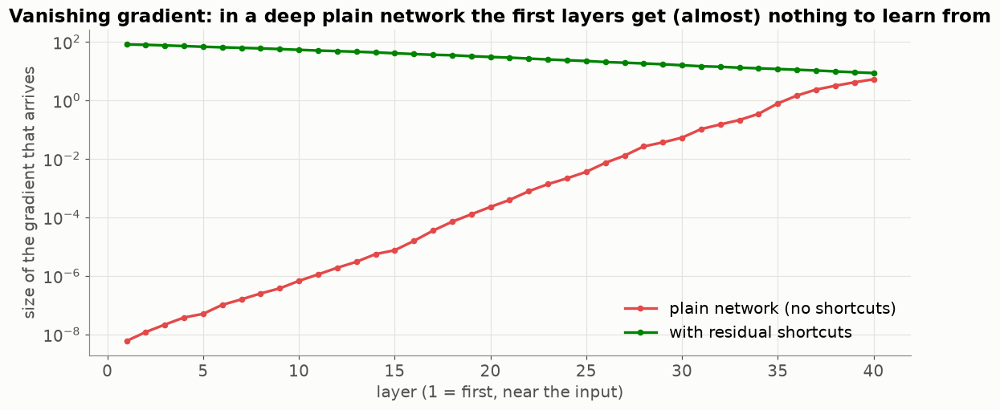
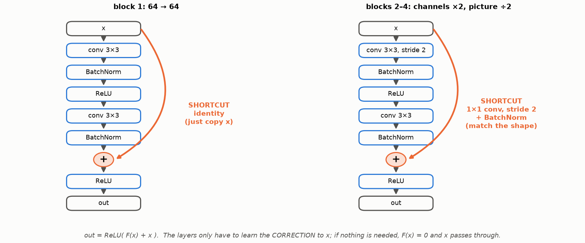
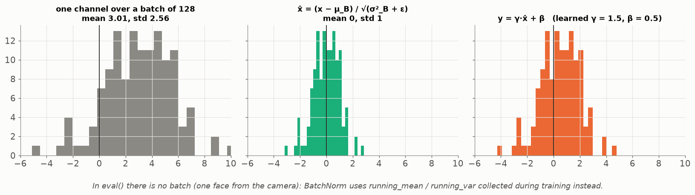
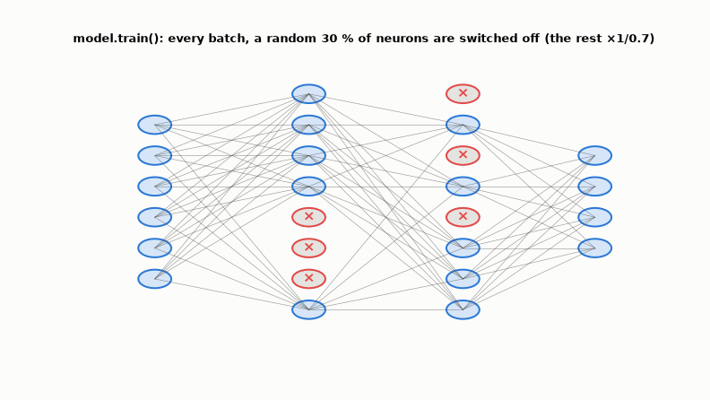

# Lesson 23 — EmotionNet: residual blocks, BatchNorm, Dropout, and `train()` vs `eval()`

> **For:** Ryan (FaceEmotion stage 3 — `network.py`) &nbsp;·&nbsp; **Time:** 45 – 60 min
> **Before:** Lessons 20–22 &nbsp;·&nbsp; **After this:** Lesson 24 (training), Lesson 26 (real time)

## 🎯 By the end, the student can

1. Draw EmotionNet with the shape after every block, and count the parameters of one block.
2. Explain the vanishing gradient and how the residual shortcut fixes it.
3. Explain when the shortcut needs a 1 × 1 convolution.
4. Explain BatchNorm and Dropout, and **exactly** what `model.eval()` changes.

---

## 1. The whole network



```
input           1 × 48 × 48
stem            Conv3x3 → BN → ReLU         64 × 48 × 48
block1          Residual(64 → 64,  s=1)     64 × 48 × 48
block2          Residual(64 → 128, s=2)    128 × 24 × 24
block3          Residual(128 → 256, s=2)   256 × 12 × 12
block4          Residual(256 → 512, s=2)   512 ×  6 ×  6
GlobalAvgPool                              512
Dropout(0.3) → Linear(512 → 7)               7 logits
```

The picture gets **smaller** (48 → 6) and **deeper** (1 → 512 channels): fewer positions, more kinds of features.
Total ≈ **4.9 million** weights — small enough for 25 fps, big enough for 65 %+.

**Counting one block (block 2) — be ready in the defence:**

```
conv 3×3, 64→128      9·64·128   =  73,728
BN(128)               2·128      =     256
conv 3×3, 128→128     9·128·128  = 147,456
BN(128)                          =     256
shortcut 1×1, 64→128  64·128     =   8,192
BN(128)                          =     256
                                   230,144
```

(Conv layers use `bias=False` because the BatchNorm right after has its own shift β.)

## 2. The problem ResNet solved — vanishing gradients



Before 2015, a 56-layer network trained **worse** than a 20-layer one — even on training data. Backprop multiplies one
factor per layer; many factors < 1 → almost nothing reaches the first layers (red). With shortcuts the gradient has a
direct path back (green).

## 3. The residual block



$$\text{out}=\text{ReLU}\big(F(x)+x\big)$$

* The layers learn only the **correction** to x. If nothing is needed, F(x) = 0 and x passes through unchanged.
* When the block halves the picture (stride 2) or changes the channels (64 → 128), `x` has the wrong shape to add → the
  shortcut becomes a **1 × 1 conv with stride 2 + BN** that only matches the shape
  (`test_residual_block_halves_with_stride_two`).

```python
identity = self.shortcut(x)            # nn.Identity() or 1x1 conv + BN
out = F.relu(self.bn1(self.conv1(x)))
out = self.bn2(self.conv2(out))
out = F.relu(out + identity)           # the jump
```

## 4. BatchNorm



For every channel, over the batch: subtract the mean, divide by the std (Lesson 02 again — *inside* the network), then let
the network rescale with learned γ, β. Keeps every layer's inputs in a healthy range → faster, more stable training, higher
learning rates possible. During training it also keeps **running averages** of mean and variance.

## 5. Dropout



In training, each batch randomly switches off 30 % of the neurons before the last layer (the rest are multiplied by
1/0.7). No neuron can rely on another — the network learns redundant, robust features. **0 parameters.**

## 6. `model.train()` vs `model.eval()` — the most-asked question

| | `train()` | `eval()` |
|---|---|---|
| Dropout | random 30 % off | everyone on |
| BatchNorm | normalises with **this batch's** mean/var, updates running averages | uses the **running** averages |

`eval()` does not "evaluate" anything — it is a switch. Forget it in real time and: Dropout makes every frame random, and
BatchNorm normalises **one face** by itself (variance 0) → nonsense. Always: `model.eval()` + `torch.no_grad()` for
inference.

## 7. Misconceptions

| Student says | Truth |
|---|---|
| "Deeper is always better" | Not without shortcuts — that was the 2015 surprise. |
| "The shortcut skips learning" | It skips *the need* to learn identity; the block still learns F(x). |
| "`eval()` turns off gradients" | No — that's `torch.no_grad()`. Use both for inference. |
| "Why not ResNet-50 from the internet?" | Built for 224 × 224 colour; 25 M weights slow real time; and the project requires understanding the architecture. (Valid alternative for the book.) |

## 8. Activities

1. **Telephone game (10 min).** Whisper a sentence through 10 students (a plain deep network) vs. the first student also
   writing it on a note passed directly to the last (the shortcut). Which one survives?
2. **Count (10 min).** Pairs compute block 3's parameters with the formulas. (919,040)
3. **Break it (10 min).** In `02_neurons_to_resnet.ipynb` / `04_detection_and_realtime.ipynb`, predict the same face 5
   times with `train()` and with `eval()`.

## 9. Check yourself

<details><summary>1. Block 4 input 256 × 12 × 12, stride 2, 512 filters. Output shape?</summary>

512 × 6 × 6.
</details>

<details><summary>2. Why does block 1 not need a 1 × 1 shortcut?</summary>

Input and output are both 64 × 48 × 48, so `x` can be added directly (identity).
</details>

<details><summary>3. The camera always says "neutral" with 31 % confidence, whatever the face. Two likely causes?</summary>

`model.eval()` forgotten (BatchNorm on one image), or a pre-processing mismatch (Lesson 19). Also check the weights file
actually loaded.
</details>

## 10. In your project

| Project | Where |
|---|---|
| FaceEmotion | `app/ml/network.py` → `ResidualBlock.__init__/forward`, `EmotionNet.__init__/forward` · `app/ml/predictor.py` → `load_model` (calls `eval()`) · theory `13_FaceEmotion/01_theory/05_cnn.md` §5.4–5.8, `03_images_nn.md` §4.6, 4.12 · notebook `02_neurons_to_resnet.ipynb` |

## 🎬 Watch & explore

* *ResNet (Residual Networks) explained* — [search on YouTube](https://www.youtube.com/results?search_query=ResNet+residual+network+explained+skip+connection)
* *Batch Normalization explained* — [search on YouTube](https://www.youtube.com/results?search_query=batch+normalization+explained)
* He et al. 2016 — [Deep Residual Learning for Image Recognition (arXiv)](https://arxiv.org/abs/1512.03385)
