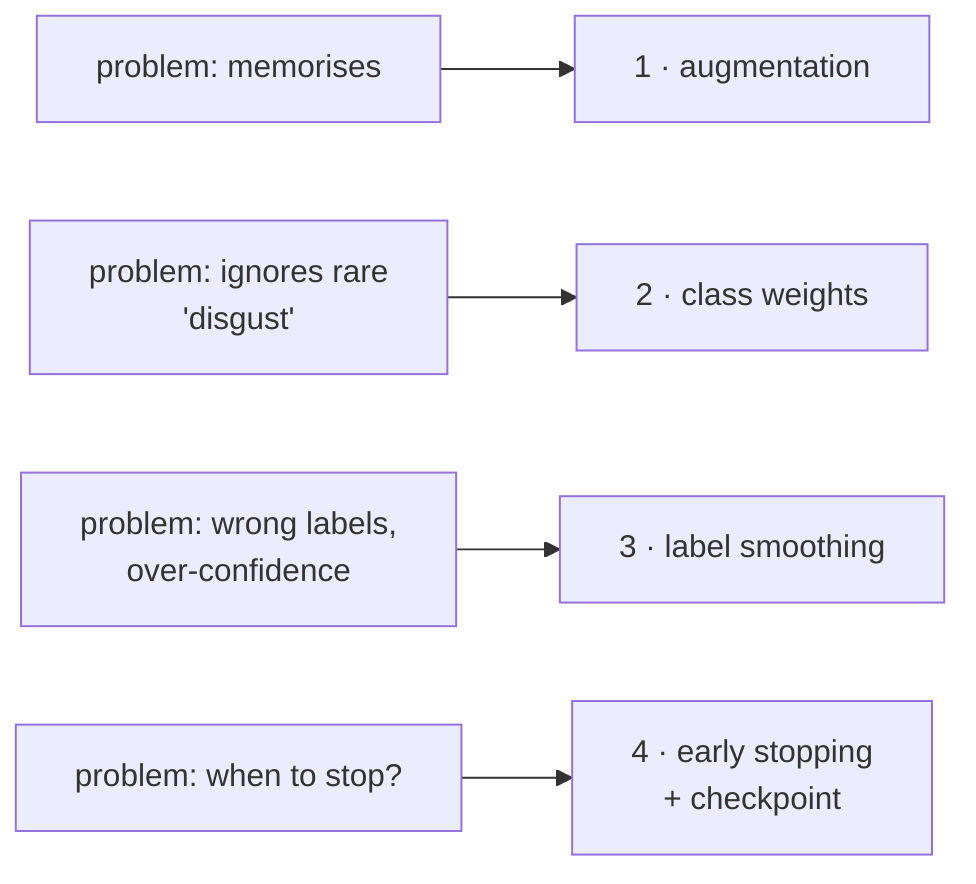
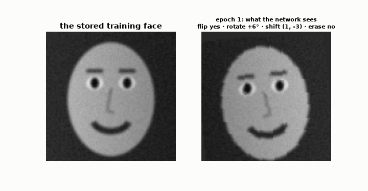
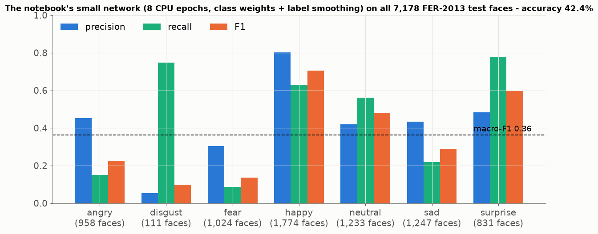

# Lesson 24 — Training in practice: augmentation, class weights, label smoothing, early stopping

> **For:** Ryan (FaceEmotion stage 4 — training on the GPU) &nbsp;·&nbsp; **Time:** 2 × 45 min
> **Before:** Lessons 01, 21, 23 &nbsp;·&nbsp; **After this:** the evaluation chapter (Lesson 03 for 7 classes)

**In one sentence:** four standard tricks — change the training pictures a little every time, make mistakes on rare
emotions cost more, don't demand 100 % certainty, and keep the best epoch — turn a network that memorises into one that
generalises.

## 🗺️ The map of this lesson



## The story

> Ryan trains EmotionNet. Three problems show up, one after the other:
>
> 1. After 20 epochs the network is 99 % right on the training faces and only 60 % on new ones — it **memorised**.
> 2. It **never** says "disgust": only 436 of 28,709 training faces are disgust, so ignoring them is the cheapest strategy.
> 3. Some FER-2013 faces are labelled **wrong** (a "sad" face that looks neutral), and the network tries hard to be 100 %
>    sure about them anyway.
>
> Each problem has a standard fix. This lesson explains all four tricks Ryan's trainer uses — with the numbers.

### 🌍 Real world

* **Self-driving car companies** augment their camera pictures with fake rain, fog, darkness and glare, so the car has "seen"
  bad weather it was never driven in.
* **Medical image models** have few pictures of rare diseases — they use class weights (or show rare cases more often), the
  same fix as "disgust".
* **A student revising**: practising the same 20 questions until you memorise them is overfitting; practising with the
  numbers changed every time is augmentation. Stopping when your practice-exam grade stops improving is early stopping.

## Words you need

| word | meaning |
|---|---|
| **augmentation** | small random changes to each training picture every epoch (flip, rotate, crop, erase) |
| **imbalanced classes** | some answers are much rarer than others |
| **class weight** | a multiplier on the loss: mistakes on rare classes cost more |
| **label smoothing** | the target is "91 % right answer, a little for each other", not "100 %" |
| **training curve** | a chart of the loss / accuracy after every epoch |
| **early stopping** | stop training when the validation score hasn't improved for a while |
| **patience** | how many epochs to wait for an improvement (Ryan: 8) |
| **checkpoint** | a saved copy of the weights — the best ones so far |

---

## 1. Augmentation — more data for free


Every epoch, before a face enters the network, it is changed a little at random:

| change | why it's allowed |
|---|---|
| horizontal flip | a smile is still a smile in the mirror |
| rotation up to 10° | people tilt their heads |
| a small crop | the face detector isn't perfectly centred |
| erase a small rectangle | a hand, glasses, hair in front of the face |

Watch one stored face over 16 epochs — the network gets a slightly different picture every time:



The network never sees the exact same picture twice, so memorising becomes hard → typically a few % better on new faces.

⚠️ **Training only.** The validation, test and camera pictures are never changed — otherwise scores change on every run, and
the camera would see "random" faces. That's why `dataset.py` has two separate transforms.

## 2. Imbalance — class weights


$$\text{weight}_i = \frac{\text{total faces}}{K \times \text{faces of class } i}\qquad K = 7\text{ emotions}$$

```
happy:    28,709 / (7 × 7,215) = 28,709 / 50,505 = 0.57      a mistake is cheap
disgust:  28,709 / (7 × 436)   = 28,709 / 3,052  = 9.41      a mistake costs 16× more
angry:    28,709 / (7 × 3,995) = 28,709 / 27,965 = 1.03      about normal
```

Why this formula? If every class had the same number of faces (28,709 / 7 = 4,101 each), every weight would be exactly 1.
Rare classes get more than 1, common ones less. The weights go into the loss: `nn.CrossEntropyLoss(weight=...)`. Now
ignoring "disgust" is expensive, and the network starts trying. (The same problem as Seif's alpha, Lesson 15.)

### What class weights really do — measured

The small network trained in the project's notebook (8 epochs on a laptop CPU, with class weights and label smoothing), on
all 7,178 FER-2013 test faces:



Look at **disgust**: recall 0.75 (it finds most disgust faces) but precision 0.05 (most faces it *calls* disgust aren't). The
weight made disgust mistakes so expensive that the young network now says "disgust" too often. After more epochs on a GPU
the full EmotionNet balances this out (target ≥ 65 % accuracy) — but this chart is exactly what to look at: **per-class
precision and recall**, never just accuracy (Lesson 03).

## 3. Label smoothing — don't demand 100 % certainty


$$y_i = (1 - \varepsilon)\times\text{onehot}_i + \frac{\varepsilon}{K}\qquad \varepsilon = 0.1$$

**Step by step (truth = happy):**

```
normal target ("onehot"):   [0, 0, 0, 1, 0, 0, 0]                       100 % happy
(1 − ε) × onehot:           [0, 0, 0, 0.9, 0, 0, 0]
ε / K = 0.1 / 7 = 0.014    → add to every position:
smoothed target:            [0.014, 0.014, 0.014, 0.914, 0.014, 0.014, 0.014]     (adds up to 1)
```

The loss becomes Σ yᵢ × (−ln pᵢ) — a bit of loss for every class. The right panel: with the normal target the loss is lowest
at 100 % (it never stops pushing); with smoothing the loss is lowest at about **91 %**. The network stops chasing certainty on
labels that may be wrong, and its shown confidence ("81 % happy") becomes more honest.

## 4. When to stop — early stopping and checkpoints


*(Illustration with the project's settings.)* After every epoch, measure accuracy on the **validation** faces:

```
new best?  → save the weights to emotion_net_best.pt, reset the counter to 0
no?        → counter + 1
counter reaches 8 (patience) → stop
```

Here the best epoch is 22, training stops at 30, and the saved file holds **epoch 22** — never the over-trained end. The
checkpoint also stores the normalisation numbers, so a model file can never be used with the wrong preparation:

```python
torch.save({"model_state": model.state_dict(), "epoch": epoch, "val_acc": val_acc,
            "config": {"image_size": 48, "mean": 0.5013, "std": 0.2916}}, path)
```

## 5. Reading training curves

| you see | it means | do |
|---|---|---|
| both losses fall together | still learning | continue |
| training ↓, validation ↑ | overfitting | the checkpoint keeps the best; more augmentation / dropout |
| both flat and high | not learning: lr too small, or a bug | check lr; check labels match pictures |
| loss = `nan` | lr too high, or ln(0) | lower lr |
| loss stuck at 1.95 (= ln 7) | the network guesses uniformly | a pipeline bug |

## 🧪 Worked example: the numbers of Parts 2–4 in Python

```python
import numpy as np

counts = {"angry": 3995, "disgust": 436, "fear": 4097, "happy": 7215, "sad": 4830, "surprise": 3171, "neutral": 4965}
total, K = sum(counts.values()), len(counts)
weights = {e: round(total / (K * n), 2) for e, n in counts.items()}
print(weights)              # disgust 9.41, happy 0.57, ...

eps = 0.1
onehot = np.array([0, 0, 0, 1, 0, 0, 0], float)                 # truth = happy
smooth = (1 - eps) * onehot + eps / K
print(smooth.round(3), smooth.sum())                            # 0.914 for happy, 0.014 for the others, sum 1

val_acc = [0.50, 0.55, 0.58, 0.60, 0.61, 0.60, 0.61, 0.60, 0.59, 0.61, 0.60, 0.60, 0.59]
best, best_epoch, bad, patience = 0, 0, 0, 3
for epoch, acc in enumerate(val_acc, start=1):
    if acc > best:
        best, best_epoch, bad = acc, epoch, 0                   # save the checkpoint here
    else:
        bad += 1
        if bad >= patience:
            print(f"stop after epoch {epoch}; the checkpoint holds epoch {best_epoch} ({best})")
            break
```

## 6. Common mistakes

| student says | the truth |
|---|---|
| "Augment the test set too" | Then you measure on pictures that don't exist. |
| "Early stopping wastes the last epochs" | Those epochs made it worse; the checkpoint keeps the best. |
| "Class weights make everything better" | They trade a bit of accuracy on common classes for recall on rare ones. Report per-class F1. |
| "Upside-down faces are good augmentation" | Only changes the camera could really produce. A webcam never sees you upside down. |

## 📝 Summary

> * **Augmentation**: random flips, small rotations, crops, erasing — training pictures only.
> * **Class weights** = total ÷ (K × count): rare classes cost more (disgust 9.4×). Check per-class precision and recall.
> * **Label smoothing** ε = 0.1: target 0.914 / 0.014 — no chasing 100 % on possibly wrong labels.
> * **Early stopping**: keep the best validation epoch (checkpoint), stop after 8 epochs without improvement.
> * Read the **curves**: training ↓ validation ↑ = overfitting; stuck at ln 7 = 1.95 = a bug.

## 7. Activities

1. **Augment by hand (5 min).** Hold a printed face mirrored, tilted, half-covered: still the same emotion? Which change is
   *not* allowed? (Upside down — webcams don't see that.)
2. **Weights (10 min).** Compute all 7 class weights from the chart's counts.
3. **Be the early-stopping helper (10 min).** Read 20 validation accuracies aloud; students track "best" and "patience" and
   shout STOP.

## 8. Do it yourself

<details><summary>1. Sad has 4,830 faces. Its class weight?</summary>

28,709 / (7 × 4,830) = 28,709 / 33,810 = **0.85**.
</details>

<details><summary>2. With ε = 0.2 and K = 4, the smoothed target for the true class and for the others?</summary>

others 0.2 / 4 = **0.05** · true class 0.8 + 0.05 = **0.85** (check: 0.85 + 3 × 0.05 = 1).
</details>

<details><summary>3. Validation: 0.60, 0.62, 0.61, 0.63, then 8 epochs below 0.63. Which epoch is saved, and when does training stop?</summary>

Epoch 4 (0.63) is saved; training stops after epoch 12.
</details>

## 9. In your project

| Project | Where |
|---|---|
| FaceEmotion | `app/ml/dataset.py` → `build_train_transform`, `build_eval_transform`, `compute_class_weights`, `FER2013Dataset.class_counts` · `app/ml/trainer.py` → `fit`, `save_checkpoint`, `plot_history` · `config.py` → `LABEL_SMOOTHING = 0.1`, `EARLY_STOPPING_PATIENCE = 8`, `EPOCHS = 50` · theory `13_FaceEmotion/01_theory/06_data_training.md` · notebook `03_training_loop.ipynb` |

## 🎬 Watch & explore

| | |
|---|---|
| <a href="https://www.youtube.com/watch?v=rfM4DaLTkMs"></a> | **deeplizard — Data augmentation explained**. Part 1. |
| <a href="https://www.youtube.com/watch?v=yY1Qh_4LHf8"></a> | **Data augmentation explained simply**. A second, short explanation. |

**Read more:**
* Andrej Karpathy — [A Recipe for Training Neural Networks](https://karpathy.github.io/2019/04/25/recipe/)
