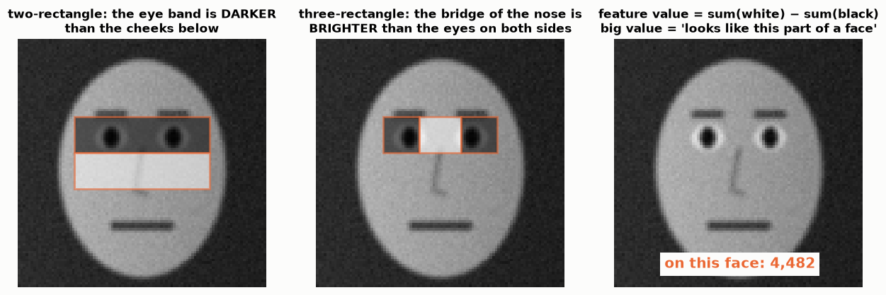
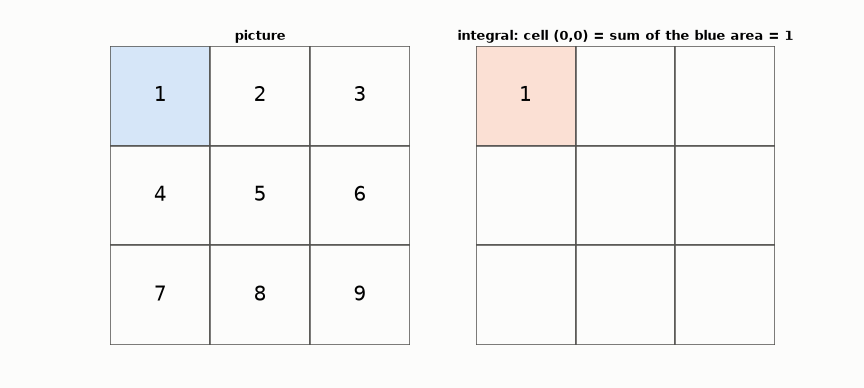
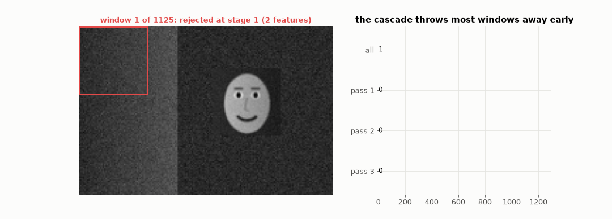
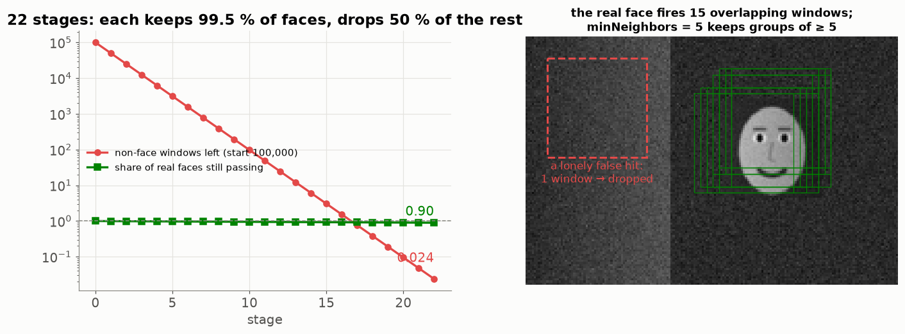

# Lesson 25 — Finding the face: Haar features, the integral image and the cascade

> **For:** Ryan (FaceEmotion stage 2) &nbsp;·&nbsp; **Time:** 2 × 45 min
> **Before:** Lesson 00 §5; Lesson 19 &nbsp;·&nbsp; **After this:** Lesson 26

## The story

> Before EmotionNet can say "happy", someone must find **where** the face is in the 640 × 480 camera picture and cut it
> out. That means checking about **100,000 small windows** per picture, 25 times a second. Think of a **security guard at
> a stadium gate** with 100,000 people to check. He can't interview each one. So he uses a quick first look ("no ticket in
> hand? → out"), and only those who pass get a closer look, and only a few get the full check. The **Viola–Jones face
> detector** (2001) works exactly like that guard — and it's what Ryan's `HaarCascadeDetector` uses.

## 🎯 By the end, the student can

1. Explain a Haar feature (sum of white − sum of black) and point at two on a face.
2. Build an integral image by hand and get any rectangle's sum with 4 reads.
3. Explain the cascade with its numbers (0.995²² vs 0.5²²).
4. Explain `scaleFactor`, `minNeighbors` and `minSize`.

## Words you need

| word | meaning |
|---|---|
| **window** | a small square of the picture being checked: "is there a face here?" |
| **sliding window** | moving the window over the whole picture, step by step, at several sizes |
| **Haar feature** | sum of pixels in the white rectangle − sum in the black rectangle |
| **integral image** | a table where every cell holds the sum of all pixels above and to its left |
| **stage** | one quick test of the cascade |
| **cascade** | a chain of tests: fail one → rejected immediately |
| **AdaBoost** | the method that chose which features to use and in which order (done once, by OpenCV's authors) |

---

## 1. Haar features — simple light/dark patterns



A face has typical light/dark patterns: the eye band is **darker** than the cheeks below; the bridge of the nose is
**brighter** than the eyes beside it. A Haar feature measures one such pattern:

```
feature value = (sum of the pixels in the white rectangle) − (sum of the pixels in the black rectangle)
```

A big value = "this part looks like that part of a face". One feature alone is weak; thousands of them, chosen well, are
strong.

## 2. The integral image — any rectangle sum in 4 steps

Adding up all pixels of a 20 × 20 rectangle = 400 additions — for every feature, every window, every frame. Too slow. The
trick: prepare one table first.

**Each cell of the integral image = the sum of all pixels above it and to its left (including itself).**

```
picture:          integral image:
 1 2 3             1   1+2=3    3+3=6
 4 5 6             1+4=5   1+2+4+5=12   6+4+5+6=21
 7 8 9             5+7=12  12+7+8=27    21+7+8+9=45
```



Now the sum of **any** rectangle needs only 4 reads. For the rectangle [5 6 / 8 9]:

```
D = the bottom-right corner of the rectangle         = 45   (everything up to 9)
B = the cell just above the rectangle's top-right    =  6   (the top row: 1 2 3)
C = the cell just left of the rectangle's bottom-left = 12   (the left column: 1 4 7)
A = the cell diagonally above-left                   =  1   (counted in both B and C → add back once)

sum = D − B − C + A = 45 − 6 − 12 + 1 = 28          check: 5 + 6 + 8 + 9 = 28 ✓
```

Same 4 reads for a 2 × 2 or a 200 × 200 rectangle — that's what makes the detector fast.

## 3. Sliding windows and the cascade



A window slides over the picture (then again bigger: `scaleFactor = 1.1` grows it 10 % each round). For each window, the
cascade asks cheap questions first; fail → rejected immediately (red). In this toy run: 1,125 windows → 76 pass stage 1 →
15 pass all stages, all on the face.



### The cascade arithmetic, step by step

OpenCV's cascade has about **22 stages**. Each stage is tuned to keep **99.5 %** of real faces and throw away **50 %** of
non-faces:

```
real faces surviving all 22 stages:   0.995 × 0.995 × … (22 times) = 0.995²² ≈ 0.90      (90 % of faces found)
non-faces surviving all 22 stages:    0.5²² = 0.00000024
of 100,000 windows:                   100,000 × 0.00000024 ≈ 0.02 false detections per picture
```

And the work: most windows die at stage 1 or 2 (after 2–10 features), so on average only ~20–30 features are checked per
window instead of 6,000.

**The idea:** don't make each test more accurate — put cheap tests first, so the expensive work happens only on the few
windows that survive.

## 4. `minNeighbors` — one window is not enough

A real face makes **many** overlapping windows pass (shift 2 pixels, a bit bigger — still the face). A false detection
usually makes one or two. `detectMultiScale` groups overlapping windows; `minNeighbors = 5` throws away groups with fewer than
5.

| parameter (config.py) | meaning | too low | too high |
|---|---|---|---|
| `scaleFactor = 1.1` | the window grows 10 % per round | slow | misses sizes in between |
| `minNeighbors = 5` | how many windows must agree | false faces | missed faces |
| `minSize = (60, 60)` | ignore smaller faces | slow, background noise | misses people far away |

## 5. Common mistakes

| student says | the truth |
|---|---|
| "Haar is a neural network" | No: rectangle features + AdaBoost + a cascade. Nothing is trained in the project. |
| "It recognises who you are" | It only answers "is there a frontal face here?" |
| "Works for any head angle" | Frontal only — that's why the DNN detector is the alternative in the book. |

## 6. Activities

1. **Integral image by hand (10 min).** A 4 × 4 grid of small numbers: compute the integral image; get 3 rectangle sums
   with 4 reads; check by direct adding.
2. **Be the cascade (10 min).** 30 cut-out pictures (faces and objects). Stage 1: "two dark spots side by side?" Stage 2:
   "a darker band under them?" Count how many each stage removes.
3. **Live:** in `04_detection_and_realtime.ipynb` change `minNeighbors` from 1 to 10 on the same picture.

## 7. Do it yourself

<details><summary>1. With the integral image above, the sum of the bottom row (7 8 9)?</summary>

D = 45 (bottom-right), B = 21 (just above: the first two rows), no C or A (it touches the left edge) → 45 − 21 = **24**
(7 + 8 + 9 ✓).
</details>

<details><summary>2. 30 stages of 99 % faces / 50 % non-faces. Share of faces that survive?</summary>

0.99³⁰ ≈ **0.74** — a quarter of faces lost. That's why each stage must keep ~99.5 %+.
</details>

<details><summary>3. A poster of a face on the wall is detected. A bug?</summary>

No — it *is* a frontal face pattern. Mention it as a limitation.
</details>

## 8. In your project

| Project | Where |
|---|---|
| FaceEmotion | `app/vision/haar_detector.py` → `HaarCascadeDetector.__init__/detect` (`detectMultiScale`) · `app/vision/face_detector.py` → `detect_largest`, `create_detector` · `app/models/detection.py` → `with_margin`, `crop` · `app/vision/dnn_detector.py` (the alternative) · theory `13_FaceEmotion/01_theory/07_detection_realtime.md` §7 · notebook `04_detection_and_realtime.ipynb` |

## 🎬 Watch & explore

* Computerphile — *Detecting Faces (Viola Jones Algorithm)* — [search on YouTube](https://www.youtube.com/results?search_query=Computerphile+Viola+Jones+face+detection)
* OpenCV docs — [Cascade Classifier tutorial](https://docs.opencv.org/4.x/db/d28/tutorial_cascade_classifier.html)
