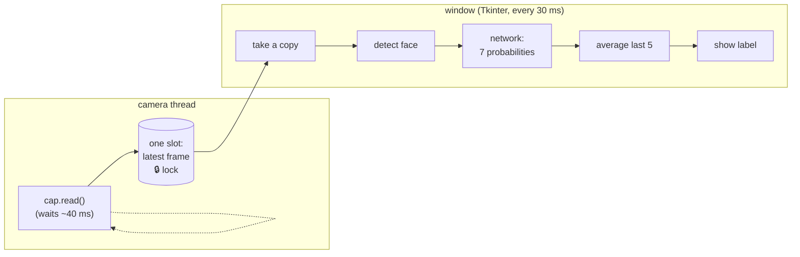
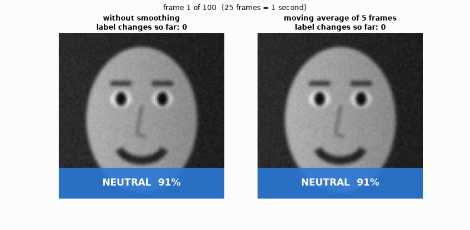
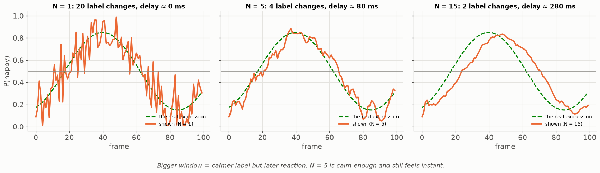

# Lesson 26 — Real time: the frame budget, the camera thread, and a label that doesn't flicker

> **For:** Ryan (FaceEmotion stage 5) · the thread part also for Liraz (Lesson 32) &nbsp;·&nbsp; **Time:** 45 – 60 min
> **Before:** Lesson 00 §2; Lessons 23, 25 &nbsp;·&nbsp; **After this:** the real-time chapter of the book

**In one sentence:** read the camera in its own thread and always show the newest frame, and average the last few
frames' probabilities so the label stays calm — accepting a tiny delay.

## 🗺️ The map of this lesson



## The story

> Ryan's app finally runs with the camera. Two things look bad in the demo:
>
> 1. The picture **stutters** — the window freezes for a moment every second.
> 2. When the student half-smiles, the label **flickers**: happy, neutral, happy, happy, neutral … eight times a second.
>    It looks broken, although each single answer is reasonable.
>
> Think of a TV news ticker that jumped every time one viewer's opinion changed — unreadable. This lesson fixes both:
> a separate **camera thread** with "latest frame only", and **temporal smoothing** — averaging the last few answers.

### 🌍 Real world

* **Moving averages** are everywhere: stock charts ("50-day average"), weather ("7-day average temperature"), COVID charts
  ("7-day average of new cases") — all to calm a jumpy line.
* Your **phone's compass and step counter** smooth their sensor readings, or the arrow would shake in your hand.
* **Video calls** drop late frames instead of queuing them — it's better to skip a frame than to show the past (Part 2).

## Words you need

| word | meaning |
|---|---|
| **frame** | one picture from the camera |
| **fps** | frames per second; 25 fps → 1000 / 25 = **40 ms** per frame |
| **thread** | a part of the program that runs at the same time as the rest (Lesson 32) |
| **blocking** | a call that waits: `cap.read()` waits until the camera delivers a frame |
| **lock** | a token so two threads don't touch the same variable at once (Lesson 32) |
| **probability vector** | the 7 probabilities, one per emotion, for one frame |
| **moving average** | the average of the last N values; when a new one arrives, the oldest drops out |
| **delay / lag** | how late the smoothed label reacts to a real change |

---

## 1. The time budget


At 25 fps everything for one frame must fit in **40 ms**: face detection (~14 ms), preparation (~1 ms), the network (~3 ms
on a GPU), drawing (~5 ms) = about 23 ms. Fine. But reading the camera, `cap.read()`, **waits 30–40 ms** for the next frame.
In the same thread as the window, that alone eats the whole budget → stutter. So the camera gets **its own thread**.

## 2. Latest frame only


The camera thread reads frames non-stop and overwrites **one** slot with the newest one. The window takes whatever is in
the slot. If the window is slower than the camera, some frames are simply skipped — and that's correct: a **queue** would
fill up and the screen would show the **past**, further and further behind.

Two threads touch the same slot → a `threading.Lock` around it, and `read()` returns `frame.copy()` (if the window drew
rectangles on the shared frame while the camera writes into it → corrupted pictures).

Tkinter (the window library) runs everything in one thread: no `while True` loop in the window code. Use
`root.after(30, process_frame)`: "run this again in 30 ms" — between calls the window stays responsive.

## 3. Why the label flickers — and the fix


Each frame is judged alone. With a borderline expression (51 % happy / 49 % neutral), one pixel of noise flips the label.
In the simulation: the raw label changes **20 times** in 100 frames (4 seconds) — flicker; the smoothed one **4 times**.

What the user actually sees — the same 100 frames as two app screens:



**Moving average, step by step (window N = 5).** P(happy) in frames 1–7:

```
frame:      1     2     3     4     5     6     7
P(happy):  0.6   0.4   0.6   0.5   0.7   0.3   0.6

after frame 5:  average of frames 1–5 = (0.6 + 0.4 + 0.6 + 0.5 + 0.7) / 5 = 2.8 / 5 = 0.56   → happy
after frame 6:  drop frame 1, add frame 6: (0.4 + 0.6 + 0.5 + 0.7 + 0.3) / 5 = 2.5 / 5 = 0.50   → exactly on the edge
after frame 7:  (0.6 + 0.5 + 0.7 + 0.3 + 0.6) / 5 = 2.7 / 5 = 0.54   → happy
raw labels would be: happy, neutral, happy, tie, happy, neutral, happy  — flickering
```

In the real app we average the **whole vector** of 7 probabilities, then take the biggest:

```python
class TemporalSmoother:
    def __init__(self, window=5):
        self._history = deque(maxlen=window)    # the oldest frame drops out by itself
    def update(self, probs):
        self._history.append(probs)
        return np.mean(self._history, axis=0)   # average each emotion over the frames, then argmax
```

## 4. Average the probabilities — don't vote on the labels


Three frames: (0.6 happy, 0.4 sad), (0.6, 0.4), (0.0, 1.0).

```
voting on the labels:   happy, happy, sad       → happy wins 2 to 1
averaging:              happy (0.6 + 0.6 + 0.0) / 3 = 0.4      sad (0.4 + 0.4 + 1.0) / 3 = 0.6   → SAD
```

The third frame was **very** sure; averaging respects how sure each frame was, voting throws that away
(`test_probabilities_are_averaged_not_voted`).

## 5. The price: delay


A moving average over N frames reacts about (N − 1) / 2 frames late (its "centre" is that far in the past). N = 5 at 25
fps: 2 × 40 ms = **80 ms** — people don't notice delays below ~150 ms. N = 15: 7 × 40 ms = **280 ms** — noticeable. If the
label still changes more than twice a second, go to 7, not to 15.



## 🧪 Worked example: the smoother, and average vs vote

```python
from collections import deque
import numpy as np

class TemporalSmoother:
    def __init__(self, window=5):
        self._history = deque(maxlen=window)
    def update(self, probs):
        self._history.append(np.asarray(probs, float))
        return np.mean(self._history, axis=0)
    def reset(self):
        self._history.clear()

s = TemporalSmoother(5)
for p in [0.6, 0.4, 0.6, 0.5, 0.7, 0.3, 0.6]:                 # P(happy) per frame, Part 3
    out = s.update([p, 1 - p])                               # [happy, neutral]
    print(f"frame P(happy) {p:.1f} → smoothed {out[0]:.2f} → {'happy' if out[0] > 0.5 else 'neutral/edge'}")

frames = np.array([[0.6, 0.4], [0.6, 0.4], [0.0, 1.0]])      # Part 4: [happy, sad]
print("vote   :", np.bincount(frames.argmax(1)).argmax())     # 0 = happy
print("average:", frames.mean(0).argmax(), frames.mean(0))    # 1 = sad, [0.4 0.6]
```

## 6. Common mistakes

| student says | the truth |
|---|---|
| "Python threads don't run at the same time (the GIL)" | Only one runs Python at a time — but `cap.read()` *waits* on the camera and lets the other thread work meanwhile. |
| "Smoothing makes the model more accurate" | It makes the display stable; the model is the same. |
| "Process every frame in a queue to be correct" | Then the screen falls behind. Skip frames. |
| "A bigger window is always better" | Calmer but later — N = 15 already lags ~0.3 s. |

## 📝 Summary

> * 25 fps → **40 ms** per frame; `cap.read()` alone waits that long → the camera gets **its own thread**.
> * **Latest frame only**: one slot, overwritten; a lock around it; hand out a **copy**. Never a growing queue.
> * Tkinter: `root.after(30, …)`, never `while True`.
> * **Moving average** of the last 5 **probability vectors** (not votes) → a calm label.
> * Price: ≈ (N − 1)/2 frames of delay — 80 ms for N = 5. `reset()` when the face disappears.

## 7. Activities

1. **The flicker game (5 min).** One student keeps a half smile; 5 others shout their label every second; then shout the
   majority of the last 3 seconds.
2. **Compute (5 min).** §8 question 1.
3. **Measure (10 min).** In the app, show the FPS counter and count label changes per second with N = 1, 5, 15.

## 8. Do it yourself

<details><summary>1. P(happy) over 5 frames: 0.7, 0.4, 0.6, 0.2, 0.9. Smoothed P(happy)?</summary>

(0.7 + 0.4 + 0.6 + 0.2 + 0.9) / 5 = 2.8 / 5 = **0.56** → happy.
</details>

<details><summary>2. 25 fps and N = 7. About how much delay?</summary>

(7 − 1) / 2 = 3 frames × 40 ms = **120 ms** — still fine, close to the limit.
</details>

<details><summary>3. The face leaves the picture. What should the smoother do?</summary>

`reset()` — otherwise the next person's first frames are averaged with the previous person's emotions.
</details>

## 9. In your project

| Project | Where |
|---|---|
| FaceEmotion | `app/vision/camera.py` → `CameraService.start`, `_reader_loop`, `read`, `stop` · `app/ml/smoothing.py` → `TemporalSmoother.update/reset/current` · `app/controllers/app_controller.py` → `start_capture`, `_on_frame` · `app/utils/fps.py` · config `SMOOTHING_WINDOW = 5` · theory `13_FaceEmotion/01_theory/07_detection_realtime.md` §8 · notebook `04_detection_and_realtime.ipynb` |

## 🎬 Watch & explore

* *Moving average explained* — [search on YouTube](https://www.youtube.com/results?search_query=moving+average+filter+smoothing+explained)
* Lesson 32 — threads and locks, with animations (the camera thread is a real example of it).
* Python docs — [`collections.deque`](https://docs.python.org/3/library/collections.html#collections.deque) · [`threading.Lock`](https://docs.python.org/3/library/threading.html#lock-objects)
