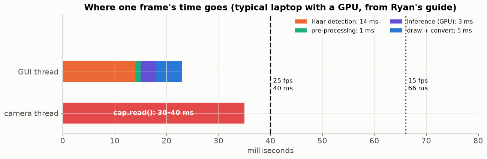
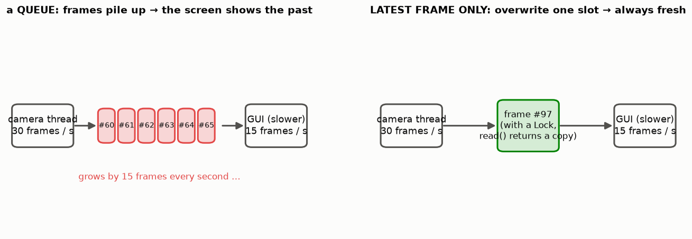
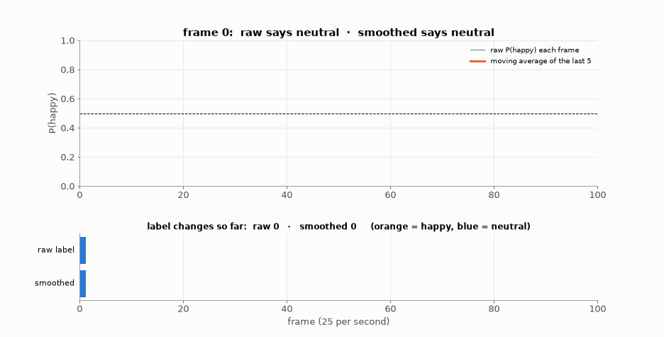
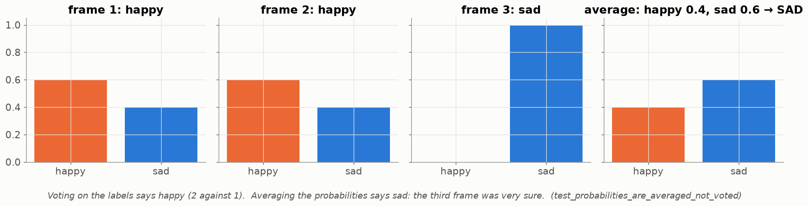
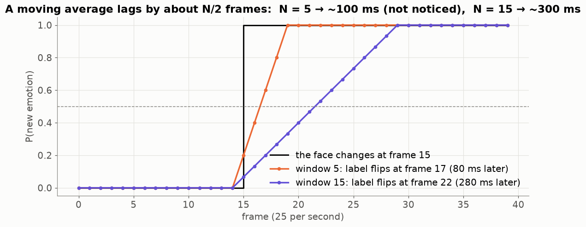

# Lesson 26 — Real time: the frame budget, the camera thread, and a label that doesn't flicker

> **For:** Ryan (FaceEmotion stage 5) · the threading part also for Liraz (Lesson 32) &nbsp;·&nbsp; **Time:** 45 min
> **Before:** Lessons 23, 25 &nbsp;·&nbsp; **After this:** the real-time chapter of the book

## 🎯 By the end, the student can

1. Draw the time budget of one frame and say why the camera read must be in its own thread.
2. Explain "latest frame only" and why the shared frame needs a Lock and a copy.
3. Explain temporal smoothing and why it averages **probabilities**, not labels.
4. Compute the delay smoothing adds, and defend N = 5.

---

## 1. The time budget



25 fps = **40 ms per frame** for everything: detection, pre-processing, inference, drawing. The biggest cost is not on the
list: `cap.read()` **blocks** 30–40 ms until the camera delivers. In the GUI thread that alone would eat the budget — so it
runs in **its own thread**.

## 2. Latest frame only



The camera thread overwrites **one** slot with the newest frame; the GUI takes whatever is there. A queue would fill up
when the GUI is slower, and the screen would show the **past**. Two threads, one variable → a `threading.Lock`, and
`read()` returns `frame.copy()` (drawing on the shared buffer would corrupt it).

Tkinter is single-threaded: no `while True` in the GUI. Use `root.after(30, process_frame)` — process one frame, schedule
the next, and the window stays responsive.

## 3. Why the label flickers — and the fix



Each frame is classified on its own. In a borderline expression (51 % happy / 49 % neutral) one pixel of noise flips the
label. Simulation, 100 frames: the raw label changes **20 times** (8 per second — flicker); a moving average over the last
5 probability vectors changes it **4 times**.

```python
class TemporalSmoother:
    def __init__(self, window=5):
        self._history = deque(maxlen=window)    # the oldest drops out by itself
    def update(self, probs):
        self._history.append(probs)
        return np.mean(self._history, axis=0)   # average the VECTORS, then argmax
```

## 4. Average the probabilities, don't vote



Three frames: (0.6 happy, 0.4 sad), (0.6, 0.4), (0.0, 1.0). Voting: happy 2 – 1. Averaging: happy 0.4, sad **0.6**. The
third frame was very sure; the average respects confidence, voting throws it away. That's
`test_probabilities_are_averaged_not_voted`.

## 5. The price: delay



A moving average over N frames reacts about N/2 frames late. N = 5 at 25 fps → ≈ 100 ms (people don't notice below
~150 ms). N = 15 → ≈ 300 ms — noticeable. If the success metric ("≤ 2 label changes per second") fails, go to 7, not 15.

## 6. Misconceptions

| Student says | Truth |
|---|---|
| "Threads make Python run things in parallel" | The GIL lets one thread run Python at a time — but `cap.read()` waits on the camera and releases the GIL, so the GUI can work meanwhile. |
| "Smoothing makes the model more accurate" | It makes the display stable. The model is the same. |
| "A bigger window is always better" | Bigger = slower to react. |
| "Process every frame from a queue to be correct" | Then the screen lags further and further behind. Skip frames instead. |

## 7. Activities

1. **Flicker game (5 min).** One student shows a "half smile"; 5 others each shout their label every second — then shout
   the majority of the last 3 seconds.
2. **Compute (5 min).** Probabilities of happy over 5 frames: 0.7, 0.4, 0.6, 0.2, 0.9 → average 0.56 → happy.
3. **Measure (10 min).** In the app, show the FPS counter and the number of label changes per second with N = 1, 5, 15.

## 8. Check yourself

<details><summary>1. 25 fps and N = 7. About how much delay?</summary>

3.5 frames × 40 ms = **140 ms** — borderline noticeable.
</details>

<details><summary>2. Why must `CameraService.read()` return a copy?</summary>

The GUI draws rectangles and text on the frame. Without a copy it would draw on the buffer the camera thread is writing
into — corrupted frames, races.
</details>

<details><summary>3. The face leaves the picture. What should the smoother do?</summary>

`reset()` — otherwise the next person's first frames are averaged with the previous person's emotions.
</details>

## 9. In your project

| Project | Where |
|---|---|
| FaceEmotion | `app/vision/camera.py` → `CameraService.start`, `_reader_loop`, `read`, `stop` · `app/ml/smoothing.py` → `TemporalSmoother.update/reset/current` · `app/controllers/app_controller.py` → `start_capture`, `_on_frame` (`root.after`) · `app/utils/fps.py` · config `SMOOTHING_WINDOW = 5` · theory `13_FaceEmotion/01_theory/07_detection_realtime.md` §8 · notebook `04_detection_and_realtime.ipynb` |

## 🎬 Watch & explore

* *Moving average filter explained* — [search on YouTube](https://www.youtube.com/results?search_query=moving+average+filter+smoothing+explained)
* Python docs — [`collections.deque(maxlen=...)`](https://docs.python.org/3/library/collections.html#collections.deque) and [`threading.Lock`](https://docs.python.org/3/library/threading.html#lock-objects)
