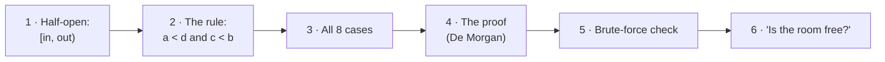
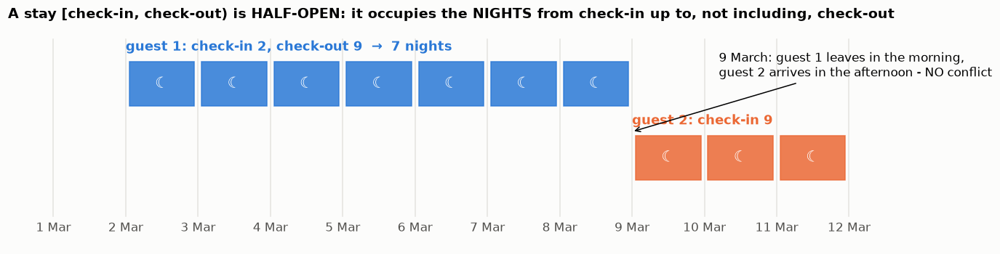
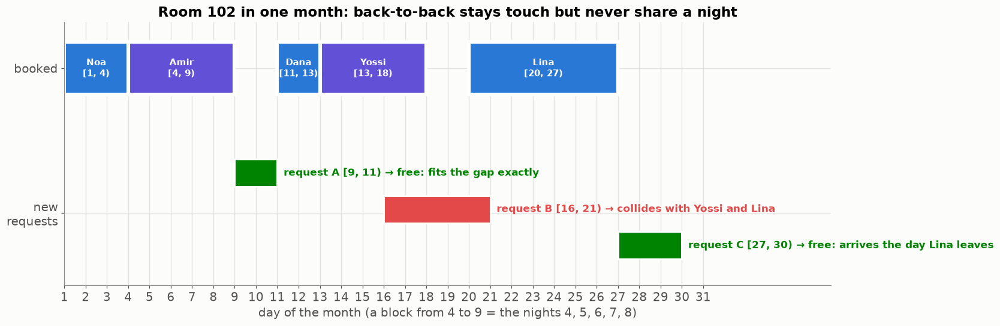
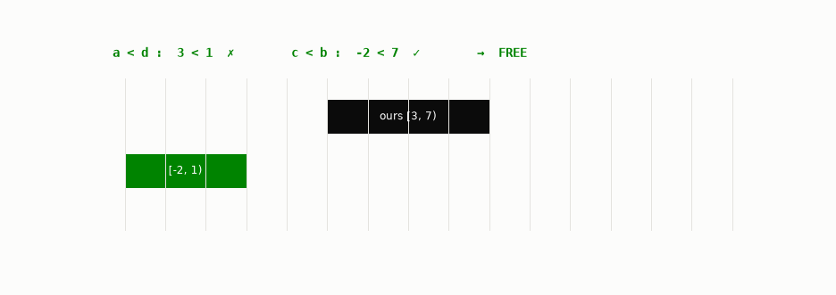
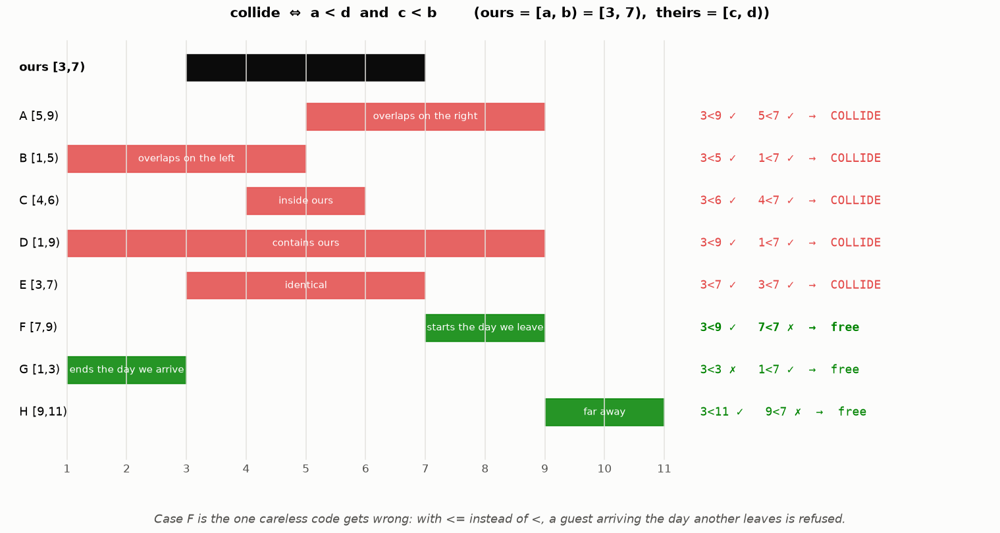
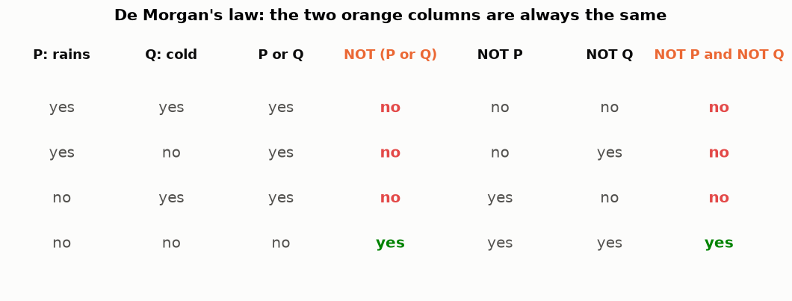
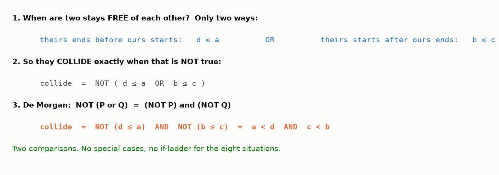
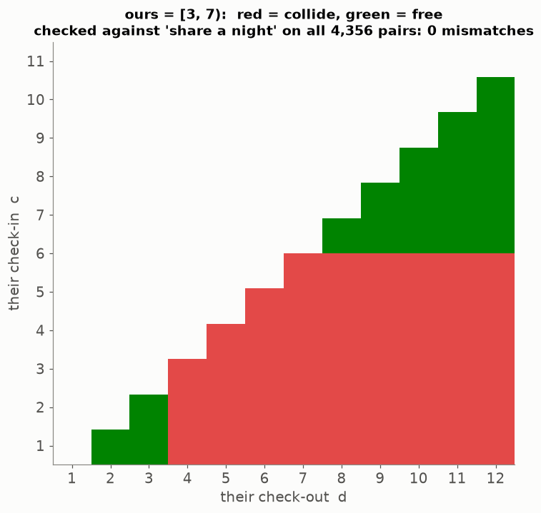

# Lesson 27 — Do two stays collide? Half-open intervals and a two-comparison rule

> **For:** Eran (HotelManager stage 1 — "the heart") &nbsp;·&nbsp; **Time:** 2 × 45 min
> **Before:** Python `date`, `and` / `or` / `not` &nbsp;·&nbsp; **After this:** Lessons 28, 30, 33

**In one sentence:** write a stay as [check-in, check-out) — nights, not days — and two stays collide exactly when
`a < d and c < b`: two comparisons that cover every possible case.

## 🗺️ The map of this lesson



## The story

> At a small hotel, two guests arrive on the same evening — and both have a booking for **room 102**. The receptionist
> apologises, the second guest drives to another hotel at 11 pm, and writes a one-star review. The cause: the booking
> program checked "do these dates collide?" with a wrong rule. A week later the **opposite** happens: a guest wants
> room 102 from the 9th, the previous guest leaves on the morning of the 9th — and the program says "occupied". Lost money.
> This lesson writes the collision rule correctly — it's just **two comparisons** — and proves it's right.

### 🌍 Real world

The same rule runs **every** booking system: hotel sites, car rentals, meeting rooms in Outlook / Google Calendar ("this
room is busy"), doctors' appointment slots, cinema halls. A double booking anywhere is this rule written wrong.

And you already know half-open intervals from Python: `range(2, 9)` gives 2, 3, 4, 5, 6, 7, 8 — **7 numbers**, without 9;
`text[2:9]` is 7 characters. Python chose half-open for the same reason the hotel does: lengths are just `end − start`, and
pieces fit back to back.

## Words you need

| word | meaning |
|---|---|
| **interval** | a range from one point to another, e.g. from the 2nd to the 9th |
| **[a, b)** | **half-open** interval: includes a, **does not** include b. `[` = included, `)` = not included |
| **night** | a stay "occupies" the nights from check-in up to the night *before* check-out |
| **overlap / collide** | the two stays share at least one night |
| **`<` vs `<=`** | "strictly smaller" vs "smaller or equal" — here the difference is money |
| **De Morgan's law** | NOT (P or Q) = (NOT P) and (NOT Q) |
| **status** | the state of a booking: confirmed, checked in, checked out, cancelled (Lesson 30) |

---

## 1. Half-open: the hotel sells nights, not days



Guest 1: check-in 2 March, check-out 9 March. Which nights does she sleep here? The 2nd, 3rd, 4th, 5th, 6th, 7th, 8th —
**7 nights**. The 9th is the morning she leaves; that night belongs to someone else.

Writing the stay as **[2, 9)** ("from 2, up to but not including 9") makes everything easy:

* nights = 9 − 2 = **7** — no "+1" anywhere;
* guest 2's stay [9, 12) shares **nothing** with [2, 9) — back-to-back stays fit perfectly.

### A month of one room



Amir arrives on the 4th, the morning Noa leaves — they **touch** but share no night. Request A fits exactly into the gap
[9, 11). Request C arrives the day Lina leaves: free. Request B overlaps two stays.

## 2. The rule

Our stay is [a, b), theirs is [c, d).

$$\text{they collide} \iff a < d \;\text{ and }\; c < b$$

In words: **"ours starts before theirs ends, and theirs starts before ours ends."**



Watch a 3-night stay slide past ours [3, 7): both lights must be ✓ to collide. The moment its check-in reaches 7 (our
check-out day), `c < b` becomes 7 < 7 = false → free.

## 3. All eight cases (from Eran's guide)



Check two of them by hand, ours = [3, 7):

```
case A, theirs [5, 9):   a < d → 3 < 9 ✓     c < b → 5 < 7 ✓     → COLLIDE (the nights 5 and 6)
case F, theirs [7, 9):   a < d → 3 < 9 ✓     c < b → 7 < 7 ✗     → FREE (they arrive the day we leave)
```

**Case F** is where careless code fails: with `<=`, 7 <= 7 would be true → "occupied" → a lost booking. `tests/test_date_range.py`
has all eight; F has its own test.

(These are Allen's interval relations, 1983 — 13 possible ways two intervals can relate; 6 of them overlap.)

## 4. Why the rule is right — the proof with De Morgan

It's easier to describe when two stays are **free**. There are only two ways:

```
1. theirs ends before (or exactly when) ours starts:     d ≤ a
2. theirs starts after (or exactly when) ours ends:      b ≤ c
free  =  (d ≤ a)  OR  (b ≤ c)
```

They **collide** exactly when they are **not** free:

```
collide = NOT ( d ≤ a  OR  b ≤ c )
```

**De Morgan's law:** NOT (P or Q) = (NOT P) and (NOT Q). Example: "it's not true that (it rains or it's cold)" = "it
doesn't rain **and** it isn't cold". Check every possibility:

 And NOT (d ≤ a) is simply a < d. So:

```
collide = NOT(d ≤ a)  AND  NOT(b ≤ c)  =  a < d  AND  c < b        ∎
```



Two comparisons replace an `if`-ladder for eight different situations.

## 5. Checked by brute force



Every pair of stays with dates between 1 and 12 — **4,356 pairs** — checked against the slow, obvious definition "do they
share a night?" (make both lists of nights and compare): **0 mismatches**. Change `<` to `<=` in the script and watch the
stays that only *touch* ours (check-in on the 7th, or check-out on the 3rd) turn red.

## 6. From one pair to "is the room free?"

```python
def is_room_free(room_id, stay, bookings, ignore_booking_id=None):     # a sketch — write your own
    for booking in bookings:
        if booking.room_id != room_id or booking.id == ignore_booking_id:
            continue                                 # another room, or the booking we are editing
        if not booking.status.blocks_room:           # cancelled / checked-out bookings don't block
            continue
        if booking.stay.overlaps(stay):              # the two-comparison rule
            return False
    return True
```

`blocks_room` is `True` only for CONFIRMED and CHECKED_IN (Lesson 30). So **cancelling frees the room immediately** — no
deleting, no special case, the history stays. In SQL the same rule becomes
`WHERE room_id = ? AND check_in < :their_out AND :their_in < check_out` — fast with an index (Lesson 33).

## 🧪 Worked example: the rule, the nights and the brute-force check

```python
from datetime import date

def overlaps(a, b, c, d):                       # stays [a, b) and [c, d)
    return a < d and c < b

print((date(2026, 3, 9) - date(2026, 3, 2)).days)                 # 7 nights
print(overlaps(3, 7, 5, 9), overlaps(3, 7, 7, 9), overlaps(3, 7, 1, 3))   # True False False

# brute force: compare with the slow, obvious definition on every pair of stays in days 1..12
mismatches = 0
for a in range(1, 13):
    for b in range(a + 1, 13):
        for c in range(1, 13):
            for d in range(c + 1, 13):
                share_a_night = bool(set(range(a, b)) & set(range(c, d)))
                mismatches += overlaps(a, b, c, d) != share_a_night
print("mismatches:", mismatches)                                  # 0
```

Change `<` to `<=` in `overlaps` and run it again.

## 7. Common mistakes

| student says | the truth |
|---|---|
| "2 → 9 is 8 days, so 8 nights" | 7 nights: b − a. |
| "I need an `if` for each of the 8 cases" | Two comparisons cover all of them. |
| "`<=` is safer" | It refuses back-to-back bookings (case F). |
| "Cancel = delete the row" | Change the status; availability ignores it; history is kept. |
| "Check-out day counts as a night" | It's the morning you leave — the night belongs to the next guest. |

## 📝 Summary

> * A stay is **[check-in, check-out)**: nights = out − in; back-to-back stays fit.
> * Collide ⇔ **a < d and c < b** — strictly `<`, or case F (arrive the day the other leaves) is wrongly refused.
> * Proof: free = (d ≤ a) or (b ≤ c); collide = NOT free → De Morgan → the rule.
> * Checked on all 8 cases and by brute force on 4,356 pairs.
> * Only CONFIRMED and CHECKED_IN bookings block a room; cancelling changes the status, never deletes.

## 8. Activities

1. **Rope timeline (10 min).** Tape days 1–12 on the floor. Two students hold ropes for two stays; the class says
   collide/free; check with the two comparisons on the board.
2. **Prove it yourselves (10 min).** Give only "free = d ≤ a or b ≤ c" and De Morgan's law; groups derive the rule.
3. **Break it (5 min).** In `01_intervals.ipynb` change `<` to `<=` and run the eight cases.

## 9. Do it yourself

<details><summary>1. [10, 14) and [13, 20) — collide? Which night?</summary>

10 < 20 ✓ and 13 < 14 ✓ → **collide** — the night of the 13th.
</details>

<details><summary>2. How many nights is [28 Feb 2026, 3 Mar 2026)?</summary>

28 Feb, 1 Mar, 2 Mar = **3** (2026 is not a leap year). In Python: `(check_out − check_in).days`.
</details>

<details><summary>3. A cancelled booking for room 102 overlaps a new request. Free?</summary>

Yes — CANCELLED doesn't block the room, so availability skips it.
</details>

<details><summary>4. 🟢 How many numbers does `range(5, 12)` give? How many nights is [5, 12)?</summary>

**7** and **7** — the same idea.
</details>

<details><summary>5. 🟡 Ours [10, 15). For which check-in days c does a 2-night stay [c, c + 2) collide?</summary>

Need 10 < c + 2 and c < 15 → c > 8 and c < 15 → **c = 9, 10, 11, 12, 13, 14**.
</details>

<details><summary>6. 🔴 Write the SQL WHERE clause for "bookings of room 102 that collide with [2026-03-05, 2026-03-08)".</summary>

`WHERE room_id = 102 AND status IN ('CONFIRMED', 'CHECKED_IN') AND check_in < '2026-03-08' AND '2026-03-05' < check_out`
(with `?` placeholders in real code — Lesson 33).
</details>

## 10. In your project

| Project | Where |
|---|---|
| HotelManager | `hotelmanager/models/date_range.py` → `DateRange.__post_init__`, `nights`, `overlaps`, `contains`, `nights_list` · `models/entities.py` → `Booking.occupies` · `booking/availability.py` → `is_room_free`, `free_rooms` · `BookingRepository.in_period` · exercises ex01–ex04 · theory `18_HotelManager/01_theory/03_intervals.md` · notebook `01_intervals.ipynb` |

## 🎬 Watch & explore

* *Check if two intervals overlap* — [search on YouTube](https://www.youtube.com/results?search_query=check+if+two+intervals+overlap)
* *De Morgan's laws explained* — [search on YouTube](https://www.youtube.com/results?search_query=De+Morgan%27s+laws+explained)
* At home: run the worked example with `<=` and count the mismatches — each one is a lost booking.
* Wikipedia — [Allen's interval algebra](https://en.wikipedia.org/wiki/Allen%27s_interval_algebra)
