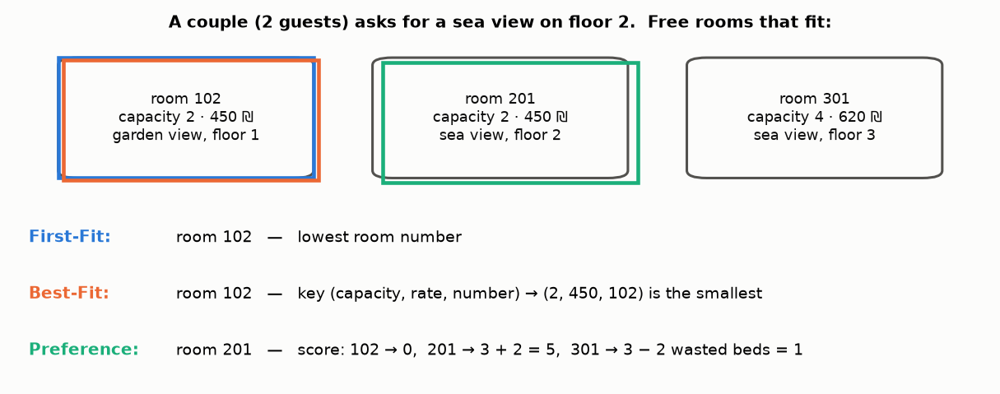
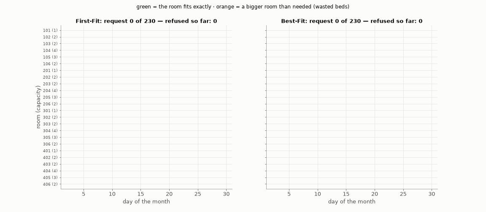
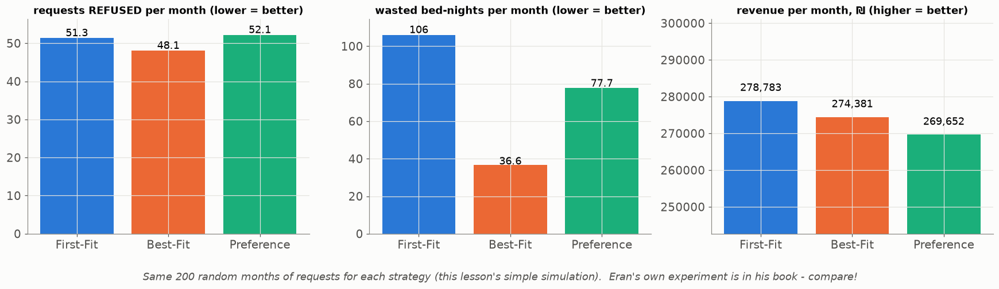
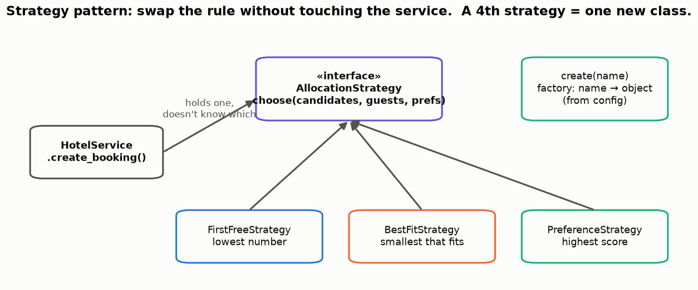

# Lesson 28 — Which free room to give? First-Fit, Best-Fit, Preference — and the Strategy pattern

> **For:** Eran (HotelManager stage 3) &nbsp;·&nbsp; **Time:** 45 min
> **Before:** Lesson 27 &nbsp;·&nbsp; **After this:** the experiment chapter of the book; Lesson 29 (pricing)

## 🎯 By the end, the student can

1. Apply the three strategies by hand to a list of free rooms (including the tie-breaks).
2. Explain why Best-Fit refuses fewer guests, with the timeline picture.
3. Read the 200-month experiment and explain why "best" depends on what you measure.
4. Explain the Strategy pattern and the factory.

---

## 1. The three rules (the guide's example)

| strategy | rule | Python |
|---|---|---|
| **First-Fit** | lowest room number | `min(cands, key=lambda r: int(r.number))` |
| **Best-Fit** | smallest capacity that fits; tie → cheaper → lower number | `min(cands, key=lambda r: (r.capacity, r.rate, int(r.number)))` |
| **Preference** | highest score: +3 view, +2 floor, +1 type, −1 per unused bed | `max(cands, key=lambda r: (score(r), -int(r.number)))` |

Two Python tricks to explain on the board:

* **A tuple as the key**: Python compares tuples left to right — capacity first, then rate, then number. The order is
  always fully decided → the same request always gets the same room → reliable tests.
* **`-int(r.number)` inside `max`**: for equal scores we want the *smallest* number, and −101 > −102.
* `int(...)`: as text, "10" < "9".

## 2. Watch a month fill up

The 24 sample rooms (capacity in brackets), the same 230 random requests, two strategies. **Green** = the room fits
exactly; **orange** = a bigger room than needed. First-Fit hands rooms 104/105 (family, suite) to couples early in the
month — later a family arrives and there's no 4-bed room left. Best-Fit keeps the big rooms for those who need them.

**Analogy — memory allocation / Tetris:** put each piece where it fits snugly, and big gaps stay free for big pieces.

## 3. The experiment — 200 simulated months

This lesson's simulation (same requests for all three):

| | refused / month | wasted bed-nights | revenue |
|---|---|---|---|
| First-Fit | 51.3 | 106 | **278,783** |
| Best-Fit | **48.1** | **37** | 274,381 |
| Preference | 52.1 | 78 | 269,652 |

Best-Fit serves the most guests and wastes the fewest beds — but **First-Fit earns the most**, because the price is per
*room*: putting a couple in a 620 ₪ family room earns more than the 450 ₪ double. Which is "best" is a business decision —
exactly the discussion Eran's book needs (the guide's own numbers say the same).

## 4. The Strategy pattern

`HotelService` holds *an* `AllocationStrategy` and calls `choose(...)` — it doesn't know which one. A factory
`create(name)` turns the name from the config into the object. Adding a fourth strategy = writing **one** class; nothing
else changes. (Open/closed principle.)

Every strategy must return **None** for an empty list — the service relies on it to say "no room available".

## 5. Misconceptions

| Student says | Truth |
|---|---|
| "Best-Fit is always best" | Best for occupancy and waste; not for revenue. Measure, then decide. |
| "Sorting all rooms first is needed" | `min`/`max` with a key is one pass: O(n). |
| "Preference ignores capacity" | The −1 per unused bed keeps it from giving the suite to everyone who wants a sea view. |
| "One random month proves it" | Luck. That's why 200 months. |

## 6. Activities

1. **Play hotel (15 min).** Cards = rooms (capacity 1, 2, 2, 4). Read requests aloud (2, 2, 4, 1, 4…). Half the class
   allocates First-Fit, half Best-Fit. Who refused fewer?
2. **Tie-breaks (5 min).** Rooms 203 (2, 450), 106 (2, 450), 104 (4, 620), guests 2 → Best-Fit? (106: same capacity and
   rate, lower number.)
3. **Design a 4th strategy (10 min).** "Fill the lowest floor first" / "cheapest first" — write the key function.

## 7. Check yourself

1. Free: 301 (cap 4, 620), 206 (cap 2, 450, sea, floor 2), 101 (cap 1). 2 guests want sea, floor 2. Each strategy?

101 doesn't fit (capacity 1). First-Fit → 206 (lowest of 206, 301). Best-Fit → 206 (capacity 2). Preference → 206: 3 + 2 −
0 = 5 vs 301: 0 + 0 − 2 = −2.

2. Why does the key use int(room.number)?

As strings, "10" < "9" (character by character). Numbers compare numerically.

3. Why must choose() return None for an empty list instead of raising?

"No free room" is a normal business outcome, not an error. The service turns None into a clear message.

## 8. In your project

| Project | Where |
|---|---|
| HotelManager | `hotelmanager/booking/allocation.py` → `FirstFreeStrategy`, `BestFitStrategy`, `PreferenceStrategy.score/choose`, `create` · `booking/availability.py` → `free_rooms` · `HotelService.create_booking` · exercises ex05–ex07 · theory `18_HotelManager/01_theory/04_allocation.md` · notebook `02_allocation.ipynb` |

## 🎬 Watch & explore

* Refactoring Guru — [The Strategy pattern](https://refactoring.guru/design-patterns/strategy) (illustrated)
* *First fit, best fit, worst fit — memory allocation* — [search on YouTube](https://www.youtube.com/results?search_query=first+fit+best+fit+worst+fit+memory+allocation)
