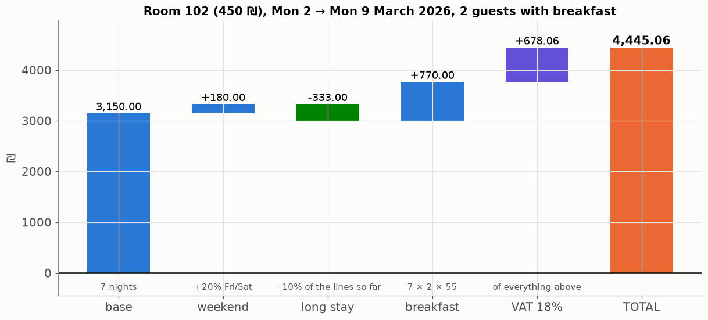
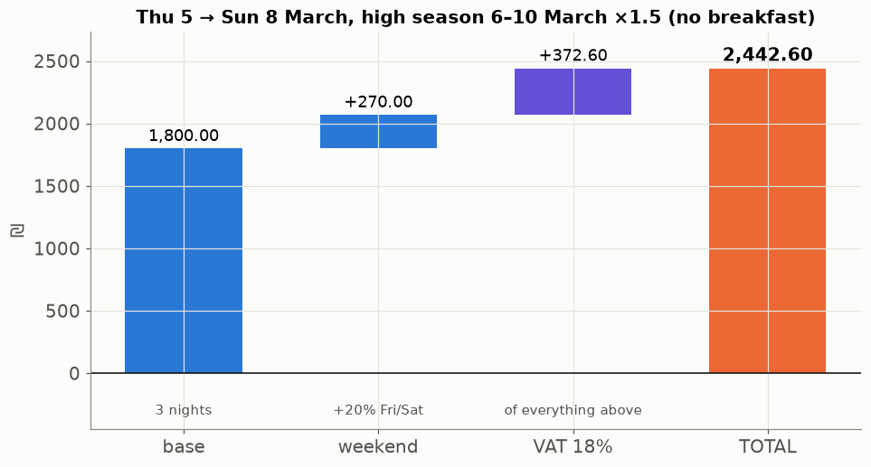
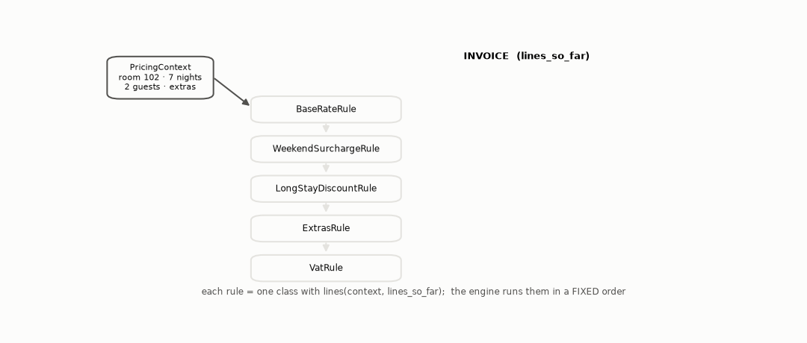
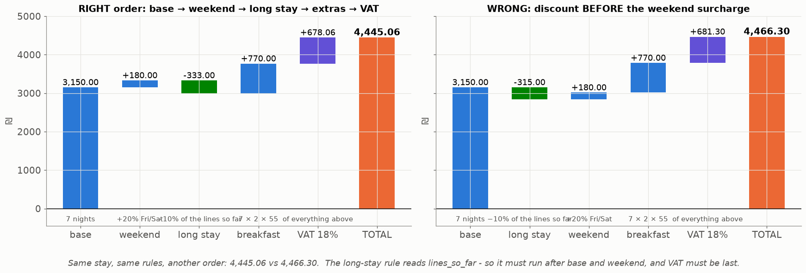

# Lesson 29 — What does the stay cost, and why? A chain of pricing rules

> **For:** Eran (HotelManager stage 4) &nbsp;·&nbsp; **Time:** 45 min
> **Before:** Lesson 27 (nights), Python classes &nbsp;·&nbsp; **After this:** Lesson 30 (the booking life cycle)

## 🎯 By the end, the student can

1. Compute the guide's invoice **4,445.06** by hand, line by line.
2. Explain the rule-chain design: each rule is a class that reads the context and the lines so far and adds lines.
3. Explain why **the order of the rules is part of the algorithm** (4,445.06 vs 4,466.30).
4. Explain the open/closed principle with "add a new discount in two minutes".

---

## 1. The invoice as a picture



Room 102 (double, 450 ₪/night), Mon 2 → Mon 9 March 2026, 2 guests, breakfast. 6 March is a Friday, 7 March a Saturday.

```
nights = 9 − 2 = 7                    (2, 3, 4, 5, 6, 7, 8 March)
1. Base         7 × 450                                 = 3,150.00
2. Weekend      2 nights (Fri 6, Sat 7) × 450 × 20%     =   180.00      room part 3,330.00
3. Long stay    7 ≥ 7 nights → −10% × 3,330.00          =  −333.00      room part 2,997.00
4. Extras       breakfast: 7 nights × 2 guests × 55     =   770.00      subtotal  3,767.00
5. VAT 18%      3,767.00 × 0.18                         =   678.06
                                                          TOTAL 4,445.06
```

With a season (Thu 5 → Sun 8 March, high season 6–10 March ×1.5, no breakfast):



Base 450 + 675 + 675 = 1,800 · weekend (675 + 675) × 20 % = 270 — **on the seasonal price** · VAT 372.60 → **2,442.60**.

`tests/test_pricing.py` asserts exactly these two numbers.

## 2. The design — a chain of rules



```
rule.lines(context, lines_so_far)  →  the lines this rule adds

engine:   lines = []
          for rule in [BaseRate, WeekendSurcharge, LongStayDiscount, Extras, Vat]:
              lines += rule.lines(context, lines)
          total = sum(line.amount for line in lines)
```

* Every rule produces **visible invoice lines** — the guest sees *why* the price is what it is.
* A discount is a **negative line**, not a hidden subtraction; the total is just the sum of the lines (never computed
  twice in two ways).
* Equal nights are grouped: "5 nights × double @ 450.00" instead of five identical lines.

## 3. The order is part of the algorithm



Long-stay reads `lines_so_far` (base + weekend) → it must come after them. VAT sums everything → it must be last. Put the
discount before the weekend surcharge and the guest pays **4,466.30** instead of 4,445.06. Say this sentence in the
defence: *"The order of the rules is part of the algorithm."*

## 4. Open / closed

Adding "returning guests −5 %" = one new class + one line in the engine's list. No other rule, test or file changes.
Complexity O(nights × rules) ≤ 30 × 5 = 150 operations.

**Money:** round each line to the agora (`round(x, 2)` in Eran's code; this lesson's script uses `Decimal` with
`ROUND_HALF_UP`, which avoids float surprises like 0.1 + 0.2 = 0.30000000000000004). Whatever you choose, round **per
line**, then sum.

## 5. Misconceptions

| Student says | Truth |
|---|---|
| "Just compute total = rate × nights × factors in one formula" | Then nobody can see why, and adding a rule means editing the formula. |
| "Order doesn't matter, addition is commutative" | The rules read the lines so far — percentages of different bases. |
| "VAT on the discount line is wrong" | VAT is on what the guest actually pays: the lines after the discount. |
| "The weekend surcharge uses the base rate" | It uses the night's (seasonal) price — 675, not 450, in high season. |

## 6. Activities

1. **Be the engine (15 min).** 5 students are the 5 rules, each with a card of its formula. Pass the "invoice" sheet down
   the row; each adds their line. Then swap students 2 and 3 and run again.
2. **New rule live (10 min).** "Children under 12 −50 % on breakfast" — where does it go in the chain, and what does it read?
3. **Check by hand (10 min).** Mon 9 → Wed 11 March, 1 guest, no breakfast, no season → 900 + 0 weekend + no discount
   + VAT 162 = 1,062.00.

## 7. Check yourself

<details><summary>1. 8 nights Sun 1 → Mon 9 March (one Friday and one Saturday), 450 ₪, no extras, no season. Total?</summary>

Base 3,600 · weekend 2 × 90 = 180 · room part 3,780 · long stay −378 → 3,402 · VAT 612.36 → **4,014.36**.
</details>

<details><summary>2. Why must the long-stay rule run after the weekend rule?</summary>

It takes 10 % of the lines so far. Run it first, and the weekend surcharge is never discounted — a different price.
</details>

<details><summary>3. Where does Friday/Saturday come from, and how would Israel's weekend be configured?</summary>

`night.weekday() in config.WEEKEND_DAYS` (Monday = 0 … Friday = 4, Saturday = 5). Another country = change one tuple in
`config.py`.
</details>

## 8. In your project

| Project | Where |
|---|---|
| HotelManager | `hotelmanager/pricing/rules.py` → `Season.contains`, `PricingContext.season_for`, `BaseRateRule`, `WeekendSurchargeRule`, `LongStayDiscountRule`, `ExtrasRule`, `VatRule` (each `.lines`) · `pricing/engine.py` → `PricingEngine.quote`, `cancellation_fee` · `models/entities.py` → `Quote.subtotal/total` · exercises ex08–ex10 · theory `18_HotelManager/01_theory/05_pricing.md` · notebook `03_pricing.ipynb` |

## 🎬 Watch & explore

* Refactoring Guru — [Chain of Responsibility](https://refactoring.guru/design-patterns/chain-of-responsibility) (a close cousin of this design)
* *Open/Closed principle (SOLID) explained* — [search on YouTube](https://www.youtube.com/results?search_query=open+closed+principle+SOLID+explained)
* Python docs — [`decimal` — decimal fixed point arithmetic](https://docs.python.org/3/library/decimal.html)
