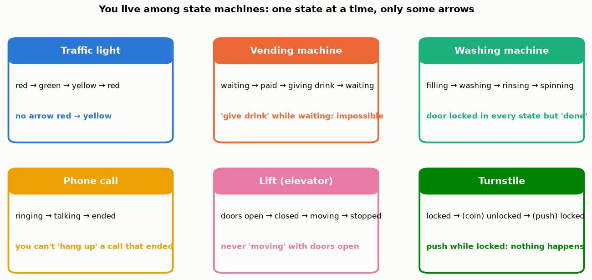
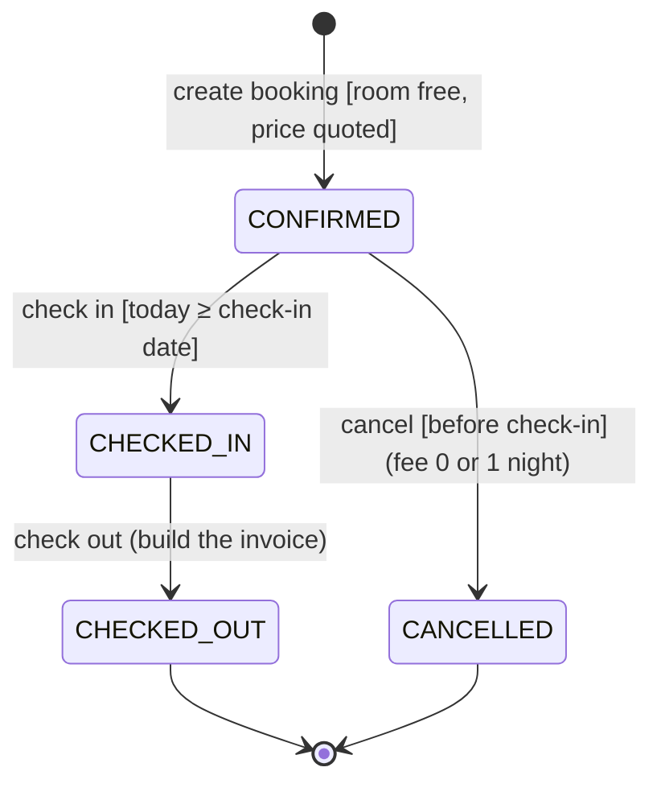
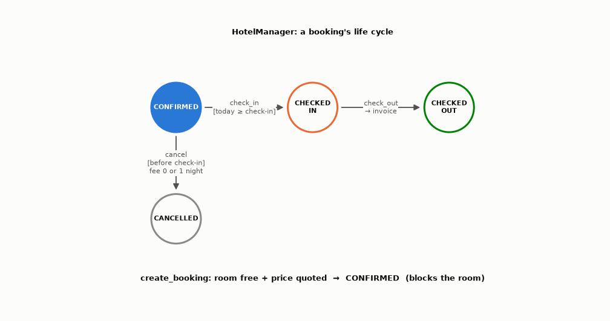
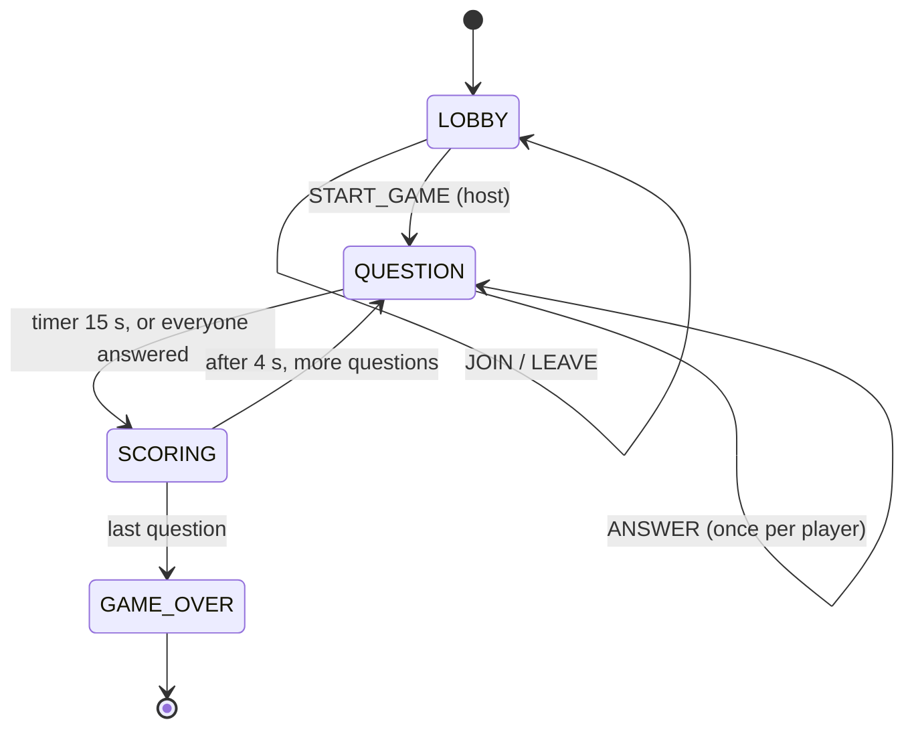
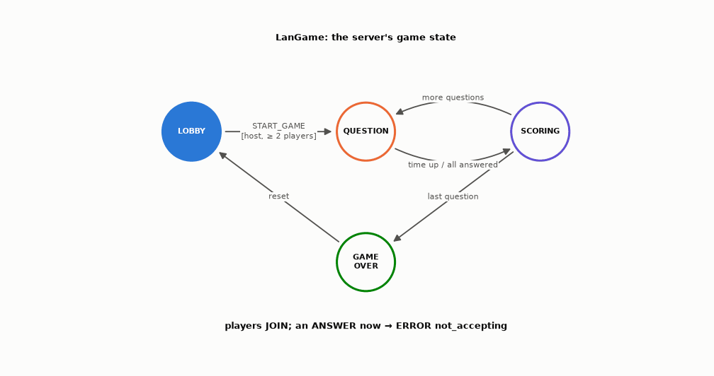
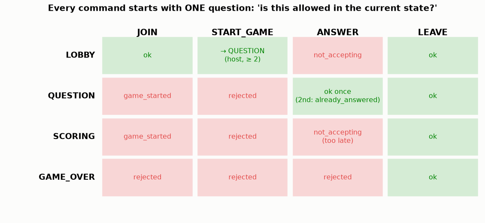
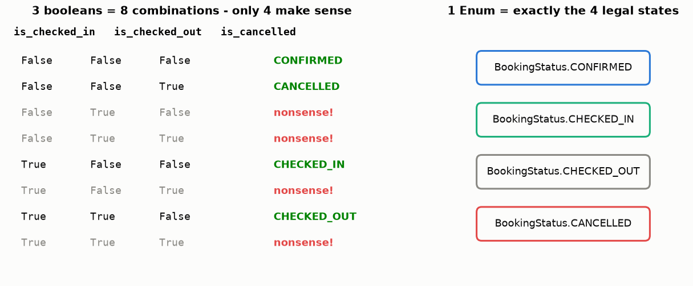
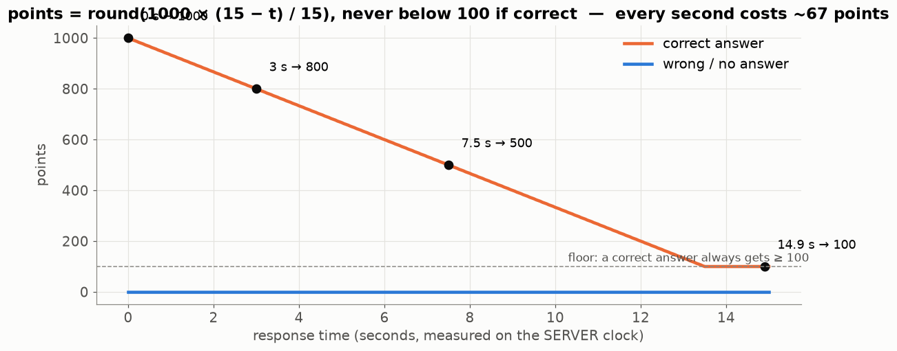

# Lesson 30 — Finite state machines: making illegal moves impossible

> **For:** Eran (the booking life cycle) · Liraz (the game server + scoring) &nbsp;·&nbsp; **Time:** 2 × 45 min
> **Before:** Python `Enum`, classes &nbsp;·&nbsp; **After this:** Lessons 32, 33

**In one sentence:** keep the program in exactly one named state at a time and allow only the arrows you drew — then
illegal actions (cancel after check-in, a late answer) are not "forgotten checks" but simply impossible.

## The story

> Two bugs, one cause.
>
> **At the hotel:** a receptionist presses "cancel" on a booking — but the guest had already **checked in** and is asleep
> in the room. The program happily cancels it and gives the room to someone else.
>
> **In Liraz's quiz game:** a player's answer arrives a split second **after** the question closed — and still gets
> points. Another player answers the same question **twice** and gets points twice.
>
> In both programs the rules were scattered `if`s, and someone forgot one. A **state machine** fixes this by design: the
> program is always in exactly **one state**, and from each state only a few **arrows** lead out. If there's no arrow, the
> action is simply impossible.

### 🌍 Real world



Traffic lights, vending machines, washing machines, lifts, phone calls, the turnstile at the train station — all are state
machines. Their designers didn't write "don't move with the doors open" as a hundred checks; they made it a state with no
such arrow.

## Words you need

| word | meaning | traffic light |
|---|---|---|
| **state** | where the program is right now — always exactly one | red |
| **event** | something that happens / is requested | the timer rings |
| **transition** | an allowed arrow from one state to another, caused by an event | red → green |
| **guard** | a condition that must be true for the arrow | "only if no pedestrian is crossing" |
| **action** | what happens while moving along the arrow | switch the lamps |
| **FSM** | finite state machine: a few states + the arrows between them | |
| **Enum** | a Python type with a fixed list of values — perfect for states | `BookingStatus.CONFIRMED` |

**The traffic light:** red → green → yellow → red. There is no arrow red → yellow. Nobody has to remember "don't go from red
to yellow" — it simply cannot happen.

---

## 1. Eran: a booking's life cycle





| from | event | guard (must be true) | action | to |
|---|---|---|---|---|
| (new) | create booking | the room is free, a price was quoted | save | CONFIRMED |
| CONFIRMED | check in | today ≥ the check-in date | stamp the time | CHECKED_IN |
| CHECKED_IN | check out | — | build the invoice (one transaction, Lesson 33) | CHECKED_OUT |
| CONFIRMED | cancel | before the check-in date | compute the fee (0 or 1 night) | CANCELLED |

**Everything else is an error with a clear reason.** The story's bug: "cancel" from CHECKED_IN → there is no such arrow →
error *"Cannot cancel: the guest has already checked in"*.

**The elegant part:** each status knows whether it **blocks the room**: CONFIRMED and CHECKED_IN do; CANCELLED and
CHECKED_OUT don't. The availability check (Lesson 27) asks only that. So cancelling frees the room **immediately**, without
deleting anything.

## 2. Liraz: the game server







Read the table: row = the current state, column = the message that arrived. Green = allowed (and where it leads), red = the
error the player gets. The story's bugs:

* An answer 10 ms after the timer closed the question: the timer already moved the state to SCORING → the cell (SCORING,
  ANSWER) is red → `ERROR not_accepting`. The server's clock decides.
* A second answer to the same question: (QUESTION, ANSWER) is "ok **once**" → `already_answered`.

## 3. A guarded transition in code

```python
def check_in(self, booking_id, today):
    booking = self._bookings.get(booking_id)
    if booking.status is not BookingStatus.CONFIRMED:                 # 1. is there an arrow from here?
        raise BookingError(f"Cannot check in: the booking is {booking.status.value}")
    if today < booking.stay.check_in:                                 # 2. the guard
        raise BookingError("Cannot check in before the arrival date")
    booking.status = BookingStatus.CHECKED_IN                         # 3. the transition
```

(A sketch — your skeleton's docstrings give the exact names and messages.) Every command has the same three steps.

### Booleans or an Enum?



With three booleans, half of the combinations are nonsense — and some bug will eventually create one ("checked out but never
checked in"). An `Enum` has **only** the legal states.

## 4. Why it makes the program correct and testable

* **Impossible situations are impossible:** an answer can't be scored twice — scoring happens only on the QUESTION →
  SCORING arrow, which happens once per question.
* **Testing is easy:** put the engine in a state, send an event, check the new state and the reply. No network, no window.
* **The diagram in the book *is* the code:** every circle is an `Enum` value, every arrow a method.

## 5. Liraz: time-based scoring



```
points = round(1000 × (15 − t) / 15)       t = seconds the player took (measured by the SERVER)
never below 100 for a correct answer;  wrong or no answer → 0
```

Step by step:

```
t = 0 s:     (15 − 0) / 15 = 1.0     × 1000 = 1000
t = 3 s:     (15 − 3) / 15 = 0.8     × 1000 =  800
t = 7.5 s:   7.5 / 15      = 0.5     × 1000 =  500
t = 14.9 s:  0.1 / 15      = 0.0067  × 1000 =    7  → raised to the minimum 100
```

Every second costs about 1000 / 15 ≈ 67 points. The minimum of 100 makes sure a slow correct answer still beats a wrong one.
`t` is limited to 0 … 15 so a late answer that slipped through can't give negative points.

**Leaderboard:** sort by score, highest first; on equal scores sort by **name**, so tied players don't swap places between
broadcasts.

## 🧪 Worked example: a tiny booking FSM and the scoring function

```python
from enum import Enum

class Status(Enum):
    CONFIRMED = "confirmed"
    CHECKED_IN = "checked in"
    CHECKED_OUT = "checked out"
    CANCELLED = "cancelled"

    @property
    def blocks_room(self):
        return self in (Status.CONFIRMED, Status.CHECKED_IN)

ARROWS = {(Status.CONFIRMED, "check_in"): Status.CHECKED_IN,
          (Status.CHECKED_IN, "check_out"): Status.CHECKED_OUT,
          (Status.CONFIRMED, "cancel"): Status.CANCELLED}

def fire(state, event):
    if (state, event) not in ARROWS:
        raise ValueError(f"Cannot {event.replace('_', ' ')}: the booking is {state.value}")
    return ARROWS[(state, event)]

s = fire(Status.CONFIRMED, "check_in")
print(s, s.blocks_room)                          # Status.CHECKED_IN True
try:
    fire(s, "cancel")
except ValueError as e:
    print(e)                                     # Cannot cancel: the booking is checked in

def points_for(t, correct, limit=15):
    if not correct:
        return 0
    t = min(max(t, 0), limit)
    return max(100, round(1000 * (limit - t) / limit))

print([points_for(t, True) for t in (0, 3, 7.5, 13.2, 14.9)], points_for(2, False))   # [1000, 800, 500, 120, 100] 0
```

## 6. Common mistakes

| student says | the truth |
|---|---|
| "I'll use booleans: is_started, is_finished …" | 3 booleans = 8 combinations, most of them nonsense ("finished but not started"). An Enum has exactly the legal states. |
| "Cancel = delete the row" | Change the state; history and invoices stay. |
| "The client knows when time is up" | The server decides; client clocks differ and can cheat. |
| "Errors for illegal moves are rude" | They're the point: a clear reason ("already checked in") instead of silent damage. |

## 📝 Summary

> * A **state machine**: one state at a time (an `Enum`), arrows = allowed **transitions**, **guards** = conditions.
> * No arrow → the action is impossible → a clear error message.
> * Eran: CONFIRMED → CHECKED_IN → CHECKED_OUT, or CONFIRMED → CANCELLED; `blocks_room` drives availability.
> * Liraz: LOBBY → QUESTION ⇄ SCORING → GAME_OVER; the **server's** timer moves the state.
> * Score = round(1000 × (15 − t) / 15), at least 100 if correct, 0 if wrong; ties on the leaderboard sorted by name.

## 7. Activities

1. **Human FSM (10 min).** Students hold state cards. The teacher calls events; the "current state" student passes the token
   along an arrow — or shouts the error.
2. **Fill the table (10 min).** Eran: 4 states × 3 events (check in / check out / cancel) — which cells are errors, and what
   does each error message say?
3. **Score by hand (5 min).** Correct at 1.5 s, 6 s, 12 s; wrong at 2 s.

## 8. Do it yourself

<details><summary>1. A booking is CHECKED_OUT. The receptionist presses "cancel".</summary>

Error — no arrow leaves CHECKED_OUT. The message says the stay already ended. Nothing changes.
</details>

<details><summary>2. Activity 3: the points.</summary>

1.5 s → 13.5/15 × 1000 = **900** · 6 s → **600** · 12 s → **200** · wrong → **0**.
</details>

<details><summary>3. Correct at 13.2 s. Points?</summary>

1.8 / 15 × 1000 = **120** (above the minimum).
</details>

## 9. In your project

| Project | Where |
|---|---|
| HotelManager | `hotelmanager/models/entities.py` → `BookingStatus.blocks_room`, `Booking.occupies` · `booking/hotel_service.py` → `create_booking`, `check_in`, `check_out`, `cancel` · `PricingEngine.cancellation_fee` · exercises ex11–ex13 · theory `18_HotelManager/01_theory/06_fsm.md` · notebook `04_state_machine.ipynb` |
| LanGame | `langame/server/game_engine.py` → `start_game`, `next_question`, `record_answer`, `close_question`, `end_game` · `server/score_engine.py` → `points_for`, `score_round` · `common/models.py` → `build_leaderboard` · theory `05_LanGame/01_theory/05_state_machine_scoring.md` · notebook `03_game_engine.ipynb` |

## 🎬 Watch & explore

| | |
|---|---|
| <a href="https://www.youtube.com/watch?v=vhiiia1_hC4"></a> | **Computerphile — Computers Without Memory**. Finite state machines explained with a turnstile-like example. |

**Read more:**
* Refactoring Guru — [The State pattern](https://refactoring.guru/design-patterns/state)
* Game Programming Patterns — [State](https://gameprogrammingpatterns.com/state.html)
