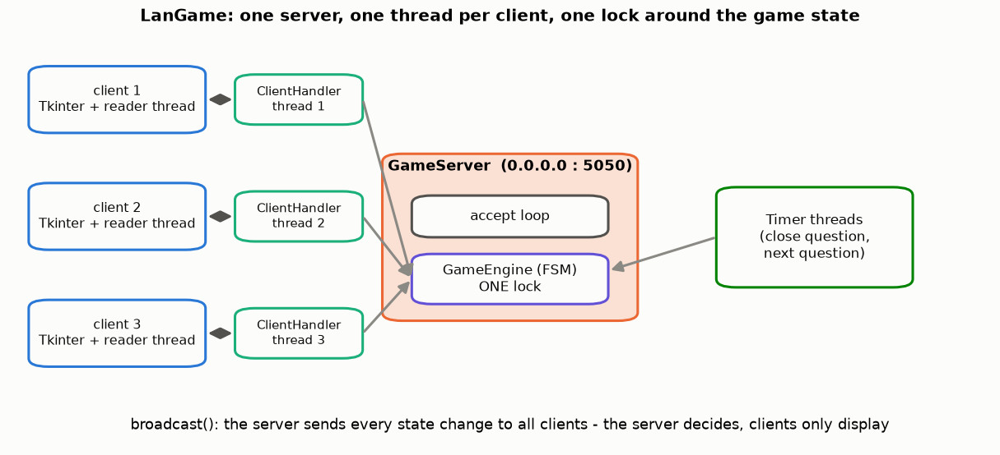
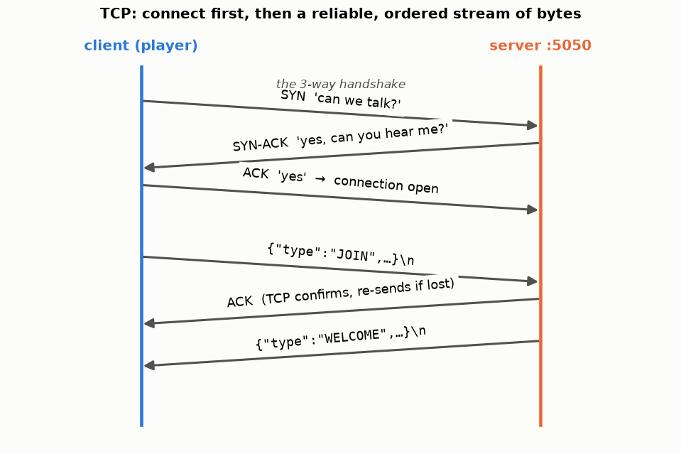
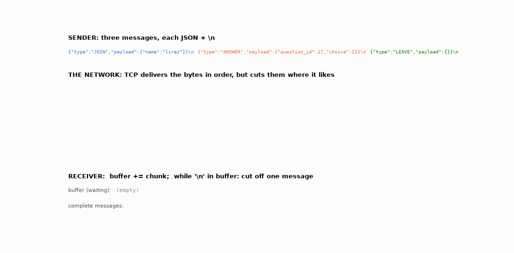
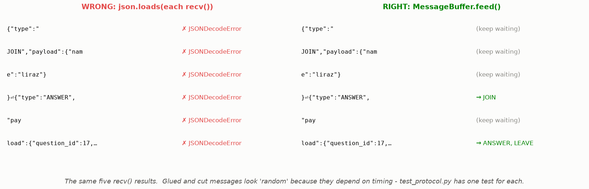

# Lesson 31 — TCP is a stream: sockets, the protocol and message framing

> **For:** Liraz (LanGame stages 1–2) &nbsp;·&nbsp; **Time:** 45 – 60 min
> **Before:** Python bytes/str, JSON &nbsp;·&nbsp; **After this:** Lesson 32 (threads), Lesson 30 (the game FSM)

## 🎯 By the end, the student can

1. Explain client/server, IP address and port, and the TCP handshake with a sequence diagram.
2. Explain **why TCP glues and cuts messages**, and show it happening on a real socket.
3. Write the newline-framing receiver (`buffer += chunk; while "\n" in buffer: …`).
4. Explain the protocol design (`type` + `payload`, one JSON per line) and "never trust the other side".

---

## 1. The architecture



The **server** listens on a port (5050) and is the authority: it holds the game state and the clock, and **broadcasts**
every change. **Clients** only send requests (JOIN, ANSWER…) and display what the server says.

## 2. Connecting — the handshake



**TCP** first opens a connection (SYN, SYN-ACK, ACK), then guarantees that bytes arrive **complete and in order**,
re-sending lost packets. **UDP** guarantees nothing — fine for video, wrong for "who answered first".

## 3. The most important idea: TCP is a stream of bytes



TCP doesn't send "messages" — it sends bytes, like water through a pipe. The receiver's `recv()` gets **whatever has
arrived**: half a message, or two and a half glued together. TCP promises the bytes, not where the cuts are.

**Framing** = marking where each message ends. LanGame uses a **delimiter**: `\n` after every JSON message (JSON never
contains a raw newline, so it can't appear inside one). The other common way is a **length prefix**.

```python
class MessageBuffer:
    def feed(self, chunk: bytes) -> list:
        self._pending += chunk                          # 1. append
        if len(self._pending) > MAX_MESSAGE_BYTES:      # 2. never trust the other side
            raise ProtocolError("too_large", ...)
        *complete, self._pending = self._pending.split(b"\n")   # 3. the LAST piece is incomplete: keep it
        return [decode(line) for line in complete if line]      # 4. every complete line → a Message
```

(A sketch — follow the TODO steps in your `protocol.py`.)



### See it for real

```bash
cd lessons/31_tcp_framing
python demo_socket.py            # json.loads on each recv() -> 3 failures
python demo_socket.py --framed   # the buffer -> JOIN, ANSWER, LEAVE
```

## 4. The protocol

```
{"type": "ANSWER", "payload": {"question_id": 17, "choice": 2}}\n
```

* `type` — one of a fixed list (`MessageType`); the receiver switches on it.
* `payload` — a dict whose keys depend on the type.
* JSON: readable in Wireshark and in logs; every language parses it; adding a field doesn't break old clients.
* The QUESTION message **never contains the correct answer** — a curious player with Wireshark would see it.

**Never trust the other side:** a malicious or buggy client can send 10 MB without a newline (→ `too_large`), invalid
JSON, an unknown type, `choice: 7`. Each becomes an `ERROR` reply — the server never crashes.

## 5. Misconceptions

| Student says | Truth |
|---|---|
| "One `send()` = one `recv()`" | Only by luck on localhost. On a real network, never assume it. |
| "It works on my computer, so it's fine" | Localhost rarely cuts messages; the classroom Wi-Fi will. Test with the demo. |
| "`recv(4096)` returns 4096 bytes" | It returns *up to* 4096 — whatever has arrived. 0 bytes = the other side closed. |
| "Put the correct answer in QUESTION, the client won't show it" | Anyone can read the bytes. |

## 6. Activities

1. **Paper pipe (10 min).** Write 3 messages on a paper strip with `⏎` marks; cut it at random places with scissors; hand
   the pieces one by one to a "receiver" student who must rebuild the messages using only a buffer and the `⏎`.
2. **Run the demo (5 min)** — both modes; then change the cut points in `sender()`.
3. **Wireshark (15 min).** Capture `tcp.port == 5050` while two clients play; find the QUESTION message and confirm it has
   no correct answer.

## 7. Check yourself

<details><summary>1. The buffer holds `{"type":"JO` and the next chunk is `IN","payload":{}}\n{"ty`. What does feed() return and keep?</summary>

Returns one message (JOIN); keeps `{"ty` in the buffer for the next chunk.
</details>

<details><summary>2. Why is a newline a safe delimiter for JSON messages?</summary>

`json.dumps` escapes newlines inside strings as `\n` (two characters), so a raw newline byte never appears inside a
message.
</details>

<details><summary>3. Why does the server enforce MAX_MESSAGE_BYTES?</summary>

A client that never sends `\n` would make the buffer grow forever — a memory attack. Over 64 KB → error and disconnect.
</details>

## 8. In your project

| Project | Where |
|---|---|
| LanGame | `langame/common/protocol.py` → `Message.to_wire`, `Message.from_wire`, `MessageBuffer.feed` · `server/client_handler.py` → `ClientHandler.run`, `send` · `server/game_server.py` → `serve_forever`, `broadcast` · `client/network_client.py` → `_reader_loop`, `send` · config `SERVER_PORT = 5050`, `MAX_MESSAGE_BYTES` · theory `05_LanGame/01_theory/02_networks.md`, `03_sockets_protocol.md` · notebooks `01_tcp_stream_and_framing.ipynb`, `04_mini_server.ipynb` |

## 🎬 Watch & explore

* *TCP vs UDP explained* / *TCP 3-way handshake* — [search on YouTube](https://www.youtube.com/results?search_query=TCP+3+way+handshake+explained)
* Python docs — [Socket Programming HOWTO](https://docs.python.org/3/howto/sockets.html) (read "Using a Socket": it says exactly this)
* Wireshark — [download and user guide](https://www.wireshark.org/docs/wsug_html_chunked/)
